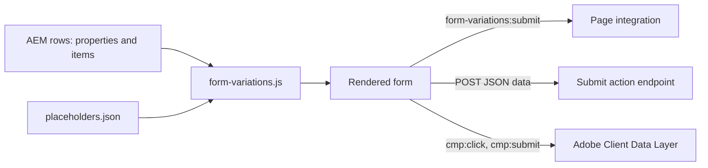
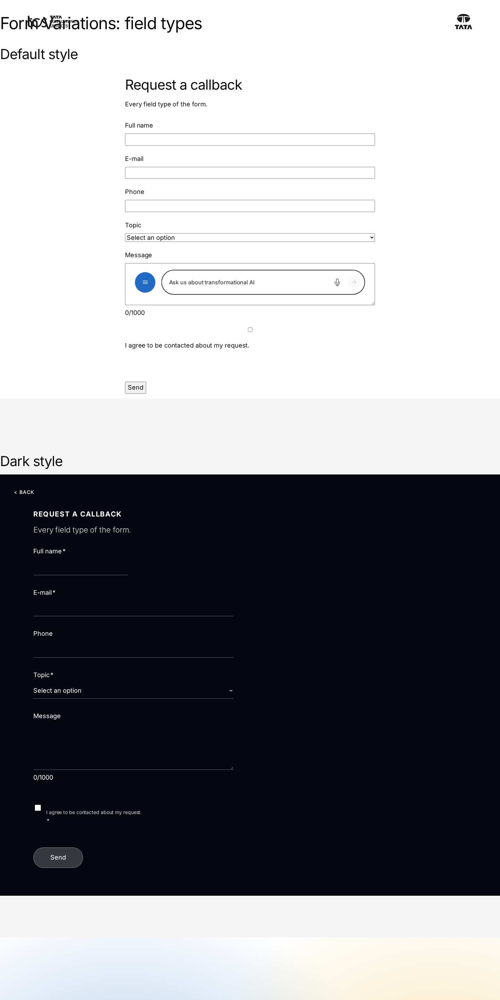
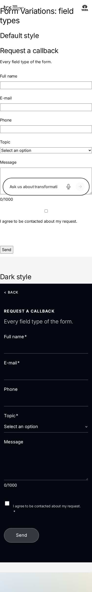
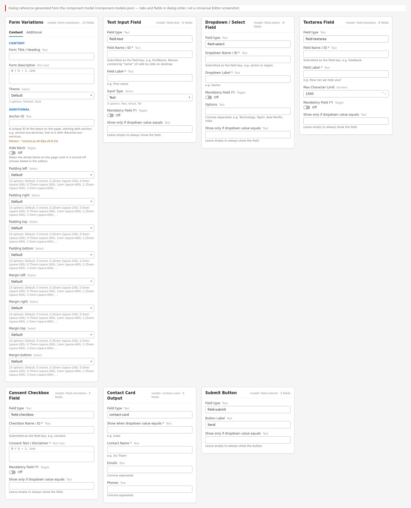

# Form Variations Block — Developer Guide

| Attribute | Value |
| --- | --- |
| Document ID | DEV-B-form-variations |
| Audience | Developers, technical leads, block owners, AI coding agents |
| Purpose | How the Form Variations block is built: files, model, structure, behaviour, variations, tests and limitations |
| Scope | blocks/form-variations/ and its components form-variations, field-text, field-select, field-combined, field-textarea, field-checkbox, contact-card, field-submit |
| Prerequisites | — |
| Owner | Technical Lead / Block Owner (proposed) |
| Approver | Product Owner (to be confirmed) |
| Version | 1.0 |
| Status | Draft for review |
| Last updated | 8 November 2026 |
| Last validated | 2026-11-08 (model, files, imports from the code; reference pages from the live site) |
| Source files | blocks/form-variations/README.md, blocks/form-variations/_form-variations.json, blocks/form-variations/form-variations.css, blocks/form-variations/form-variations.js |
| Related documents | [Variations](./FORM-VARIATIONS-VARIATIONS.md), [Test coverage](./FORM-VARIATIONS-TEST-COVERAGE.md), [Authoring guide](../../../03-authoring/components/form-variations/FORM-VARIATIONS-AUTHORING-GUIDE.md) |
| Related AEM paths | /content/tcs-corp/design-block-master/en/block-library/form-variations, /content/tcs-corp/design-block-master/en/block-library/form-variations/field-types, /content/tcs-corp/design-block-master/en/block-library/form-variations/form-variations |

## Contents

- [Summary](#summary)
- [Overview](#overview)
- [Source files](#source-files)
- [Components, models and filters](#components-models-and-filters)
- [Fields](#fields)
- [Dependencies](#dependencies)
- [For Developers](#for-developers)
- [Extending the Block](#extending-the-block)
- [Responsive Behavior](#responsive-behavior)
- [Accessibility](#accessibility)
- [Data Layer and Analytics](#data-layer-and-analytics)
- [Performance Considerations](#performance-considerations)
- [Security and Privacy](#security-and-privacy)
- [For Architects](#for-architects)
- [Troubleshooting](#troubleshooting)
- [Known limitations of the block](#known-limitations-of-the-block)
- [Change history of the block](#change-history-of-the-block)
- [Reference pages](#reference-pages)
- [Coverage of the required topics](#coverage-of-the-required-topics)
- [Screenshots](#screenshots)
- [Known limitations](#known-limitations)
- [Open items](#open-items)
- [Change history](#change-history)

## Summary

| Attribute | Value |
| --- | --- |
| Block | Form Variations |
| Folder | `blocks/form-variations` |
| Type | Container |
| Category | interactive |
| Status | Active |
| Purpose | Forms (contact, download, subscribe) built from field items |
| Variations (summary) | Form variations and field items |
| Children | field-text, field-select, field-textarea, field-checkbox, contact-card, field-submit |
| Code size | 740 lines of JS and CSS |

## Overview

**Business purpose.** Authors create contact, enquiry, call-back and feedback forms without developer work, with consistent TCS styling, accessible labels and errors, and conditional content (for example a Region dropdown that reveals the matching regional contact card).

**User experience.** The visitor sees an optional H2 title and description, a "* Required fields" note when any field is mandatory, the fields in authored order (fields whose Field Name / ID contains "name" side by side on desktop), and a primary submit button. Errors are validated on submit and shown under each invalid field; a status message below the form reports the outcome.

**Templates and page types.** Any page: the block is in the Section, Columns Container and Tabs Container filters. No template adds it automatically. It can be reused through a Fragment, or shown in a pop-up through a Modal (the block library has a `block-library/modal/fragments/contact-form` page).

**Data source.** Authored content only. The block reads no query index, metadata, tags or data sheets; UI texts come from the locale's placeholders sheet.

**Related blocks.** Conversation Canvas ([README](https://github.com/sradha-tcs/tcs-corp/blob/main/blocks/conversation-canvas/README.md)) for search / question entry points (not data capture); Columns Container ([README](https://github.com/sradha-tcs/tcs-corp/blob/main/blocks/columns-container/README.md)) to place a form next to other content; Modal and Fragment for reuse.

**When to use.**

- A short form of simple fields (text, email, phone, dropdown, long text, one consent checkbox) whose data is handled by a connected endpoint or page integration.
- Contact details that change with a visitor's choice (contact cards).

**When not to use.**

- For live data capture while no Submit action and no integration exists: visitors are told "This form isn’t connected yet: your details weren’t sent."
- For file uploads, date pickers, radio groups, multi-select, number fields, checkbox groups, multi-step forms, CAPTCHA or server-side validation: no verified implementation of these was identified.
- For content without input (use Teaser, Cards or default content).

**Realistic use cases.** "Contact us" with Region, names, email, message and consent; "Request a call back" with names and email; "Share your feedback" with a 1500-character message; "Talk to our experts" on a dark panel with a regional contact card.

## Source files

| File | Link |
| --- | --- |
| `README.md` | [GitHub](https://github.com/sradha-tcs/tcs-corp/blob/main/blocks/form-variations/README.md) |
| `_form-variations.json` | [GitHub](https://github.com/sradha-tcs/tcs-corp/blob/main/blocks/form-variations/_form-variations.json) |
| `form-variations.css` | [GitHub](https://github.com/sradha-tcs/tcs-corp/blob/main/blocks/form-variations/form-variations.css) |
| `form-variations.js` | [GitHub](https://github.com/sradha-tcs/tcs-corp/blob/main/blocks/form-variations/form-variations.js) |

## Components, models and filters

| Component | Title | Resource type | Template name | Model | Children allowed |
| --- | --- | --- | --- | --- | --- |
| `form-variations` | Form Variations | `core/franklin/components/block/v1/block` | Form Variations | `form-variations` | field-text, field-select, field-combined, field-textarea, field-checkbox, contact-card, field-submit |
| `field-text` | Text Input Field | `core/franklin/components/block/v1/block/item` | Text Input Field | `field-text` | — |
| `field-select` | Dropdown / Select Field | `core/franklin/components/block/v1/block/item` | Dropdown / Select Field | `field-select` | — |
| `field-combined` | Combined Input Field | `core/franklin/components/block/v1/block/item` | Combined Input Field | `field-combined` | — |
| `field-textarea` | Textarea Field | `core/franklin/components/block/v1/block/item` | Textarea Field | `field-textarea` | — |
| `field-checkbox` | Consent Checkbox Field | `core/franklin/components/block/v1/block/item` | Consent Checkbox Field | `field-checkbox` | — |
| `contact-card` | Contact Card Output | `core/franklin/components/block/v1/block/item` | Contact Card Output | `contact-card` | — |
| `field-submit` | Submit Button | `core/franklin/components/block/v1/block/item` | Submit Button | `field-submit` | — |

## Fields

The Additional tab fields (anchor, hide, padding, margin, animation) are common to the blocks and described in the [content modeling guide](../../markdown/CONTENT-MODELING-GUIDE.md).

### Form Variations (`form-variations`)

| Tab | Label | Property | Type | Required in model | Default | Options | Visibility |
| --- | --- | --- | --- | --- | --- | --- | --- |
| Content | Form Title / Heading | `formHeading` | text | No | — | — | — |
| Content | Form Description | `formDescription` | richtext | No | `""` | — | — |
| Content | Submit action | `formAction` | aem-content | No | — | — | — |
| Content | Theme | `classes` | select | No | `""` | 2 options | — |

### Text Input Field (`field-text`)

| Tab | Label | Property | Type | Required in model | Default | Options | Visibility |
| --- | --- | --- | --- | --- | --- | --- | --- |
| — | Field type | `classes` | text | No | `field-text` | — | — |
| — | Field Name / ID | `fieldName` | text | Yes | — | — | — |
| — | Field Label | `label` | text | Yes | — | — | — |
| — | Input Type | `inputKind` | select | No | `text` | 3 options | — |
| — | Mandatory Field (*) | `required` | boolean | No | `false` | — | — |
| — | Show only if dropdown value equals | `dependsOn` | text | No | — | — | — |

### Dropdown / Select Field (`field-select`)

| Tab | Label | Property | Type | Required in model | Default | Options | Visibility |
| --- | --- | --- | --- | --- | --- | --- | --- |
| — | Field type | `classes` | text | No | `field-select` | — | — |
| — | Dropdown Name / ID | `fieldName` | text | Yes | — | — | — |
| — | Dropdown Label | `label` | text | Yes | — | — | — |
| — | Mandatory Field (*) | `required` | boolean | No | `false` | — | — |
| — | Options | `options` | text | No | — | — | — |
| — | Show only if dropdown value equals | `dependsOn` | text | No | — | — | — |

### Combined Input Field (`field-combined`)

| Tab | Label | Property | Type | Required in model | Default | Options | Visibility |
| --- | --- | --- | --- | --- | --- | --- | --- |
| — | Field type | `classes` | text | No | `field-combined` | — | — |
| — | Field Name / ID | `fieldName` | text | Yes | — | — | — |
| — | Mandatory Field (*) | `required` | boolean | No | `false` | — | — |
| — | Show only if dropdown value equals | `dependsOn` | text | No | — | — | — |

### Textarea Field (`field-textarea`)

| Tab | Label | Property | Type | Required in model | Default | Options | Visibility |
| --- | --- | --- | --- | --- | --- | --- | --- |
| — | Field type | `classes` | text | No | `field-textarea` | — | — |
| — | Field Name / ID | `fieldName` | text | Yes | — | — | — |
| — | Field Label | `label` | text | Yes | — | — | — |
| — | Max Character Limit | `maxLength` | number | No | `1500` | — | — |
| — | Mandatory Field (*) | `required` | boolean | No | `false` | — | — |
| — | Show only if dropdown value equals | `dependsOn` | text | No | — | — | — |

### Consent Checkbox Field (`field-checkbox`)

| Tab | Label | Property | Type | Required in model | Default | Options | Visibility |
| --- | --- | --- | --- | --- | --- | --- | --- |
| — | Field type | `classes` | text | No | `field-checkbox` | — | — |
| — | Checkbox Name / ID | `fieldName` | text | Yes | — | — | — |
| — | Consent Text / Disclaimer | `label` | richtext | Yes | — | — | — |
| — | Mandatory Field (*) | `required` | boolean | No | `true` | — | — |
| — | Show only if dropdown value equals | `dependsOn` | text | No | — | — | — |

### Contact Card Output (`contact-card`)

| Tab | Label | Property | Type | Required in model | Default | Options | Visibility |
| --- | --- | --- | --- | --- | --- | --- | --- |
| — | Field type | `classes` | text | No | `contact-card` | — | — |
| — | Show when dropdown value equals | `region` | text | Yes | — | — | — |
| — | Contact Name | `contactName` | text | Yes | — | — | — |
| — | Emails | `emails` | text | No | — | — | — |
| — | Phones | `phones` | text | No | — | — | — |

### Submit Button (`field-submit`)

| Tab | Label | Property | Type | Required in model | Default | Options | Visibility |
| --- | --- | --- | --- | --- | --- | --- | --- |
| — | Field type | `classes` | text | No | `field-submit` | — | — |
| — | Button Label | `label` | text | No | `Send` | — | — |
| — | Show only if dropdown value equals | `dependsOn` | text | No | — | — | — |

"Required in model" is the model's `required` flag; whether a field is required in practice is stated in the authoring guide where it is known.

## Dependencies

| Import |
| --- |
| `../../scripts/scripts.js` |
| `../../decorators/button-decorator.js` |
| `../../decorators/content-decorator.js` |
| `../../decorators/heading-decorator.js` |
| `../../utils/environment.js` |
| `../../utils/links.js` |
| `../../utils/properties.js` |
| `../../utils/ids.js` |
| `../../utils/placeholders.js` |

## For Developers

<!-- BEGIN GENERATED: files (npm run build:docs) -->

```text
blocks/form-variations/
├── README.md
├── _form-variations.json
├── form-variations.css
└── form-variations.js
```

| Decorator/Utility | Purpose | Execution or dependency point |
| ----------------- | ------- | ----------------------------- |
| [`scripts/scripts.js`](https://github.com/sradha-tcs/tcs-corp/blob/main/scripts/scripts.js) | Page decoration (moveInstrumentation and shared page helpers) | `form-variations.js`: { moveInstrumentation } |
| [`decorators/content-decorator.js`](https://github.com/sradha-tcs/tcs-corp/blob/main/decorators/content-decorator.js) | `fromCell` (property content into an element, keeping editor instrumentation) | `form-variations.js`: { fromCell } |
| [`decorators/heading-decorator.js`](https://github.com/sradha-tcs/tcs-corp/blob/main/decorators/heading-decorator.js) | `buildHeading` (Title + Title Type), `HEADINGS` | `form-variations.js`: { buildHeading } |
| [`utils/environment.js`](https://github.com/sradha-tcs/tcs-corp/blob/main/utils/environment.js) | `prefersReducedMotion`, `scrollBehavior`, `isEditing`, `isInEditor`, `isAuthor` (the page is rendered by AEM author, which has no query index) | `form-variations.js`: { isInEditor } |
| [`utils/links.js`](https://github.com/sradha-tcs/tcs-corp/blob/main/utils/links.js) | `NEW_WINDOW`, `linkOf`, `linkPathsOf` (the paths of a page property, one or many), `readLinkItems` (CTA lists with Link Type and the items' other select values), `readLinkRows` (the same from link item rows, e.g. Hero CT | `form-variations.js`: { linkOf } |
| [`utils/properties.js`](https://github.com/sradha-tcs/tcs-corp/blob/main/utils/properties.js) | `readProperties`, `textOf`, `isOn`, `isOnByDefault` (a toggle that defaults to on), `optionOf`, `normalizeKey`, `textSource` (key-value block properties) | `form-variations.js`: { textOf } |
| [`utils/ids.js`](https://github.com/sradha-tcs/tcs-corp/blob/main/utils/ids.js) | `nextInstance`, `uniqueId`, `createIdFactory` (unique ids per block instance), `availableId` (an authored id kept, suffixed -2, -3, ... only when taken) | `form-variations.js`: { createIdFactory, uniqueId } |
| [`utils/placeholders.js`](https://github.com/sradha-tcs/tcs-corp/blob/main/utils/placeholders.js) | `getPlaceholders`, `loadPlaceholders`, `fillPlaceholder` (UI text from the locale's placeholders, with English fallbacks) | `form-variations.js`: { fillPlaceholder, getPlaceholders } |

<!-- END GENERATED: files -->

**Responsibilities.** `form-variations.js` reads the rows, builds the form, validates, handles conditional visibility and the submission. `form-variations.css` styles both themes, the grid, errors, counter, contact cards and the editor notes.

**Input DOM (what AEM delivers).** Not a key-value block: the first rows are the block properties, with an empty row for each dialog tab (Content first, Additional last) around Form Title / Heading, Form Description and Submit action; Theme and the Additional tab arrive as block classes. Then one row per item: the first cell is `<node name>, <classes>` (e.g. `email, field-text`), followed by one cell per field in model order. `readProperties` uses `data-aue-prop` in the editor, else skips the leading empty tab row; `readItem` takes the type from the first cell (or `data-aue-model` in the editor), uses the `fieldName` cell when the row has all cells of the current model (`FIELD_COUNT`) and otherwise the legacy key from the node name. Item cells are read by position (handover open question O-18).

**Rendered DOM contract.**

```html
<div class="form-variations block [dark]">
  <div class="form-variations-header"><h2 class="form-variations-title" id="form-variations-1-title">…</h2><div class="form-variations-description">…</div></div>
  <form class="form-variations-form" novalidate aria-labelledby="form-variations-1-title">
    <p class="form-variations-required-note">* Required fields</p>
    <div class="form-variations-group field-text half-width">label, input.form-variations-control</div>
    <div class="form-variations-group form-variations-contact-card full-width" data-depends-on="India" hidden>…</div>
    <div class="form-variations-group field-submit full-width"><button type="submit" class="button primary">Send</button></div>
  </form>
  <p class="form-variations-status" role="status" tabindex="-1"></p>
</div>
```

Ids come from `createIdFactory(uniqueId('form-variations'))`: `form-variations-{n}-{name in class-name form}`, de-duplicated with `-2`, `-3`. Mandatory controls carry `data-required="true"` so `updateVisibility` can restore `required`.

**Decoration flow.** `getPlaceholders()` (awaited first) → rows to properties and items → `BUILDERS[type]` per item, `moveInstrumentation` from the row → editor condition notes → header (`buildHeading`, `fromCell`) → required note → listeners (`change` on selects, `input`, `submit`) → editor "No Submit action" note → `block.replaceChildren(header, form, status)` → `updateVisibility`.

**Submission (events and async behavior).**

1. `submit` is prevented; a second submit while `aria-busy="true"` is ignored.
2. `validate(form)`: errors and focus; stop when invalid.
3. `collectData(form)`: `FormData` of the enabled controls; repeated names become arrays.
4. A bubbling, cancelable `form-variations:submit` `CustomEvent` is dispatched on the block with `detail: { data, respondWith(promise) }`.
5. An integration that handles it calls `preventDefault()` and may call `detail.respondWith(promise)`. The block awaits the promise: resolved (or no promise given) → reset, counters and visibility updated, `formSuccess`; rejected → `formError`, values kept.
6. Not handled and no Submit action → `formNotConnected` ("This form isn’t connected yet: your details weren’t sent."), values kept, no request.
7. Not handled with a Submit action → `fetch(action, { method: 'POST', headers: { 'Content-Type': 'application/json' }, body: JSON.stringify({ data }) })` with `aria-busy` / `aria-disabled` set; `response.ok` → success, otherwise or on a network error → `formError`.
8. The status message receives focus.

```js
document.addEventListener('form-variations:submit', (e) => {
  e.preventDefault(); // the integration handles the data
  e.detail.respondWith(sendToBackEnd(e.detail.data)); // rejected: "couldn’t be sent"
});
```

**Exported functions.** `default decorate(block)`, `readItem(row)` (`{ type, cells }`), `readProperties(cells)` (`{ titleCell, descriptionCell, actionCell }`).

**Parent / child contracts.** The filter `form-variations` allows the six item components; each item definition stores its type in the read-only `classes` field (template value), which is how the published row is recognised.

**Data-layer hooks.** None in the block; see Data Layer and Analytics.

## Extending the Block

1. **A new field or option** in an item model: edit `_form-variations.json` (model, and the definition template only for type values, never sample content), run `npm run build:json` and `npm run lint`. Item cells are positional: append new fields at the end of the model, update `FIELD_COUNT` for keyed types and the destructuring in the builder, and keep reading rows with fewer cells (content authored before).
2. **A new item type:** add a definition with a `classes` template value, a model whose first field is the read-only `classes`, the id to the filter, the type to `ITEM_TYPES` (and `KEYED_TYPES` / `FIELD_COUNT` / `TEMPLATE_NAMES` when it has a key) and a builder in `BUILDERS`.
3. **Delivery rules:** avoid field names ending in Text, Title, Type, Alt or MimeType (field collapse); don't rely on the item `name` for case-sensitive values (use `fieldName`); expect the empty tab rows; keep `classes_*` for the Additional tab.
4. **Rendering, responsive and accessibility:** keep labels, `aria-describedby` errors and the status live region; UI texts through `t(key, fallback)` with a new placeholder key.
5. **Data layer:** don't push events from the block; `cmp:submit` is captured centrally.
6. **Tests:** there is no unit test of this block in `test/` yet; `readItem` and `readProperties` are exported and pure enough to test with fixtures of the delivered rows.
7. **Block library and docs:** add an example to `block-library/form-variations`, update this README; `npm run build:docs` regenerates the generated sections; run `npm run build:modules` after changing imports.

## Responsive Behavior

| Viewport | Layout | Image behavior | Interaction behavior |
| -------- | ------ | -------------- | -------------------- |
| Below 600px | One column, every item full width; Dark panel padding `--space-1000` / `--space-600` | No images | Native mobile keyboards per Input Type |
| 600px and above | One column; Dark panel padding `--space-1200` / `--space-1000` | No images | As below 600px |
| 900px and above | Two columns: `half-width` text fields side by side, the other items span both columns; Dark panel padding `--space-1600` | No images | As below 600px |

The "* Required fields" note has no `full-width` class, so from 900px it takes one grid column (handover finding F-32).

## Accessibility

- **Semantic HTML:** a native `form` (`novalidate`, labelled by the title), `label for` on every control, native `input`, `select`, `textarea`, `button type="submit"`, a `ul` of contact links.
- **Headings:** the title is an H2.
- **Errors:** validated on submit; each error is a `p.form-variations-error` in the field's group, linked with `aria-describedby`, the control gets `aria-invalid="true"`; messages are text, not only colour; focus moves to the first invalid field; an error is removed as soon as the field becomes valid while typing.
- **Required:** native `required`; the asterisk is `aria-hidden` and explained once by "* Required fields".
- **Input purpose:** `autocomplete` from the field name or type (WCAG 1.3.5).
- **Announcements:** `p.form-variations-status` (`role="status"`, `tabindex="-1"`) announces revealed fields ("More fields are shown below.") and the outcome, and receives focus after a submission.
- **Counter:** the visible `count/limit` is `aria-hidden`; a visually hidden text reads "{count} of {max} characters".
- **Busy state:** while the Submit action request runs, the form has `aria-busy="true"` and the button `aria-disabled="true"`.
- **Focus:** a 2px brand outline on controls (`:focus-visible`).
- **Reflow:** single column below 900px.
- **Reduced motion:** the Additional tab animations don't play for reduced motion (AGENTS.md).

**Author responsibilities:** a label on every field, only genuinely required fields marked, Input Type Email / Tel where relevant, descriptive link text in the consent text, conditional items placed right after their dropdown.

**Developer responsibilities:** keep the error / status contract, keep UI texts in placeholders, check contrast of the Dark theme and the hard-coded error colours.

| Key | Expected behavior |
| --- | ----------------- |
| Enter (in a text input) / Enter or Space (on Send) | Submits: validation runs, focus goes to the first invalid field or, after the outcome, to the status message |
| Tab / Shift+Tab | Moves through the visible fields; hidden conditional fields are disabled and skipped |

## Data Layer and Analytics

- **Component:** `tcs-corp/components/form-variations`, id = the block's id (Anchor ID) else `form-variations-{n}`; `dc:title` from the first heading (the form title).
- **Variation:** not pushed; the Theme is a block class only.
- **Item positions:** none.
- **Interactions** (captured centrally by `decorators/data-layer-decorator.js`; the block sets no `data-cmp-*` attributes and calls no `pushComponentEvent`): `cmp:click` on the Send button (`interaction: button`), not while it is `aria-disabled`; `cmp:click` on contact links (`interaction: link`, `xdm:linkType: exit` for `mailto:` / `tel:`); `cmp:submit` in the capture phase, only when the form is valid (`noValidate` forms are checked with `checkValidity()`), with the field **names** only (never values, including the names of hidden conditional fields). The dropdowns don't push `cmp:change` (they have no `data-cmp-interaction`).
- **Outcome:** `cmp:submit` is pushed before the outcome is known; an outcome signal is blocked on the measurement plan (re-audit R-D-3).

| Trigger | Data-layer event | Required properties | Analytics behavior |
| ------- | ---------------- | ------------------- | ------------------ |
| Block decorated | component state | `@type`, `parentId`, `dc:title` | Inventory of forms on the page |
| Click on Send | `cmp:click` | `interaction`, `dc:title`, `xdm:linkType`, `breakpoint` | Button click, also for invalid attempts |
| Click on a contact link | `cmp:click` | `interaction: link`, `xdm:linkURL`, `xdm:linkType: exit` | Contact intent |
| Valid submit | `cmp:submit` | `dc:title` (form title), `fields` (names) | Submission attempt, not confirmed delivery |

The intended path is Adobe Client Data Layer → Adobe Data Collection (Tags) → AEP Web SDK → Edge Network → Analytics / CJA, but Tags and the Web SDK aren't configured yet (blocked: measurement plan). No consent mechanism is implemented.

## Performance Considerations

- Decoration waits for the placeholders sheet (loaded once per page view) before rendering.
- The block loads with its section (eager only in the first section); no images, no dynamic imports, no third-party scripts.
- One `fetch` per valid submission (Submit action path); none otherwise.
- Listeners on the form only (`change`, `input`, `submit`) and one `input` listener per textarea; no observers.
- `updateVisibility` repeats until stable, at most once per conditional item plus one pass.
- Layout shift: the form is built before it replaces the rows; the status paragraph has no margin while empty.

## Security and Privacy

- The Submit action URL is used as authored (no allow-list); the request carries no credentials beyond the browser's defaults for that URL and no CSRF token or CAPTCHA.
- Values are sent as typed, without server-side validation in this repository; client validation is only `required`, `type="email"` and `maxlength`. There is no phone format validation.
- The consent text is rich text sanitized by the platform; labels, options and contact data are set with `textContent`.
- Contact phone links keep only digits and `+`; email links use the authored text.
- Data minimisation: the data layer receives field names only, never values; the block stores nothing.

## For Architects

- **Role:** client-side form renderer and validator; data delivery is delegated to an authored endpoint or a page integration (event contract).
- **Content model:** container block with six typed item models; positional cells; type in the first cell.
- **Rendering and data source:** authored rows only; no index or sheets besides placeholders.
- **Dependencies:** `moveInstrumentation` (scripts.js), `decorateButton`, `fromCell`, `buildHeading`, `isInEditor`, `linkOf`, `textOf`, `createIdFactory` / `uniqueId`, `getPlaceholders` / `fillPlaceholder`.
- **Data layer / Web SDK / Target:** central `cmp:click` / `cmp:submit`; Tags and Web SDK not configured; no Target.
- **Consent and identity:** no consent mechanism, no identity handling; the consent checkbox only travels as `consent: "true"` in the data.
- **Caching:** page HTML on the CDN; placeholders loaded once per page view; no form data stored.
- **Performance:** no images, no third-party scripts; one request per submission.
- **Security:** see Security and Privacy.
- **Scalability:** no verified technical limit was identified.



## Troubleshooting

| Symptom | Likely cause | Diagnostic steps | Resolution | Verification |
| ------- | ------------ | ---------------- | ---------- | ------------ |
| "This form isn’t connected yet" after Send | No Submit action and no integration | Check the Submit action field; in the console listen for `form-variations:submit` | Set the Submit action or add the integration | A valid Send shows the success message |
| "Your details couldn’t be sent" | Endpoint error, network error or rejected `respondWith` promise | Network tab: the POST status; console | Fix the endpoint / integration | 2xx response, success message |
| A conditional item never appears | Condition text differs from the option, or its dropdown is hidden | Inspect `data-depends-on` on the group | Copy the option text exactly; one value per item | Item appears for that value on aem.page |
| All conditional items visible | Viewed in Universal Editor | Look for the italic condition notes | Test on aem.page | Only unconditional items initially |
| No Send button | Every Submit Button conditional, or none added | Check the submit items | Add an unconditional Submit Button | Button visible for every choice |
| Submitted keys lower-cased | Items authored before `fieldName` | `.plain.html`: count the item's cells | Open the item, set Field Name / ID, republish | Key arrives as written |
| Values in the wrong field | A missing positional cell (O-18) | `.plain.html`: count the item's cells | Set every field of the item and save | One cell per field |
| English texts on a locale | Placeholder key missing | Open `/{locale}/placeholders.json` | Add and publish the keys | Translated texts |

Evidence to collect (without secrets): page URL on aem.page, the item rows of `{page}.plain.html`, the Network entry of the POST (status only, no personal data), console errors, `window.adobeDataLayer` entries.

## Known limitations of the block

| Limitation | Impact | Workaround | Planned correction |
| ---------- | ------ | ---------- | ------------------ |
| No back end in the repository (F-01, O-08) | Data is delivered only with a Submit action or an integration | Set the Submit action; agree the back end | Not recorded |
| `cmp:submit` is pushed before the outcome (R-D-3) | Analytics can't tell delivered submissions | Use a success signal from the integration | Blocked: measurement plan |
| The double-submit guard (`aria-busy`) covers only the Submit action request | While an integration's promise is pending, another Send dispatches the event again | Let the integration ignore repeated calls | Not recorded |
| One value per condition; conditions match any dropdown of the form | Complex routing needs several items | Add one item per value | Not planned |
| Width derived from the field name; the required note takes one grid column from 900px; the checkbox error sits beside the consent text (F-32) | Layout surprises | Start with a full-width item, pair half-width fields | Not recorded |
| Item cells read by position (O-18) | A missing cell shifts later values | Set every item field once | Not recorded |
| Error colours hard-coded (`#c8102e`, `#ff6b6b`) | Not themable by tokens | — | Not recorded |
| No radio groups, multi-select, file upload, date, number or multi-step forms | Unsupported form types | Other solutions | Not recorded |

## Change history of the block

| Version | Change | Source | Date |
| ------- | ------ | ------ | ---- |
| Not recorded | README generated from verified implementation and approved handover documentation | Repository review | Not recorded |
| Handover 2.18 | Background animation offered on Form Variations (Additional tab) | docs/handover revision history | 18 October 2026 |
| Handover 2.27 | Block audit: forms were empty on the published site (item node name and classes in the first cell, empty row per dialog tab); corrected | docs/handover revision history | 19 October 2026 |
| Handover 2.29 | Re-audit: field keys in their own `fieldName` field, double-submit guard, integration outcomes (`detail.respondWith`) | docs/handover revision history | 20 October 2026 |

## Reference pages

| Kind | Page | Live URL |
| --- | --- | --- |
| Block library | /design-block-master/en/block-library/form-variations | https://main--tcs-corp--sradha-tcs.aem.live/design-block-master/en/block-library/form-variations |
| Block library | /design-block-master/en/block-library/form-variations/field-types | https://main--tcs-corp--sradha-tcs.aem.live/design-block-master/en/block-library/form-variations/field-types |
| Block library | /design-block-master/en/block-library/form-variations/form-variations | https://main--tcs-corp--sradha-tcs.aem.live/design-block-master/en/block-library/form-variations/form-variations |
| Curated design page | /design-block-master/en/curated-design-pages/forms/ar-landing | https://main--tcs-corp--sradha-tcs.aem.live/design-block-master/en/curated-design-pages/forms/ar-landing |
| Curated design page | /design-block-master/en/curated-design-pages/forms/csr | https://main--tcs-corp--sradha-tcs.aem.live/design-block-master/en/curated-design-pages/forms/csr |
| Curated design page | /design-block-master/en/curated-design-pages/forms/csr-form | https://main--tcs-corp--sradha-tcs.aem.live/design-block-master/en/curated-design-pages/forms/csr-form |
| Curated design page | /design-block-master/en/curated-design-pages/forms/global-contact-us | https://main--tcs-corp--sradha-tcs.aem.live/design-block-master/en/curated-design-pages/forms/global-contact-us |
| Curated design page | /design-block-master/en/curated-design-pages/forms/inquizitive | https://main--tcs-corp--sradha-tcs.aem.live/design-block-master/en/curated-design-pages/forms/inquizitive |
| Curated design page | /design-block-master/en/curated-design-pages/forms/media-form | https://main--tcs-corp--sradha-tcs.aem.live/design-block-master/en/curated-design-pages/forms/media-form |
| Curated design page | /design-block-master/en/curated-design-pages/forms/talk-to-an-expert-retail | https://main--tcs-corp--sradha-tcs.aem.live/design-block-master/en/curated-design-pages/forms/talk-to-an-expert-retail |
| Curated design page | /design-block-master/en/curated-design-pages/forms/website-feedback-form | https://main--tcs-corp--sradha-tcs.aem.live/design-block-master/en/curated-design-pages/forms/website-feedback-form |

## Coverage of the required topics

| Topic | Where |
| --- | --- |
| Purpose | Overview |
| Source files | generated: Files |
| Model, definition, filters, children | generated: Components |
| Dependencies | generated: Dependencies |
| Authored input / rendered output / DOM transformation | For Developers |
| Configuration fields, defaults, required fields | generated: Fields |
| Variations | FORM-VARIATIONS-VARIATIONS.md |
| Responsive behaviour | Responsive Behavior |
| Accessibility and keyboard | Accessibility |
| Analytics / data layer | Data Layer and Analytics |
| Performance | Performance Considerations |
| Security | Security and Privacy |
| Extending | Extending the Block |
| Known limitations | Known Limitations |
| Troubleshooting | Troubleshooting |
| Tests | FORM-VARIATIONS-TEST-COVERAGE.md |
| SEO behaviour | Not recorded |
| Caching considerations | Not recorded (Edge Delivery default caching; no block-specific rule) |
| Ownership | Technical Lead / Block Owner (proposed) |

## Screenshots



*Figure: Form Variations block library page — desktop 1440 × 900 (/design-block-master/en/block-library/form-variations/field-types, captured 2026-11-08).*



*Figure: Form Variations block library page — mobile 375 × 812 (/design-block-master/en/block-library/form-variations/field-types, captured 2026-11-08).*

![Desktop rendering — The Form Variations block at 1280 px, Default theme, 45rem wide: the H2 Contact us and its grey description, the note * Required fields, the Region dropdown on Select an option, First name and Last name side by side, Email, the How can we help you? textarea with the counter 0/1500, the consent checkbox with the underlined Privacy Notice link and the black Send button with an arrow. (Sample content on the preview; callout letters as in the Field Entry Table; file screenshots/form-variations-desktop-view.jpg)](./screenshots/handover/form-variations-desktop-view.jpg)

*Figure: Desktop rendering — The Form Variations block at 1280 px, Default theme, 45rem wide: the H2 Contact us and its grey description, the note * Required fields, the Region dropdown on Select an option, First name and Last name side by side, Email, the How can we help you? textarea with the counter 0/1500, the consent checkbox with the underlined Privacy Notice link and the black Send button with an arrow. (Sample content on the preview; callout letters as in the Field Entry Table; file screenshots/form-variations-desktop-view.jpg) (handover screenshot; rendering at the time it was taken).*


*Figure: Tablet rendering — The same Contact us form at 768 px: title, description, * Required fields, Region, then First name, Last name and Email each on their own full-width row, the textarea with 0/1500 below it, the consent checkbox and the left-aligned Send button. (Sample content on the preview; callout letters as in the Field Entry Table; file screenshots/form-variations-tablet-view.jpg) (handover screenshot; rendering at the time it was taken).*


*Figure: Mobile rendering — The Contact us form at 375 px after a successful Send: single column, every field empty again (reset), the consent text wrapped beside the checkbox, the Send button and below it the blue message Thank you, your details were sent.; the sticky header covers the description in the capture. (Sample content on the preview; callout letters as in the Field Entry Table; file screenshots/form-variations-mobile-view.jpg) (handover screenshot; rendering at the time it was taken).*


*Figure: Default theme — A Default theme form at 1280 px: the H2 Request a call back, the description Leave your details and a specialist will call you., First name and Last name side by side, Email, the black Send button and, after Send, the blue message Thank you, your details were sent. (Sample content on the preview; callout letters as in the Field Entry Table; file screenshots/form-variations-default-theme.jpg) (handover screenshot; rendering at the time it was taken).*

![Dark theme — A Dark theme form at 1280 px: a black panel with 1rem rounded corners across the section, the content centred at 45rem: the white H2 Talk to our experts, the description, Region set to India, First name and Last name side by side, Email, a divider, the India media relations card in light blue with two email addresses and +91 00 0000 0000, and the white Send button. (Sample content on the preview; callout letters as in the Field Entry Table; file screenshots/form-variations-dark-theme.jpg)](./screenshots/handover/form-variations-dark-theme.jpg)

*Figure: Dark theme — A Dark theme form at 1280 px: a black panel with 1rem rounded corners across the section, the content centred at 45rem: the white H2 Talk to our experts, the description, Region set to India, First name and Last name side by side, Email, a divider, the India media relations card in light blue with two email addresses and +91 00 0000 0000, and the white Send button. (Sample content on the preview; callout letters as in the Field Entry Table; file screenshots/form-variations-dark-theme.jpg) (handover screenshot; rendering at the time it was taken).*


*Figure: Half-width name fields — A Default theme form at 1280 px: the H2 Subscribe to our insights, First name and Last name side by side in two columns, a full-width Email input below them and the black Subscribe button with an arrow. (Sample content on the preview; callout letters as in the Field Entry Table; file screenshots/form-variations-half-width.jpg) (handover screenshot; rendering at the time it was taken).*


*Figure: Single-column form — A Default theme form at 1280 px: the H2 Share your feedback and four full-width fields one below the other, Full name, Email, Phone and the Message textarea with the counter 0/1500, then the black Send button. (Sample content on the preview; callout letters as in the Field Entry Table; file screenshots/form-variations-full-width.jpg) (handover screenshot; rendering at the time it was taken).*


*Figure: Text input — A form at 1280 px with a single mandatory Text input: the note * Required fields, the label Company with a red asterisk and an empty full-width single-line input. (Sample content on the preview; callout letters as in the Field Entry Table; file screenshots/form-variations-input-text.jpg) (handover screenshot; rendering at the time it was taken).*


*Figure: Email input with error — A form at 1280 px after Send with an invalid address: * Required fields, the label Business email with an asterisk, the input with anita.rao.example.com and a red border, the red error Enter a valid email address. below it and the black Send button. (Sample content on the preview; callout letters as in the Field Entry Table; file screenshots/form-variations-input-email.jpg) (handover screenshot; rendering at the time it was taken).*


*Figure: Phone input — A form at 375 px with a mandatory Tel input: * Required fields, the label Phone number with a red asterisk and the full-width input focused with the 2 px brand-blue outline; the telephone keypad that opens on the phone is not part of the capture. (Sample content on the preview; callout letters as in the Field Entry Table; file screenshots/form-variations-input-tel.jpg) (handover screenshot; rendering at the time it was taken).*


*Figure: Dropdown field — A form at 1280 px with the Region dropdown open: the native list shows the greyed prompt Select an option and the options Asia Pacific, Europe, India and North America; the label has no asterisk because the field is optional. (Sample content on the preview; callout letters as in the Field Entry Table; file screenshots/form-variations-dropdown.jpg) (handover screenshot; rendering at the time it was taken).*


*Figure: Textarea with counter — A form at 1280 px with the textarea How can we help you? focused (brand outline), holding the typed text We are planning to move our customer analytics platform to the cloud and would like to discuss options, timelines and costs. and the counter 124/1500 right-aligned below it. (Sample content on the preview; callout letters as in the Field Entry Table; file screenshots/form-variations-textarea.jpg) (handover screenshot; rendering at the time it was taken).*


*Figure: Consent checkbox — A form at 1280 px with a mandatory consent checkbox: * Required fields, then a 1.25rem checkbox followed by the small text I agree to the processing of my personal data as described in the Privacy Notice, with Privacy Notice underlined as a link, and a red asterisk. (Sample content on the preview; callout letters as in the Field Entry Table; file screenshots/form-variations-consent-checkbox.jpg) (handover screenshot; rendering at the time it was taken).*


*Figure: Conditional field shown — A form at 1280 px after choosing Other: * Required fields, the mandatory Sector dropdown set to Other and, below it, the newly shown mandatory text input Please specify your sector. (Sample content on the preview; callout letters as in the Field Entry Table; file screenshots/form-variations-conditional-fields.jpg) (handover screenshot; rendering at the time it was taken).*


*Figure: Contact card shown for a region — A form at 1280 px with Region set to India: below the dropdown, after a thin divider, the contact name India media relations in brand blue and the links media.india@example.com, press.india@example.com and +91 00 0000 0000 listed vertically; the Europe card stays hidden. (Sample content on the preview; callout letters as in the Field Entry Table; file screenshots/form-variations-contact-card.jpg) (handover screenshot; rendering at the time it was taken).*


*Figure: Submit button and success message — A form at 1280 px after a valid Send: the label Email above an empty input (reset), the black primary Send button with a trailing arrow, and below the form the brand-blue message Thank you, your details were sent. (Sample content on the preview; callout letters as in the Field Entry Table; file screenshots/form-variations-submit-button.jpg) (handover screenshot; rendering at the time it was taken).*

![Universal Editor canvas — The Contact us form in Universal Editor edit mode at 1280 px with sample content and red dashed markers A to J: title, description, required note (one column wide), First name, Region, the textarea, the consent row, the India contact card with its italic condition note in a dashed box, and the Send button. (Annotated preview in editor mode with sample content; letters as in the annotations list, not a Universal Editor screenshot; file screenshots/form-variations-authoring-view.jpg)](./screenshots/handover/form-variations-authoring-view.jpg)

*Figure: Universal Editor canvas — The Contact us form in Universal Editor edit mode at 1280 px with sample content and red dashed markers A to J: title, description, required note (one column wide), First name, Region, the textarea, the consent row, the India contact card with its italic condition note in a dashed box, and the Send button. (Annotated preview in editor mode with sample content; letters as in the annotations list, not a Universal Editor screenshot; file screenshots/form-variations-authoring-view.jpg) (handover screenshot; rendering at the time it was taken).*



*Figure: Properties panel — The properties panel of the Form Variations block with the Content and (Dialog reference generated from the component model, not a Universal Editor screenshot; file screenshots/form-variations-properties-panel.jpg) (handover screenshot; rendering at the time it was taken).*

## Known limitations

- Universal Editor dialogs were not captured: no author access in this program (see the access blockers).

## Open items

- None.

## Change history

| Version | Date | Author | Change |
| --- | --- | --- | --- |
| 1.0 | 8 November 2026 | Delivery team (documentation program) | First version of the role-specific documentation (master documentation prompt), generated from the repository and the published reference pages |
