# Form Variations Block — Test Coverage

| Attribute | Value |
| --- | --- |
| Document ID | DEV-T-form-variations |
| Audience | Developers, technical leads, block owners, AI coding agents |
| Purpose | Unit tests, automated reference-page checks and manual test guidance for the block |
| Scope | — |
| Prerequisites | — |
| Owner | Technical Lead / Block Owner (proposed) |
| Approver | Product Owner (to be confirmed) |
| Version | 1.0 |
| Status | Draft for review |
| Last updated | 8 November 2026 |
| Last validated | 8 November 2026 |
| Source files | — |
| Related documents | — |
| Related AEM paths | — |

## Contents

- [Unit tests](#unit-tests)
- [Automated checks of the block library pages (executed 8 November 2026)](#automated-checks-of-the-block-library-pages-executed-8-november-2026)
- [Manual test guidance (block README)](#manual-test-guidance-block-readme)
- [Screenshots](#screenshots)
- [Known limitations](#known-limitations)
- [Open items](#open-items)
- [Change history](#change-history)

## Unit tests

No unit test is specific to this block (shared tests: test/models, test/items, test/docs, test/motion).

## Automated checks of the block library pages (executed 8 November 2026)

Per page: HTTP status and horizontal overflow at 375 / 768 / 1024 / 1440 px, console errors, failed requests and DOM accessibility checks at 1440 px (evidence: [screenshot register](../../../SCREENSHOT-REGISTER.md)).

| Page | 375 / 768 / 1024 / 1440 | Console errors | Failed requests | Accessibility (DOM) |
| --- | --- | --- | --- | --- |
| /design-block-master/en/block-library/form-variations | ok / ok / ok / ok | 12 | 12 | 0 img no alt, 0 unnamed buttons, 1 heading skips |
| /design-block-master/en/block-library/form-variations/field-types | ok / ok / ok / ok | 4 | 4 | 0 img no alt, 0 unnamed buttons, 0 heading skips |
| /design-block-master/en/block-library/form-variations/form-variations | ok / ok / ok / ok | 4 | 4 | 0 img no alt, 0 unnamed buttons, 0 heading skips |

## Manual test guidance (block README)

| Test ID | Scenario | Configuration | Expected result |
| ------- | -------- | ------------- | --------------- |
| FORM-VARIATIONS-QA-01 | Default rendering | Library section Main | Title, description, required note, fields in order, Send |
| FORM-VARIATIONS-QA-02 | Dark theme | Theme Dark | Dark panel, light text, white Send button |
| FORM-VARIATIONS-QA-03 | Half width | firstName, lastName, email at 1280px | First / Last name side by side, Email full width |
| FORM-VARIATIONS-QA-04 | Required errors | Empty Send | "This field is required." under each mandatory field, focus on the first |
| FORM-VARIATIONS-QA-05 | Email format | Input Type Email, value without @ | "Enter a valid email address." |
| FORM-VARIATIONS-QA-06 | Textarea limit | Max Character Limit 1000 | Counter 0/1000, input stops at 1000 |
| FORM-VARIATIONS-QA-07 | Conditional field | Sector = Other | "Please specify your sector" appears and becomes required; status announces it |
| FORM-VARIATIONS-QA-08 | Contact card | Region = India / Europe | Only the matching card shows; links are `mailto:` / `tel:` |
| FORM-VARIATIONS-QA-09 | Not connected | No Submit action, no integration | Values kept, "This form isn’t connected yet: your details weren’t sent.", no request |
| FORM-VARIATIONS-QA-10 | Endpoint success | Submit action returning 2xx | One POST with `{ data }`, form reset, success message focused |
| FORM-VARIATIONS-QA-11 | Endpoint failure | Submit action returning an error | "Your details couldn’t be sent. Please try again.", values kept |
| FORM-VARIATIONS-QA-12 | Double submit | Two quick Sends with a slow endpoint | One request |
| FORM-VARIATIONS-QA-13 | Integration | Listener with `preventDefault()` and a rejected `respondWith` | No POST, error message |
| FORM-VARIATIONS-QA-14 | Editor | Universal Editor | Conditional items visible with notes; "No Submit action" note when empty |
| FORM-VARIATIONS-QA-15 | Multiple instances | Two forms on a page | Unique ids (`form-variations-1-…`, `form-variations-2-…`) |
| FORM-VARIATIONS-QA-16 | Viewports | 375, 768, 1280px | One column below 900px, two from 900px |
| FORM-VARIATIONS-QA-17 | Keyboard | Tab through, Enter to submit | Logical order, visible focus, hidden fields skipped |
| FORM-VARIATIONS-QA-18 | Data layer | Valid and invalid Send | `cmp:click` for both; `cmp:submit` with names only for the valid one |
| FORM-VARIATIONS-QA-19 | Existing content | Items authored before `fieldName` | Keys read from the node name (lower-cased), form renders |
| FORM-VARIATIONS-QA-20 | Translation | /de-de page | UI texts from the German placeholders, else English |

Test cases: [05-quality-assurance/test-cases/blocks/form-variations](../../../05-quality-assurance/test-cases/blocks/form-variations/FORM-VARIATIONS-TEST-CASES.md).

## Screenshots

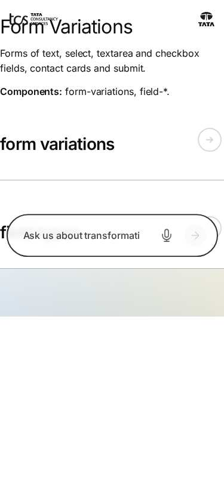

*Figure: Form Variations: form-variations — mobile 375 × 812 (/design-block-master/en/block-library/form-variations, captured 2026-11-08).*

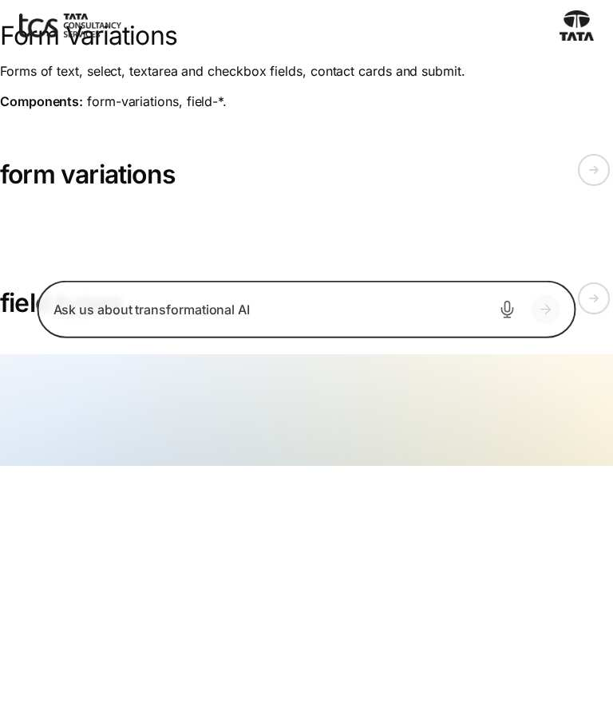

*Figure: Form Variations: form-variations — tablet 768 × 900 (/design-block-master/en/block-library/form-variations, captured 2026-11-08).*

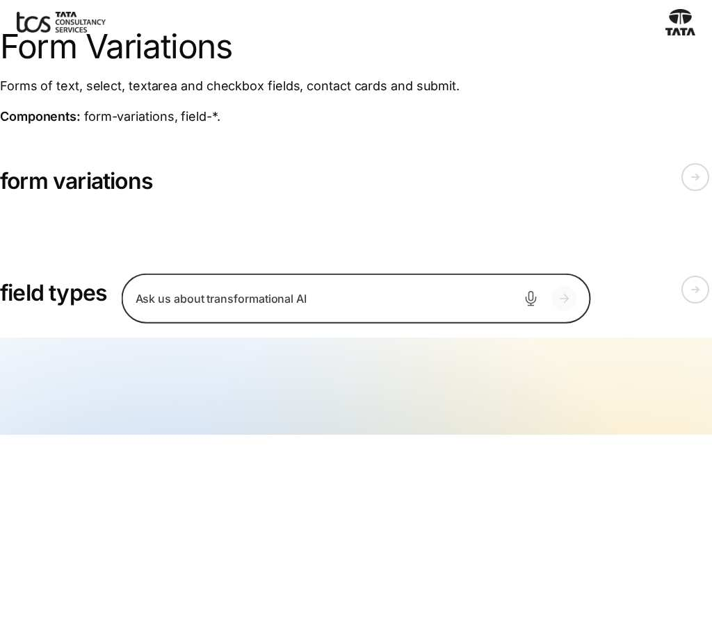

*Figure: Form Variations: form-variations — small desktop 1024 × 900 (/design-block-master/en/block-library/form-variations, captured 2026-11-08).*

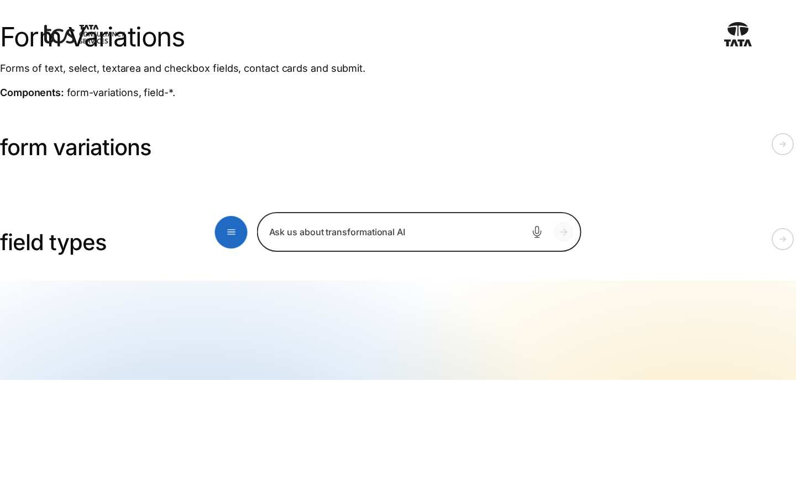

*Figure: Form Variations: form-variations — desktop 1440 × 900 (/design-block-master/en/block-library/form-variations, captured 2026-11-08).*

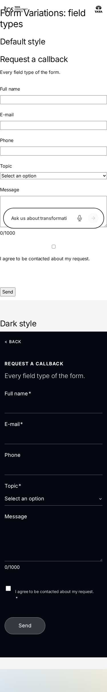

*Figure: Form Variations: form-variations/field-types — mobile 375 × 812 (/design-block-master/en/block-library/form-variations/field-types, captured 2026-11-08).*

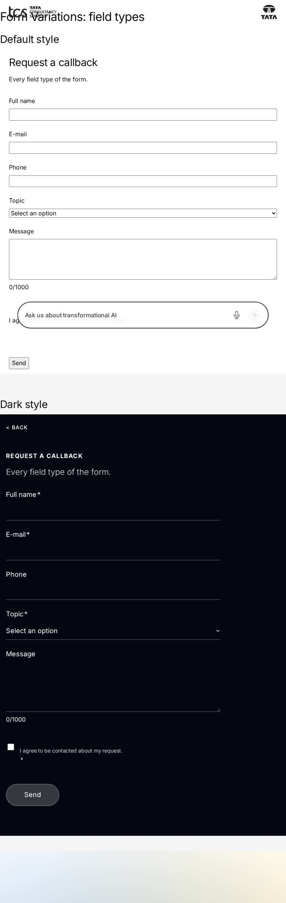

*Figure: Form Variations: form-variations/field-types — tablet 768 × 900 (/design-block-master/en/block-library/form-variations/field-types, captured 2026-11-08).*

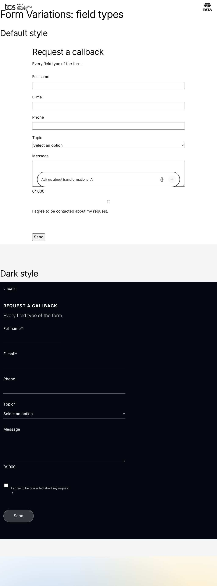

*Figure: Form Variations: form-variations/field-types — small desktop 1024 × 900 (/design-block-master/en/block-library/form-variations/field-types, captured 2026-11-08).*

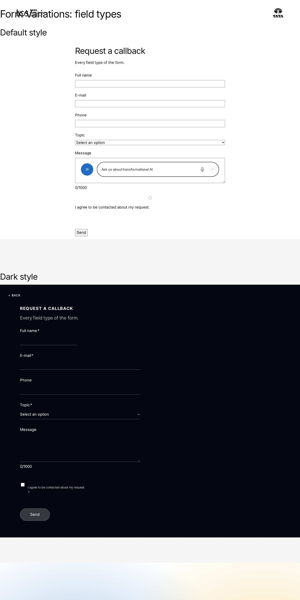

*Figure: Form Variations: form-variations/field-types — desktop 1440 × 900 (/design-block-master/en/block-library/form-variations/field-types, captured 2026-11-08).*

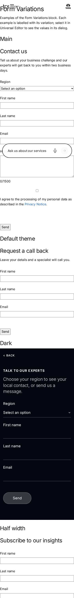

*Figure: Form Variations: form-variations/form-variations — mobile 375 × 812 (/design-block-master/en/block-library/form-variations/form-variations, captured 2026-11-08).*

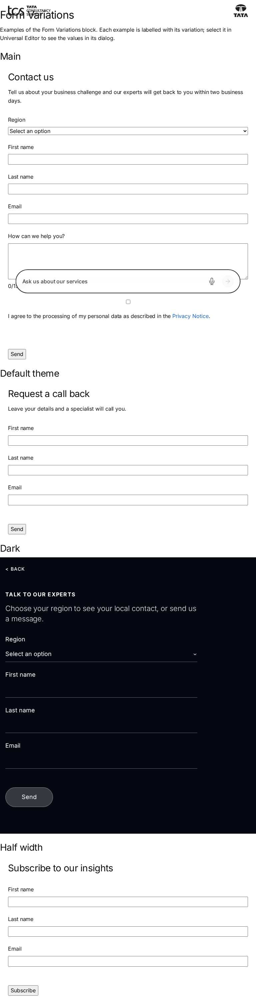

*Figure: Form Variations: form-variations/form-variations — tablet 768 × 900 (/design-block-master/en/block-library/form-variations/form-variations, captured 2026-11-08).*

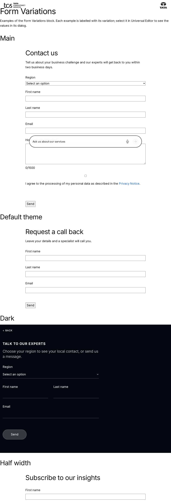

*Figure: Form Variations: form-variations/form-variations — small desktop 1024 × 900 (/design-block-master/en/block-library/form-variations/form-variations, captured 2026-11-08).*

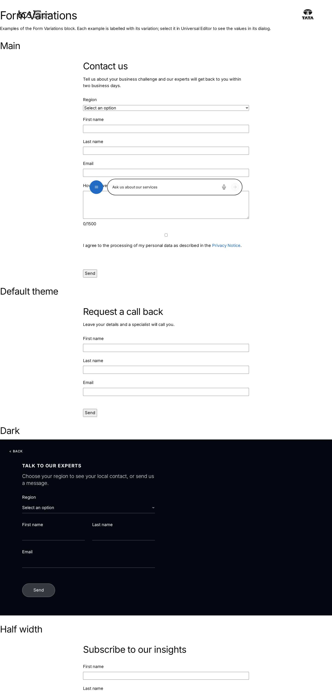

*Figure: Form Variations: form-variations/form-variations — desktop 1440 × 900 (/design-block-master/en/block-library/form-variations/form-variations, captured 2026-11-08).*

## Known limitations

- None recorded for this document.

## Open items

- None.

## Change history

| Version | Date | Author | Change |
| --- | --- | --- | --- |
| 1.0 | 8 November 2026 | Delivery team (documentation program) | First version of the role-specific documentation (master documentation prompt), generated from the repository and the published reference pages |
