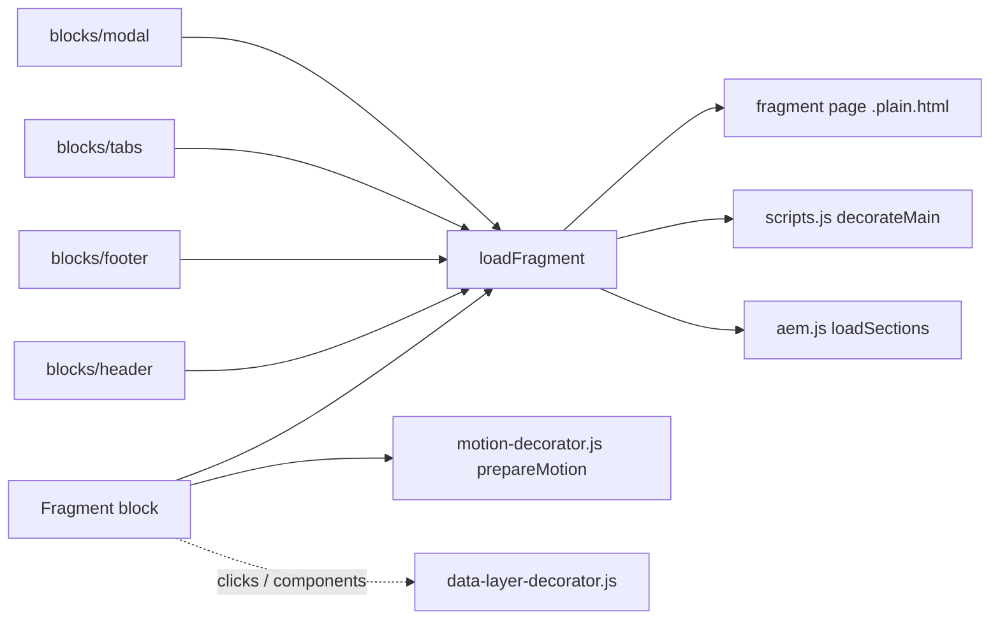
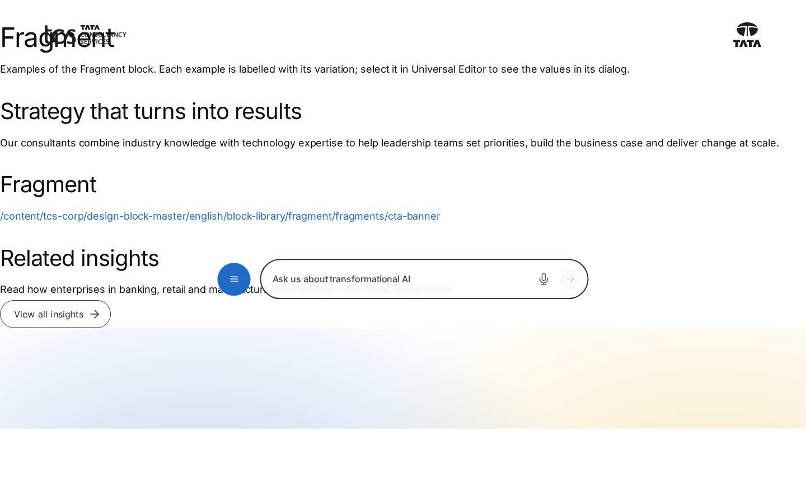
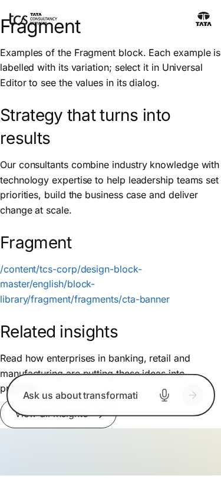

# Fragment Block — Developer Guide

| Attribute | Value |
| --- | --- |
| Document ID | DEV-B-fragment |
| Audience | Developers, technical leads, block owners, AI coding agents |
| Purpose | How the Fragment block is built: files, model, structure, behaviour, variations, tests and limitations |
| Scope | blocks/fragment/ and its components fragment |
| Prerequisites | — |
| Owner | Technical Lead / Block Owner (proposed) |
| Approver | Product Owner (to be confirmed) |
| Version | 1.0 |
| Status | Draft for review |
| Last updated | 8 November 2026 |
| Last validated | 2026-11-08 (model, files, imports from the code; reference pages from the live site) |
| Source files | blocks/fragment/README.md, blocks/fragment/_fragment.json, blocks/fragment/fragment.css, blocks/fragment/fragment.js |
| Related documents | [Variations](./FRAGMENT-VARIATIONS.md), [Test coverage](./FRAGMENT-TEST-COVERAGE.md), [Authoring guide](../../../03-authoring/components/fragment/FRAGMENT-AUTHORING-GUIDE.md) |
| Related AEM paths | /content/tcs-corp/design-block-master/en/block-library/fragment, /content/tcs-corp/design-block-master/en/block-library/fragment/fragment-block, /content/tcs-corp/design-block-master/en/block-library/fragment/fragments |

## Contents

- [Summary](#summary)
- [Overview](#overview)
- [Source files](#source-files)
- [Components, models and filters](#components-models-and-filters)
- [Fields](#fields)
- [Dependencies](#dependencies)
- [For Developers](#for-developers)
- [Extending the Block](#extending-the-block)
- [Responsive Behavior](#responsive-behavior)
- [Accessibility](#accessibility)
- [Data Layer and Analytics](#data-layer-and-analytics)
- [Performance Considerations](#performance-considerations)
- [Security and Privacy](#security-and-privacy)
- [For Architects](#for-architects)
- [Troubleshooting](#troubleshooting)
- [Known limitations of the block](#known-limitations-of-the-block)
- [Change history of the block](#change-history-of-the-block)
- [Reference pages](#reference-pages)
- [Coverage of the required topics](#coverage-of-the-required-topics)
- [Screenshots](#screenshots)
- [Known limitations](#known-limitations)
- [Open items](#open-items)
- [Change history](#change-history)

## Summary

| Attribute | Value |
| --- | --- |
| Block | Fragment |
| Folder | `blocks/fragment` |
| Type | Structural |
| Category | utility |
| Status | Active |
| Purpose | Includes the sections of another page |
| Variations (summary) | — |
| Children | — |
| Code size | 84 lines of JS and CSS |

## Overview

**Business purpose.** Author shared content once and reuse it on many pages, so a change is made in one place (a contact banner, a disclaimer, a recurring call to action).

**User experience.** Visitors see the fragment's sections as part of the page, styled by their own sections and blocks; nothing marks them as included.

**Templates / page types.** Any page and template.

**Data source.** The fragment page's `{path}.plain.html` (its sections), fetched in the browser; the fragment page's metadata and tags aren't used.

**Related blocks.** [Header](https://github.com/sradha-tcs/tcs-corp/blob/main/blocks/header/README.md) (nav page), [Footer](https://github.com/sradha-tcs/tcs-corp/blob/main/blocks/footer/README.md) (footer page and its Canvas page), [Modal](https://github.com/sradha-tcs/tcs-corp/blob/main/blocks/modal/README.md) (fragment pages in a dialog), the Tabs block (`blocks/tabs`, a tab's Fragment), [Columns Container](https://github.com/sradha-tcs/tcs-corp/blob/main/blocks/columns-container/README.md) (can hold a Fragment).

**When to use.** Content that must be identical on several pages of the same locale and maintained centrally.

**When not to use.** Page-specific content; the header and footer (use the Navigation / Footer page properties); content that must be in the page's delivered HTML for SEO (fragments are loaded in the browser); the first, LCP-critical section (a fragment adds a request).

**Realistic use cases.** A "Talk to our experts" banner with three service columns on every service page (block library `block-library/fragment/fragment-block` with `fragments/cta-banner`); a regulatory disclaimer on investor pages; a campaign banner for a period.

## Source files

| File | Link |
| --- | --- |
| `README.md` | [GitHub](https://github.com/sradha-tcs/tcs-corp/blob/main/blocks/fragment/README.md) |
| `_fragment.json` | [GitHub](https://github.com/sradha-tcs/tcs-corp/blob/main/blocks/fragment/_fragment.json) |
| `fragment.css` | [GitHub](https://github.com/sradha-tcs/tcs-corp/blob/main/blocks/fragment/fragment.css) |
| `fragment.js` | [GitHub](https://github.com/sradha-tcs/tcs-corp/blob/main/blocks/fragment/fragment.js) |

## Components, models and filters

| Component | Title | Resource type | Template name | Model | Children allowed |
| --- | --- | --- | --- | --- | --- |
| `fragment` | Fragment | `core/franklin/components/block/v1/block` | Fragment | `fragment` | — |

## Fields

The Additional tab fields (anchor, hide, padding, margin, animation) are common to the blocks and described in the [content modeling guide](../../markdown/CONTENT-MODELING-GUIDE.md).

### Fragment (`fragment`)

| Tab | Label | Property | Type | Required in model | Default | Options | Visibility |
| --- | --- | --- | --- | --- | --- | --- | --- |
| Content | Reference | `reference` | aem-content | No | — | — | — |

"Required in model" is the model's `required` flag; whether a field is required in practice is stated in the authoring guide where it is known.

## Dependencies

| Import |
| --- |
| `../../scripts/scripts.js` |
| `../../scripts/aem.js` |
| `../../decorators/motion-decorator.js` |
| `../../utils/environment.js` |
| `../../utils/placeholders.js` |

## For Developers

<!-- BEGIN GENERATED: files (npm run build:docs) -->

```text
blocks/fragment/
├── README.md
├── _fragment.json
├── fragment.css
└── fragment.js
```

| Decorator/Utility | Purpose | Execution or dependency point |
| ----------------- | ------- | ----------------------------- |
| [`scripts/scripts.js`](https://github.com/sradha-tcs/tcs-corp/blob/main/scripts/scripts.js) | Page decoration (moveInstrumentation and shared page helpers) | `fragment.js`: { decorateMain, } |
| [`scripts/aem.js`](https://github.com/sradha-tcs/tcs-corp/blob/main/scripts/aem.js) | Edge Delivery core library (block loading, CSS, metadata, optimized pictures) | `fragment.js`: { loadSections, } |
| [`decorators/motion-decorator.js`](https://github.com/sradha-tcs/tcs-corp/blob/main/decorators/motion-decorator.js) | `prepareMotion` (the Content animation and Background animation of the blocks of a section, before it is shown, or of a fragment, footer page or header Canvas once in the page: first frame paused, run by one Intersection | `fragment.js`: { prepareMotion } |
| [`utils/environment.js`](https://github.com/sradha-tcs/tcs-corp/blob/main/utils/environment.js) | `prefersReducedMotion`, `scrollBehavior`, `isEditing`, `isInEditor`, `isAuthor` (the page is rendered by AEM author, which has no query index) | `fragment.js`: { isEditing } |
| [`utils/placeholders.js`](https://github.com/sradha-tcs/tcs-corp/blob/main/utils/placeholders.js) | `getPlaceholders`, `loadPlaceholders`, `fillPlaceholder` (UI text from the locale's placeholders, with English fallbacks) | `fragment.js`: { getPlaceholders } |

<!-- END GENERATED: files -->

**Input DOM.** One row with one cell: the Reference link (or its text). The Additional tab arrives as block classes.

**`loadFragment(path, from = null)`** (exported).

1. Returns `null` unless `path` starts with `/` and not `//`.
2. Removes the first `.plain.html` / `.html`; returns `null` for the current page's path or a path already in the chain of `from` (`from.closest('main[data-fragment-chain]')`).
3. `fetchFragment`: `fetch(`${path}.plain.html`)`; a non-OK response returns `null`; a detached `main[data-fragment-chain]` gets the HTML; `./media_` `img[src]` / `source[srcset]` are rebased; `decorateMain(main)`; `await loadSections(main)`; returns the `main`.

Callers pass the including element as `from` (the Fragment block, a tab row) so nested fragments know their chain; the header, the footer and the Modal call it without `from`.

**`decorate(block)`.** Path from the first `a` or the text; `loadFragment(path, block)`; on success `block.replaceChildren(...fragment.childNodes)` and `await prepareMotion(block)`; else in edit mode (`isEditing()`, `html.adobe-ue-edit`) `p.fragment-empty` with the `fragmentEmpty` placeholder; otherwise the block is left as delivered.

**Rendered DOM contract.**

```text
div.fragment.block[data-block-name=fragment][id?]
├─ div.section …[data-section-status=loaded]
│  ├─ div.default-content-wrapper
│  └─ div.{block}-wrapper > div.{block}.block
└─ div.section …
```

**Error handling.** A network error rejects `fetch`; `aem.js` `loadBlock` logs it and marks the block loaded with its authored content. Other callers treat `null` as "no content".

**Async behavior.** The block resolves after the fragment's sections and blocks are loaded and its animations prepared.

## Extending the Block

- **A field.** Add it to `_fragment.json` (keep the Additional tab last), `npm run build:json`, `npm run lint`. The block isn't key-value: a dialog tab adds an empty row, so read rows by `data-aue-prop` in the editor and skip empty rows rather than taking "the first row" (AGENTS.md "AEM delivery rules").
- **Loader changes.** `loadFragment` is shared by header, footer, tabs and modal: keep its signature, the path rules and the recursion guard; pass `from` from new callers.
- **Responsive / accessibility.** The block should stay style-free; included content owns its layout and semantics.
- **Data layer.** Inner blocks are tracked as children automatically.
- **Tests.** No unit test covers the block; `test/motion/motion.test.mjs` checks it has no animation fields. Add tests for new pure logic.
- **Docs and modules.** Update this README (`npm run build:docs`) and the block library page; `npm run build:modules` after changing imports (the fragment is in `CHROME_BLOCKS`).

## Responsive Behavior

| Viewport | Layout | Image behavior | Interaction behavior |
| -------- | ------ | -------------- | -------------------- |
| All | No styles of its own (`fragment.css` is empty, no media queries): the included sections and blocks apply their own breakpoints | As the included blocks | As the included blocks |

## Accessibility

- The block adds no markup or roles: the fragment's content keeps its own semantics, headings, keyboard behaviour and focus handling.
- One H1 per page: fragments start at H2.
- The editor hint is plain text (edit mode only).
- Ids inside a fragment are de-duplicated against the page only for block anchors at decoration time; the same fragment included twice may produce duplicate ids (suspected in the audit).

Author responsibilities: heading levels, alt texts and link texts on the fragment page; content that makes sense without the surrounding page.

Developer responsibilities: keep the content unchanged when moving it into the block; keep the recursion guard and the editor hint.

The block handles no keys itself; the included blocks define their keyboard behaviour.

## Data Layer and Analytics

- **Component.** `fragment-{n}` (its Anchor ID when set), `@type` `tcs-corp/components/fragment`, `parentId` the page, added after the main sections are loaded (`trackBlocks(main)`).
- **Children.** Blocks of the fragment get `parentId` = the fragment's id.
- **Clicks.** Captured centrally; links in the fragment's default content report the fragment, links in its blocks report those blocks. No `data-cmp-*` attributes or own pushes.

| Trigger | Data-layer event | Required properties | Analytics behavior |
| ------- | ---------------- | ------------------- | ------------------ |
| Main sections loaded | `component` entries for the fragment and its blocks | `@type`, `parentId` | Inventory with nesting |
| Click on a link in the fragment's default content | `cmp:click` | `eventInfo.path` `component.fragment-{n}`, `interaction`, `dc:title`, `xdm:linkURL`, `xdm:linkType`, `breakpoint` | Link click attributed to the fragment |
| Click in a block of the fragment | `cmp:click` | The block's own path | As that block |

The intended flow is Adobe Client Data Layer → Adobe Data Collection (Tags) → AEP Web SDK → Edge Network → Analytics / CJA; Tags and the Web SDK aren't configured yet (blocked: measurement plan). No consent mechanism is implemented.

## Performance Considerations

- Loaded with its section (eager for the first section, else lazy): one extra request, then the included blocks' modules and styles; avoid the first section.
- Nested fragments add sequential requests; the same fragment used twice is requested twice (normally from the browser cache).
- No listeners or observers of its own; animations through `prepareMotion`.

## Security and Privacy

- Only root-relative same-site paths are fetched (`/`, not `//`); full URLs are ignored, so no external content is loaded.
- The HTML is the site's own `.plain.html`, inserted with `innerHTML` into a detached element and decorated; no query strings, no personal data.

## For Architects

- **Role.** Content reuse (the Edge Delivery equivalent of an experience fragment) and the shared loader of the page chrome and dialogs.
- **Content model.** A reference to a page; the page is the unit of reuse.
- **Rendering.** Client-side: `.plain.html` fetched and decorated with the page pipeline (`decorateMain`, `loadSections`).
- **Dependencies.** `scripts/scripts.js` (`decorateMain`), `scripts/aem.js` (`loadSections`), `decorators/motion-decorator.js`, `utils/environment.js`, `utils/placeholders.js`.
- **Data layer / Web SDK / Target.** Nested component entries; no Target.
- **Consent and identity.** None.
- **Caching.** `.plain.html` through the CDN and browser cache; no caching in code (each use fetches).
- **Performance.** One request per fragment per use, sequential for nesting.
- **Security.** Same-site root-relative paths only.
- **Scalability.** Any number of host pages per fragment; republish the fragment to update them all.



## Troubleshooting

| Symptom | Likely cause | Diagnostic steps | Resolution | Verification |
| ------- | ------------ | ---------------- | ---------- | ------------ |
| The block shows a bare link | Fragment page not published (404) or a full URL | Network: `{path}.plain.html` status; the Reference value | Publish the page; pick it with the content picker | Content renders |
| Broken images in the fragment | Unpublished assets or non-`./media_` paths | Inspect `img src` | Re-select images on the fragment page and republish | Images load |
| Wrong language | Reference to another locale | Check the path's locale | Point to the locale's fragment page | Right language |
| Old content | Fragment page not republished, cache | Open its `.plain.html` | Publish the fragment page | New content |
| Two H1 | H1 or Page Header in the fragment | Heading outline | Use H2 | One H1 |
| Fragment missing on one page only | It references that page itself (guard) | Compare Reference and host path | Reference another page | Content renders |

Evidence to collect: host page URL, Reference value, network status of the `.plain.html` request, console errors, screenshot. No cookies or tokens.

## Known limitations of the block

| Limitation | Impact | Workaround | Planned correction |
| ---------- | ------ | ---------- | ------------------ |
| Full URLs in Reference are ignored (F-15) | A pasted URL shows nothing | Use the content picker | Not recorded (F-15 open, P3) |
| Content isn't in the delivered page HTML | Not part of the page for SEO | Keep unique content on the page | Not planned |
| No caching in code; each use fetches | Extra requests for repeated fragments | — | Not planned |
| The same fragment twice may produce duplicate ids (suspected, audit docs/audit/blocks/group-c-containers.md) | Duplicate anchors | Avoid two instances with anchors | Not recorded |
| The Reference isn't localized | Copied pages may show another locale | Re-point after copying | Not planned |
| Field label "Reference" is technical (audit suggestion "Fragment page") | Author clarity | — | Not recorded |

## Change history of the block

| Version | Change | Source | Date |
| ------- | ------ | ------ | ---- |
| Not recorded | README generated from verified implementation and approved handover documentation | Repository review | Not recorded |
| Handover 2.27 | Block ecosystem audit: recursion guard (D-C-17); editor hint when nothing is shown (D-C-21) | docs/handover revision history; docs/audit/BLOCK-ECOSYSTEM-AUDIT.md | 19 October 2026 |
| Handover 2.29 | Re-audit: fragments loaded twice (regression of the recursion guard) corrected; recursion by the chain of including fragments (R-C-5) | docs/handover revision history; docs/audit/REAUDIT-2026-10-20.md | 20 October 2026 |
| Handover 2.36 | The stylesheets of blocks in the header's fragments preloaded (F-106) | docs/handover revision history | 20 October 2026 |

## Reference pages

| Kind | Page | Live URL |
| --- | --- | --- |
| Block library | /design-block-master/en/block-library/fragment | https://main--tcs-corp--sradha-tcs.aem.live/design-block-master/en/block-library/fragment |
| Block library | /design-block-master/en/block-library/fragment/fragment-block | https://main--tcs-corp--sradha-tcs.aem.live/design-block-master/en/block-library/fragment/fragment-block |
| Block library | /design-block-master/en/block-library/fragment/fragments | https://main--tcs-corp--sradha-tcs.aem.live/design-block-master/en/block-library/fragment/fragments |
| Block library | /design-block-master/en/block-library/fragment/fragments/cta-banner | https://main--tcs-corp--sradha-tcs.aem.live/design-block-master/en/block-library/fragment/fragments/cta-banner |

## Coverage of the required topics

| Topic | Where |
| --- | --- |
| Purpose | Overview |
| Source files | generated: Files |
| Model, definition, filters, children | generated: Components |
| Dependencies | generated: Dependencies |
| Authored input / rendered output / DOM transformation | For Developers |
| Configuration fields, defaults, required fields | generated: Fields |
| Variations | FRAGMENT-VARIATIONS.md |
| Responsive behaviour | Responsive Behavior |
| Accessibility and keyboard | Accessibility |
| Analytics / data layer | Data Layer and Analytics |
| Performance | Performance Considerations |
| Security | Security and Privacy |
| Extending | Extending the Block |
| Known limitations | Known Limitations |
| Troubleshooting | Troubleshooting |
| Tests | FRAGMENT-TEST-COVERAGE.md |
| SEO behaviour | Not recorded |
| Caching considerations | Not recorded (Edge Delivery default caching; no block-specific rule) |
| Ownership | Technical Lead / Block Owner (proposed) |

## Screenshots



*Figure: Fragment block library page — desktop 1440 × 900 (/design-block-master/en/block-library/fragment/fragment-block, captured 2026-11-08).*



*Figure: Fragment block library page — mobile 375 × 812 (/design-block-master/en/block-library/fragment/fragment-block, captured 2026-11-08).*

![Desktop rendering — The Consulting page at 1440 px: the H2 Strategy that turns into results and its text, then the grey Highlight section of references/cta-banner with the H2 Talk to our experts, its intro text, the H3 columns Consulting, Cloud and Cybersecurity with the links Explore consulting, Explore cloud and Explore cybersecurity, and a black Contact us primary button, the three columns side by side, then the H2 Related insights, its text and an outlined View all insights button. (Sample content on the preview; callout letters as in the Field Entry Table; file screenshots/fragment-desktop-view.jpg)](./screenshots/handover/fragment-desktop-view.jpg)

*Figure: Desktop rendering — The Consulting page at 1440 px: the H2 Strategy that turns into results and its text, then the grey Highlight section of references/cta-banner with the H2 Talk to our experts, its intro text, the H3 columns Consulting, Cloud and Cybersecurity with the links Explore consulting, Explore cloud and Explore cybersecurity, and a black Contact us primary button, the three columns side by side, then the H2 Related insights, its text and an outlined View all insights button. (Sample content on the preview; callout letters as in the Field Entry Table; file screenshots/fragment-desktop-view.jpg) (handover screenshot; rendering at the time it was taken).*


*Figure: Tablet rendering — The Fragment at 768 px: the grey Highlight section with the H2 Talk to our experts and its text, the columns Consulting, Cloud and Cybersecurity stacked one below the other (Columns go side by side only from 900 px), each with its Explore link, and the black Contact us button. (Sample content on the preview; callout letters as in the Field Entry Table; file screenshots/fragment-tablet-view.jpg) (handover screenshot; rendering at the time it was taken).*


*Figure: Mobile rendering — The Fragment at 390 px: the grey Highlight section with the H2 Talk to our experts, the intro text wrapped over four lines, Consulting, Cloud and Cybersecurity stacked with their texts and Explore links, and the black Contact us button last. (Sample content on the preview; callout letters as in the Field Entry Table; file screenshots/fragment-mobile-view.jpg) (handover screenshot; rendering at the time it was taken).*

![Fragment block in a page — The selected Fragment block in Universal Editor at 1440 px, cropped to the block: the grey Highlight section of references/cta-banner with the H2 Talk to our experts, its intro text, the H3 columns Consulting, Cloud and Cybersecurity with the links Explore consulting, Explore cloud and Explore cybersecurity, and a black Contact us primary button, the columns side by side. (Sample content on the preview; callout letters as in the Field Entry Table; file screenshots/fragment-authored-block.jpg)](./screenshots/handover/fragment-authored-block.jpg)

*Figure: Fragment block in a page — The selected Fragment block in Universal Editor at 1440 px, cropped to the block: the grey Highlight section of references/cta-banner with the H2 Talk to our experts, its intro text, the H3 columns Consulting, Cloud and Cybersecurity with the links Explore consulting, Explore cloud and Explore cybersecurity, and a black Contact us primary button, the columns side by side. (Sample content on the preview; callout letters as in the Field Entry Table; file screenshots/fragment-authored-block.jpg) (handover screenshot; rendering at the time it was taken).*


*Figure: Fragment in a tab — The Tabs block How we help at 1440 px in the Underline style: the tabs Overview and Industries, Industries selected with a blue underline; its panel shows the tab-industries fragment, three columns Banking, Retail and Manufacturing, each with a sample image, an H3, a short text and a link. (Sample content on the preview; callout letters as in the Field Entry Table; file screenshots/fragment-tab-panel.jpg) (handover screenshot; rendering at the time it was taken).*


*Figure: Fragment in a modal — The Get in touch page at 1440 px dimmed behind an open dialog loaded from /en/shots/g01b/modals/contact-form: a close icon, the H2 Contact our team, the description, the * Required fields note taking a grid column beside Full name (F-32), Business e-mail, Company, How can we help? with 0/1500, the consent checkbox and the Send button cut at the bottom. (Sample content on the preview; callout letters as in the Field Entry Table; file screenshots/fragment-modal.jpg) (handover screenshot; rendering at the time it was taken).*

![Universal Editor canvas — The Fragment at 1440 px in editor mode with two markers: A around the whole Fragment block (the grey Talk to our experts section) and B around the included Columns block only (Consulting, Cloud, Cybersecurity with their Explore links); the H2, the text and the Contact us button lie inside A, outside B. (Annotated preview in editor mode with sample content; letters as in the annotations list, not a Universal Editor screenshot; file screenshots/fragment-authoring-view.jpg)](./screenshots/handover/fragment-authoring-view.jpg)

*Figure: Universal Editor canvas — The Fragment at 1440 px in editor mode with two markers: A around the whole Fragment block (the grey Talk to our experts section) and B around the included Columns block only (Consulting, Cloud, Cybersecurity with their Explore links); the H2, the text and the Contact us button lie inside A, outside B. (Annotated preview in editor mode with sample content; letters as in the annotations list, not a Universal Editor screenshot; file screenshots/fragment-authoring-view.jpg) (handover screenshot; rendering at the time it was taken).*


*Figure: Properties panel — The Fragment block's properties with the Content tab (Reference) and the Additional tab (Anchor ID, Hide block, padding and margin selects). (Dialog reference generated from the component model, not a Universal Editor screenshot; file screenshots/fragment-properties-panel.jpg) (handover screenshot; rendering at the time it was taken).*

## Known limitations

- Universal Editor dialogs were not captured: no author access in this program (see the access blockers).

## Open items

- None.

## Change history

| Version | Date | Author | Change |
| --- | --- | --- | --- |
| 1.0 | 8 November 2026 | Delivery team (documentation program) | First version of the role-specific documentation (master documentation prompt), generated from the repository and the published reference pages |
