# Fragment Block — Test Coverage

| Attribute | Value |
| --- | --- |
| Document ID | DEV-T-fragment |
| Audience | Developers, technical leads, block owners, AI coding agents |
| Purpose | Unit tests, automated reference-page checks and manual test guidance for the block |
| Scope | — |
| Prerequisites | — |
| Owner | Technical Lead / Block Owner (proposed) |
| Approver | Product Owner (to be confirmed) |
| Version | 1.0 |
| Status | Draft for review |
| Last updated | 13 November 2026 |
| Last validated | 13 November 2026 |
| Source files | — |
| Related documents | — |
| Related AEM paths | — |

## Contents

- [Unit tests](#unit-tests)
- [Automated checks of the block library pages (executed 13 November 2026)](#automated-checks-of-the-block-library-pages-executed-13-november-2026)
- [Manual test guidance (block README)](#manual-test-guidance-block-readme)
- [Screenshots](#screenshots)
- [Known limitations](#known-limitations)
- [Open items](#open-items)
- [Change history](#change-history)

## Unit tests

No unit test is specific to this block (shared tests: test/models, test/items, test/docs, test/motion).

## Automated checks of the block library pages (executed 13 November 2026)

Per page: HTTP status and horizontal overflow at 375 / 768 / 1024 / 1440 px, console errors, failed requests and DOM accessibility checks at 1440 px (evidence: [screenshot register](../../../SCREENSHOT-REGISTER.md)).

| Page | 375 / 768 / 1024 / 1440 | Console errors | Failed requests | Accessibility (DOM) |
| --- | --- | --- | --- | --- |
| /design-block-master/en/block-library/fragment | ok / ok / ok / ok | 12 | 12 | 0 img no alt, 0 unnamed buttons, 1 heading skips |
| /design-block-master/en/block-library/fragment/fragment-block | ok / ok / ok / ok | 8 | 8 | 0 img no alt, 0 unnamed buttons, 0 heading skips |
| /design-block-master/en/block-library/fragment/fragments | ok / ok / ok / ok | 8 | 8 | 0 img no alt, 0 unnamed buttons, 1 heading skips |
| /design-block-master/en/block-library/fragment/fragments/cta-banner | ok / ok / ok / ok | 4 | 4 | 0 img no alt, 0 unnamed buttons, 0 heading skips |

## Manual test guidance (block README)

| Test ID | Scenario | Configuration | Expected result |
| ------- | -------- | ------------- | --------------- |
| FRAGMENT-QA-01 | Default | Reference to a published page | Its sections render in the block |
| FRAGMENT-QA-02 | Unpublished page | Reference to an unpublished page | Reference link stays; no error on the page |
| FRAGMENT-QA-03 | Empty in the editor | No Reference, edit mode | Hint "Fragment: choose the page whose content it shows." |
| FRAGMENT-QA-04 | Full URL | Reference `https://…` | Ignored (authored content stays) |
| FRAGMENT-QA-05 | Self-inclusion | Fragment page containing a Fragment of itself | Loaded once, no loop |
| FRAGMENT-QA-06 | Host page reference | Fragment pointing to the host page | Not loaded |
| FRAGMENT-QA-07 | Twice side by side | Two Fragments with the same Reference | Both render |
| FRAGMENT-QA-08 | Images | Fragment with images | Images load on the host page |
| FRAGMENT-QA-09 | Additional tab | Anchor ID, Hide block | `id` set; hidden on the site, dimmed in the editor |
| FRAGMENT-QA-10 | In a Columns Container / Tab | Fragment in a column or tab | Renders inside the column / panel |
| FRAGMENT-QA-11 | Viewports | 390 / 1024 / 1440px | Included blocks follow their own breakpoints |
| FRAGMENT-QA-12 | Data layer | Inspect `adobeDataLayer` | Fragment entry with child blocks' `parentId` |
| FRAGMENT-QA-13 | Animations | Fragment with an animated block | Animation plays when in view, not in edit mode |

Test cases: [05-quality-assurance/test-cases/blocks/fragment](../../../05-quality-assurance/test-cases/blocks/fragment/FRAGMENT-TEST-CASES.md).

## Screenshots

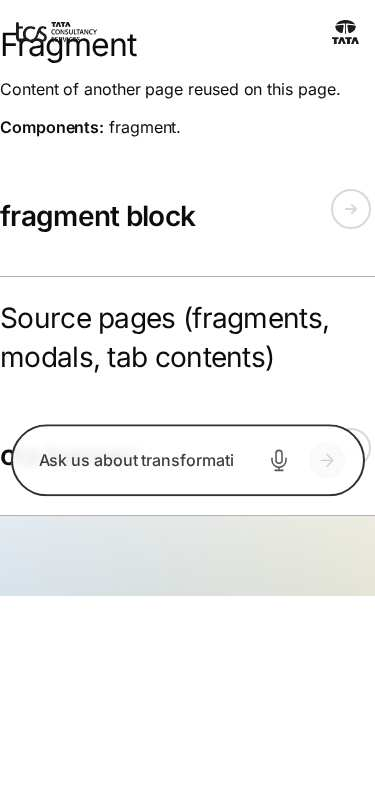

*Figure: Fragment: fragment — mobile 375 × 812 (/design-block-master/en/block-library/fragment, captured 2026-11-08).*

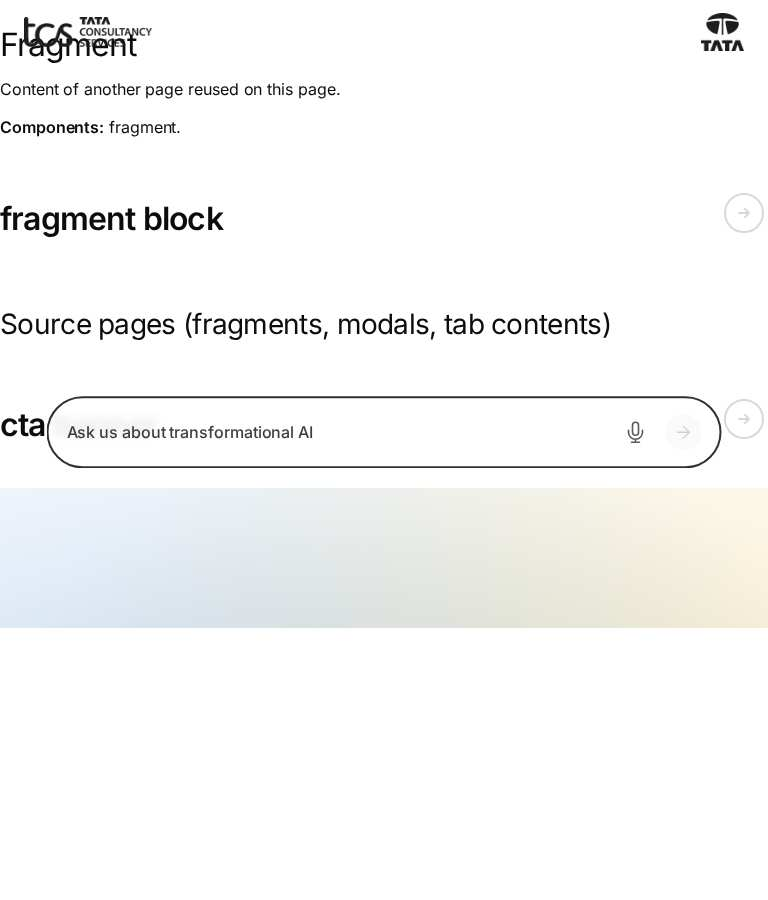

*Figure: Fragment: fragment — tablet 768 × 900 (/design-block-master/en/block-library/fragment, captured 2026-11-08).*

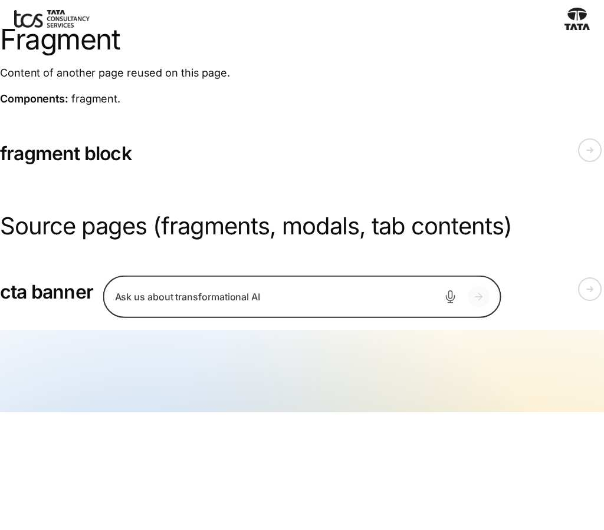

*Figure: Fragment: fragment — small desktop 1024 × 900 (/design-block-master/en/block-library/fragment, captured 2026-11-08).*

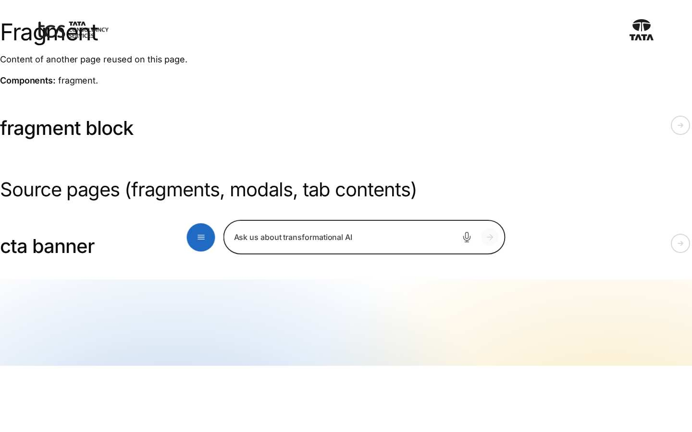

*Figure: Fragment: fragment — desktop 1440 × 900 (/design-block-master/en/block-library/fragment, captured 2026-11-08).*

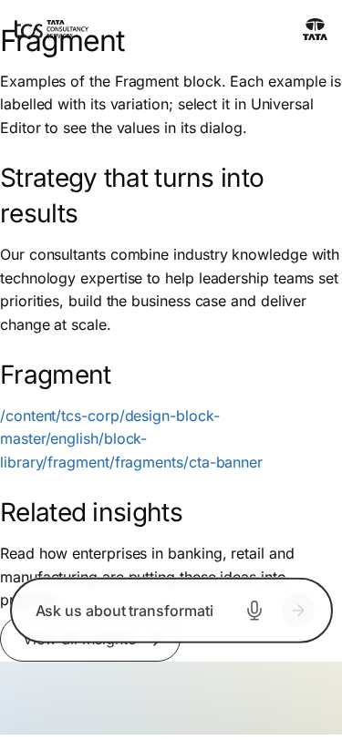

*Figure: Fragment: fragment/fragment-block — mobile 375 × 812 (/design-block-master/en/block-library/fragment/fragment-block, captured 2026-11-08).*

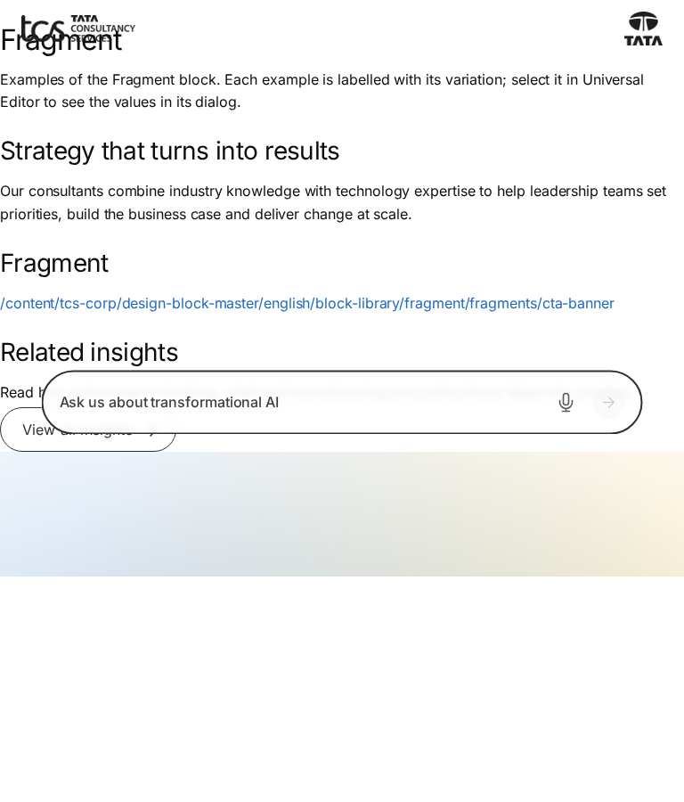

*Figure: Fragment: fragment/fragment-block — tablet 768 × 900 (/design-block-master/en/block-library/fragment/fragment-block, captured 2026-11-08).*

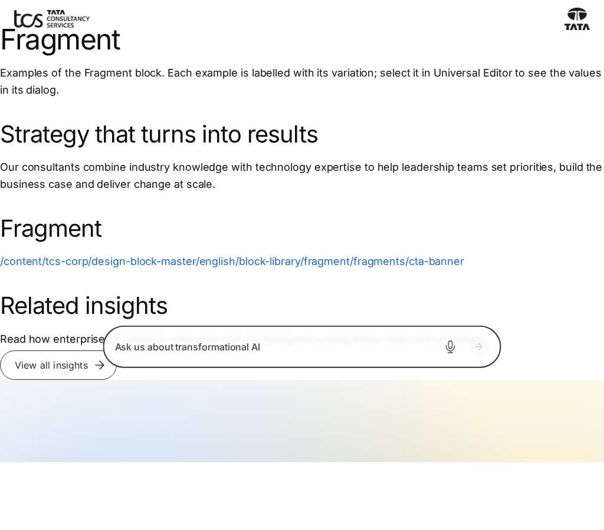

*Figure: Fragment: fragment/fragment-block — small desktop 1024 × 900 (/design-block-master/en/block-library/fragment/fragment-block, captured 2026-11-08).*

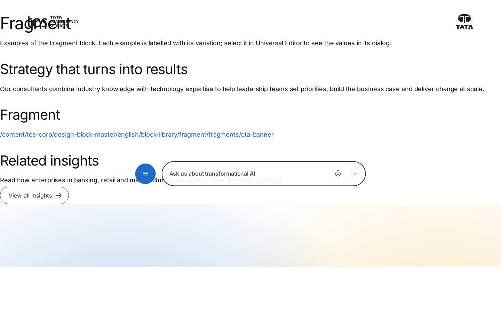

*Figure: Fragment: fragment/fragment-block — desktop 1440 × 900 (/design-block-master/en/block-library/fragment/fragment-block, captured 2026-11-08).*

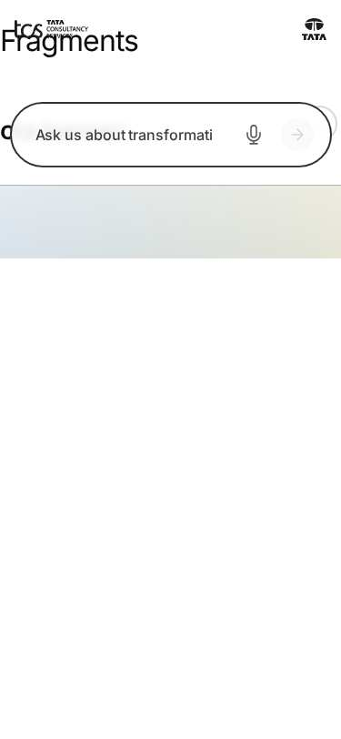

*Figure: Fragment: fragment/fragments — mobile 375 × 812 (/design-block-master/en/block-library/fragment/fragments, captured 2026-11-08).*

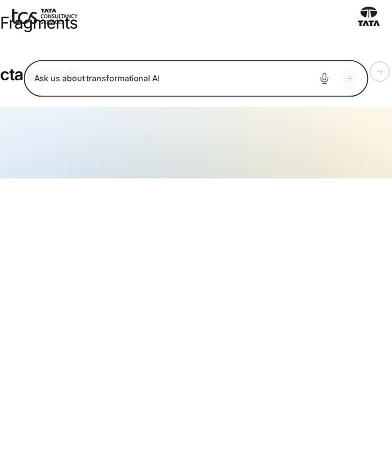

*Figure: Fragment: fragment/fragments — tablet 768 × 900 (/design-block-master/en/block-library/fragment/fragments, captured 2026-11-08).*

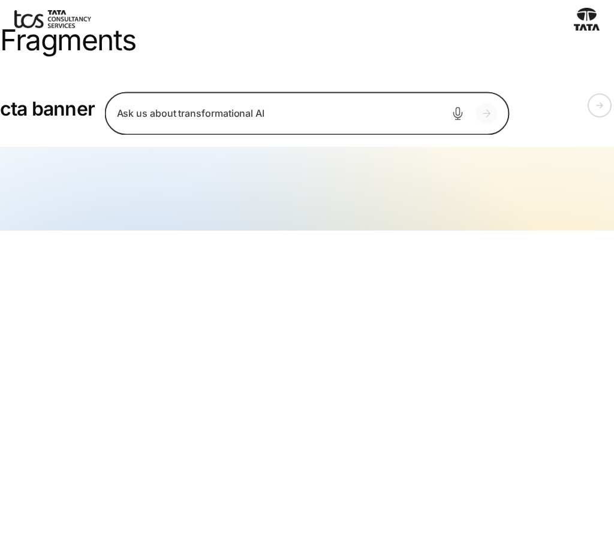

*Figure: Fragment: fragment/fragments — small desktop 1024 × 900 (/design-block-master/en/block-library/fragment/fragments, captured 2026-11-08).*

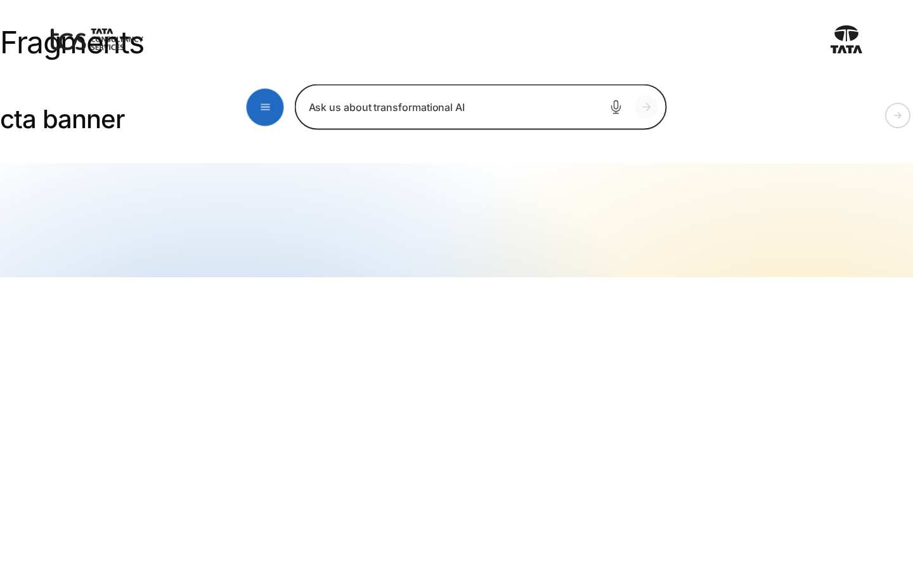

*Figure: Fragment: fragment/fragments — desktop 1440 × 900 (/design-block-master/en/block-library/fragment/fragments, captured 2026-11-08).*

*Figure: Fragment: fragment/fragments/cta-banner — mobile 375 × 812 (/design-block-master/en/block-library/fragment/fragments/cta-banner, captured 2026-11-08).*

*Figure: Fragment: fragment/fragments/cta-banner — tablet 768 × 900 (/design-block-master/en/block-library/fragment/fragments/cta-banner, captured 2026-11-08).*

*Figure: Fragment: fragment/fragments/cta-banner — small desktop 1024 × 900 (/design-block-master/en/block-library/fragment/fragments/cta-banner, captured 2026-11-08).*

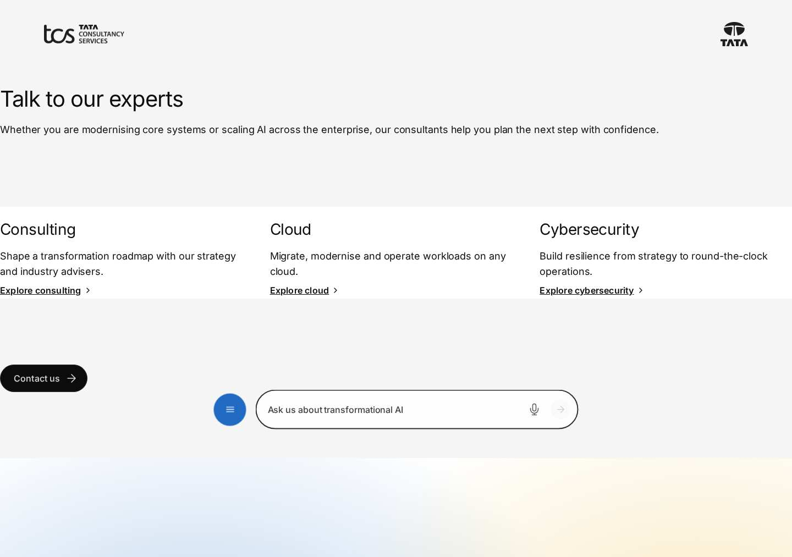

*Figure: Fragment: fragment/fragments/cta-banner — desktop 1440 × 900 (/design-block-master/en/block-library/fragment/fragments/cta-banner, captured 2026-11-08).*

## Known limitations

- None recorded for this document.

## Open items

- None.

## Change history

| Version | Date | Author | Change |
| --- | --- | --- | --- |
| 1.0 | 13 November 2026 | Delivery team (documentation program) | First version of the role-specific documentation (master documentation prompt), generated from the repository and the published reference pages |
