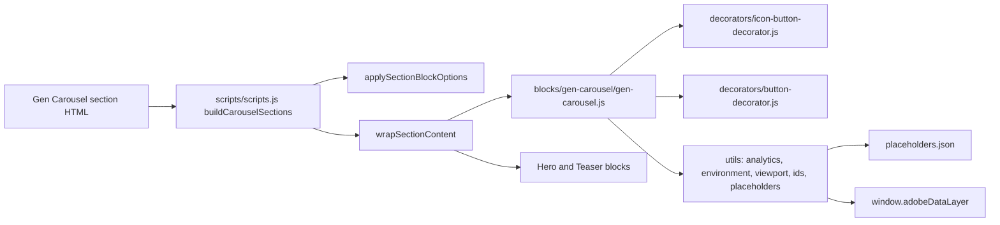
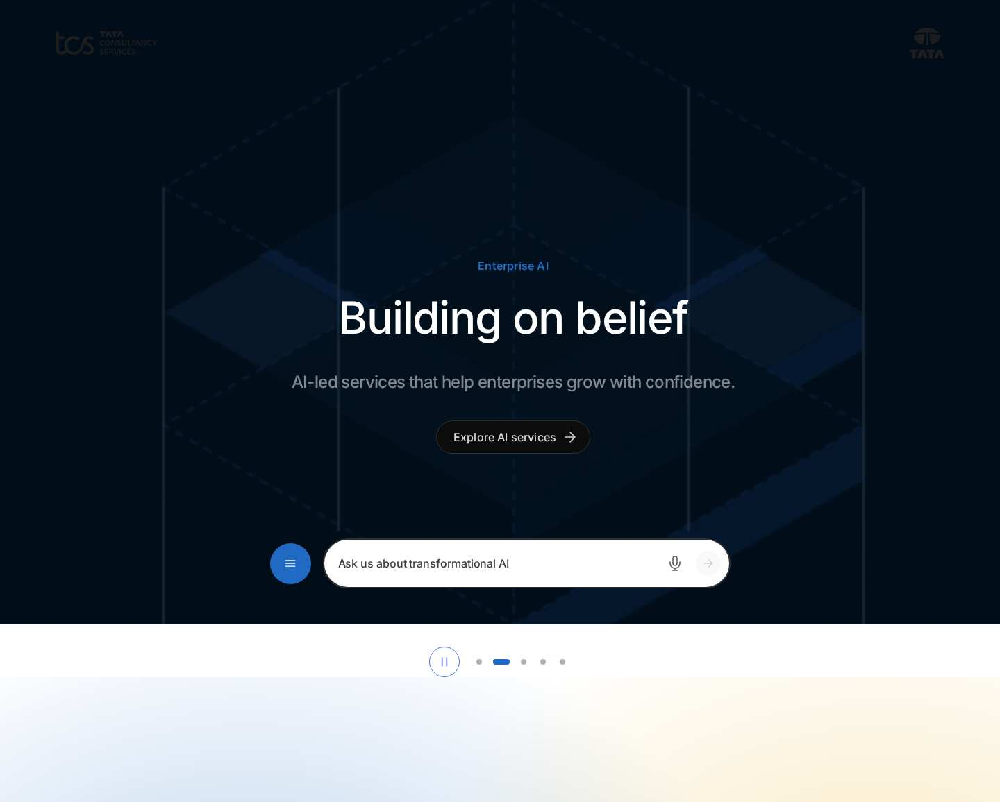

# Gen Carousel Block — Developer Guide

| Attribute | Value |
| --- | --- |
| Document ID | DEV-B-gen-carousel |
| Audience | Developers, technical leads, block owners, AI coding agents |
| Purpose | How the Gen Carousel block is built: files, model, structure, behaviour, variations, tests and limitations |
| Scope | blocks/gen-carousel/ and its components gen-carousel |
| Prerequisites | — |
| Owner | Technical Lead / Block Owner (proposed) |
| Approver | Product Owner (to be confirmed) |
| Version | 1.0 |
| Status | Draft for review |
| Last updated | 8 November 2026 |
| Last validated | 2026-11-08 (model, files, imports from the code; reference pages from the live site) |
| Source files | blocks/gen-carousel/README.md, blocks/gen-carousel/_gen-carousel.json, blocks/gen-carousel/gen-carousel.css, blocks/gen-carousel/gen-carousel.js |
| Related documents | [Variations](./GEN-CAROUSEL-VARIATIONS.md), [Test coverage](./GEN-CAROUSEL-TEST-COVERAGE.md), [Authoring guide](../../../03-authoring/components/gen-carousel/GEN-CAROUSEL-AUTHORING-GUIDE.md) |
| Related AEM paths | /content/tcs-corp/design-block-master/en/block-library/gen-carousel, /content/tcs-corp/design-block-master/en/block-library/gen-carousel/auto, /content/tcs-corp/design-block-master/en/block-library/gen-carousel/hero-slides |

## Contents

- [Summary](#summary)
- [Overview](#overview)
- [Source files](#source-files)
- [Components, models and filters](#components-models-and-filters)
- [Fields](#fields)
- [Dependencies](#dependencies)
- [For Developers](#for-developers)
- [Extending the Block](#extending-the-block)
- [Responsive Behavior](#responsive-behavior)
- [Accessibility](#accessibility)
- [Data Layer and Analytics](#data-layer-and-analytics)
- [Performance Considerations](#performance-considerations)
- [Security and Privacy](#security-and-privacy)
- [For Architects](#for-architects)
- [Troubleshooting](#troubleshooting)
- [Known limitations of the block](#known-limitations-of-the-block)
- [Change history of the block](#change-history-of-the-block)
- [Reference pages](#reference-pages)
- [Coverage of the required topics](#coverage-of-the-required-topics)
- [Screenshots](#screenshots)
- [Known limitations](#known-limitations)
- [Open items](#open-items)
- [Change history](#change-history)

## Summary

| Attribute | Value |
| --- | --- |
| Block | Gen Carousel |
| Folder | `blocks/gen-carousel` |
| Type | Container (section) |
| Category | container |
| Status | Active |
| Purpose | A section whose Heroes or Teasers rotate as slides |
| Variations (summary) | Navigation (dots, arrows), automatic interval |
| Children | hero, teaser |
| Code size | 351 lines of JS and CSS |

## Overview

**Business purpose.** Feature several campaigns, stories or offers of similar importance in one prominent space, typically the top of the home page, while each message stays a full-size [Hero](https://github.com/sradha-tcs/tcs-corp/blob/main/blocks/hero/README.md) or Teaser with its own CTA.

**User experience.** One slide is visible at a time. With two or more slides, controls appear below the slides: a pause / play button (Auto modes), previous and next arrows (Manual modes) and one dot per slide (the current one a wide brand pill). Slides can be swiped or scrolled (except in Auto-only mode). Autoplay pauses while the pointer is over the slides, while keyboard focus is inside the carousel, when it is mostly off screen and when the browser tab is hidden.

**Templates / page types.** Any page; typically the Home template and landing pages. `templates/home/home.css` makes the first section (usually a Hero or a Gen Carousel) meet the header.

**Data source.** The authored slides and the section's properties; UI text from the locale's placeholders. No metadata, tags, sheets or query index.

**Related blocks.** [Hero](https://github.com/sradha-tcs/tcs-corp/blob/main/blocks/hero/README.md) and the Teaser (`blocks/teaser`) are the slides; [List](https://github.com/sradha-tcs/tcs-corp/blob/main/blocks/list/README.md) and [Cards](https://github.com/sradha-tcs/tcs-corp/blob/main/blocks/cards/README.md) offer horizontal-scroll card lists; the Tabs Container (`blocks/tabs`) switches content without rotation; [Columns Container](https://github.com/sradha-tcs/tcs-corp/blob/main/blocks/columns-container/README.md) is the other section container built the same way.

**When to use.** Two or more messages of similar importance sharing one space, each a complete Hero or Teaser.

**When not to use.** One message only (a single slide shows no controls: use the Hero or Teaser directly); critical information every visitor must see (later slides are often not viewed); long lists of items (use List or Cards); content other than Hero and Teaser (the filter allows only these two).

**Realistic use cases.**

- A home page rotation of three Heroes: brand campaign, latest results, a major event.
- Rotating case studies as Teasers on an industry landing page.
- Campaign highlights with autoplay every 7 seconds and manual navigation.

## Source files

| File | Link |
| --- | --- |
| `README.md` | [GitHub](https://github.com/sradha-tcs/tcs-corp/blob/main/blocks/gen-carousel/README.md) |
| `_gen-carousel.json` | [GitHub](https://github.com/sradha-tcs/tcs-corp/blob/main/blocks/gen-carousel/_gen-carousel.json) |
| `gen-carousel.css` | [GitHub](https://github.com/sradha-tcs/tcs-corp/blob/main/blocks/gen-carousel/gen-carousel.css) |
| `gen-carousel.js` | [GitHub](https://github.com/sradha-tcs/tcs-corp/blob/main/blocks/gen-carousel/gen-carousel.js) |

## Components, models and filters

| Component | Title | Resource type | Template name | Model | Children allowed |
| --- | --- | --- | --- | --- | --- |
| `gen-carousel` | Gen Carousel | `core/franklin/components/section/v1/section` | Gen Carousel | `gen-carousel` | hero, teaser |

## Fields

The Additional tab fields (anchor, hide, padding, margin, animation) are common to the blocks and described in the [content modeling guide](../../markdown/CONTENT-MODELING-GUIDE.md).

### Gen Carousel (`gen-carousel`)

| Tab | Label | Property | Type | Required in model | Default | Options | Visibility |
| --- | --- | --- | --- | --- | --- | --- | --- |
| Content | Style | `style` | select | No | `gen-carousel-section` | 1 options | — |
| Content | Navigation | `carouselNavigation` | select | No | `manual` | 3 options | — |
| Content | Accessible name | `carouselAriaLabel` | text | No | — | — | — |
| Content | Autoplay interval (seconds) | `carouselInterval` | number | No | `5` | — | Conditional |
| Additional | Anchor ID | `containerAnchor` | text | No | — | — | — |
| Additional | Hide block | `containerHide` | boolean | No | `false` | — | — |
| Additional | Animation Type | `containerAnimation` | select | No | `""` | 11 options | — |
| Additional | Motion Speed | `containerAnimationSpeed` | select | No | `""` | 3 options | Conditional |
| Additional | Animation Trigger | `containerAnimationTrigger` | select | No | `""` | 2 options | Conditional |
| Additional | Padding left | `containerPaddingLeft` | select | No | `""` | 15 options | — |
| Additional | Padding right | `containerPaddingRight` | select | No | `""` | 15 options | — |
| Additional | Padding top | `containerPaddingTop` | select | No | `""` | 15 options | — |
| Additional | Padding bottom | `containerPaddingBottom` | select | No | `""` | 15 options | — |
| Additional | Margin left | `containerMarginLeft` | select | No | `""` | 15 options | — |
| Additional | Margin right | `containerMarginRight` | select | No | `""` | 15 options | — |
| Additional | Margin top | `containerMarginTop` | select | No | `""` | 15 options | — |
| Additional | Margin bottom | `containerMarginBottom` | select | No | `""` | 15 options | — |

"Required in model" is the model's `required` flag; whether a field is required in practice is stated in the authoring guide where it is known.

## Dependencies

| Import |
| --- |
| `../../decorators/button-decorator.js` |
| `../../decorators/icon-button-decorator.js` |
| `../../utils/analytics.js` |
| `../../utils/environment.js` |
| `../../utils/viewport.js` |
| `../../utils/ids.js` |
| `../../utils/placeholders.js` |

## For Developers

<!-- BEGIN GENERATED: files (npm run build:docs) -->

```text
blocks/gen-carousel/
├── README.md
├── _gen-carousel.json
├── gen-carousel.css
└── gen-carousel.js
```

| Decorator/Utility | Purpose | Execution or dependency point |
| ----------------- | ------- | ----------------------------- |
| [`decorators/button-decorator.js`](https://github.com/sradha-tcs/tcs-corp/blob/main/decorators/button-decorator.js) | `decorateButton` (option `newTabHint`: a link opening a new tab says so), `createButton`, `setButtonDisabled`, `setButtonAlignment`, `removeButtonDecoration` | `gen-carousel.js`: { decorateButton } |
| [`decorators/icon-button-decorator.js`](https://github.com/sradha-tcs/tcs-corp/blob/main/decorators/icon-button-decorator.js) | `createIconButton` | `gen-carousel.js`: { createIconButton } |
| [`utils/analytics.js`](https://github.com/sradha-tcs/tcs-corp/blob/main/utils/analytics.js) | `pushToDataLayer`, `pushComponents`, `pushComponentEvent` (Adobe Client Data Layer, Core Components schema; never throws) | `gen-carousel.js`: { pushComponentEvent } |
| [`utils/environment.js`](https://github.com/sradha-tcs/tcs-corp/blob/main/utils/environment.js) | `prefersReducedMotion`, `scrollBehavior`, `isEditing`, `isInEditor`, `isAuthor` (the page is rendered by AEM author, which has no query index) | `gen-carousel.js`: { isEditing, prefersReducedMotion, scrollBehavior } |
| [`utils/viewport.js`](https://github.com/sradha-tcs/tcs-corp/blob/main/utils/viewport.js) | `onVisible` (once), `watchVisibility` (on / off screen), `currentBreakpoint` (mobile / tablet / desktop) | `gen-carousel.js`: { watchVisibility } |
| [`utils/ids.js`](https://github.com/sradha-tcs/tcs-corp/blob/main/utils/ids.js) | `nextInstance`, `uniqueId`, `createIdFactory` (unique ids per block instance), `availableId` (an authored id kept, suffixed -2, -3, ... only when taken) | `gen-carousel.js`: { uniqueId } |
| [`utils/placeholders.js`](https://github.com/sradha-tcs/tcs-corp/blob/main/utils/placeholders.js) | `getPlaceholders`, `loadPlaceholders`, `fillPlaceholder` (UI text from the locale's placeholders, with English fallbacks) | `gen-carousel.js`: { getPlaceholders } |

<!-- END GENERATED: files -->

**Responsibilities.** `scripts/scripts.js` `buildCarouselSections` (during `decorateMain`): for each `.section.gen-carousel-section` without a `.gen-carousel-wrapper`, create `div.gen-carousel`, add the Navigation class, `data-interval` and `aria-label` from the section's data attributes, apply the Additional tab (`applySectionBlockOptions`) and `wrapSectionContent` (decorate the empty block, then decorate and append the section's wrappers, except `.section-background`). `gen-carousel.js` builds the slides and controls; `gen-carousel.css` the scroll-snap track, slide sizing, controls and dots.

**Input DOM.** The section, with `data-carouselnavigation`, `data-carouselinterval`, `data-carouselarialabel` and `data-container*`, holding block wrappers (Hero, Teaser) and default-content wrappers; each wrapper becomes one child of the synthetic block, and so one slide.

**Rendered DOM.**

```html
<div class="gen-carousel manual-auto block" data-interval="7" role="region" aria-roledescription="carousel" aria-label="Highlights">
  <div class="gen-carousel-slides" id="gen-carousel-1-slides" tabindex="0" aria-live="off">
    <div class="gen-carousel-slide gen-carousel-slide-active" id="gen-carousel-1-slide-1" data-cmp-id="gen-carousel-1-slide-1" role="group" aria-roledescription="slide" aria-label="1 of 3"><div class="hero-wrapper">…</div></div>
    <div class="gen-carousel-slide" id="gen-carousel-1-slide-2" inert>…</div>
  </div>
  <div class="gen-carousel-controls">
    <button class="gen-carousel-toggle …" data-cmp-interaction="pause" aria-controls="gen-carousel-1-slides"></button>
    <button class="gen-carousel-prev …" data-cmp-interaction="previous"></button>
    <ul class="gen-carousel-dots"><li><button class="gen-carousel-dot" aria-controls="gen-carousel-1-slide-1" aria-current="true"></button></li></ul>
    <button class="gen-carousel-next …" data-cmp-interaction="next"></button>
  </div>
</div>
```

**Decoration flow.** Await placeholders → set the region roles and label → wrap each child in a slide → if fewer than two slides, mark the first active and stop → build the controls for the navigation mode → `IntersectionObserver` on the slides (root the track, threshold 0.6) sets the current slide on swipe / scroll → `watchVisibility` (threshold 0.25) pauses off screen → pointer, focus, `visibilitychange` and `aue:ui-select` listeners → `setCurrent(0)` and `schedule()`.

**Events and async behavior.** Autoplay uses one `setTimeout` per interval; it doesn't run in edit mode (`isEditing()`), off screen, in a hidden browser tab, while hovered or keyboard-focused, or once the block is disconnected. A navigation suppresses the `cmp:show` of slides passed on the way for 1 second. `aue:ui-select` (Universal Editor) scrolls to the slide holding the selected component.

**Error handling.** No console output of its own; missing placeholders fall back to English.

**Exported functions.** Only the default `decorate`.

**Parent / child contracts.** Slides are any wrapper of the section; the carousel never reads slide markup. Section-level CSS hides the whole section when the carousel has `hideblock`. Keep the `gen-carousel-section` style value and the `gen-carousel-wrapper` check (re-rendered sections aren't wrapped twice).

**Data-layer hooks.** `data-cmp-id` on slides, `data-cmp-interaction` on the controls, `pushComponentEvent('cmp:show', …)`.

## Extending the Block

1. **Add a section field** in `_gen-carousel.json` (it arrives as a section data attribute, not as a class: sections don't get `classes_*` delivered), read it in `buildCarouselSections` and pass it to the block (class or data attribute); run `npm run build:json` and `npm run lint`.
2. **Add a navigation mode** to the Navigation options and `NAVIGATION_MODES`, with its controls in `decorate` and its CSS under `.gen-carousel.<mode>`.
3. **Allow another slide block** by adding it to the `gen-carousel` filter in `_gen-carousel.json` (the carousel accepts any wrapper; check the block's layout at full slide width).
4. **Responsive and accessibility.** Keep one slide per view, the pause control for any autoplay, `inert` hidden slides and the controls-only arrow keys.
5. **Data layer.** Describe new controls with `data-cmp-interaction`; keep `cmp:show` limited to real slide changes.
6. **Tests.** `test/motion/motion.test.mjs` checks that the container sections have no `classes_*` fields and that their animation fields are `container*`. Run `npm test`.
7. **Block library and docs.** Update the Gen Carousel library pages and this README, run `npm run build:docs`; `npm run build:modules` after changing imports.

## Responsive Behavior

| Viewport | Layout | Image behavior | Interaction behavior |
| -------- | ------ | -------------- | -------------------- |
| < 900px | One full-width slide at a time; controls centred, wrapping, `--space-600` below the slides | As the slide block (e.g. Hero mobile crop) | Swipe with scroll snap (not in Auto); controls and dots |
| >= 900px | As above; controls `--space-800` below the slides | As the slide block | As above |

## Accessibility

- **Semantic HTML and roles.** The block is `role="region"` with `aria-roledescription` (placeholder `carouselRole`, "carousel") and an `aria-label` (Accessible name, else `carousel`); slides are `role="group"` with `aria-roledescription` (`slideRole`, "slide") and `aria-label` "{n} of {total}" (`slideOf`).
- **Headings.** From the slides; one H1 per page.
- **Keyboard.** The slide track is focusable (`tabindex="0"`) so arrow keys scroll it; on the controls ArrowLeft / ArrowRight change slides and move focus to the current dot; non-current slides are `inert` outside edit mode, so focus never lands in a hidden slide.
- **Focus.** Keyboard focus inside the carousel (`:focus-visible`, except on the pause / play button) pauses autoplay.
- **Accessible names.** Dots "Show slide {n} of {total}" (`showSlide`) with `aria-controls` and `aria-current`; previous / next (`previousSlide`, `nextSlide`); pause / play (`pauseSlides`, `playSlides`) with `aria-controls` on the track.
- **Announcements.** The track is `aria-live="polite"` when not playing and `off` while playing.
- **Reduced motion.** Autoplay starts paused, slide scrolling is instant, the dot transition is off.
- **Contrast.** Dots use `--color-border-neutral-tertiary` and the brand fill for the current one.
- **Hit area.** Dots are at least 1.5rem (`--space-600`).
- **Empty state.** A single slide has no controls.

Author responsibilities: Accessible name, at least 5 seconds for autoplay, alt texts and one H1 across slides, no hidden slides.

Developer responsibilities: keep the region / group roles, the pause control for Auto modes, `inert` on hidden slides, the controls-only arrow keys (widgets inside slides keep their keys) and the reduced-motion behavior.

| Key | Expected behavior |
| --- | ----------------- |
| Tab / Shift+Tab | Moves to the slide track, the current slide's links and the controls (hidden slides are skipped) |
| ArrowLeft / ArrowRight (focus on the controls, Manual modes) | Previous / next slide; focus moves to the current dot |
| ArrowLeft / ArrowRight (focus on the track) | Scroll the track; the slide mostly in view becomes current |
| Enter / Space | Activates the focused pause / play, previous, next or dot button |

## Data Layer and Analytics

- **Component.** The synthetic block is in the data layer as `tcs-corp/components/gen-carousel`, id = Anchor ID else `gen-carousel-{n}`; the slide blocks get the carousel as `parentId`.
- **Item positions.** Slides carry `data-cmp-id` (`gen-carousel-{n}-slide-{i}`); `cmp:show` carries the 1-based `position`.
- **Impression / slide view.** `gen-carousel.js` pushes `cmp:show` (`pushComponentEvent`) at every change of slide (buttons, dots, keys, swipe, autoplay, editor selection), not for the first slide on load.
- **Interactions.** Captured centrally: `data-cmp-interaction` `previous`, `next`, and `pause` / `play` (the action the click takes); dots have none (`button`).

| Trigger | Data-layer event | Required properties | Analytics behavior |
| ------- | ---------------- | ------------------- | ------------------ |
| Block decorated | component entry | `@type`, `parentId`, `dc:title` | State |
| Slide change | `cmp:show` | `path: component.gen-carousel-{n}-slide-{i}`, `position` | Slide view (also automatic changes) |
| Previous / next click | `cmp:click` | `interaction: previous` / `next`, `dc:title` (button label), `breakpoint` | Navigation use |
| Pause / play click | `cmp:click` | `interaction: pause` / `play`, `dc:title` | Autoplay control |
| Dot click | `cmp:click` | `interaction: button`, `dc:title` "Show slide {n} of {total}" | Navigation use |
| CTA click in a slide | `cmp:click` | as the slide block (Hero / Teaser) | Attributed to the slide block |

The intended path is Adobe Client Data Layer → Adobe Data Collection (Tags) → AEP Web SDK → Edge Network → Analytics / CJA, but Tags and the Web SDK aren't configured yet (blocked: measurement plan). No consent mechanism is implemented.

## Performance Considerations

- **Initialization.** Built with its section; when it opens the page, the first slide's image is the LCP candidate. `decorate` awaits the placeholders.
- **Requests.** None besides placeholders and icons.
- **DOM size.** One wrapper per slide plus the controls (one dot per slide).
- **Listeners / observers.** One IntersectionObserver for the slides, one for the block's visibility, pointer / focus / keydown listeners on the block, a `visibilitychange` listener on the document; one autoplay timeout at a time.
- **Layout shift.** All slides are in the DOM from the start; the controls are added below the track during decoration.
- **High-cost configurations.** Many heavy slides (each slide's block is decorated with the section).

## Security and Privacy

- No external content, URLs or query strings are read by the carousel; slide content is the authored blocks.
- The data layer receives slide ids, positions and control labels only.

## For Architects

- **Role.** A section container that turns its blocks into slides; often the opening section of Home.
- **Content model.** Section resource type with a model (Content, Additional) and a filter of Hero / Teaser; options delivered as section data attributes.
- **Rendering and data source.** Synthetic block built client-side in `decorateMain`; authored content only.
- **Container / child model.** Child of `main`; parent of Hero and Teaser blocks, which decorate themselves.
- **Dependencies.** Button and icon-button decorators; analytics, environment, viewport, ids and placeholders utils; `scripts/scripts.js` section helpers.
- **Data layer / Web SDK / Target.** `cmp:show` per slide and `cmp:click` per control; no Web SDK or Target.
- **Consent and identity.** None handled.
- **Caching.** Page HTML on the Edge Delivery CDN; placeholders loaded once per page.
- **Performance.** No requests besides placeholders; timers stop when not needed; observers per carousel.
- **Security.** No external content; no URL handling of its own.
- **Scalability.** Several carousels per page get unique ids (`uniqueId`).



## Troubleshooting

| Symptom | Likely cause | Diagnostic steps | Resolution | Verification |
| ------- | ------------ | ---------------- | ---------- | ------------ |
| Slides stacked, no carousel | Section isn't a Gen Carousel (no `gen-carousel-section`) or a script error | Look for `div.gen-carousel-wrapper`; console | Use the Gen Carousel component and move the blocks into it | One slide with controls |
| No controls | Only one slide | Count the blocks | Add slides or use the Hero alone | Controls from two slides |
| Autoplay doesn't run | Navigation Manual; paused; reduced motion; hovered; focus inside; off screen; edit mode | Block class and pause / play label; OS setting; test in Preview | Set Auto or Manual and Auto; select Play | Slides advance |
| Interval differs | Missing / invalid value (5 s) or below 2 (2 s); interaction restarts it | `data-interval` on the block | Enter 2–30 and publish | Interval matches |
| Swipe doesn't work | Navigation Auto (by design) | `auto` class | Use Manual and Auto | Swipe changes slide |
| Empty slide / dot | A slide with Hide block or no content | Check each slide's Additional tab | Delete or move the block | Every dot shows content |
| Many `cmp:show` events | Autoplay changes count as slide views | Inspect `window.adobeDataLayer` | Define the slide view in the measurement plan | Reports match the definition |

Evidence to collect (no secrets): URL, viewport, the section's data attributes, the block's classes and `data-interval`, console errors, the data-layer events.

## Known limitations of the block

| Limitation | Impact | Workaround | Planned correction |
| ---------- | ------ | ---------- | ------------------ |
| Autoplay pushes `cmp:show` at every automatic change | Slide views inflated in analytics | Filter in the measurement plan | Not recorded (analytics owner to be confirmed) |
| A hidden or empty slide still counts as a slide | Empty slide and dot | Delete or move the block | Not planned |
| Auto-only carousels can't be swiped | No touch navigation besides the dots | Use Manual and Auto | Not planned (by design) |

## Change history of the block

| Version | Change | Source | Date |
| ------- | ------ | ------ | ---- |
| Not recorded | README generated from verified implementation and approved handover documentation | Repository review | Not recorded |
| Handover 2.30 | The Additional tab fields are `container*` (AEM doesn't deliver a section's `classes_*`), applied to the carousel block | docs/handover revision history | 20 October 2026 |
| Handover 2.31 | Container sections' Additional tab verified on aem.live (`data-containeranimation`, `data-containeranimationspeed`) | docs/handover revision history | 20 October 2026 |

## Reference pages

| Kind | Page | Live URL |
| --- | --- | --- |
| Block library | /design-block-master/en/block-library/gen-carousel | https://main--tcs-corp--sradha-tcs.aem.live/design-block-master/en/block-library/gen-carousel |
| Block library | /design-block-master/en/block-library/gen-carousel/auto | https://main--tcs-corp--sradha-tcs.aem.live/design-block-master/en/block-library/gen-carousel/auto |
| Block library | /design-block-master/en/block-library/gen-carousel/hero-slides | https://main--tcs-corp--sradha-tcs.aem.live/design-block-master/en/block-library/gen-carousel/hero-slides |
| Block library | /design-block-master/en/block-library/gen-carousel/manual-and-auto | https://main--tcs-corp--sradha-tcs.aem.live/design-block-master/en/block-library/gen-carousel/manual-and-auto |
| Block library | /design-block-master/en/block-library/gen-carousel/single-slide | https://main--tcs-corp--sradha-tcs.aem.live/design-block-master/en/block-library/gen-carousel/single-slide |
| Block library | /design-block-master/en/block-library/gen-carousel/teaser-slides | https://main--tcs-corp--sradha-tcs.aem.live/design-block-master/en/block-library/gen-carousel/teaser-slides |
| Curated design page | /design-block-master/en/curated-design-pages/who-we-are | https://main--tcs-corp--sradha-tcs.aem.live/design-block-master/en/curated-design-pages/who-we-are |

## Coverage of the required topics

| Topic | Where |
| --- | --- |
| Purpose | Overview |
| Source files | generated: Files |
| Model, definition, filters, children | generated: Components |
| Dependencies | generated: Dependencies |
| Authored input / rendered output / DOM transformation | For Developers |
| Configuration fields, defaults, required fields | generated: Fields |
| Variations | GEN-CAROUSEL-VARIATIONS.md |
| Responsive behaviour | Responsive Behavior |
| Accessibility and keyboard | Accessibility |
| Analytics / data layer | Data Layer and Analytics |
| Performance | Performance Considerations |
| Security | Security and Privacy |
| Extending | Extending the Block |
| Known limitations | Known Limitations |
| Troubleshooting | Troubleshooting |
| Tests | GEN-CAROUSEL-TEST-COVERAGE.md |
| SEO behaviour | Not recorded |
| Caching considerations | Not recorded (Edge Delivery default caching; no block-specific rule) |
| Ownership | Technical Lead / Block Owner (proposed) |

## Screenshots



*Figure: Gen Carousel block library page — desktop 1440 × 900 (/design-block-master/en/block-library/gen-carousel/auto, captured 2026-11-08).*


*Figure: Gen Carousel block library page — mobile 375 × 812 (/design-block-master/en/block-library/gen-carousel/auto, captured 2026-11-08).*


*Figure: Desktop rendering — At 1200 px: slide 1 of a three-Hero carousel at full content width (navy overlay, eyebrow Enterprise AI, H1 Building on belief, the description and the primary button Explore AI services, centred), and 2rem below it the pause button, previous arrow, three dots (the first a wide brand pill) and next arrow. (Sample content on the preview; callout letters as in the Field Entry Table; file screenshots/gen-carousel-desktop-view.jpg) (handover screenshot; rendering at the time it was taken).*


*Figure: Tablet rendering — At 768 px: slide 1 of a three-Teaser carousel, the photo-4 image above the eyebrow Case study, the H2 A digital core for a European bank, the description and the primary button Read the story, and 1.5rem below it the previous arrow, three dots and next arrow. (Sample content on the preview; callout letters as in the Field Entry Table; file screenshots/gen-carousel-tablet-view.jpg) (handover screenshot; rendering at the time it was taken).*


*Figure: Mobile rendering — At 375 px: slide 1 of a three-Hero carousel in the Hero mobile layout (35rem high, navy overlay, eyebrow Enterprise AI, H1 Building on belief, description and the button Explore AI services, centred), and below it the previous arrow, three dots and next arrow on one line. (Sample content on the preview; callout letters as in the Field Entry Table; file screenshots/gen-carousel-mobile-view.jpg) (handover screenshot; rendering at the time it was taken).*


*Figure: Manual navigation — At 1440 px: slide 1 of the three-Hero carousel (navy overlay, Enterprise AI, H1 Building on belief, description, Explore AI services) and centred 2rem below it the previous arrow, three dots and next arrow, with no pause button. (Sample content on the preview; callout letters as in the Field Entry Table; file screenshots/gen-carousel-manual.jpg) (handover screenshot; rendering at the time it was taken).*


*Figure: Auto navigation — At 1440 px: slide 1 of the three-Hero carousel (Enterprise AI, H1 Building on belief, Explore AI services over the navy overlay) and below it only the pause button and three dots, without previous or next arrows. (Sample content on the preview; callout letters as in the Field Entry Table; file screenshots/gen-carousel-auto.jpg) (handover screenshot; rendering at the time it was taken).*


*Figure: Manual and Auto navigation — At 1440 px: slide 1 of the three-Hero carousel (Enterprise AI, H1 Building on belief, Explore AI services over the navy overlay) and centred below it the pause button, previous arrow, three dots and next arrow. (Sample content on the preview; callout letters as in the Field Entry Table; file screenshots/gen-carousel-manual-auto.jpg) (handover screenshot; rendering at the time it was taken).*


*Figure: Single slide — At 1440 px: a Gen Carousel with a single Hero (navy overlay, eyebrow Enterprise AI, H1 Building on belief, description and Explore AI services, centred) and no controls below it. (Sample content on the preview; callout letters as in the Field Entry Table; file screenshots/gen-carousel-single-slide.jpg) (handover screenshot; rendering at the time it was taken).*


*Figure: Hero slides — At 1440 px: slide 1 of three Hero slides, a full-width photograph under the navy overlay with the eyebrow Enterprise AI, the H1 Building on belief, the description and the primary button Explore AI services, and below it previous, three dots and next. (Sample content on the preview; callout letters as in the Field Entry Table; file screenshots/gen-carousel-hero-slides.jpg) (handover screenshot; rendering at the time it was taken).*


*Figure: Teaser slides — At 1440 px: slide 1 of three Teaser slides, the rounded photo-4 image on the left and on the right the eyebrow Case study, the H2 A digital core for a European bank, the description and the primary button Read the story, with previous, three dots and next below. (Sample content on the preview; callout letters as in the Field Entry Table; file screenshots/gen-carousel-teaser-slides.jpg) (handover screenshot; rendering at the time it was taken).*


*Figure: Universal Editor canvas — Universal Editor edit mode at 1440 px: a Gen Carousel of Hero, Teaser, Hero showing slide 2, the Teaser A digital core for a European bank, because it is selected; letters A (carousel), B (current slide), C (next button), D (dots) and E (pause button). (Annotated preview in editor mode with sample content; letters as in the annotations list, not a Universal Editor screenshot; file screenshots/gen-carousel-authoring-view.jpg) (handover screenshot; rendering at the time it was taken).*


*Figure: Properties panel — The Gen Carousel properties panel with the Content tab (Style, Navigation, Autoplay interval) and the Additional tab. (Dialog reference generated from the component model, not a Universal Editor screenshot; file screenshots/gen-carousel-properties-panel.jpg) (handover screenshot; rendering at the time it was taken).*

## Known limitations

- Universal Editor dialogs were not captured: no author access in this program (see the access blockers).

## Open items

- None.

## Change history

| Version | Date | Author | Change |
| --- | --- | --- | --- |
| 1.0 | 8 November 2026 | Delivery team (documentation program) | First version of the role-specific documentation (master documentation prompt), generated from the repository and the published reference pages |
