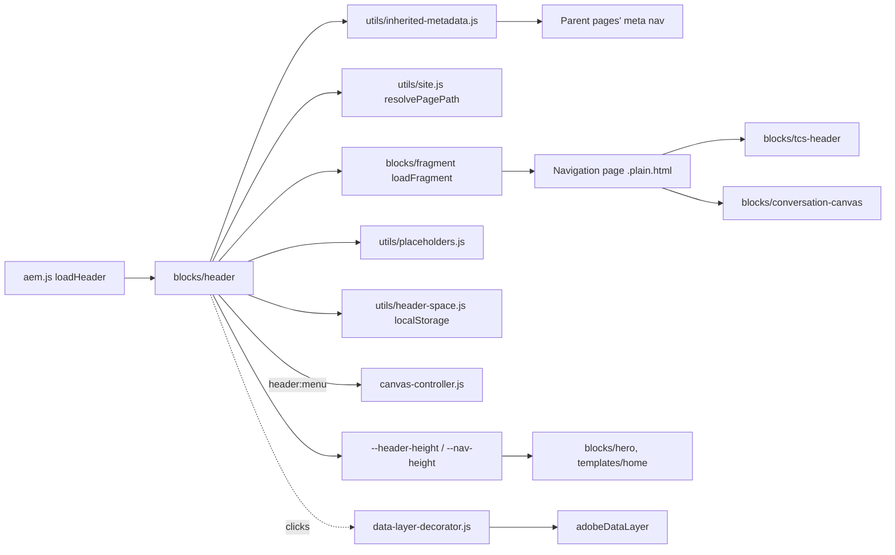
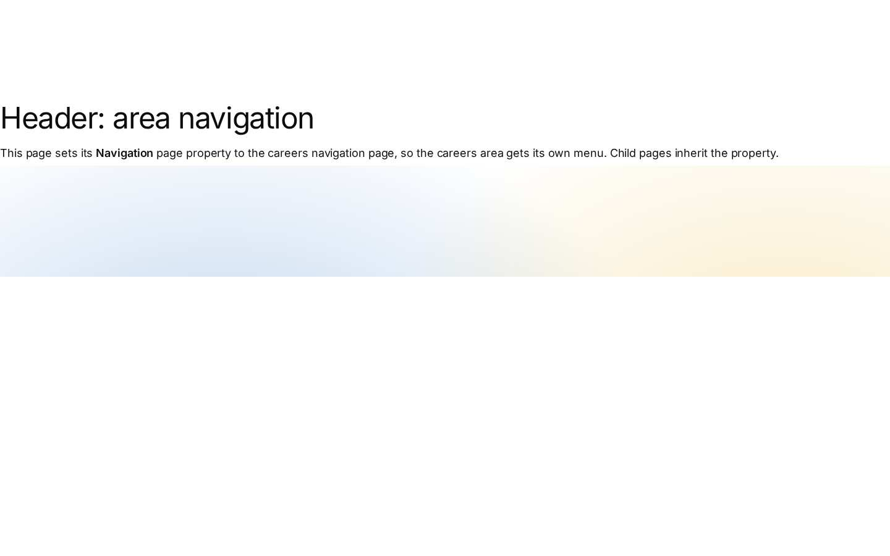
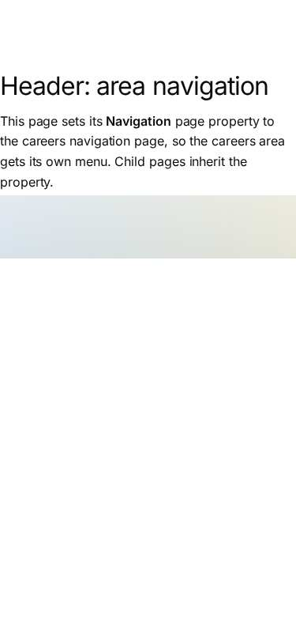

# Header Block — Developer Guide

| Attribute | Value |
| --- | --- |
| Document ID | DEV-B-header |
| Audience | Developers, technical leads, block owners, AI coding agents |
| Purpose | How the Header block is built: files, model, structure, behaviour, variations, tests and limitations |
| Scope | blocks/header/ and its components (none) |
| Prerequisites | — |
| Owner | Technical Lead / Block Owner (proposed) |
| Approver | Product Owner (to be confirmed) |
| Version | 1.0 |
| Status | Draft for review |
| Last updated | 8 November 2026 |
| Last validated | 2026-11-08 (model, files, imports from the code; reference pages from the live site) |
| Source files | blocks/header/README.md, blocks/header/header.css, blocks/header/header.js |
| Related documents | [Variations](./HEADER-VARIATIONS.md), [Test coverage](./HEADER-TEST-COVERAGE.md) |
| Related AEM paths | /content/tcs-corp/design-block-master/en/block-library/header, /content/tcs-corp/design-block-master/en/block-library/header/header-careers, /content/tcs-corp/design-block-master/en/block-library/header/header-default |

## Contents

- [Summary](#summary)
- [Overview](#overview)
- [Source files](#source-files)
- [Components, models and filters](#components-models-and-filters)
- [Fields](#fields)
- [Dependencies](#dependencies)
- [For Developers](#for-developers)
- [Extending the Block](#extending-the-block)
- [Responsive Behavior](#responsive-behavior)
- [Accessibility](#accessibility)
- [Data Layer and Analytics](#data-layer-and-analytics)
- [Performance Considerations](#performance-considerations)
- [Security and Privacy](#security-and-privacy)
- [For Architects](#for-architects)
- [Troubleshooting](#troubleshooting)
- [Known limitations of the block](#known-limitations-of-the-block)
- [Change history of the block](#change-history-of-the-block)
- [Reference pages](#reference-pages)
- [Coverage of the required topics](#coverage-of-the-required-topics)
- [Screenshots](#screenshots)
- [Known limitations](#known-limitations)
- [Open items](#open-items)
- [Change history](#change-history)

## Summary

| Attribute | Value |
| --- | --- |
| Block | Header |
| Folder | `blocks/header` |
| Type | Structural |
| Category | navigation |
| Status | Active |
| Purpose | Site header from the nav reference page: brand, menu sections, tools |
| Variations (summary) | Desktop logo bar; tablet / mobile full-screen menu |
| Children | — |
| Code size | 295 lines of JS and CSS |

## Overview

**Business purpose.** One consistent, accessible header on every page of every locale site, maintained by authors on a Navigation page (no code change for a new menu or logo).

**User experience.**

- Desktop (>= 1200px): the Figma logo bar only, TCS logo left and TATA logo right, 124px high. There is no navigation in the header (strict Figma, product decision of 16 October 2026, handover F-72): the site navigation is in the Conversation Canvas.
- Tablet and mobile (< 1200px): a fixed 64px bar with the two logos and a menu button; the menu opens full screen and shows one level at a time (title "Menu", then the open section's label, a Back button from the second level).
- Desktop over a light hero: when the page's first section has a Hero that isn't one of the dark BG Colors (`bg-dark`, `bg-dark-subtle`, `bg-black`, `bg-charcoal-80`, `bg-navy-60`, `bg-charcoal-40`), the header has no band and lies over the hero (Figma Logos 667:52520, Hero 4082:120388). With a TCS Header this applies at every width and its **Header over the first block** can change it (Always: over any first block; Never: never), and the logo bar stays fixed at the top on desktop too, see [TCS Header](https://github.com/sradha-tcs/tcs-corp/blob/main/blocks/tcs-header/README.md).

Figma: *New Screens from New DS* (`yElx5Tf9wr8G2vCXopi49W`): Navigation (1124:25825; mobile menu frames 1124:27418, 1124:27432, 1124:27453), Home desktop / tablet / mobile (229:15426, 671:52732, 4082:120430).

**Templates / page types.** All pages and templates, including the 404 page (`404.html` uses `--nav-height`).

**Data source.** The Navigation page: the page's own **Navigation** page property (or the metadata sheet's `nav` column), else the nearest parent page's up to the locale's Home page (`utils/inherited-metadata.js`), else the locale's `references/nav` (`utils/site.js` `resolvePagePath`). A configured Navigation page that can't be loaded (not published, moved) falls back to `references/nav`, so the page keeps a header. UI text comes from the locale's placeholders.

**Related blocks.** [TCS Header](https://github.com/sradha-tcs/tcs-corp/blob/main/blocks/tcs-header/README.md) (the logos on the nav page), [Conversation Canvas](https://github.com/sradha-tcs/tcs-corp/blob/main/blocks/conversation-canvas/README.md) (the header Canvas and the floating journey), [Fragment](https://github.com/sradha-tcs/tcs-corp/blob/main/blocks/fragment/README.md) (`loadFragment`), [Footer](https://github.com/sradha-tcs/tcs-corp/blob/main/blocks/footer/README.md) (same loading and inheritance).

**When to use.** Always: it is loaded automatically. Authors decide which Navigation page a page (or an area) uses and what that page contains.

**When not to use.** Don't try to add a Header to a page (it isn't in any component list); don't put page-specific promotions on the nav page (use a Fragment, Teaser or Hero on the page); don't expect desktop navigation from the header (add a Conversation Canvas).

**Realistic use cases.**

- The global header of a locale (`/en/references/nav`).
- An area header: the Careers area sets Navigation `references/nav-careers` on its top page; all pages below inherit it (block library: `block-library/header/nav-careers`).
- A Home page whose Navigation page has a Conversation Canvas section: the search row lies on the bottom of the hero and floats when the page scrolls.

## Source files

| File | Link |
| --- | --- |
| `README.md` | [GitHub](https://github.com/sradha-tcs/tcs-corp/blob/main/blocks/header/README.md) |
| `header.css` | [GitHub](https://github.com/sradha-tcs/tcs-corp/blob/main/blocks/header/header.css) |
| `header.js` | [GitHub](https://github.com/sradha-tcs/tcs-corp/blob/main/blocks/header/header.js) |

## Components, models and filters

No Universal Editor component (code-only block).

## Fields

The Additional tab fields (anchor, hide, padding, margin, animation) are common to the blocks and described in the [content modeling guide](../../markdown/CONTENT-MODELING-GUIDE.md).


"Required in model" is the model's `required` flag; whether a field is required in practice is stated in the authoring guide where it is known.

## Dependencies

| Import |
| --- |
| `../fragment/fragment.js` |
| `../../decorators/motion-decorator.js` |
| `../../decorators/button-decorator.js` |
| `../../utils/placeholders.js` |
| `../../utils/header-space.js` |
| `../../utils/inherited-metadata.js` |
| `../../utils/site.js` |

## For Developers

<!-- BEGIN GENERATED: files (npm run build:docs) -->

```text
blocks/header/
├── README.md
├── header.css
└── header.js
```

| Decorator/Utility | Purpose | Execution or dependency point |
| ----------------- | ------- | ----------------------------- |
| [`blocks/fragment/fragment.js`](https://github.com/sradha-tcs/tcs-corp/blob/main/blocks/fragment/fragment.js) | — | `header.js`: { loadFragment } |
| [`decorators/motion-decorator.js`](https://github.com/sradha-tcs/tcs-corp/blob/main/decorators/motion-decorator.js) | `prepareMotion` (the Content animation and Background animation of the blocks of a section, before it is shown, or of a fragment, footer page or header Canvas once in the page: first frame paused, run by one Intersection | `header.js`: { prepareMotion } |
| [`decorators/button-decorator.js`](https://github.com/sradha-tcs/tcs-corp/blob/main/decorators/button-decorator.js) | `decorateButton` (option `newTabHint`: a link opening a new tab says so), `createButton`, `setButtonDisabled`, `setButtonAlignment`, `removeButtonDecoration` | `header.js`: { removeButtonDecoration } |
| [`utils/placeholders.js`](https://github.com/sradha-tcs/tcs-corp/blob/main/utils/placeholders.js) | `getPlaceholders`, `loadPlaceholders`, `fillPlaceholder` (UI text from the locale's placeholders, with English fallbacks) | `header.js`: { getPlaceholders } |
| [`utils/header-space.js`](https://github.com/sradha-tcs/tcs-corp/blob/main/utils/header-space.js) | `reserveHeaderSpace`, `rememberHeaderSpace` (the loaded header's height, the logo bar, remembered per breakpoint (`header-height-v2-*`) and reserved on the next pages before the header loads: no layout shift); `setHeader | `header.js`: { rememberHeaderSpace } |
| [`utils/inherited-metadata.js`](https://github.com/sradha-tcs/tcs-corp/blob/main/utils/inherited-metadata.js) | `getInheritedMetadata`, `INHERITED_METADATA` (nav, footer and error-page of the page, else of the nearest parent page up to Home; parent heads loaded in parallel and cached per session) | `header.js`: { getInheritedMetadata } |
| [`utils/site.js`](https://github.com/sradha-tcs/tcs-corp/blob/main/utils/site.js) | `LOCALES`, `DEFAULT_LOCALE`, `getLocale`, `indexRoot`, `REVIEW_ROOTS` and `REVIEW_SHEETS` (the three review roots, KB-D-068: /language-master/en for testing, /language-masters/en the language master, /design-block-master | `header.js`: { resolvePagePath } |

<!-- END GENERATED: files -->

**Responsibilities.** `header.js` loads the nav page, assigns roles, builds the menu levels and the menu button, hosts the header Canvas and publishes the header height. `header.css` lays out the bar, menu levels and the Canvas host; `styles/styles.css` reserves the header space and takes the header out of the flow over a light hero.

**Input DOM.** `aem.js` `loadHeader` builds an empty `div.header` block in `<header>`. The content is the nav page's `.plain.html`, decorated as a page by `loadFragment` (sections, default content, TCS Header and Canvas blocks loaded).

**Decoration flow (`decorate`).**

1. Starts `loadFragment(resolvePagePath('', 'references/nav'))` at once, in parallel with `getInheritedMetadata('nav')` and `getPlaceholders()`; a configured nav page that returns nothing falls back to the default.
2. No fragment: the block stays empty (`--header-reserved` keeps the space).
3. Moves the sections into `nav#nav[aria-label]`; sections with a `.conversation-canvas` are taken out (a TCS Header in the same section is kept in its own section).
4. `applyLogoBar`: a `.tcs-header` block supplies `nav-brand` / `nav-tools`; else sections 1–3 get `nav-brand`, `nav-sections`, `nav-tools`.
5. `removeButtonDecoration` on the brand link; every `li` with a child `ul` in `.nav-sections .default-content-wrapper` becomes `.nav-drop` (`decorateDrop`, ids from `createIdFactory('nav-submenu')`); `buildLevel` prepends `.nav-level` (Back, `h2.nav-level-title`).
6. `buildHamburger` only when there is a menu; tools are moved before it (DOM order = screen order).
7. `toggleMenu(nav, navSections, isDesktop.matches)`, a `matchMedia('(min-width: 1200px)')` change listener, `keydown` (Escape) on `window`, `focusout` on the nav.
8. Appends `div.nav-wrapper > nav`, then `div.nav-canvas` with the Canvas sections and runs `prepareMotion(navCanvas)`.
9. Sets `--header-height` (rem) on `<html>`, `rememberHeaderSpace(header)` (localStorage `header-height-v2-{breakpoint}`, read by `reserveHeaderSpace` in the eager phase of the next page) and a `ResizeObserver` updating `--header-height`.

**Rendered DOM contract.**

```text
header
└─ div.header.block
   ├─ div.nav-wrapper
   │  └─ nav#nav[aria-label][data-expanded]
   │     ├─ div.section.nav-brand > p > a.tcs-header-brand (or the authored brand)
   │     ├─ div.section.nav-tools > p > a.tcs-header-group
   │     ├─ div.nav-hamburger > button[aria-controls=nav-sections][aria-expanded] > span.nav-hamburger-icon
   │     └─ div.section.nav-sections#nav-sections[.nav-sections-level]
   │        ├─ div.nav-level > button.nav-level-back[hidden] + h2.nav-level-title
   │        └─ div.default-content-wrapper > ul > li.nav-drop[data-expanded]
   │           ├─ button.nav-drop-toggle[aria-controls][aria-expanded] (or a + button[aria-label])
   │           └─ ul#nav-submenu-{label}
   └─ div.nav-canvas > div.section … div.conversation-canvas.block
```

On desktop `nav[data-expanded]` is `"true"` (the boilerplate's desktop state) while CSS hides the menu; the menu button's `aria-expanded` is the real state.

**Events.** `header:menu` (`CustomEvent` on `document`, `detail.open`) on every menu toggle, at load and at the 1200px change; the Canvas controller hides the floating journey while `open` is true (it also reads `header .nav-hamburger button[aria-expanded="true"]` at start).

**Contracts kept for other code.**

| Contract | Used by |
| -------- | ------- |
| `header .nav-wrapper` (fixed below 1200px) | `blocks/anchor-list` (offset below a fixed header) |
| `--nav-height` (4rem; 7.75rem from 1200px, `styles/styles.css`) | `styles/styles.css` (`header` height), `blocks/tabs` (scroll margin), `blocks/hero`, `templates/home`, `404.html` |
| `--header-height` (the header's height with its Canvas host, on `<html>`) | `blocks/hero`, `templates/home` (desktop header over a light hero) |
| `--header-reserved` (the space kept until the header loads: `--nav-height`, or the height remembered by `utils/header-space.js`) | `styles/styles.css`, `blocks/hero`, `templates/home` |
| `#nav`, `nav[data-expanded]`, `.nav-hamburger button[aria-expanded]`, `header:menu` | `header.js` itself (Escape), the Conversation Canvas controller |
| `.nav-canvas` | Conversation Canvas (`inHeader`), `--conversation-canvas-first-section-bottom` set on `<header>` |
| `nav-brand`, `nav-sections`, `nav-tools` | The nav page authoring contract |
| `.tcs-header-brand`, `.tcs-header-group` | `blocks/tcs-header` output read by `applyLogoBar` |

Don't add Canvas logic to `header.js` (AGENTS.md "Floating Canvas"): header and Canvas don't import each other.

**Error handling.** A nav page that can't load falls back to `references/nav`; if that fails too the header stays empty, without an error message. `localStorage` failures are ignored.

**Exported functions.** Only the default `decorate(block)`.

**Decisions (destination first, kept from the original design note).**

| Capability | Destination | Decision |
| ---------- | ----------- | -------- |
| Header loading | `aem.js` `loadHeader` → `blocks/header` | Reused; the source site's changed `aem.js` (which this project never modifies) wasn't taken over; `blocks/tcs-header` only supplies the logos |
| Navigation source | Nav page fragment (`blocks/fragment` `loadFragment`), inherited Navigation | Reused; the source's query-index menu tree and hard-coded AEM path rejected |
| Mobile menu | The header's menu (`nav[data-expanded]`, scroll lock, Escape, focus-out) | Extended with levels (Figma drill-down) on the authored list; the source's body overlay (cloned logos, `innerHTML`, `.hidden !important`, `z-index: 9999`) rejected |
| Ids, placeholders, button decoration | `utils/ids.js`, `utils/placeholders.js`, `decorators/button-decorator.js` | Reused |
| Tokens | `styles/styles.css` | Reused (spacing, icon sizes, colors, weights, border width, content max width); one token value added: `--nav-height` at 1200px |
| Icons | `icons/arrow-left.svg`, `icons/arrow-right.svg` (CSS masks) | Reused; the menu / close icon stays CSS-drawn |
| Header variants (source: Standard, Compact, Dark, Centered) | — | Not implemented: not in Figma |

## Extending the Block

- **New behaviour or variation.** The header has no model; a new option is either nav page content (a new section role, a class from the Section's Style) or a TCS Header field. A TCS Header field goes in `blocks/tcs-header/_tcs-header.json` (then `npm run build:json`, `npm run lint`); mind the delivery rules (AGENTS.md "AEM delivery rules"): fields ending in Alt / Text / Title / Type collapse into their base field, key-value blocks don't deliver grouped fields.
- **Rendering.** Keep the contracts table above; read the nav page by section role, not by position, when a TCS Header block is present.
- **Responsive.** The menu breakpoint is `isDesktop` (`min-width: 1200px`) in `header.js` and the 1200px media queries in `header.css`: change both together (F-72 suggests this to bring the menu to desktop).
- **Accessibility.** New controls are `<button>`s with `aria-expanded` / `aria-controls`, names from placeholders, focus moves as today.
- **Data layer.** Clicks are captured centrally; describe new controls with `data-cmp-interaction` / `data-cmp-value` rather than pushing events.
- **Tests.** The journey interplay is covered by `test/conversation-canvas/canvas-journey.test.mjs`, the locale reference paths by `test/site/index-root.test.mjs`; add unit tests for new pure logic.
- **Backward compatibility.** Keep reading the positional nav page and linked / unlinked labels.
- **Docs and modules.** Update this README (`npm run build:docs` regenerates the marked sections) and run `npm run build:modules` after changing imports (`scripts/module-graph.js`, checked by `npm test`; the header is in `CHROME_BLOCKS`, preloaded on every page).

## Responsive Behavior

| Viewport | Layout | Image behavior | Interaction behavior |
| -------- | ------ | -------------- | -------------------- |
| Mobile (< 600px) | Fixed bar 4rem (64px), 1rem gutters: TCS logo, TATA logo, menu button | TCS logo 1.2104rem, TATA logo 1.5rem high | Menu button opens the full-screen menu, one level at a time |
| Tablet (600–1199px) | As mobile with 1.5rem (24px) gutters; header Canvas search row 28.9375rem | TCS 1.9165rem, TATA 2.375rem | As mobile |
| Desktop (>= 1200px) | Logo bar 7.75rem (124px), 5rem (80px) gutters, not fixed (with a TCS Header: fixed at the top, `blocks/tcs-header`); no menu; over a light hero without a band; header Canvas search row 37.9375rem | TCS 2.175rem, TATA 2.75rem | No menu; crossing 1200px resets the menu state (`matchMedia` change) |

## Accessibility

- **Semantics.** `<header>` (banner landmark) holding `nav#nav` named "Main navigation" (placeholder `mainNavigation`); the menu is the authored list; the level title is an `h2`.
- **Keyboard and focus.** DOM order follows the screen: logos, menu button, menu. Opening a level focuses Back; Back focuses the button of the section it closed; Escape closes the menu and focuses the menu button; focus moving to an element outside the nav closes the menu (a tap on the menu's background, which focuses nothing, doesn't).
- **Accessible names.** Menu button "Open navigation" / "Close navigation" (`openNavigation`, `closeNavigation`); arrow button of a linked section "Show {label} menu" (`showSubmenu`); Back "Back" (`back`); level title "Menu" (`menu`).
- **State.** `aria-expanded` on the menu button and on every section button, `aria-controls` to the menu (`nav-sections`) or the sub-list (`nav-submenu-…`).
- **Hidden content.** Closed levels and the closed menu are `display: none` (not focusable, not read); while the full-screen menu is open, `main` and `footer` are `inert`.
- **Contrast.** Arrows use `--color-icon-default` (Figma's light grey fails 3:1 non-text contrast, F-75).
- **Reflow.** The menu scrolls inside the full-screen layer.

Author responsibilities: meaningful logo alt texts, short unique labels, a section label for every nested list, translated placeholders per locale.

Developer responsibilities: keep the buttons, `aria-*` and focus moves; keep hidden levels `display: none`; keep `inert` on `main` / `footer` while the menu is open; UI text only from placeholders.

| Key | Expected behavior |
| --- | ----------------- |
| Tab / Shift+Tab | Moves through logos, menu button and the visible menu rows; leaving the nav closes the menu (below 1200px) |
| Enter / Space | On the menu button: opens / closes the menu; on a section button: opens its level (focus to Back) or closes it; on Back: returns one level |
| Escape | Closes the open menu (below 1200px) and focuses the menu button |

## Data Layer and Analytics

- **Component.** The header block is a `.block`: it is added to the Adobe Client Data Layer in the delayed phase (`trackBlocks(document)` in `scripts/scripts.js` `loadDelayed`) as `component.header-1` (`@type` `tcs-corp/components/header`, `parentId` the page; `dc:title` is the first heading in it, the menu level title "Menu").
- **Variation / positions.** No variation or `data-cmp-position` attributes; the header sets no `data-cmp-*` attributes and pushes no events itself.
- **Clicks.** `decorators/data-layer-decorator.js` captures clicks on the logos, menu links and buttons (menu, section, Back) as `cmp:click` for the header component; on the nav page the TCS Header block is replaced by the header's sections, so logo clicks report the header.
- **Header Canvas.** The Conversation Canvas in `.nav-canvas` is its own component with its own events.

| Trigger | Data-layer event | Required properties | Analytics behavior |
| ------- | ---------------- | ------------------- | ------------------ |
| Delayed phase (3 s after the lazy phase) | `component` entry `header-1` | `@type`, `parentId` | Component inventory |
| Click on a logo or a menu link | `cmp:click` | `eventInfo.path` `component.header-1`, `interaction` "link", `dc:title` (the link text; empty for an image-only logo link), `xdm:linkURL`, `xdm:linkType` (`other` / `exit`), `breakpoint` | Navigation click |
| Click on the menu button, a section button or Back | `cmp:click` | `interaction` "button", `dc:title` (its `aria-label` or text), `breakpoint` | Menu use |

The intended flow is Adobe Client Data Layer → Adobe Data Collection (Tags) → AEP Web SDK → Edge Network → Analytics / CJA; Tags and the Web SDK aren't configured yet (blocked: measurement plan). No consent mechanism is implemented. The `header:menu` DOM event is not a data-layer event.

## Performance Considerations

- Lazy phase (`loadLazy`); `reserveHeaderSpace()` runs in the eager phase so the header's space (`--header-reserved`, or the height remembered per breakpoint) is kept and nothing shifts when it arrives.
- The default nav page request starts immediately (most pages use it), in parallel with the parent-page lookup and the placeholders; a page with its own Navigation still requests the default (it's the fallback).
- Header, footer, fragment, TCS Header and Conversation Canvas modules and stylesheets are preloaded on every page (`preloadBlockModules(CHROME_BLOCKS)`, handover 2.36).
- Listeners: one `matchMedia` change listener, `keydown` on `window`, `focusout` on the nav, one `ResizeObserver` on `<header>`.
- The header Canvas is out of the flow and the reserve is the logo bar only (F-98): no layout shift from the Canvas.
- High-cost configuration: a deep inheritance chain (many parent pages without a Navigation value) adds one parallel request per parent page in the first session.

## Security and Privacy

- Fragment paths go through `loadFragment`: only root-relative same-site paths are fetched (not `//`); content is the site's own `.plain.html`.
- Links are as authored; the header adds no query strings and stores only the header height (`localStorage`) and the inherited values (`sessionStorage`), no personal data.

## For Architects

- **Role.** Page chrome: the banner landmark, built in the lazy phase from a content page (experience-fragment-like reuse through Edge Delivery fragments).
- **Content model.** A Navigation page per locale / area, inherited like an AEM page property (`getInheritedMetadata`: parent heads loaded in parallel, cached in `sessionStorage` per session).
- **Rendering.** Client-side, from `{nav}.plain.html` via `loadFragment` (full page decoration of the fragment); AEM author paths when editing, published paths on the site.
- **Dependencies.** `blocks/fragment`, `decorators/motion-decorator.js`, `decorators/button-decorator.js`, `utils/ids.js`, `utils/placeholders.js`, `utils/header-space.js`, `utils/inherited-metadata.js`, `utils/site.js`.
- **Data layer / Web SDK / Target.** Central click capture only; no Target / AJO.
- **Consent and identity.** None in the block.
- **Caching.** Nav page and placeholders through the CDN and browser cache; inherited values per session; the header height per breakpoint in `localStorage`.
- **Performance.** Default nav fetched immediately, in parallel with the inheritance lookup; modules preloaded (`preloadBlockModules(CHROME_BLOCKS)`); the reserved space avoids layout shift (F-93, F-98).
- **Security.** Only same-site root-relative fragment paths are fetched (`loadFragment`).
- **Scalability.** One nav page per locale / area; any menu depth.



## Troubleshooting

| Symptom | Likely cause | Diagnostic steps | Resolution | Verification |
| ------- | ------------ | ---------------- | ---------- | ------------ |
| Header empty | Neither the configured nor the default nav page is published (F-80) | Network: `{nav}.plain.html` status | Publish `references/nav` (and the configured page) | Header shows |
| Area shows the default header | Navigation not set on a parent, or cached inherited value (F-35) | Check the page and parents' `<meta name="nav">`; new private window | Set Navigation on the area top page and publish | Area header in a new session |
| No navigation on desktop | Expected: desktop is the logo bar (F-72) | — | Add a Conversation Canvas to the page or nav page | Canvas navigation visible |
| Text "Button" or boilerplate items | Nav page holds placeholder content (F-74) | Open the nav page | Author the logos and the menu | Real header |
| A section's page can't be reached | Label typed outside the list item, or old content before 2.2 | Inspect the list structure | Make the label the linked list item holding the nested list | Link and arrow button |
| Menu stays open / page doesn't scroll | Script error during toggle | Console; `nav[data-expanded]`, `body` `overflow-y` | Reload; report with the console log | Menu closes, scroll restored |
| English button names on another locale | Placeholders keys missing | `/{locale}/placeholders.json` | Add the keys | Translated names |
| Logos missing | DAM assets not uploaded / published (F-77) | Image requests in Network | Upload and publish the SVGs, select them in the TCS Header | Logos visible |

Evidence to collect: page URL, viewport width, the `nav` meta value of the page and its parents, the network status of the nav page request, console errors, a screenshot. Don't collect cookies or tokens.

## Known limitations of the block

| Limitation | Impact | Workaround | Planned correction |
| ---------- | ------ | ---------- | ------------------ |
| No navigation in the desktop header (product decision, F-72) | A page without a Conversation Canvas has no desktop navigation | Author a Canvas on the page or the nav page | Not recorded (F-72 open, Product Owner / Design) |
| Inherited Navigation cached per browser session (F-35) | A changed parent value shows in a new session | Test in a private window | Not recorded |
| Nav pages hold boilerplate content (F-74) and the logos aren't in DAM yet (F-77) | Placeholder header content | Author the nav pages; upload the SVG logos | Not recorded (content tasks) |
| Figma deviations for accessibility (F-75): darker arrows, inset rows | Visual difference from Figma | — | Design review |
| On desktop the nav landmark "Main navigation" holds only the two logo links (audit, docs/audit/blocks/group-d-forms-media-chrome.md) | Landmark name slightly inaccurate | — | Not planned |
| No hover-to-open and no outside-click handler; closing relies on focus leaving the nav | A tap on the menu background keeps it open (by design, F-71) | Escape or the close button | Not planned |

## Change history of the block

| Version | Change | Source | Date |
| ------- | ------ | ------ | ---- |
| Not recorded | README generated from verified implementation and approved handover documentation | Repository review | Not recorded |
| Handover 2.2 | TCS Header: desktop logo bar (124px, navigation in the Conversation Canvas), tablet / mobile menu one level at a time, linked labels keep their link, `--nav-height` 7.75rem from 1200px (F-70 to F-76) | docs/handover revision history | 16 October 2026 |
| Handover 2.3 | Floating Canvas journey hidden while the header menu is open (`header:menu`) | docs/handover revision history | 16 October 2026 |
| Handover 2.4 | Logo sizes per breakpoint, one DAM asset per logo (F-77) | docs/handover revision history | 16 October 2026 |
| Handover 2.6 | Fallback to `references/nav` when the configured Navigation page can't load (F-80); desktop header over a light hero | docs/handover revision history | 16 October 2026 |
| Handover 2.13 | Nav page and placeholders loaded in parallel, default nav started at once | docs/handover revision history | 17 October 2026 |
| Handover 2.14 | Language master pages inherit Navigation up to its root page (F-91) | docs/handover revision history | 17 October 2026 |
| Handover 2.15 | Header space reserved until it loads (`--header-reserved`, `utils/header-space.js`, F-93) | docs/handover revision history | 18 October 2026 |
| Handover 2.21 | Header and Canvas as two zones: the reserve is the logo bar, the Canvas row on the bottom of the Home hero (F-98) | docs/handover revision history | 19 October 2026 |
| Handover 2.27 | Block ecosystem audit: the page behind the full-screen menu made inert (D-D-26) | docs/handover revision history; docs/audit/BLOCK-ECOSYSTEM-AUDIT.md | 19 October 2026 |
| Handover 2.29 | Re-audit: no menu button without a menu (R-D-14) | docs/handover revision history; docs/audit/REAUDIT-2026-10-20.md | 20 October 2026 |
| Handover 2.36 | Header blocks' modules and stylesheets preloaded (load time, F-106) | docs/handover revision history | 20 October 2026 |

## Reference pages

| Kind | Page | Live URL |
| --- | --- | --- |
| Block library | /design-block-master/en/block-library/header | https://main--tcs-corp--sradha-tcs.aem.live/design-block-master/en/block-library/header |
| Block library | /design-block-master/en/block-library/header/header-careers | https://main--tcs-corp--sradha-tcs.aem.live/design-block-master/en/block-library/header/header-careers |
| Block library | /design-block-master/en/block-library/header/header-default | https://main--tcs-corp--sradha-tcs.aem.live/design-block-master/en/block-library/header/header-default |
| Block library | /design-block-master/en/block-library/header/nav-careers | https://main--tcs-corp--sradha-tcs.aem.live/design-block-master/en/block-library/header/nav-careers |
| Block library | /design-block-master/en/block-library/header/nav-default | https://main--tcs-corp--sradha-tcs.aem.live/design-block-master/en/block-library/header/nav-default |

## Coverage of the required topics

| Topic | Where |
| --- | --- |
| Purpose | Overview |
| Source files | generated: Files |
| Model, definition, filters, children | generated: Components |
| Dependencies | generated: Dependencies |
| Authored input / rendered output / DOM transformation | For Developers |
| Configuration fields, defaults, required fields | generated: Fields |
| Variations | HEADER-VARIATIONS.md |
| Responsive behaviour | Responsive Behavior |
| Accessibility and keyboard | Accessibility |
| Analytics / data layer | Data Layer and Analytics |
| Performance | Performance Considerations |
| Security | Security and Privacy |
| Extending | Extending the Block |
| Known limitations | Known Limitations |
| Troubleshooting | Troubleshooting |
| Tests | HEADER-TEST-COVERAGE.md |
| SEO behaviour | Not recorded |
| Caching considerations | Not recorded (Edge Delivery default caching; no block-specific rule) |
| Ownership | Technical Lead / Block Owner (proposed) |

## Screenshots



*Figure: Header block library page — desktop 1440 × 900 (/design-block-master/en/block-library/header/header-careers, captured 2026-11-08).*



*Figure: Header block library page — mobile 375 × 812 (/design-block-master/en/block-library/header/header-careers, captured 2026-11-08).*


*Figure: Desktop rendering — The header at 1440 px in one 4rem row: TCS at the left, Services, Industries, Insights and About us, then Investors and the Contact us primary button at the right. Services is open: its chevron points up and a light grey 12.5rem panel with a pointer triangle lists Consulting, Cloud, Cybersecurity and AI and data. (Sample content on the preview; callout letters as in the Field Entry Table; file screenshots/header-desktop-view.jpg) (handover screenshot; rendering at the time it was taken).*


*Figure: Tablet rendering — The header at 768 px with the menu closed, in one 4rem row: the three-bar menu button at the left, TCS next to it and Investors with the Contact us button at the right; the four sections are hidden. (Sample content on the preview; callout letters as in the Field Entry Table; file screenshots/header-tablet-view.jpg) (handover screenshot; rendering at the time it was taken).*


*Figure: Mobile rendering — Two 390 px frames side by side. Menu closed: the menu button, TCS and the tools in one 4rem row. Menu open: the X icon and TCS, then Services with Consulting, Cloud, Cybersecurity and AI and data, Industries with Banking, Retail and Manufacturing, Insights and About us stacked, and Investors and Contact us at the bottom. (Sample content on the preview; callout letters as in the Field Entry Table; file screenshots/header-mobile-view.jpg) (handover screenshot; rendering at the time it was taken).*


*Figure: Default navigation of the /en locale — An /en content page at 1440 px with the header from /en/references/nav, all dropdowns closed: TCS, Services and Industries with chevrons, Insights, About us, Investors and the Contact us primary button, above the start of the page content. (Sample content on the preview; callout letters as in the Field Entry Table; file screenshots/header-default-locale-navigation.jpg) (handover screenshot; rendering at the time it was taken).*


*Figure: Area-specific navigation — Two 1440 px headers one above the other (not side by side). Top, a page of /en: TCS, Services, Industries, Insights, About us, Investors, Contact us. Bottom, /en/careers/jobs inheriting nav-careers: TCS Careers, Find jobs with a chevron, Life at TCS, Locations, tcs.com and the Apply now primary button. (Sample content on the preview; callout letters as in the Field Entry Table; file screenshots/header-alternate-navigation.jpg) (handover screenshot; rendering at the time it was taken).*


*Figure: An open dropdown — The header at 1440 px with Services open: its chevron points up, and the light grey 12.5rem panel with the pointer triangle lists Consulting, Cloud, Cybersecurity and AI and data in regular weight, with Cloud underlined under the mouse pointer. (Sample content on the preview; callout letters as in the Field Entry Table; file screenshots/header-desktop-dropdown.jpg) (handover screenshot; rendering at the time it was taken).*


*Figure: Open mobile menu — The header at 390 px with the menu open over the full height: the X icon and TCS on top, then Services with Consulting, Cloud, Cybersecurity and AI and data, Industries with Banking, Retail and Manufacturing, Insights and About us stacked, and Investors and Contact us at the bottom. (Sample content on the preview; callout letters as in the Field Entry Table; file screenshots/header-mobile-menu.jpg) (handover screenshot; rendering at the time it was taken).*


*Figure: Section label rendered as a button — The header at 1440 px after Tab to Services and Enter: the Services button shows the keyboard focus ring and its chevron points up, and its dropdown lists Consulting, Cloud, Cybersecurity and AI and data. (Sample content on the preview; callout letters as in the Field Entry Table; file screenshots/header-unlinked-section-label.jpg) (handover screenshot; rendering at the time it was taken).*


*Figure: Linked label with dropdown toggle — The header at 1440 px after Tab from the bold Industries link to its toggle and Enter: Industries stays a link with its chevron pointing up and the dropdown lists Banking, Retail and Manufacturing; no focus ring is visible because the toggle button is 0 × 0 (F-13). (Sample content on the preview; callout letters as in the Field Entry Table; file screenshots/header-linked-section-label.jpg) (handover screenshot; rendering at the time it was taken).*


*Figure: Plain first-level link — The header at 1440 px with the pointer on Insights: Insights is underlined and has no chevron, like About us, while Services and Industries carry closed chevrons; no dropdown is open. (Sample content on the preview; callout letters as in the Field Entry Table; file screenshots/header-simple-section-link.jpg) (handover screenshot; rendering at the time it was taken).*


*Figure: Tools on the right of the header — Two frames one above the other. Top, 1440 px: the full row with Investors as a link and the Contact us primary button at the right end. Bottom, 390 px with the menu closed: the menu button, TCS and the same two tools at the right of the 4rem row. (Sample content on the preview; callout letters as in the Field Entry Table; file screenshots/header-tools-area.jpg) (handover screenshot; rendering at the time it was taken).*


*Figure: Universal Editor canvas of the nav page — references/nav opened directly in editor mode at 1440 px, rendered as an ordinary page under its own header: A the section with the TCS link, B the bulleted list, C Services with its four indented links, D one second-level link, E the section with Investors and the Contact us button. (Annotated preview in editor mode with sample content; letters as in the annotations list, not a Universal Editor screenshot; file screenshots/header-authoring-view.jpg) (handover screenshot; rendering at the time it was taken).*


*Figure: Properties used to choose the nav page — Page Properties of a content page with the Navigation field (and Footer, 404 Page) highlighted; plus the properties panel of the Text component holding the list on the nav page. (Dialog reference generated from the component model, not a Universal Editor screenshot; file screenshots/header-properties-panel.jpg) (handover screenshot; rendering at the time it was taken).*

## Known limitations

- Universal Editor dialogs were not captured: no author access in this program (see the access blockers).

## Open items

- None.

## Change history

| Version | Date | Author | Change |
| --- | --- | --- | --- |
| 1.0 | 8 November 2026 | Delivery team (documentation program) | First version of the role-specific documentation (master documentation prompt), generated from the repository and the published reference pages |
