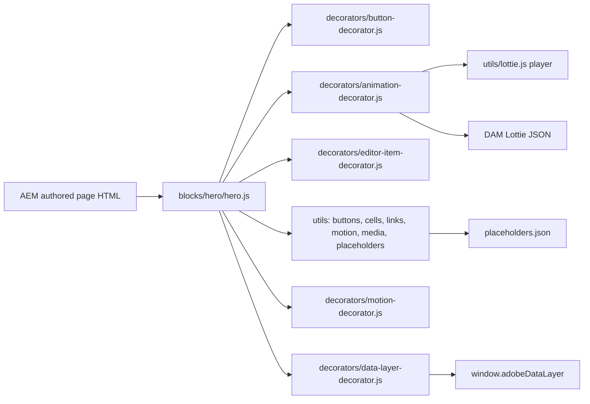
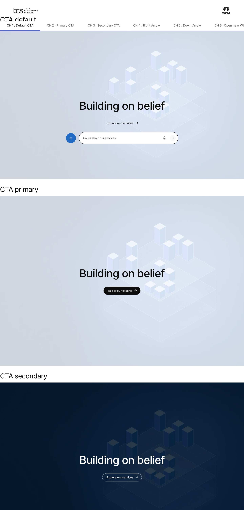
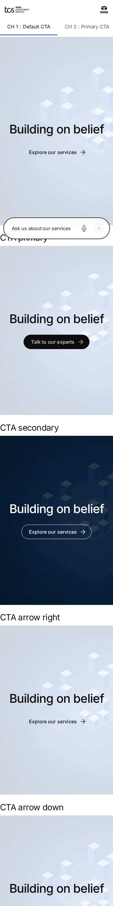

# Hero Block — Developer Guide

| Attribute | Value |
| --- | --- |
| Document ID | DEV-B-hero |
| Audience | Developers, technical leads, block owners, AI coding agents |
| Purpose | How the Hero block is built: files, model, structure, behaviour, variations, tests and limitations |
| Scope | blocks/hero/ and its components hero, hero-cta |
| Prerequisites | — |
| Owner | Technical Lead / Block Owner (proposed) |
| Approver | Product Owner (to be confirmed) |
| Version | 1.0 |
| Status | Draft for review |
| Last updated | 13 November 2026 |
| Last validated | 2026-11-13 (model, files, imports from the code; reference pages from the live site) |
| Source files | blocks/hero/README.md, blocks/hero/_hero.json, blocks/hero/hero.css, blocks/hero/hero.js |
| Related documents | [Variations](./HERO-VARIATIONS.md), [Test coverage](./HERO-TEST-COVERAGE.md), [Authoring guide](../../../03-authoring/components/hero/HERO-AUTHORING-GUIDE.md) |
| Related AEM paths | /content/tcs-corp/design-block-master/en/block-library/hero, /content/tcs-corp/design-block-master/en/block-library/hero/hero-ctas, /content/tcs-corp/design-block-master/en/block-library/hero/hero-motion |

## Contents

- [Summary](#summary)
- [Overview](#overview)
- [Source files](#source-files)
- [Components, models and filters](#components-models-and-filters)
- [Fields](#fields)
- [Dependencies](#dependencies)
- [For Developers](#for-developers)
- [Extending the Block](#extending-the-block)
- [Responsive Behavior](#responsive-behavior)
- [Accessibility](#accessibility)
- [Data Layer and Analytics](#data-layer-and-analytics)
- [Performance Considerations](#performance-considerations)
- [Security and Privacy](#security-and-privacy)
- [For Architects](#for-architects)
- [Troubleshooting](#troubleshooting)
- [Known limitations of the block](#known-limitations-of-the-block)
- [Change history of the block](#change-history-of-the-block)
- [Reference pages](#reference-pages)
- [Coverage of the required topics](#coverage-of-the-required-topics)
- [Screenshots](#screenshots)
- [Known limitations](#known-limitations)
- [Open items](#open-items)
- [Change history](#change-history)

## Summary

| Attribute | Value |
| --- | --- |
| Block | Hero |
| Folder | `blocks/hero` |
| Type | Container |
| Category | content |
| Status | Active |
| Purpose | Full-width banner with image or Lottie, title, description and CTAs |
| Variations (summary) | Views, nine positions, BG Color, animation |
| Children | hero-cta (CTA) |
| Code size | 908 lines of JS and CSS |

## Overview

**Business purpose.** Give key landing pages a brand-consistent first impression: one headline, supporting imagery or motion, and one or more CTAs that route visitors to the next step. As the first block of a page the Hero image is usually the Largest Contentful Paint (LCP) element, so `hero.js` loads it first.

**User experience.** Visitors see a banner at least 35rem high (40rem from 600px, 53.125rem from 900px) with the media behind an overlay and the content block on top. A Lottie animation loops behind the content with a pause / play button in the bottom-right corner. CTAs are pill buttons (Primary, Secondary) or text links with an arrow (Default).

**Templates / page types.** Any page. On Page Type `home` the Home template (`templates/home/home.css`) makes the opening Hero fill the first screen and keeps its content clear of the header Conversation Canvas row. On `article`, `blog` and `press-release` pages the template adds a [Page Header](https://github.com/sradha-tcs/tcs-corp/blob/main/blocks/page-header/README.md), which holds the page's H1.

**Data source.** Authored fields only. The Hero reads no page metadata, tags, taxonomy, data sheet or query index; it reads the placeholders sheet only for the new-tab hint (when a CTA opens a new tab), the Lottie pause / play labels and, in Universal Editor, the empty-item hint.

**Related blocks.** [Page Header](https://github.com/sradha-tcs/tcs-corp/blob/main/blocks/page-header/README.md) (metadata-driven title area of templated pages), the Teaser block (`blocks/teaser`, a smaller promotion in the page flow sharing the Lotto image type), [Gen Carousel](https://github.com/sradha-tcs/tcs-corp/blob/main/blocks/gen-carousel/README.md) (rotates Heroes or Teasers as slides), [Button Block](https://github.com/sradha-tcs/tcs-corp/blob/main/blocks/button-block/README.md) (same button decorator and styles).

**When to use.** At the top of a landing, home or campaign page that needs a visual banner with a single strong headline and a few prominent CTAs; as a slide of a Gen Carousel.

**When not to use.** On article, blog and press-release pages (use the Page Header); for a smaller promotion inside the page flow (use the Teaser); for lists of pages or cards (List, Cards, Filter List); for a background video (not implemented in the Hero; use the Video or Embed block); for several banners in a row (use a Gen Carousel section).

**Realistic use cases.**

- The opening banner of a locale home page (`/en`, `/de-de`, ...).
- A service or industry landing page with a photograph, an H1 and two CTAs.
- A campaign page with a Lottie animation as the background (Hero Image type Lotto).
- An annual report banner whose chart illustration must be shown whole (Hero View Contained image).
- A brand statement on a navy or black overlay with white text.
- A "Discover our story" banner whose CTA scrolls to a section of the same page (down arrow).

## Source files

| File | Link |
| --- | --- |
| `README.md` | [GitHub](https://github.com/sradha-tcs/tcs-corp/blob/main/blocks/hero/README.md) |
| `_hero.json` | [GitHub](https://github.com/sradha-tcs/tcs-corp/blob/main/blocks/hero/_hero.json) |
| `hero.css` | [GitHub](https://github.com/sradha-tcs/tcs-corp/blob/main/blocks/hero/hero.css) |
| `hero.js` | [GitHub](https://github.com/sradha-tcs/tcs-corp/blob/main/blocks/hero/hero.js) |

## Components, models and filters

| Component | Title | Resource type | Template name | Model | Children allowed |
| --- | --- | --- | --- | --- | --- |
| `hero` | Hero | `core/franklin/components/block/v1/block` | Hero | `hero` | hero-cta |
| `hero-cta` | CTA | `core/franklin/components/block/v1/block/item` | CTA | `hero-cta` | — |

## Fields

The Additional tab fields (anchor, hide, padding, margin, animation) are common to the blocks and described in the [content modeling guide](../../markdown/CONTENT-MODELING-GUIDE.md).

### Hero (`hero`)

| Tab | Label | Property | Type | Required in model | Default | Options | Visibility |
| --- | --- | --- | --- | --- | --- | --- | --- |
| Content | Icon | `content_icon` | reference | No | — | — | — |
| Content | Icon Image Alt Text | `content_iconAlt` | text | No | — | — | — |
| Content | Hero Image type | `classes_media` | select | No | `""` | 2 options | — |
| Content | Hero Image Path | `image` | reference | No | — | — | — |
| Content | Hero Image alt text | `imageAlt` | text | No | — | — | — |
| Content | Hero View | `classes` | select | No | `""` | 2 options | — |
| Content | Eyebrow | `content_eyebrow` | text | No | — | — | — |
| Content | Title | `content_title` | text | No | — | — | — |
| Content | Title heading level | `content_titleType` | select | No | `h1` | 2 options | — |
| Content | Description | `content_description` | richtext | No | `""` | — | — |
| Content | CTA List | `ctas` | container | No | — | — | — |
| Content | CTA List › CTA Title | `ctaText` | text | No | — | — | — |
| Content | CTA List › CTA Text color | `ctaTextColor` | select | No | `cta-text-black` | 2 options | — |
| Content | CTA List › CTA Link | `cta` | aem-content | No | — | — | — |
| Content | CTA List › CTA Link Type | `ctaTarget` | select | No | `same-window` | 2 options | — |
| Content | CTA List › CTA view | `ctaType` | select | No | `default` | 3 options | — |
| Content | CTA List › Primary CTA BG Color (Primary only) | `ctaPrimaryBackground` | select | No | `primary-bg-default` | 2 options | — |
| Content | CTA List › Secondary CTA BG Color (Secondary only) | `ctaBackground` | select | No | `secondary-bg-default` | 3 options | — |
| Content | CTA List › Secondary CTA Border color (Secondary only) | `ctaBorder` | select | No | `secondary-border-default` | 3 options | — |
| Content | CTA List › CTA Arrow | `ctaArrow` | select | No | `right` | 2 options | — |
| Style | Vertical Alignment | `classes_alignment` | select | No | `align-middle` | 3 options | — |
| Style | Horizontal Alignment | `classes_horizontal` | select | No | `align-center` | 3 options | — |
| Style | Text Alignment | `classes_textAlignment` | select | No | `text-center` | 3 options | — |
| Style | BG Color | `classes_background` | select | No | `""` | 8 options | — |
| Style | Icon color | `classes_iconcolor` | select | No | `""` | 5 options | — |
| Style | Eyebrow color | `classes_eyebrowcolor` | select | No | `""` | 3 options | — |
| Style | Title color | `classes_titlecolor` | select | No | `""` | 3 options | — |
| Style | Description color | `classes_descriptioncolor` | select | No | `""` | 3 options | — |

### CTA (`hero-cta`)

| Tab | Label | Property | Type | Required in model | Default | Options | Visibility |
| --- | --- | --- | --- | --- | --- | --- | --- |
| — | CTA Link | `link` | aem-content | Yes | — | — | — |
| — | CTA Title | `linkText` | text | No | — | — | — |
| — | CTA Link Type | `linkTarget` | select | No | `""` | 2 options | — |
| — | CTA view | `linkStyle` | select | No | `""` | 3 options | — |
| — | CTA Arrow | `linkArrow` | select | No | `""` | 3 options | — |

"Required in model" is the model's `required` flag; whether a field is required in practice is stated in the authoring guide where it is known.

## Dependencies

| Import |
| --- |
| `../../scripts/scripts.js` |
| `../../decorators/animation-decorator.js` |
| `../../decorators/button-decorator.js` |
| `../../decorators/editor-item-decorator.js` |
| `../../utils/buttons.js` |
| `../../utils/cells.js` |
| `../../utils/links.js` |
| `../../utils/motion.js` |
| `../../utils/media.js` |
| `../../utils/placeholders.js` |

## For Developers

<!-- BEGIN GENERATED: files (npm run build:docs) -->

```text
blocks/hero/
├── README.md
├── _hero.json
├── hero.css
└── hero.js
```

| Decorator/Utility | Purpose | Execution or dependency point |
| ----------------- | ------- | ----------------------------- |
| [`scripts/scripts.js`](https://github.com/sradha-tcs/tcs-corp/blob/main/scripts/scripts.js) | Page decoration (moveInstrumentation and shared page helpers) | `hero.js`: { moveInstrumentation } |
| [`decorators/animation-decorator.js`](https://github.com/sradha-tcs/tcs-corp/blob/main/decorators/animation-decorator.js) | `createAnimation`, `playAnimation` (Lottie animations of the Lotto image type, loaded when near the viewport; a pause / play button as `element.animationToggle`, WCAG 2.2.2; paused for reduced motion) | `hero.js`: { createAnimation } |
| [`decorators/button-decorator.js`](https://github.com/sradha-tcs/tcs-corp/blob/main/decorators/button-decorator.js) | `decorateButton` (option `newTabHint`: a link opening a new tab says so), `createButton`, `setButtonDisabled`, `setButtonAlignment`, `removeButtonDecoration` | `hero.js`: { decorateButton } |
| [`decorators/editor-item-decorator.js`](https://github.com/sradha-tcs/tcs-corp/blob/main/decorators/editor-item-decorator.js) | `buildEditorItems`, `editorItemHint` (in Universal Editor, an item the block doesn't render yet, e.g. a CTA just added, as a dashed placeholder the author can select; styles in `styles/lazy-styles.css`; the hint loaded o | `hero.js`: { buildEditorItems, editorItemHint } |
| [`utils/buttons.js`](https://github.com/sradha-tcs/tcs-corp/blob/main/utils/buttons.js) | `BUTTON_VIEWS`, `BUTTON_TYPES`, `BUTTON_ALIGNMENTS`, `pick`, `readButtonOptions` | `hero.js`: { readButtonOptions } |
| [`utils/cells.js`](https://github.com/sradha-tcs/tcs-corp/blob/main/utils/cells.js) | `itemRows`, `KEY_VALUE_ITEM`, `FIELD_ROW_ITEM` (the item rows of a block: by model in the editor, by their cells on the page), `withoutTabCells` (drops the empty cell AEM renders for each dialog tab of an item model), `m | `hero.js`: { FIELD_ROW_ITEM, itemRows } |
| [`utils/links.js`](https://github.com/sradha-tcs/tcs-corp/blob/main/utils/links.js) | `NEW_WINDOW`, `linkOf`, `linkPathsOf` (the paths of a page property, one or many), `readLinkItems` (CTA lists with Link Type and the items' other select values), `readLinkRows` (the same from link item rows, e.g. Hero CT | `hero.js`: { NEW_WINDOW, readLinkItems, readLinkRows } |
| [`utils/motion.js`](https://github.com/sradha-tcs/tcs-corp/blob/main/utils/motion.js) | `CONTENT_MOTIONS`, `BACKGROUND_MOTIONS`, `contentMotionOf`, `backgroundMotionOf` (the Content animation / Background animation of the Additional tab, read from the block classes `motion-*` / `bg-motion-*`; unknown values | `hero.js`: { addLegacyMotion } |
| [`utils/media.js`](https://github.com/sradha-tcs/tcs-corp/blob/main/utils/media.js) | `isYoutube`, `isVimeo`, `isAnimation`, `youtubeEmbedUrl`, `vimeoEmbedUrl`, `videoType`, `deliveryAsset` (reads a Dynamic Media with OpenAPI delivery URL of a separate AEM Assets environment), `deliveryImageUrl` (its URL  | `hero.js`: { animationLabel, isAnimation } |
| [`utils/placeholders.js`](https://github.com/sradha-tcs/tcs-corp/blob/main/utils/placeholders.js) | `getPlaceholders`, `loadPlaceholders`, `fillPlaceholder` (UI text from the locale's placeholders, with English fallbacks) | `hero.js`: { getPlaceholders } |

<!-- END GENERATED: files -->

**Responsibilities.** `hero.js` sorts the authored rows into media, content and CTA cells, builds `div.hero-media`, `div.hero-content` and `div.hero-ctas`, decorates the CTAs and maps the legacy Motion Type. `hero.css` holds the layout, the nine positions, the overlays and the dark-variant colours through custom properties (`--hero-*`).

**Input DOM.** One cell per row, in any order (`readCells`): the media cell (only one picture and no text, or only one animation link whose text is its link text), the CTA List cell (legacy multifield: only links and `new-window` / `right` / `down` values, no heading), and the content cell (the first other cell; further cells, including the empty rows AEM delivers for dialog tabs, are appended to it). CTA items (`hero-cta`) arrive as rows after the block's own rows, one cell per field (link, link target, style, arrow); `itemRows(block, ['hero-cta'], FIELD_ROW_ITEM)` finds them by model in Universal Editor and by their 2+ cells on the page (`test/items/item-rows.test.mjs`).

**Rendered DOM.**

```html
<div class="hero align-middle align-center text-center hero-has-media block" data-block-name="hero">
  <div class="hero-media"><picture>…</picture></div>
  <div class="hero-content">
    <div class="hero-icon"><picture>…</picture></div>
    <p class="hero-eyebrow">…</p>
    <h1 class="hero-title">…</h1>
    <div class="hero-description"><p>…</p></div>
    <div class="hero-ctas"><a class="button primary" href="…">…</a><a class="button tertiary hero-cta-down" href="#…">…</a></div>
  </div>
  <button class="animation-toggle …" data-cmp-interaction="animation"></button>
</div>
```

The toggle exists only for Lotto. `hero-has-media` is set only when media rendered.

**Decoration flow.** `decorate(block)`: find CTA item rows → read the other rows → `editorItemHint` (placeholders only in Universal Editor) → load placeholders for `opensInNewTab` only when a CTA opens a new tab → `buildMedia` (eager / high priority image in the first section, or `createAnimation`) → `buildContent` → `buildCtas` (`readLinkItems` for the legacy multifield, `readLinkRows` for items, `decorateButton` with `view: 'button'`, `moveInstrumentation` from each item row) → move Universal Editor instrumentation to the new elements → `block.replaceChildren` → `mapLegacyMotion`.

**Events and async behavior.** `decorate` awaits the placeholders only in the editor or when a CTA opens a new tab. The Lottie player loads asynchronously (`playAnimation`: `onVisible` with 200px root margin, then idle); `animation:failed` hides the animation and its toggle. Motion is prepared afterwards by `decorators/motion-decorator.js` (targets `:scope > .hero-content`, background layers `:scope > .hero-media` with the overlay).

**Error handling.** A Lottie failure logs `failed to play the Lottie animation` and hides the animation; missing placeholders fall back to English; CTAs without links are dropped (shown as editor placeholders in Universal Editor).

**Exported functions.** Only the default `decorate`.

**Parent / child contracts.** As a Gen Carousel slide the Hero is decorated normally and then moved into a slide by `blocks/gen-carousel/gen-carousel.js`. `styles/styles.css` and `templates/home/home.css` select `main > .section:first-child .hero` (header over a light hero, Home first screen; with `<html data-header-overlay>` from the TCS Header); keep the `bg-dark`, `bg-dark-subtle`, `bg-black`, `bg-charcoal-80`, `bg-navy-60`, `bg-charcoal-40` class names (a new dark BG Color goes into those selectors and `blocks/header`, `blocks/tcs-header` too).

**Data-layer hooks.** `data-cmp-interaction="animation"` on the toggle; nothing else.

## Extending the Block

1. **Add a value or field** in `blocks/hero/_hero.json` (a `classes_*` select for a new variation: it arrives as a block class and doesn't shift rows), then run `npm run build:json` and `npm run lint`.
2. **Map it to rendering** in `hero.css` (preferably by setting `--hero-*` custom properties under `.hero.<class>`) or in `hero.js` if the DOM changes; keep the content cell recognition in `readCells` working (a new non-class field adds a row).
3. **Responsive and accessibility.** Mobile-first rules with the 600 / 900 / 1200px queries, rem sizes; check contrast for any new overlay colour and keep keyboard access.
4. **Data layer.** Describe new interactive elements with `data-cmp-interaction` instead of pushing events.
5. **Tests.** Item layout changes must keep `test/items/item-rows.test.mjs` passing (the `hero-cta` cells `link`, `linkTarget`, `linkStyle`, `linkArrow`); animation fields are checked by `test/motion/motion.test.mjs`. Run `npm test`.
6. **Backward compatibility.** Don't name fields ending in Text, Title, Type, Alt or MimeType unless they should collapse into their base field; the Hero gets an empty row per dialog tab (handled by `readCells`); keep reading the legacy `ctas` multifield and Motion Type classes.
7. **Block library and docs.** Add an example to the Hero block library pages, update this README and run `npm run build:docs`; run `npm run build:modules` after changing imports.

## Responsive Behavior

| Viewport | Layout | Image behavior | Interaction behavior |
| -------- | ------ | -------------- | -------------------- |
| < 600px | Min height 35rem; padding `--space-1600` block, `--space-600` inline; content full width | Cover crop around the centre; Contained image padded `--space-600` | CTAs wrap; toggle bottom right |
| >= 600px | Min height 40rem; inline padding `--space-1000` | As above | As above |
| >= 900px | Min height 53.125rem; padding `--space-3000` block, 2.75rem inline; larger gaps; eyebrow `--body-font-size-s`; Left / Right content limited to 47.5rem | Icon 3rem | As above |
| First section (all widths) | Min height at most the screen below the header bar (`100dvh - --nav-height`); taller content grows the hero | Eager, high-priority image | — |
| First section, under the header (all widths) | A light Hero (not Dark blue, subtle or Black) lies under the header: its min height and top padding grow by the header height (at most the screen); with the TCS Header's Header over the first block Always any Hero does, with Never none | As above | As above |

## Accessibility

- **Semantic HTML.** The title is the authored `h1` / `h2`; CTAs are `<a href>` links styled as buttons; the pause / play control is a `<button>`.
- **Headings.** Title heading level H1 or H2; one H1 per page (two Heroes, or a Hero and a Page Header, may produce two H1s).
- **Keyboard and focus.** CTAs and the pause / play button are in the tab order with the site's focus styles; on dark backgrounds hover and focus keep visible colours.
- **Accessible names.** CTA text; the animation toggle's `aria-label` ("Pause animation" / "Play animation", from placeholders).
- **Alt text.** Image `alt`; Lottie `role="img"` with `aria-label`, or `aria-hidden="true"` when decorative; icon alt.
- **Link purpose.** New-tab CTAs append visually hidden "(opens in a new tab)" (placeholder `opensInNewTab`).
- **Reduced motion.** The Lottie starts paused on its first frame; Additional tab animations don't play.
- **Contrast.** Dark BG Colors switch text and CTA colours (eyebrow `--brand-300` or white); Light, no overlay depends on the image.
- **Error / loading / empty states.** A failed Lottie is hidden with its control; no loading state (the Hero doesn't wait for data).
- **Reflow.** The content block is fluid; CTAs wrap.

Author responsibilities: alt texts, one H1, meaningful CTA labels, readable text over the chosen image and BG Color, Open in New Window only where needed.

Developer responsibilities: keep the toggle reachable above the overlay, keep `announceNewTab` on new-window CTAs, keep contrast of the dark variants, keep the eager loading of the first-section image.

| Key | Expected behavior |
| --- | ----------------- |
| Tab / Shift+Tab | Moves through the CTAs and the animation pause / play button |
| Enter | Follows the focused CTA |
| Enter / Space | Pauses or plays the Lottie animation when the toggle has focus |

## Data Layer and Analytics

- **Component.** `decorators/data-layer-decorator.js` adds the Hero to `window.adobeDataLayer` once decorated: `@type` `tcs-corp/components/hero`, id = the Anchor ID (block id) else `hero-{n}` in page order (`data-cmp-id`), `parentId` the page (or the enclosing block), `dc:title` the text of its first heading.
- **Variation.** Not pushed (the classes aren't part of the entry).
- **Item positions.** The CTAs have no `data-cmp-position`.
- **Impressions.** No impression event; the component entry is pushed once.
- **Interactions.** CTA clicks are captured centrally; the Hero adds `data-cmp-interaction="animation"` on the Lottie toggle (set by the animation decorator). The Hero pushes no event of its own.

| Trigger | Data-layer event | Required properties | Analytics behavior |
| ------- | ---------------- | ------------------- | ------------------ |
| Block decorated | component entry | `@type`, `parentId`, `dc:title` | State of the page's components |
| CTA click | `cmp:click` | `interaction: link`, `dc:title` (link text, including the hidden new-tab hint), `xdm:linkURL`, `xdm:linkType` (`other`, `exit`, `download`), `breakpoint` | Link tracking |
| Lottie pause / play click | `cmp:click` | `interaction: animation`, `dc:title` (the button's label at the time of the click), `breakpoint` | Control usage |

The intended path is Adobe Client Data Layer → Adobe Data Collection (Tags) → AEP Web SDK → Edge Network → Analytics / CJA, but Tags and the Web SDK aren't configured yet (blocked: measurement plan). No consent mechanism is implemented.

## Performance Considerations

- **Loading phase.** In the first section the Hero is decorated in the eager phase; its image gets `loading="eager"` and `fetchpriority="high"`.
- **No waiting.** On the page `decorate` loads placeholders only when a CTA opens a new tab (the editor hint only in Universal Editor).
- **Lottie.** The player (`utils/lottie.js`) loads once per page, when the animation is within 200px of the viewport, in idle time (200ms timeout fallback); the animation pauses off screen.
- **DOM size.** At most the media, the content and the toggle.
- **Listeners / observers.** Visibility observers of the animation decorator; the shared motion IntersectionObserver.
- **Layout shift.** The Hero has a minimum height; a light Hero in the first section reserves the header height (at every width) (`--header-height`, `--header-reserved`); with the TCS Header's Header over the first block Always any first Hero does, with Never none (`<html data-header-overlay>`, remembered for the next pages; a visitor's first page with Always / Never can shift once, KB-D-052).
- **High-cost configurations.** Background animation on the first Hero delays the LCP image paint (F-94); large Lottie files.

## Security and Privacy

- Links are authored in AEM; the block doesn't validate or rewrite URLs. New-window links get `rel="noopener noreferrer"`.
- No HTML is injected from external sources; the Lottie JSON is loaded from the authored DAM path by the vendored player.
- No query strings are read; no personal data is collected. The data layer records link text and URL of clicked CTAs.

## For Architects

- **Role.** The primary above-the-fold banner; the LCP element when it opens the page.
- **Content model.** A block with a model of three tabs (Content, Style, Additional) and CTA items; options as block classes.
- **Rendering and data source.** Client-side decoration of the server-delivered HTML; authored content only (no metadata, index or sheets except placeholders).
- **Container / child model.** Child of sections and container sections; parent of CTA items.
- **Dependencies.** Button, animation and editor-item decorators; buttons, cells, links, motion, media and placeholders utils.
- **Data layer / Web SDK / Target.** In the data layer as `tcs-corp/components/hero`; Web SDK and Target not integrated.
- **Consent and identity.** None handled by the block.
- **Caching.** Page HTML and assets cached by the Edge Delivery CDN; the Lottie player and JSON as static resources.
- **Performance.** Eager, high-priority first-section image; Lottie loaded lazily near the viewport in idle time.
- **Security.** Authored links only; new-window links get `rel="noopener noreferrer"`.
- **Scalability.** No per-instance network requests besides the Lottie file and the shared placeholders.



## Troubleshooting

| Symptom | Likely cause | Diagnostic steps | Resolution | Verification |
| ------- | ------------ | ---------------- | ---------- | ------------ |
| No animation behind the content | Hero Image type Default with a `.json` file; JSON asset not published; invalid Lottie | Check the block has class `lottie`; Network: `.json` status; console `failed to play the Lottie animation` | Set Lotto; publish the asset; re-export the Lottie | Animation plays on the published page |
| Animation shows its first frame only | Visitor prefers reduced motion | Check the OS setting | Expected; Play starts it | Toggle plays it |
| Two H1s on the page | Several Heroes with H1, or a Hero on a templated page with Page Header | Search the DOM for `h1` | Set Title heading level H2 on the others; use the Page Header on templated pages | One `h1` |
| A CTA is missing | CTA item without CTA Link | Open the CTA item | Fill CTA Link | CTA renders |
| CTA arrow points down for a normal link | CTA Arrow Down, or Auto with a `#` link | Check CTA Arrow / CTA Link | Set CTA Arrow Right | Right arrow |
| Text hard to read | Light, no overlay on a busy image; Dark blue (subtle) on a bright image | Contrast checker at the text | Choose Default or a dark BG Color, or another image | Contrast at least 4.5:1 (3:1 large text) |
| Hero missing on the published page | Hide block on | Block has class `hideblock` | Turn Hide block off and publish | Hero visible |
| Old Motion Type can't be changed | Legacy `motion-*` class from content authored before | Inspect the authored classes | Migrate to Animation Type (re-audit R-B-6) | Animation as chosen |
| Slow LCP on a page opening with a Hero | Background animation on the first Hero (F-94) | Lighthouse LCP | Use Background animation below the fold | LCP improves |

Evidence to collect (no secrets): page URL, viewport, the block's classes and rendered HTML, console errors, Network status of the image / `.json`, the data-layer entries.

## Known limitations of the block

| Limitation | Impact | Workaround | Planned correction |
| ---------- | ------ | ---------- | ------------------ |
| No background video | Video banners can't be built with the Hero | Use the Video or Embed block | Not recorded |
| Lottie JSON served only once published (R-B-2) | Empty background on preview / live if not published | Publish the asset | Operations |
| Motion Type authored before can't be changed in the dialog (R-B-6) | Legacy animation stays | Migrate to Animation Type | Content migration |
| Default overlay eyebrow contrast (R-B-4) | Brand eyebrow over the white overlay | — | Design sign-off pending |
| Background animation delays LCP on the first Hero (F-94) | Slower LCP | Use it below the fold | Not planned |
| Legacy CTA List items keep their stored CTA Arrow "right" (F-55) | No automatic down arrow for `#` links in those items | Choose Down, or re-create as CTA items (Auto) | Not planned |

## Change history of the block

| Version | Change | Source | Date |
| ------- | ------ | ------ | ---- |
| Not recorded | README generated from verified implementation and approved handover documentation | Repository review | Not recorded |
| Handover 2.8 | Dialog reduced to Content / Style / Additional (Image, Content, Links merged into Content) | docs/handover revision history | 17 October 2026 |
| Handover 2.10 | CTAs as CTA items (`hero-cta`) instead of the CTA List multifield, which is still read | docs/handover revision history | 17 October 2026 |
| Handover 2.18 | Additional tab Content animation and Background animation | docs/handover revision history | 18 October 2026 |
| Handover 2.27 | Motion Type removed from the dialog (block ecosystem audit) | docs/handover revision history | 19 October 2026 |
| Handover 2.29 | Re-audit: new-tab hint, Lottie alt text and failed files, dark Hero eyebrow contrast | docs/handover revision history | 20 October 2026 |
| Not recorded | Desktop min height 56.25rem (900px), tablet 46.875rem (750px) with 7.625rem block padding; the opening hero no longer grows by the header height. Desktop (from 1200px) to Figma "Hero" 57:16843 (What we do) and "Hero Header" 3670:14111 (Home): middle-aligned content with 12.5rem (200px) below it; icon to eyebrow 0.5rem; eyebrow 0.875rem / 22px; CTAs 50px high with 0.875rem text; the opening hero under the header (not on Home, which has its own template rule) has as much space below as above. Mobile unchanged | fix/hero-content | 11 November 2026 |
| Not recorded | Title color (`classes_titlecolor`: Default, Black `title-black`, White `title-white`) and Description color (`classes_descriptioncolor`: Default, Black `description-black`, White `description-white`) in the Style tab; Default keeps the colour the BG Color sets (black and dark grey on Default and Light, white and 50 % / 85 % white on the dark options), Black and White apply whatever the BG Color | fix/hero-content | 11 November 2026 |

## Reference pages

| Kind | Page | Live URL |
| --- | --- | --- |
| Block library | /design-block-master/en/block-library/hero | https://main--tcs-corp--sradha-tcs.aem.live/design-block-master/en/block-library/hero |
| Block library | /design-block-master/en/block-library/hero/hero-ctas | https://main--tcs-corp--sradha-tcs.aem.live/design-block-master/en/block-library/hero/hero-ctas |
| Block library | /design-block-master/en/block-library/hero/hero-motion | https://main--tcs-corp--sradha-tcs.aem.live/design-block-master/en/block-library/hero/hero-motion |
| Block library | /design-block-master/en/block-library/hero/hero-overview | https://main--tcs-corp--sradha-tcs.aem.live/design-block-master/en/block-library/hero/hero-overview |
| Block library | /design-block-master/en/block-library/hero/hero-styles | https://main--tcs-corp--sradha-tcs.aem.live/design-block-master/en/block-library/hero/hero-styles |
| Curated design page | /design-block-master/en/curated-design-pages/home | https://main--tcs-corp--sradha-tcs.aem.live/design-block-master/en/curated-design-pages/home |
| Curated design page | /design-block-master/en/curated-design-pages/insights | https://main--tcs-corp--sradha-tcs.aem.live/design-block-master/en/curated-design-pages/insights |
| Curated design page | /design-block-master/en/curated-design-pages/media-and-investor | https://main--tcs-corp--sradha-tcs.aem.live/design-block-master/en/curated-design-pages/media-and-investor |
| Curated design page | /design-block-master/en/curated-design-pages/news-and-events | https://main--tcs-corp--sradha-tcs.aem.live/design-block-master/en/curated-design-pages/news-and-events |
| Curated design page | /design-block-master/en/curated-design-pages/what-we-do | https://main--tcs-corp--sradha-tcs.aem.live/design-block-master/en/curated-design-pages/what-we-do |
| Curated design page | /design-block-master/en/curated-design-pages/who-we-are | https://main--tcs-corp--sradha-tcs.aem.live/design-block-master/en/curated-design-pages/who-we-are |

## Coverage of the required topics

| Topic | Where |
| --- | --- |
| Purpose | Overview |
| Source files | generated: Files |
| Model, definition, filters, children | generated: Components |
| Dependencies | generated: Dependencies |
| Authored input / rendered output / DOM transformation | For Developers |
| Configuration fields, defaults, required fields | generated: Fields |
| Variations | HERO-VARIATIONS.md |
| Responsive behaviour | Responsive Behavior |
| Accessibility and keyboard | Accessibility |
| Analytics / data layer | Data Layer and Analytics |
| Performance | Performance Considerations |
| Security | Security and Privacy |
| Extending | Extending the Block |
| Known limitations | Known Limitations |
| Troubleshooting | Troubleshooting |
| Tests | HERO-TEST-COVERAGE.md |
| SEO behaviour | Not recorded |
| Caching considerations | Not recorded (Edge Delivery default caching; no block-specific rule) |
| Ownership | Technical Lead / Block Owner (proposed) |

## Screenshots



*Figure: Hero block library page — desktop 1440 × 900 (/design-block-master/en/block-library/hero/hero-ctas, captured 2026-11-08).*



*Figure: Hero block library page — mobile 375 × 812 (/design-block-master/en/block-library/hero/hero-ctas, captured 2026-11-08).*

![Desktop rendering — The Hero at 1440 px: photo-1.svg full width under the 80 % white overlay; centred, the 3rem square-3 icon, the brand-blue eyebrow 'Enterprise AI', the 4rem H1 'Building on belief', the grey description 'Our AI-led services help enterprises grow, transform and compete with confidence.' and the buttons 'Talk to our experts' (Primary, filled) and 'Explore our services' (Secondary, outline) side by side. (Sample content on the preview; callout letters as in the Field Entry Table; file screenshots/hero-desktop-view.jpg)](./screenshots/handover/hero-desktop-view.jpg)

*Figure: Desktop rendering — The Hero at 1440 px: photo-1.svg full width under the 80 % white overlay; centred, the 3rem square-3 icon, the brand-blue eyebrow 'Enterprise AI', the 4rem H1 'Building on belief', the grey description 'Our AI-led services help enterprises grow, transform and compete with confidence.' and the buttons 'Talk to our experts' (Primary, filled) and 'Explore our services' (Secondary, outline) side by side. (Sample content on the preview; callout letters as in the Field Entry Table; file screenshots/hero-desktop-view.jpg) (handover screenshot; rendering at the time it was taken).*


*Figure: Tablet rendering — The same Hero at 768 px: a banner at least 40rem high, photo-1.svg cropped to its centre, the 2.5rem icon, the eyebrow 'Enterprise AI', the 2.5rem H1 'Building on belief', the 1rem description and the two CTAs, all centred; the CTAs wrap only when they do not fit in one row. (Sample content on the preview; callout letters as in the Field Entry Table; file screenshots/hero-tablet-view.jpg) (handover screenshot; rendering at the time it was taken).*


*Figure: Mobile rendering — The Hero at 375 px: a banner at least 35rem high with photo-1.svg cropped to its centre; the icon, the eyebrow 'Enterprise AI', the 2.5rem H1 'Building on belief' and the 1rem description stacked and centred, the CTAs 'Talk to our experts' and 'Explore our services' wrapping one per line when they do not fit side by side. (Sample content on the preview; callout letters as in the Field Entry Table; file screenshots/hero-mobile-view.jpg) (handover screenshot; rendering at the time it was taken).*


*Figure: Default image hero — The Hero at 1440 px: photo-2.svg (alt 'Consultants reviewing a transformation roadmap') full width under the 80 % white overlay, with the brand-blue eyebrow 'Consulting', the H1 'Transform with confidence', the grey description and the buttons 'Talk to our experts' (Primary, filled) and 'Explore our services' (Secondary, outline) side by side, centred. (Sample content on the preview; callout letters as in the Field Entry Table; file screenshots/hero-default-image.jpg) (handover screenshot; rendering at the time it was taken).*

![Lottie animation hero — The Hero at 1440 px with Hero Image type Lotto: the pulsing-circle animation.json playing behind the content with no overlay (Light, no overlay); centred, the eyebrow 'AI and automation', the H1 'Intelligence in motion', the description and the buttons 'Talk to our experts' (Primary, filled) and 'Explore our services' (Secondary, outline) side by side; the round pause button 1rem from the bottom-right corner. (Sample content on the preview; callout letters as in the Field Entry Table; file screenshots/hero-lotto-animation.jpg)](./screenshots/handover/hero-lotto-animation.jpg)

*Figure: Lottie animation hero — The Hero at 1440 px with Hero Image type Lotto: the pulsing-circle animation.json playing behind the content with no overlay (Light, no overlay); centred, the eyebrow 'AI and automation', the H1 'Intelligence in motion', the description and the buttons 'Talk to our experts' (Primary, filled) and 'Explore our services' (Secondary, outline) side by side; the round pause button 1rem from the bottom-right corner. (Sample content on the preview; callout letters as in the Field Entry Table; file screenshots/hero-lotto-animation.jpg) (handover screenshot; rendering at the time it was taken).*


*Figure: Contained image hero — The Hero at 1440 px: the bar chart chart.svg shown whole and centred with no overlay (Contained image, Light, no overlay); at the top, centred, the eyebrow 'Annual report 2026', the H1 'Growth you can measure', the description and one Primary button 'Read the report'. (Sample content on the preview; callout letters as in the Field Entry Table; file screenshots/hero-contained-image.jpg) (handover screenshot; rendering at the time it was taken).*


*Figure: Hero without media — The Hero at 1440 px without an image: a plain white banner with no overlay; centred, the brand-blue eyebrow 'About us', the H1 'Technology that moves business forward', the grey description and the buttons 'Talk to our experts' (Primary, filled) and 'Explore our services' (Secondary, outline) side by side. (Sample content on the preview; callout letters as in the Field Entry Table; file screenshots/hero-text-only.jpg) (handover screenshot; rendering at the time it was taken).*


*Figure: Default light overlay — The Hero at 1440 px with BG Color Default: photo-3.svg under an 80 % white overlay, the brand-blue eyebrow 'Enterprise AI', the dark H1 'Building on belief', the grey description and the buttons 'Talk to our experts' (Primary, filled) and 'Explore our services' (Secondary, outline) side by side, centred. (Sample content on the preview; callout letters as in the Field Entry Table; file screenshots/hero-bg-default.jpg) (handover screenshot; rendering at the time it was taken).*


*Figure: Light background without overlay — The Hero at 1440 px with BG Color Light, no overlay: the light gradient light.svg at full strength, with the brand-blue eyebrow 'Enterprise AI', the dark H1 'Building on belief', the grey description and the buttons 'Talk to our experts' (Primary, filled) and 'Explore our services' (Secondary, outline) side by side, centred. (Sample content on the preview; callout letters as in the Field Entry Table; file screenshots/hero-bg-light.jpg) (handover screenshot; rendering at the time it was taken).*


*Figure: Dark blue overlay — The Hero at 1440 px with BG Color Dark blue: photo-4.svg under an 80 % navy overlay, the eyebrow 'Enterprise AI' still brand blue, the white H1 'Building on belief', the 50 % white description, an outline 'Talk to our experts' button and a text link 'Explore our services' with an arrow, both white, centred. (Sample content on the preview; callout letters as in the Field Entry Table; file screenshots/hero-bg-dark.jpg) (handover screenshot; rendering at the time it was taken).*


*Figure: Subtle dark blue overlay — The Hero at 1440 px with BG Color Dark blue (subtle): photo-5.svg under a 60 % navy overlay, more visible than with Dark blue; the brand-blue eyebrow 'Enterprise AI', the white H1 'Building on belief', the 50 % white description, an outline 'Talk to our experts' button and a text link 'Explore our services' with an arrow, both white, centred. (Sample content on the preview; callout letters as in the Field Entry Table; file screenshots/hero-bg-dark-subtle.jpg) (handover screenshot; rendering at the time it was taken).*


*Figure: Black overlay — The Hero at 1440 px with BG Color Black: photo-6.svg under an 80 % black overlay; the brand-blue eyebrow 'Enterprise AI', the white H1 'Building on belief', the 50 % white description, an outline 'Talk to our experts' button and a text link 'Explore our services' with an arrow, both white, centred. (Sample content on the preview; callout letters as in the Field Entry Table; file screenshots/hero-bg-black.jpg) (handover screenshot; rendering at the time it was taken).*

![Content at the top — The Hero at 1440 px: photo-7.svg under the 80 % white overlay with the brand-blue eyebrow 'Manufacturing', the H1 'Reimagine your operations', the grey description and the buttons 'Talk to our experts' (Primary, filled) and 'Explore our services' (Secondary, outline) side by side; with Vertical Alignment Top the centred content starts right below the 7.5rem top padding, leaving the lower part of the image free. (Sample content on the preview; callout letters as in the Field Entry Table; file screenshots/hero-align-top.jpg)](./screenshots/handover/hero-align-top.jpg)

*Figure: Content at the top — The Hero at 1440 px: photo-7.svg under the 80 % white overlay with the brand-blue eyebrow 'Manufacturing', the H1 'Reimagine your operations', the grey description and the buttons 'Talk to our experts' (Primary, filled) and 'Explore our services' (Secondary, outline) side by side; with Vertical Alignment Top the centred content starts right below the 7.5rem top padding, leaving the lower part of the image free. (Sample content on the preview; callout letters as in the Field Entry Table; file screenshots/hero-align-top.jpg) (handover screenshot; rendering at the time it was taken).*


*Figure: Content in the middle — The Hero at 1440 px: photo-7.svg under the 80 % white overlay with the brand-blue eyebrow 'Manufacturing', the H1 'Reimagine your operations', the grey description and the buttons 'Talk to our experts' (Primary, filled) and 'Explore our services' (Secondary, outline) side by side; with the default Middle the content is centred vertically and horizontally. (Sample content on the preview; callout letters as in the Field Entry Table; file screenshots/hero-align-middle.jpg) (handover screenshot; rendering at the time it was taken).*

![Content at the bottom — The Hero at 1440 px: photo-7.svg under the 80 % white overlay with the brand-blue eyebrow 'Manufacturing', the H1 'Reimagine your operations', the grey description and the buttons 'Talk to our experts' (Primary, filled) and 'Explore our services' (Secondary, outline) side by side; with Vertical Alignment Bottom the centred content rests above the 7.5rem bottom padding, leaving the upper part of the image free. (Sample content on the preview; callout letters as in the Field Entry Table; file screenshots/hero-align-bottom.jpg)](./screenshots/handover/hero-align-bottom.jpg)

*Figure: Content at the bottom — The Hero at 1440 px: photo-7.svg under the 80 % white overlay with the brand-blue eyebrow 'Manufacturing', the H1 'Reimagine your operations', the grey description and the buttons 'Talk to our experts' (Primary, filled) and 'Explore our services' (Secondary, outline) side by side; with Vertical Alignment Bottom the centred content rests above the 7.5rem bottom padding, leaving the upper part of the image free. (Sample content on the preview; callout letters as in the Field Entry Table; file screenshots/hero-align-bottom.jpg) (handover screenshot; rendering at the time it was taken).*

![Content on the left — The Hero at 1440 px: wide.svg under the 80 % white overlay with the brand-blue eyebrow 'Manufacturing', the H1 'Reimagine your operations', the grey description and the buttons 'Talk to our experts' (Primary, filled) and 'Explore our services' (Secondary, outline) side by side; with Horizontal Alignment Left and Left align the 47.5rem content block sits on the left, its text and CTAs left aligned. (Sample content on the preview; callout letters as in the Field Entry Table; file screenshots/hero-align-left.jpg)](./screenshots/handover/hero-align-left.jpg)

*Figure: Content on the left — The Hero at 1440 px: wide.svg under the 80 % white overlay with the brand-blue eyebrow 'Manufacturing', the H1 'Reimagine your operations', the grey description and the buttons 'Talk to our experts' (Primary, filled) and 'Explore our services' (Secondary, outline) side by side; with Horizontal Alignment Left and Left align the 47.5rem content block sits on the left, its text and CTAs left aligned. (Sample content on the preview; callout letters as in the Field Entry Table; file screenshots/hero-align-left.jpg) (handover screenshot; rendering at the time it was taken).*

![Content in the centre — The Hero at 1440 px: wide.svg under the 80 % white overlay with the brand-blue eyebrow 'Manufacturing', the H1 'Reimagine your operations', the grey description and the buttons 'Talk to our experts' (Primary, filled) and 'Explore our services' (Secondary, outline) side by side; with the default Center and Center align the content block and its text are centred. (Sample content on the preview; callout letters as in the Field Entry Table; file screenshots/hero-align-center.jpg)](./screenshots/handover/hero-align-center.jpg)

*Figure: Content in the centre — The Hero at 1440 px: wide.svg under the 80 % white overlay with the brand-blue eyebrow 'Manufacturing', the H1 'Reimagine your operations', the grey description and the buttons 'Talk to our experts' (Primary, filled) and 'Explore our services' (Secondary, outline) side by side; with the default Center and Center align the content block and its text are centred. (Sample content on the preview; callout letters as in the Field Entry Table; file screenshots/hero-align-center.jpg) (handover screenshot; rendering at the time it was taken).*

![Content on the right — The Hero at 1440 px: wide.svg under the 80 % white overlay with the brand-blue eyebrow 'Manufacturing', the H1 'Reimagine your operations', the grey description and the buttons 'Talk to our experts' (Primary, filled) and 'Explore our services' (Secondary, outline) side by side; with Horizontal Alignment Right and Right align the 47.5rem content block sits on the right, its text and CTAs right aligned. (Sample content on the preview; callout letters as in the Field Entry Table; file screenshots/hero-align-right.jpg)](./screenshots/handover/hero-align-right.jpg)

*Figure: Content on the right — The Hero at 1440 px: wide.svg under the 80 % white overlay with the brand-blue eyebrow 'Manufacturing', the H1 'Reimagine your operations', the grey description and the buttons 'Talk to our experts' (Primary, filled) and 'Explore our services' (Secondary, outline) side by side; with Horizontal Alignment Right and Right align the 47.5rem content block sits on the right, its text and CTAs right aligned. (Sample content on the preview; callout letters as in the Field Entry Table; file screenshots/hero-align-right.jpg) (handover screenshot; rendering at the time it was taken).*


*Figure: Left-aligned text — The Hero at 1440 px: photo-2.svg under the white overlay; inside the centred content block the square-3 icon, the eyebrow 'Manufacturing', the H1 'Reimagine your operations', the description and the Primary and Secondary CTAs all start at its left edge (Text Alignment Left align). (Sample content on the preview; callout letters as in the Field Entry Table; file screenshots/hero-text-left.jpg) (handover screenshot; rendering at the time it was taken).*


*Figure: Centred text — The Hero at 1440 px: photo-2.svg under the white overlay; the square-3 icon, the eyebrow 'Manufacturing', the H1 'Reimagine your operations', the description and the Primary and Secondary CTAs all centred in the content block (default Center align). (Sample content on the preview; callout letters as in the Field Entry Table; file screenshots/hero-text-center.jpg) (handover screenshot; rendering at the time it was taken).*


*Figure: Right-aligned text — The Hero at 1440 px: photo-2.svg under the white overlay; inside the centred content block the square-3 icon, the eyebrow 'Manufacturing', the H1 'Reimagine your operations', the description and the Primary and Secondary CTAs all aligned to its right edge (Text Alignment Right align). (Sample content on the preview; callout letters as in the Field Entry Table; file screenshots/hero-text-right.jpg) (handover screenshot; rendering at the time it was taken).*


*Figure: No motion — The Hero at 1440 px: photo-4.svg under the 80 % navy overlay with the brand-blue eyebrow 'Cloud', the white H1 'Accelerate your growth', the 50 % white description and an outline 'Talk to our experts' button and a text link 'Explore our services' with an arrow, both white, centred and fully visible with no entrance animation (Motion Type None). (Sample content on the preview; callout letters as in the Field Entry Table; file screenshots/hero-motion-none.jpg) (handover screenshot; rendering at the time it was taken).*

![Fade-in motion — The Hero at 1440 px: photo-4.svg under the 80 % navy overlay with the brand-blue eyebrow 'Cloud', the white H1 'Accelerate your growth', the 50 % white description and an outline 'Talk to our experts' button and a text link 'Explore our services' with an arrow, both white; a frame about 250 ms into the 800 ms Fade in, the whole content block half transparent while the image is static. (Sample content on the preview; callout letters as in the Field Entry Table; file screenshots/hero-motion-fade.jpg)](./screenshots/handover/hero-motion-fade.jpg)

*Figure: Fade-in motion — The Hero at 1440 px: photo-4.svg under the 80 % navy overlay with the brand-blue eyebrow 'Cloud', the white H1 'Accelerate your growth', the 50 % white description and an outline 'Talk to our experts' button and a text link 'Explore our services' with an arrow, both white; a frame about 250 ms into the 800 ms Fade in, the whole content block half transparent while the image is static. (Sample content on the preview; callout letters as in the Field Entry Table; file screenshots/hero-motion-fade.jpg) (handover screenshot; rendering at the time it was taken).*

![Slide-up motion — The Hero at 1440 px: photo-4.svg under the 80 % navy overlay with the brand-blue eyebrow 'Cloud', the white H1 'Accelerate your growth', the 50 % white description and an outline 'Talk to our experts' button and a text link 'Explore our services' with an arrow, both white; a frame about 300 ms into the 800 ms Slide up, the content block slightly below its final place and partly transparent. (Sample content on the preview; callout letters as in the Field Entry Table; file screenshots/hero-motion-slide.jpg)](./screenshots/handover/hero-motion-slide.jpg)

*Figure: Slide-up motion — The Hero at 1440 px: photo-4.svg under the 80 % navy overlay with the brand-blue eyebrow 'Cloud', the white H1 'Accelerate your growth', the 50 % white description and an outline 'Talk to our experts' button and a text link 'Explore our services' with an arrow, both white; a frame about 300 ms into the 800 ms Slide up, the content block slightly below its final place and partly transparent. (Sample content on the preview; callout letters as in the Field Entry Table; file screenshots/hero-motion-slide.jpg) (handover screenshot; rendering at the time it was taken).*

![Zoom motion — The Hero at 1440 px: photo-4.svg under the 80 % navy overlay with the brand-blue eyebrow 'Cloud', the white H1 'Accelerate your growth', the 50 % white description and an outline 'Talk to our experts' button and a text link 'Explore our services' with an arrow, both white; a frame about 300 ms into the 1600 ms Zoom (image), the photograph slightly enlarged while the text is fully visible. (Sample content on the preview; callout letters as in the Field Entry Table; file screenshots/hero-motion-zoom.jpg)](./screenshots/handover/hero-motion-zoom.jpg)

*Figure: Zoom motion — The Hero at 1440 px: photo-4.svg under the 80 % navy overlay with the brand-blue eyebrow 'Cloud', the white H1 'Accelerate your growth', the 50 % white description and an outline 'Talk to our experts' button and a text link 'Explore our services' with an arrow, both white; a frame about 300 ms into the 1600 ms Zoom (image), the photograph slightly enlarged while the text is fully visible. (Sample content on the preview; callout letters as in the Field Entry Table; file screenshots/hero-motion-zoom.jpg) (handover screenshot; rendering at the time it was taken).*


*Figure: Default CTA view — A crop of the CTA row of a Hero at 1440 px (title 'Building on belief' over photo-3.svg): the CTA 'Explore our services' (CTA view Default) as dark text with a trailing right arrow, no border or fill. (Sample content on the preview; callout letters as in the Field Entry Table; file screenshots/hero-cta-default.jpg) (handover screenshot; rendering at the time it was taken).*


*Figure: Primary CTA — A crop of the CTA row of a Hero at 1440 px (title 'Building on belief' over photo-3.svg): the Primary CTA 'Talk to our experts' as a pill-shaped filled black button with white text and a right arrow. (Sample content on the preview; callout letters as in the Field Entry Table; file screenshots/hero-cta-primary.jpg) (handover screenshot; rendering at the time it was taken).*


*Figure: Secondary CTA — A crop of the CTA row of a Dark blue Hero at 1440 px (title 'Building on belief' over photo-3.svg under the navy overlay): the Secondary CTA 'Explore our services' as a pill-shaped outline button with white border, white text and a right arrow. (Sample content on the preview; callout letters as in the Field Entry Table; file screenshots/hero-cta-secondary.jpg) (handover screenshot; rendering at the time it was taken).*


*Figure: Right arrow CTA — A crop of the CTA row of a Hero at 1440 px (title 'Building on belief' over photo-3.svg): the text CTA 'Explore our services' (CTA view Default, CTA Arrow Right) with a right-pointing arrow after the text. (Sample content on the preview; callout letters as in the Field Entry Table; file screenshots/hero-cta-arrow-right.jpg) (handover screenshot; rendering at the time it was taken).*


*Figure: Down arrow CTA — A crop of the CTA row of a Hero at 1440 px (title 'Building on belief' over photo-3.svg): the text CTA 'Discover our story' (link #anchor-our-story, CTA Arrow Down) with a down-pointing arrow after the text. (Sample content on the preview; callout letters as in the Field Entry Table; file screenshots/hero-cta-arrow-down.jpg) (handover screenshot; rendering at the time it was taken).*


*Figure: New-window CTA — A crop of the CTA row of a Hero at 1440 px (title 'Building on belief' over photo-3.svg): the Primary button 'Read the full report' in its hover state; it links to https://www.example.com/reports/ai-outlook-2026.pdf and opens in a new tab, with no visible new-tab hint. (Sample content on the preview; callout letters as in the Field Entry Table; file screenshots/hero-cta-new-window.jpg) (handover screenshot; rendering at the time it was taken).*


*Figure: Hero with an H2 title — The Hero at 1440 px: photo-8.svg under the 80 % white overlay with the eyebrow 'Industries', the title 'Industries we serve', the description and one Primary button 'Explore industries', centred; it looks the same as an H1 Hero, but the title is an h2 element. (Sample content on the preview; callout letters as in the Field Entry Table; file screenshots/hero-title-h2.jpg) (handover screenshot; rendering at the time it was taken).*


*Figure: Universal Editor canvas — The Hero at 1440 px in Universal Editor Edit mode (annotated preview, not a Universal Editor screenshot): the Enterprise AI banner selected, with A on the block, B on photo-1.svg, C on the square-3 icon, D on 'Enterprise AI', E on 'Building on belief', F on the description and G on the two CTAs. (Annotated preview in editor mode with sample content; letters as in the annotations list, not a Universal Editor screenshot; file screenshots/hero-authoring-view.jpg) (handover screenshot; rendering at the time it was taken).*


*Figure: Properties panel — The Hero properties panel with its five tabs (Image, Content, Links, Style, Additional), the Image tab open showing Icon, Icon Image Alt Text, Hero Image type, Hero Image Path, Hero Image alt text and Hero View. (Dialog reference generated from the component model, not a Universal Editor screenshot; file screenshots/hero-properties-panel.jpg) (handover screenshot; rendering at the time it was taken).*

## Known limitations

- Universal Editor dialogs were not captured: no author access in this program (see the access blockers).

## Open items

- None.

## Change history

| Version | Date | Author | Change |
| --- | --- | --- | --- |
| 1.0 | 13 November 2026 | Delivery team (documentation program) | First version of the role-specific documentation (master documentation prompt), generated from the repository and the published reference pages |
