# Hero Block — Test Coverage

| Attribute | Value |
| --- | --- |
| Document ID | DEV-T-hero |
| Audience | Developers, technical leads, block owners, AI coding agents |
| Purpose | Unit tests, automated reference-page checks and manual test guidance for the block |
| Scope | — |
| Prerequisites | — |
| Owner | Technical Lead / Block Owner (proposed) |
| Approver | Product Owner (to be confirmed) |
| Version | 1.0 |
| Status | Draft for review |
| Last updated | 8 November 2026 |
| Last validated | 8 November 2026 |
| Source files | — |
| Related documents | — |
| Related AEM paths | — |

## Contents

- [Unit tests](#unit-tests)
- [Automated checks of the block library pages (executed 8 November 2026)](#automated-checks-of-the-block-library-pages-executed-8-november-2026)
- [Manual test guidance (block README)](#manual-test-guidance-block-readme)
- [Screenshots](#screenshots)
- [Known limitations](#known-limitations)
- [Open items](#open-items)
- [Change history](#change-history)

## Unit tests

No unit test is specific to this block (shared tests: test/models, test/items, test/docs, test/motion).

## Automated checks of the block library pages (executed 8 November 2026)

Per page: HTTP status and horizontal overflow at 375 / 768 / 1024 / 1440 px, console errors, failed requests and DOM accessibility checks at 1440 px (evidence: [screenshot register](../../../SCREENSHOT-REGISTER.md)).

| Page | 375 / 768 / 1024 / 1440 | Console errors | Failed requests | Accessibility (DOM) |
| --- | --- | --- | --- | --- |
| /design-block-master/en/block-library/hero | ok / ok / ok / ok | 20 | 20 | 0 img no alt, 0 unnamed buttons, 1 heading skips |
| /design-block-master/en/block-library/hero/hero-ctas | ok / ok / ok / ok | 4 | 4 | 0 img no alt, 0 unnamed buttons, 0 heading skips |
| /design-block-master/en/block-library/hero/hero-motion | ok / ok / ok / ok | 4 | 4 | 0 img no alt, 0 unnamed buttons, 0 heading skips |
| /design-block-master/en/block-library/hero/hero-overview | ok / ok / ok / ok | 8 | 8 | 0 img no alt, 0 unnamed buttons, 0 heading skips |
| /design-block-master/en/block-library/hero/hero-styles | ok / ok / ok / ok | 4 | 4 | 0 img no alt, 0 unnamed buttons, 0 heading skips |

## Manual test guidance (block README)

| Test ID | Scenario | Configuration | Expected result |
| ------- | -------- | ------------- | --------------- |
| HERO-QA-01 | Default Hero | Image, alt, eyebrow, H1 title, description, Primary and Secondary CTA | Centred content over the white overlay; image `alt` set; eager / high priority in the first section |
| HERO-QA-02 | Lotto | Hero Image type Lotto, published `.json`, alt | Animation plays; toggle pauses / plays; label switches |
| HERO-QA-03 | Lotto, file missing | Unpublished or invalid `.json` | Animation and toggle hidden; console error; content renders |
| HERO-QA-04 | Lotto with reduced motion | OS reduced motion on | Animation shows its first frame, paused; Play starts it |
| HERO-QA-05 | Contained image | Hero View Contained image, Light no overlay | Whole image visible, centred |
| HERO-QA-06 | Text only | No image | No overlay, no `hero-has-media` |
| HERO-QA-07 | BG Colors | Each of Default, Light, Dark blue, Dark blue (subtle), Black | Overlay and text colours as specified; text readable |
| HERO-QA-08 | Nine positions | Each Vertical × Horizontal Alignment | Content block placed accordingly; 47.5rem limit from 900px for Left / Right |
| HERO-QA-09 | Text Alignment | Left, Center, Right align | Icon, text and CTAs aligned inside the block |
| HERO-QA-10 | CTA views and arrows | Default, Primary, Secondary; Arrow Auto with `#anchor-...`, Down, Right | Tertiary text link, filled, outline; down arrow for in-page links |
| HERO-QA-11 | New window CTA | CTA Link Type Open in New Window | `target="_blank"`, `rel="noopener noreferrer"`, hidden "(opens in a new tab)" |
| HERO-QA-12 | CTA without link | CTA item without CTA Link | Not rendered on the page; dashed placeholder in the editor |
| HERO-QA-13 | H2 title | Title heading level H2 | `h2.hero-title` |
| HERO-QA-14 | Multiple instances | Two Heroes on a page, the second in a later section | Ids `hero-1`, `hero-2`; only the first-section Hero image gets `loading="eager"` / `fetchpriority="high"` |
| HERO-QA-15 | Viewports | 375, 768, 1024, 1440px | Min heights and paddings as in Responsive Behavior; no horizontal overflow |
| HERO-QA-16 | Keyboard | Tab through the Hero | CTAs and toggle focusable with visible focus |
| HERO-QA-17 | Data layer | Click a CTA and the toggle | `cmp:click` with `interaction` `link` / `animation` and the Hero's id |
| HERO-QA-18 | Legacy content | Hero with CTA List multifield and Motion Type | CTAs render before CTA items; Motion Type plays as the mapped animation |
| HERO-QA-19 | Additional tab | Anchor ID, Hide block, Background animation | Block id set; hidden on the page; background animates once (not in the editor) |

Test cases: [05-quality-assurance/test-cases/blocks/hero](../../../05-quality-assurance/test-cases/blocks/hero/HERO-TEST-CASES.md).

## Screenshots

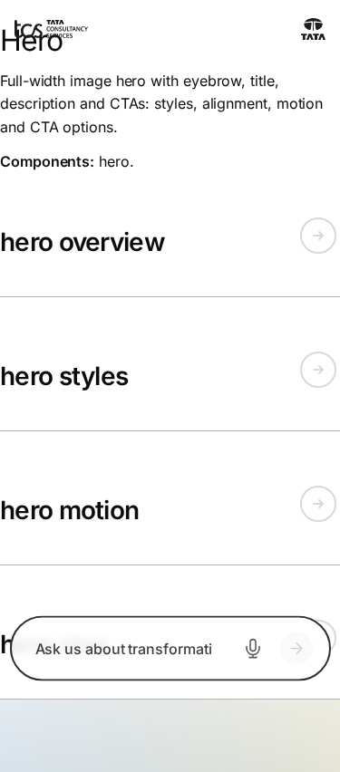

*Figure: Hero: hero — mobile 375 × 812 (/design-block-master/en/block-library/hero, captured 2026-11-08).*

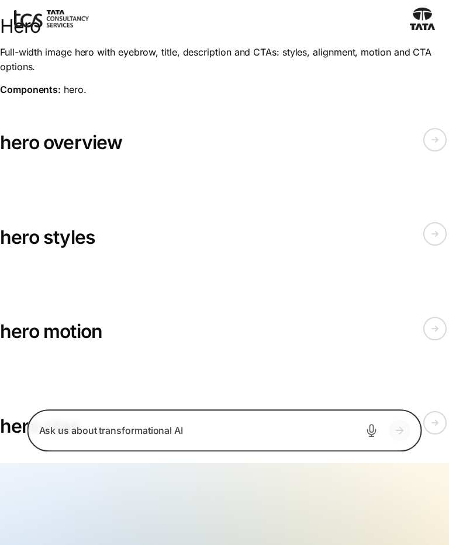

*Figure: Hero: hero — tablet 768 × 900 (/design-block-master/en/block-library/hero, captured 2026-11-08).*

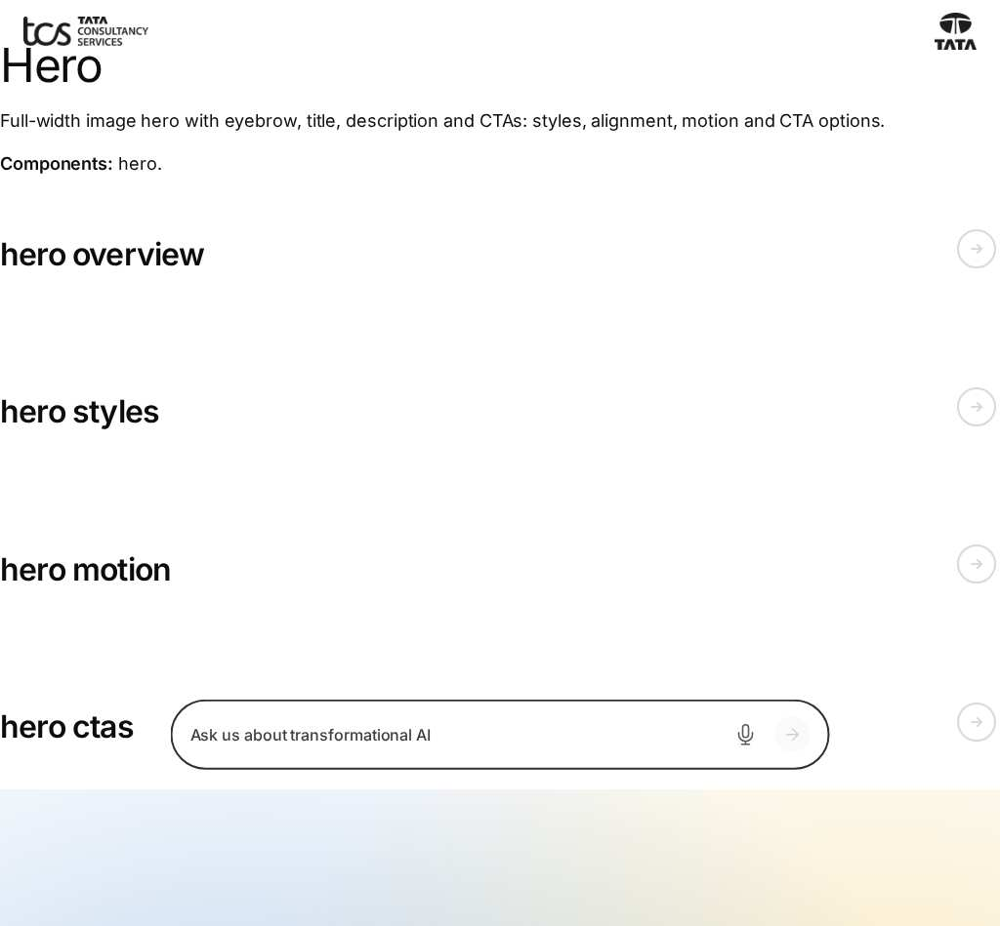

*Figure: Hero: hero — small desktop 1024 × 900 (/design-block-master/en/block-library/hero, captured 2026-11-08).*

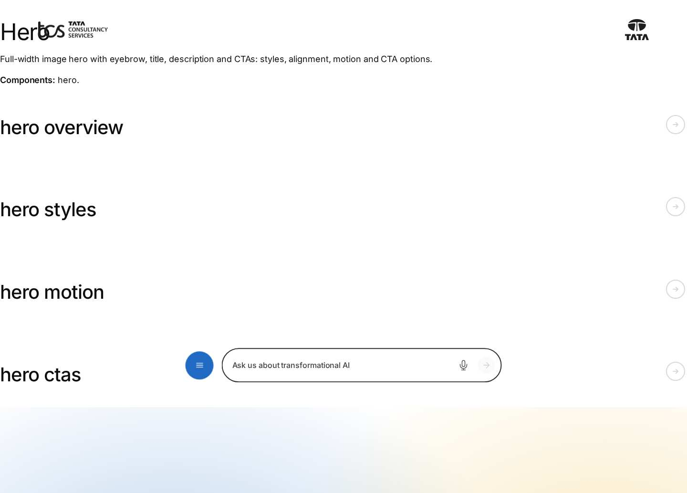

*Figure: Hero: hero — desktop 1440 × 900 (/design-block-master/en/block-library/hero, captured 2026-11-08).*

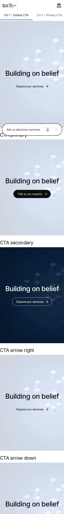

*Figure: Hero: hero/hero-ctas — mobile 375 × 812 (/design-block-master/en/block-library/hero/hero-ctas, captured 2026-11-08).*

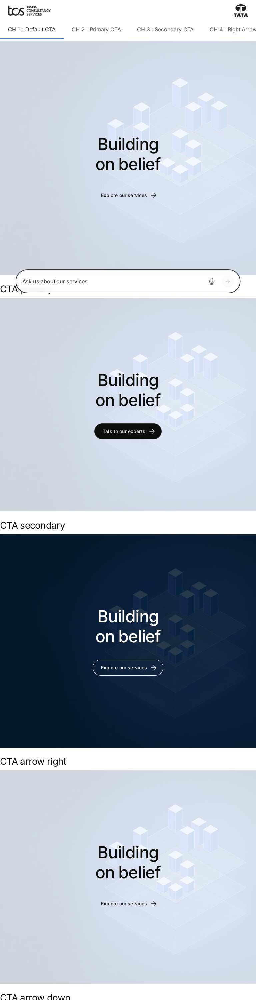

*Figure: Hero: hero/hero-ctas — tablet 768 × 900 (/design-block-master/en/block-library/hero/hero-ctas, captured 2026-11-08).*

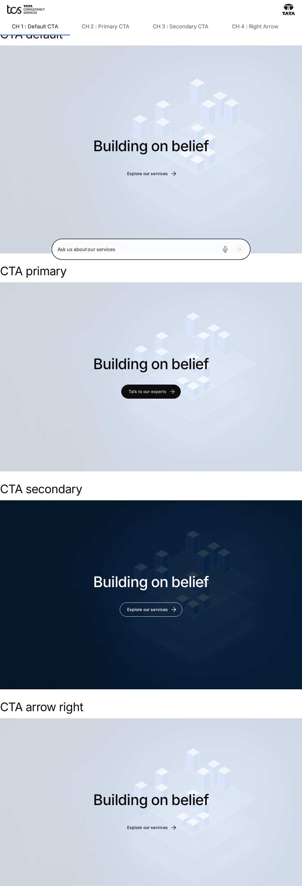

*Figure: Hero: hero/hero-ctas — small desktop 1024 × 900 (/design-block-master/en/block-library/hero/hero-ctas, captured 2026-11-08).*

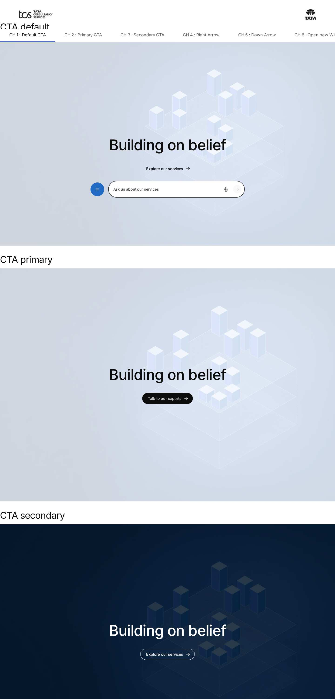

*Figure: Hero: hero/hero-ctas — desktop 1440 × 900 (/design-block-master/en/block-library/hero/hero-ctas, captured 2026-11-08).*

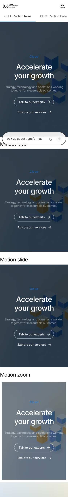

*Figure: Hero: hero/hero-motion — mobile 375 × 812 (/design-block-master/en/block-library/hero/hero-motion, captured 2026-11-08).*

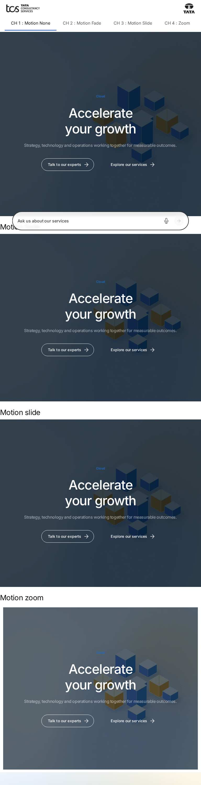

*Figure: Hero: hero/hero-motion — tablet 768 × 900 (/design-block-master/en/block-library/hero/hero-motion, captured 2026-11-08).*

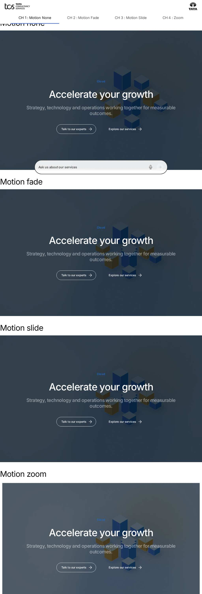

*Figure: Hero: hero/hero-motion — small desktop 1024 × 900 (/design-block-master/en/block-library/hero/hero-motion, captured 2026-11-08).*

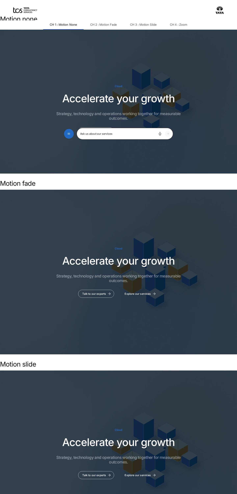

*Figure: Hero: hero/hero-motion — desktop 1440 × 900 (/design-block-master/en/block-library/hero/hero-motion, captured 2026-11-08).*

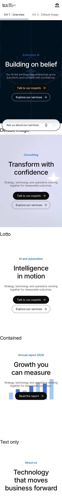

*Figure: Hero: hero/hero-overview — mobile 375 × 812 (/design-block-master/en/block-library/hero/hero-overview, captured 2026-11-08).*

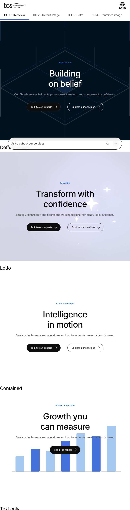

*Figure: Hero: hero/hero-overview — tablet 768 × 900 (/design-block-master/en/block-library/hero/hero-overview, captured 2026-11-08).*

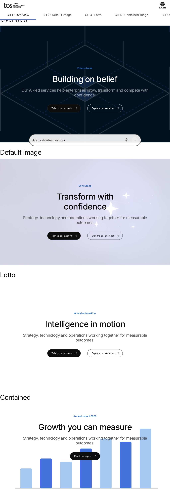

*Figure: Hero: hero/hero-overview — small desktop 1024 × 900 (/design-block-master/en/block-library/hero/hero-overview, captured 2026-11-08).*

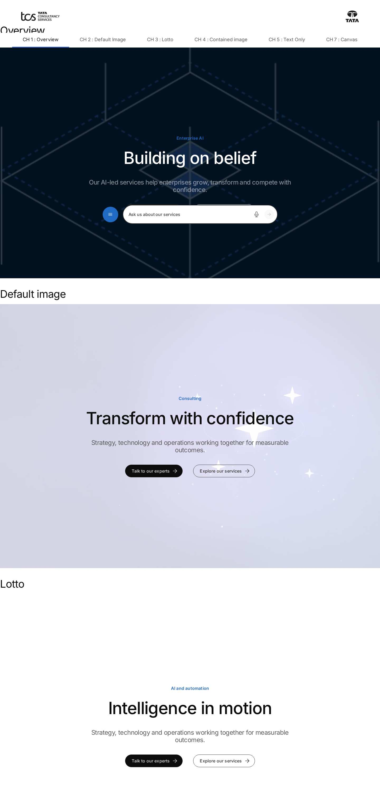

*Figure: Hero: hero/hero-overview — desktop 1440 × 900 (/design-block-master/en/block-library/hero/hero-overview, captured 2026-11-08).*

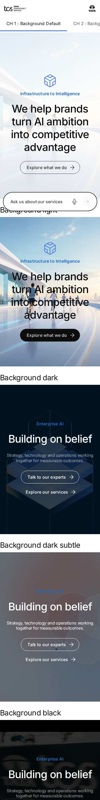

*Figure: Hero: hero/hero-styles — mobile 375 × 812 (/design-block-master/en/block-library/hero/hero-styles, captured 2026-11-08).*

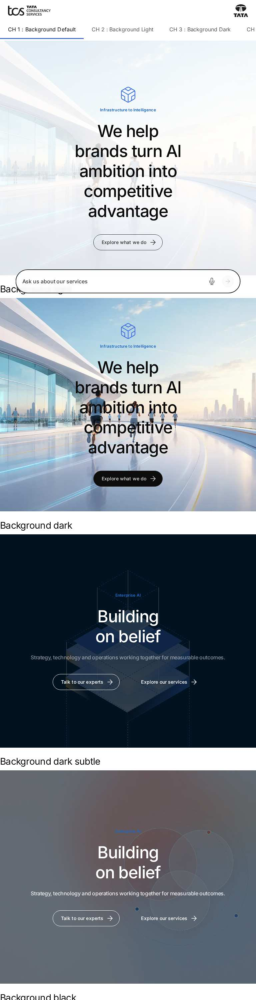

*Figure: Hero: hero/hero-styles — tablet 768 × 900 (/design-block-master/en/block-library/hero/hero-styles, captured 2026-11-08).*

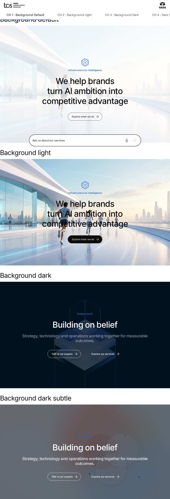

*Figure: Hero: hero/hero-styles — small desktop 1024 × 900 (/design-block-master/en/block-library/hero/hero-styles, captured 2026-11-08).*

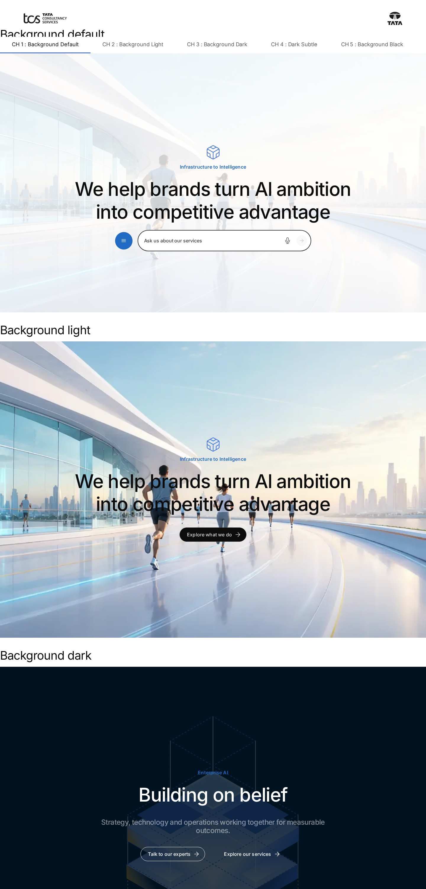

*Figure: Hero: hero/hero-styles — desktop 1440 × 900 (/design-block-master/en/block-library/hero/hero-styles, captured 2026-11-08).*

## Known limitations

- None recorded for this document.

## Open items

- None.

## Change history

| Version | Date | Author | Change |
| --- | --- | --- | --- |
| 1.0 | 8 November 2026 | Delivery team (documentation program) | First version of the role-specific documentation (master documentation prompt), generated from the repository and the published reference pages |
