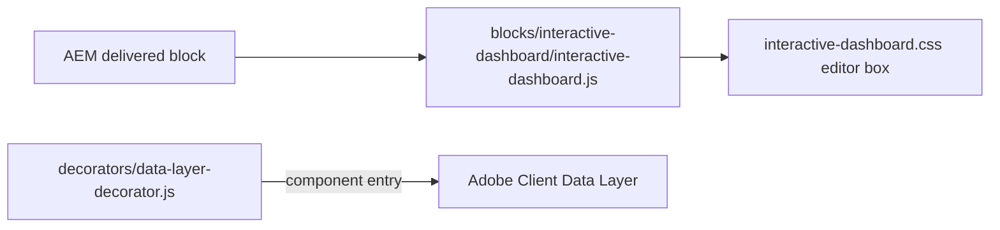
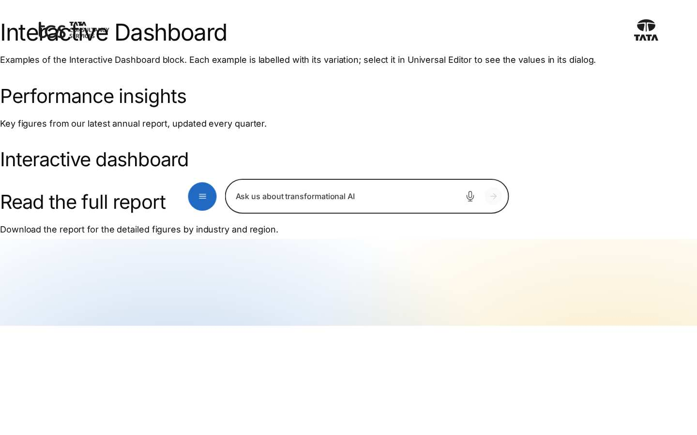
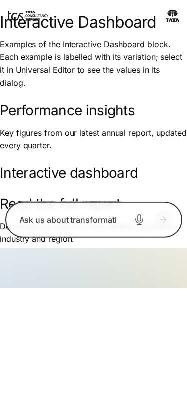
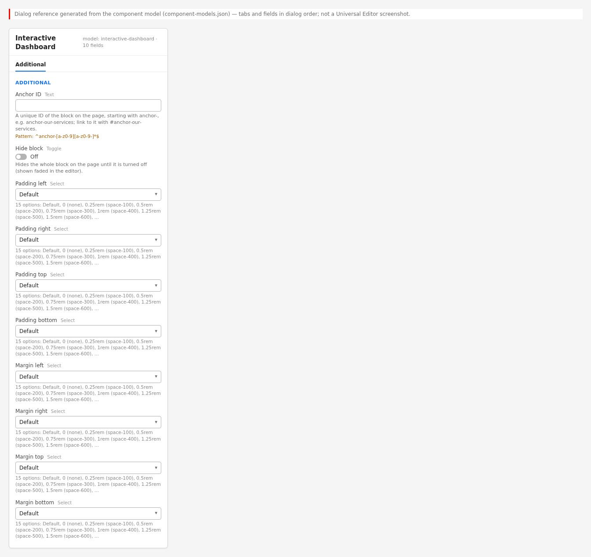

# Interactive Dashboard Block — Developer Guide

| Attribute | Value |
| --- | --- |
| Document ID | DEV-B-interactive-dashboard |
| Audience | Developers, technical leads, block owners, AI coding agents |
| Purpose | How the Interactive Dashboard block is built: files, model, structure, behaviour, variations, tests and limitations |
| Scope | blocks/interactive-dashboard/ and its components interactive-dashboard |
| Prerequisites | — |
| Owner | Technical Lead / Block Owner (proposed) |
| Approver | Product Owner (to be confirmed) |
| Version | 1.0 |
| Status | Draft for review |
| Last updated | 8 November 2026 |
| Last validated | 2026-11-08 (model, files, imports from the code; reference pages from the live site) |
| Source files | blocks/interactive-dashboard/README.md, blocks/interactive-dashboard/_interactive-dashboard.json, blocks/interactive-dashboard/interactive-dashboard.css, blocks/interactive-dashboard/interactive-dashboard.js |
| Related documents | [Variations](./INTERACTIVE-DASHBOARD-VARIATIONS.md), [Test coverage](./INTERACTIVE-DASHBOARD-TEST-COVERAGE.md), [Authoring guide](../../../03-authoring/components/interactive-dashboard/INTERACTIVE-DASHBOARD-AUTHORING-GUIDE.md) |
| Related AEM paths | /content/tcs-corp/design-block-master/en/block-library/interactive-dashboard, /content/tcs-corp/design-block-master/en/block-library/interactive-dashboard/interactive-dashboard |

## Contents

- [Summary](#summary)
- [Overview](#overview)
- [Source files](#source-files)
- [Components, models and filters](#components-models-and-filters)
- [Fields](#fields)
- [Dependencies](#dependencies)
- [For Developers](#for-developers)
- [Extending the Block](#extending-the-block)
- [Responsive Behavior](#responsive-behavior)
- [Accessibility](#accessibility)
- [Data Layer and Analytics](#data-layer-and-analytics)
- [Performance Considerations](#performance-considerations)
- [Security and Privacy](#security-and-privacy)
- [For Architects](#for-architects)
- [Troubleshooting](#troubleshooting)
- [Known limitations of the block](#known-limitations-of-the-block)
- [Change history of the block](#change-history-of-the-block)
- [Reference pages](#reference-pages)
- [Coverage of the required topics](#coverage-of-the-required-topics)
- [Screenshots](#screenshots)
- [Known limitations](#known-limitations)
- [Open items](#open-items)
- [Change history](#change-history)

## Summary

| Attribute | Value |
| --- | --- |
| Block | Interactive Dashboard |
| Folder | `blocks/interactive-dashboard` |
| Type | Independent |
| Category | utility |
| Status | Experimental (placeholder) |
| Purpose | Reserved for a future dashboard; renders nothing on the site |
| Variations (summary) | — |
| Children | — |
| Code size | 34 lines of JS and CSS |

## Overview

**Business purpose.** Reserve a component name, the Additional options and a data-layer entry for
a future dashboard (for example interactive figures or KPIs). Requirements, data source and design
are not recorded.

**User experience.** Visitors see nothing. Authors see a dashed box in edit mode.

**Templates / page types.** None use it.

**Data source.** None: no sheets, query index, metadata, taxonomy or placeholders.

**Related blocks.** [Table](https://github.com/sradha-tcs/tcs-corp/blob/main/blocks/table/README.md) and Table List (tabular data available today),
[Cards](https://github.com/sradha-tcs/tcs-corp/blob/main/blocks/cards/README.md) / [List](https://github.com/sradha-tcs/tcs-corp/blob/main/blocks/list/README.md) (statistic-style cards),
[Embed](https://github.com/sradha-tcs/tcs-corp/blob/main/blocks/embed/README.md) (an external dashboard a provider allows to be framed).

**When to use.** Not for new content (it can't be added); an existing instance only reserves a
position on draft or block library pages.

**When not to use.** On any published page: it shows nothing and may leave an empty gap.

**Realistic use cases.** None today.

## Source files

| File | Link |
| --- | --- |
| `README.md` | [GitHub](https://github.com/sradha-tcs/tcs-corp/blob/main/blocks/interactive-dashboard/README.md) |
| `_interactive-dashboard.json` | [GitHub](https://github.com/sradha-tcs/tcs-corp/blob/main/blocks/interactive-dashboard/_interactive-dashboard.json) |
| `interactive-dashboard.css` | [GitHub](https://github.com/sradha-tcs/tcs-corp/blob/main/blocks/interactive-dashboard/interactive-dashboard.css) |
| `interactive-dashboard.js` | [GitHub](https://github.com/sradha-tcs/tcs-corp/blob/main/blocks/interactive-dashboard/interactive-dashboard.js) |

## Components, models and filters

| Component | Title | Resource type | Template name | Model | Children allowed |
| --- | --- | --- | --- | --- | --- |
| `interactive-dashboard` | Interactive Dashboard | `core/franklin/components/block/v1/block` | Interactive Dashboard | `interactive-dashboard` | — |

## Fields

The Additional tab fields (anchor, hide, padding, margin, animation) are common to the blocks and described in the [content modeling guide](../../markdown/CONTENT-MODELING-GUIDE.md).

### Interactive Dashboard (`interactive-dashboard`)

| Tab | Label | Property | Type | Required in model | Default | Options | Visibility |
| --- | --- | --- | --- | --- | --- | --- | --- |

"Required in model" is the model's `required` flag; whether a field is required in practice is stated in the authoring guide where it is known.

## Dependencies

| Import |
| --- |

## For Developers

<!-- BEGIN GENERATED: files (npm run build:docs) -->

```text
blocks/interactive-dashboard/
├── README.md
├── _interactive-dashboard.json
├── interactive-dashboard.css
└── interactive-dashboard.js
```

The block imports no shared decorator or utility.

<!-- END GENERATED: files -->

**JavaScript (`interactive-dashboard.js`).** `decorate(block)` (synchronous) calls
`block.replaceChildren()` and sets `data-placeholder="Interactive Dashboard"`. Nothing else.

**CSS (`interactive-dashboard.css`).** `.interactive-dashboard:empty` hidden;
`.adobe-ue-edit .interactive-dashboard:empty` the dashed box with the `::before` label from
`data-placeholder`.

**Input DOM.** Not key-value; AEM delivers an empty row for the Additional tab (discarded);
Additional values as block classes.

**Rendered DOM contract.** `div.interactive-dashboard.block[data-placeholder="Interactive Dashboard"]`,
empty (the block options decorator sets the id from an `anchor-…` class).

**Events, async behavior, error handling, exports.** None beyond `decorate`.

## Extending the Block

1. **Define the requirements** (data source, design, interactions) with the product owner first.
2. **Model:** add Content fields to `_interactive-dashboard.json` (respecting the delivery rules:
   tab rows, field collapse, `classes_*`), keep the Additional tab last; `npm run build:json`,
   `npm run lint`.
3. **Availability:** add `interactive-dashboard` to the filters where it should be offered
   (`models/_section.json`, the Columns Container and Tabs filters) and regenerate the aggregates.
4. **Rendering:** replace `decorate`; use decorators / utils for shared behaviour; load data through
   `renderWhenLoaded` (skeleton) if it comes from the query index or sheets; placeholders for UI text.
5. **Animation:** add the block to `CONTENT_TARGETS` in `decorators/motion-decorator.js` if items
   should stagger.
6. **Data layer:** describe controls with `data-cmp-interaction`; push state with
   `pushComponentEvent`.
7. **Tests, library, docs:** unit tests for pure logic in `test/`, a block library page, this README,
   `npm run build:docs`, `npm run build:modules` after adding imports.

## Responsive Behavior

`interactive-dashboard.css` has no media queries.

| Viewport | Layout | Image behavior | Interaction behavior |
| -------- | ------ | -------------- | -------------------- |
| All viewports | Not displayed on the site; in edit mode a box at least 10rem tall | — | None |

## Accessibility

- **Semantics:** none on the site (`display: none`, not in the accessibility tree).
- **Keyboard, focus, names, announcements:** nothing to reach.
- **Reduced motion:** not applicable.
- **Empty state:** always empty; the editor box is for authors only.

**Author responsibilities:** don't reference the dashboard in page content ("see the dashboard
below").

**Developer responsibilities:** a future implementation must meet WCAG 2.1 AA (text alternatives
for charts, keyboard operation, no colour-only encoding) and take its UI text from placeholders.

The block handles no keys.

## Data Layer and Analytics

`decorators/data-layer-decorator.js` adds every `.block`, so the placeholder gets a component entry
`tcs-corp/components/interactive-dashboard` (id = Anchor ID else `interactive-dashboard-{n}`,
without `dc:title`). The block adds no `data-cmp-*` attributes.

| Trigger | Data-layer event | Required properties | Analytics behavior |
| ------- | ---------------- | ------------------- | ------------------ |
| Block decorated | component state | `@type`, `parentId` | An untitled component entry (noise) |

No interaction events exist. The intended path is Adobe Client Data Layer, then Adobe Data
Collection (Tags), the AEP Web SDK, the Edge Network and Analytics / CJA, but Tags and the Web SDK
aren't configured yet (blocked: measurement plan); no consent mechanism is implemented.

## Performance Considerations

Negligible: the block's JS (13 lines) and CSS load with its section; no requests, observers or
listeners.

## Security and Privacy

No content, links, external requests or data. Nothing to sanitise.

## For Architects

- **Role:** reserved component name; no rendering, data or interactivity.
- **Content model:** Additional tab only; not offered to authors.
- **Data layer / Web SDK / Target:** an untitled component entry; nothing else.
- **Consent, identity, caching, security:** not applicable (no requests, no content).
- **Performance:** two small files loaded with the section when an instance exists.



## Troubleshooting

| Symptom | Likely cause | Diagnostic steps | Resolution | Verification |
| ------- | ------------ | ---------------- | ---------- | ------------ |
| Nothing on the published page | By design | Inspect: empty `div.interactive-dashboard` | Remove the block; use Table, Cards or Embed | Intended content shows |
| Not offered in Add (+) | Not in any filter (by design) | `component-filters.json` | None until it is implemented | — |
| Box not visible in the editor | Preview mode | Editor mode toggle | Switch to edit mode or use the content tree | Box appears |
| Empty gap on the page | The section keeps its spacing | Inspect the section | Delete the block / section, or Hide block | No gap |
| Anchor link doesn't scroll | Target is `display: none` | Check the id | Remove the link | — |
| Data layer lists the component | Every block is tracked | `window.adobeDataLayer` | Remove the block, or ignore the type | — |

Evidence to collect: page URL and the block's markup (no secrets involved).

## Known limitations of the block

| Limitation | Impact | Workaround | Planned correction |
| ---------- | ------ | ---------- | ------------------ |
| Placeholder only: no content model, rendering, data or interactivity | No dashboard | Table, Cards, Embed | Not recorded (requirements: owner product owner) |
| Not offered in any filter | Can't be added | — | When implemented |
| Editor label is fixed English | Not translated | — | Not recorded |
| Still tracked in the data layer; its section may leave empty space | Reporting noise; gaps | Remove from pages | Not planned |

## Change history of the block

| Version | Change | Source | Date |
| ------- | ------ | ------ | ---- |
| Not recorded | README generated from verified implementation and approved handover documentation | Repository review | Not recorded |
| Handover 2.18 | Additional tab content animation fields added to the model | docs/handover revision history | 18 October 2026 |
| Handover 2.27 | Block audit: the placeholder no longer offered to authors (D-B-17: removed from the section and Columns Container filters; definition and model kept) | docs/handover revision history; docs/audit/BLOCK-ECOSYSTEM-AUDIT.md | 19 October 2026 |

## Reference pages

| Kind | Page | Live URL |
| --- | --- | --- |
| Block library | /design-block-master/en/block-library/interactive-dashboard | https://main--tcs-corp--sradha-tcs.aem.live/design-block-master/en/block-library/interactive-dashboard |
| Block library | /design-block-master/en/block-library/interactive-dashboard/interactive-dashboard | https://main--tcs-corp--sradha-tcs.aem.live/design-block-master/en/block-library/interactive-dashboard/interactive-dashboard |

## Coverage of the required topics

| Topic | Where |
| --- | --- |
| Purpose | Overview |
| Source files | generated: Files |
| Model, definition, filters, children | generated: Components |
| Dependencies | generated: Dependencies |
| Authored input / rendered output / DOM transformation | For Developers |
| Configuration fields, defaults, required fields | generated: Fields |
| Variations | INTERACTIVE-DASHBOARD-VARIATIONS.md |
| Responsive behaviour | Responsive Behavior |
| Accessibility and keyboard | Accessibility |
| Analytics / data layer | Data Layer and Analytics |
| Performance | Performance Considerations |
| Security | Security and Privacy |
| Extending | Extending the Block |
| Known limitations | Known Limitations |
| Troubleshooting | Troubleshooting |
| Tests | INTERACTIVE-DASHBOARD-TEST-COVERAGE.md |
| SEO behaviour | Not recorded |
| Caching considerations | Not recorded (Edge Delivery default caching; no block-specific rule) |
| Ownership | Technical Lead / Block Owner (proposed) |

## Screenshots



*Figure: Interactive Dashboard block library page — desktop 1440 × 900 (/design-block-master/en/block-library/interactive-dashboard/interactive-dashboard, captured 2026-11-08).*



*Figure: Interactive Dashboard block library page — mobile 375 × 812 (/design-block-master/en/block-library/interactive-dashboard/interactive-dashboard, captured 2026-11-08).*


*Figure: Desktop rendering — A page on aem.page at 1440 px: the H2 Performance insights with the line Key figures from our latest annual report, updated every quarter., empty space where the Interactive Dashboard section is, then the H2 Read the full report and its line about downloading the report. (Sample content on the preview; callout letters as in the Field Entry Table; file screenshots/interactive-dashboard-desktop-view.jpg) (handover screenshot; rendering at the time it was taken).*


*Figure: Tablet rendering — The same draft page at 768 px: Performance insights with its line, blank space where the hidden Interactive Dashboard section is, then Read the full report and its line; no dashboard is visible. (Sample content on the preview; callout letters as in the Field Entry Table; file screenshots/interactive-dashboard-tablet-view.jpg) (handover screenshot; rendering at the time it was taken).*


*Figure: Mobile rendering — The draft page at 375 px: the H2 Performance insights and Key figures from our latest annual report, updated every quarter., then directly the H2 Read the full report and Download the report for the detailed figures by industry and region.; no dashboard appears. (Sample content on the preview; callout letters as in the Field Entry Table; file screenshots/interactive-dashboard-mobile-view.jpg) (handover screenshot; rendering at the time it was taken).*


*Figure: Universal Editor canvas — The draft page in Universal Editor edit mode at 1440 px: Performance insights and its line, then a dashed, rounded grey box with the centred text Interactive Dashboard (placeholder) and marker A, then Read the full report and its line. (Annotated preview in editor mode with sample content; letters as in the annotations list, not a Universal Editor screenshot; file screenshots/interactive-dashboard-authoring-view.jpg) (handover screenshot; rendering at the time it was taken).*



*Figure: Properties panel — Properties panel of the block showing only the Additional tab. (Dialog reference generated from the component model, not a Universal Editor screenshot; file screenshots/interactive-dashboard-properties-panel.jpg) (handover screenshot; rendering at the time it was taken).*

## Known limitations

- Universal Editor dialogs were not captured: no author access in this program (see the access blockers).

## Open items

- None.

## Change history

| Version | Date | Author | Change |
| --- | --- | --- | --- |
| 1.0 | 8 November 2026 | Delivery team (documentation program) | First version of the role-specific documentation (master documentation prompt), generated from the repository and the published reference pages |
