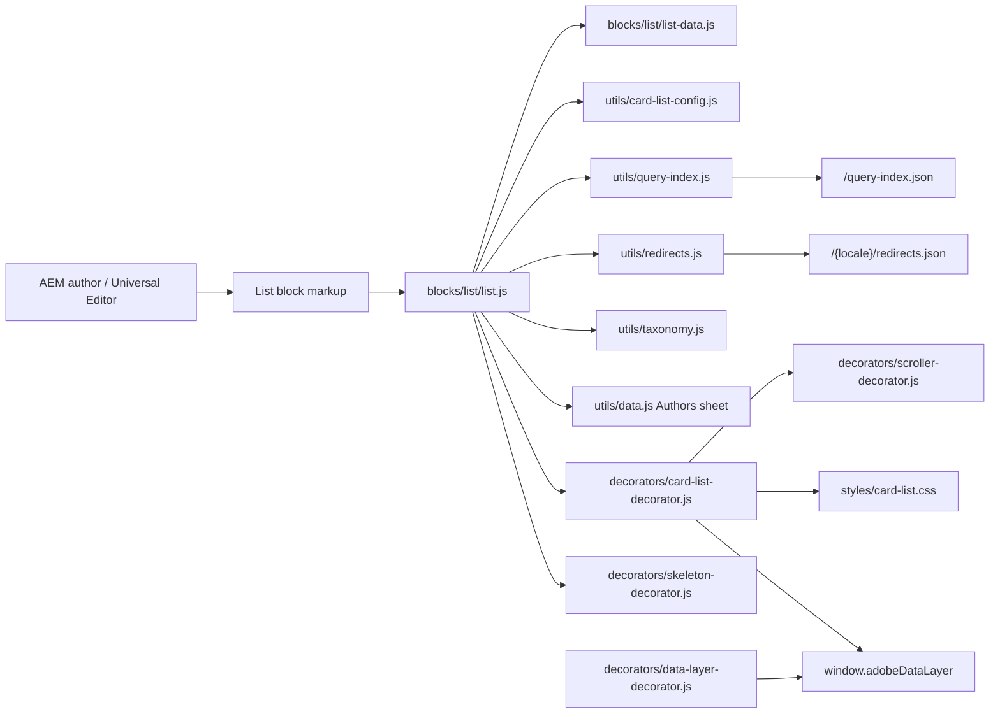
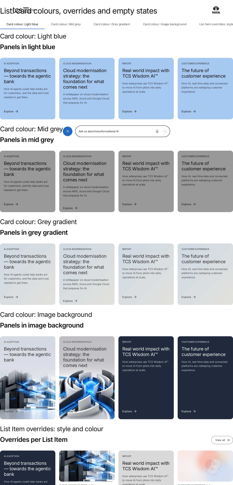
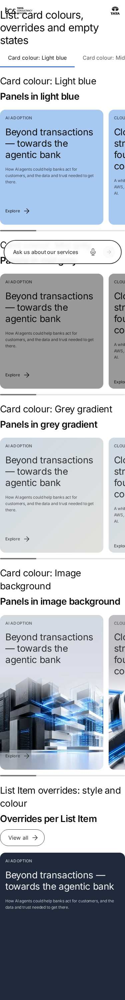

# List Block — Developer Guide

| Attribute | Value |
| --- | --- |
| Document ID | DEV-B-list |
| Audience | Developers, technical leads, block owners, AI coding agents |
| Purpose | How the List block is built: files, model, structure, behaviour, variations, tests and limitations |
| Scope | blocks/list/ and its components list, list-item |
| Prerequisites | — |
| Owner | Technical Lead / Block Owner (proposed) |
| Approver | Product Owner (to be confirmed) |
| Version | 1.0 |
| Status | Draft for review |
| Last updated | 8 November 2026 |
| Last validated | 2026-11-08 (model, files, imports from the code; reference pages from the live site) |
| Source files | blocks/list/README.md, blocks/list/_list.json, blocks/list/list-data.js, blocks/list/list.css, blocks/list/list.js |
| Related documents | [Variations](./LIST-VARIATIONS.md), [Test coverage](./LIST-TEST-COVERAGE.md), [Authoring guide](../../../03-authoring/components/list/LIST-AUTHORING-GUIDE.md) |
| Related AEM paths | /content/tcs-corp/design-block-master/en/block-library/list, /content/tcs-corp/design-block-master/en/block-library/list/card-colours-and-overrides, /content/tcs-corp/design-block-master/en/block-library/list/card-style-from-pages |

## Contents

- [Summary](#summary)
- [Overview](#overview)
- [Source files](#source-files)
- [Components, models and filters](#components-models-and-filters)
- [Fields](#fields)
- [Dependencies](#dependencies)
- [For Developers](#for-developers)
- [Extending the Block](#extending-the-block)
- [Responsive Behavior](#responsive-behavior)
- [Accessibility](#accessibility)
- [Data Layer and Analytics](#data-layer-and-analytics)
- [Performance Considerations](#performance-considerations)
- [Security and Privacy](#security-and-privacy)
- [For Architects](#for-architects)
- [Troubleshooting](#troubleshooting)
- [Known limitations of the block](#known-limitations-of-the-block)
- [Change history of the block](#change-history-of-the-block)
- [Reference pages](#reference-pages)
- [Coverage of the required topics](#coverage-of-the-required-topics)
- [Screenshots](#screenshots)
- [Known limitations](#known-limitations)
- [Open items](#open-items)
- [Change history](#change-history)

## Summary

| Attribute | Value |
| --- | --- |
| Block | List |
| Folder | `blocks/list` |
| Type | Container |
| Category | listing |
| Status | Active |
| Purpose | Child pages, a fixed list or tagged pages from the query index, as cards or links |
| Variations (summary) | Sources, card styles, layout per breakpoint, rows |
| Children | list-item (List Item) |
| Code size | 849 lines of JS and CSS |

## Overview

- **Business purpose:** keeps listings of site content up to date without manual work. When an author publishes a new child page or tags a page, every List that selects it shows the new card, with the title, text and image the page defines in its metadata. Authors decide what is listed (source, tags, order, maximum) and how it looks; page owners maintain the card content once, on the page.
- **User experience:** an optional header (title, description, a CTA on the right), then the cards or rows. Each breakpoint is a grid or a horizontal scroller with optional previous / next buttons and a scroll indicator. While the query index loads (more than 150ms), a skeleton in the list's layout keeps the section visible.
- **Templates / page types:** any page; no template adds or removes it. Typical: home and landing pages (child pages, curated selections), article and blog pages (related tagged pages), press-release and news overview pages (rows of links ordered by date).
- **Data source:** the locale's published query index (`/query-index.json`, `helix-query.yaml`), the redirects sheet (`/{locale}/redirects.json`), the Authors sheet (feature card only, unless Show author on feature card is off), the taxonomy (tag labels) and the placeholders (UI text). List Items add authored values on top.
- **Related blocks:** [Cards](https://github.com/sradha-tcs/tcs-corp/blob/main/blocks/cards/README.md) (the same presentation, content typed in the block), [Filter List](https://github.com/sradha-tcs/tcs-corp/blob/main/blocks/filter-list/README.md) (query index lists with filter pills and sorting), [Table List](https://github.com/sradha-tcs/tcs-corp/blob/main/blocks/table-list/README.md) (tabular listings), [Page Header](https://github.com/sradha-tcs/tcs-corp/blob/main/blocks/page-header/README.md) (uses the same page metadata).

| Source | What it lists |
|---|---|
| Child pages (`parent`) | The pages below the **Parent page** (or the current page): its children, or down to the **Child depth** |
| Fixed list (`fixed`) | The List Items in their order: pages (their metadata, with the item's overrides), paths or external URLs. Pages authored before List Items (`pageItems`, `pages`) come first, a List Item for one of them takes its place |
| Tagged pages (`tags`) | The pages below the **Search root** (or the current page) with **any** or **all** of the **Tags**; never the current page |

- **When to use:** the cards represent published, indexed pages of the same locale; the list should update itself (Child pages, Tagged pages); the cards should reuse the pages' own metadata; ordering by title or last modified, or a maximum number of items, is needed.
- **When not to use:** content that isn't a page (statistics without detail pages, capabilities with their own wording, rich text descriptions): use [Cards](https://github.com/sradha-tcs/tcs-corp/blob/main/blocks/cards/README.md); visitors must filter or search: use [Filter List](https://github.com/sradha-tcs/tcs-corp/blob/main/blocks/filter-list/README.md); Content Fragment lists (not supported, by decision); full-text search (the Core List search source isn't available); pages of another locale.
- **Realistic use cases:** a services hub listing its child pages; "Related to Agentic AI" rails of tagged insights; news rows ordered by last modified; media coverage and investor relations rails of report pages (Mixed); editor's picks with per-item title overrides; statistic rows (a Fixed list with the number as Title); a featured spotlight with the author's photo and designation (First card as feature), or a clean hero spotlight without the author (Show author on feature card off); external partner links mixed with site pages.

## Source files

| File | Link |
| --- | --- |
| `README.md` | [GitHub](https://github.com/sradha-tcs/tcs-corp/blob/main/blocks/list/README.md) |
| `_list.json` | [GitHub](https://github.com/sradha-tcs/tcs-corp/blob/main/blocks/list/_list.json) |
| `list-data.js` | [GitHub](https://github.com/sradha-tcs/tcs-corp/blob/main/blocks/list/list-data.js) |
| `list.css` | [GitHub](https://github.com/sradha-tcs/tcs-corp/blob/main/blocks/list/list.css) |
| `list.js` | [GitHub](https://github.com/sradha-tcs/tcs-corp/blob/main/blocks/list/list.js) |

## Components, models and filters

| Component | Title | Resource type | Template name | Model | Children allowed |
| --- | --- | --- | --- | --- | --- |
| `list` | List | `core/franklin/components/block/v1/block` | List | `list` | list-item |
| `list-item` | List Item | `core/franklin/components/block/v1/block/item` | List Item | `list-item` | — |

## Fields

The Additional tab fields (anchor, hide, padding, margin, animation) are common to the blocks and described in the [content modeling guide](../../markdown/CONTENT-MODELING-GUIDE.md).

### List (`list`)

| Tab | Label | Property | Type | Required in model | Default | Options | Visibility |
| --- | --- | --- | --- | --- | --- | --- | --- |
| Content | Title | `title` | text | No | — | — | — |
| Content | Heading type | `titleType` | select | No | `h2` | 5 options | — |
| Content | Description | `description` | richtext | No | — | — | — |
| Content | CTA link | `link` | aem-content | No | — | — | — |
| Content | CTA text | `linkText` | text | No | — | — | — |
| Content | CTA style | `linkType` | select | No | `""` | 3 options | — |
| Content | Accessible list label | `listLabel` | text | No | — | — | — |
| Content | List source | `source` | select | Yes | `fixed` | 3 options | — |
| Content | Pages (authored before List Items) | `pageItems` | container | No | — | — | Conditional |
| Content | Pages (authored before List Items) › Page | `page` | aem-content | No | — | — | — |
| Content | Parent page | `parentPath` | aem-content | No | — | — | Conditional |
| Content | Use the current page when empty | `parentUseCurrentPage` | boolean | No | `true` | — | Conditional |
| Content | Direct children only | `directChildrenOnly` | boolean | No | `true` | — | Conditional |
| Content | Child depth | `childDepth` | number | No | `2` | — | Conditional |
| Content | Search root | `rootPath` | aem-content | No | — | — | Conditional |
| Content | Use the current page when empty | `tagsUseCurrentPage` | boolean | No | `true` | — | Conditional |
| Content | Tags | `tags` | aem-tag | No | — | — | Conditional |
| Content | Match | `tagMatch` | select | No | `any` | 2 options | Conditional |
| Content | Include descendant pages | `includeDescendants` | boolean | No | `true` | — | Conditional |
| Content | Maximum search depth | `maxDepth` | number | No | `0` | — | Conditional |
| Content | Order by | `orderBy` | select | No | `manual` | 3 options | — |
| Content | Sort order | `sortOrder` | select | No | `ascending` | 2 options | Conditional |
| Content | Maximum items | `maxItems` | number | No | `0` | — | — |
| Display | Display as teaser | `displayAsTeaser` | boolean | No | `true` | — | — |
| Display | Card style | `cardStyle` | select | No | `image` | 5 options | Conditional |
| Display | Card colour | `cardTheme` | select | No | `""` | 9 options | Conditional |
| Display | Image ratio | `imageRatio` | select | No | `16-9` | 4 options | Conditional |
| Display | Panel height | `panelHeight` | select | No | `portrait` | 3 options | Conditional |
| Display | First card as feature | `featureFirst` | boolean | No | `false` | — | Conditional |
| Display | Show author on feature card | `featureShowAuthor` | boolean | No | `true` | — | Conditional |
| Display | Link items | `linkItems` | boolean | No | `true` | — | — |
| Display | Open links in a new tab | `openInNewTab` | boolean | No | `false` | — | — |
| Display | Show image | `showImage` | boolean | No | `true` | — | — |
| Display | Show eyebrow | `showEyebrow` | boolean | No | `true` | — | — |
| Display | Show tags | `showTags` | boolean | No | `true` | — | — |
| Display | Show description | `showDescription` | boolean | No | `true` | — | — |
| Display | Show date | `showDate` | boolean | No | `true` | — | — |
| Display | Date format | `dateFormat` | select | No | `dd-mmm-yy` | 6 options | Conditional |
| Display | Show content type | `showContentLabel` | boolean | No | `true` | — | Conditional |
| Display | Show call to action | `showCta` | boolean | No | `true` | — | Conditional |
| Display | Image loading | `imageLoading` | select | No | `lazy` | 2 options | — |
| Display | Desktop display | `desktopMode` | select | No | `grid` | 2 options | — |
| Display | Desktop columns | `desktopColumns` | number | No | `4` | — | Conditional |
| Display | Desktop gap (px) | `desktopGap` | number | No | `24` | — | — |
| Display | Desktop items visible | `desktopVisible` | number | No | `4.2` | — | Conditional |
| Display | Desktop card width (px) | `desktopCardWidth` | number | No | `0` | — | Conditional |
| Display | Previous / next buttons on desktop | `desktopControls` | boolean | No | `false` | — | Conditional |
| Display | Scroll indicator on desktop | `desktopIndicator` | boolean | No | `false` | — | Conditional |
| Display | Tablet display | `tabletMode` | select | No | `grid` | 2 options | — |
| Display | Tablet columns | `tabletColumns` | number | No | `4` | — | Conditional |
| Display | Tablet gap (px) | `tabletGap` | number | No | `24` | — | — |
| Display | Tablet items visible | `tabletVisible` | number | No | `3.3` | — | Conditional |
| Display | Tablet card width (px) | `tabletCardWidth` | number | No | `0` | — | Conditional |
| Display | Previous / next buttons on tablet | `tabletControls` | boolean | No | `false` | — | Conditional |
| Display | Scroll indicator on tablet | `tabletIndicator` | boolean | No | `false` | — | Conditional |
| Display | Mobile display | `mobileMode` | select | No | `grid` | 2 options | — |
| Display | Mobile columns | `mobileColumns` | number | No | `1` | — | Conditional |
| Display | Mobile gap (px) | `mobileGap` | number | No | `16` | — | — |
| Display | Mobile items visible | `mobileVisible` | number | No | `1.2` | — | Conditional |
| Display | Mobile card width (px) | `mobileCardWidth` | number | No | `0` | — | Conditional |
| Display | Previous / next buttons on mobile | `mobileControls` | boolean | No | `false` | — | Conditional |
| Display | Scroll indicator on mobile | `mobileIndicator` | boolean | No | `true` | — | Conditional |
| Display | Equal card height | `equalHeight` | boolean | No | `false` | — | — |
| Display | Stretch cards to row height | `stretchCards` | boolean | No | `true` | — | — |
| Display | Scroll snap | `scrollSnap` | boolean | No | `true` | — | Conditional |
| Display | Snap alignment | `snapAlign` | select | No | `start` | 2 options | Conditional |
| Display | Hide native scrollbar | `hideScrollbar` | boolean | No | `true` | — | Conditional |
| Display | Allow mouse drag | `mouseDrag` | boolean | No | `true` | — | Conditional |
| Display | Keyboard scrolling | `keyboardScrolling` | boolean | No | `true` | — | Conditional |
| Display | Scroll step | `scrollStep` | select | No | `one-card` | 2 options | Conditional |
| Display | Loop | `loop` | boolean | No | `false` | — | Conditional |
| Display | Initial item index | `initialIndex` | number | No | `0` | — | Conditional |
| Display | Edge | `edgePadding` | select | No | `bleed` | 2 options | Conditional |
| Display | When there are no items | `emptyBehavior` | select | No | `message` | 3 options | — |
| Display | Empty message | `emptyMessage` | text | No | — | — | Conditional |
| Display | Analytics | `analyticsEnabled` | boolean | No | `true` | — | — |
| Display | Style options | `classes` | multiselect | No | — | 3 options | — |

### List Item (`list-item`)

| Tab | Label | Property | Type | Required in model | Default | Options | Visibility |
| --- | --- | --- | --- | --- | --- | --- | --- |
| Link | Page or link | `link` | aem-content | Yes | — | — | — |
| Link | Link text | `linkText` | text | No | — | — | — |
| Link | Open in a new tab | `newTab` | select | No | `""` | 3 options | — |
| Content | Title | `headline` | text | No | — | — | — |
| Content | Description | `summary` | text | No | — | — | — |
| Content | Image | `image` | reference | No | — | — | — |
| Content | Image alt text | `imageAlt` | text | No | — | — | — |
| Content | Eyebrow | `eyebrow` | text | No | — | — | — |
| Content | Tags | `tags` | aem-tag | No | — | — | — |
| Content | Label | `subtitle` | text | No | — | — | — |
| Content | Call to action label | `ctaLabel` | text | No | — | — | — |
| Display | Card style | `kind` | select | No | `""` | 5 options | — |
| Display | Card colour | `theme` | select | No | `""` | 9 options | — |
| Display | Analytics label | `analyticsLabel` | text | No | — | — | — |
| Display | Accessibility label | `ariaLabel` | text | No | — | — | — |
| Display | Hide Title | `titleHidden` | boolean | No | `false` | — | — |
| Display | Show Description | `showDescription` | boolean | No | `true` | — | — |
| Display | Show Image | `showImage` | boolean | No | `true` | — | — |
| Display | Show Eyebrow | `showEyebrow` | boolean | No | `true` | — | — |
| Display | Show Label | `showLabel` | boolean | No | `true` | — | — |
| Display | Show Action Label | `showActionLabel` | boolean | No | `true` | — | — |

"Required in model" is the model's `required` flag; whether a field is required in practice is stated in the authoring guide where it is known.

## Dependencies

| Import |
| --- |
| `../../utils/card-list-config.js` |
| `../../utils/dates.js` |
| `../../utils/query-index.js` |
| `../../decorators/card-list-decorator.js` |
| `../../decorators/skeleton-decorator.js` |
| `../../utils/cells.js` |
| `../../utils/data.js` |
| `../../utils/environment.js` |
| `../../utils/placeholders.js` |
| `../../utils/links.js` |
| `../../utils/properties.js` |
| `../../utils/redirects.js` |
| `../../utils/site.js` |
| `../../utils/tags.js` |
| `../../utils/taxonomy.js` |
| `./list-data.js` |

## For Developers

<!-- BEGIN GENERATED: files (npm run build:docs) -->

```text
blocks/list/
├── README.md
├── _list.json
├── list-data.js
├── list.css
└── list.js
```

| Decorator/Utility | Purpose | Execution or dependency point |
| ----------------- | ------- | ----------------------------- |
| [`utils/card-list-config.js`](https://github.com/sradha-tcs/tcs-corp/blob/main/utils/card-list-config.js) | `normalizePresentation` (the card list settings of List and Cards, with defaults and validation), `PRESENTATION_PROPERTIES`, `kindOf` and `themeOf` (the card's Card style and Card colour: item, list, page metadata, autom | `list-data.js`: { CARD_KINDS, CARD_THEMES, flag, hash, integer, isExternal, isSafeUrl, isYes, normalizePath, normalizePresentation, pickValue as pick, text, toISODate, } |
| [`utils/dates.js`](https://github.com/sradha-tcs/tcs-corp/blob/main/utils/dates.js) | `formatDate` (DD-MM-YYYY, MM-DD-YYYY, MMM d, yyyy, DD/MM/YY, DD MMM YY, 4th September 2026; no time zone shift) | `list-data.js`: { formatDate } |
| [`utils/query-index.js`](https://github.com/sradha-tcs/tcs-corp/blob/main/utils/query-index.js) | `getPages` (the current locale's pages from `/query-index.json`, or the language master's own pages while it is under review (`indexRoot`) with their metadata columns: tags, page and content type, dates, images, author,  | `list-data.js`: { columnOf, listOf } |
| [`decorators/card-list-decorator.js`](https://github.com/sradha-tcs/tcs-corp/blob/main/decorators/card-list-decorator.js) | `buildCardListHeader`, `renderCardList`, `renderCard`, `renderRow`, `renderFeature`, `applyCardListLayout`, `buildCardListSkeleton` (the List's skeleton in its own layout), `renderCardListEmpty`, `cardListId`, `cardHeadi | `list.js`: { applyCardListLayout, buildCardListHeader, buildCardListSkeleton, cardListId, renderCardList, renderCardListEmpty, renderEditorItems, trackCardList, } |
| [`decorators/skeleton-decorator.js`](https://github.com/sradha-tcs/tcs-corp/blob/main/decorators/skeleton-decorator.js) | `renderWhenLoaded` (a block from data that may take time: directly within 150ms, else after a skeleton so its section is shown; removed on success and failure), `skeletonWhile` (a skeleton in a part that fills in by itse | `list.js`: { renderWhenLoaded } |
| [`utils/card-list-config.js`](https://github.com/sradha-tcs/tcs-corp/blob/main/utils/card-list-config.js) | `normalizePresentation` (the card list settings of List and Cards, with defaults and validation), `PRESENTATION_PROPERTIES`, `kindOf` and `themeOf` (the card's Card style and Card colour: item, list, page metadata, autom | `list.js`: { PRESENTATION_PROPERTIES, contentTypeLabel } |
| [`utils/cells.js`](https://github.com/sradha-tcs/tcs-corp/blob/main/utils/cells.js) | `itemRows`, `KEY_VALUE_ITEM`, `FIELD_ROW_ITEM` (the item rows of a block: by model in the editor, by their cells on the page), `withoutTabCells` (drops the empty cell AEM renders for each dialog tab of an item model), `m | `list.js`: { matchCells, withoutTabCells } |
| [`utils/data.js`](https://github.com/sradha-tcs/tcs-corp/blob/main/utils/data.js) | `loadDataSheet`, `getAuthor`, `getAuthors`, `getLocations`, `getPartners`, `getSocialLinks`, `getMediaContacts`, `inRegion` (the locale's data sheets) | `list.js`: { getAuthors } |
| [`utils/environment.js`](https://github.com/sradha-tcs/tcs-corp/blob/main/utils/environment.js) | `prefersReducedMotion`, `scrollBehavior`, `isEditing`, `isInEditor`, `isAuthor` (the page is rendered by AEM author, which has no query index) | `list.js`: { isAuthor, isEditing } |
| [`utils/placeholders.js`](https://github.com/sradha-tcs/tcs-corp/blob/main/utils/placeholders.js) | `getPlaceholders`, `loadPlaceholders`, `fillPlaceholder` (UI text from the locale's placeholders, with English fallbacks) | `list.js`: { getPlaceholders } |
| [`utils/links.js`](https://github.com/sradha-tcs/tcs-corp/blob/main/utils/links.js) | `NEW_WINDOW`, `linkOf`, `linkPathsOf` (the paths of a page property, one or many), `readLinkItems` (CTA lists with Link Type and the items' other select values), `readLinkRows` (the same from link item rows, e.g. Hero CT | `list.js`: { linkPathsOf } |
| [`utils/properties.js`](https://github.com/sradha-tcs/tcs-corp/blob/main/utils/properties.js) | `readProperties`, `textOf`, `isOn`, `isOnByDefault` (a toggle that defaults to on), `optionOf`, `normalizeKey`, `textSource` (key-value block properties) | `list.js`: { normalizeKey, textOf } |
| [`utils/query-index.js`](https://github.com/sradha-tcs/tcs-corp/blob/main/utils/query-index.js) | `getPages` (the current locale's pages from `/query-index.json`, or the language master's own pages while it is under review (`indexRoot`) with their metadata columns: tags, page and content type, dates, images, author,  | `list.js`: { getPages, getPagesAt } |
| [`utils/redirects.js`](https://github.com/sradha-tcs/tcs-corp/blob/main/utils/redirects.js) | `loadRedirects`, `resolveRedirect`, `normalizeRedirectPath` (redirect targets from the locale's redirects sheet, loaded once) | `list.js`: { loadRedirects, resolveRedirect } |
| [`utils/site.js`](https://github.com/sradha-tcs/tcs-corp/blob/main/utils/site.js) | `LOCALES`, `DEFAULT_LOCALE`, `getLocale`, `indexRoot`, `REVIEW_ROOTS` and `REVIEW_SHEETS` (the three review roots, KB-D-068: /language-master/en for testing, /language-masters/en the language master, /design-block-master | `list.js`: { getLocale, pageLink, toPublishedPath } |
| [`utils/tags.js`](https://github.com/sradha-tcs/tcs-corp/blob/main/utils/tags.js) | `readTagValues`, `parseTag`, `readTags` (tag IDs; ID-derived labels as the taxonomy fallback) | `list.js`: { readTagValues } |
| [`utils/taxonomy.js`](https://github.com/sradha-tcs/tcs-corp/blob/main/utils/taxonomy.js) | `loadTaxonomy`, `resolveTags` (tag labels from the locale's taxonomy) | `list.js`: { resolveTags } |

<!-- END GENERATED: files -->

**Responsibilities.** `list.js` reads the block (`readBlockConfig`), loads the data and renders through the shared card list decorator. `list-data.js` is the DOM-free data side (unit tested): the List Item cell layout (`ITEM_LAYOUT`, `ITEM_FIELDS`, `ITEM_DISPLAY`, `itemLayoutFor`, `itemDisplay`), `normalizeConfig`, `validateConfig` (warning codes `tags-missing`, `parent-missing`, `root-missing`, `items-missing`), discovery (`resolveParentPages`, `resolveTagPages`, `applyTagMatching`, `hasTag`, `isListable`), `PAGE_MAPPING` and `normalizePageToCard`, `applyOverrides`, `resolveFixedItems`, `mergeFixedItems`, `deduplicateCards`, `sortCards`, `limitCards`, `withIds`, `buildCards`. `utils/card-list-config.js` normalizes the presentation (`normalizePresentation`, `RESPONSIVE_DEFAULTS`, `kindOf`, `themeOf`, `isSafeUrl`); `decorators/card-list-decorator.js` builds the header, cards, feature card, rows, layout classes, skeleton, empty state, editor placeholders and the data layer state; `decorators/scroller-decorator.js` the previous / next, indicator, drag and keyboard. `list.css` only imports `styles/card-list.css` (shared with Cards).

**Input DOM (what AEM delivers).** A key-value block: one row of two cells (key | value) per List property; then one row per List Item, recognised by `data-aue-model="list-item"` in the editor, else as a row whose first cell isn't a List property key. A List Item row has a cell per field and an empty cell per dialog tab (`ITEM_LAYOUT`: `null` for the Link, Content and Display tab cells; link text and image alt fold into the link and image cells). Rows rendered before the Display toggles have six cells fewer (`itemLayoutFor`); `withoutTabCells` and `matchCells` (`utils/cells.js`) drop tab cells and match cells by content (link, picture, true / false, card kind or theme values). A list made before the key-value model (rows of at most one cell) is `legacy`.

**Rendered DOM contract.** Block classes: `card-list`, `source-{parent|fixed|tags}`, `{desktop|tablet|mobile}-{grid|scroll}`, `{bp}-controls`, `{bp}-indicator`, `snap`, `snap-{start|center}`, `hide-scrollbar`, `no-swipe`, `edge-bleed`, `equal-height`, `stretch`, `feature-first`, `display-teaser` or `links`, `style-*`, `ratio-*`, `panel-*`, the Style options, `list-legacy`; custom properties `--list-{columns,gap,visible,card-width}-{bp}`; `id` = the component id; `data-list-decorated`, `data-analytics` (`custom` / `off`). Inside: `.list-header` (`.list-title-slot`, CTA with `data-cmp-interaction="cta"`), the feature card, a `role="region"` viewport with a `<ul>` of `<li data-card-id data-cmp-id data-cmp-position>` holding `article.list-card.list-card-{image|panel|report|stat}` (`theme-*`) or rows, card links with `data-card-id`, `data-cmp-interaction="card"`, `data-external`, `data-analytics-label`; Previous / Next with `data-cmp-interaction`.

**Decoration flow.**

```text
decorate(block)
  readBlockConfig()      property rows, List Item rows (or a list made before)
  normalizeConfig()      defaults and clamped values; cardListId(): Component ID, Anchor ID or list-N
  Promise.all(getPages() if needed, loadRedirects(), getAuthors() for the feature card)
  applyCardListLayout()  classes and custom properties before the data (the skeleton takes the layout)
  renderWhenLoaded()     skeleton after 150ms, then render:
    getPagesAt()         List Item pages the index doesn't have (AEM author), read from their HTML
    buildCards():
      parent  resolveParentPages() -> normalizePageToCard()
      tags    resolveTagPages() -> applyTagMatching() -> normalizePageToCard()   (never the current page)
      fixed   mergeFixedItems() -> resolveFixedItems() -> normalizePageToCard() / link card -> applyOverrides()
      -> deduplicateCards() -> sortCards() -> limitCards() -> withIds()
    fallback             no cards and emptyBehavior fallback: buildCards() as a Fixed list
    resolveTags()        tag labels (taxonomy), contentTypeLabel()
    renderCardList() or renderCardListEmpty(); renderEditorItems() in the editor
    trackCardList()      data layer state (Analytics on)
```

**Card model** (the only input of rendering; all text is set with `textContent`):

```js
{
  id,                  // `${componentId}-item-${hash(dedupe key)}`, stable
  sourceType,          // parent | fixed | tags
  sourcePath, url,     // published path ('' for external links); destination (redirect target)
  title, description, image, imageAlt, // imageAlt '' = decorative
  eyebrow, tagIds, tags, date, dateISO,
  lastModified,        // seconds: modified-date, else when last published (sorting)
  contentType, readingTime, authorId, subtitle,
  kind, theme,         // the List Item's Card style and Card colour ('' = as the list)
  pageKind, pageTheme, // the page's card-style and card-theme metadata
  ctaLabel, openInNewTab, external, analyticsLabel, accessibilityLabel,
  display,             // List Item Display toggles (itemDisplay), applied by displayOf()
}
```

**Page metadata contract** (`PAGE_MAPPING`, in order of preference): Title `card-title`, else `og:title`; Description `card-description`, else `description`; Image `card-image`, else `og:image` (not the default social image), `thumbnail-image`, `featured-image`; Image alt `card-image-alt`, else `image-alt`, else decorative; Eyebrow `eyebrow`, else `category`; Tags `article:tag` (and `cq-tags`); Date `modified-date`, else `publish-date`, else when last published; `content-type`, `reading-time`, `author-id`; `hide-in-nav` = yes: not listed; `card-style`, `card-theme`. The query index (`helix-query.yaml`) indexes these columns (`cardTitle`, `cardDescription`, `cardImage`, `cardImageAlt`, `imageAlt`, `eyebrow`, `category`, `hideInNav`, `cardStyle`, `cardTheme`, `contentType`, `publishDate`, `modifiedDate`, `readingTime`, `thumbnailImage`, `featuredImage`, `authorId`, `cqTags`), so source lists request no page.

**Sorting and deduplication.** Manual: authored order (Fixed) or path order (pages; the repository order isn't in the index); Title: `Intl.Collator`, locale-aware and numeric; Last modified: `modified-date`, else when last published (external links 0). Ties are broken by path. Deduplication key: the destination path (without `.html`, query, hash and trailing slash) or the full external URL, lower case; the first card wins. Maximum items applies after discovery, filtering, deduplication and sorting.

**Events and async.** Data loads in parallel and is cached (`getPages` once per page, 500 rows per request; `prefetchData` in `scripts.js` starts the index, taxonomy and redirects at the lazy phase on pages with a List). The block is decorated once (`data-list-decorated`). It listens to no custom events; the scroller listens to scroll, pointer, keyboard and resize.

**Error handling.** Invalid items are skipped, one item never breaks the others; a missing or failing index lists no pages and the empty behaviour applies; analytics pushes are wrapped. `?debug=list` logs the configuration, warnings and cards (`console.debug`).

**Exports.** `list.js`: `default decorate`, `readBlockConfig`. `list-data.js`: the functions above and the re-exported config constants.

## Extending the Block

- **New dialog field or value:** add it to `blocks/list/_list.json` (or to the shared groups in `models/_card-list.json` for List and Cards), run `npm run build:json` and `npm run lint`. Avoid names ending in Text, Title, Type, Alt or MimeType (they collapse into their base field), don't use grouped `prefix_name` fields in this key-value block, and add no sample content to templates.
- **New List Item field:** append it to the model and to `ITEM_LAYOUT` (at the end, so rows rendered before still read via `itemLayoutFor`), add a matcher in `ITEM_MATCHERS` (`list.js`) and update `test/list` (the layout is checked against `_list.json`).
- **Map it to rendering:** presentation options in `normalizePresentation` (`utils/card-list-config.js`) and the card list decorator, for both blocks; data options in `normalizeConfig`.
- **New card kind:** `kindOf()` and `renderCard()`, styles in `styles/card-list.css` (mobile first, rem, 600 / 900 / 1200px).
- **New data source:** a `resolve…()` returning index pages or cards, added to `buildCards()`; new metadata: `PAGE_MAPPING` and a column in `helix-query.yaml`.
- **Accessibility and data layer:** keep one link per card and the region label; describe new interactions with `data-cmp-interaction`, don't push clicks from the block.
- **Tests and docs:** `npm test`; add a block library example; update this README (`npm run build:docs` for the generated sections); `npm run build:modules` after changing imports.
- **Backward compatibility:** keep `pageItems` / `pages`, `componentId`, `touchSwipe` and the legacy layout readable.

## Responsive Behavior

Breakpoints from `styles/card-list.css`: mobile below 600px, tablet 600–1199px, desktop 1200px and wider (Figma frames 402 / 1024 / 1440); 900px only steps the type sizes.

| Viewport | Layout | Image behavior | Interaction behavior |
|---|---|---|---|
| Mobile (< 600px) | Mobile display: grid (default 1 column, gap 16) or scroller (default 1.2 visible, indicator on) | Image ratio kept; responsive image sources | Swipe (unless swipe off), indicator, optional buttons |
| Tablet (600–1199px) | Tablet display: grid (default 4 columns, gap 24) or scroller (default 3.3 visible) | Same | Swipe, drag, keyboard, optional buttons and indicator |
| Desktop (>= 1200px) | Desktop display: grid (default 4 columns, gap 24) or scroller (default 4.2 visible); the header CTA sits on the right of the title (a wrapping flex row: it moves below when there is no room) | Same | Drag, keyboard, optional buttons and indicator |

The layout is CSS only (`{bp}-grid` / `{bp}-scroll` classes, `--list-columns-*`, `--list-gap-*`, `--list-visible-*`, `--list-card-width-*` custom properties, scroll snap), so lists scroll without JavaScript; the scroller decorator adds buttons, indicator, drag and keyboard only where a breakpoint scrolls and the cards don't fit, and recalculates on resize (ResizeObserver).

## Accessibility

- **Semantics:** the cards are a `<ul>` / `<li>` in a region (`role="region"`) labelled by the title (`aria-labelledby`) or the Accessible list label, else "List" (placeholder `list`); cards are `<article>`s with headings one level below the list heading; dates are `<time datetime>`.
- **Links:** one link per card covering the card (the title, or the call to action when shown; its name "label: title" unless an Accessibility label is set); no empty links; new-tab links say "(opens in a new tab)".
- **Hidden title:** Hide Title hides it visually only (`hideVisually`): it stays in the heading outline.
- **Scroller:** focusable (`tabindex="0"`) only while it actually scrolls; arrow keys, Home and End scroll it; links inside stay reachable with Tab; nothing traps focus and updates never move it. Previous / Next are `<button>`s named by placeholders (`listPrevious`, `listNext`) with `aria-controls`, marked `aria-disabled` at the start / end (unless Loop) so focus isn't dropped. The indicator is `aria-hidden`.
- **Reduced motion:** smooth scrolling and the row arrow transition are off for `prefers-reduced-motion`; animations don't play.
- **Images:** `alt=""` unless an alt is set.
- **States:** the empty message is text in the list; the skeleton replaces itself with the list.
- **Contrast:** card colours and the dark-section theme contract (light text, inverted image cards: `styles/card-list.css`) were checked with axe (handover 2.34).

Author responsibilities: a Title or Accessible list label; meaningful image alt text on pages and List Items; Accessibility labels where the visible text isn't descriptive; heading type that fits the page outline.

Developer responsibilities: keep one link per card, the region label, `aria-disabled` on the scroller buttons and the visually hidden (not removed) hidden title.

| Key | Expected behavior |
|---|---|
| Tab | Moves to the scroll region (only while it scrolls), the card links, then Previous / Next |
| Arrow Left / Arrow Right | On the focused scroll region: previous / next step (one card or a viewport) |
| Home / End | On the focused scroll region: first / last card |
| Enter | Follows the focused card link; activates Previous / Next |
| Space | Activates the focused Previous / Next button |

## Data Layer and Analytics

With **Analytics** on, the List pushes its component state to `window.adobeDataLayer` (`trackCardList`, block `data-analytics="custom"`): the list `{ '@type': 'tcs-corp/components/list', parentId: <page>, 'dc:title', 'xdm:listSource': parent | fixed | tags, 'xdm:variant': <Card style> | links }` and one entry per card `{ '@type': 'tcs-corp/components/list/item', parentId: <list id>, 'dc:title' (Analytics label, else title, else the description's first 100 characters), 'xdm:linkURL', 'xdm:position', 'repo:modifyDate' }`. Card ids are `<list id>-item-<hash>`, stable per destination. Clicks are captured centrally by `decorators/data-layer-decorator.js` from `data-cmp-id`, `data-cmp-position` and `data-cmp-interaction` (`card`, `cta`, `previous`, `next`); a drag of the scroller and an `aria-disabled` button push no click. With Analytics off the block is `data-analytics="off"`: no state and no events. Pushes are wrapped so an analytics error never breaks rendering.

| Trigger | Data-layer event | Required properties | Analytics behavior |
|---|---|---|---|
| List rendered with cards | component state (`component.<id>` and items) | `@type`, `dc:title`, `xdm:listSource`, `xdm:variant`; items `xdm:position`, `xdm:linkURL` | Impression context for the list and its cards |
| Card link clicked | `cmp:click` | `path`, `interaction: card`, `position`, `dc:title`, `xdm:linkURL`, `xdm:linkType`, `breakpoint` | Card click with its position |
| Header CTA clicked | `cmp:click` | `interaction: cta`, `xdm:linkURL` | CTA click |
| Previous / Next clicked | `cmp:click` | `interaction: previous` / `next`, `breakpoint` | Scroller use |

The intended path is Adobe Client Data Layer → Adobe Data Collection (Tags) → AEP Web SDK → Edge Network → Analytics / CJA, but Tags and the Web SDK aren't configured yet (blocked: measurement plan). No consent mechanism is implemented.

## Performance Considerations

- Decorated in its section's normal flow; data (`getPages`, `loadRedirects`, `getAuthors` only with the feature card) loads in parallel and is prefetched at the lazy phase; a Fixed list of external links only doesn't load the index.
- Skeleton after 150ms in the configured layout, so the section isn't held back and layout shift stays low.
- Images lazy by default; Eager gives the first image `fetchpriority="high"`; image ratios reserve space.
- The full locale index is fetched in pages of 500 rows (cost grows with the site); `getPagesAt` fetches the HTML of List Item pages missing from the index (editor only, in practice).
- The scroller uses one ResizeObserver and adds listeners only where a breakpoint scrolls; no carousel library, no auto-rotation.
- High cost: very large Maximum items or child depth with many pages (DOM size), many Lists on one page (one shared index load).

## Security and Privacy

- Links are checked with `isSafeUrl` (`utils/card-list-config.js`): `http(s):`, `mailto:`, `tel:` and relative paths are allowed, any other scheme (`javascript:`, `data:`, ...) is skipped; external links get `rel="noopener noreferrer"` when opened in a new tab.
- All text is set with `textContent`; no `innerHTML` from index or sheet data.
- Only public, published data is read (query index, sheets); no repository details are exposed in the data layer.
- `?debug=list` only logs to the console. No personal data beyond the public Authors sheet (feature card).

## For Architects

The List is a client-side rendered listing: the page delivers only the block's settings and items; cards are assembled in the browser from the CDN-cached query index and sheets (no repository queries, no server API). Content model: a key-value block with List Item children; presentation shared with Cards. Data layer: Adobe Client Data Layer state and central click capture; Web SDK and Target aren't configured; no consent or identity handling. Caching: the index, redirects and authors are cached in memory per page load. Performance: data starts loading at the lazy phase, skeleton after 150ms. Security: text only (`textContent`), unsafe link schemes skipped. Scalability: the whole locale index is loaded (500 rows per request) and filtered in the browser, so cost grows with the number of indexed pages.



## Troubleshooting

| Symptom | Likely cause | Diagnostic steps | Resolution | Verification |
|---|---|---|---|---|
| "The pages show on the published page" | AEM author has no query index | Open the published page | None needed | Cards on aem.page / aem.live |
| A page is missing | Not published, not indexed, `hide-in-nav` = yes, outside the root or depth | Check `/query-index.json` for its path | Publish, reindex, fix metadata or settings | Page in the index and the list |
| Card overrides from metadata ignored | Live index lacks the columns (F-10) | Inspect the index row columns | Reindex after the configuration update | Columns present |
| Tags don't match | Tags not in `article:tag` / `cq-tags`, wrong tag | Check the page head metas | Fix the page Tags | Card listed |
| Wrong link target | Redirects sheet entry | Check `/{locale}/redirects.json` | Correct the sheet | Card URL |
| Editor hint "Set up the list" | Missing tags, parent, root or items | Read the hint | Fill the named field | Cards render |
| Cards not styled as expected | Precedence (item > List > page) | `?debug=list` card `kind` / `theme` | Change the right level | Classes on the card |
| An image card shows no content type | Show content type off, or the page has no `content-type` metadata / content type tag | The List's Display tab (Card style Image card or Mixed shows the option); the page's `contentType` in the index | Turn the option on, or set the page's `content-type` | Content type tag in the kicker and label before the date |
| The feature card shows no author | Show author on feature card off, the page has no `author-id`, or it isn't in the Authors sheet | The List's Display tab; the page's `author-id` in the index; `/{locale}/data/authors.json` | Turn the option on, or fix the `author-id` / the sheet | Author lockup on the feature card |

Evidence to collect: the page URL, the block's settings (screenshots of the dialog), `?debug=list` console output, the index row of a missing page. No credentials or author host names.

## Known limitations of the block

| Limitation | Impact | Workaround | Planned correction |
|---|---|---|---|
| Content Fragment lists aren't supported | No CF-driven lists | Pages or Cards | Not planned (by decision) |
| Sources come from the query index | Unpublished or not indexed pages aren't listed; manual order is path order | Fixed list for a curated order | Not planned |
| No full-text search source | Core List search unavailable | Filter List | Not planned |
| No query index in Universal Editor | Child / tagged lists show a hint in the editor | Check the published page | Not planned |
| Live index missing card columns (F-10) | Overrides and hide-in-nav may have no effect | Reindex | Not recorded |
| Statistic "bn" smaller units in one title (Figma) aren't styled | One size for the number | None | Not recorded |
| Figma two-tone title (variation 6) isn't an option | One colour title | None | Not recorded |
| Only the current locale's pages | No cross-locale lists | Fixed list with URLs | Not recorded |

## Change history of the block

| Version | Change | Source | Date |
|---|---|---|---|
| Not recorded | README generated from verified implementation and approved handover documentation | Repository review | Not recorded |
| Handover 2.7 | Display as teaser block class `display-teaser` (was `teaser`), finding F-83 | docs/handover revision history | 17 October 2026 |
| Handover 2.8 | Dialog reduced to Content / Display / Additional | docs/handover revision history | 17 October 2026 |
| Handover 2.9 | Pages as a composite multifield (`pageItems`), F-86 | docs/handover revision history | 17 October 2026 |
| Handover 2.12 | On AEM author, child / tag lists say their pages show on the published page (`listEditorPages`) | docs/handover revision history | 17 October 2026 |
| Handover 2.13 | Query index, taxonomy and redirects start loading at the lazy phase on pages with Lists | docs/handover revision history | 17 October 2026 |
| Handover 2.16 | Page `card-style` / `card-theme` metadata and the Card style / colour precedence | docs/handover revision history | 18 October 2026 |
| Handover 2.18 | Content animation and skeleton loading | docs/handover revision history | 18 October 2026 |
| Handover 2.34 | List Item Display toggles (Hide Title, Show Description / Image / Eyebrow / Label / Action Label) | docs/handover revision history | 20 October 2026 |
| Handover 2.45 | Show author on feature card (`featureShowAuthor`): the feature card's author lockup can be turned off; on by default; the shared Display fields split (`cards`, `cardsShow`) so the option sits below First card as feature in the List only | docs/handover revision history | 27 October 2026 |
| Handover 2.46 | Show content type (`showContentLabel`): the content type of image cards (its tag in the kicker and its label before the date) can be turned off; on by default; the shared Display fields split again (`cardsShow`, `cardsAction`) so the option sits between Date format and Show call to action in the List only | docs/handover revision history | 28 October 2026 |
| Handover 2.47 | Image card hover (Figma): the whole linked card fades the title to brand blue with an underline (300ms ease-out), no layout change | docs/handover revision history | 28 October 2026 |

## Reference pages

| Kind | Page | Live URL |
| --- | --- | --- |
| Block library | /design-block-master/en/block-library/list | https://main--tcs-corp--sradha-tcs.aem.live/design-block-master/en/block-library/list |
| Block library | /design-block-master/en/block-library/list/card-colours-and-overrides | https://main--tcs-corp--sradha-tcs.aem.live/design-block-master/en/block-library/list/card-colours-and-overrides |
| Block library | /design-block-master/en/block-library/list/card-style-from-pages | https://main--tcs-corp--sradha-tcs.aem.live/design-block-master/en/block-library/list/card-style-from-pages |
| Block library | /design-block-master/en/block-library/list/card-style-from-pages/automatic | https://main--tcs-corp--sradha-tcs.aem.live/design-block-master/en/block-library/list/card-style-from-pages/automatic |
| Block library | /design-block-master/en/block-library/list/card-style-from-pages/image-light-blue | https://main--tcs-corp--sradha-tcs.aem.live/design-block-master/en/block-library/list/card-style-from-pages/image-light-blue |
| Block library | /design-block-master/en/block-library/list/card-style-from-pages/panel-grey | https://main--tcs-corp--sradha-tcs.aem.live/design-block-master/en/block-library/list/card-style-from-pages/panel-grey |
| Block library | /design-block-master/en/block-library/list/card-style-from-pages/report-navy | https://main--tcs-corp--sradha-tcs.aem.live/design-block-master/en/block-library/list/card-style-from-pages/report-navy |
| Block library | /design-block-master/en/block-library/list/card-style-from-pages/statistic | https://main--tcs-corp--sradha-tcs.aem.live/design-block-master/en/block-library/list/card-style-from-pages/statistic |
| Block library | /design-block-master/en/block-library/list/cards | https://main--tcs-corp--sradha-tcs.aem.live/design-block-master/en/block-library/list/cards |
| Block library | /design-block-master/en/block-library/list/empty-state | https://main--tcs-corp--sradha-tcs.aem.live/design-block-master/en/block-library/list/empty-state |
| Block library | /design-block-master/en/block-library/list/figma-variations | https://main--tcs-corp--sradha-tcs.aem.live/design-block-master/en/block-library/list/figma-variations |
| Block library | /design-block-master/en/block-library/list/layout-and-scrolling | https://main--tcs-corp--sradha-tcs.aem.live/design-block-master/en/block-library/list/layout-and-scrolling |
| Block library | /design-block-master/en/block-library/list/list-item-display | https://main--tcs-corp--sradha-tcs.aem.live/design-block-master/en/block-library/list/list-item-display |
| Block library | /design-block-master/en/block-library/list/lists-made-before | https://main--tcs-corp--sradha-tcs.aem.live/design-block-master/en/block-library/list/lists-made-before |
| Block library | /design-block-master/en/block-library/list/sources | https://main--tcs-corp--sradha-tcs.aem.live/design-block-master/en/block-library/list/sources |
| Curated design page | /design-block-master/en/curated-design-pages | https://main--tcs-corp--sradha-tcs.aem.live/design-block-master/en/curated-design-pages |
| Curated design page | /design-block-master/en/curated-design-pages/case-study | https://main--tcs-corp--sradha-tcs.aem.live/design-block-master/en/curated-design-pages/case-study |
| Curated design page | /design-block-master/en/curated-design-pages/collection | https://main--tcs-corp--sradha-tcs.aem.live/design-block-master/en/curated-design-pages/collection |
| Curated design page | /design-block-master/en/curated-design-pages/home | https://main--tcs-corp--sradha-tcs.aem.live/design-block-master/en/curated-design-pages/home |
| Curated design page | /design-block-master/en/curated-design-pages/industry-landing-page | https://main--tcs-corp--sradha-tcs.aem.live/design-block-master/en/curated-design-pages/industry-landing-page |
| Curated design page | /design-block-master/en/curated-design-pages/media-and-investor | https://main--tcs-corp--sradha-tcs.aem.live/design-block-master/en/curated-design-pages/media-and-investor |
| Curated design page | /design-block-master/en/curated-design-pages/news-and-events | https://main--tcs-corp--sradha-tcs.aem.live/design-block-master/en/curated-design-pages/news-and-events |
| Curated design page | /design-block-master/en/curated-design-pages/product | https://main--tcs-corp--sradha-tcs.aem.live/design-block-master/en/curated-design-pages/product |
| Curated design page | /design-block-master/en/curated-design-pages/services | https://main--tcs-corp--sradha-tcs.aem.live/design-block-master/en/curated-design-pages/services |
| Curated design page | /design-block-master/en/curated-design-pages/story | https://main--tcs-corp--sradha-tcs.aem.live/design-block-master/en/curated-design-pages/story |
| Curated design page | /design-block-master/en/curated-design-pages/who-we-are | https://main--tcs-corp--sradha-tcs.aem.live/design-block-master/en/curated-design-pages/who-we-are |

## Coverage of the required topics

| Topic | Where |
| --- | --- |
| Purpose | Overview |
| Source files | generated: Files |
| Model, definition, filters, children | generated: Components |
| Dependencies | generated: Dependencies |
| Authored input / rendered output / DOM transformation | For Developers |
| Configuration fields, defaults, required fields | generated: Fields |
| Variations | LIST-VARIATIONS.md |
| Responsive behaviour | Responsive Behavior |
| Accessibility and keyboard | Accessibility |
| Analytics / data layer | Data Layer and Analytics |
| Performance | Performance Considerations |
| Security | Security and Privacy |
| Extending | Extending the Block |
| Known limitations | Known Limitations |
| Troubleshooting | Troubleshooting |
| Tests | LIST-TEST-COVERAGE.md |
| SEO behaviour | Not recorded |
| Caching considerations | Not recorded (Edge Delivery default caching; no block-specific rule) |
| Ownership | Technical Lead / Block Owner (proposed) |

## Screenshots



*Figure: List block library page — desktop 1440 × 900 (/design-block-master/en/block-library/list/card-colours-and-overrides, captured 2026-11-08).*



*Figure: List block library page — mobile 375 × 812 (/design-block-master/en/block-library/list/card-colours-and-overrides, captured 2026-11-08).*


*Figure: Desktop rendering — The List at 1440 px: the title Insights and its description on the left, the View all text link on the right, and four image cards in one row (The agentic bank, Cloud at scale, The energy transition, The future of work) with thumbnail images, kickers, titles, descriptions, content types and dates, the first four child pages in path order. (Sample content on the preview; callout letters as in the Field Entry Table; file screenshots/list-desktop-view.jpg) (handover screenshot; rendering at the time it was taken).*


*Figure: Tablet rendering — The same Insights List at 1024 px: a 2rem title with the description and View all on the right, and the four image cards (The agentic bank, Cloud at scale, The energy transition, The future of work) in one row of four narrower columns with 1.25rem titles. (Sample content on the preview; callout letters as in the Field Entry Table; file screenshots/list-tablet-view.jpg) (handover screenshot; rendering at the time it was taken).*


*Figure: Mobile rendering — The Insights List at 402 px: the title, the description and the View all link stacked, then the four image cards (The agentic bank, Cloud at scale, The energy transition, The future of work) in one column with a 1rem gap. (Sample content on the preview; callout letters as in the Field Entry Table; file screenshots/list-mobile-view.jpg) (handover screenshot; rendering at the time it was taken).*


*Figure: Child pages source — At 1440 px the title Our industries with the description Deep domain knowledge for the industries we serve, above three image cards in one row (Banking, Manufacturing, Retail), the child pages of /en/industries in path order, each with its image, industry tag, title, description and date. (Sample content on the preview; callout letters as in the Field Entry Table; file screenshots/list-source-child-pages.jpg) (handover screenshot; rendering at the time it was taken).*


*Figure: Child pages with depth — At 1440 px the title Services and offerings above five image cards of the child and grandchild pages of /en/services, sorted by title: AI and data, Cloud, Cloud migration (no image area, eyebrow Offering), Consulting and Cybersecurity, four in the first row and one in the second. (Sample content on the preview; callout letters as in the Field Entry Table; file screenshots/list-source-child-depth.jpg) (handover screenshot; rendering at the time it was taken).*


*Figure: Fixed list source — At 1440 px the title Editor's picks above four image cards in authored order: The agentic bank, Cloud services for the enterprise (title override on the Cloud page), Supply chain resilience, and the external Joint solutions with our partners with photo-6, the eyebrow Partner and its description. (Sample content on the preview; callout letters as in the Field Entry Table; file screenshots/list-source-fixed.jpg) (handover screenshot; rendering at the time it was taken).*


*Figure: Tagged pages source (any) — At 1440 px the title Related to Agentic AI above a rail of Mixed cards bleeding to the right edge, the AI-tagged pages below /en in path order: image cards The future of work, Touchless insurance claims, Personalisation in retail, the gradient report card State of AI 2026 with Download, and AI and data. (Sample content on the preview; callout letters as in the Field Entry Table; file screenshots/list-source-tagged-any.jpg) (handover screenshot; rendering at the time it was taken).*


*Figure: Tagged pages source (all) — At 1440 px the title AI in industry with its description above two image cards, Touchless insurance claims and Personalisation in retail, the only insights tagged with AI and an industry; the other two columns of the 4-column grid stay empty. (Sample content on the preview; callout letters as in the Field Entry Table; file screenshots/list-source-tagged-all.jpg) (handover screenshot; rendering at the time it was taken).*


*Figure: Order by title — At 1440 px the title Insights A to Z above four image cards, the Insights child pages sorted by title: Cloud at scale, Personalisation in retail, Quantum readiness (no image area) and State of AI 2026. (Sample content on the preview; callout letters as in the Field Entry Table; file screenshots/list-order-title.jpg) (handover screenshot; rendering at the time it was taken).*


*Figure: Order by last modified — At 1440 px the title Latest news above five rows of links, newest first: The agentic bank, Cloud at scale, State of AI 2026, Supply chain resilience and Personalisation in retail, each with eyebrow or content type and a tag, a large title, the description, the date and an arrow. (Sample content on the preview; callout letters as in the Field Entry Table; file screenshots/list-order-last-modified.jpg) (handover screenshot; rendering at the time it was taken).*


*Figure: Maximum items — At 1440 px the title Latest insights above four image cards, the four most recently modified of the nine insights with a content type tag: The agentic bank, Cloud at scale, State of AI 2026 and Supply chain resilience. (Sample content on the preview; callout letters as in the Field Entry Table; file screenshots/list-max-items.jpg) (handover screenshot; rendering at the time it was taken).*


*Figure: Fallback items — At 1440 px the title Insights for Europe above two image cards, The agentic bank and State of AI 2026: no page has the Europe tag, so the two fallback List Items show, built from the pages' metadata, in the first two columns. (Sample content on the preview; callout letters as in the Field Entry Table; file screenshots/list-fallback-items.jpg) (handover screenshot; rendering at the time it was taken).*


*Figure: Image card style — At 1440 px the title Latest insights above four image cards, newest first: The agentic bank, Cloud at scale, State of AI 2026 and Supply chain resilience, each with a 16:9 image, an uppercase kicker of eyebrow, tags and reading time, the title, the description and content type with date. (Sample content on the preview; callout letters as in the Field Entry Table; file screenshots/list-image-card.jpg) (handover screenshot; rendering at the time it was taken).*


*Figure: Panel card style — At 1440 px the title What we do above four tall dark #20293c panels, the Services child pages in path order: AI and data, Cloud, Consulting and Cybersecurity, each with the eyebrow Service, a large light title, the description and Explore. (Sample content on the preview; callout letters as in the Field Entry Table; file screenshots/list-panel-card.jpg) (handover screenshot; rendering at the time it was taken).*


*Figure: Report card style — At 1440 px the title Research and case studies above four gradient report cards in path order: The energy transition, Touchless insurance claims, Quantum readiness and State of AI 2026, each with content type and date, a large title, the description and an outlined Download button. (Sample content on the preview; callout letters as in the Field Entry Table; file screenshots/list-report-card.jpg) (handover screenshot; rendering at the time it was taken).*


*Figure: Statistic card style — At 1440 px the title At a glance above four light grey statistic cards: 150,000+ Colleagues, 46 Countries, 1,200+ Clients and 100% Renewable power, each with the large number at the top and the label and description at the bottom. (Sample content on the preview; callout letters as in the Field Entry Table; file screenshots/list-statistic-card.jpg) (handover screenshot; rendering at the time it was taken).*


*Figure: Mixed card style — At 1440 px the title Explore our thinking above a rail of six Mixed cards in authored order: image card The agentic bank, report card State of AI 2026, dark panel Cloud migration with Explore, image card Cloud at scale, report card Quantum readiness and image card The future of work. (Sample content on the preview; callout letters as in the Field Entry Table; file screenshots/list-mixed.jpg) (handover screenshot; rendering at the time it was taken).*


*Figure: Feature card — At 1440 px the title Insight and opinion, a full-width feature for The agentic bank with its image, the tags Banking and Article, reading time 8m, the title and Anita Rao, Head of Banking Research, then three image cards: Cloud at scale, State of AI 2026 and Supply chain resilience. (Sample content on the preview; callout letters as in the Field Entry Table; file screenshots/list-feature-card.jpg) (handover screenshot; rendering at the time it was taken).*


*Figure: Rows of links — At 1440 px the title AI in the news above four rows of links, newest first: State of AI 2026, Personalisation in retail, The future of work and Touchless insurance claims, each with eyebrow or content type and a tag, a large title, description, date and an arrow, without lines. (Sample content on the preview; callout letters as in the Field Entry Table; file screenshots/list-rows-of-links.jpg) (handover screenshot; rendering at the time it was taken).*


*Figure: Dark card colour — At 1440 px the title Industries and facts above four #20293c cards with light text: the Banking and Retail panels with their tag, description and Explore, then the statistic cards 150,000+ Colleagues and 46 Countries. (Sample content on the preview; callout letters as in the Field Entry Table; file screenshots/list-colour-dark.jpg) (handover screenshot; rendering at the time it was taken).*


*Figure: Navy card colour — At 1440 px the title Research and case studies above four #011627 navy report cards (The energy transition, Touchless insurance claims, Quantum readiness, State of AI 2026) with light text, content type and date, and light outlined Download buttons. (Sample content on the preview; callout letters as in the Field Entry Table; file screenshots/list-colour-navy.jpg) (handover screenshot; rendering at the time it was taken).*


*Figure: Brand blue card colour — At 1440 px the title At a glance above four statistic cards: 150,000+, 1,200+ and 100% on light grey, and 46 Countries on brand blue #4673db with white text. (Sample content on the preview; callout letters as in the Field Entry Table; file screenshots/list-colour-brand.jpg) (handover screenshot; rendering at the time it was taken).*


*Figure: Light blue card colour — At 1440 px the title At a glance above four statistic cards: 150,000+, 46 and 100% on light grey, and 1,200+ Clients on light blue #a7c8f1 with black text. (Sample content on the preview; callout letters as in the Field Entry Table; file screenshots/list-colour-brand-light.jpg) (handover screenshot; rendering at the time it was taken).*


*Figure: Light grey card colour — At 1440 px the title Industries above three tall light grey #d9d9d9 panels in one row (Banking, Manufacturing, Retail) with black titles, the industry tag as kicker, the description and Explore. (Sample content on the preview; callout letters as in the Field Entry Table; file screenshots/list-colour-grey.jpg) (handover screenshot; rendering at the time it was taken).*


*Figure: Mid grey card colour — At 1440 px the title At a glance above four statistic cards: 150,000+ Colleagues on mid grey #999 with black text, then 46, 1,200+ and 100% on light grey. (Sample content on the preview; callout letters as in the Field Entry Table; file screenshots/list-colour-mid-grey.jpg) (handover screenshot; rendering at the time it was taken).*


*Figure: Grey gradient card colour — At 1440 px the title At a glance above four statistic cards: 150,000+, 46 and 1,200+ on light grey, and 100% Renewable power on the diagonal grey gradient. (Sample content on the preview; callout letters as in the Field Entry Table; file screenshots/list-colour-gradient.jpg) (handover screenshot; rendering at the time it was taken).*


*Figure: Image background card colour — At 1440 px the title Industries above three tall panels in one row: Banking filled with its photograph behind the tag, title, description and Explore, then Retail and Manufacturing as dark #20293c panels. (Sample content on the preview; callout letters as in the Field Entry Table; file screenshots/list-colour-image.jpg) (handover screenshot; rendering at the time it was taken).*


*Figure: Square image ratio — At 1440 px the title Latest insights above four image cards with square images: The agentic bank, Cloud at scale, The energy transition and The future of work. (Sample content on the preview; callout letters as in the Field Entry Table; file screenshots/list-ratio-1-1.jpg) (handover screenshot; rendering at the time it was taken).*


*Figure: 4:3 image ratio — At 1440 px the title Latest insights above four image cards with 4:3 images: The agentic bank, Cloud at scale, The energy transition and The future of work. (Sample content on the preview; callout letters as in the Field Entry Table; file screenshots/list-ratio-4-3.jpg) (handover screenshot; rendering at the time it was taken).*


*Figure: 3:2 image ratio — At 1440 px the title Latest insights above four image cards with 3:2 images: The agentic bank, Cloud at scale, The energy transition and The future of work. (Sample content on the preview; callout letters as in the Field Entry Table; file screenshots/list-ratio-3-2.jpg) (handover screenshot; rendering at the time it was taken).*


*Figure: Compact panel height — At 1440 px the title At a glance above four nearly square (9:10) light grey statistic cards: 150,000+ Colleagues, 46 Countries, 1,200+ Clients and 100% Renewable power. (Sample content on the preview; callout letters as in the Field Entry Table; file screenshots/list-panel-compact.jpg) (handover screenshot; rendering at the time it was taken).*


*Figure: Content panel height — At 1440 px the title What we do above four dark panels (AI and data, Cloud, Consulting, Cybersecurity) only as tall as their eyebrow, title, description and Explore, equal within the row. (Sample content on the preview; callout letters as in the Field Entry Table; file screenshots/list-panel-content.jpg) (handover screenshot; rendering at the time it was taken).*


*Figure: Compact statistic title — At 1440 px the title What we stand for above three grey statistic cards with medium statement titles (AI that works for the whole enterprise, Cloud that scales with the business, Security built into every layer), the kicker Service, labels, descriptions and outlined Learn more buttons. (Sample content on the preview; callout letters as in the Field Entry Table; file screenshots/list-stat-compact.jpg) (handover screenshot; rendering at the time it was taken).*


*Figure: Dividers between rows — At 1440 px the title Latest news above four rows (The agentic bank, Cloud at scale, State of AI 2026, Supply chain resilience) separated by thin grey lines, each with eyebrow and tag, a large title, description, date and an arrow. (Sample content on the preview; callout letters as in the Field Entry Table; file screenshots/list-dividers.jpg) (handover screenshot; rendering at the time it was taken).*


*Figure: Centred header — At 1440 px the centred title What we do and the description Services that help enterprises grow, transform and compete, above four image cards: AI and data, Cloud, Consulting and Cybersecurity. (Sample content on the preview; callout letters as in the Field Entry Table; file screenshots/list-header-centred.jpg) (handover screenshot; rendering at the time it was taken).*


*Figure: Header call to action — At 1440 px the title News with the primary button View all news on the right, above four image cards of the newest insights: The agentic bank, Cloud at scale, State of AI 2026 and Supply chain resilience. (Sample content on the preview; callout letters as in the Field Entry Table; file screenshots/list-header-cta.jpg) (handover screenshot; rendering at the time it was taken).*


*Figure: Grid on every breakpoint — At 1440 px only: the title Latest insights above the eight newest insights in a 4-column grid of two rows, from The agentic bank to The future of work. The mobile one-column layout isn't part of this screenshot. (Sample content on the preview; callout letters as in the Field Entry Table; file screenshots/list-grid-all.jpg) (handover screenshot; rendering at the time it was taken).*


*Figure: Horizontal scroll on every breakpoint — At 1440 px only: the title Latest insights above a rail of about 4.2 image cards of the eight newest insights, cut at the right screen edge, with the scroll indicator and the Previous (disabled) and Next buttons below. (Sample content on the preview; callout letters as in the Field Entry Table; file screenshots/list-scroll-all.jpg) (handover screenshot; rendering at the time it was taken).*


*Figure: Desktop-only scroll — At 1440 px only: the title Latest insights above a rail of about 4.2 image cards cut at the right screen edge, without buttons or indicator. The tablet and mobile grids aren't part of this screenshot. (Sample content on the preview; callout letters as in the Field Entry Table; file screenshots/list-scroll-desktop-only.jpg) (handover screenshot; rendering at the time it was taken).*


*Figure: Tablet-only scroll — At 1024 px only: the title Latest insights above a tablet rail of about 3.3 image cards cut at the right edge, without buttons or indicator. The desktop and mobile grids aren't part of this screenshot. (Sample content on the preview; callout letters as in the Field Entry Table; file screenshots/list-scroll-tablet-only.jpg) (handover screenshot; rendering at the time it was taken).*


*Figure: Mobile-only scroll — At 402 px only: the title Latest insights above a mobile rail with one full card and part of the next, and the scroll indicator below. The desktop and tablet grids aren't part of this screenshot. (Sample content on the preview; callout letters as in the Field Entry Table; file screenshots/list-scroll-mobile-only.jpg) (handover screenshot; rendering at the time it was taken).*


*Figure: Desktop and tablet scroll — At 1024 px only: the title Latest insights above a tablet rail of about 3.3 image cards cut at the right edge. The desktop rail and the mobile column aren't part of this screenshot. (Sample content on the preview; callout letters as in the Field Entry Table; file screenshots/list-scroll-desktop-tablet.jpg) (handover screenshot; rendering at the time it was taken).*


*Figure: Desktop and mobile scroll — At 1024 px only: the title Latest insights above the eight newest insights in a 2-column grid of four rows (Tablet columns 2). The desktop and mobile rails aren't part of this screenshot. (Sample content on the preview; callout letters as in the Field Entry Table; file screenshots/list-scroll-desktop-mobile.jpg) (handover screenshot; rendering at the time it was taken).*


*Figure: Tablet and mobile scroll — At 402 px only: the title Latest insights above a mobile rail of 1.2 image cards with the scroll indicator below. The tablet rail and the 4-column desktop grid aren't part of this screenshot. (Sample content on the preview; callout letters as in the Field Entry Table; file screenshots/list-scroll-tablet-mobile.jpg) (handover screenshot; rendering at the time it was taken).*


*Figure: Previous and next buttons — At 1440 px the title Latest insights above a desktop rail of about 4.2 cards at its start, with two round chevron buttons below on the right: Previous disabled, Next enabled. (Sample content on the preview; callout letters as in the Field Entry Table; file screenshots/list-previous-next.jpg) (handover screenshot; rendering at the time it was taken).*


*Figure: Scroll indicator — At 402 px the title Latest insights above a mobile rail with one full card and part of the next, and below it the thin grey indicator track with a darker thumb at the left. (Sample content on the preview; callout letters as in the Field Entry Table; file screenshots/list-scroll-indicator.jpg) (handover screenshot; rendering at the time it was taken).*


*Figure: Fixed card width — At 1440 px the title Latest insights above a desktop rail of 20rem (320 px) wide image cards running to the right screen edge, more cards visible than with the default 4.2. (Sample content on the preview; callout letters as in the Field Entry Table; file screenshots/list-fixed-card-width.jpg) (handover screenshot; rendering at the time it was taken).*


*Figure: Scroller inside the content width — At 1440 px the title Latest insights above a desktop rail of about 4.2 image cards whose last visible card is cut at the section padding, not at the screen edge. (Sample content on the preview; callout letters as in the Field Entry Table; file screenshots/list-edge-none.jpg) (handover screenshot; rendering at the time it was taken).*


*Figure: Centre snap alignment — At 402 px the mobile rail after a short swipe: the second card, Cloud at scale, snapped to the centre with slivers of The agentic bank and State of AI 2026 on both sides, and the indicator below. (Sample content on the preview; callout letters as in the Field Entry Table; file screenshots/list-snap-center.jpg) (handover screenshot; rendering at the time it was taken).*


*Figure: Viewport scroll step — At 1440 px the desktop rail after one click on Next: scrolled by a screenful to its end, showing the last cards up to The future of work, with Previous now enabled. (Sample content on the preview; callout letters as in the Field Entry Table; file screenshots/list-step-viewport.jpg) (handover screenshot; rendering at the time it was taken).*


*Figure: Loop — At 1440 px the desktop rail after four clicks on Next: scrolled to its end with The future of work as the last card, and Next still enabled because Loop is on (the next click would return to the first card). (Sample content on the preview; callout letters as in the Field Entry Table; file screenshots/list-loop.jpg) (handover screenshot; rendering at the time it was taken).*


*Figure: Initial item — At 1440 px the title Latest insights above a desktop rail opened at its third card, State of AI 2026, as the first visible card, with Previous and Next enabled below. (Sample content on the preview; callout letters as in the Field Entry Table; file screenshots/list-initial-item.jpg) (handover screenshot; rendering at the time it was taken).*


*Figure: Equal card height — At 1440 px the title Latest insights above the eight newest insights in a 4-column grid of two rows of exactly the same height. (Sample content on the preview; callout letters as in the Field Entry Table; file screenshots/list-equal-height.jpg) (handover screenshot; rendering at the time it was taken).*


*Figure: Cards not stretched — At 1440 px the title Explore above four image cards of different heights aligned to the top: Consulting with its image, Cloud migration and About us without image areas, and The agentic bank with image and meta. (Sample content on the preview; callout letters as in the Field Entry Table; file screenshots/list-no-stretch.jpg) (handover screenshot; rendering at the time it was taken).*


*Figure: Unlinked cards — At 1440 px the title At a glance above four light grey statistic cards (150,000+ Colleagues, 46 Countries, 1,200+ Clients, 100% Renewable power) without links or buttons. (Sample content on the preview; callout letters as in the Field Entry Table; file screenshots/list-unlinked.jpg) (handover screenshot; rendering at the time it was taken).*


*Figure: New-tab links — At 1440 px the title Partners and insights above three image cards: The agentic bank, Cloud at scale and Joint solutions with our partners with photo-6 and eyebrow Partner, whose title is underlined under the mouse pointer. (Sample content on the preview; callout letters as in the Field Entry Table; file screenshots/list-new-tab.jpg) (handover screenshot; rendering at the time it was taken).*


*Figure: Legacy list — At 1440 px a List made before this version: the large heading Our latest thinking and below it the primary button Explore all insights, without any cards. (Sample content on the preview; callout letters as in the Field Entry Table; file screenshots/list-legacy.jpg) (handover screenshot; rendering at the time it was taken).*


*Figure: Empty state — The page at 1440 px with two Lists: below Insights for Europe a grey rounded box with There are no items to show., and below Related insights, rendered as in Universal Editor, the hint The pages show on the published page (from the query index). (Sample content on the preview; callout letters as in the Field Entry Table; file screenshots/list-empty-state.jpg) (handover screenshot; rendering at the time it was taken).*


*Figure: Figma variation 1 — At 1440 px the title Themes above three tall panels in one row: Agentic AI on dark #20293c, The future of work on brand blue and Sustainability with the energy transition image behind it, each with the eyebrow Theme, the page description and Explore. (Sample content on the preview; callout letters as in the Field Entry Table; file screenshots/list-figma-01-themes.jpg) (handover screenshot; rendering at the time it was taken).*


*Figure: Figma variation 2 — At 1440 px the title Insight and opinion with View all on the right, a feature for The agentic bank with Anita Rao, then Supply chain resilience, a dark Cloud migration panel, The future of work and Personalisation in retail with square images. (Sample content on the preview; callout letters as in the Field Entry Table; file screenshots/list-figma-02-insight-opinion.jpg) (handover screenshot; rendering at the time it was taken).*


*Figure: Figma variation 3 — At 1440 px the title Related above a rail of Mixed cards bleeding to the right edge: image cards Cloud at scale, The future of work, Touchless insurance claims and Personalisation in retail, and the gradient report card State of AI 2026. (Sample content on the preview; callout letters as in the Field Entry Table; file screenshots/list-figma-03-related.jpg) (handover screenshot; rendering at the time it was taken).*


*Figure: Figma variation 4 — At 1440 px the title Intelligence in action above three service pages as image cards in one row (Consulting, AI and data, Cloud) with square images, the eyebrow Service and tag, titles and descriptions. (Sample content on the preview; callout letters as in the Field Entry Table; file screenshots/list-figma-04-intelligence-in-action.jpg) (handover screenshot; rendering at the time it was taken).*


*Figure: Figma variation 5 — At 1440 px the title News with the primary button All news on the right, above five rows separated by grey lines: The agentic bank, Cloud at scale, State of AI 2026, Supply chain resilience and Personalisation in retail. (Sample content on the preview; callout letters as in the Field Entry Table; file screenshots/list-figma-05-news.jpg) (handover screenshot; rendering at the time it was taken).*


*Figure: Figma variation 6 — At 1440 px the title At a glance above four light grey statistic cards in one row: 150,000+ Colleagues, 46 Countries, 1,200+ Clients and 100% Renewable power. The mobile rail isn't part of this screenshot. (Sample content on the preview; callout letters as in the Field Entry Table; file screenshots/list-figma-06-at-a-glance.jpg) (handover screenshot; rendering at the time it was taken).*


*Figure: Figma variation 7 — At 1440 px the title What we stand for above three grey statistic cards with medium statement titles, the kicker Service, the labels AI and data, Cloud and Cybersecurity, descriptions and outlined Learn more buttons. (Sample content on the preview; callout letters as in the Field Entry Table; file screenshots/list-figma-07-statements.jpg) (handover screenshot; rendering at the time it was taken).*


*Figure: Figma variation 8 — At 1440 px the title Media coverage above a rail: image cards The agentic bank, Cloud at scale and The future of work, navy report cards Quantum readiness and State of AI 2026, and Supply chain resilience at the right edge. (Sample content on the preview; callout letters as in the Field Entry Table; file screenshots/list-figma-08-media-coverage.jpg) (handover screenshot; rendering at the time it was taken).*


*Figure: Figma variation 9 — At 1440 px the title Investor relations above a rail of the six newest Insights child pages: image cards The agentic bank and Cloud at scale, the navy report card State of AI 2026, then image cards Supply chain resilience, Personalisation in retail and The energy transition. (Sample content on the preview; callout letters as in the Field Entry Table; file screenshots/list-figma-09-investor-relations.jpg) (handover screenshot; rendering at the time it was taken).*


*Figure: Figma variation 10 — At 1440 px the title Banking today above four brand blue statistic cards with white text: 8 of 10 Core banking, 2bn Payments, 40% Risk and compliance and 24/7 Customer experience. The mobile rail isn't part of this screenshot. (Sample content on the preview; callout letters as in the Field Entry Table; file screenshots/list-figma-10-banking-today.jpg) (handover screenshot; rendering at the time it was taken).*


*Figure: Figma variation 11 — At 1440 px the title Featured services above two large image cards side by side, Consulting and AI and data, with square images, kicker, title and description. (Sample content on the preview; callout letters as in the Field Entry Table; file screenshots/list-figma-11-2-up.jpg) (handover screenshot; rendering at the time it was taken).*


*Figure: Figma variation 12 — At 1440 px the title Industries we transform above three grey statistic cards with the statements Banking that runs on intelligence, Retail that knows every customer and Factories that learn and adapt, their labels, descriptions and Learn more buttons. (Sample content on the preview; callout letters as in the Field Entry Table; file screenshots/list-figma-12-statements.jpg) (handover screenshot; rendering at the time it was taken).*


*Figure: Figma variation 13 — At 1440 px the title At a glance above four statistic cards: 150,000+ on brand blue, 46 on the grey gradient, 1,200+ on mid grey and 100% on light blue, each with label and description. (Sample content on the preview; callout letters as in the Field Entry Table; file screenshots/list-figma-13-4-up-colours.jpg) (handover screenshot; rendering at the time it was taken).*


*Figure: Figma variation 14 — At 1440 px the title Our impact in numbers above four light grey statistic cards within the content width: 150,000+ Colleagues, 46 Countries, 1,200+ Clients and 100% Renewable power. (Sample content on the preview; callout letters as in the Field Entry Table; file screenshots/list-figma-14-statistics.jpg) (handover screenshot; rendering at the time it was taken).*


*Figure: Universal Editor canvas — At 1440 px the List Latest insights with description and View all, a desktop rail of 3.3 cards (The agentic bank, Running the multi-cloud enterprise, Supply chain resilience with Read the story, The future of work) and indicator and buttons, lettered A to K. The content tree (L) isn't in this capture. (Annotated preview in editor mode with sample content; letters as in the annotations list, not a Universal Editor screenshot; file screenshots/list-authoring-view.jpg) (handover screenshot; rendering at the time it was taken).*


*Figure: Properties panel — The properties panel of a selected List with the tabs Content, Source, Cards, Layout, Scroll, Advanced and Additional; the Source tab open with List source = Tagged pages and the Search root, Use the current page when empty, Tags, Match, Include descendant pages and Maximum search depth fields, followed by Order by, Sort order and Maximum items. (Dialog reference generated from the component model, not a Universal Editor screenshot; file screenshots/list-properties-panel.jpg) (handover screenshot; rendering at the time it was taken).*

## Known limitations

- Universal Editor dialogs were not captured: no author access in this program (see the access blockers).

## Open items

- None.

## Change history

| Version | Date | Author | Change |
| --- | --- | --- | --- |
| 1.0 | 8 November 2026 | Delivery team (documentation program) | First version of the role-specific documentation (master documentation prompt), generated from the repository and the published reference pages |
