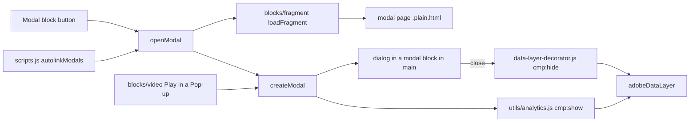
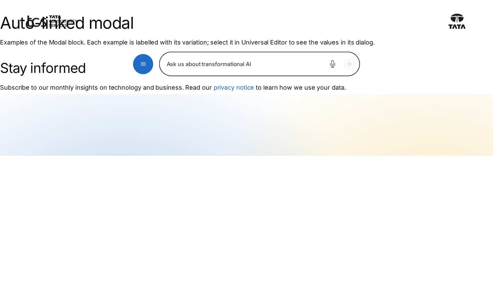
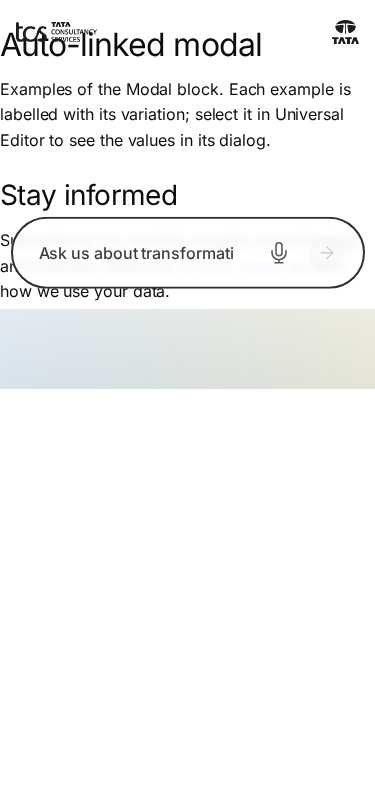

# Modal Block — Developer Guide

| Attribute | Value |
| --- | --- |
| Document ID | DEV-B-modal |
| Audience | Developers, technical leads, block owners, AI coding agents |
| Purpose | How the Modal block is built: files, model, structure, behaviour, variations, tests and limitations |
| Scope | blocks/modal/ and its components modal |
| Prerequisites | — |
| Owner | Technical Lead / Block Owner (proposed) |
| Approver | Product Owner (to be confirmed) |
| Version | 1.0 |
| Status | Draft for review |
| Last updated | 8 November 2026 |
| Last validated | 2026-11-08 (model, files, imports from the code; reference pages from the live site) |
| Source files | blocks/modal/README.md, blocks/modal/_modal.json, blocks/modal/modal.css, blocks/modal/modal.js |
| Related documents | [Variations](./MODAL-VARIATIONS.md), [Test coverage](./MODAL-TEST-COVERAGE.md), [Authoring guide](../../../03-authoring/components/modal/MODAL-AUTHORING-GUIDE.md) |
| Related AEM paths | /content/tcs-corp/design-block-master/en/block-library/modal, /content/tcs-corp/design-block-master/en/block-library/modal/auto-linked-modal, /content/tcs-corp/design-block-master/en/block-library/modal/fragments |

## Contents

- [Summary](#summary)
- [Overview](#overview)
- [Source files](#source-files)
- [Components, models and filters](#components-models-and-filters)
- [Fields](#fields)
- [Dependencies](#dependencies)
- [For Developers](#for-developers)
- [Extending the Block](#extending-the-block)
- [Responsive Behavior](#responsive-behavior)
- [Accessibility](#accessibility)
- [Data Layer and Analytics](#data-layer-and-analytics)
- [Performance Considerations](#performance-considerations)
- [Security and Privacy](#security-and-privacy)
- [For Architects](#for-architects)
- [Troubleshooting](#troubleshooting)
- [Known limitations of the block](#known-limitations-of-the-block)
- [Change history of the block](#change-history-of-the-block)
- [Reference pages](#reference-pages)
- [Coverage of the required topics](#coverage-of-the-required-topics)
- [Screenshots](#screenshots)
- [Known limitations](#known-limitations)
- [Open items](#open-items)
- [Change history](#change-history)

## Summary

| Attribute | Value |
| --- | --- |
| Block | Modal |
| Folder | `blocks/modal` |
| Type | Independent |
| Category | interactive |
| Status | Active |
| Purpose | Opens a page's content in a dialog (button or auto-linked /modal/ links) |
| Variations (summary) | Trigger button; auto-linked |
| Children | — |
| Code size | 276 lines of JS and CSS |

## Overview

**Business purpose.** Show supplementary content (details, terms, a short form, a video) without leaving the page; visitors return to the same place when they close it.

**User experience.** A primary button (for example "View our awards"); selecting it dims the page and opens a white dialog, centred, at most 56.25rem wide, with a close button at the top right; long content scrolls inside the dialog while the page behind stays still. The close button, Escape or a click on the backdrop closes it and focus returns to the button.

**Templates / page types.** Any page.

**Data source.** The fragment page named in Modal Content, fetched (`{path}.plain.html`) and decorated each time the dialog opens.

**Related blocks.** [Fragment](https://github.com/sradha-tcs/tcs-corp/blob/main/blocks/fragment/README.md) (same loader, inline instead of a dialog), the Video block (`blocks/video`, Play in a Pop-up uses `createModal`), Form Variations (a form on a modal page), Button Block (a button linking to a `/modal/` page opens a modal too).

**When to use.** Short, secondary, self-contained content.

**When not to use.** Primary or indexable content (it is loaded from another page on demand), long articles, multi-step processes, content that must be shared by URL; automatic pop-ups on page load aren't implemented.

**Realistic use cases.** "View our awards" (block library `block-library/modal/modal-block`, fragment `modal/fragments/recognition`); "Read the programme terms" with long content (`modal-long-content`); "Contact our team" with a form (`modal-with-a-form`); a privacy notice linked from running text.

## Source files

| File | Link |
| --- | --- |
| `README.md` | [GitHub](https://github.com/sradha-tcs/tcs-corp/blob/main/blocks/modal/README.md) |
| `_modal.json` | [GitHub](https://github.com/sradha-tcs/tcs-corp/blob/main/blocks/modal/_modal.json) |
| `modal.css` | [GitHub](https://github.com/sradha-tcs/tcs-corp/blob/main/blocks/modal/modal.css) |
| `modal.js` | [GitHub](https://github.com/sradha-tcs/tcs-corp/blob/main/blocks/modal/modal.js) |

## Components, models and filters

| Component | Title | Resource type | Template name | Model | Children allowed |
| --- | --- | --- | --- | --- | --- |
| `modal` | Modal | `core/franklin/components/block/v1/block` | Modal | `modal` | — |

## Fields

The Additional tab fields (anchor, hide, padding, margin, animation) are common to the blocks and described in the [content modeling guide](../../markdown/CONTENT-MODELING-GUIDE.md).

### Modal (`modal`)

| Tab | Label | Property | Type | Required in model | Default | Options | Visibility |
| --- | --- | --- | --- | --- | --- | --- | --- |
| Content | Modal Content | `link` | aem-content | No | — | — | — |
| Content | Button Text | `linkText` | text | No | — | — | — |

"Required in model" is the model's `required` flag; whether a field is required in practice is stated in the authoring guide where it is known.

## Dependencies

| Import |
| --- |
| `../fragment/fragment.js` |
| `../../scripts/aem.js` |
| `../../scripts/scripts.js` |
| `../../decorators/button-decorator.js` |
| `../../decorators/icon-button-decorator.js` |
| `../../decorators/data-layer-decorator.js` |
| `../../utils/analytics.js` |
| `../../utils/environment.js` |
| `../../utils/ids.js` |
| `../../utils/placeholders.js` |

## For Developers

<!-- BEGIN GENERATED: files (npm run build:docs) -->

```text
blocks/modal/
├── README.md
├── _modal.json
├── modal.css
└── modal.js
```

| Decorator/Utility | Purpose | Execution or dependency point |
| ----------------- | ------- | ----------------------------- |
| [`blocks/fragment/fragment.js`](https://github.com/sradha-tcs/tcs-corp/blob/main/blocks/fragment/fragment.js) | — | `modal.js`: { loadFragment } |
| [`scripts/aem.js`](https://github.com/sradha-tcs/tcs-corp/blob/main/scripts/aem.js) | Edge Delivery core library (block loading, CSS, metadata, optimized pictures) | `modal.js`: { buildBlock, decorateBlock, loadBlock, loadCSS, toClassName, } |
| [`scripts/scripts.js`](https://github.com/sradha-tcs/tcs-corp/blob/main/scripts/scripts.js) | Page decoration (moveInstrumentation and shared page helpers) | `modal.js`: { moveInstrumentation } |
| [`decorators/button-decorator.js`](https://github.com/sradha-tcs/tcs-corp/blob/main/decorators/button-decorator.js) | `decorateButton` (option `newTabHint`: a link opening a new tab says so), `createButton`, `setButtonDisabled`, `setButtonAlignment`, `removeButtonDecoration` | `modal.js`: { decorateButton } |
| [`decorators/icon-button-decorator.js`](https://github.com/sradha-tcs/tcs-corp/blob/main/decorators/icon-button-decorator.js) | `createIconButton` | `modal.js`: { createIconButton } |
| [`decorators/data-layer-decorator.js`](https://github.com/sradha-tcs/tcs-corp/blob/main/decorators/data-layer-decorator.js) | `trackPage`, `trackBlocks`, `trackInteractions`, `componentIdOf` (Adobe Client Data Layer for every block, Core Components schema, read by Adobe Tags / Web SDK; see "Data layer" below) | `modal.js`: { componentIdOf } |
| [`utils/analytics.js`](https://github.com/sradha-tcs/tcs-corp/blob/main/utils/analytics.js) | `pushToDataLayer`, `pushComponents`, `pushComponentEvent` (Adobe Client Data Layer, Core Components schema; never throws) | `modal.js`: { pushComponentEvent } |
| [`utils/environment.js`](https://github.com/sradha-tcs/tcs-corp/blob/main/utils/environment.js) | `prefersReducedMotion`, `scrollBehavior`, `isEditing`, `isInEditor`, `isAuthor` (the page is rendered by AEM author, which has no query index) | `modal.js`: { isEditing } |
| [`utils/ids.js`](https://github.com/sradha-tcs/tcs-corp/blob/main/utils/ids.js) | `nextInstance`, `uniqueId`, `createIdFactory` (unique ids per block instance), `availableId` (an authored id kept, suffixed -2, -3, ... only when taken) | `modal.js`: { uniqueId } |
| [`utils/placeholders.js`](https://github.com/sradha-tcs/tcs-corp/blob/main/utils/placeholders.js) | `getPlaceholders`, `loadPlaceholders`, `fillPlaceholder` (UI text from the locale's placeholders, with English fallbacks) | `modal.js`: { getPlaceholders } |

<!-- END GENERATED: files -->

**Input DOM.** The Modal Content link with its collapsed Button Text (one `a[href]`, possibly in a `p.button-container`); the Additional tab as block classes.

**`decorate(block)`.** No link: empty block (edit mode: `p.modal-empty`). Else a `button` (text, `title`, `aria-haspopup`), `moveInstrumentation(link, button)`, `decorateButton(button, { view: 'button', type: 'primary' })`, click → `openModal(href, { opener: button, id: `${componentIdOf(block)}-dialog` })`.

**`openModal(fragmentUrl, { opener, id })`** (exported). Path from an absolute URL; a `Set` of paths being opened ignores repeated clicks; `loadFragment(path)`; `null` → nothing; `createModal(fragment.childNodes, { id: id || `modal-${toClassName(path)}` })`, then `showModal(opener)`.

**`createModal(contentNodes, { id })`** (exported). Placeholders; `loadCSS('blocks/modal/modal.css')`; `dialog > button.close-button + div.modal-content`; the name; a `modal` block built with `buildBlock`, given `data-cmp-id`, appended to `main`, decorated and loaded, then filled with the dialog. Returns `{ block, showModal(from) }`. `showModal` stores the opener, starts `trackVisibleArea` (only in a frame: an `IntersectionObserver` on the document and a non-passive `wheel` listener, both removed on close), calls `dialog.showModal()`, pushes `cmp:show`, resets the scroll and adds `body.modal-open`. On `close`: stops tracking, removes `modal-open`, removes the block, focuses the opener.

**Rendered DOM contract.**

```html
<div class="modal block" data-block-name="modal" data-cmp-id="anchor-modal-awards-dialog">
  <dialog aria-labelledby="modal-title-1" open>
    <button type="button" class="close-button button tertiary" aria-label="Close" title="Close"></button>
    <div class="modal-content">
      <div class="section">…<h2 id="modal-title-1">Awards and recognition</h2>…</div>
    </div>
  </dialog>
</div>
```

**Auto-link.** `scripts/scripts.js` `autolinkModals(doc)` (lazy phase) imports `blocks/modal/modal.js` on the first matching click.

**Error handling.** A failed fetch resolves to nothing (no dialog, no message); a network error rejects inside `openModal` (the `finally` clears the guard).

## Extending the Block

- **A field (e.g. a button style).** Add it to `_modal.json` (Additional tab last), `npm run build:json`, `npm run lint`. The block isn't key-value: each dialog tab adds an empty row, so read by `data-aue-prop` in the editor and skip empty rows; a field ending in Text, Title, Type or Alt collapses into its base field (use e.g. `buttonVariant`, as the Button Block does).
- **Rendering.** Keep the opener a `<button>` with `aria-haspopup`; pass a stable `id` to `openModal` / `createModal` from new callers.
- **Responsive.** `modal.css` uses the 900px breakpoint and `--modal-top` / `--modal-height`.
- **Accessibility.** Keep `showModal()`, the name, focus return and the close button.
- **Data layer.** Keep `cmp:show` here and `cmp:hide` from the central `close` listener.
- **Tests.** No unit test covers the block; `test/motion/motion.test.mjs` checks it has no animation fields.
- **Docs and modules.** Update this README (`npm run build:docs`) and the block library modal pages; `npm run build:modules` after changing imports.

## Responsive Behavior

| Viewport | Layout | Image behavior | Interaction behavior |
| -------- | ------ | -------------- | -------------------- |
| Below 900px | Dialog `calc(100vw - 3rem)` wide, gap 1.5rem above and below, content padding 0 1.5rem 1.5rem | As the content's blocks | Opener button; scroll inside the dialog; Escape, close button, backdrop close |
| 900px and above | Dialog `calc(100vw - 4rem)` wide, at most 56.25rem, gap 2.5rem, content padding 0 2rem 2rem | As above | As above |

The dialog is centred in the visible area (`--modal-top`, `--modal-height` in a frame, else the viewport) and never taller than it.

## Accessibility

- **Semantics.** Native `<dialog>` opened with `showModal()` (modal, the rest of the page inert); named by `aria-labelledby` (first heading) or `aria-label` "Dialog".
- **Opener.** A `<button>` with `aria-haspopup="dialog"` (a button, not a link, so it works in Universal Editor preview too).
- **Focus.** On open the browser focuses the first focusable element (the close button); on close focus returns to the opener passed explicitly (works in Safari, which doesn't focus clicked buttons).
- **Close.** Close button (icon button, `aria-label` and `title` "Close"), Escape (native), a click on the backdrop outside the dialog's box.
- **Scroll.** The page is locked while open; the dialog scrolls; in a frame (Universal Editor) the dialog is kept in the visible area and hidden until measured.
- **Reduced motion.** No animation in the block.

Author responsibilities: a heading at the top of every modal page, a descriptive Button Text, one purpose per dialog.

Developer responsibilities: keep `showModal()`, the naming, the explicit opener and the placeholders; never open a dialog without a visitor action.

| Key | Expected behavior |
| --- | ----------------- |
| Enter / Space | On the opener: opens the dialog; on the close button: closes it |
| Tab / Shift+Tab | Moves within the dialog (the page behind is inert) |
| Escape | Closes the dialog; focus returns to the opener |

## Data Layer and Analytics

- **Opener component.** The authored block (`modal-{n}`, or its Anchor ID), `@type` `tcs-corp/components/modal`, added after the main sections load.
- **Dialog id.** Stable: `{opener id}-dialog` for the Modal block, `modal-{path}` (`toClassName`) for auto-linked links; Video pop-ups get `modal-{n}`. The dialog block is created at opening and removed at closing; it is added to the component state only if it is open during the delayed `trackBlocks` pass.
- **Events.** `modal.js` pushes `cmp:show` on open (`pushComponentEvent`); `decorators/data-layer-decorator.js` pushes `cmp:hide` on the dialog's `close` event (any way of closing). Clicks are captured centrally.

| Trigger | Data-layer event | Required properties | Analytics behavior |
| ------- | ---------------- | ------------------- | ------------------ |
| Click on the opener | `cmp:click` | `eventInfo.path` `component.{opener id}`, `interaction` "button", `dc:title` (button text), `breakpoint` | Opener use |
| Dialog opened | `cmp:show` | `eventInfo.path` `component.{dialog id}`, `interaction` "dialog" | Dialog impression |
| Dialog closed (button, Escape, backdrop) | `cmp:hide` | `eventInfo.path` `component.{dialog id}`, `interaction` "dialog" | Dialog close |
| Click on the close button | `cmp:click` | `interaction` "button", `dc:title` "Close" | Close intent |
| Click on a link in the dialog | `cmp:click` | `xdm:linkURL`, `xdm:linkType` | Link from the dialog |

The intended flow is Adobe Client Data Layer → Adobe Data Collection (Tags) → AEP Web SDK → Edge Network → Analytics / CJA; Tags and the Web SDK aren't configured yet (blocked: measurement plan). No consent mechanism is implemented. Build rules on `interaction: "dialog"`.

## Performance Considerations

- The authored block only builds a button (eager or lazy with its section); the modal stylesheet, the placeholders and the page are loaded when the dialog opens.
- Auto-link: one document click listener from the lazy phase; `modal.js` imported on the first matching click.
- The page is fetched and decorated again at each opening (no caching in code); the dialog block is removed on close.
- In a frame only: an `IntersectionObserver` (101 thresholds) and a non-passive `wheel` listener while open, both removed on close.

## Security and Privacy

- Only root-relative same-site paths are loaded (`loadFragment`); absolute URLs are reduced to their path.
- Auto-link checks only the path (`/modal/`), not the link's origin: an external link whose path contains `/modal/` would open the same path of this site instead of navigating.
- Content is the site's own HTML; no query strings, no personal data; form data in a dialog is handled by Form Variations.

## For Architects

- **Role.** On-demand presentation of a content page in a dialog; a shared dialog service for blocks.
- **Content model.** A link to a page; the page is the content.
- **Rendering.** Client-side; content fetched and decorated at each opening; the dialog lives in a temporary block in `main`.
- **Dependencies.** `blocks/fragment`, `scripts/aem.js` (`buildBlock`, `decorateBlock`, `loadBlock`, `loadCSS`, `toClassName`), `scripts/scripts.js` (`moveInstrumentation`, `autolinkModals`), `decorators/button-decorator.js`, `decorators/icon-button-decorator.js`, `decorators/data-layer-decorator.js`, `utils/analytics.js`, `utils/environment.js`, `utils/ids.js`, `utils/placeholders.js`.
- **Data layer / Web SDK / Target.** `cmp:show` / `cmp:hide`; no Target.
- **Consent and identity.** None.
- **Caching.** The modal page through the CDN and browser cache; no caching in code.
- **Performance.** No cost until opened.
- **Security.** Same-site root-relative paths only.



## Troubleshooting

| Symptom | Likely cause | Diagnostic steps | Resolution | Verification |
| ------- | ------------ | ---------------- | ---------- | ------------ |
| The button does nothing | Modal page not published, wrong path, or not a site path | Network: `{path}.plain.html` status | Publish / correct Modal Content | Dialog opens |
| No button | Modal Content empty, or Hide block on | Properties panel | Choose the page; switch Hide block off | Button visible |
| Button says "Open" | Button Text empty or equal to the URL | Properties panel | Enter a descriptive text | Correct label |
| A link opens a dialog (or navigates) unexpectedly | Its path contains `/modal/` (auto-link), or clicked before the lazy phase / in the editor | Check the URL | Move pages out of `modal` folders; use a Modal block in the editor | Intended behaviour on `.aem.page` |
| Screen readers say "Dialog" only | Modal page without a heading | Inspect `aria-label` | Add a heading | `aria-labelledby` set |
| Content unstyled or blocks missing | A block of the modal page failed | Console `failed to load …` | Fix the content; escalate block errors | Renders as on its page |
| No `cmp:show` / `cmp:hide` | Dialog didn't open; Tags not configured | `adobeDataLayer.filter((e) => e.eventInfo?.interaction === 'dialog')` | Fix the opening; configure Tags later | Events present |

Evidence to collect: host page URL, Modal Content value, network status of the modal page request, console errors, the data-layer entries. No cookies or tokens.

## Known limitations of the block

| Limitation | Impact | Workaround | Planned correction |
| ---------- | ------ | ---------- | ------------------ |
| The Video pop-up player (`.modal .video-modal-player`, up to 75rem) is wider than the dialog (56.25rem) (F-51) | Player runs past the dialog edge at 1440px | — | Not recorded (F-51 open, P2) |
| The modal page is fetched at every opening | Repeated requests | — | Not planned |
| The opener is always a primary button (no style option, audit) | No secondary / tertiary opener | Use a Button Block linking to a `/modal/` page | Not recorded |
| Auto-link ignores the link's origin | External `/modal/` links don't navigate | Avoid such links | Not recorded |
| Auto-link starts in the lazy phase and not in Universal Editor (the editor navigates) | Early clicks navigate | Use a Modal block for editor previews | Not planned |
| A failed fetch shows no message | Silent failure | Publish the modal page | Not recorded |

## Change history of the block

| Version | Change | Source | Date |
| ------- | ------ | ------ | ---- |
| Not recorded | README generated from verified implementation and approved handover documentation | Repository review | Not recorded |
| Handover 2.27 | Block ecosystem audit: one dialog per double click (D-C-9), stable data-layer id from the opener / path (D-C-10), opener passed explicitly for focus return (D-C-11), editor hint without Modal Content (D-C-21) | docs/handover revision history; docs/audit/BLOCK-ECOSYSTEM-AUDIT.md | 19 October 2026 |
| Handover 2.29 | Re-audit: the Video pop-up in the dialog corrected | docs/handover revision history | 20 October 2026 |

## Reference pages

| Kind | Page | Live URL |
| --- | --- | --- |
| Block library | /design-block-master/en/block-library/modal | https://main--tcs-corp--sradha-tcs.aem.live/design-block-master/en/block-library/modal |
| Block library | /design-block-master/en/block-library/modal/auto-linked-modal | https://main--tcs-corp--sradha-tcs.aem.live/design-block-master/en/block-library/modal/auto-linked-modal |
| Block library | /design-block-master/en/block-library/modal/fragments | https://main--tcs-corp--sradha-tcs.aem.live/design-block-master/en/block-library/modal/fragments |
| Block library | /design-block-master/en/block-library/modal/fragments/contact-form | https://main--tcs-corp--sradha-tcs.aem.live/design-block-master/en/block-library/modal/fragments/contact-form |
| Block library | /design-block-master/en/block-library/modal/fragments/privacy-notice | https://main--tcs-corp--sradha-tcs.aem.live/design-block-master/en/block-library/modal/fragments/privacy-notice |
| Block library | /design-block-master/en/block-library/modal/fragments/recognition | https://main--tcs-corp--sradha-tcs.aem.live/design-block-master/en/block-library/modal/fragments/recognition |
| Block library | /design-block-master/en/block-library/modal/fragments/terms | https://main--tcs-corp--sradha-tcs.aem.live/design-block-master/en/block-library/modal/fragments/terms |
| Block library | /design-block-master/en/block-library/modal/modal-block | https://main--tcs-corp--sradha-tcs.aem.live/design-block-master/en/block-library/modal/modal-block |
| Block library | /design-block-master/en/block-library/modal/modal-long-content | https://main--tcs-corp--sradha-tcs.aem.live/design-block-master/en/block-library/modal/modal-long-content |
| Block library | /design-block-master/en/block-library/modal/modal-with-a-form | https://main--tcs-corp--sradha-tcs.aem.live/design-block-master/en/block-library/modal/modal-with-a-form |

## Coverage of the required topics

| Topic | Where |
| --- | --- |
| Purpose | Overview |
| Source files | generated: Files |
| Model, definition, filters, children | generated: Components |
| Dependencies | generated: Dependencies |
| Authored input / rendered output / DOM transformation | For Developers |
| Configuration fields, defaults, required fields | generated: Fields |
| Variations | MODAL-VARIATIONS.md |
| Responsive behaviour | Responsive Behavior |
| Accessibility and keyboard | Accessibility |
| Analytics / data layer | Data Layer and Analytics |
| Performance | Performance Considerations |
| Security | Security and Privacy |
| Extending | Extending the Block |
| Known limitations | Known Limitations |
| Troubleshooting | Troubleshooting |
| Tests | MODAL-TEST-COVERAGE.md |
| SEO behaviour | Not recorded |
| Caching considerations | Not recorded (Edge Delivery default caching; no block-specific rule) |
| Ownership | Technical Lead / Block Owner (proposed) |

## Screenshots



*Figure: Modal block library page — desktop 1440 × 900 (/design-block-master/en/block-library/modal/auto-linked-modal, captured 2026-11-08).*



*Figure: Modal block library page — mobile 375 × 812 (/design-block-master/en/block-library/modal/auto-linked-modal, captured 2026-11-08).*


*Figure: Desktop rendering — At 1200 px, after selecting View our awards: the page dimmed by the near-black 75 % backdrop and, centred over it, a white dialog 56.25rem wide with 1rem rounded corners, the close (X) button at the top right, the H2 Awards and recognition, the introduction, four bulleted awards and the link More about us, with 2rem padding. (Sample content on the preview; callout letters as in the Field Entry Table; file screenshots/modal-desktop-view.jpg) (handover screenshot; rendering at the time it was taken).*


*Figure: Tablet rendering — At 768 px, after selecting Read the programme terms and scrolling inside the dialog: a white dialog 1.5rem from each screen edge over the dark backdrop, showing the middle of the programme terms (Heading 3 sections with their paragraphs), with the close (X) button still at the top right. (Sample content on the preview; callout letters as in the Field Entry Table; file screenshots/modal-tablet-view.jpg) (handover screenshot; rendering at the time it was taken).*


*Figure: Mobile rendering — At 375 px, after selecting Read the programme terms: the dialog 1.5rem from each screen edge and as tall as the screen minus 3rem, showing the close (X) button at the top right, the H2 Programme terms, the introduction and the first Heading 3 sections; the rest scrolls inside. (Sample content on the preview; callout letters as in the Field Entry Table; file screenshots/modal-mobile-view.jpg) (handover screenshot; rendering at the time it was taken).*


*Figure: Modal block variation — At 1440 px: the section with the H2 Recognised for excellence, the paragraph and the primary button View our awards, dimmed under the dark backdrop, and the awards dialog (56.25rem wide, the H2 Awards and recognition, four bulleted awards and More about us) open over it rather than next to it. (Sample content on the preview; callout letters as in the Field Entry Table; file screenshots/modal-block-button.jpg) (handover screenshot; rendering at the time it was taken).*


*Figure: Auto-linked modal variation — At 1440 px: the H2 Stay informed and the paragraph with the inline link privacy notice, dimmed under the backdrop, and over them the dialog opened by that link with the close button, the H2 Privacy notice and three paragraphs. (Sample content on the preview; callout letters as in the Field Entry Table; file screenshots/modal-auto-link.jpg) (handover screenshot; rendering at the time it was taken).*


*Figure: Universal Editor canvas — Universal Editor edit mode at 1440 px: the section with the H2 Recognised for excellence, the paragraph and the primary button View our awards; letter A marks the Modal block and B its opener button. No dialog is open. (Annotated preview in editor mode with sample content; letters as in the annotations list, not a Universal Editor screenshot; file screenshots/modal-authoring-view.jpg) (handover screenshot; rendering at the time it was taken).*


*Figure: Properties panel — The Modal properties panel with the Content tab (Modal Content picker and Button Text) and the Additional tab. (Dialog reference generated from the component model, not a Universal Editor screenshot; file screenshots/modal-properties-panel.jpg) (handover screenshot; rendering at the time it was taken).*

## Known limitations

- Universal Editor dialogs were not captured: no author access in this program (see the access blockers).

## Open items

- None.

## Change history

| Version | Date | Author | Change |
| --- | --- | --- | --- |
| 1.0 | 8 November 2026 | Delivery team (documentation program) | First version of the role-specific documentation (master documentation prompt), generated from the repository and the published reference pages |
