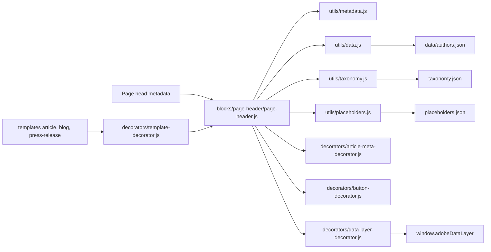
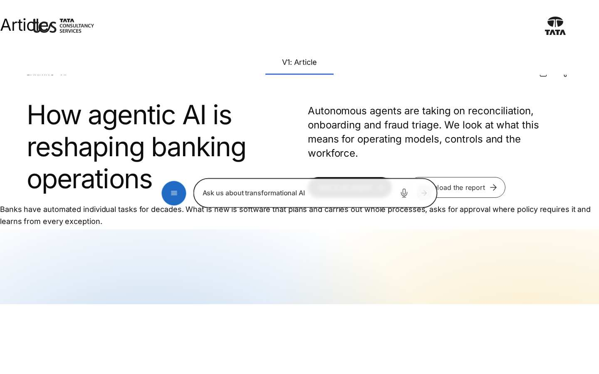

# Page Header Block — Developer Guide

| Attribute | Value |
| --- | --- |
| Document ID | DEV-B-page-header |
| Audience | Developers, technical leads, block owners, AI coding agents |
| Purpose | How the Page Header block is built: files, model, structure, behaviour, variations, tests and limitations |
| Scope | blocks/page-header/ and its components page-header, page-header-cta |
| Prerequisites | — |
| Owner | Technical Lead / Block Owner (proposed) |
| Approver | Product Owner (to be confirmed) |
| Version | 1.0 |
| Status | Draft for review |
| Last updated | 8 November 2026 |
| Last validated | 2026-11-08 (model, files, imports from the code; reference pages from the live site) |
| Source files | blocks/page-header/README.md, blocks/page-header/_page-header.json, blocks/page-header/page-header.css, blocks/page-header/page-header.js |
| Related documents | [Variations](./PAGE-HEADER-VARIATIONS.md), [Test coverage](./PAGE-HEADER-TEST-COVERAGE.md), [Authoring guide](../../../03-authoring/components/page-header/PAGE-HEADER-AUTHORING-GUIDE.md) |
| Related AEM paths | /content/tcs-corp/design-block-master/en/block-library/page-header, /content/tcs-corp/design-block-master/en/block-library/page-header/article, /content/tcs-corp/design-block-master/en/block-library/page-header/article-default |

## Contents

- [Summary](#summary)
- [Overview](#overview)
- [Source files](#source-files)
- [Components, models and filters](#components-models-and-filters)
- [Fields](#fields)
- [Dependencies](#dependencies)
- [For Developers](#for-developers)
- [Extending the Block](#extending-the-block)
- [Responsive Behavior](#responsive-behavior)
- [Accessibility](#accessibility)
- [Data Layer and Analytics](#data-layer-and-analytics)
- [Performance Considerations](#performance-considerations)
- [Security and Privacy](#security-and-privacy)
- [For Architects](#for-architects)
- [Troubleshooting](#troubleshooting)
- [Known limitations of the block](#known-limitations-of-the-block)
- [Change history of the block](#change-history-of-the-block)
- [Reference pages](#reference-pages)
- [Coverage of the required topics](#coverage-of-the-required-topics)
- [Screenshots](#screenshots)
- [Known limitations](#known-limitations)
- [Open items](#open-items)
- [Change history](#change-history)

## Summary

| Attribute | Value |
| --- | --- |
| Block | Page Header |
| Folder | `blocks/page-header` |
| Type | Container |
| Category | content |
| Status | Active |
| Purpose | The title area of a page from its metadata (title, description, tags, author, dates) |
| Variations (summary) | Layouts by page type |
| Children | page-header-cta (CTA) |
| Code size | 561 lines of JS and CSS |

## Overview

**Business purpose.** One consistent, design-system header for secondary pages (landing, listing, article, blog, press release, insight) whose title, description, tags, dates and author are always the values used for SEO, the query index, cards and listings, because they come from the same metadata.

**User experience.** Visitors see the page title as the H1, with an eyebrow (content type or tags), the description and CTAs. Article pages add a meta row (tags, content type, "Published" date, reading time, listen / download / share icon buttons) and the author's photo, name (linked to LinkedIn) and designation. Landing pages can show the featured image next to the text.

**Templates / page types.** Default layout: Landing for the page types `landing` and `listing`, Article for any other. The Article, Blog and Press Release templates insert an empty Page Header as the first section when the page has none (`decorators/template-decorator.js` `ensurePageHeader`); an authored one wins.

**Data source.** Page metadata (`utils/metadata.js` `getPageMetadata`: title, description, tags, page-type, content-type, publish-date, reading-time, author-id, author, featured-image, image-alt, listen-link), the Authors sheet (`/{locale}/data/authors.json`), the taxonomy (`/{locale}/taxonomy.json`) and placeholders.

**Related blocks.** [Hero](https://github.com/sradha-tcs/tcs-corp/blob/main/blocks/hero/README.md) (the authored opening banner, e.g. on Home), the Teaser (`blocks/teaser`, shares `decorators/article-meta-decorator.js`), [List](https://github.com/sradha-tcs/tcs-corp/blob/main/blocks/list/README.md) and Filter List (show the same metadata on cards).

**When to use.** As the first block of landing, listing, article, blog and press-release pages, once per page.

**When not to use.** On the Home page (use Hero or Gen Carousel); when the header needs content that isn't metadata (a video, an authored image per breakpoint: use Hero or Teaser); more than once per page (it renders an H1). There are no title or description fields: change the page properties or the metadata sheet instead.

**Realistic use cases.**

- A banking industry landing page: eyebrow "Industry", title, description, two CTAs and the featured image (Landing).
- An insight article: tags and content type, publish date, "6 min read", listen / download / share, the author from the Authors sheet (Article).
- A press release with the header added by the template (Article, no CTAs).
- A leadership page with the title on the left and the description and CTAs on the right (Secondary).
- A campaign page with a very large display title under its tags (Display).

## Source files

| File | Link |
| --- | --- |
| `README.md` | [GitHub](https://github.com/sradha-tcs/tcs-corp/blob/main/blocks/page-header/README.md) |
| `_page-header.json` | [GitHub](https://github.com/sradha-tcs/tcs-corp/blob/main/blocks/page-header/_page-header.json) |
| `page-header.css` | [GitHub](https://github.com/sradha-tcs/tcs-corp/blob/main/blocks/page-header/page-header.css) |
| `page-header.js` | [GitHub](https://github.com/sradha-tcs/tcs-corp/blob/main/blocks/page-header/page-header.js) |

## Components, models and filters

| Component | Title | Resource type | Template name | Model | Children allowed |
| --- | --- | --- | --- | --- | --- |
| `page-header` | Page Header | `core/franklin/components/block/v1/block` | Page Header | `page-header` | page-header-cta |
| `page-header-cta` | CTA | `core/franklin/components/block/v1/block/item` | CTA | `page-header-cta` | — |

## Fields

The Additional tab fields (anchor, hide, padding, margin, animation) are common to the blocks and described in the [content modeling guide](../../markdown/CONTENT-MODELING-GUIDE.md).

### Page Header (`page-header`)

| Tab | Label | Property | Type | Required in model | Default | Options | Visibility |
| --- | --- | --- | --- | --- | --- | --- | --- |
| Style | Layout | `classes` | select | No | `""` | 5 options | — |
| CTAs | CTA List | `ctas` | container | No | — | — | — |
| CTAs | CTA List › CTA Title | `ctaText` | text | No | — | — | — |
| CTAs | CTA List › CTA Link | `cta` | aem-content | No | — | — | — |
| CTAs | CTA List › CTA Link Type | `ctaTarget` | select | No | `""` | 2 options | — |
| CTAs | CTA List › CTA Link Style | `ctaStyle` | select | No | `primary` | 3 options | — |

### CTA (`page-header-cta`)

| Tab | Label | Property | Type | Required in model | Default | Options | Visibility |
| --- | --- | --- | --- | --- | --- | --- | --- |
| — | CTA Link | `link` | aem-content | Yes | — | — | — |
| — | CTA Title | `linkText` | text | No | — | — | — |
| — | CTA Link Type | `linkTarget` | select | No | `""` | 2 options | — |
| — | CTA Link Style | `linkStyle` | select | No | `primary` | 3 options | — |
| — | Button background | `buttonBackground` | select | No | `""` | 2 options | — |
| — | Button shape | `buttonShape` | select | No | `""` | 2 options | — |

"Required in model" is the model's `required` flag; whether a field is required in practice is stated in the authoring guide where it is known.

## Dependencies

| Import |
| --- |
| `../../scripts/scripts.js` |
| `../../decorators/article-meta-decorator.js` |
| `../../decorators/button-decorator.js` |
| `../../decorators/editor-item-decorator.js` |
| `../../decorators/link-decorator.js` |
| `../../decorators/responsive-image-decorator.js` |
| `../../decorators/tag-decorator.js` |
| `../../utils/cells.js` |
| `../../utils/data.js` |
| `../../utils/links.js` |
| `../../utils/metadata.js` |
| `../../utils/placeholders.js` |
| `../../utils/properties.js` |
| `../../utils/taxonomy.js` |

## For Developers

<!-- BEGIN GENERATED: files (npm run build:docs) -->

```text
blocks/page-header/
├── README.md
├── _page-header.json
├── page-header.css
└── page-header.js
```

| Decorator/Utility | Purpose | Execution or dependency point |
| ----------------- | ------- | ----------------------------- |
| [`scripts/scripts.js`](https://github.com/sradha-tcs/tcs-corp/blob/main/scripts/scripts.js) | Page decoration (moveInstrumentation and shared page helpers) | `page-header.js`: { moveInstrumentation } |
| [`decorators/article-meta-decorator.js`](https://github.com/sradha-tcs/tcs-corp/blob/main/decorators/article-meta-decorator.js) | `buildPublished`, `buildReadingTime`, `buildPageActions` (listen / download / share), `buildAuthorLockup` | `page-header.js`: { buildAuthorLockup, buildPageActions, buildPublished, buildReadingTime, } |
| [`decorators/button-decorator.js`](https://github.com/sradha-tcs/tcs-corp/blob/main/decorators/button-decorator.js) | `decorateButton` (option `newTabHint`: a link opening a new tab says so), `createButton`, `setButtonDisabled`, `setButtonAlignment`, `removeButtonDecoration` | `page-header.js`: { decorateButton } |
| [`decorators/editor-item-decorator.js`](https://github.com/sradha-tcs/tcs-corp/blob/main/decorators/editor-item-decorator.js) | `buildEditorItems`, `editorItemHint` (in Universal Editor, an item the block doesn't render yet, e.g. a CTA just added, as a dashed placeholder the author can select; styles in `styles/lazy-styles.css`; the hint loaded o | `page-header.js`: { buildEditorItems, editorItemHint } |
| [`decorators/link-decorator.js`](https://github.com/sradha-tcs/tcs-corp/blob/main/decorators/link-decorator.js) | `setLinkTarget` (open in a new window), `announceNewTab` (tells screen reader users a link opens in a new tab: hidden text, or added to its aria-label) | `page-header.js`: { announceNewTab, setLinkTarget } |
| [`decorators/responsive-image-decorator.js`](https://github.com/sradha-tcs/tcs-corp/blob/main/decorators/responsive-image-decorator.js) | `buildImage` (image from a URL; site media and EDAM delivery images optimized), `buildDeliveryPicture` (responsive picture of a Dynamic Media with OpenAPI delivery image), `decorateDeliveryImages` (standalone delivery im | `page-header.js`: { buildImage } |
| [`decorators/tag-decorator.js`](https://github.com/sradha-tcs/tcs-corp/blob/main/decorators/tag-decorator.js) | `buildTagList` | `page-header.js`: { buildTagList } |
| [`utils/cells.js`](https://github.com/sradha-tcs/tcs-corp/blob/main/utils/cells.js) | `itemRows`, `KEY_VALUE_ITEM`, `FIELD_ROW_ITEM` (the item rows of a block: by model in the editor, by their cells on the page), `withoutTabCells` (drops the empty cell AEM renders for each dialog tab of an item model), `m | `page-header.js`: { KEY_VALUE_ITEM, itemRows } |
| [`utils/data.js`](https://github.com/sradha-tcs/tcs-corp/blob/main/utils/data.js) | `loadDataSheet`, `getAuthor`, `getAuthors`, `getLocations`, `getPartners`, `getSocialLinks`, `getMediaContacts`, `inRegion` (the locale's data sheets) | `page-header.js`: { getAuthor } |
| [`utils/links.js`](https://github.com/sradha-tcs/tcs-corp/blob/main/utils/links.js) | `NEW_WINDOW`, `linkOf`, `linkPathsOf` (the paths of a page property, one or many), `readLinkItems` (CTA lists with Link Type and the items' other select values), `readLinkRows` (the same from link item rows, e.g. Hero CT | `page-header.js`: { readLinkItems, readLinkRows } |
| [`utils/metadata.js`](https://github.com/sradha-tcs/tcs-corp/blob/main/utils/metadata.js) | `getPageMetadata`, `getPageTags` (article:tag and the AEM page Tags published as `cq-tags`), `getPageLanguage` (page properties and bulk metadata columns: page-type, author-id, publish-date, reading-time, ...) | `page-header.js`: { getPageMetadata } |
| [`utils/placeholders.js`](https://github.com/sradha-tcs/tcs-corp/blob/main/utils/placeholders.js) | `getPlaceholders`, `loadPlaceholders`, `fillPlaceholder` (UI text from the locale's placeholders, with English fallbacks) | `page-header.js`: { getPlaceholders } |
| [`utils/properties.js`](https://github.com/sradha-tcs/tcs-corp/blob/main/utils/properties.js) | `readProperties`, `textOf`, `isOn`, `isOnByDefault` (a toggle that defaults to on), `optionOf`, `normalizeKey`, `textSource` (key-value block properties) | `page-header.js`: { optionOf, readProperties } |
| [`utils/taxonomy.js`](https://github.com/sradha-tcs/tcs-corp/blob/main/utils/taxonomy.js) | `loadTaxonomy`, `resolveTags` (tag labels from the locale's taxonomy) | `page-header.js`: { resolveTags } |

<!-- END GENERATED: files -->

**Responsibilities.** `page-header.js` reads the Layout and the legacy CTA List (`readProperties`), the CTA items (`itemRows(block, ['page-header-cta'], KEY_VALUE_ITEM)`), the page metadata, the author and the tags, and builds the layout's DOM. `page-header.css` styles the four layouts, with one breakpoint (900px).

**Input DOM.** Key-value rows (`classes` → Layout; `ctas` → the legacy multifield cell); CTA item rows after them with five cells (link, link type, style, Button background, Button shape; `test/items/item-rows.test.mjs`). Older three- and four-cell CTA rows remain supported. The template-added block is an empty `div.page-header`.

**Rendered DOM.**

```text
div.page-header.<layout>[.page-header-has-image]
├── div.page-header-meta-row (article)
│   ├── div.page-header-labels > ul.page-header-tags > li[data-tag], p.page-header-collection
│   └── div.page-header-info > p.page-header-date > time, p.page-header-reading-time,
│       div.page-header-actions > (a|button).button.tertiary.icon-button…, p.page-header-status[role=status]
├── p.page-header-eyebrow | ul.page-header-tags (secondary: above the columns)
├── div.page-header-columns (secondary, article, display)
│   ├── div.page-header-intro > [eyebrow (display)], h1.page-header-title, [div.page-header-author]
│   └── div.page-header-summary > div.page-header-description, div.page-header-ctas > a.button
├── div.page-header-intro (landing: eyebrow, title, description, CTAs)
└── div.page-header-media > picture | img (landing)
```

**Decoration flow.** Read properties and CTA rows → `getPageMetadata()` → in parallel `getPlaceholders()`, `resolveTags(metadata.tags)`, `getAuthor(metadata.authorId)`, `editorItemHint(ctaRows)` → `layoutOf` → build title, tags, eyebrow, description, CTAs (`decorateButton` with `newTabHint`, `moveInstrumentation` from each item row, `buildEditorItems` for items without link) → assemble the layout → replace the layout class, toggle `page-header-has-image` → `replaceChildren` with the non-empty parts.

**Events and async behavior.** `decorate` awaits placeholders, the taxonomy (only when the page has tags) and the Authors sheet (only with an author-id), each fetched once per page. Share uses `navigator.share`, else `navigator.clipboard.writeText`; errors (dismissed dialog, blocked clipboard) are ignored.

**Error handling.** Missing sheets resolve to empty results (`.catch`), so the header renders without author and with ID-derived tag labels; missing metadata parts are omitted.

**Exported functions.** Only the default `decorate`.

**Parent / child contracts.** `decorators/template-decorator.js` `ensurePageHeader` checks `main .page-header` before adding one. Only the `section` filter offers the Page Header (not Columns Containers, Tabs Containers or Gen Carousels).

**Data-layer hooks.** `data-cmp-interaction` `listen` / `download` / `share` on the actions.

## Extending the Block

1. **Add a layout** to the Layout select in `_page-header.json` and to `LAYOUTS` in `page-header.js`, build its branch in `decorate` and its styles under `.page-header.<layout>`; run `npm run build:json` and `npm run lint`.
2. **Show another metadata column**: read it in `utils/metadata.js` `getPageMetadata` (and index it in `helix-query.yaml` if listings need it), then render it in the layouts; text that isn't metadata belongs in placeholders.
3. **Responsive and accessibility.** Mobile first with the 900px query (add 600 / 1200px only when needed), rem sizes, theme tokens for text; keep one H1.
4. **Data layer.** Use `data-cmp-interaction` for new actions.
5. **Tests.** Keep `test/items/item-rows.test.mjs` passing for `page-header-cta` (cells `link`, `linkTarget`, `linkStyle`); animation fields are checked by `test/motion/motion.test.mjs`. Run `npm test`.
6. **Backward compatibility.** Key-value block: don't use grouped (`prefix_name`) fields; fields ending in Text, Title, Type, Alt or MimeType collapse into their base field; keep reading the legacy `ctas` multifield and the empty style value.
7. **Block library and docs.** Update the Page Header library pages and this README, run `npm run build:docs`; `npm run build:modules` after changing imports.

## Responsive Behavior

| Viewport | Layout | Image behavior | Interaction behavior |
| -------- | ------ | -------------- | -------------------- |
| < 900px | One column; top padding `--space-1000`; parts stacked with `--space-1000` gaps | Landing image below the text, full width; `<picture>` source 750px | Meta row, tags, CTAs wrap |
| >= 900px | Top padding `--space-3000`; title side and summary side in two equal columns; Landing with image a two-column grid (`--space-2000` gap); Landing and Display titles 6rem | Landing image beside the text; source 1200px | As above |

## Accessibility

- **Semantic HTML.** `h1` title, `ul` tags, `<time datetime>` dates, `<a>` CTAs and listen link, `<button>` download and share.
- **Headings.** Always H1: one Page Header per page and no other H1 (e.g. a Hero with H1).
- **Keyboard and focus.** CTAs, LinkedIn link and the icon buttons are in the tab order; icon buttons turn brand-coloured on hover and focus.
- **Accessible names.** Icon buttons named from placeholders (`listenToThisPage`, `downloadThisPage`, `shareThisPage`).
- **Alt text.** Featured image from `image-alt` (empty: decorative); author image decorative.
- **Link purpose.** New-tab CTAs and the LinkedIn link append "(opens in a new tab)" (placeholder `opensInNewTab`).
- **Announcements.** The share fallback writes "Link copied to clipboard" (`linkCopied`) into a `role="status"` element.
- **Reduced motion.** Additional tab animations don't play for reduced motion or in the editor.
- **Contrast.** Text uses the theme tokens (`--color-text-default`, `--color-text-secondary`).
- **Empty states.** Parts without data are left out.
- **Reflow.** One column below 900px; the meta row and CTAs wrap.

Author responsibilities: meaningful Title, Description and tags, `image-alt` for informative featured images, one H1, CTA labels that make sense out of context.

Developer responsibilities: keep the H1, the `role="status"` message, the named icon buttons and the new-tab hints.

| Key | Expected behavior |
| --- | ----------------- |
| Tab / Shift+Tab | Moves through the listen link, download and share buttons, the LinkedIn link and the CTAs |
| Enter | Follows the focused link |
| Enter / Space | Activates download (print dialog) or share |

## Data Layer and Analytics

- **Component.** `@type` `tcs-corp/components/page-header`, id = Anchor ID else `page-header-{n}`, `dc:title` the H1 text, `parentId` the page.
- **Variation.** Not pushed.
- **Interactions.** Captured centrally by `decorators/data-layer-decorator.js`; the actions carry `data-cmp-interaction` `listen`, `download` and `share` (set by `decorators/article-meta-decorator.js`). The block pushes no events of its own.

| Trigger | Data-layer event | Required properties | Analytics behavior |
| ------- | ---------------- | ------------------- | ------------------ |
| Block decorated | component entry | `@type`, `parentId`, `dc:title` | State |
| CTA click | `cmp:click` | `interaction: link`, `dc:title`, `xdm:linkURL`, `xdm:linkType`, `breakpoint` | Link tracking |
| LinkedIn author link | `cmp:click` | `interaction: link`, `xdm:linkType: exit` | Exit link |
| Listen | `cmp:click` | `interaction: listen`, `xdm:linkURL` (`xdm:linkType` `download` for file links such as `.mp3`) | Audio use |
| Download | `cmp:click` | `interaction: download`, `dc:title` | Print / PDF use |
| Share | `cmp:click` | `interaction: share`, `dc:title` | Share use |

The intended path is Adobe Client Data Layer → Adobe Data Collection (Tags) → AEP Web SDK → Edge Network → Analytics / CJA, but Tags and the Web SDK aren't configured yet (blocked: measurement plan). No consent mechanism is implemented.

## Performance Considerations

- **Initialization.** Usually in the first section (eager phase); rendering waits for placeholders, the taxonomy (only with tags) and the Authors sheet (only with an author-id), fetched in parallel and cached per page.
- **Images.** Landing site-media images are eager with `fetchpriority="high"` (1200px / 750px sources); other URLs are lazy plain images (F-14); author images go through the same helper.
- **DOM size.** Small; no observers; listeners only on the download and share buttons.
- **Layout shift.** The header renders after its data arrives; the template-inserted block is empty until then.
- **High-cost configurations.** None identified beyond the Landing image size.

## Security and Privacy

- All metadata text is inserted with `textContent` (no HTML injection).
- Link URLs (CTAs, listen-link, LinkedIn) come from authored content and sheets; they aren't validated. The LinkedIn link opens with `rel="noopener noreferrer"`.
- Share passes the current URL and page title to the device share dialog or the clipboard; no data is sent elsewhere. No personal data beyond the published author details is used.

## For Architects

- **Role.** Metadata-driven page title area; usually the first section and the LCP area of templated pages.
- **Content model.** Key-value block with one authored option (Layout) and CTA items; everything else from metadata, sheets and taxonomy.
- **Rendering and data source.** Client-side, from `<head>` metadata of the delivered page plus three JSON resources (placeholders, taxonomy, Authors sheet), each cached per page.
- **Container / child model.** Child of Sections (or inserted by templates); parent of CTA items.
- **Dependencies.** Article meta, button, editor item, link, responsive image and tag decorators; cells, data, links, metadata, placeholders, properties and taxonomy utils.
- **Data layer / Web SDK / Target.** In the data layer as `tcs-corp/components/page-header`; no Web SDK or Target.
- **Consent and identity.** None handled.
- **Caching.** HTML and sheets cached by the Edge Delivery CDN.
- **Performance.** The block waits for its JSON resources before rendering; the Landing site-media image is eager with high priority.
- **Security.** Text is set with `textContent`; links come from authored metadata and sheets.
- **Scalability.** One fetch per resource per page, shared with other blocks.



## Troubleshooting

| Symptom | Likely cause | Diagnostic steps | Resolution | Verification |
| ------- | ------------ | ---------------- | ---------- | ------------ |
| Title or description wrong / missing | Page properties not updated or not republished | Page source: `og:title`, `description` | Update the page properties; publish | H1 matches the Title |
| Wrong layout | Default with an unexpected page-type (e.g. a sheet row) | `<meta name="page-type">`; block classes | Choose the Layout explicitly or fix the sheet | Expected layout class |
| No author lockup | author-id missing from the Authors sheet, sheet not published, or layout not Article | `<meta name="author-id">`; open `/{locale}/data/authors.json` | Fix the author row; publish | Lockup shows |
| Tags show technical labels | Tag missing from the locale taxonomy / language sheet | Open `/{locale}/taxonomy.json` | Add / translate the tag; publish | Proper labels |
| Date not formatted | publish-date not ISO | Check the metadata value | Use YYYY-MM-DD | dd/mm/yy with `datetime` |
| Landing image loads late | featured-image not same-origin site media (F-14) | `img` with `loading="lazy"`, no `<picture>` | Use DAM / site media | Eager, high priority |
| Share does nothing | No share dialog and clipboard blocked | Test on HTTPS, check permissions | Use the HTTPS hosts | Dialog or message |
| Two H1s | Hero with H1 or a second Page Header | List headings | Change other H1s to H2; keep one Page Header | One H1 |

Evidence to collect (no secrets): URL, viewport, the page's `<meta>` tags, the rendered block HTML, Network status of the three JSON resources, console errors.

## Known limitations of the block

| Limitation | Impact | Workaround | Planned correction |
| ---------- | ------ | ---------- | ------------------ |
| A featured image that isn't same-origin site media is lazy-loaded (F-14) | Slower LCP on landing pages | Use DAM images delivered as site media | Not recorded |
| Page Type offers home, article, blog, press-release; landing / listing only via the metadata sheet (F-12) | Default can't resolve to Landing from page properties | Set page-type in the sheet or choose Landing | Not recorded (open: one list of page types, O-11) |
| Only the English taxonomy is published (F-09) | ID-derived tag labels in other locales | Publish each locale's taxonomy | Not recorded |
| Date format dd/mm/yy in every locale | Not localised | — | Not recorded |
| Metadata changes are read when the page loads | Editor shows old values until reloaded | Reload the editor | Not planned |

## Change history of the block

| Version | Change | Source | Date |
| ------- | ------ | ------ | ---- |
| Not recorded | README generated from verified implementation and approved handover documentation | Repository review | Not recorded |
| Handover 2.10 | CTAs as CTA items (`page-header-cta`) instead of the CTA List multifield, which is still read (F-87: a Page Header with CTAs was left out on published pages) | docs/handover revision history | 17 October 2026 |
| Handover 2.17 | Item children in the Page Header field specification | docs/handover revision history | 18 October 2026 |
| Handover 2.18 | Additional tab Content animation | docs/handover revision history | 18 October 2026 |

## Reference pages

| Kind | Page | Live URL |
| --- | --- | --- |
| Block library | /design-block-master/en/block-library/page-header | https://main--tcs-corp--sradha-tcs.aem.live/design-block-master/en/block-library/page-header |
| Block library | /design-block-master/en/block-library/page-header/article | https://main--tcs-corp--sradha-tcs.aem.live/design-block-master/en/block-library/page-header/article |
| Block library | /design-block-master/en/block-library/page-header/article-default | https://main--tcs-corp--sradha-tcs.aem.live/design-block-master/en/block-library/page-header/article-default |
| Block library | /design-block-master/en/block-library/page-header/cta-primary | https://main--tcs-corp--sradha-tcs.aem.live/design-block-master/en/block-library/page-header/cta-primary |
| Block library | /design-block-master/en/block-library/page-header/cta-secondary | https://main--tcs-corp--sradha-tcs.aem.live/design-block-master/en/block-library/page-header/cta-secondary |
| Block library | /design-block-master/en/block-library/page-header/cta-text-link | https://main--tcs-corp--sradha-tcs.aem.live/design-block-master/en/block-library/page-header/cta-text-link |
| Block library | /design-block-master/en/block-library/page-header/default-by-page-type | https://main--tcs-corp--sradha-tcs.aem.live/design-block-master/en/block-library/page-header/default-by-page-type |
| Block library | /design-block-master/en/block-library/page-header/display | https://main--tcs-corp--sradha-tcs.aem.live/design-block-master/en/block-library/page-header/display |
| Block library | /design-block-master/en/block-library/page-header/guest-author | https://main--tcs-corp--sradha-tcs.aem.live/design-block-master/en/block-library/page-header/guest-author |
| Block library | /design-block-master/en/block-library/page-header/landing | https://main--tcs-corp--sradha-tcs.aem.live/design-block-master/en/block-library/page-header/landing |
| Block library | /design-block-master/en/block-library/page-header/landing-default | https://main--tcs-corp--sradha-tcs.aem.live/design-block-master/en/block-library/page-header/landing-default |
| Block library | /design-block-master/en/block-library/page-header/landing-featured-image | https://main--tcs-corp--sradha-tcs.aem.live/design-block-master/en/block-library/page-header/landing-featured-image |
| Block library | /design-block-master/en/block-library/page-header/landing-text-only | https://main--tcs-corp--sradha-tcs.aem.live/design-block-master/en/block-library/page-header/landing-text-only |
| Block library | /design-block-master/en/block-library/page-header/press-release | https://main--tcs-corp--sradha-tcs.aem.live/design-block-master/en/block-library/page-header/press-release |
| Block library | /design-block-master/en/block-library/page-header/secondary | https://main--tcs-corp--sradha-tcs.aem.live/design-block-master/en/block-library/page-header/secondary |
| Block library | /design-block-master/en/block-library/page-header/tablet-widths | https://main--tcs-corp--sradha-tcs.aem.live/design-block-master/en/block-library/page-header/tablet-widths |
| Block library | /design-block-master/en/block-library/page-header/tags-and-content-type | https://main--tcs-corp--sradha-tcs.aem.live/design-block-master/en/block-library/page-header/tags-and-content-type |
| Curated design page | /design-block-master/en/curated-design-pages/case-study | https://main--tcs-corp--sradha-tcs.aem.live/design-block-master/en/curated-design-pages/case-study |
| Curated design page | /design-block-master/en/curated-design-pages/collection | https://main--tcs-corp--sradha-tcs.aem.live/design-block-master/en/curated-design-pages/collection |
| Curated design page | /design-block-master/en/curated-design-pages/story | https://main--tcs-corp--sradha-tcs.aem.live/design-block-master/en/curated-design-pages/story |

## Coverage of the required topics

| Topic | Where |
| --- | --- |
| Purpose | Overview |
| Source files | generated: Files |
| Model, definition, filters, children | generated: Components |
| Dependencies | generated: Dependencies |
| Authored input / rendered output / DOM transformation | For Developers |
| Configuration fields, defaults, required fields | generated: Fields |
| Variations | PAGE-HEADER-VARIATIONS.md |
| Responsive behaviour | Responsive Behavior |
| Accessibility and keyboard | Accessibility |
| Analytics / data layer | Data Layer and Analytics |
| Performance | Performance Considerations |
| Security | Security and Privacy |
| Extending | Extending the Block |
| Known limitations | Known Limitations |
| Troubleshooting | Troubleshooting |
| Tests | PAGE-HEADER-TEST-COVERAGE.md |
| SEO behaviour | Not recorded |
| Caching considerations | Not recorded (Edge Delivery default caching; no block-specific rule) |
| Ownership | Technical Lead / Block Owner (proposed) |

## Screenshots



*Figure: Page Header block library page — desktop 1440 × 900 (/design-block-master/en/block-library/page-header/article, captured 2026-11-08).*


*Figure: Page Header block library page — mobile 375 × 812 (/design-block-master/en/block-library/page-header/article, captured 2026-11-08).*

![Desktop rendering — The article Page Header at 1440 px: the meta row with BANKING, ARTIFICIAL INTELLIGENCE and Insight on the left and Published 12/03/26, 6 min read and the headphones, download and share icons on the right; then the title and the Anita Rao lockup (Head of Banking Research, Europe) on the left, the description, Talk to an expert (black) and Download the report (outlined) on the right. (Sample content on the preview; callout letters as in the Field Entry Table; file screenshots/page-header-desktop-view.jpg)](./screenshots/handover/page-header-desktop-view.jpg)

*Figure: Desktop rendering — The article Page Header at 1440 px: the meta row with BANKING, ARTIFICIAL INTELLIGENCE and Insight on the left and Published 12/03/26, 6 min read and the headphones, download and share icons on the right; then the title and the Anita Rao lockup (Head of Banking Research, Europe) on the left, the description, Talk to an expert (black) and Download the report (outlined) on the right. (Sample content on the preview; callout letters as in the Field Entry Table; file screenshots/page-header-desktop-view.jpg) (handover screenshot; rendering at the time it was taken).*


*Figure: Tablet rendering — The same article at 1024 px and 768 px side by side. At 1024 px the meta row is one line and the title with the Anita Rao lockup and the description with the two CTAs are in two columns; at 768 px the labels and the info wrap onto two lines and title, lockup, description and CTAs stack in one column. (Sample content on the preview; callout letters as in the Field Entry Table; file screenshots/page-header-tablet-view.jpg) (handover screenshot; rendering at the time it was taken).*


*Figure: Mobile rendering — The article Page Header at 390 px: the meta row wraps onto three lines (BANKING, ARTIFICIAL INTELLIGENCE, Insight; Published 12/03/26 and 6 min read; the three icons), then the title, the Anita Rao lockup, the description, and Talk to an expert and Download the report stacked. (Sample content on the preview; callout letters as in the Field Entry Table; file screenshots/page-header-mobile-view.jpg) (handover screenshot; rendering at the time it was taken).*


*Figure: Layout chosen by Page Type — Two pages with Layout Default at 1200 px. Left, page-type landing: the Landing layout with INDUSTRY, Banking and financial services, the description and two CTAs beside the blue featured image. Right, Page Type Article: the meta row, the agentic AI title with the Anita Rao lockup, the description and one Talk to an expert button. (Sample content on the preview; callout letters as in the Field Entry Table; file screenshots/page-header-default-layout.jpg) (handover screenshot; rendering at the time it was taken).*


*Figure: Landing with image — The Landing layout at 1440 px and 390 px. Desktop: INDUSTRY, the semibold 6rem title Banking and financial services, the description, Talk to an expert (black) and Explore banking insights (outlined) on the left, the blue sample image on the right. Mobile: the text and CTAs stacked, the image below them. (Sample content on the preview; callout letters as in the Field Entry Table; file screenshots/page-header-landing-with-image.jpg) (handover screenshot; rendering at the time it was taken).*


*Figure: Landing without image — The Landing layout without a featured image at 1440 px: the INSIGHTS eyebrow, the very large semibold title All insights, the description Research, perspectives and case studies from our consultants and industry experts, and a black Subscribe to updates button, stacked on the left. (Sample content on the preview; callout letters as in the Field Entry Table; file screenshots/page-header-landing-text-only.jpg) (handover screenshot; rendering at the time it was taken).*


*Figure: Secondary layout — The Secondary layout at 1440 px: the ABOUT US eyebrow above both columns, the semibold title Our leadership on the left; on the right, slightly lower, the description, Meet the board (black) and Corporate governance (outlined). (Sample content on the preview; callout letters as in the Field Entry Table; file screenshots/page-header-secondary.jpg) (handover screenshot; rendering at the time it was taken).*


*Figure: Article layout — The Article layout at 1440 px: BANKING, ARTIFICIAL INTELLIGENCE and Insight left in the meta row, Published 12/03/26, 6 min read and the headphones, download and share icons right; the title with the round Anita Rao photo, name and Head of Banking Research, Europe below it; the description, Talk to an expert and Download the report on the right. (Sample content on the preview; callout letters as in the Field Entry Table; file screenshots/page-header-article.jpg) (handover screenshot; rendering at the time it was taken).*


*Figure: Display layout — The Display layout at 1440 px: the tags CLOUD, ARTIFICIAL INTELLIGENCE and SUSTAINABILITY separated by vertical bars above the 6rem medium-weight dark slate title Sustainable cloud, by design on the left; the description, Explore our approach (black) and Read the report (outlined) vertically centred on the right. (Sample content on the preview; callout letters as in the Field Entry Table; file screenshots/page-header-display.jpg) (handover screenshot; rendering at the time it was taken).*


*Figure: Template-generated header — The header the Press Release template adds at 1440 px, cropped to the block: EUROPE, ARTIFICIAL INTELLIGENCE and Press Release left, Published 15/09/26, 3 min read and only the download and share icons right; the title TCS expands its AI innovation network in Europe left and the description right, with no author and no CTAs. (Sample content on the preview; callout letters as in the Field Entry Table; file screenshots/page-header-template-automatic.jpg) (handover screenshot; rendering at the time it was taken).*


*Figure: Primary CTA — The summary column of the Secondary header at 1440 px: the description Plan, migrate and run your applications on the cloud platforms that fit your business, and below it Talk to an expert as a black filled pill with white text and an arrow. (Sample content on the preview; callout letters as in the Field Entry Table; file screenshots/page-header-cta-primary.jpg) (handover screenshot; rendering at the time it was taken).*


*Figure: Secondary CTA — The summary column at 1440 px: the description, then Talk to an expert as a black filled pill and, beside it, Explore services as an outlined pill with dark text, both with an arrow. (Sample content on the preview; callout letters as in the Field Entry Table; file screenshots/page-header-cta-secondary.jpg) (handover screenshot; rendering at the time it was taken).*


*Figure: Text link CTA — The summary column at 1440 px: the description, Talk to an expert (black pill) and Explore services (outlined pill) on one line, and below them View all case studies as a plain text link with an arrow. (Sample content on the preview; callout letters as in the Field Entry Table; file screenshots/page-header-cta-text-link.jpg) (handover screenshot; rendering at the time it was taken).*


*Figure: Name-only author — The intro column of the Article header at 1440 px: the title Lessons from a mainframe-to-cloud migration over three lines and below it the name Jordan Example in light weight, with no photo, designation or link. (Sample content on the preview; callout letters as in the Field Entry Table; file screenshots/page-header-author-metadata.jpg) (handover screenshot; rendering at the time it was taken).*


*Figure: Listen icon — The info part of the article meta row at 1440 px: Published 12/03/26, 6 min read, then the headphones (listen), download and share icons. (Sample content on the preview; callout letters as in the Field Entry Table; file screenshots/page-header-listen-action.jpg) (handover screenshot; rendering at the time it was taken).*

![Universal Editor canvas — The article Page Header at 1440 px in editor mode with markers A to G: A the block, B BANKING, ARTIFICIAL INTELLIGENCE and Insight, C the title, D the description, E the date, reading time and icons, F the Anita Rao lockup, G the two CTAs. There is no H: the featured image appears only in the Landing layout. (Annotated preview in editor mode with sample content; letters as in the annotations list, not a Universal Editor screenshot; file screenshots/page-header-authoring-view.jpg)](./screenshots/handover/page-header-authoring-view.jpg)

*Figure: Universal Editor canvas — The article Page Header at 1440 px in editor mode with markers A to G: A the block, B BANKING, ARTIFICIAL INTELLIGENCE and Insight, C the title, D the description, E the date, reading time and icons, F the Anita Rao lockup, G the two CTAs. There is no H: the featured image appears only in the Landing layout. (Annotated preview in editor mode with sample content; letters as in the annotations list, not a Universal Editor screenshot; file screenshots/page-header-authoring-view.jpg) (handover screenshot; rendering at the time it was taken).*


*Figure: Properties panel — The Page Header properties with the Style tab (Layout select open), the CTAs tab with two CTA List items, and the Additional tab. (Dialog reference generated from the component model, not a Universal Editor screenshot; file screenshots/page-header-properties-panel.jpg) (handover screenshot; rendering at the time it was taken).*

## Known limitations

- Universal Editor dialogs were not captured: no author access in this program (see the access blockers).

## Open items

- None.

## Change history

| Version | Date | Author | Change |
| --- | --- | --- | --- |
| 1.0 | 8 November 2026 | Delivery team (documentation program) | First version of the role-specific documentation (master documentation prompt), generated from the repository and the published reference pages |
