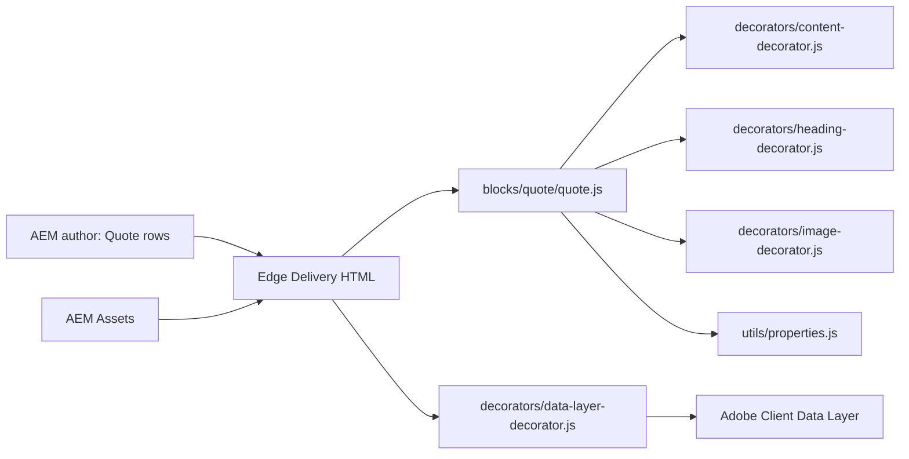
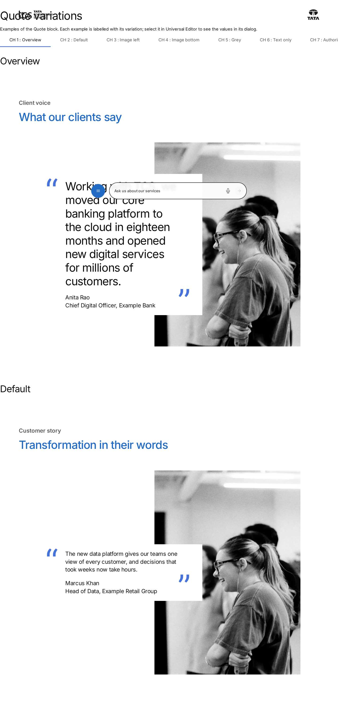
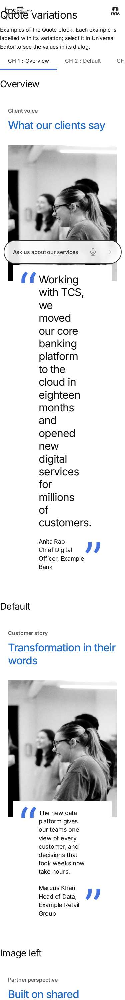

# Quote Block — Developer Guide

| Attribute | Value |
| --- | --- |
| Document ID | DEV-B-quote |
| Audience | Developers, technical leads, block owners, AI coding agents |
| Purpose | How the Quote block is built: files, model, structure, behaviour, variations, tests and limitations |
| Scope | blocks/quote/ and its components quote |
| Prerequisites | — |
| Owner | Technical Lead / Block Owner (proposed) |
| Approver | Product Owner (to be confirmed) |
| Version | 1.0 |
| Status | Draft for review |
| Last updated | 8 November 2026 |
| Last validated | 2026-11-08 (model, files, imports from the code; reference pages from the live site) |
| Source files | blocks/quote/README.md, blocks/quote/_quote.json, blocks/quote/quote.css, blocks/quote/quote.js |
| Related documents | [Variations](./QUOTE-VARIATIONS.md), [Test coverage](./QUOTE-TEST-COVERAGE.md), [Authoring guide](../../../03-authoring/components/quote/QUOTE-AUTHORING-GUIDE.md) |
| Related AEM paths | /content/tcs-corp/design-block-master/en/block-library/quote, /content/tcs-corp/design-block-master/en/block-library/quote/quote-variations |

## Contents

- [Summary](#summary)
- [Overview](#overview)
- [Source files](#source-files)
- [Components, models and filters](#components-models-and-filters)
- [Fields](#fields)
- [Dependencies](#dependencies)
- [For Developers](#for-developers)
- [Extending the Block](#extending-the-block)
- [Responsive Behavior](#responsive-behavior)
- [Accessibility](#accessibility)
- [Data Layer and Analytics](#data-layer-and-analytics)
- [Performance Considerations](#performance-considerations)
- [Security and Privacy](#security-and-privacy)
- [For Architects](#for-architects)
- [Troubleshooting](#troubleshooting)
- [Known limitations of the block](#known-limitations-of-the-block)
- [Change history of the block](#change-history-of-the-block)
- [Reference pages](#reference-pages)
- [Coverage of the required topics](#coverage-of-the-required-topics)
- [Screenshots](#screenshots)
- [Known limitations](#known-limitations)
- [Open items](#open-items)
- [Change history](#change-history)

## Summary

| Attribute | Value |
| --- | --- |
| Block | Quote |
| Folder | `blocks/quote` |
| Type | Independent |
| Category | content |
| Status | Active |
| Purpose | A quotation with author, optional image and title |
| Variations (summary) | Image position, BG Color |
| Children | — |
| Code size | 350 lines of JS and CSS |

## Overview

- **Business purpose:** gives one voice visual weight. The statement sits next to a portrait, so it reads as a credible endorsement that is clearly attributed to a person.
- **User experience:** on desktop (900px and wider), a white card holds the quote and its author and overlaps the portrait, which sits on the right or the left. On mobile and tablet the image comes first (or last), and the card overlaps its bottom (or top) edge. With no image, the card stands on its own.
- **Templates / page types:** any page. No template adds the block.
- **Data source:** authored fields only. The block reads no sheet, placeholder, taxonomy, metadata or query index.
- **Related blocks:** Testimonial (`blocks/testimonial`) for a centred testimonial with a small round photo and stats. Teaser (`blocks/teaser`) for image and text with calls to action.
- **When to use:** a single statement deserves emphasis and should be attributed to a named person, ideally with a portrait.
- **When not to use:** to add a call to action (the block has no CTA field; use a Teaser). To show stats or several quotes in one block (use a Testimonial, or one Quote per Gen Carousel slide). For a short inline quotation in running text (use rich text).
- **Realistic use cases:** a client quote on a case study page; a leadership statement on a corporate page; a partner endorsement; a pull quote in an article.

## Source files

| File | Link |
| --- | --- |
| `README.md` | [GitHub](https://github.com/sradha-tcs/tcs-corp/blob/main/blocks/quote/README.md) |
| `_quote.json` | [GitHub](https://github.com/sradha-tcs/tcs-corp/blob/main/blocks/quote/_quote.json) |
| `quote.css` | [GitHub](https://github.com/sradha-tcs/tcs-corp/blob/main/blocks/quote/quote.css) |
| `quote.js` | [GitHub](https://github.com/sradha-tcs/tcs-corp/blob/main/blocks/quote/quote.js) |

## Components, models and filters

| Component | Title | Resource type | Template name | Model | Children allowed |
| --- | --- | --- | --- | --- | --- |
| `quote` | Quote | `core/franklin/components/block/v1/block` | Quote | `quote` | — |

## Fields

The Additional tab fields (anchor, hide, padding, margin, animation) are common to the blocks and described in the [content modeling guide](../../markdown/CONTENT-MODELING-GUIDE.md).

### Quote (`quote`)

| Tab | Label | Property | Type | Required in model | Default | Options | Visibility |
| --- | --- | --- | --- | --- | --- | --- | --- |
| Content | Eyebrow | `eyebrow` | text | No | — | — | — |
| Content | Title | `title` | text | No | — | — | — |
| Content | Title Type | `titleType` | select | No | `h2` | 6 options | — |
| Content | Quote | `quote` | richtext | No | `""` | — | — |
| Content | Quote Author | `author` | richtext | No | `""` | — | — |
| Content | Image | `image` | reference | No | — | — | — |
| Content | Image Alt Text | `imageAlt` | text | No | — | — | — |
| Content | Image Position (Desktop) | `imagePosition` | select | No | `right` | 2 options | — |
| Content | Image Position (Mobile) | `imagePositionMobile` | select | No | `top` | 2 options | — |
| Content | BG Color | `bgColor` | select | No | `""` | 2 options | — |

"Required in model" is the model's `required` flag; whether a field is required in practice is stated in the authoring guide where it is known.

## Dependencies

| Import |
| --- |
| `../../decorators/content-decorator.js` |
| `../../decorators/heading-decorator.js` |
| `../../decorators/image-decorator.js` |
| `../../utils/properties.js` |

## For Developers

<!-- BEGIN GENERATED: files (npm run build:docs) -->

```text
blocks/quote/
├── README.md
├── _quote.json
├── quote.css
└── quote.js
```

| Decorator/Utility | Purpose | Execution or dependency point |
| ----------------- | ------- | ----------------------------- |
| [`decorators/content-decorator.js`](https://github.com/sradha-tcs/tcs-corp/blob/main/decorators/content-decorator.js) | `fromCell` (property content into an element, keeping editor instrumentation) | `quote.js`: { fromCell } |
| [`decorators/heading-decorator.js`](https://github.com/sradha-tcs/tcs-corp/blob/main/decorators/heading-decorator.js) | `buildHeading` (Title + Title Type), `HEADINGS` | `quote.js`: { buildHeading } |
| [`decorators/image-decorator.js`](https://github.com/sradha-tcs/tcs-corp/blob/main/decorators/image-decorator.js) | `pictureOf` (image with its alt text field) | `quote.js`: { pictureOf } |
| [`utils/properties.js`](https://github.com/sradha-tcs/tcs-corp/blob/main/utils/properties.js) | `readProperties`, `textOf`, `isOn`, `isOnByDefault` (a toggle that defaults to on), `optionOf`, `normalizeKey`, `textSource` (key-value block properties) | `quote.js`: { optionOf, readProperties, textOf } |

<!-- END GENERATED: files -->

- **JavaScript (`quote.js`):** a synchronous `decorate(block)`. It reads the rows with `readProperties` and resolves BG Color, Image Position (Desktop) and Image Position (Mobile) with `optionOf` (row value, else a matching block class). It then builds the header, the card and the media, and replaces the block's children.
- **CSS (`quote.css`):** the stacked layout, the 900px overlap grid, the quote marks as `::before` / `::after` of `.quote-card`, and the Grey colours and padding.
- **Input DOM:** key-value rows `<div><div>name</div><div>value</div></div>` for `eyebrow`, `title`, `titleType`, `quote`, `author`, `image` (with `imageAlt`; with field collapse the alt may arrive in the image cell), `imagePosition`, `imagePositionMobile` and `bgColor`. The `classes_*` fields arrive as block classes.
- **Rendered DOM:**

```html
<div class="quote block quote-has-media image-left bg-grey">
  <div class="quote-header">
    <p class="quote-eyebrow">…</p>
    <h2 class="quote-title">…</h2>
  </div>
  <div class="quote-body">
    <div class="quote-card">
      <figure class="quote-card-text">
        <blockquote class="quote-text">…</blockquote>
        <figcaption class="quote-author">…</figcaption>
      </figure>
    </div>
    <div class="quote-media"><picture>…</picture></div>
  </div>
</div>
```

- **Block classes set by the code:** `bg-grey` (removed first, then re-added), `quote-has-media`, `image-left`, `image-bottom` (toggled on each decoration).
- **Decoration flow:** read the properties, build the header (eyebrow `fromCell`, title `buildHeading`), build the card (only children with text), add the picture (`pictureOf`), set the classes, `replaceChildren`. Parts without content are left out.
- **Events and async behavior:** none; no network requests.
- **Error handling:** no try / catch in the block. Missing cells give empty parts.
- **Exports:** the default `decorate` only.
- **Editor:** `fromCell`, `buildHeading` and `pictureOf` move the Universal Editor instrumentation to the rendered elements, so in-place editing keeps working.
- **Data-layer hooks:** none in the block (see Data Layer and Analytics).
- **Motion:** `decorators/motion-decorator.js` animates the block's direct children (`quote: { targets: ':scope > *' }`) and its background colour (`BACKGROUNDS.quote`).

## Extending the Block

1. **Add a field or value** in `blocks/quote/_quote.json` (keep at most three short tabs, with Additional last). Then run `npm run build:json` and `npm run lint`.
2. **Respect the delivery rules:** don't end a field name that must be read in Text, Title, Type, Alt or MimeType (field collapse); don't use grouped (`prefix_name`) fields in this key-value block; put options that should become classes in `classes_*` fields; no sample content in the definition template.
3. **Map it to rendering** in `quote.js` (read with `readProperties` / `optionOf`) and style it in `quote.css`, scoped to `.quote`, mobile first, with `min-width` media queries and rem sizes.
4. **Responsive and accessibility:** keep the figure structure, the hidden quote marks and the DOM order.
5. **Data layer:** describe new interactive elements with `data-cmp-interaction` / `data-cmp-value`; the central decorator captures their clicks.
6. **Tests:** `test/motion/motion.test.mjs` checks the Additional tab fields of every model (the Quote is a background block). Add unit tests for any new pure logic.
7. **Backward compatibility:** keep reading the existing property names and the class fallbacks (`optionOf`).
8. **Library and docs:** add an example to the block library page `block-library/quote/quote-variations`, then regenerate this README with `npm run build:docs`. Run `npm run build:modules` after changing imports.

## Responsive Behavior

| Viewport | Layout | Image behavior | Interaction behavior |
| -------- | ------ | -------------- | -------------------- |
| Below 900px (mobile, tablet) | Header, then image and card stacked; the card overlaps the image by 3rem and is inset 1rem; block padding 2.5rem / 1.5rem (every background); quote marks 1.9167rem x 3.8333rem | 4:5 crop, full width; first (Top) or last (Bottom, `image-bottom`) | None |
| 900px and wider (desktop) | Body up to 70rem, centred; with an image, a 498 : 204 : 418 grid (418 : 204 : 498 with `image-left`) with the card overlapping the image; block padding 7.5rem / 5rem (every background); quote marks 2.875rem x 5.75rem | 622:869 crop; right or left | None |

## Accessibility

- **Semantic HTML:** the title is a real heading. The quote and its author are a `<figure>` with a `<blockquote>` and a `<figcaption>` as its direct child. The quotation marks are decorative SVG backgrounds of empty `::before` / `::after` boxes (`icons/quote-open.svg`, `icons/quote-close.svg`), so screen readers don't announce them.
- **Headings:** Title Type sets the level; pick the one that fits the page outline.
- **Keyboard and focus:** the block adds no interactive elements. Links inside the rich text keep the site's focus styles.
- **Alt text:** Image Alt Text, else `alt=""` (decorative).
- **Reduced motion:** the Additional tab's animations don't play for visitors who prefer reduced motion or in the editor.
- **Contrast:** text uses the default text and brand tokens on a white or grey card.
- **Reflow:** the layout stacks below 900px.
- **Empty states:** parts without content aren't rendered; an empty block renders nothing.

Author responsibilities: choose the heading level, write meaningful alt text, don't type quotation marks, and keep link text descriptive.

Developer responsibilities: keep the `figure` / `blockquote` / `figcaption` structure and the hidden quote-mark text, and keep the reading order (card before image in the DOM).

The block handles no keys itself; links in the rich text behave as normal links.

## Data Layer and Analytics

- **Component:** `decorators/data-layer-decorator.js` (`trackBlocks`) adds the block once the sections have loaded: `@type` `tcs-corp/components/quote`, id = the block's id (Anchor ID) else `quote-{n}` (`data-cmp-id`), `parentId` (the page or the enclosing block), `dc:title` = the first heading.
- **Variation:** not recorded in the data layer.
- **Item positions:** none (no items).
- **Interactions:** the block sets no `data-cmp-*` attributes and pushes no events itself. Clicks on links in the quote or author text are captured centrally.

| Trigger | Data-layer event | Required properties | Analytics behavior |
| ------- | ---------------- | ------------------- | ------------------ |
| Block decorated and sections loaded | component state (`component.{id}`) | `@type`, `parentId`, `dc:title` | Component inventory of the page |
| Click on a link in the Quote or Quote Author | `cmp:click` | `interaction` (`link`), `dc:title`, `xdm:linkURL`, `xdm:linkType`, `breakpoint` | Link click attributed to the Quote |

The intended path is Adobe Client Data Layer, then Adobe Data Collection (Tags), the AEP Web SDK, the Edge Network, and finally Analytics / CJA. Tags and the Web SDK aren't configured yet (blocked: measurement plan). No consent mechanism is implemented.

## Performance Considerations

- **Initialization:** synchronous decoration without network requests, in the eager phase when the block is in the first section, else lazily with its section.
- **Images:** the authored, optimized picture; lazy, except the first section's first image (`waitForFirstImage`).
- **Dynamic imports:** none in the block. Its modules are preloaded (`scripts/module-graph.js`).
- **DOM size:** a handful of elements. No listeners or observers in the block (the motion decorator observes animated blocks only).
- **Layout shift:** the image has a fixed aspect ratio (4:5, 622:869), so its box is reserved.
- **High-cost configurations:** an animation in the first section delays the paint of its content (handover F-94: Content animation also delays the text paint). Use the animations below the fold.

## Security and Privacy

- **Links:** authored links are used as delivered; the block adds none.
- **Sanitization:** the block moves the delivered DOM nodes; it builds no HTML from strings.
- **External content:** none. **Query strings:** not read.
- **Data minimization:** no personal data is collected. The data layer records the title and clicked link text and URL only.

## For Architects

- **Role:** a presentational, authored-content block with no data source.
- **Content model:** a key-value block, with one row per property and no children.
- **Rendering:** client-side decoration of the delivered rows. The text is in the delivered HTML.
- **Dependencies:** `decorators/content-decorator.js`, `decorators/heading-decorator.js`, `decorators/image-decorator.js`, `utils/properties.js`; global block options, motion and data-layer decorators.
- **Data layer / Web SDK / Target:** a component entry and central click capture only. Tags, the Web SDK and Target aren't integrated.
- **Consent and identity:** none.
- **Caching:** part of the page HTML on the Edge Delivery CDN.
- **Performance:** synchronous, no requests. Its modules are preloaded from `scripts/module-graph.js`.
- **Security:** authored content only. No HTML is injected from external sources.
- **Scalability:** many instances per page are independent.



## Troubleshooting

| Symptom | Likely cause | Diagnostic steps | Resolution | Verification |
| ------- | ------------ | ---------------- | ---------- | ------------ |
| The card doesn't overlap the image | No picture in Image (empty or broken reference) | Inspect the block: no `quote-has-media`, no `.quote-media` | Select the image again and publish it with the page | The block has `quote-has-media` |
| Image Position has no effect | Checked at the wrong width (Left from 900px, Bottom below 900px), or no image | Check the classes `image-left` / `image-bottom` and the viewport width | Resize past / below 900px; set an image | The image moves at the right widths |
| Double quotation marks | Marks typed in the Quote | Read the Quote rich text | Remove the typed marks | Only the blue marks remain |
| The face is cut off | 4:5 / 622:869 cover crop | Compare the image's proportions | Use a portrait with the face in the upper-middle area | Check at 375 / 768 / 1440px |
| The block is empty | No Quote, Quote Author, Title, Eyebrow or Image | Inspect the rows in the editor | Fill in the content | The card renders |
| Wrong heading level | Title Type | Inspect the title element | Set Title Type | The expected `h1`–`h6` |

Evidence to collect: the page URL (preview or live), viewport width, browser, a screenshot, and the block's outer HTML from the inspector. Don't include credentials or author session data.

## Known limitations of the block

| Limitation | Impact | Workaround | Planned correction |
| ---------- | ------ | ---------- | ------------------ |
| No CTA field | A quote can't carry a styled call to action | Put a link in its own paragraph in the Quote or Quote Author (it becomes a button), or add a Teaser or Button below | Not planned |
| Image Position (Desktop) applies only from 900px and Image Position (Mobile) only below 900px | Authors checking the wrong width see no change | Validate both widths in preview | Not planned |
| Fixed cover crops (4:5, 622:869) | Landscape or tight images lose their edges | Use portrait images with space around the face | Not planned |

## Change history of the block

| Version | Change | Source | Date |
| ------- | ------ | ------ | ---- |
| Not recorded | README generated from verified implementation and approved handover documentation | Repository review | Not recorded |
| Handover 2.18 | Background animation and Content animation on the Additional tab (Quote among the background blocks) | docs/handover revision history | 18 October 2026 |
| Handover 2.27 | Block ecosystem audit: the Quote / Testimonial Style field removed | docs/handover revision history | 19 October 2026 |

## Reference pages

| Kind | Page | Live URL |
| --- | --- | --- |
| Block library | /design-block-master/en/block-library/quote | https://main--tcs-corp--sradha-tcs.aem.live/design-block-master/en/block-library/quote |
| Block library | /design-block-master/en/block-library/quote/quote-variations | https://main--tcs-corp--sradha-tcs.aem.live/design-block-master/en/block-library/quote/quote-variations |
| Curated design page | /design-block-master/en/curated-design-pages/who-we-are | https://main--tcs-corp--sradha-tcs.aem.live/design-block-master/en/curated-design-pages/who-we-are |

## Coverage of the required topics

| Topic | Where |
| --- | --- |
| Purpose | Overview |
| Source files | generated: Files |
| Model, definition, filters, children | generated: Components |
| Dependencies | generated: Dependencies |
| Authored input / rendered output / DOM transformation | For Developers |
| Configuration fields, defaults, required fields | generated: Fields |
| Variations | QUOTE-VARIATIONS.md |
| Responsive behaviour | Responsive Behavior |
| Accessibility and keyboard | Accessibility |
| Analytics / data layer | Data Layer and Analytics |
| Performance | Performance Considerations |
| Security | Security and Privacy |
| Extending | Extending the Block |
| Known limitations | Known Limitations |
| Troubleshooting | Troubleshooting |
| Tests | QUOTE-TEST-COVERAGE.md |
| SEO behaviour | Not recorded |
| Caching considerations | Not recorded (Edge Delivery default caching; no block-specific rule) |
| Ownership | Technical Lead / Block Owner (proposed) |

## Screenshots



*Figure: Quote block library page — desktop 1440 × 900 (/design-block-master/en/block-library/quote/quote-variations, captured 2026-11-08).*



*Figure: Quote block library page — mobile 375 × 812 (/design-block-master/en/block-library/quote/quote-variations, captured 2026-11-08).*

![Desktop rendering — The Quote at 1440 px: the grey eyebrow Client voice and the brand-blue H2 What our clients say above a white card with large blue opening and closing quote marks, holding the quote Working with TCS, we moved our core banking platform… and Anita Rao / Chief Digital Officer, Example Bank; the card on the left overlaps the portrait tall.svg on the right and is vertically centred against it. (Sample content on the preview; callout letters as in the Field Entry Table; file screenshots/quote-desktop-view.jpg)](./screenshots/handover/quote-desktop-view.jpg)

*Figure: Desktop rendering — The Quote at 1440 px: the grey eyebrow Client voice and the brand-blue H2 What our clients say above a white card with large blue opening and closing quote marks, holding the quote Working with TCS, we moved our core banking platform… and Anita Rao / Chief Digital Officer, Example Bank; the card on the left overlaps the portrait tall.svg on the right and is vertically centred against it. (Sample content on the preview; callout letters as in the Field Entry Table; file screenshots/quote-desktop-view.jpg) (handover screenshot; rendering at the time it was taken).*


*Figure: Tablet rendering — The Quote at 768 px in the stacked layout: Client voice and the H2 What our clients say on top, tall.svg across the block width at 4 : 5, and the white card with 5rem quote marks, the quote and Anita Rao / Chief Digital Officer, Example Bank overlapping the image's bottom edge, inset 1rem on each side. (Sample content on the preview; callout letters as in the Field Entry Table; file screenshots/quote-tablet-view.jpg) (handover screenshot; rendering at the time it was taken).*


*Figure: Mobile rendering — The Quote at 375 px: Client voice and What our clients say stacked, tall.svg full width at 4 : 5, and the white card with the smaller 5rem blue quote marks, the quote and Anita Rao / Chief Digital Officer, Example Bank overlapping the image's bottom edge by 3rem. (Sample content on the preview; callout letters as in the Field Entry Table; file screenshots/quote-mobile-view.jpg) (handover screenshot; rendering at the time it was taken).*


*Figure: Default variation — The Quote at 1440 px on a white background: the eyebrow Customer story and the H2 Transformation in their words above the white card with the data platform quote and Marcus Khan / Head of Data, Example Retail Group; the card on the left overlaps the portrait tall.svg on the right. (Sample content on the preview; callout letters as in the Field Entry Table; file screenshots/quote-default-image-right.jpg) (handover screenshot; rendering at the time it was taken).*


*Figure: Image Left variation — The Quote at 1440 px with Image Position (Desktop) Left: Partner perspective and the H2 Built on shared ambition above; the portrait tall.svg on the left and the white card with the connected factory quote and Sara Lee / VP Operations, Example Manufacturing on the right, overlapping the image's right edge. (Sample content on the preview; callout letters as in the Field Entry Table; file screenshots/quote-image-left.jpg) (handover screenshot; rendering at the time it was taken).*


*Figure: Image Bottom (mobile) variation — The Quote at 375 px with Image Position (Mobile) Bottom: Client voice and What our clients say on top, then the white card with 5rem quote marks, the quote and Anita Rao / Chief Digital Officer, Example Bank, and below it tall.svg full width at 4 : 5, its top edge overlapped by the card. (Sample content on the preview; callout letters as in the Field Entry Table; file screenshots/quote-image-bottom-mobile.jpg) (handover screenshot; rendering at the time it was taken).*


*Figure: Grey background variation — The Quote at 1440 px with BG Color Grey: the whole block and the card are light grey with 7.5rem / 5rem padding; Leadership insight and the H2 Resilience as a strategy above the card with the security quote and Marcus Khan / Chief Information Security Officer, Example Insurance, overlapping tall.svg on the right. (Sample content on the preview; callout letters as in the Field Entry Table; file screenshots/quote-grey-background.jpg) (handover screenshot; rendering at the time it was taken).*


*Figure: Text-only variation — The Quote at 1440 px without an image: In their words and the H2 A partnership that scales above a white card centred in the 70rem body, with the large blue quote marks around the roll-out quote and Sara Lee / Chief Operating Officer, Example Energy. (Sample content on the preview; callout letters as in the Field Entry Table; file screenshots/quote-text-only.jpg) (handover screenshot; rendering at the time it was taken).*

![Universal Editor canvas — The Quote in Universal Editor edit mode at 1440 px, selected, with letters A on the eyebrow Client voice, B on the H2 What our clients say, C on the quote text, D on Anita Rao / Chief Digital Officer, Example Bank and E on the portrait tall.svg, which the card overlaps on the right. An annotated preview, not a Universal Editor screenshot. (Annotated preview in editor mode with sample content; letters as in the annotations list, not a Universal Editor screenshot; file screenshots/quote-authoring-view.jpg)](./screenshots/handover/quote-authoring-view.jpg)

*Figure: Universal Editor canvas — The Quote in Universal Editor edit mode at 1440 px, selected, with letters A on the eyebrow Client voice, B on the H2 What our clients say, C on the quote text, D on Anita Rao / Chief Digital Officer, Example Bank and E on the portrait tall.svg, which the card overlaps on the right. An annotated preview, not a Universal Editor screenshot. (Annotated preview in editor mode with sample content; letters as in the annotations list, not a Universal Editor screenshot; file screenshots/quote-authoring-view.jpg) (handover screenshot; rendering at the time it was taken).*


*Figure: Properties panel — The Universal Editor properties panel of the Quote block showing the Content tab with all fields and the Additional tab header. (Dialog reference generated from the component model, not a Universal Editor screenshot; file screenshots/quote-properties-panel.jpg) (handover screenshot; rendering at the time it was taken).*

## Known limitations

- Universal Editor dialogs were not captured: no author access in this program (see the access blockers).

## Open items

- None.

## Change history

| Version | Date | Author | Change |
| --- | --- | --- | --- |
| 1.0 | 8 November 2026 | Delivery team (documentation program) | First version of the role-specific documentation (master documentation prompt), generated from the repository and the published reference pages |
