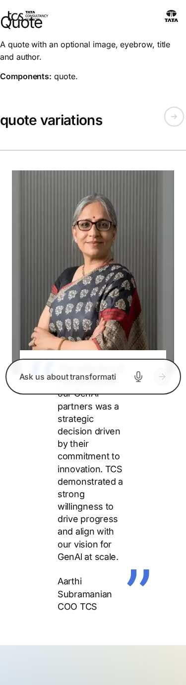
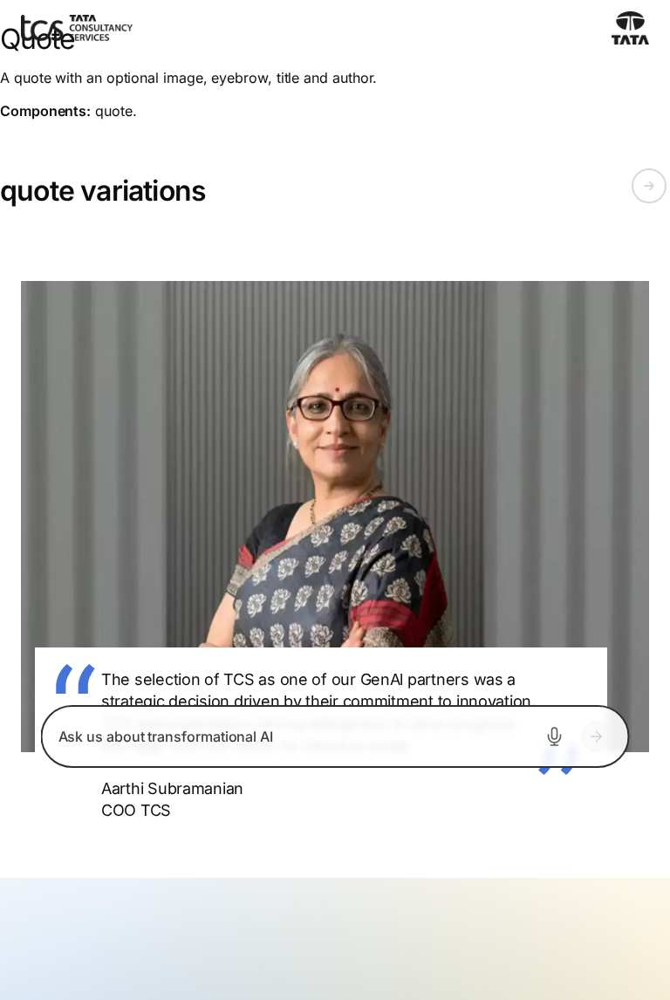
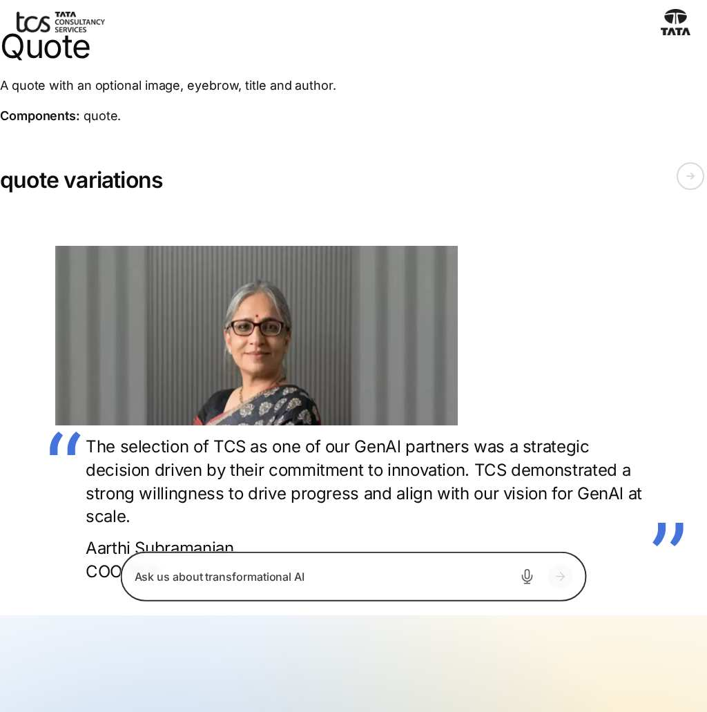
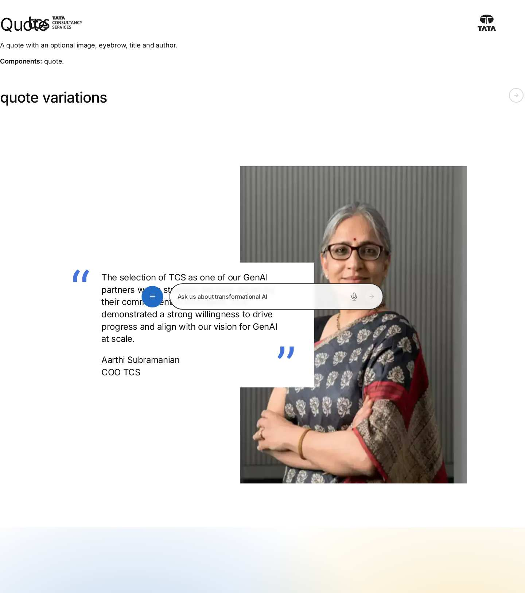
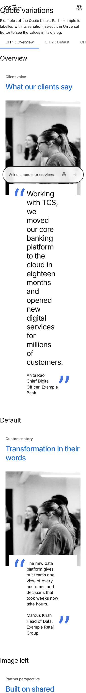
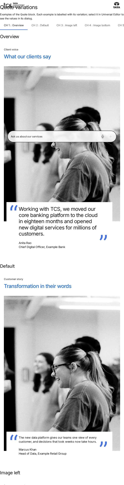
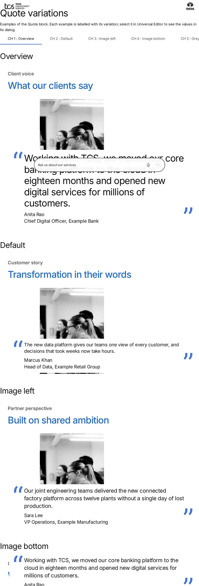
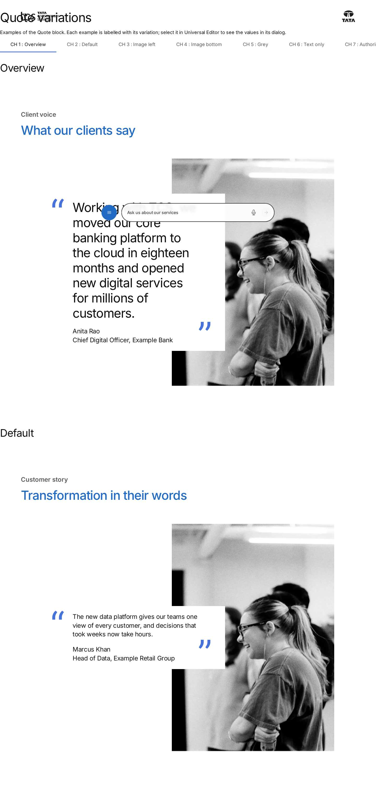

# Quote Block — Test Coverage

| Attribute | Value |
| --- | --- |
| Document ID | DEV-T-quote |
| Audience | Developers, technical leads, block owners, AI coding agents |
| Purpose | Unit tests, automated reference-page checks and manual test guidance for the block |
| Scope | — |
| Prerequisites | — |
| Owner | Technical Lead / Block Owner (proposed) |
| Approver | Product Owner (to be confirmed) |
| Version | 1.0 |
| Status | Draft for review |
| Last updated | 8 November 2026 |
| Last validated | 8 November 2026 |
| Source files | — |
| Related documents | — |
| Related AEM paths | — |

## Contents

- [Unit tests](#unit-tests)
- [Automated checks of the block library pages (executed 8 November 2026)](#automated-checks-of-the-block-library-pages-executed-8-november-2026)
- [Manual test guidance (block README)](#manual-test-guidance-block-readme)
- [Screenshots](#screenshots)
- [Known limitations](#known-limitations)
- [Open items](#open-items)
- [Change history](#change-history)

## Unit tests

No unit test is specific to this block (shared tests: test/models, test/items, test/docs, test/motion).

## Automated checks of the block library pages (executed 8 November 2026)

Per page: HTTP status and horizontal overflow at 375 / 768 / 1024 / 1440 px, console errors, failed requests and DOM accessibility checks at 1440 px (evidence: [screenshot register](../../../SCREENSHOT-REGISTER.md)).

| Page | 375 / 768 / 1024 / 1440 | Console errors | Failed requests | Accessibility (DOM) |
| --- | --- | --- | --- | --- |
| /design-block-master/en/block-library/quote | ok / ok / ok / ok | 8 | 8 | 0 img no alt, 0 unnamed buttons, 1 heading skips |
| /design-block-master/en/block-library/quote/quote-variations | ok / ok / ok / ok | 4 | 4 | 0 img no alt, 0 unnamed buttons, 1 heading skips |

## Manual test guidance (block README)

| Test ID | Scenario | Configuration | Expected result |
| ------- | -------- | ------------- | --------------- |
| QUOTE-QA-01 | Default | Eyebrow, Title, Quote, Quote Author, Image, Image Alt Text | Overlap on the right from 900px; image above the card below 900px |
| QUOTE-QA-02 | Image Left | Image Position (Desktop) Left | Image on the left from 900px; unchanged below 900px |
| QUOTE-QA-03 | Image Bottom | Image Position (Mobile) Bottom | Image below the card below 900px; unchanged from 900px |
| QUOTE-QA-04 | Grey background | BG Color Grey | Grey block and card, 2.5rem / 1.5rem padding, 7.5rem / 5rem from 900px |
| QUOTE-QA-04b | White background | BG Color Default | Same padding as Grey: eyebrow and title 1.5rem (5rem from 900px) from the block's left edge |
| QUOTE-QA-05 | Text only | No Image | No `quote-has-media`; the card alone |
| QUOTE-QA-06 | Missing content | Only a Title | Header only, no body |
| QUOTE-QA-07 | Decorative image | Image without alt text | `alt=""` |
| QUOTE-QA-08 | Heading level | Title Type H3 | An `<h3 class="quote-title">` |
| QUOTE-QA-09 | Multiple instances | Two Quotes on one page | Each decorates independently; data-layer ids `quote-1`, `quote-2` (or their Anchor IDs) |
| QUOTE-QA-10 | Viewports | 375 / 768 / 1440px | Stacked below 900px, grid from 900px |
| QUOTE-QA-11 | Keyboard | Link in the Quote Author | Reachable with Tab, visible focus |
| QUOTE-QA-12 | Data layer | Load the page | `component.{id}` with `@type` `tcs-corp/components/quote`; a click on a link pushes `cmp:click` |
| QUOTE-QA-13 | Dark Section | Quote inside a Section with Style Dark | Check the contrast of the white card's text (the theme contract turns text tokens light) |
| QUOTE-QA-14 | Existing content | Quotes authored before (with block classes `grey`, `left`, `bottom`) | Rendered as the matching field values |

Test cases: [05-quality-assurance/test-cases/blocks/quote](../../../05-quality-assurance/test-cases/blocks/quote/QUOTE-TEST-CASES.md).

## Screenshots

*Figure: Quote: quote — mobile 375 × 812 (/design-block-master/en/block-library/quote, captured 2026-11-08).*

*Figure: Quote: quote — tablet 768 × 900 (/design-block-master/en/block-library/quote, captured 2026-11-08).*

*Figure: Quote: quote — small desktop 1024 × 900 (/design-block-master/en/block-library/quote, captured 2026-11-08).*

*Figure: Quote: quote — desktop 1440 × 900 (/design-block-master/en/block-library/quote, captured 2026-11-08).*

*Figure: Quote: quote/quote-variations — mobile 375 × 812 (/design-block-master/en/block-library/quote/quote-variations, captured 2026-11-08).*

*Figure: Quote: quote/quote-variations — tablet 768 × 900 (/design-block-master/en/block-library/quote/quote-variations, captured 2026-11-08).*

*Figure: Quote: quote/quote-variations — small desktop 1024 × 900 (/design-block-master/en/block-library/quote/quote-variations, captured 2026-11-08).*

*Figure: Quote: quote/quote-variations — desktop 1440 × 900 (/design-block-master/en/block-library/quote/quote-variations, captured 2026-11-08).*

## Known limitations

- None recorded for this document.

## Open items

- None.

## Change history

| Version | Date | Author | Change |
| --- | --- | --- | --- |
| 1.0 | 8 November 2026 | Delivery team (documentation program) | First version of the role-specific documentation (master documentation prompt), generated from the repository and the published reference pages |
