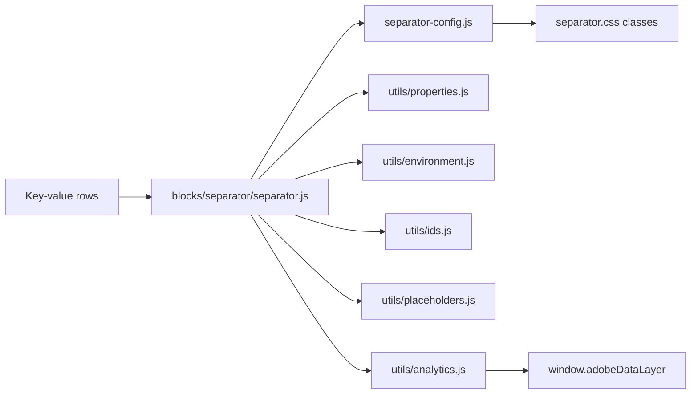
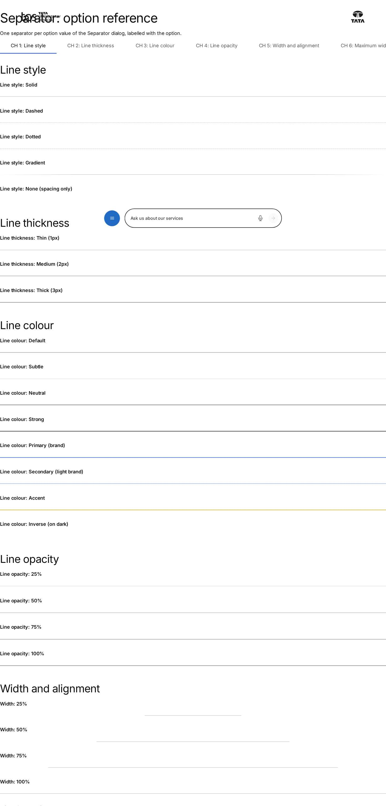
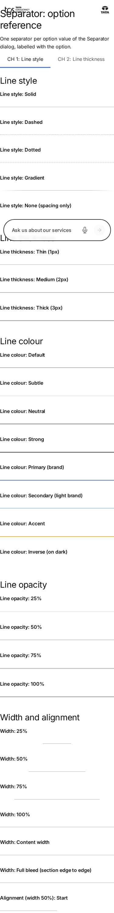

# Separator Block — Developer Guide

| Attribute | Value |
| --- | --- |
| Document ID | DEV-B-separator |
| Audience | Developers, technical leads, block owners, AI coding agents |
| Purpose | How the Separator block is built: files, model, structure, behaviour, variations, tests and limitations |
| Scope | blocks/separator/ and its components separator |
| Prerequisites | — |
| Owner | Technical Lead / Block Owner (proposed) |
| Approver | Product Owner (to be confirmed) |
| Version | 1.0 |
| Status | Draft for review |
| Last updated | 8 November 2026 |
| Last validated | 2026-11-08 (model, files, imports from the code; reference pages from the live site) |
| Source files | blocks/separator/README.md, blocks/separator/_separator.json, blocks/separator/separator-config.js, blocks/separator/separator.css, blocks/separator/separator.js |
| Related documents | [Variations](./SEPARATOR-VARIATIONS.md), [Test coverage](./SEPARATOR-TEST-COVERAGE.md), [Authoring guide](../../../03-authoring/components/separator/SEPARATOR-AUTHORING-GUIDE.md) |
| Related AEM paths | /content/tcs-corp/design-block-master/en/block-library/separator, /content/tcs-corp/design-block-master/en/block-library/separator/option-reference, /content/tcs-corp/design-block-master/en/block-library/separator/separator-variations |

## Contents

- [Summary](#summary)
- [Overview](#overview)
- [Source files](#source-files)
- [Components, models and filters](#components-models-and-filters)
- [Fields](#fields)
- [Dependencies](#dependencies)
- [For Developers](#for-developers)
- [Extending the Block](#extending-the-block)
- [Responsive Behavior](#responsive-behavior)
- [Accessibility](#accessibility)
- [Data Layer and Analytics](#data-layer-and-analytics)
- [Performance Considerations](#performance-considerations)
- [Security and Privacy](#security-and-privacy)
- [For Architects](#for-architects)
- [Troubleshooting](#troubleshooting)
- [Known limitations of the block](#known-limitations-of-the-block)
- [Change history of the block](#change-history-of-the-block)
- [Reference pages](#reference-pages)
- [Coverage of the required topics](#coverage-of-the-required-topics)
- [Screenshots](#screenshots)
- [Known limitations](#known-limitations)
- [Open items](#open-items)
- [Change history](#change-history)

## Summary

| Attribute | Value |
| --- | --- |
| Block | Separator |
| Folder | `blocks/separator` |
| Type | Independent |
| Category | structural |
| Status | Active |
| Purpose | A divider line between content |
| Variations (summary) | Variants, widths per breakpoint, theme, motion |
| Children | — |
| Code size | 977 lines of JS and CSS |

## Overview

**Business purpose.** Structure long pages visually and semantically with one consistent, design-system-controlled divider that authors configure without CSS, that is accessible (semantic thematic break or decorative) and that never breaks the layout on any device.

**User experience.** Visitors see a line (solid, dashed, dotted or gradient) of a chosen colour, thickness and width, optionally with a dot, square or diamond at its start, centre or end, with space above and below. Screen reader users hear a separator only when it is Semantic.

**Templates / page types.** Any page, any section that offers it.

**Data source.** Its own settings only; no metadata, tags, sheets or index. Placeholders are read only in Universal Editor, for the editor notes.

**Related blocks.** Sections (spacing; Theme Auto follows the `dark` / `brand` section classes), [List](https://github.com/sradha-tcs/tcs-corp/blob/main/blocks/list/README.md) and [Cards](https://github.com/sradha-tcs/tcs-corp/blob/main/blocks/cards/README.md) (their own dividers), the Table block, the Anchor List (in-page navigation by Anchor ID), [Columns Container](https://github.com/sradha-tcs/tcs-corp/blob/main/blocks/columns-container/README.md) (a desktop-only divider between columns).

**When to use.** The topic changes within a section (Accessibility mode **Semantic**); a visual division between content of the same topic helps scanning (**Decorative**, the default).

**When not to use.** Only to add space when the section spacing is enough (or deliberately use Line style None with spacing); to separate items of a list, cards or table rows (those blocks have their own dividers); several in a row; as a heading replacement (a separator doesn't name the next section).

**Realistic use cases.**

| Purpose | Settings |
| ------- | -------- |
| Between two stories | Semantic, Accessible label "End of the story", Default |
| A light rule under a section intro | Decorative, Subtle, 50%, Center |
| A brand accent under a title | Decorative, Branded, 25%, Start, Desktop top spacing None |
| Edge-to-edge in a section | Variant Full width (or Separator width Full bleed) |
| A desktop-only divider of two columns | Show on tablet and Show on mobile off |
| A decorated chapter break | Semantic, Line thickness Medium, 50%, Center, Center decoration Diamond |
| Space only | Decorative, Line style None, Desktop top spacing XL |

## Source files

| File | Link |
| --- | --- |
| `README.md` | [GitHub](https://github.com/sradha-tcs/tcs-corp/blob/main/blocks/separator/README.md) |
| `_separator.json` | [GitHub](https://github.com/sradha-tcs/tcs-corp/blob/main/blocks/separator/_separator.json) |
| `separator-config.js` | [GitHub](https://github.com/sradha-tcs/tcs-corp/blob/main/blocks/separator/separator-config.js) |
| `separator.css` | [GitHub](https://github.com/sradha-tcs/tcs-corp/blob/main/blocks/separator/separator.css) |
| `separator.js` | [GitHub](https://github.com/sradha-tcs/tcs-corp/blob/main/blocks/separator/separator.js) |

## Components, models and filters

| Component | Title | Resource type | Template name | Model | Children allowed |
| --- | --- | --- | --- | --- | --- |
| `separator` | Separator | `core/franklin/components/block/v1/block` | Separator | `separator` | — |

## Fields

The Additional tab fields (anchor, hide, padding, margin, animation) are common to the blocks and described in the [content modeling guide](../../markdown/CONTENT-MODELING-GUIDE.md).

### Separator (`separator`)

| Tab | Label | Property | Type | Required in model | Default | Options | Visibility |
| --- | --- | --- | --- | --- | --- | --- | --- |
| General | Component ID | `componentId` | text | No | — | — | Conditional |
| General | Accessibility mode | `accessibilityMode` | select | No | `decorative` | 2 options | — |
| General | Accessible label | `accessibleLabel` | text | No | — | — | Conditional |
| General | Separator variant | `variant` | select | No | `default` | 9 options | — |
| General | Theme | `theme` | select | No | `auto` | 4 options | — |
| Style | Line style | `lineStyle` | select | No | `""` | 6 options | — |
| Style | Line thickness | `lineThickness` | select | No | `""` | 4 options | — |
| Style | Line colour | `lineColor` | select | No | `""` | 9 options | — |
| Style | Line opacity | `lineOpacity` | select | No | `100` | 4 options | — |
| Style | Separator width | `width` | select | No | `""` | 7 options | — |
| Style | Maximum width | `maxWidth` | select | No | `none` | 6 options | — |
| Style | Alignment | `alignment` | select | No | `center` | 3 options | — |
| Style | Start decoration | `startDecoration` | select | No | `none` | 4 options | — |
| Style | Center decoration | `centerDecoration` | select | No | `none` | 4 options | — |
| Style | End decoration | `endDecoration` | select | No | `none` | 4 options | — |
| Style | Background contrast | `contrastMode` | select | No | `standard` | 2 options | Conditional |
| Style | Show on desktop | `showDesktop` | boolean | No | `true` | — | — |
| Style | Show on tablet | `showTablet` | boolean | No | `true` | — | — |
| Style | Show on mobile | `showMobile` | boolean | No | `true` | — | — |
| Style | Desktop width | `desktopWidth` | select | No | `inherit` | 7 options | — |
| Style | Desktop thickness | `desktopThickness` | select | No | `inherit` | 4 options | — |
| Style | Desktop alignment | `desktopAlignment` | select | No | `inherit` | 4 options | — |
| Style | Tablet width | `tabletWidth` | select | No | `inherit` | 7 options | — |
| Style | Tablet thickness | `tabletThickness` | select | No | `inherit` | 4 options | — |
| Style | Tablet alignment | `tabletAlignment` | select | No | `inherit` | 4 options | — |
| Style | Mobile width | `mobileWidth` | select | No | `inherit` | 7 options | — |
| Style | Mobile thickness | `mobileThickness` | select | No | `inherit` | 4 options | — |
| Style | Mobile alignment | `mobileAlignment` | select | No | `inherit` | 4 options | — |
| Style | Desktop top spacing | `desktopTopSpacing` | select | No | `default` | 9 options | — |
| Style | Desktop bottom spacing | `desktopBottomSpacing` | select | No | `default` | 9 options | — |
| Style | Tablet top spacing | `tabletTopSpacing` | select | No | `default` | 9 options | — |
| Style | Tablet bottom spacing | `tabletBottomSpacing` | select | No | `default` | 9 options | — |
| Style | Mobile top spacing | `mobileTopSpacing` | select | No | `default` | 9 options | — |
| Style | Mobile bottom spacing | `mobileBottomSpacing` | select | No | `default` | 9 options | — |
| Style | Use section padding | `useSectionPadding` | boolean | No | `false` | — | — |
| Style | Stretch to container width | `stretchToContainer` | boolean | No | `false` | — | Conditional |
| Style | Respect content maximum width | `respectMaxWidth` | boolean | No | `true` | — | — |
| Style | Animate on view | `animateOnView` | select | No | `none` | 4 options | — |
| Style | Reduced motion fallback | `reducedMotionFallback` | select | No | `static` | 2 options | Conditional |
| Style | Print | `printVisibility` | select | No | `show` | 2 options | — |
| Style | Analytics | `analyticsEnabled` | boolean | No | `false` | — | — |
| Style | Analytics label | `analyticsLabel` | text | No | — | — | Conditional |

"Required in model" is the model's `required` flag; whether a field is required in practice is stated in the authoring guide where it is known.

## Dependencies

| Import |
| --- |
| `../../utils/analytics.js` |
| `../../utils/environment.js` |
| `../../utils/ids.js` |
| `../../utils/placeholders.js` |
| `../../utils/properties.js` |
| `./separator-config.js` |

## For Developers

<!-- BEGIN GENERATED: files (npm run build:docs) -->

```text
blocks/separator/
├── README.md
├── _separator.json
├── separator-config.js
├── separator.css
└── separator.js
```

| Decorator/Utility | Purpose | Execution or dependency point |
| ----------------- | ------- | ----------------------------- |
| [`utils/analytics.js`](https://github.com/sradha-tcs/tcs-corp/blob/main/utils/analytics.js) | `pushToDataLayer`, `pushComponents`, `pushComponentEvent` (Adobe Client Data Layer, Core Components schema; never throws) | `separator.js`: { pushComponents } |
| [`utils/environment.js`](https://github.com/sradha-tcs/tcs-corp/blob/main/utils/environment.js) | `prefersReducedMotion`, `scrollBehavior`, `isEditing`, `isInEditor`, `isAuthor` (the page is rendered by AEM author, which has no query index) | `separator.js`: { isEditing, prefersReducedMotion } |
| [`utils/ids.js`](https://github.com/sradha-tcs/tcs-corp/blob/main/utils/ids.js) | `nextInstance`, `uniqueId`, `createIdFactory` (unique ids per block instance), `availableId` (an authored id kept, suffixed -2, -3, ... only when taken) | `separator.js`: { uniqueId } |
| [`utils/placeholders.js`](https://github.com/sradha-tcs/tcs-corp/blob/main/utils/placeholders.js) | `getPlaceholders`, `loadPlaceholders`, `fillPlaceholder` (UI text from the locale's placeholders, with English fallbacks) | `separator.js`: { getPlaceholders } |
| [`utils/properties.js`](https://github.com/sradha-tcs/tcs-corp/blob/main/utils/properties.js) | `readProperties`, `textOf`, `isOn`, `isOnByDefault` (a toggle that defaults to on), `optionOf`, `normalizeKey`, `textSource` (key-value block properties) | `separator.js`: { readProperties, textOf } |

<!-- END GENERATED: files -->

**Responsibilities.** `separator-config.js` normalizes the properties into a safe configuration and the block classes (no DOM; unit tested in `test/separator/separator-config.test.mjs`). `separator.js` reads the properties once, sets the id and classes and renders the rule, decorations, editor note, animation and data layer. `separator.css` does all styling and responsive behavior.

**Input DOM.** Key-value rows (`readProperties`: two-cell rows; keys matched case- and separator-insensitively, e.g. `accessibilityMode` → `accessibilitymode`); an authored `<hr>` in the block is reused (its attributes other than `class` removed), extra ones dropped. The Additional tab arrives as block classes.

**Rendered DOM (published).**

```html
<div class="separator block semantic variant-branded theme-auto line-solid thickness-medium color-primary opacity-100 width-25-percent max-none align-start respect-max hide-mobile" id="separator-1" data-separator-ready="true" data-analytics="off">
  <div class="separator-line">
    <hr class="separator-rule" aria-label="End of the story">
    <span class="separator-decoration separator-decoration-center separator-decoration-diamond" aria-hidden="true"></span>
  </div>
</div>
```

Decorative: `div.separator-line` gets `aria-hidden="true"`. Edit mode with a warning: `p.separator-editor-note` after the line. At runtime: `animate-ready`, `reduced-motion`, `is-visible`. Class names follow the repository's `block-part` convention (a BEM `separator__rule` maps to `separator-rule`).

**Decoration flow.** Once per block (`data-separator-ready`) → `normalizeConfig(readBlockConfig(block))` → `validateConfig` (warning codes `hidden-everywhere`, `invisible-semantic`) → `idOf` → `classesOf` → the line (`hasRule`), `renderDecorations`, `applyAccessibilityMode` → editor note (placeholders loaded only in edit mode with a warning) → `replaceChildren` → `initializeAnimation` → `initializeAnalytics`.

**CSS.** Classes set custom properties (`--separator-color`, `--separator-thickness`, `--separator-width`, `--separator-bleed`, `--separator-max`, `--separator-cap`, `--separator-limit`, `--separator-justify`, `--separator-inset`, `--separator-space-top` / `-bottom`); breakpoint classes override them inside range media queries. Palettes per theme map to site tokens; no new global tokens.

**Events and async behavior.** IntersectionObserver (threshold 0.1) only when an animation is set and not for reduced motion with Show immediately; it disconnects after the first intersection.

**Error handling.** Unknown values fall back to defaults; animation set-up errors remove `animate-ready`; analytics errors never affect rendering; `?debug=separator` logs the configuration, the warnings and duplicate Component IDs (`console.debug`).

**Exported functions.** `separator.js`: `decorate` (default), `readBlockConfig`. `separator-config.js`: `BREAKPOINTS`, the option lists (`MODES`, `VARIANTS`, `THEMES`, `LINE_STYLES`, `THICKNESSES`, `COLORS`, `OPACITIES`, `WIDTHS`, `MAX_WIDTHS`, `ALIGNMENTS`, `DECORATIONS`, `CONTRASTS`, `SPACINGS`, `ANIMATIONS`, `MOTION_FALLBACKS`, `PRINT`), `VARIANT_PRESETS`, `pick`, `flag`, `sanitizeComponentId`, `normalizeConfig`, `validateConfig`, `hasRule`, `decorationsOf`, `classesOf`, `analyticsEntry`.

**Parent / child contracts.** Theme Auto reads the ancestor `.section.dark` / `.section.brand`; Full bleed uses the section's `--section-padding-inline`. `decorators/block-options-decorator.js` gives a separator with an Anchor ID its id before decoration; a Component ID replaces it.

**Without JavaScript.** Edge Delivery shows the page only after its scripts run, so the separator is always decorated; it has no runtime dependency beyond that.

## Extending the Block

1. **Add a variant.** Add a row to `VARIANT_PRESETS` and the name to `VARIANTS` in `separator-config.js`, the option to `_separator.json`, and its classes to `separator.css` if the preset needs more than the line settings; run `npm run build:json` and `npm run lint`.
2. **Add a field or value.** Add it to `_separator.json` (a plain name: key-value blocks don't deliver grouped `prefix_name` fields, and names ending in Text, Title, Type, Alt or MimeType collapse), normalize it in `normalizeConfig` with `pick` / `flag` and a controlled list, map it in `classesOf` and style the class.
3. **Responsive.** Add the breakpoint classes inside the three range media queries.
4. **Accessibility.** Keep one `<hr>`; anything visual only is `aria-hidden`.
5. **Data layer.** Extend `analyticsEntry` (state only).
6. **Tests.** Extend `test/separator/separator-config.test.mjs` (defaults, options, presets, legacy values, visibility, warnings, analytics) and run `npm test`.
7. **Backward compatibility.** Keep reading removed values (`auto` width, `custom-design` variant) and the legacy-only fields.
8. **Block library and docs.** Update the Separator library pages (`separator-variations`, `option-reference`, `theme-auto`) and this README, run `npm run build:docs`; `npm run build:modules` after changing imports.

## Responsive Behavior

| Viewport | Layout | Image behavior | Interaction behavior |
| -------- | ------ | -------------- | -------------------- |
| < 600px (mobile) | `hide-mobile`, `mobile-width-*`, `mobile-thickness-*`, `mobile-align-*`, `mobile-top-*` / `mobile-bottom-*` apply | No images | None |
| 600–1199px (tablet) | The `tablet-*` classes apply | No images | None |
| >= 1200px (desktop) | The `desktop-*` classes apply | No images | None |
| All | General settings where no breakpoint value is set; print and forced-colours rules | — | Animation once on view |

The CSS uses range media queries (`width < 600px`, `600px <= width < 1200px`, `width >= 1200px`), so a breakpoint value applies only within its range; there are no resize listeners.

## Accessibility

- **Semantic HTML.** One native `<hr>`; Semantic exposes it as a separator, Decorative hides the line wrapper with `aria-hidden="true"`; decorations are always `aria-hidden`.
- **Headings.** None; don't use separators instead of headings.
- **Keyboard and focus.** Nothing focusable: no text, links, buttons, `tabindex`, `role` or handlers.
- **Accessible names.** The Accessible label as `aria-label` (most screen readers read it as the separator's name, not all).
- **Reduced motion.** Show immediately or Short fade; the draw transform is disabled for reduced motion.
- **Contrast.** Choose Strong / High contrast and 100 % opacity for lines that carry meaning; forced colours draw the line, the gradient and the decorations in `CanvasText`.
- **Editor states.** Warnings (hidden everywhere, semantic without a line) appear only in Universal Editor edit mode.
- **Reflow.** Widths are relative; full bleed never overflows the page.

Author responsibilities: Semantic only for topic changes, a label for important breaks, visible lines on their backgrounds.

Developer responsibilities: keep the single `<hr>`, `aria-hidden` on decorative parts, the forced-colours and reduced-motion rules, and the animation's never-hidden fallback.

The Separator handles no keys (it has no interactive element).

## Data Layer and Analytics

- **Component.** With Analytics on, `separator.js` pushes one state entry (`pushComponents(analyticsEntry(config, id))`): id = the separator's `id`, `@type` `tcs-corp/components/separator`, `dc:title` (Analytics label), `xdm:variant`, `xdm:accessibilityMode`, `xdm:theme`, `xdm:lineStyle`, `xdm:visibility` (the breakpoints it is shown on, or `none`).
- **Generic tracking.** The block always has `data-analytics`: `off` (Analytics off, the default: not tracked at all) or `custom` (the separator pushes its own state); `decorators/data-layer-decorator.js` skips both for the generic component entry.
- **Events.** None: a separator has no interactions.

| Trigger | Data-layer event | Required properties | Analytics behavior |
| ------- | ---------------- | ------------------- | ------------------ |
| Decorated with Analytics on | component state entry | `@type`, `xdm:variant`, `xdm:accessibilityMode`, `xdm:theme`, `xdm:lineStyle`, `xdm:visibility`, optional `dc:title` | Inventory of separators on the page |
| Decorated with Analytics off | none | — | Not tracked |

The intended path is Adobe Client Data Layer → Adobe Data Collection (Tags) → AEP Web SDK → Edge Network → Analytics / CJA, but Tags and the Web SDK aren't configured yet (blocked: measurement plan). No consent mechanism is implemented.

## Performance Considerations

- **Initialization.** Synchronous on the published page (placeholders are awaited only in edit mode with a warning); decorated with its section.
- **Images / dynamic imports / network.** None.
- **DOM size.** One line wrapper, one `<hr>` and up to three decorations.
- **Listeners / observers.** No resize listeners (responsive behavior is CSS); one IntersectionObserver only with an animation, disconnected after it runs.
- **Layout shift.** Spacing is fixed by classes (padding), so the block doesn't shift after decoration.
- **High-cost configurations.** None identified.

## Security and Privacy

- Every value comes from a controlled list; unknown values fall back to the defaults, so no authored text becomes a class name, style or markup.
- The Component ID is sanitized before it becomes the `id`; the Accessible and Analytics labels are cut to 120 characters and set as attribute / data-layer text only.
- No links, external content or query strings, except the `?debug=separator` switch (console output only). No personal data.

## For Architects

- **Role.** A structural, content-free block.
- **Content model.** Key-value block with controlled options; all values normalized into classes (no authored text becomes a class, style or markup).
- **Rendering and data source.** Client-side, from its own rows; CSS-only responsive behavior.
- **Container / child model.** Child of sections and container sections; no children.
- **Dependencies.** analytics, environment, ids, placeholders and properties utils; no decorators.
- **Data layer / Web SDK / Target.** Optional state entry; no events; no Web SDK or Target.
- **Consent and identity.** None handled.
- **Caching.** Page HTML on the Edge Delivery CDN; no requests on the published page.
- **Performance.** No network calls on the published page, no resize listeners, an observer only with an animation.
- **Security.** Controlled lists; sanitized ids; text only in `aria-label` and the data layer.
- **Scalability.** Many separators per page cost one small DOM subtree each.



## Troubleshooting

| Symptom | Likely cause | Diagnostic steps | Resolution | Verification |
| ------- | ------------ | ---------------- | ---------- | ------------ |
| Separator not visible | All Show on … off; Hide block on; Decorative with Line style None; low opacity / subtle colour | Edit mode note; Additional tab; `?debug=separator` on preview | Turn on the devices, turn off Hide block, choose a visible style | Line in Preview at all intended widths |
| Editor note "Semantic separator without a line" | Semantic with Line style None | General and Style tabs | Decorative (spacing only) or a visible style | Note gone |
| Theme Auto stays light on a dark background | Auto follows only `.section.dark` / `.section.brand` (not background images or Section Style Dark / Dark Green) | Inspect the section's classes | Set Theme Dark or Brand; consider High contrast | Line visible |
| Double spacing | 1.5rem default spacing plus section spacing | Inspect the block's padding | Use section padding or smaller spacing | Gaps as designed |
| Spacing settings have no effect | Use section padding on; Additional Padding top / bottom override; wrong preview width | Check the fields and the width | Turn them off; preview at the breakpoint | Gap changes |
| Anchor links don't jump | A Component ID replaces the Anchor ID, or was sanitized / suffixed | Inspect the block `id`; `?debug=separator` | Link to the actual id or clear the Component ID | Link scrolls |
| Animation doesn't play | Reduced motion with Show immediately; already in view on load (plays at once); no IntersectionObserver | OS setting; classes `animate-ready` / `is-visible` | Expected behavior | Plays when scrolled into view |

Evidence to collect (no secrets): URL, viewport, the block's classes and `id`, the `?debug=separator` console output, the section's classes.

## Known limitations of the block

| Limitation | Impact | Workaround | Planned correction |
| ---------- | ------ | ---------- | ------------------ |
| The visual presentation uses the site's tokens until the Figma designs are applied | Colours / sizes may differ from the final design | — | Not recorded |
| A brand-icon decoration needs an approved icon asset | Only dot, square and diamond | — | Not recorded |
| No free-form CSS class or colour fields (controlled options only, by the design system) | Custom looks need a new option | Add a variant / option | Not planned |
| An Accessible label is read as the separator's name by most screen readers, not all | Name not announced everywhere | Use headings for important structure | Not planned |
| Theme Auto follows only `.section.dark` / `.section.brand`; Section Style Dark / Dark Green don't switch its palette (F-21) | Light-palette line on dark sections | Choose Theme Dark or Brand | Not recorded |
| Duplicate controls kept for content authored before (Component ID, Background contrast, Stretch; audit D-D-17) | Two ways to set id, colour and width | Use the main fields | Not recorded |

## Change history of the block

| Version | Change | Source | Date |
| ------- | ------ | ------ | ---- |
| Not recorded | README generated from verified implementation and approved handover documentation | Repository review | Not recorded |
| Handover 2.8 | Dialog reduced to General / Style / Additional (fields and stored values unchanged) | docs/handover revision history | 17 October 2026 |
| Handover 2.27 | Width "Auto" and variant "Custom" removed from the dialog (values still read) | docs/handover revision history | 19 October 2026 |

## Reference pages

| Kind | Page | Live URL |
| --- | --- | --- |
| Block library | /design-block-master/en/block-library/separator | https://main--tcs-corp--sradha-tcs.aem.live/design-block-master/en/block-library/separator |
| Block library | /design-block-master/en/block-library/separator/option-reference | https://main--tcs-corp--sradha-tcs.aem.live/design-block-master/en/block-library/separator/option-reference |
| Block library | /design-block-master/en/block-library/separator/separator-variations | https://main--tcs-corp--sradha-tcs.aem.live/design-block-master/en/block-library/separator/separator-variations |
| Block library | /design-block-master/en/block-library/separator/theme-auto | https://main--tcs-corp--sradha-tcs.aem.live/design-block-master/en/block-library/separator/theme-auto |

## Coverage of the required topics

| Topic | Where |
| --- | --- |
| Purpose | Overview |
| Source files | generated: Files |
| Model, definition, filters, children | generated: Components |
| Dependencies | generated: Dependencies |
| Authored input / rendered output / DOM transformation | For Developers |
| Configuration fields, defaults, required fields | generated: Fields |
| Variations | SEPARATOR-VARIATIONS.md |
| Responsive behaviour | Responsive Behavior |
| Accessibility and keyboard | Accessibility |
| Analytics / data layer | Data Layer and Analytics |
| Performance | Performance Considerations |
| Security | Security and Privacy |
| Extending | Extending the Block |
| Known limitations | Known Limitations |
| Troubleshooting | Troubleshooting |
| Tests | SEPARATOR-TEST-COVERAGE.md |
| SEO behaviour | Not recorded |
| Caching considerations | Not recorded (Edge Delivery default caching; no block-specific rule) |
| Ownership | Technical Lead / Block Owner (proposed) |

## Screenshots



*Figure: Separator block library page — desktop 1440 × 900 (/design-block-master/en/block-library/separator/option-reference, captured 2026-11-08).*



*Figure: Separator block library page — mobile 375 × 812 (/design-block-master/en/block-library/separator/option-reference, captured 2026-11-08).*


*Figure: Desktop rendering — The section at 1440 px: a paragraph, a Default separator (solid 1px slate 400 line across the 1280 px content width), a second paragraph, the H3 Our approach, a Branded separator (2px brand 500 line, 25% wide, at the start edge) below the heading, and the last paragraph. (Sample content on the preview; callout letters as in the Field Entry Table; file screenshots/separator-desktop-view.jpg) (handover screenshot; rendering at the time it was taken).*


*Figure: Tablet rendering — The section at 1024 px: four paragraphs; a full-width thin grey separator after the first, a separator at 50% of the content width, centred, after the second, and no separator between the third and fourth paragraphs because Show on tablet is off. (Sample content on the preview; callout letters as in the Field Entry Table; file screenshots/separator-tablet-view.jpg) (handover screenshot; rendering at the time it was taken).*


*Figure: Mobile rendering — The section at 390 px: a thin grey separator directly under the first paragraph (Mobile top spacing None), the second paragraph, then a thin grey full-bleed separator touching both screen edges, and the banking paragraph. (Sample content on the preview; callout letters as in the Field Entry Table; file screenshots/separator-mobile-view.jpg) (handover screenshot; rendering at the time it was taken).*


*Figure: Variation example — The section at 1440 px: the consulting paragraph, a Default Decorative separator (solid 1px slate 400 line across the content width with 1.5rem above and below) and the cloud migration paragraph. The image shows only the page; no accessibility tree is visible. (Sample content on the preview; callout letters as in the Field Entry Table; file screenshots/separator-decorative.jpg) (handover screenshot; rendering at the time it was taken).*


*Figure: Variation example — The section at 1440 px: the case study about a European bank, a Default separator in Semantic mode (a thin slate 400 line, visually identical to a decorative one), and the case study about a global retailer. The accessible name End of the story is in the markup, not visible. (Sample content on the preview; callout letters as in the Field Entry Table; file screenshots/separator-semantic.jpg) (handover screenshot; rendering at the time it was taken).*


*Figure: Variation example — The section at 1440 px: the consulting paragraph, a gap of 4rem (Desktop top spacing XL, bottom None) with no line, and the cloud migration paragraph. (Sample content on the preview; callout letters as in the Field Entry Table; file screenshots/separator-spacing-only.jpg) (handover screenshot; rendering at the time it was taken).*


*Figure: Variation example — The section at 1440 px: the consulting paragraph, a Default separator (solid 1px slate 400 #b2b2b2 line, 100% of the content width, centred) and the cloud migration paragraph. (Sample content on the preview; callout letters as in the Field Entry Table; file screenshots/separator-variant-default.jpg) (handover screenshot; rendering at the time it was taken).*


*Figure: Variation example — The section at 1440 px: the H2 Industries we serve, the introduction paragraph, a Subtle separator (solid 1px very light grey 200 #e6e6e6 line across the content width) and the banking paragraph. (Sample content on the preview; callout letters as in the Field Entry Table; file screenshots/separator-variant-subtle.jpg) (handover screenshot; rendering at the time it was taken).*


*Figure: Variation example — The section at 1440 px: the H3 Banking and its paragraph, a Strong separator (solid 2px slate 900 #303030 line across the content width), then the H3 Retail and its paragraph. (Sample content on the preview; callout letters as in the Field Entry Table; file screenshots/separator-variant-strong.jpg) (handover screenshot; rendering at the time it was taken).*


*Figure: Variation example — The section at 1440 px: the consulting paragraph, an Inset separator (solid 1px slate 400 line that stops 2.5rem short of the left and right content edges) and the cloud migration paragraph. (Sample content on the preview; callout letters as in the Field Entry Table; file screenshots/separator-variant-inset.jpg) (handover screenshot; rendering at the time it was taken).*


*Figure: Variation example — The section at 1440 px: the consulting paragraph, a Full width separator (solid 1px slate 400 line that extends over the 5rem section padding on both sides to the full 1440 px) and the cloud migration paragraph. (Sample content on the preview; callout letters as in the Field Entry Table; file screenshots/separator-variant-full-width.jpg) (handover screenshot; rendering at the time it was taken).*


*Figure: Variation example — The section at 1440 px: the consulting paragraph, a Dotted separator (a 2px dotted slate 400 line across the content width) and the cloud migration paragraph. (Sample content on the preview; callout letters as in the Field Entry Table; file screenshots/separator-variant-dotted.jpg) (handover screenshot; rendering at the time it was taken).*


*Figure: Variation example — The section at 1440 px: the consulting paragraph, a Dashed separator (a 1px dashed slate 400 line across the content width) and the cloud migration paragraph. (Sample content on the preview; callout letters as in the Field Entry Table; file screenshots/separator-variant-dashed.jpg) (handover screenshot; rendering at the time it was taken).*


*Figure: Variation example — The section at 1440 px: the consulting paragraph, a Gradient separator (a 2px brand 500 blue line across the content width that fades to transparent at both ends) and the cloud migration paragraph. (Sample content on the preview; callout letters as in the Field Entry Table; file screenshots/separator-variant-gradient.jpg) (handover screenshot; rendering at the time it was taken).*


*Figure: Variation example — The section at 1440 px: the H2 Our approach, directly below it a Branded separator (solid 2px brand 500 #4673db line, 25% of the content width, at the start edge) and the industries paragraph. (Sample content on the preview; callout letters as in the Field Entry Table; file screenshots/separator-variant-branded.jpg) (handover screenshot; rendering at the time it was taken).*


*Figure: Variation example — The section at 1440 px: the consulting paragraph, a Custom separator (a 3px dashed accent-yellow #e8b931 line, 75% of the content width, aligned to the end) and the cloud migration paragraph. (Sample content on the preview; callout letters as in the Field Entry Table; file screenshots/separator-variant-custom.jpg) (handover screenshot; rendering at the time it was taken).*


*Figure: Variation example — The page at 1440 px: a white section with two paragraphs and a Default separator between them, followed by a Highlight section (light grey background) with the same Default separator between two paragraphs; both lines are the same slate 400 grey. (Sample content on the preview; callout letters as in the Field Entry Table; file screenshots/separator-theme-auto.jpg) (handover screenshot; rendering at the time it was taken).*


*Figure: Variation example — The section at 1440 px on the light.svg background image: two paragraphs with a separator between them using Theme Light background, a thin slate 400 line across the content width. (Sample content on the preview; callout letters as in the Field Entry Table; file screenshots/separator-theme-light.jpg) (handover screenshot; rendering at the time it was taken).*


*Figure: Variation example — The section at 1440 px on the dark photo-1.svg background image: a Strong separator with Theme Dark background, a 2px light grey (slate 200 #e3e3e3) line across the content width with 4rem above and below. (Sample content on the preview; callout letters as in the Field Entry Table; file screenshots/separator-theme-dark.jpg) (handover screenshot; rendering at the time it was taken).*


*Figure: Variation example — The section at 1440 px on the light.svg background image: two paragraphs with a Default separator in Theme Brand background between them, a thin brand 500 blue line across the content width. (Sample content on the preview; callout letters as in the Field Entry Table; file screenshots/separator-theme-brand.jpg) (handover screenshot; rendering at the time it was taken).*


*Figure: Variation example — A Highlight section (light grey background) at 1440 px: two paragraphs with a separator in Background contrast High between them, a thin slate 900 #303030 line instead of the default slate 400. (Sample content on the preview; callout letters as in the Field Entry Table; file screenshots/separator-contrast-high.jpg) (handover screenshot; rendering at the time it was taken).*


*Figure: Variation example — The section at 1440 px: four paragraphs, each followed by a Strong separator (2px slate 900 line across the content width) at Line opacity 100%, 75%, 50% and 25%, getting lighter from top to bottom. (Sample content on the preview; callout letters as in the Field Entry Table; file screenshots/separator-opacity.jpg) (handover screenshot; rendering at the time it was taken).*


*Figure: Variation example — The section at 1440 px: three paragraphs, each followed by a thin slate 400 separator, centred, at 25%, 50% and 75% of the content width (about 320, 640 and 960 px). (Sample content on the preview; callout letters as in the Field Entry Table; file screenshots/separator-partial-width.jpg) (handover screenshot; rendering at the time it was taken).*


*Figure: Variation example — A full-width section at 2560 px: two paragraphs with a separator in Separator width Content width between them; the thin slate 400 line is capped at 90rem (1440 px) and centred, narrower than the section's 110rem content area. (Sample content on the preview; callout letters as in the Field Entry Table; file screenshots/separator-content-width.jpg) (handover screenshot; rendering at the time it was taken).*


*Figure: Variation example — The section at 390 px: two paragraphs with a Branded separator between them in Separator width Full bleed and Respect content maximum width off; the 2px brand 500 line runs across the full 390 px, over the 1.5rem section padding on both sides. (Sample content on the preview; callout letters as in the Field Entry Table; file screenshots/separator-full-bleed.jpg) (handover screenshot; rendering at the time it was taken).*


*Figure: Variation example — The section at 1440 px: two paragraphs with a separator at Separator width 100% and Maximum width Medium (640px) between them; the thin slate 400 line is 40rem long and centred. (Sample content on the preview; callout letters as in the Field Entry Table; file screenshots/separator-max-width.jpg) (handover screenshot; rendering at the time it was taken).*


*Figure: Variation example — The section at 1440 px: two paragraphs with a separator between them whose Separator width is 25% but Stretch to container width is on, so the thin slate 400 line fills the full content width. (Sample content on the preview; callout letters as in the Field Entry Table; file screenshots/separator-stretch.jpg) (handover screenshot; rendering at the time it was taken).*


*Figure: Variation example — The section at 1440 px: two paragraphs with a Default separator between them carrying a Center decoration Dot, a 0.5625rem slate 400 circle centred on the thin line. (Sample content on the preview; callout letters as in the Field Entry Table; file screenshots/separator-decoration-dot.jpg) (handover screenshot; rendering at the time it was taken).*


*Figure: Variation example — The section at 1440 px: two paragraphs with a Default separator between them carrying Start decoration Square and End decoration Square, small slate 400 squares at both ends of the thin line. (Sample content on the preview; callout letters as in the Field Entry Table; file screenshots/separator-decoration-square.jpg) (handover screenshot; rendering at the time it was taken).*


*Figure: Variation example — The section at 1440 px: two paragraphs with a separator between them at Line thickness Medium (2px), Separator width 50% (640 px, centred) and Center decoration Diamond, a 0.75rem rotated square at the middle of the line. (Sample content on the preview; callout letters as in the Field Entry Table; file screenshots/separator-decoration-diamond.jpg) (handover screenshot; rendering at the time it was taken).*


*Figure: Variation example — The section at 1440 px: the two paragraphs follow each other with no separator and no extra space between them, because the separator's Show on desktop is off. The screenshot shows only the desktop width. (Sample content on the preview; callout letters as in the Field Entry Table; file screenshots/separator-hidden-desktop.jpg) (handover screenshot; rendering at the time it was taken).*


*Figure: Variation example — The section at 1024 px: the two paragraphs follow each other without a separator, because Show on tablet is off. The screenshot shows only the tablet width. (Sample content on the preview; callout letters as in the Field Entry Table; file screenshots/separator-hidden-tablet.jpg) (handover screenshot; rendering at the time it was taken).*


*Figure: Variation example — The section at 390 px: the two paragraphs follow each other without a separator, because Show on mobile is off. The screenshot shows only the mobile width. (Sample content on the preview; callout letters as in the Field Entry Table; file screenshots/separator-hidden-mobile.jpg) (handover screenshot; rendering at the time it was taken).*


*Figure: Variation example — Universal Editor edit mode at 1440 px: between the two paragraphs a dashed outline box containing the thin line and the small grey note Separator hidden on all devices. Preview and the published page show nothing there. (Sample content on the preview; callout letters as in the Field Entry Table; file screenshots/separator-hidden-all.jpg) (handover screenshot; rendering at the time it was taken).*


*Figure: Variation example — The section at 1440 px: two paragraphs with a separator between them using Desktop width 50%, Desktop thickness Medium (2px) and Desktop alignment Start; the slate 400 line is 640 px long at the start edge. (Sample content on the preview; callout letters as in the Field Entry Table; file screenshots/separator-desktop-overrides.jpg) (handover screenshot; rendering at the time it was taken).*


*Figure: Variation example — The section at 1024 px: two paragraphs with a separator between them using Tablet width 75% and Tablet alignment Center; the thin slate 400 line is about 708 px long and centred. Desktop width 50% applies only from 1200 px. (Sample content on the preview; callout letters as in the Field Entry Table; file screenshots/separator-tablet-overrides.jpg) (handover screenshot; rendering at the time it was taken).*


*Figure: Variation example — The section at 390 px: two paragraphs with a separator between them that is a 1px accent-yellow line at 100% of the content width, from Mobile width 100% and Mobile thickness Thin overriding the Appearance values 25% and Medium. (Sample content on the preview; callout letters as in the Field Entry Table; file screenshots/separator-mobile-overrides.jpg) (handover screenshot; rendering at the time it was taken).*


*Figure: Variation example — The section at 1440 px: the H2 Our approach, directly below it a thin slate 400 full-width separator with Desktop top spacing None, then 2.5rem (Large) of space and the paragraph. (Sample content on the preview; callout letters as in the Field Entry Table; file screenshots/separator-desktop-spacing.jpg) (handover screenshot; rendering at the time it was taken).*


*Figure: Variation example — The section at 1024 px: two paragraphs with a thin slate 400 full-width separator between them and Tablet top and bottom spacing Small, 1rem above and below the line. (Sample content on the preview; callout letters as in the Field Entry Table; file screenshots/separator-tablet-spacing.jpg) (handover screenshot; rendering at the time it was taken).*


*Figure: Variation example — The section at 390 px: two paragraphs with a thin slate 400 full-width separator between them and Mobile top and bottom spacing XS, 0.5rem above and below the line. (Sample content on the preview; callout letters as in the Field Entry Table; file screenshots/separator-mobile-spacing.jpg) (handover screenshot; rendering at the time it was taken).*


*Figure: Variation example — A Highlight section (light grey background) at 1440 px: a thin slate 400 full-width separator as the first element with Use section padding on, so the line sits directly at the top of the section content, followed by the H2 Industries we serve and the paragraph. (Sample content on the preview; callout letters as in the Field Entry Table; file screenshots/separator-section-padding.jpg) (handover screenshot; rendering at the time it was taken).*


*Figure: Variation example — The section at 1440 px: two paragraphs with a separator with Animate on view Fade between them, captured half-way through the fade, the thin slate 400 line at reduced opacity. A single frame is shown. (Sample content on the preview; callout letters as in the Field Entry Table; file screenshots/separator-animate-fade.jpg) (handover screenshot; rendering at the time it was taken).*


*Figure: Variation example — The section at 1440 px: two paragraphs with a separator with Animate on view Draw from start between them, captured half-way: the thin slate 400 line has grown from the left edge to about 45% of its length. A single frame is shown. (Sample content on the preview; callout letters as in the Field Entry Table; file screenshots/separator-animate-draw-start.jpg) (handover screenshot; rendering at the time it was taken).*


*Figure: Variation example — The section at 1440 px: two paragraphs with a separator with Animate on view Draw from center between them, captured half-way: the thin slate 400 line has grown from its centre to about 45% of its length. A single frame is shown. (Sample content on the preview; callout letters as in the Field Entry Table; file screenshots/separator-animate-draw-center.jpg) (handover screenshot; rendering at the time it was taken).*

![Variation example — The section at 1440 px: two paragraphs with a semantic default separator between them, and below a dark console panel showing the data layer entry for separator-chapter-break: @type tcs-corp/components/separator, dc:title Chapter break, xdm:variant default, xdm:accessibilityMode semantic, xdm:theme auto, xdm:lineStyle solid, xdm:visibility desktop,tablet,mobile. (Sample content on the preview; callout letters as in the Field Entry Table; file screenshots/separator-analytics.jpg)](./screenshots/handover/separator-analytics.jpg)

*Figure: Variation example — The section at 1440 px: two paragraphs with a semantic default separator between them, and below a dark console panel showing the data layer entry for separator-chapter-break: @type tcs-corp/components/separator, dc:title Chapter break, xdm:variant default, xdm:accessibilityMode semantic, xdm:theme auto, xdm:lineStyle solid, xdm:visibility desktop,tablet,mobile. (Sample content on the preview; callout letters as in the Field Entry Table; file screenshots/separator-analytics.jpg) (handover screenshot; rendering at the time it was taken).*


*Figure: Universal Editor canvas — An annotated edit-mode view at 1440 px (not a Universal Editor screenshot): a 50% separator with a centre diamond (A block, B rule, C decoration) between two paragraphs, and below it a separator hidden on all devices shown as a dashed box with the note Separator hidden on all devices (D). (Annotated preview in editor mode with sample content; letters as in the annotations list, not a Universal Editor screenshot; file screenshots/separator-authoring-view.jpg) (handover screenshot; rendering at the time it was taken).*


*Figure: Properties panel — The properties panel of a selected Separator with its tabs General, Appearance, Responsive, Spacing, Advanced and Additional; the General tab open. (Dialog reference generated from the component model, not a Universal Editor screenshot; file screenshots/separator-properties-panel.jpg) (handover screenshot; rendering at the time it was taken).*

## Known limitations

- Universal Editor dialogs were not captured: no author access in this program (see the access blockers).

## Open items

- None.

## Change history

| Version | Date | Author | Change |
| --- | --- | --- | --- |
| 1.0 | 8 November 2026 | Delivery team (documentation program) | First version of the role-specific documentation (master documentation prompt), generated from the repository and the published reference pages |
