# Separator Block — Test Coverage

| Attribute | Value |
| --- | --- |
| Document ID | DEV-T-separator |
| Audience | Developers, technical leads, block owners, AI coding agents |
| Purpose | Unit tests, automated reference-page checks and manual test guidance for the block |
| Scope | — |
| Prerequisites | — |
| Owner | Technical Lead / Block Owner (proposed) |
| Approver | Product Owner (to be confirmed) |
| Version | 1.0 |
| Status | Draft for review |
| Last updated | 13 November 2026 |
| Last validated | 13 November 2026 |
| Source files | test/separator/separator-config.test.mjs |
| Related documents | — |
| Related AEM paths | — |

## Contents

- [Unit tests](#unit-tests)
- [Automated checks of the block library pages (executed 13 November 2026)](#automated-checks-of-the-block-library-pages-executed-13-november-2026)
- [Manual test guidance (block README)](#manual-test-guidance-block-readme)
- [Screenshots](#screenshots)
- [Known limitations](#known-limitations)
- [Open items](#open-items)
- [Change history](#change-history)

## Unit tests

| File | Suites | Tests |
| --- | --- | --- |
| `test/separator/separator-config.test.mjs` | defaults; component id; accessibility mode; variants and line settings; width and alignment; responsive; decorations; animation, print and analytics | 21 |

## Automated checks of the block library pages (executed 13 November 2026)

Per page: HTTP status and horizontal overflow at 375 / 768 / 1024 / 1440 px, console errors, failed requests and DOM accessibility checks at 1440 px (evidence: [screenshot register](../../../SCREENSHOT-REGISTER.md)).

| Page | 375 / 768 / 1024 / 1440 | Console errors | Failed requests | Accessibility (DOM) |
| --- | --- | --- | --- | --- |
| /design-block-master/en/block-library/separator | ok / ok / ok / ok | 16 | 16 | 0 img no alt, 0 unnamed buttons, 1 heading skips |
| /design-block-master/en/block-library/separator/option-reference | ok / ok / ok / ok | 4 | 4 | 0 img no alt, 0 unnamed buttons, 0 heading skips |
| /design-block-master/en/block-library/separator/separator-variations | ok / ok / ok / ok | 4 | 4 | 0 img no alt, 0 unnamed buttons, 0 heading skips |
| /design-block-master/en/block-library/separator/theme-auto | ok / ok / ok / ok | 4 | 4 | 0 img no alt, 0 unnamed buttons, 0 heading skips |

## Manual test guidance (block README)

| Test ID | Scenario | Configuration | Expected result |
| ------- | -------- | ------------- | --------------- |
| SEPARATOR-QA-01 | Default | New separator | Decorative thin line, 100 %, centred, 1.5rem above and below, `aria-hidden` |
| SEPARATOR-QA-02 | Semantic with label | Semantic, "End of the story" | `hr` exposed with `aria-label` |
| SEPARATOR-QA-03 | Spacing only | Decorative, Line style None | No `hr`; spacing kept |
| SEPARATOR-QA-04 | Invisible semantic | Semantic, Line style None | `hr` without visible line; editor note in edit mode only |
| SEPARATOR-QA-05 | Variants | Each of the nine variants | Presets as documented; overrides win |
| SEPARATOR-QA-06 | Themes | Light, Dark, Brand; Auto in `.section.dark` | Palettes switch |
| SEPARATOR-QA-07 | Widths | 25 / 50 / 75 / 100 %, Content width, Full bleed, Maximum width, Stretch | Correct widths; no page overflow |
| SEPARATOR-QA-08 | Alignment RTL | Start on a right-to-left page | Line at the right edge |
| SEPARATOR-QA-09 | Decorations | Start, center, end shapes; Line style None | Shapes shown; none without a line |
| SEPARATOR-QA-10 | Visibility | Each Show on … off; all off | Hidden in that range without spacing; all off: nothing on the page, dashed note in the editor |
| SEPARATOR-QA-11 | Overrides | Desktop / Tablet / Mobile width, thickness, alignment, spacing | Each applies only in its range |
| SEPARATOR-QA-12 | Use section padding | On | No own vertical spacing |
| SEPARATOR-QA-13 | Animation | Fade, Draw from start, Draw from center; reduced motion static / fade | Plays once on view; reduced motion as chosen; never left hidden |
| SEPARATOR-QA-14 | Print | Hide when printed | Absent from print; otherwise printed at full opacity |
| SEPARATOR-QA-15 | Forced colours | Windows high contrast | Line and decorations in `CanvasText` |
| SEPARATOR-QA-16 | Component ID | Duplicate Component IDs | Second gets a suffix; `?debug=separator` logs it |
| SEPARATOR-QA-17 | Analytics | On with label; off | One state entry; off: `data-analytics="off"`, nothing pushed |
| SEPARATOR-QA-18 | Legacy values | Width `auto`, variant `custom-design`, "50%" | Rendered as 100 %, Default, 50 % |
| SEPARATOR-QA-19 | Viewports | 390, 768, 1024, 1440px | Per-breakpoint settings at the right widths |

Test cases: [05-quality-assurance/test-cases/blocks/separator](../../../05-quality-assurance/test-cases/blocks/separator/SEPARATOR-TEST-CASES.md).

## Screenshots

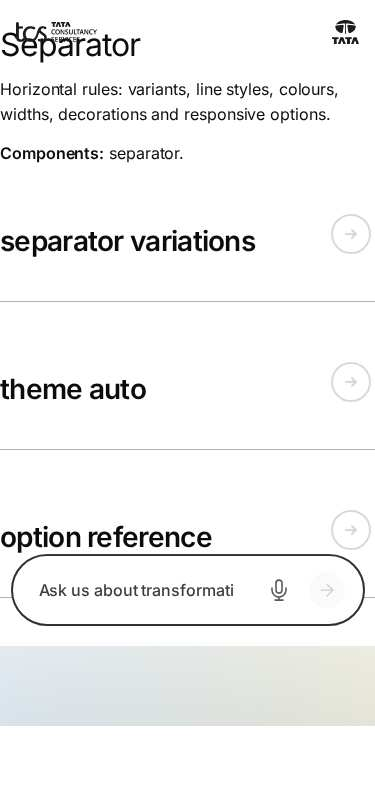

*Figure: Separator: separator — mobile 375 × 812 (/design-block-master/en/block-library/separator, captured 2026-11-08).*

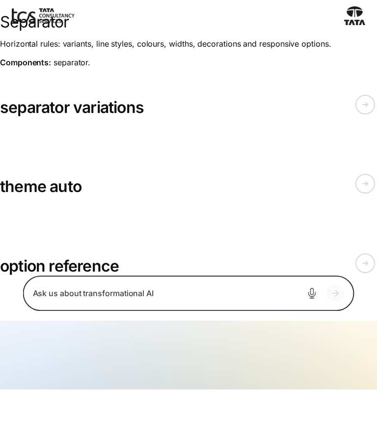

*Figure: Separator: separator — tablet 768 × 900 (/design-block-master/en/block-library/separator, captured 2026-11-08).*

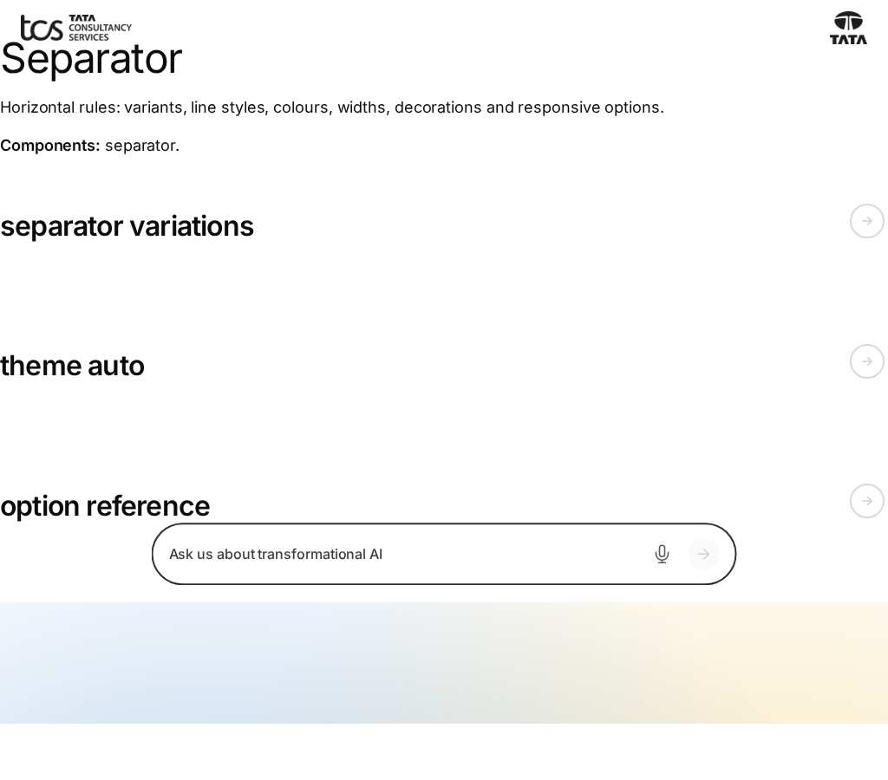

*Figure: Separator: separator — small desktop 1024 × 900 (/design-block-master/en/block-library/separator, captured 2026-11-08).*

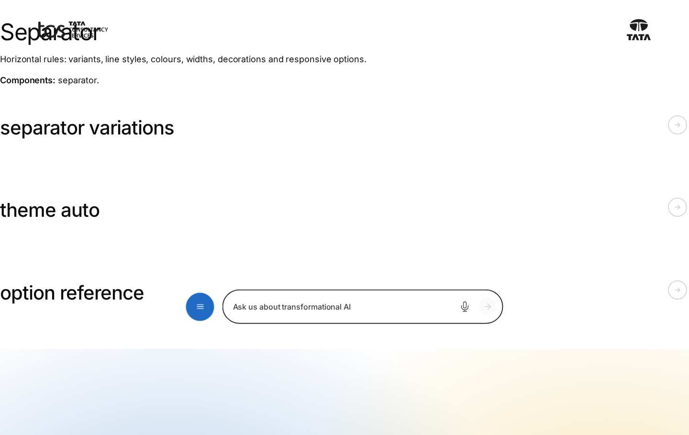

*Figure: Separator: separator — desktop 1440 × 900 (/design-block-master/en/block-library/separator, captured 2026-11-08).*

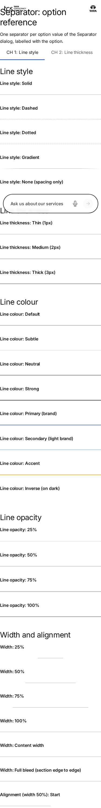

*Figure: Separator: separator/option-reference — mobile 375 × 812 (/design-block-master/en/block-library/separator/option-reference, captured 2026-11-08).*

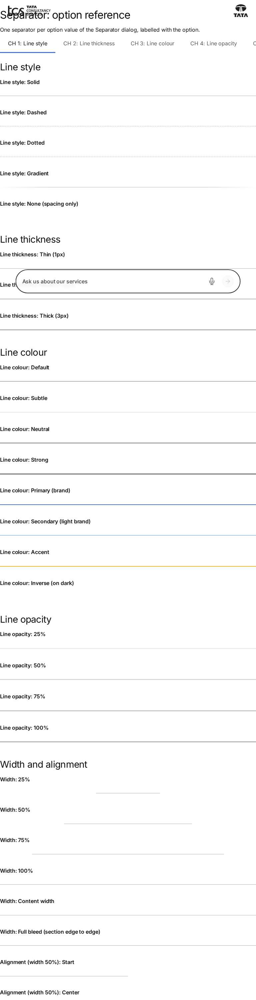

*Figure: Separator: separator/option-reference — tablet 768 × 900 (/design-block-master/en/block-library/separator/option-reference, captured 2026-11-08).*

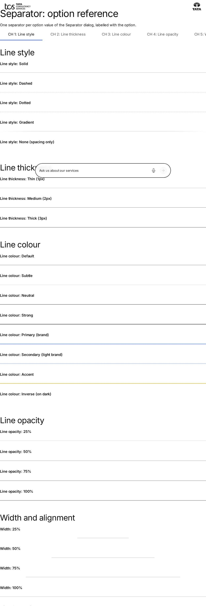

*Figure: Separator: separator/option-reference — small desktop 1024 × 900 (/design-block-master/en/block-library/separator/option-reference, captured 2026-11-08).*

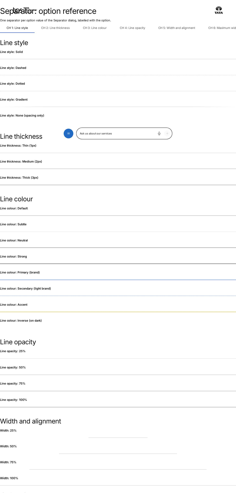

*Figure: Separator: separator/option-reference — desktop 1440 × 900 (/design-block-master/en/block-library/separator/option-reference, captured 2026-11-08).*

*Figure: Separator: separator/separator-variations — mobile 375 × 812 (/design-block-master/en/block-library/separator/separator-variations, captured 2026-11-08).*

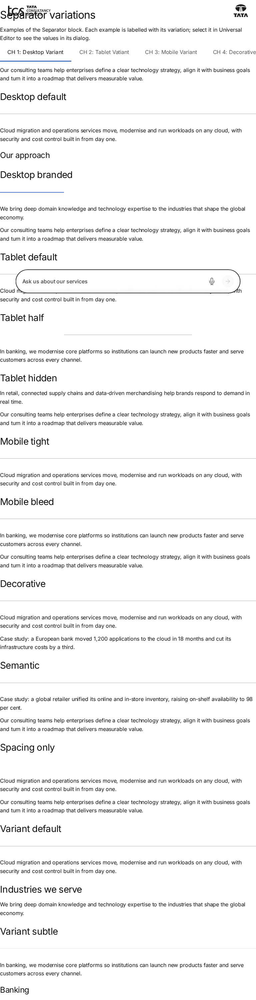

*Figure: Separator: separator/separator-variations — tablet 768 × 900 (/design-block-master/en/block-library/separator/separator-variations, captured 2026-11-08).*

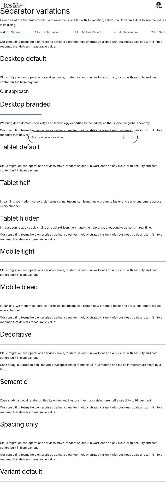

*Figure: Separator: separator/separator-variations — small desktop 1024 × 900 (/design-block-master/en/block-library/separator/separator-variations, captured 2026-11-08).*

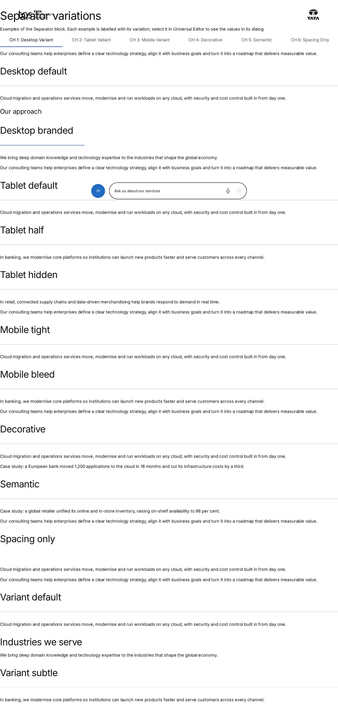

*Figure: Separator: separator/separator-variations — desktop 1440 × 900 (/design-block-master/en/block-library/separator/separator-variations, captured 2026-11-08).*

*Figure: Separator: separator/theme-auto — mobile 375 × 812 (/design-block-master/en/block-library/separator/theme-auto, captured 2026-11-08).*

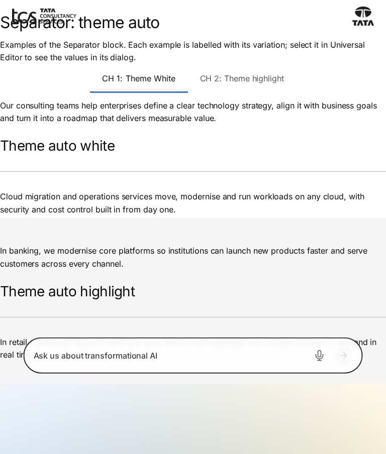

*Figure: Separator: separator/theme-auto — tablet 768 × 900 (/design-block-master/en/block-library/separator/theme-auto, captured 2026-11-08).*

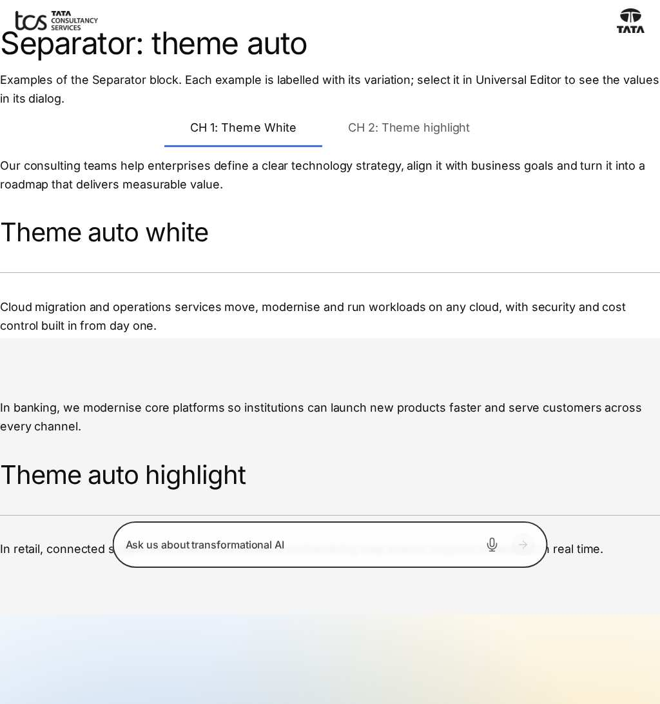

*Figure: Separator: separator/theme-auto — small desktop 1024 × 900 (/design-block-master/en/block-library/separator/theme-auto, captured 2026-11-08).*

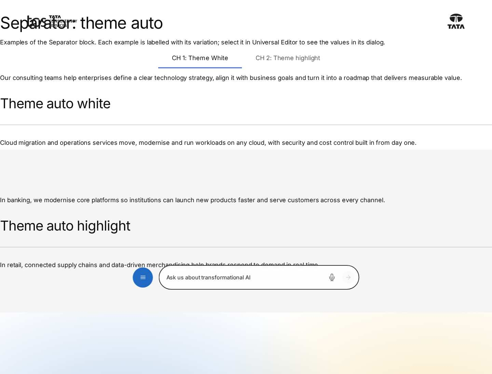

*Figure: Separator: separator/theme-auto — desktop 1440 × 900 (/design-block-master/en/block-library/separator/theme-auto, captured 2026-11-08).*

## Known limitations

- None recorded for this document.

## Open items

- None.

## Change history

| Version | Date | Author | Change |
| --- | --- | --- | --- |
| 1.0 | 13 November 2026 | Delivery team (documentation program) | First version of the role-specific documentation (master documentation prompt), generated from the repository and the published reference pages |
