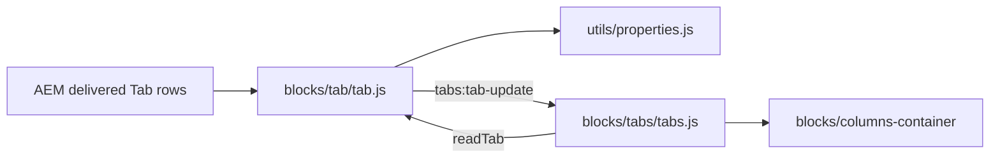
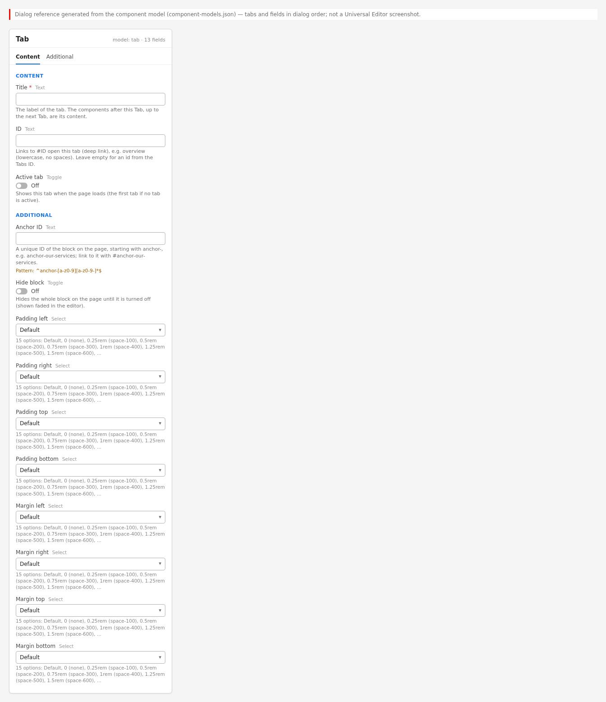

# Tab Block — Developer Guide

| Attribute | Value |
| --- | --- |
| Document ID | DEV-B-tab |
| Audience | Developers, technical leads, block owners, AI coding agents |
| Purpose | How the Tab block is built: files, model, structure, behaviour, variations, tests and limitations |
| Scope | blocks/tab/ and its components tab |
| Prerequisites | — |
| Owner | Technical Lead / Block Owner (proposed) |
| Approver | Product Owner (to be confirmed) |
| Version | 1.0 |
| Status | Draft for review |
| Last updated | 8 November 2026 |
| Last validated | 2026-11-08 (model, files, imports from the code; reference pages from the live site) |
| Source files | blocks/tab/README.md, blocks/tab/_tab.json, blocks/tab/tab.css, blocks/tab/tab.js |
| Related documents | [Variations](./TAB-VARIATIONS.md), [Test coverage](./TAB-TEST-COVERAGE.md), [Authoring guide](../../../03-authoring/components/tab/TAB-AUTHORING-GUIDE.md) |
| Related AEM paths | — |

## Contents

- [Summary](#summary)
- [Overview](#overview)
- [Source files](#source-files)
- [Components, models and filters](#components-models-and-filters)
- [Fields](#fields)
- [Dependencies](#dependencies)
- [For Developers](#for-developers)
- [Extending the Block](#extending-the-block)
- [Responsive Behavior](#responsive-behavior)
- [Accessibility](#accessibility)
- [Data Layer and Analytics](#data-layer-and-analytics)
- [Performance Considerations](#performance-considerations)
- [Security and Privacy](#security-and-privacy)
- [For Architects](#for-architects)
- [Troubleshooting](#troubleshooting)
- [Known limitations of the block](#known-limitations-of-the-block)
- [Change history of the block](#change-history-of-the-block)
- [Reference pages](#reference-pages)
- [Coverage of the required topics](#coverage-of-the-required-topics)
- [Screenshots](#screenshots)
- [Known limitations](#known-limitations)
- [Open items](#open-items)
- [Change history](#change-history)

## Summary

| Attribute | Value |
| --- | --- |
| Block | Tab |
| Folder | `blocks/tab` |
| Type | Child item |
| Category | child-item |
| Status | Active |
| Purpose | Starts a tab panel in a Tabs Container |
| Variations (summary) | Columns per row of its Column Breaks |
| Children | — |
| Code size | 67 lines of JS and CSS |

## Overview

**Business purpose.** A simple, visible marker for "a new tab starts here", so tabbed content is built on the page with the standard components.

**User experience.** Visitors never see the Tab itself: its Title is the label of a tab button and its content is the panel. Authors see it in edit mode as a dashed chip with the Title.

**Templates / page types.** Any page that has a Tabs Container. **Data source:** its own fields.

**Related blocks.** [Tabs](https://github.com/sradha-tcs/tcs-corp/blob/main/blocks/tabs/README.md) (builds the tab list from the Tabs), [Column Break](https://github.com/sradha-tcs/tcs-corp/blob/main/blocks/column-break/README.md) (columns in a tab), [Columns Container](https://github.com/sradha-tcs/tcs-corp/blob/main/blocks/columns-container/README.md) (the layout built in the tab). The Tabs block (`tabs-block`) has its own Tab items (`tabs-item`, with a Fragment), documented in the [Tabs README](https://github.com/sradha-tcs/tcs-corp/blob/main/blocks/tabs/README.md); they aren't this block.

**When to use.** Inside a Tabs Container, once at the start of every tab.

**When not to use.** Outside a Tabs Container (it is offered only there; elsewhere it would show as a visible chip); in a Tabs block (use its Tab items).

**Realistic use cases.** Starting the tabs Consulting, Cloud and Cybersecurity of a services Tabs Container; naming a tab for links (`#cloud`); choosing the tab shown when the page opens; laying out a tab's content in two columns.

## Source files

| File | Link |
| --- | --- |
| `README.md` | [GitHub](https://github.com/sradha-tcs/tcs-corp/blob/main/blocks/tab/README.md) |
| `_tab.json` | [GitHub](https://github.com/sradha-tcs/tcs-corp/blob/main/blocks/tab/_tab.json) |
| `tab.css` | [GitHub](https://github.com/sradha-tcs/tcs-corp/blob/main/blocks/tab/tab.css) |
| `tab.js` | [GitHub](https://github.com/sradha-tcs/tcs-corp/blob/main/blocks/tab/tab.js) |

## Components, models and filters

| Component | Title | Resource type | Template name | Model | Children allowed |
| --- | --- | --- | --- | --- | --- |
| `tab` | Tab | `core/franklin/components/block/v1/block` | Tab | `tab` | — |

## Fields

The Additional tab fields (anchor, hide, padding, margin, animation) are common to the blocks and described in the [content modeling guide](../../markdown/CONTENT-MODELING-GUIDE.md).

### Tab (`tab`)

| Tab | Label | Property | Type | Required in model | Default | Options | Visibility |
| --- | --- | --- | --- | --- | --- | --- | --- |
| Content | Title | `title` | text | Yes | — | — | — |
| Content | ID | `tabId` | text | No | — | — | — |
| Content | Active tab | `activeTab` | boolean | No | — | — | — |
| Content | Columns per row | `classes_perrow` | select | No | `""` | 5 options | — |

"Required in model" is the model's `required` flag; whether a field is required in practice is stated in the authoring guide where it is known.

## Dependencies

| Import |
| --- |
| `../../scripts/aem.js` |
| `../../utils/properties.js` |

## For Developers

<!-- BEGIN GENERATED: files (npm run build:docs) -->

```text
blocks/tab/
├── README.md
├── _tab.json
├── tab.css
└── tab.js
```

| Decorator/Utility | Purpose | Execution or dependency point |
| ----------------- | ------- | ----------------------------- |
| [`scripts/aem.js`](https://github.com/sradha-tcs/tcs-corp/blob/main/scripts/aem.js) | Edge Delivery core library (block loading, CSS, metadata, optimized pictures) | `tab.js`: { toClassName } |
| [`utils/properties.js`](https://github.com/sradha-tcs/tcs-corp/blob/main/utils/properties.js) | `readProperties`, `textOf`, `isOn`, `isOnByDefault` (a toggle that defaults to on), `optionOf`, `normalizeKey`, `textSource` (key-value block properties) | `tab.js`: { isOn, readProperties, textOf } |

<!-- END GENERATED: files -->

**Responsibilities.** `tab.js` reads the Tab's fields (`readTab`, exported for `blocks/tabs/tabs.js`) and decorates the marker (label chip, `data-analytics="off"`, `tabs:tab-update`). `tab.css` styles the chip. The hiding on the page is in `blocks/tabs/tabs.css` (`.tabs > .tabs-panel > div:has(> .tab)`, shown again under `html.adobe-ue-edit`).

**Input DOM.** A key-value block (`div.tab`) with rows `title`, `tabid` / `tabId`, `activetab`; classes from the `classes_*` fields (`per-row-N`, `hideblock`). Without key rows, one row per field in dialog order (Title, ID, Active tab: the last cell of each row).

**Rendered DOM.**

```html
<div class="tab block per-row-2" data-tab-title="Cloud" data-tab-id="cloud" data-tab-active="true" data-analytics="off">
  <p class="tab-title">Cloud</p>
</div>
```

**Decoration flow.** The Tabs block is loaded before the Tabs in its section, so `blocks/tabs/tabs.js` calls `readTab` on the undecorated Tab; `readTab` caches the values on `data-tab-title`, `data-tab-id`, `data-tab-active` so the later `decorate` (and re-reads) find them after the rows are gone. `decorate` then replaces the rows with `p.tab-title` and dispatches `tabs:tab-update` (bubbling, `detail`: `title`, `id`, `active`); the Tabs update the label of the tab whose panel contains the Tab.

**Exports.** `readTab(block)` → `{ title, id, active }`; `default decorate(block)`.

**Parent / child contracts.** The Tabs read `per-row-N` and `hideblock` from the Tab's classes (`groupContainerTabs`); a Tab with `hideblock` drops its group when not editing.

**Error handling.** Missing fields give an empty Title (the Tabs use "Tab {n}"), an empty ID and Active off.

## Extending the Block

1. Add a field in `_tab.json`, run `npm run build:json` and `npm run lint`.
2. Read it in `readTab` (add its normalized key to `FIELDS` in dialog order and cache it on a `data-tab-*` attribute) and use it in `blocks/tabs/tabs.js` `groupContainerTabs`. A `classes_*` field arrives as a block class instead (as Columns per row).
3. Delivery rules: don't end field names in Text, Title, Type, Alt or MimeType; no sample value in the definition template.
4. Data layer: the Tab stays `data-analytics="off"`; describe any new data on the panel in `tabs.js`.
5. Backward compatibility: keep reading key-value and per-field rows.
6. No unit test covers the Tab; check the block library pages listed below. Update this README and run `npm run build:docs`; `npm run build:modules` after changing imports.

## Responsive Behavior

The Tab's CSS has no media query: it is hidden on the page at every width and shown as a chip in edit mode at every width. The tab button and the columns built from its Column Breaks follow the [Tabs](https://github.com/sradha-tcs/tcs-corp/blob/main/blocks/tabs/README.md#responsive-behavior) and [Columns Container](https://github.com/sradha-tcs/tcs-corp/blob/main/blocks/columns-container/README.md#responsive-behavior) rules.

| Viewport | Layout | Image behavior | Interaction behavior |
|---|---|---|---|
| All widths | Hidden on the page; dashed chip in edit mode | None | None on the page; selectable in the editor |

## Accessibility

- The Tab adds no semantics of its own on the page: its Title becomes the accessible name of a `role="tab"` button, which labels its panel (`aria-labelledby`).
- The chip (`p.tab-title`) is shown only in edit mode; on the page its wrapper is hidden with `display: none`, so screen readers don't announce it.
- Hidden Tabs are removed from the tab list and the panels (not only visually hidden).

**Author responsibilities:** unique, descriptive Titles; a heading at the start of the tab's content; IDs that make sense in links.

**Developer responsibilities:** keep the Title as the tab button's text; keep the chip hidden outside edit mode (`blocks/tabs/tabs.css`); keep `data-analytics="off"`.

Keyboard behavior is the Tabs' (see the [Tabs accessibility section](https://github.com/sradha-tcs/tcs-corp/blob/main/blocks/tabs/README.md#accessibility)); the Tab handles no keys.

## Data Layer and Analytics

- The Tab is `data-analytics="off"`: it isn't a data-layer component and no click is measured on it.
- Its Title is the `dc:title` of its panel (`tcs-corp/components/tabs/item`, pushed by `blocks/tabs/tabs.js`) and of the `cmp:show` pushed when the tab is shown after the first one; its ID is the panel id used as the component id.
- The path Adobe Client Data Layer → Adobe Data Collection (Tags) → AEP Web SDK → Edge Network → Analytics / CJA is the intended one, but Tags and the Web SDK aren't configured yet (blocked: measurement plan). No consent mechanism is implemented.

| Trigger | Data-layer event | Required properties | Analytics behavior |
|---|---|---|---|
| Page load | component state (by the Tabs) | panel id (the Tab's ID or `{base}-item-{n}`), `dc:title` (the Title) | The tab is listed as a panel |
| Its tab shown (not on load) | `cmp:show` (by the Tabs) | panel id, `dc:title` | Tab view |

## Performance Considerations

No network requests, observers or listeners; one small DOM replacement. The Tab is loaded as a block of its section (its CSS and JS are fetched once per page).

## Security and Privacy

The Title is set with `textContent`; the ID is normalized with `toClassName`. No personal data.

## For Architects

- **Role:** a marker block inside a section container: it delimits groups of sibling components, because Edge Delivery doesn't nest blocks in blocks.
- **Content model:** key-value block `tab`; its `classes_*` fields arrive as block classes (it is a block, not a section).
- **Rendering:** read by the Tabs before its own decoration; values cached in data attributes.
- **Data layer / Target / consent:** none of its own.
- **Performance / security:** negligible (no network, no listeners).



## Troubleshooting

| Symptom | Likely cause | Diagnostic steps | Resolution | Verification |
|---|---|---|---|---|
| Label "Tab 2" instead of the Title | Empty Title, or content before the first Tab | Select the Tab; check the tree order | Enter the Title; move stray components | Labels are the Titles |
| Chip visible on the page | The Tab isn't in a Tabs Container | Check the section for `tabs-section` | Move or delete the Tab | No chip |
| ID doesn't work in links | Normalized or de-duplicated id | Inspect the panel id | Use the exact ID | Link opens the tab |
| Active tab ignored | Another active Tab, a `#hash`, or the editor keeps the shown tab | Load without hash; check all Tabs | One Active tab; reload | Correct tab on load |
| ID, Active, Columns per row or Hide block change has no effect in the editor | Applied when the container is rendered again (R-C-7) | Reload the editor | Reload | Applied |
| Component in the wrong tab | Its position in the tree | Check the tree order | Move it after its Tab | Correct panel |

Evidence to collect: page URL, the Tab's data attributes (`data-tab-*`) and classes, the panel ids.

## Known limitations of the block

| Limitation | Impact | Workaround | Planned correction |
|---|---|---|---|
| ID, Active tab, Columns per row and Hide block changes apply only when the Tabs Container is rendered again (re-audit R-C-7, deferred) | No immediate feedback in the editor | Reload the editor | Not recorded |
| A Tab outside a Tabs Container shows its chip on the page | Visible stray label | Keep Tabs in Tabs Containers (the filter offers it only there) | Not planned |
| Gap, alignment and breakpoint of the columns in a tab aren't authorable | Fixed medium gap, top, from 900px | Use a Columns Container section | Not planned |

## Change history of the block

| Version | Change | Source | Date |
|---|---|---|---|
| Not recorded | README generated from verified implementation and approved handover documentation | Repository review | Not recorded |
| Handover 2.28 | New Tab field Columns per row: a tab's Column Breaks lay its content out in columns | docs/handover revision history | 20 October 2026 |
| Handover 2.29 | Block ecosystem re-audit: sample content removed from templates (re-audit R-C-10: the Tab no longer stores the title "Tab"; Tab IDs validated) | docs/handover revision history | 20 October 2026 |

## Reference pages

| Kind | Page | Live URL |
| --- | --- | --- |
| Curated design page | /design-block-master/en/curated-design-pages/story | https://main--tcs-corp--sradha-tcs.aem.live/design-block-master/en/curated-design-pages/story |

## Coverage of the required topics

| Topic | Where |
| --- | --- |
| Purpose | Overview |
| Source files | generated: Files |
| Model, definition, filters, children | generated: Components |
| Dependencies | generated: Dependencies |
| Authored input / rendered output / DOM transformation | For Developers |
| Configuration fields, defaults, required fields | generated: Fields |
| Variations | TAB-VARIATIONS.md |
| Responsive behaviour | Responsive Behavior |
| Accessibility and keyboard | Accessibility |
| Analytics / data layer | Data Layer and Analytics |
| Performance | Performance Considerations |
| Security | Security and Privacy |
| Extending | Extending the Block |
| Known limitations | Known Limitations |
| Troubleshooting | Troubleshooting |
| Tests | TAB-TEST-COVERAGE.md |
| SEO behaviour | Not recorded |
| Caching considerations | Not recorded (Edge Delivery default caching; no block-specific rule) |
| Ownership | Technical Lead / Block Owner (proposed) |

## Screenshots

> **Screenshot required**
>
> - Required screen: Tab on its block library page
> - Required role/access: none (published page)
> - Required navigation steps: Open https://main--tcs-corp--sradha-tcs.aem.live/design-block-master/en/block-library/tab
> - Reason unavailable: No block library page of this block was found under /design-block-master/en/block-library
> - Owner: Content Lead / AEM Authoring Lead (proposed)
> - Target completion date: To be confirmed


*Figure: Desktop rendering — A Tabs Container at 1200 px on the page: the Tab markers' Titles appear only as the tab buttons Consulting (selected), Cloud and Cybersecurity; no marker is visible in the panel, which shows the Columns with photo-1.svg on the left and the H3 Business and technology consulting with its text on the right. (Sample content on the preview; callout letters as in the Field Entry Table; file screenshots/tab-desktop-view.jpg) (handover screenshot; rendering at the time it was taken).*


*Figure: Tablet rendering — The same Tabs Container at 768 px in Universal Editor edit mode: the tab list Consulting (selected), Cloud and Cybersecurity, the dashed brand chip Consulting at the top of the panel, and below it the stacked Columns with photo-1.svg, the H3 Business and technology consulting and its text. (Sample content on the preview; callout letters as in the Field Entry Table; file screenshots/tab-tablet-view.jpg) (handover screenshot; rendering at the time it was taken).*


*Figure: Mobile rendering — The Tabs Container at 375 px on the page: the tab list shows Consulting (selected), Cloud and a cut-off Cybersecu..., no marker in the panel; the Consulting panel is stacked: photo-1.svg, the H3 Business and technology consulting on two lines and its text. (Sample content on the preview; callout letters as in the Field Entry Table; file screenshots/tab-mobile-view.jpg) (handover screenshot; rendering at the time it was taken).*


*Figure: Standard Tab variation — Edit mode at 1440 px after selecting the Cloud tab button: Cloud is selected in the tab list Consulting, Cloud, Cybersecurity; the dashed chip Cloud sits at the top of the panel, followed by the H3 Cloud migration and operations and its text. (Sample content on the preview; callout letters as in the Field Entry Table; file screenshots/tab-standard.jpg) (handover screenshot; rendering at the time it was taken).*


*Figure: Active Tab variation — A Tabs Container at 1440 px loaded with its third tab, Cybersecurity, selected because that Tab has Active tab on; the panel shows the Columns with photo-3.svg on the left and the H3 Cyber defence and resilience with its text on the right. (Sample content on the preview; callout letters as in the Field Entry Table; file screenshots/tab-active.jpg) (handover screenshot; rendering at the time it was taken).*

![Tab with ID variation — The services page at 1440 px after #cloud is added to the address: the page has scrolled past the H1 and image so the Tabs sit just below the header area, with Cloud selected and its Columns (photo-2.svg, the H3 Cloud migration and operations and its text) shown; the footer's floating Ask us a question bar is at the bottom. The address bar itself is not in the screenshot. (Sample content on the preview; callout letters as in the Field Entry Table; file screenshots/tab-deep-link.jpg)](./screenshots/handover/tab-deep-link.jpg)

*Figure: Tab with ID variation — The services page at 1440 px after #cloud is added to the address: the page has scrolled past the H1 and image so the Tabs sit just below the header area, with Cloud selected and its Columns (photo-2.svg, the H3 Cloud migration and operations and its text) shown; the footer's floating Ask us a question bar is at the bottom. The address bar itself is not in the screenshot. (Sample content on the preview; callout letters as in the Field Entry Table; file screenshots/tab-deep-link.jpg) (handover screenshot; rendering at the time it was taken).*

![Universal Editor canvas — Edit mode preview at 1440 px with letters: A on the dashed Tab chip Consulting at the top of the panel, B on the selected tab button Consulting (Cloud next to it), C on the Columns with photo-1.svg and the H3; the Text Explore consulting: talk to our consulting team about your transformation agenda follows outside C. No content tree is shown. (Annotated preview in editor mode with sample content; letters as in the annotations list, not a Universal Editor screenshot; file screenshots/tab-authoring-view.jpg)](./screenshots/handover/tab-authoring-view.jpg)

*Figure: Universal Editor canvas — Edit mode preview at 1440 px with letters: A on the dashed Tab chip Consulting at the top of the panel, B on the selected tab button Consulting (Cloud next to it), C on the Columns with photo-1.svg and the H3; the Text Explore consulting: talk to our consulting team about your transformation agenda follows outside C. No content tree is shown. (Annotated preview in editor mode with sample content; letters as in the annotations list, not a Universal Editor screenshot; file screenshots/tab-authoring-view.jpg) (handover screenshot; rendering at the time it was taken).*



*Figure: Properties panel — The properties panel of a Tab with the Content tab (Title, ID, Active tab) and the Additional tab. (Dialog reference generated from the component model, not a Universal Editor screenshot; file screenshots/tab-properties-panel.jpg) (handover screenshot; rendering at the time it was taken).*

## Known limitations

- Universal Editor dialogs were not captured: no author access in this program (see the access blockers).

## Open items

- None.

## Change history

| Version | Date | Author | Change |
| --- | --- | --- | --- |
| 1.0 | 8 November 2026 | Delivery team (documentation program) | First version of the role-specific documentation (master documentation prompt), generated from the repository and the published reference pages |
