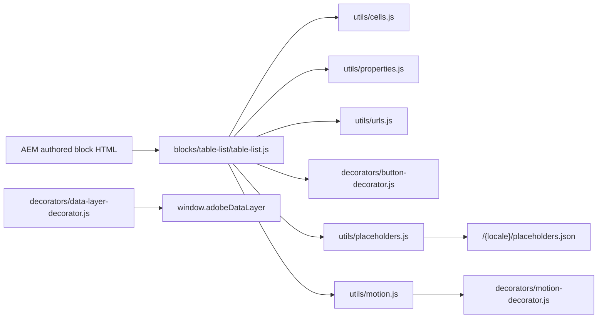
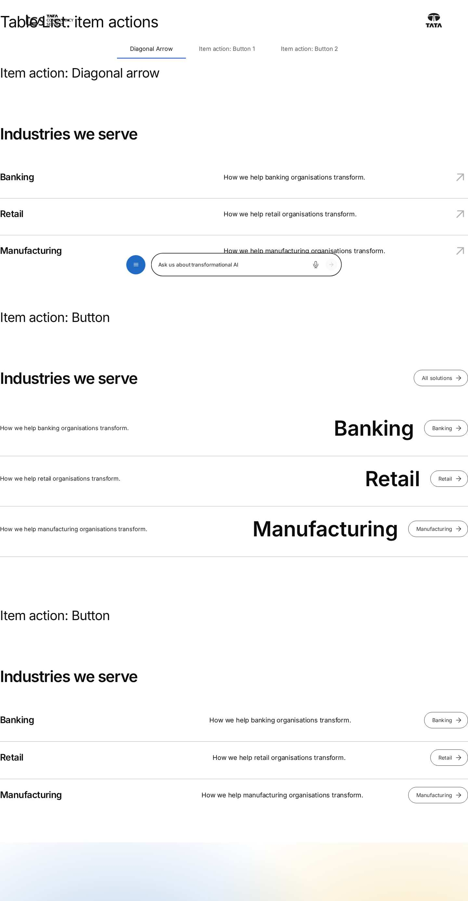
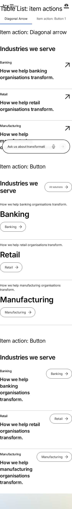

# Table List Block — Developer Guide

| Attribute | Value |
| --- | --- |
| Document ID | DEV-B-table-list |
| Audience | Developers, technical leads, block owners, AI coding agents |
| Purpose | How the Table List block is built: files, model, structure, behaviour, variations, tests and limitations |
| Scope | blocks/table-list/ and its components table-list, table-list-card |
| Prerequisites | — |
| Owner | Technical Lead / Block Owner (proposed) |
| Approver | Product Owner (to be confirmed) |
| Version | 1.0 |
| Status | Draft for review |
| Last updated | 8 November 2026 |
| Last validated | 2026-11-08 (model, files, imports from the code; reference pages from the live site) |
| Source files | blocks/table-list/README.md, blocks/table-list/_table-list.json, blocks/table-list/table-list.css, blocks/table-list/table-list.js |
| Related documents | [Variations](./TABLE-LIST-VARIATIONS.md), [Test coverage](./TABLE-LIST-TEST-COVERAGE.md), [Authoring guide](../../../03-authoring/components/table-list/TABLE-LIST-AUTHORING-GUIDE.md) |
| Related AEM paths | /content/tcs-corp/design-block-master/en/block-library/table-list, /content/tcs-corp/design-block-master/en/block-library/table-list/item-actions, /content/tcs-corp/design-block-master/en/block-library/table-list/motion |

## Contents

- [Summary](#summary)
- [Overview](#overview)
- [Source files](#source-files)
- [Components, models and filters](#components-models-and-filters)
- [Fields](#fields)
- [Dependencies](#dependencies)
- [For Developers](#for-developers)
- [Extending the Block](#extending-the-block)
- [Responsive Behavior](#responsive-behavior)
- [Accessibility](#accessibility)
- [Data Layer and Analytics](#data-layer-and-analytics)
- [Performance Considerations](#performance-considerations)
- [Security and Privacy](#security-and-privacy)
- [For Architects](#for-architects)
- [Troubleshooting](#troubleshooting)
- [Known limitations of the block](#known-limitations-of-the-block)
- [Change history of the block](#change-history-of-the-block)
- [Reference pages](#reference-pages)
- [Coverage of the required topics](#coverage-of-the-required-topics)
- [Screenshots](#screenshots)
- [Known limitations](#known-limitations)
- [Open items](#open-items)
- [Change history](#change-history)

## Summary

| Attribute | Value |
| --- | --- |
| Block | Table List |
| Folder | `blocks/table-list` |
| Type | Container |
| Category | listing |
| Status | Active |
| Purpose | A numbered list of linked items (industries, services) |
| Variations (summary) | Variations, item actions, numbers |
| Children | table-list-card (Table List Item) |
| Code size | 1190 lines of JS and CSS |

## Overview

- **Business purpose:** presents a short, scannable list of offerings (industries served, transformation solutions, products and platforms) with a strong typographic style and a clear path to each detail page, without images.
- **User experience:** a heading with a call to action (filled button, outline button or text link) on the right (below it when they don't fit), then rows separated by dividers. Variation 1: title, description and an arrow; Variation 2: description, a large title and an outline button; Variation 3: description, a number with a very large title and a diagonal arrow; Variation 4: a wide title, a narrow grey description and an arrow, the row highlighted on hover and keyboard focus. With an arrow the whole row is clickable.
- **Templates / page types:** any page (allowed in every section); typically the home page and landing pages (the curated design pages `home`, `what-we-do`, `product`, `industry-landing-page`, `case-study`, `collection` use it).
- **Data source:** authored fields only; UI text (View all, Explore, accessible names) from the locale's placeholders. No page metadata, tags, query index or images.
- **Related blocks:** [Cards](https://github.com/sradha-tcs/tcs-corp/blob/main/blocks/cards/README.md) and [List](https://github.com/sradha-tcs/tcs-corp/blob/main/blocks/list/README.md) (image cards), [Filter List](https://github.com/sradha-tcs/tcs-corp/blob/main/blocks/filter-list/README.md) (metadata-driven lists), [Table](https://github.com/sradha-tcs/tcs-corp/blob/main/blocks/table/README.md) (tabular data), [Accordion](https://github.com/sradha-tcs/tcs-corp/blob/main/blocks/accordion/README.md), [Anchor List](https://github.com/sradha-tcs/tcs-corp/blob/main/blocks/anchor-list/README.md).
- **When to use:** up to 10 items that each link to a page, where typography, not imagery, carries the design.
- **When not to use:** more than 10 items or lists that should update from page metadata (List, Filter List); image cards (Cards, List); tabular data with columns (Table); expandable content (Accordion).
- **Realistic use cases:** a home page "Industries we serve" list with a "View all industries" button; "Our transformation solutions" with an outline "Explore" button per row; "Products & Platforms" with numbered product names and trademark signs (TwinX™, ignio®).

## Source files

| File | Link |
| --- | --- |
| `README.md` | [GitHub](https://github.com/sradha-tcs/tcs-corp/blob/main/blocks/table-list/README.md) |
| `_table-list.json` | [GitHub](https://github.com/sradha-tcs/tcs-corp/blob/main/blocks/table-list/_table-list.json) |
| `table-list.css` | [GitHub](https://github.com/sradha-tcs/tcs-corp/blob/main/blocks/table-list/table-list.css) |
| `table-list.js` | [GitHub](https://github.com/sradha-tcs/tcs-corp/blob/main/blocks/table-list/table-list.js) |

## Components, models and filters

| Component | Title | Resource type | Template name | Model | Children allowed |
| --- | --- | --- | --- | --- | --- |
| `table-list` | Table List | `core/franklin/components/block/v1/block` | Table List | `table-list` | table-list-card |
| `table-list-card` | Table List Item | `core/franklin/components/block/v1/block/item` | Table List Item | `table-list-card` | — |

## Fields

The Additional tab fields (anchor, hide, padding, margin, animation) are common to the blocks and described in the [content modeling guide](../../markdown/CONTENT-MODELING-GUIDE.md).

### Table List (`table-list`)

| Tab | Label | Property | Type | Required in model | Default | Options | Visibility |
| --- | --- | --- | --- | --- | --- | --- | --- |
| Content | Variation | `variations` | select | No | `industries` | 6 options | — |
| Content | Background color | `backgroundColor` | select | No | `white` | 4 options | — |
| Content | Heading | `listHeading` | text | No | `""` | — | — |
| Content | Heading Type | `listHeadingType` | select | No | `h2` | 3 options | — |
| Content | Eyebrow | `listEyebrow` | text | No | `""` | — | — |
| Content | Heading position | `headerPosition` | select | No | `""` | 2 options | — |
| Content | Maximum items | `maxCards` | number | No | `4` | — | — |
| Content | Text | `viewAllLabel` | text | No | `""` | — | — |
| Content | Link | `viewAllLink` | aem-content | No | — | — | — |
| Content | Style | `ctaStyle` | select | No | `""` | 4 options | — |
| Content | Hide button | `hideButton` | boolean | No | `false` | — | — |
| Items | Numbers | `numbers` | select | No | `""` | 4 options | — |
| Items | Item link | `itemAction` | select | No | `""` | 5 options | — |
| Items | Button text | `itemButtonLabel` | text | No | — | — | Conditional |
| Items | Gray descriptions | `grayDescriptions` | boolean | No | `false` | — | Conditional |

### Table List Item (`table-list-card`)

| Tab | Label | Property | Type | Required in model | Default | Options | Visibility |
| --- | --- | --- | --- | --- | --- | --- | --- |
| — | Number | `number` | text | No | `""` | — | — |
| — | Title | `title` | text | No | — | — | — |
| — | Trademark | `trademark` | select | No | `""` | 3 options | — |
| — | Description | `description` | richtext | No | — | — | — |
| — | Link | `link` | aem-content | No | `""` | — | — |
| — | Button text | `linkText` | text | No | `""` | — | — |

"Required in model" is the model's `required` flag; whether a field is required in practice is stated in the authoring guide where it is known.

## Dependencies

| Import |
| --- |
| `../../scripts/scripts.js` |
| `../../decorators/button-decorator.js` |
| `../../utils/buttons.js` |
| `../../utils/environment.js` |
| `../../utils/cells.js` |
| `../../utils/properties.js` |
| `../../utils/urls.js` |
| `../../utils/placeholders.js` |
| `../../utils/motion.js` |

## For Developers

<!-- BEGIN GENERATED: files (npm run build:docs) -->

```text
blocks/table-list/
├── README.md
├── _table-list.json
├── table-list.css
└── table-list.js
```

| Decorator/Utility | Purpose | Execution or dependency point |
| ----------------- | ------- | ----------------------------- |
| [`scripts/scripts.js`](https://github.com/sradha-tcs/tcs-corp/blob/main/scripts/scripts.js) | Page decoration (moveInstrumentation and shared page helpers) | `table-list.js`: { moveInstrumentation } |
| [`decorators/button-decorator.js`](https://github.com/sradha-tcs/tcs-corp/blob/main/decorators/button-decorator.js) | `decorateButton` (option `newTabHint`: a link opening a new tab says so), `createButton`, `setButtonDisabled`, `setButtonAlignment`, `removeButtonDecoration` | `table-list.js`: { decorateButton } |
| [`utils/buttons.js`](https://github.com/sradha-tcs/tcs-corp/blob/main/utils/buttons.js) | `BUTTON_VIEWS`, `BUTTON_TYPES`, `BUTTON_ALIGNMENTS`, `pick`, `readButtonOptions` | `table-list.js`: { pick } |
| [`utils/environment.js`](https://github.com/sradha-tcs/tcs-corp/blob/main/utils/environment.js) | `prefersReducedMotion`, `scrollBehavior`, `isEditing`, `isInEditor`, `isAuthor` (the page is rendered by AEM author, which has no query index) | `table-list.js`: { isEditing } |
| [`utils/cells.js`](https://github.com/sradha-tcs/tcs-corp/blob/main/utils/cells.js) | `itemRows`, `KEY_VALUE_ITEM`, `FIELD_ROW_ITEM` (the item rows of a block: by model in the editor, by their cells on the page), `withoutTabCells` (drops the empty cell AEM renders for each dialog tab of an item model), `m | `table-list.js`: { matchCells } |
| [`utils/properties.js`](https://github.com/sradha-tcs/tcs-corp/blob/main/utils/properties.js) | `readProperties`, `textOf`, `isOn`, `isOnByDefault` (a toggle that defaults to on), `optionOf`, `normalizeKey`, `textSource` (key-value block properties) | `table-list.js`: { isOn, normalizeKey, textOf } |
| [`utils/urls.js`](https://github.com/sradha-tcs/tcs-corp/blob/main/utils/urls.js) | `toSitePath` (AEM content paths to published paths, e.g. `/content/tcs-corp/de/de-de/x.html` → `/de-de/x`) | `table-list.js`: { toSitePath } |
| [`utils/placeholders.js`](https://github.com/sradha-tcs/tcs-corp/blob/main/utils/placeholders.js) | `getPlaceholders`, `loadPlaceholders`, `fillPlaceholder` (UI text from the locale's placeholders, with English fallbacks) | `table-list.js`: { fillPlaceholder, getPlaceholders } |
| [`utils/motion.js`](https://github.com/sradha-tcs/tcs-corp/blob/main/utils/motion.js) | `CONTENT_MOTIONS`, `BACKGROUND_MOTIONS`, `contentMotionOf`, `backgroundMotionOf` (the Content animation / Background animation of the Additional tab, read from the block classes `motion-*` / `bg-motion-*`; unknown values | `table-list.js`: { addLegacyMotion } |

<!-- END GENERATED: files -->

- **JavaScript (`table-list.js`):** `decorate` loads the placeholders, reads the block (`readBlock`), adds the classes `{variation}` and `numbers-{value}`, maps a stored Motion Type (`addLegacyMotion`), builds the header (`buildHeader`) and the items (`decorateItem`), and replaces the block's children with the header and `div.table-list-items`.
- **CSS (`table-list.css`):** grid areas per variation, mobile first with `min-width` 600px and 1200px; arrows as CSS masks; the arrow link's `::after` covers the row; description links raised above it.
- **Input DOM:** key-value rows (`name | value`, keys compared by `normalizeKey` against `FIELDS`); when no row is keyed, single-cell rows are matched to the fields in model order by content (`matchCells` with `PROPERTY_MATCHERS`). Item rows: in the editor `data-aue-model="table-list-card"`; on the page rows with more than two cells. Item cells (number, title, trademark, description, link) are matched by content (`ITEM_MATCHERS`: a 1–3 digit number, `tm` / `r`, a link), so fields AEM leaves out don't shift the others. A two-cell row that isn't a property (or `data-aue-model="table-list-header"`) is the legacy header.
- **Rendered DOM:** `div.table-list.{variation}.numbers-{show|mobile|hide}` > `div.table-list-header` (`h2|h3|h4.table-list-heading`, `p.table-list-cta > a.button`) and `div.table-list-items[role=list]` > `div.table-list-item[role=listitem]` (the authored row, kept for its instrumentation) > `div.table-list-main` (`span.table-list-number`, `hN.table-list-title` with `sup.table-list-trademark`), `div.table-list-description`, `div.table-list-action` (`a.table-list-arrow.{arrow|arrow-up-right}`, `span.table-list-arrow` or `a.button.secondary`). Editor only: `table-list-item-hidden`.
- **Decoration flow:** synchronous after the placeholders are loaded; no observers or listeners besides the click guard on editor-only previews.
- **Error handling:** invalid select values fall back to the variation defaults; unsupported links are ignored; missing cells render nothing.
- **Exports:** default `decorate` only.
- **Parent / child contracts:** item rows are reused (`row.className = 'table-list-item'`), the header row's and cells' instrumentation is moved (`moveInstrumentation`), so Universal Editor selection keeps working.
- **Data-layer hooks:** none of its own (central tracking).

## Extending the Block

1. **A dialog field or value:** edit `blocks/table-list/_table-list.json`, run `npm run build:json` and `npm run lint`.
2. **Map it to rendering:** add the normalized key to `FIELDS` (in model order) and a matcher to `PROPERTY_MATCHERS`; read it in `readBlock`. A new variation needs `VARIATIONS`, `VARIATION_DEFAULTS` and its CSS (scoped to `.table-list.{variation}`, mobile first, rem).
3. **A new item field:** add it to `ITEM_FIELDS` and `ITEM_MATCHERS`; keep the matchers distinct so unset fields don't shift the cells.
4. **Delivery rules:** names ending in Text, Title, Type, Alt or MimeType collapse into their base field (as `listHeadingType` and `linkText` do on purpose); Additional tab values arrive as `classes_*` block classes; adding dialog tabs to the item model adds empty tab cells to its rows.
5. **Accessibility and data layer:** names from placeholders (add keys to all locale sheets); describe new interactions with `data-cmp-interaction` if they need their own name.
6. **Tests:** no unit tests exist for this block; add pure helpers under `test/` if logic grows.
7. **Backward compatibility:** keep reading `motion` and the legacy header row.
8. **Docs:** update the block library pages (`block-library/table-list/…`) and this README (`npm run build:docs`); run `npm run build:modules` after changing imports.

## Responsive Behavior

| Viewport | Layout | Image behavior | Interaction behavior |
| -------- | ------ | -------------- | -------------------- |
| Mobile (below 600px) | Heading 2rem (Variation 4: 1.75rem); call to action wraps below the heading when it doesn't fit (Variation 4: always below); Variation 1: number and title above the description, arrow on the right; Variation 2: description, title and button stacked; Variation 3: description above number and title, arrow on the right; Variation 4: title, description and arrow stacked | No images; SVG arrow masks | Numbers shown with Show and Show on mobile only |
| Tablet (600–1199px) | Heading 2.5rem; rows side by side: `main description action` (Variations 1 and 4) or `description main action` (Variations 2 and 3, title right-aligned); Variation 4 description column at most 21.15rem from 900px | — | Show on mobile only hides the numbers |
| Desktop (1200px and wider) | Heading 3rem (Variation 4: 2.5rem); Variation 1 inset by `--space-2000` with emphasised titles; Variation 2 title 4rem; Variation 3 title 5.625rem in 476 : 695 : auto columns; Variation 4 `1fr : 21.15rem : auto` | — | Hover on a row (any width) moves its arrow and turns it brand coloured; Variation 4: the row turns light grey and the arrow dark (also on keyboard focus), the arrow doesn't move |
| By list width (Variations 4 and 5) | Rows switch on the width of the list, not the screen (container query `table-list-items`): Variation 4 stacked below 25.5rem, title above description with the arrow beside from 25.5rem, three columns from 44.5rem; Variation 5 label above description below 44rem, beside it from 44rem. Variations 4–6 keep the Figma gutter (1 / 2.5 / 5rem); Heading position Beside: two columns from 900px | — | Variation 6: 24px arrow centred on the title |

## Accessibility

- **Semantic HTML:** the items container is `role="list"`, each row `role="listitem"`; item titles are headings one level below the list heading.
- **Headings:** the list heading at Heading Type (H2–H4); items one level lower (`h2` without a heading).
- **Keyboard and focus:** arrows are links with a visible focus outline; on focus and hover the arrow turns brand coloured and moves; buttons follow the button decorator; links inside descriptions stay reachable and clickable.
- **Accessible names:** arrows "Explore {title}" (else "Explore"); item buttons "{text}: {title}"; the call to action uses its text. The name uses the title, else the description, else the link text.
- **Unlinked states:** an arrow without a Link is `aria-hidden`; button and call to action previews without a Link (editor only) are `aria-hidden` with `tabindex="-1"`.
- **Reduced motion:** the arrow transition is off; the Additional tab animation doesn't play.
- **Contrast:** the products number uses `--slate-500` (3:1 for large text, per the CSS comment); text uses the theme tokens (`--color-text-default`).
- **Empty states:** no empty headings on the page; no loading state (authored content).
- **Reflow:** single column stacks below 600px.

**Author responsibilities:** a Link on every item; Heading Type without skipped levels; Trademark instead of typed signs; descriptions meaningful on their own; specific call to action text.

**Developer responsibilities:** keep `role="list"` / `role="listitem"`, the heading levels and the accessible names from placeholders; keep the focus outline and the description links above the arrow overlay.

| Key | Expected behavior |
| --- | ----------------- |
| Tab / Shift+Tab | Moves through the call to action, description links and each item's arrow or button |
| Enter | Follows the focused link (arrows, buttons and the call to action are links) |

## Data Layer and Analytics

- **Component:** registered centrally by `decorators/data-layer-decorator.js` (`trackBlocks`): `@type: tcs-corp/components/table-list`, `parentId` the page, `dc:title` the block's first heading. The id is the block id (Anchor ID), else `table-list-{n}`; items have no component id of their own.
- **Interactions:** the block sets no `data-cmp-*` attributes and makes no `pushComponentEvent` call; link clicks are captured as `cmp:click` with `interaction: link` and the block's path, without a position.
- **Path:** Adobe Client Data Layer → Adobe Data Collection (Tags) → AEP Web SDK → Edge Network → Analytics / CJA is the intended path, but Tags and the Web SDK aren't configured yet (blocked: measurement plan). No consent mechanism is implemented.

| Trigger | Data-layer event | Required properties | Analytics behavior |
| ------- | ---------------- | ------------------- | ------------------ |
| Block decorated | `component` state | `@type`, `parentId`, `dc:title` | Impression of the block |
| Item arrow | `cmp:click` | `path: component.{block id}`, `interaction: link`, `dc:title` ("Explore {title}"), `xdm:linkURL`, `xdm:linkType` (`other`, `exit`, `download`), `breakpoint` | Item click (no position) |
| Item button | `cmp:click` | as above, `dc:title` "{text}: {title}" | Item click |
| Call to action | `cmp:click` | as above, `dc:title` the link text | CTA click |
| Link inside a description | `cmp:click` | as above | Inline link click |

## Performance Considerations

- **Initialization:** decorated with its section; waits for the placeholders sheet (shared by all blocks, cached).
- **Images:** none; arrows are CSS masks of SVG icons.
- **Dynamic imports / requests:** none of its own.
- **DOM size:** at most 10 rows on the page; the authored rows are reused.
- **Listeners / observers:** none on the page (a click guard only on editor previews); the motion decorator observes the block when an animation is set.
- **Layout shift risks:** the block rebuilds its children on decoration; items above Maximum items are left out.
- **High-cost configurations:** none identified.

## Security and Privacy

- Link values are accepted only as `#anchor`, `/path` or `http(s)://…`; anything else (e.g. `javascript:`, `mailto:`) is ignored. Same-origin paths are normalized with `toSitePath`.
- Headings, titles, numbers and button texts are set with `textContent`; the description is the AEM-delivered rich text moved as is.
- No external content, query string handling or personal data.

## For Architects

- **Role:** a text-led, curated list with six Figma layouts.
- **Content model:** key-value container (`table-list`) with item children (`table-list-card`).
- **Rendering and data source:** client-side decoration of authored HTML; only the placeholders sheet is fetched.
- **Dependencies:** `decorators/button-decorator.js`, `utils/buttons.js`, `utils/cells.js`, `utils/properties.js`, `utils/urls.js`, `utils/environment.js`, `utils/placeholders.js`, `utils/motion.js`, `scripts/scripts.js` (`moveInstrumentation`).
- **Data layer / Web SDK / Target:** central tracking only; Tags, Web SDK and Target aren't configured.
- **Consent and identity:** none implemented; no personal data.
- **Caching:** the content is part of the page HTML cached by the Edge Delivery CDN; the placeholders sheet is fetched once per page.
- **Performance:** no images, light DOM work; suitable for the first section.
- **Security:** only `/`, `#` and `http(s)` destinations; text via `textContent`.
- **Scalability:** at most 10 rows rendered.



## Troubleshooting

| Symptom | Likely cause | Diagnostic steps | Resolution | Verification |
| ------- | ------------ | ---------------- | ---------- | ------------ |
| Some items are missing | Maximum items (default 4) lower than the item count | Check Content › Maximum items; dimmed items in the editor | Raise it (up to 10) or remove items | All items appear |
| Call to action missing | Link empty or unsupported | Check the Link value | Pick a page or a full URL | Call to action renders |
| Arrow not clickable / no button | Item Link empty or unsupported | Select the item, check Link | Set the Link | Arrow or button navigates |
| Wrong button text | Item Button text empty or equal to the URL; Item link not Button | Check item and block Button text | Set the texts; Item link Button | Expected text |
| Heading Type has no effect | Heading delivered without a heading element | Inspect the page's `.plain.html` listHeading cell | Re-select Heading Type and re-enter the Heading; escalate if it persists | Heading at the chosen level |
| Item visible in the editor, missing on the page | A two-cell row read as the legacy header | Count the row's cells in `.plain.html` | Fill the item's other fields; escalate to development | Item renders on preview |
| Unexpected numbers | Show on mobile only or Hide default; Number not 1–3 digits | Check Items › Numbers and item Numbers | Set Numbers Show; use values like 01 | Numbers as intended |
| Rows appear late | An Animation Type (or a stored Motion Type) is set | Check the Additional tab | Animation Type None | Rows visible at once |

Evidence to collect: page URL (preview / live), viewport width, the block's `.plain.html` rows, the block classes, console messages, the relevant `window.adobeDataLayer` entries. No credentials or tokens.

## Known limitations of the block

| Limitation | Impact | Workaround | Planned correction |
| ---------- | ------ | ---------- | ------------------ |
| At most 10 items | Longer lists need another block | List or Filter List | Not planned |
| Titles and headings are plain text | Formatting is dropped | — | Not recorded |
| Only `/`, `#` and `http(s)` links | No `mailto:` / `tel:` | — | Not recorded |
| No images | Text-led only | Cards or List | Not planned |
| A two-cell row without editor instrumentation is read as the legacy header | An item may disappear on the published page | Fill the item's other fields | To be confirmed (handover 6.18.13 Issue 6) |
| The legacy header item can't be added any more but is still read | Old lists keep their header | Move it into the block fields | Not recorded |
| Item clicks carry no position or item id | Item-level reporting only by `dc:title` / URL | — | Not recorded |
| No unit tests | Regressions found only by manual checks | QA table above | Not recorded |

## Change history of the block

| Version | Change | Source | Date |
| ------- | ------ | ------ | ---- |
| Not recorded | README generated from verified implementation and approved handover documentation | Repository review | Not recorded |
| Handover 2.8 | Dialog tabs Content / Items / Additional | docs/handover revision history | 17 October 2026 |
| Handover 2.18 | Additional tab Content animation; Table List Motion Type kept, replaced by the new fields when set | docs/handover revision history | 18 October 2026 |
| Handover 2.27 | Block ecosystem audit: Table List Motion Type removed from the dialog (it duplicated Animation Type); library content migrated | docs/handover revision history | 19 October 2026 |
| Handover 2.31 | Verified on aem.live: Table List items without sample text | docs/handover revision history | 20 October 2026 |
| Handover 2.43 | Variation 5 - Approach (`approach`) and Variation 6 - Platforms (`platforms`); Eyebrow (`listEyebrow`), Heading position (`headerPosition`), Background color Navy and Item link Circled arrow (`icons/arrow-right-circle.svg`), for the prototypes Figma Case Study, Product and What we do sections; Variation 4 rows follow the list width, keep the Figma gutter and the Figma dark colours; Variations 1–3 unchanged (computed styles compared at 375, 1024 and 1440px) | docs/handover revision history | 23 October 2026 |
| Handover 2.42 | Variation 4 - Segments (`segments`) from the TCS Designs - Prototypes Figma "List Item - Industry"; Variations 1–3, fields and stored values unchanged (computed styles compared before / after at 375, 1024 and 1440px) | docs/handover revision history | 23 October 2026 |

## Reference pages

| Kind | Page | Live URL |
| --- | --- | --- |
| Block library | /design-block-master/en/block-library/table-list | https://main--tcs-corp--sradha-tcs.aem.live/design-block-master/en/block-library/table-list |
| Block library | /design-block-master/en/block-library/table-list/item-actions | https://main--tcs-corp--sradha-tcs.aem.live/design-block-master/en/block-library/table-list/item-actions |
| Block library | /design-block-master/en/block-library/table-list/motion | https://main--tcs-corp--sradha-tcs.aem.live/design-block-master/en/block-library/table-list/motion |
| Block library | /design-block-master/en/block-library/table-list/numbers | https://main--tcs-corp--sradha-tcs.aem.live/design-block-master/en/block-library/table-list/numbers |
| Block library | /design-block-master/en/block-library/table-list/numbers-on-mobile | https://main--tcs-corp--sradha-tcs.aem.live/design-block-master/en/block-library/table-list/numbers-on-mobile |
| Block library | /design-block-master/en/block-library/table-list/table-list | https://main--tcs-corp--sradha-tcs.aem.live/design-block-master/en/block-library/table-list/table-list |
| Curated design page | /design-block-master/en/curated-design-pages/case-study | https://main--tcs-corp--sradha-tcs.aem.live/design-block-master/en/curated-design-pages/case-study |
| Curated design page | /design-block-master/en/curated-design-pages/collection | https://main--tcs-corp--sradha-tcs.aem.live/design-block-master/en/curated-design-pages/collection |
| Curated design page | /design-block-master/en/curated-design-pages/home | https://main--tcs-corp--sradha-tcs.aem.live/design-block-master/en/curated-design-pages/home |
| Curated design page | /design-block-master/en/curated-design-pages/industry-landing-page | https://main--tcs-corp--sradha-tcs.aem.live/design-block-master/en/curated-design-pages/industry-landing-page |
| Curated design page | /design-block-master/en/curated-design-pages/product | https://main--tcs-corp--sradha-tcs.aem.live/design-block-master/en/curated-design-pages/product |
| Curated design page | /design-block-master/en/curated-design-pages/what-we-do | https://main--tcs-corp--sradha-tcs.aem.live/design-block-master/en/curated-design-pages/what-we-do |

## Coverage of the required topics

| Topic | Where |
| --- | --- |
| Purpose | Overview |
| Source files | generated: Files |
| Model, definition, filters, children | generated: Components |
| Dependencies | generated: Dependencies |
| Authored input / rendered output / DOM transformation | For Developers |
| Configuration fields, defaults, required fields | generated: Fields |
| Variations | TABLE-LIST-VARIATIONS.md |
| Responsive behaviour | Responsive Behavior |
| Accessibility and keyboard | Accessibility |
| Analytics / data layer | Data Layer and Analytics |
| Performance | Performance Considerations |
| Security | Security and Privacy |
| Extending | Extending the Block |
| Known limitations | Known Limitations |
| Troubleshooting | Troubleshooting |
| Tests | TABLE-LIST-TEST-COVERAGE.md |
| SEO behaviour | Not recorded |
| Caching considerations | Not recorded (Edge Delivery default caching; no block-specific rule) |
| Ownership | Technical Lead / Block Owner (proposed) |

## Screenshots



*Figure: Table List block library page — desktop 1440 × 900 (/design-block-master/en/block-library/table-list/item-actions, captured 2026-11-08).*



*Figure: Table List block library page — mobile 375 × 812 (/design-block-master/en/block-library/table-list/item-actions, captured 2026-11-08).*


*Figure: Desktop rendering — The Table List (Variation 1) at 1440 px, inset 5rem: the 3rem heading Industries we serve with a filled View all button at the right, then four rows Banking, Retail, Manufacturing and Insurance with the description in the middle column and a grey arrow, thin dividers between rows, no numbers. (Sample content on the preview; callout letters as in the Field Entry Table; file screenshots/table-list-desktop-view.jpg) (handover screenshot; rendering at the time it was taken).*


*Figure: Tablet rendering — The same Table List at 768 px: the 2.5rem heading with the View all button beside it, four rows in three columns (title, description, arrow) and no numbers. (Sample content on the preview; callout letters as in the Field Entry Table; file screenshots/table-list-tablet-view.jpg) (handover screenshot; rendering at the time it was taken).*


*Figure: Mobile rendering — The Table List at 375 px: the 2rem heading with the View all button below it, then rows 01 Banking to 04 Insurance with the number and title on the first line, the description below and the arrow at the right. (Sample content on the preview; callout letters as in the Field Entry Table; file screenshots/table-list-mobile-view.jpg) (handover screenshot; rendering at the time it was taken).*


*Figure: Variation 1 (industries) — Close-up of the Variation 1 items at 1440 px: four rows with the semibold titles Banking, Retail, Manufacturing and Insurance, the description in the middle column and a grey right arrow; no numbers and no divider under the last row. (Sample content on the preview; callout letters as in the Field Entry Table; file screenshots/table-list-industries.jpg) (handover screenshot; rendering at the time it was taken).*


*Figure: Variation 2 (solutions) — The Variation 2 Table List at 1440 px: the heading Our transformation solutions with an outline All solutions button, then four rows (Cognitive operations, Enterprise cloud, Cybersecurity, AI and data) with the description at the left, the 4rem title right-aligned and an outline Explore button; no numbers. (Sample content on the preview; callout letters as in the Field Entry Table; file screenshots/table-list-solutions.jpg) (handover screenshot; rendering at the time it was taken).*


*Figure: Variation 3 (products) — The Variation 3 Table List at 1440 px: the regular-weight heading Products & Platforms with the text link All Products & Platforms, then rows with the description at the left, a grey number and a 5.625rem name (01 TwinX™, 02 ignio®, 03 TCS BaNCS®, 04 Quartz™) and a diagonal arrow, with 2px light grey dividers. (Sample content on the preview; callout letters as in the Field Entry Table; file screenshots/table-list-products.jpg) (handover screenshot; rendering at the time it was taken).*


*Figure: Filled button call to action — Close-up of the header at 1440 px: the heading Industries we serve with a filled brand button View all industries at the right. (Sample content on the preview; callout letters as in the Field Entry Table; file screenshots/table-list-cta-filled.jpg) (handover screenshot; rendering at the time it was taken).*


*Figure: Outline button call to action — Close-up of the header at 1440 px: the heading Our transformation solutions with an outline button All solutions at the right. (Sample content on the preview; callout letters as in the Field Entry Table; file screenshots/table-list-cta-outline.jpg) (handover screenshot; rendering at the time it was taken).*


*Figure: Text link call to action — Close-up of the header at 1440 px: the regular-weight heading Products & Platforms with the text link All Products & Platforms at the right. (Sample content on the preview; callout letters as in the Field Entry Table; file screenshots/table-list-cta-text-link.jpg) (handover screenshot; rendering at the time it was taken).*


*Figure: Numbers shown — The Variation 1 Table List at 1440 px with Numbers Show: the heading and View all button, then three rows 01 Banking, 02 Retail and 03 Manufacturing with descriptions and arrows. (Sample content on the preview; callout letters as in the Field Entry Table; file screenshots/table-list-numbers-show.jpg) (handover screenshot; rendering at the time it was taken).*


*Figure: Numbers on mobile only — Two frames side by side: at 375 px the rows read 01 Banking, 02 Retail and 03 Manufacturing with the View all button under the heading; at 1024 px the same rows show Banking, Retail and Manufacturing without numbers. (Sample content on the preview; callout letters as in the Field Entry Table; file screenshots/table-list-numbers-mobile.jpg) (handover screenshot; rendering at the time it was taken).*


*Figure: Numbers hidden — The Variation 3 Table List at 1440 px with Numbers Hide: the heading and text link, then three rows TwinX™, ignio® and TCS BaNCS® with descriptions and diagonal arrows and no numbers. (Sample content on the preview; callout letters as in the Field Entry Table; file screenshots/table-list-numbers-hide.jpg) (handover screenshot; rendering at the time it was taken).*


*Figure: Arrow item link — The Variation 1 Table List at 1440 px with only the heading Industries we serve (no call to action) and three rows Banking, Retail and Manufacturing; the pointer is on Banking, whose arrow is brand blue and moved slightly right. (Sample content on the preview; callout letters as in the Field Entry Table; file screenshots/table-list-item-arrow.jpg) (handover screenshot; rendering at the time it was taken).*


*Figure: Diagonal arrow item link — Close-up of the first product row at 1440 px: the description Risk free business experimentation and decision intelligence at the left, 01 and the large title TwinX™, and an up-right arrow at the right. (Sample content on the preview; callout letters as in the Field Entry Table; file screenshots/table-list-item-diagonal-arrow.jpg) (handover screenshot; rendering at the time it was taken).*


*Figure: Button item link — Close-up of the first solution row at 1440 px: the description Run operations that sense and respond to change. at the left, the 4rem title Cognitive operations and an outline Explore button at the right. (Sample content on the preview; callout letters as in the Field Entry Table; file screenshots/table-list-item-button.jpg) (handover screenshot; rendering at the time it was taken).*


*Figure: No motion — The Variation 1 Table List at 1440 px with Motion None: the heading with the filled View all button and the four rows Banking, Retail, Manufacturing and Insurance all fully visible. (Sample content on the preview; callout letters as in the Field Entry Table; file screenshots/table-list-motion-none.jpg) (handover screenshot; rendering at the time it was taken).*


*Figure: Fade motion — The Variation 1 Table List at 1440 px during Fade, captured slowed and staggered: Banking fully visible, Retail and Manufacturing partly faded in and Insurance still nearly transparent below the heading and View all button. (Sample content on the preview; callout letters as in the Field Entry Table; file screenshots/table-list-motion-fade.jpg) (handover screenshot; rendering at the time it was taken).*


*Figure: Slide motion — The Variation 1 Table List at 1440 px during Slide, captured slowed and staggered: the upper rows in place, the lower rows up to 1.25rem lower and partly transparent while rising. (Sample content on the preview; callout letters as in the Field Entry Table; file screenshots/table-list-motion-slide.jpg) (handover screenshot; rendering at the time it was taken).*


*Figure: Reveal motion — The Variation 1 Table List at 1440 px during Reveal, captured slowed and staggered: Banking fully revealed, the next rows partly uncovered from the top down and Insurance still clipped. (Sample content on the preview; callout letters as in the Field Entry Table; file screenshots/table-list-motion-reveal.jpg) (handover screenshot; rendering at the time it was taken).*


*Figure: Trademark sign — Close-up of the product items at 1440 px: 01 TwinX™, 02 ignio®, 03 TCS BaNCS® and 04 Quartz™ with the signs raised at title size after each name, descriptions at the left and diagonal arrows. (Sample content on the preview; callout letters as in the Field Entry Table; file screenshots/table-list-trademark.jpg) (handover screenshot; rendering at the time it was taken).*

![Universal Editor canvas — The Variation 3 Table List selected in Universal Editor at 1440 px, annotated: A the heading Products & Platforms, B the text link All Products & Platforms, C the number 01, D the title TwinX™, E its description, F the diagonal arrow, with three rows (TwinX, ignio, TCS BaNCS) and G the content tree with three Table List Item children. (Annotated preview in editor mode with sample content; letters as in the annotations list, not a Universal Editor screenshot; file screenshots/table-list-authoring-view.jpg)](./screenshots/handover/table-list-authoring-view.jpg)

*Figure: Universal Editor canvas — The Variation 3 Table List selected in Universal Editor at 1440 px, annotated: A the heading Products & Platforms, B the text link All Products & Platforms, C the number 01, D the title TwinX™, E its description, F the diagonal arrow, with three rows (TwinX, ignio, TCS BaNCS) and G the content tree with three Table List Item children. (Annotated preview in editor mode with sample content; letters as in the annotations list, not a Universal Editor screenshot; file screenshots/table-list-authoring-view.jpg) (handover screenshot; rendering at the time it was taken).*


*Figure: Properties panel — The properties panel of the Table List with the tabs Content, Call to action, Items and Additional, and, for a selected item, the Table List Item panel with Number, Title, Trademark, Description, Link and Button text. (Dialog reference generated from the component model, not a Universal Editor screenshot; file screenshots/table-list-properties-panel.jpg) (handover screenshot; rendering at the time it was taken).*

## Known limitations

- Universal Editor dialogs were not captured: no author access in this program (see the access blockers).

## Open items

- None.

## Change history

| Version | Date | Author | Change |
| --- | --- | --- | --- |
| 1.0 | 8 November 2026 | Delivery team (documentation program) | First version of the role-specific documentation (master documentation prompt), generated from the repository and the published reference pages |
