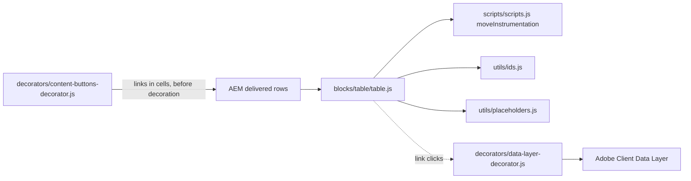
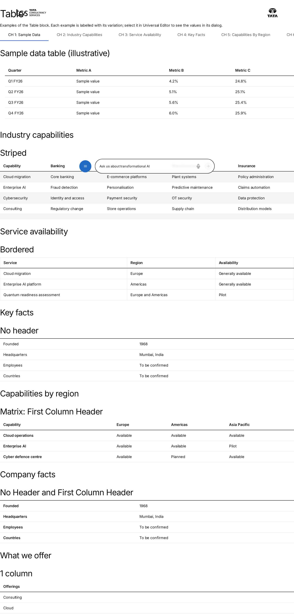
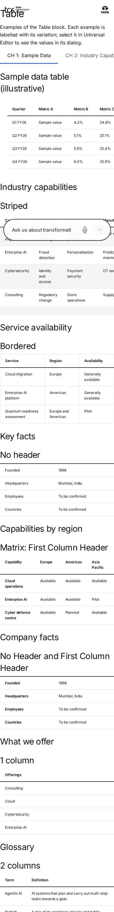

# Table Block — Developer Guide

| Attribute | Value |
| --- | --- |
| Document ID | DEV-B-table |
| Audience | Developers, technical leads, block owners, AI coding agents |
| Purpose | How the Table block is built: files, model, structure, behaviour, variations, tests and limitations |
| Scope | blocks/table/ and its components table, table-row, table-col-2, table-col-3, table-col-4, table-col-5, table-col-6, table-col-7, table-col-8, table-col-9 |
| Prerequisites | — |
| Owner | Technical Lead / Block Owner (proposed) |
| Approver | Product Owner (to be confirmed) |
| Version | 1.0 |
| Status | Draft for review |
| Last updated | 8 November 2026 |
| Last validated | 2026-11-08 (model, files, imports from the code; reference pages from the live site) |
| Source files | blocks/table/README.md, blocks/table/_table.json, blocks/table/table.css, blocks/table/table.js |
| Related documents | [Variations](./TABLE-VARIATIONS.md), [Test coverage](./TABLE-TEST-COVERAGE.md), [Authoring guide](../../../03-authoring/components/table/TABLE-AUTHORING-GUIDE.md) |
| Related AEM paths | /content/tcs-corp/design-block-master/en/block-library/table, /content/tcs-corp/design-block-master/en/block-library/table/table |

## Contents

- [Summary](#summary)
- [Overview](#overview)
- [Source files](#source-files)
- [Components, models and filters](#components-models-and-filters)
- [Fields](#fields)
- [Dependencies](#dependencies)
- [For Developers](#for-developers)
- [Extending the Block](#extending-the-block)
- [Responsive Behavior](#responsive-behavior)
- [Accessibility](#accessibility)
- [Data Layer and Analytics](#data-layer-and-analytics)
- [Performance Considerations](#performance-considerations)
- [Security and Privacy](#security-and-privacy)
- [For Architects](#for-architects)
- [Troubleshooting](#troubleshooting)
- [Known limitations of the block](#known-limitations-of-the-block)
- [Change history of the block](#change-history-of-the-block)
- [Reference pages](#reference-pages)
- [Coverage of the required topics](#coverage-of-the-required-topics)
- [Screenshots](#screenshots)
- [Known limitations](#known-limitations)
- [Open items](#open-items)
- [Change history](#change-history)

## Summary

| Attribute | Value |
| --- | --- |
| Block | Table |
| Folder | `blocks/table` |
| Type | Container |
| Category | content |
| Status | Active |
| Purpose | A data table of rows with 1–9 columns |
| Variations (summary) | Header row, column counts |
| Children | table-row, table-col-2, table-col-3, table-col-4, table-col-5, table-col-6, table-col-7, table-col-8, table-col-9 |
| Code size | 157 lines of JS and CSS |

## Overview

**Business purpose.** Publish tabular data (facts, comparisons, schedules, specifications) that is
readable on every device, understood by screen readers and indexable, without images of tables.

**User experience.** A full-width table with a semibold header row on a 2px rule, light row
separators, optional zebra stripes or cell borders; on narrow screens a wide table scrolls
sideways inside the block while the page stays put.

**Templates / page types.** Any page type.

**Data source.** The Row items authored in the block; the heading before it names the table.

**Related blocks.** Table List (`blocks/table-list`, list-style rows with actions), Columns
Container (layout, not data), List / Cards (collections of items).

**When to use.** Two-dimensional data where each value relates to a row and a column; up to nine
columns of short values (wider tables scroll inside the block on small screens).

**When not to use.** Page layout or side-by-side content (Columns Container); a single list (a
bulleted list or List / Cards); more than nine columns, merged cells (flatten them: one header row,
the value repeated in each cell it spanned), sorting, filtering or pagination (not implemented). A
table in a Text (rich text) isn't delivered as a table by AEM (its cells arrive as paragraphs): use
this block.

**Realistic use cases.**

- Quarterly results in a press release (Quarter, Revenue, Growth, Margin).
- Key facts as label / value rows (Founded, Headquarters, Employees, Countries).
- An event agenda (Time, Session, Speaker).
- Capability by region matrix with row headers.

## Source files

| File | Link |
| --- | --- |
| `README.md` | [GitHub](https://github.com/sradha-tcs/tcs-corp/blob/main/blocks/table/README.md) |
| `_table.json` | [GitHub](https://github.com/sradha-tcs/tcs-corp/blob/main/blocks/table/_table.json) |
| `table.css` | [GitHub](https://github.com/sradha-tcs/tcs-corp/blob/main/blocks/table/table.css) |
| `table.js` | [GitHub](https://github.com/sradha-tcs/tcs-corp/blob/main/blocks/table/table.js) |

## Components, models and filters

| Component | Title | Resource type | Template name | Model | Children allowed |
| --- | --- | --- | --- | --- | --- |
| `table` | Table | `core/franklin/components/block/v1/block` | Table | `table` | table-row |
| `table-row` | Row | `core/franklin/components/block/v1/block/item` | Row | `table-row` | — |
| `table-col-2` | Row | `core/franklin/components/block/v1/block/item` | Row | `table-col-2` | — |
| `table-col-3` | Row | `core/franklin/components/block/v1/block/item` | Row | `table-col-3` | — |
| `table-col-4` | Row | `core/franklin/components/block/v1/block/item` | Row | `table-col-4` | — |
| `table-col-5` | Row | `core/franklin/components/block/v1/block/item` | Row | `table-col-5` | — |
| `table-col-6` | Row | `core/franklin/components/block/v1/block/item` | Row | `table-col-6` | — |
| `table-col-7` | Row | `core/franklin/components/block/v1/block/item` | Row | `table-col-7` | — |
| `table-col-8` | Row | `core/franklin/components/block/v1/block/item` | Row | `table-col-8` | — |
| `table-col-9` | Row | `core/franklin/components/block/v1/block/item` | Row | `table-col-9` | — |

## Fields

The Additional tab fields (anchor, hide, padding, margin, animation) are common to the blocks and described in the [content modeling guide](../../markdown/CONTENT-MODELING-GUIDE.md).

### Table (`table`)

| Tab | Label | Property | Type | Required in model | Default | Options | Visibility |
| --- | --- | --- | --- | --- | --- | --- | --- |
| Content | Options | `classes` | multiselect | No | `""` | 2 options | — |
| Content | Columns | `filter` | select | No | `table` | 9 options | — |

### Row (`table-row`)

| Tab | Label | Property | Type | Required in model | Default | Options | Visibility |
| --- | --- | --- | --- | --- | --- | --- | --- |
| — | Column 1 | `column1text` | richtext | No | — | — | — |

### Row (`table-col-2`)

| Tab | Label | Property | Type | Required in model | Default | Options | Visibility |
| --- | --- | --- | --- | --- | --- | --- | --- |
| — | Column 1 | `column1text` | richtext | No | — | — | — |
| — | Column 2 | `column2text` | richtext | No | — | — | — |

### Row (`table-col-3`)

| Tab | Label | Property | Type | Required in model | Default | Options | Visibility |
| --- | --- | --- | --- | --- | --- | --- | --- |
| — | Column 1 | `column1text` | richtext | No | — | — | — |
| — | Column 2 | `column2text` | richtext | No | — | — | — |
| — | Column 3 | `column3text` | richtext | No | — | — | — |

### Row (`table-col-4`)

| Tab | Label | Property | Type | Required in model | Default | Options | Visibility |
| --- | --- | --- | --- | --- | --- | --- | --- |
| — | Column 1 | `column1text` | richtext | No | — | — | — |
| — | Column 2 | `column2text` | richtext | No | — | — | — |
| — | Column 3 | `column3text` | richtext | No | — | — | — |
| — | Column 4 | `column4text` | richtext | No | — | — | — |

### Row (`table-col-5`)

| Tab | Label | Property | Type | Required in model | Default | Options | Visibility |
| --- | --- | --- | --- | --- | --- | --- | --- |
| — | Column 1 | `column1text` | richtext | No | — | — | — |
| — | Column 2 | `column2text` | richtext | No | — | — | — |
| — | Column 3 | `column3text` | richtext | No | — | — | — |
| — | Column 4 | `column4text` | richtext | No | — | — | — |
| — | Column 5 | `column5text` | richtext | No | — | — | — |

### Row (`table-col-6`)

| Tab | Label | Property | Type | Required in model | Default | Options | Visibility |
| --- | --- | --- | --- | --- | --- | --- | --- |
| — | Column 1 | `column1text` | richtext | No | — | — | — |
| — | Column 2 | `column2text` | richtext | No | — | — | — |
| — | Column 3 | `column3text` | richtext | No | — | — | — |
| — | Column 4 | `column4text` | richtext | No | — | — | — |
| — | Column 5 | `column5text` | richtext | No | — | — | — |
| — | Column 6 | `column6text` | richtext | No | — | — | — |

### Row (`table-col-7`)

| Tab | Label | Property | Type | Required in model | Default | Options | Visibility |
| --- | --- | --- | --- | --- | --- | --- | --- |
| — | Column 1 | `column1text` | richtext | No | — | — | — |
| — | Column 2 | `column2text` | richtext | No | — | — | — |
| — | Column 3 | `column3text` | richtext | No | — | — | — |
| — | Column 4 | `column4text` | richtext | No | — | — | — |
| — | Column 5 | `column5text` | richtext | No | — | — | — |
| — | Column 6 | `column6text` | richtext | No | — | — | — |
| — | Column 7 | `column7text` | richtext | No | — | — | — |

### Row (`table-col-8`)

| Tab | Label | Property | Type | Required in model | Default | Options | Visibility |
| --- | --- | --- | --- | --- | --- | --- | --- |
| — | Column 1 | `column1text` | richtext | No | — | — | — |
| — | Column 2 | `column2text` | richtext | No | — | — | — |
| — | Column 3 | `column3text` | richtext | No | — | — | — |
| — | Column 4 | `column4text` | richtext | No | — | — | — |
| — | Column 5 | `column5text` | richtext | No | — | — | — |
| — | Column 6 | `column6text` | richtext | No | — | — | — |
| — | Column 7 | `column7text` | richtext | No | — | — | — |
| — | Column 8 | `column8text` | richtext | No | — | — | — |

### Row (`table-col-9`)

| Tab | Label | Property | Type | Required in model | Default | Options | Visibility |
| --- | --- | --- | --- | --- | --- | --- | --- |
| — | Column 1 | `column1text` | richtext | No | — | — | — |
| — | Column 2 | `column2text` | richtext | No | — | — | — |
| — | Column 3 | `column3text` | richtext | No | — | — | — |
| — | Column 4 | `column4text` | richtext | No | — | — | — |
| — | Column 5 | `column5text` | richtext | No | — | — | — |
| — | Column 6 | `column6text` | richtext | No | — | — | — |
| — | Column 7 | `column7text` | richtext | No | — | — | — |
| — | Column 8 | `column8text` | richtext | No | — | — | — |
| — | Column 9 | `column9text` | richtext | No | — | — | — |

"Required in model" is the model's `required` flag; whether a field is required in practice is stated in the authoring guide where it is known.

## Dependencies

| Import |
| --- |
| `../../scripts/scripts.js` |
| `../../utils/ids.js` |
| `../../utils/placeholders.js` |

## For Developers

<!-- BEGIN GENERATED: files (npm run build:docs) -->

```text
blocks/table/
├── README.md
├── _table.json
├── table.css
└── table.js
```

| Decorator/Utility | Purpose | Execution or dependency point |
| ----------------- | ------- | ----------------------------- |
| [`scripts/scripts.js`](https://github.com/sradha-tcs/tcs-corp/blob/main/scripts/scripts.js) | Page decoration (moveInstrumentation and shared page helpers) | `table.js`: { moveInstrumentation } |
| [`utils/ids.js`](https://github.com/sradha-tcs/tcs-corp/blob/main/utils/ids.js) | `nextInstance`, `uniqueId`, `createIdFactory` (unique ids per block instance), `availableId` (an authored id kept, suffixed -2, -3, ... only when taken) | `table.js`: { uniqueId } |
| [`utils/placeholders.js`](https://github.com/sradha-tcs/tcs-corp/blob/main/utils/placeholders.js) | `getPlaceholders`, `loadPlaceholders`, `fillPlaceholder` (UI text from the locale's placeholders, with English fallbacks) | `table.js`: { getPlaceholders } |

<!-- END GENERATED: files -->

**JavaScript (`table.js`).** `decorate` awaits the placeholders, skips the leading empty rows AEM
delivers for the dialog tabs (`isTabRow`: at most one cell, no text, no image or link), and turns
every following row into a `tr` (`moveInstrumentation(row, tr)`) and every cell into a `td` or
`th` (`moveInstrumentation(cell, td)`, content moved as authored). The first row goes to `thead`
unless `no-header`; with `row-header` the first cell of body rows is a row header. Rows are padded
to the widest row. `headingBefore` finds the naming heading; `uniqueId('table-title')` gives it an
id. The block's children are replaced with the table; a ResizeObserver toggles `tabindex`, `role`
and `aria-label` on the block. The module exports only `decorate`.

**CSS (`table.css`).** Scoped to `.table.block`; `overflow-x: auto`; header rule, body separators,
`no-header`, `striped`, `bordered`, row header styles; one media query at 900px.

**Input DOM.** Not key-value: empty rows for the Content and Additional tabs, then one row per Row
item with one cell per column field. Options and the Additional tab arrive as block classes.

**Rendered DOM contract.** `.table.block[.striped][.bordered][.no-header][.row-header]`
`[tabindex="0"][role="region"][aria-label]` > `table[aria-labelledby]` > `thead > tr > th[scope=col]`,
`tbody > tr > (th[scope=row]) td`.

**Events and async behavior.** One ResizeObserver per table (never disconnected); no network
requests besides the placeholders.

**Error handling.** No Rows: an empty `table` with an empty `tbody`. Malformed rows are padded.

**Parent / child contracts.** Row items are plain rows; Universal Editor instrumentation moves to
the `tr` / cells, so in-place editing of cells keeps working.

## Extending the Block

1. **A new option:** add a value to the `classes` multiselect in `_table.json`, style it as
   `.table.block.{value}`; `npm run build:json`, `npm run lint`.
2. **More columns:** add a `table-col-N` model and definition, a filter `table-N-columns` and a
   Columns option in `_table.json`; the code needs no change.
3. **Responsive / accessibility:** keep `th` scopes, the heading name and the scroll region.
4. **Data layer:** links in cells are tracked centrally; mark other controls with
   `data-cmp-interaction`.
5. **Tests:** no block-specific unit tests exist; a pure row-to-table function would be testable in
   `test/` with Node's test runner.
6. **Backward compatibility:** tab rows must keep being skipped (AGENTS.md delivery rules); keep the
   row padding for Rows authored with another Columns value.
7. **Library and docs:** update the block library page, this README, `npm run build:docs`;
   `npm run build:modules` after changing imports.

## Responsive Behavior

| Viewport | Layout | Image behavior | Interaction behavior |
| -------- | ------ | -------------- | -------------------- |
| Below 900px | Full width; text `--body-font-size-s` (0.75rem in `styles/styles.css` below 900px) | No images by design | A table wider than the block scrolls inside it (focusable region) |
| 900px and wider | Full width; text `--body-font-size-m` (1.125rem from 900px) | — | Scroll region only if the table still overflows |

## Accessibility

- **Semantics:** a real `table` with `thead` / `tbody`, `th scope="col"` and `th scope="row"`.
- **Headings and name:** the heading directly before the block (last element of the previous
  default content wrapper, or the previous sibling of the block's wrapper) gets an id
  (`table-title-N`) if needed, and the table `aria-labelledby` to it.
- **Keyboard and focus:** a table wider than its container becomes a focusable, named region with a
  visible focus outline, so keyboard users can scroll it with the arrow keys.
- **Reflow:** no page-level horizontal scrolling; the block scrolls.
- **Contrast:** text `--color-text-default`; on dark section backgrounds the theme tokens apply.
- **Reduced motion:** the Additional tab animation doesn't play.
- **Empty state:** an empty table (no rows) is invisible.

**Author responsibilities:** a heading before every table, a header Row (or row headers), no layout
tables, no empty header cells, units in headers.

**Developer responsibilities:** keep the `scope` attributes, the naming from the heading and the
scroll region with its label from placeholders.

| Key | Expected behavior |
| --- | ----------------- |
| Tab | Moves focus to the table's scroll region when the table overflows, then to links in cells |
| Arrow Left / Arrow Right | Scroll the focused region horizontally (browser behaviour) |

## Data Layer and Analytics

`decorators/data-layer-decorator.js` adds the block as `tcs-corp/components/table`, id = Anchor ID
else `table-{n}`; `dc:title` only if a heading is inside the block (normally not). The block adds no
`data-cmp-*` attributes and pushes nothing itself.

| Trigger | Data-layer event | Required properties | Analytics behavior |
| ------- | ---------------- | ------------------- | ------------------ |
| Block decorated | component state | `@type`, `parentId` | One entry per table |
| Click on a link in a cell | `cmp:click` | `interaction` `link`, `dc:title`, `xdm:linkURL`, `xdm:linkType` (`other`, `exit`, `download`), `breakpoint` | Link and download tracking |

The intended path is Adobe Client Data Layer, then Adobe Data Collection (Tags), the AEP Web SDK,
the Edge Network and Analytics / CJA, but Tags and the Web SDK aren't configured yet (blocked:
measurement plan); no consent mechanism is implemented.

## Performance Considerations

- Decorated with its section (eager in the first section, else lazy); no images; only placeholders
  fetched.
- Rendered once (no layout shift after decoration); the ResizeObserver only toggles attributes.
- DOM size grows with the rows; split very long tables under separate headings.

## Security and Privacy

- Cell content is moved as delivered by AEM (no HTML strings built); no external content, query
  strings or personal data.

## For Architects

- **Role:** presentational container block; no data fetching.
- **Content model:** block with Options and Columns (a filter switch) and Row items of 1 to 5
  rich-text fields.
- **Rendering:** client-side conversion of delivered rows into a semantic table.
- **Dependencies:** `scripts/scripts.js` (`moveInstrumentation`), `utils/ids.js`,
  `utils/placeholders.js`.
- **Data layer / Web SDK / Target:** generic component state and link clicks only.
- **Consent / identity / security:** no personal data, no external content.
- **Caching / performance:** part of the page HTML (CDN); tiny JS and CSS; one ResizeObserver.
- **Scalability:** DOM size grows with rows × columns; very long tables are better split.



## Troubleshooting

| Symptom | Likely cause | Diagnostic steps | Resolution | Verification |
| ------- | ------------ | ---------------- | ---------- | ------------ |
| First data row shown as header | The first Row is the header unless No Header | Check Options | Add a header Row first, or select No Header | Header as intended |
| Add offers one-column Rows | Columns is 1 Column | Check Columns | Set Columns; recreate the Rows | New Rows have N fields |
| Empty cells at row ends | Rows of different column counts | Count fields per Row | Recreate short Rows with the right Columns | All rows equal |
| Page scrolls sideways on mobile | A wide element (long URL) or large margins | Device mode; find the overflowing element | Link text instead of URLs; reset margins | Only the table scrolls |
| Screen reader says "Table" | No heading directly before the block | Check `aria-labelledby` and the preceding element | Put the heading right before the Table | Region named after the heading |
| A cell link looks like a button | Link alone in its paragraph (content buttons decorator) | Check the cell's rich text | Write the link inside a sentence | Inline link |
| The first Row disappears | It is empty and has at most one cell (read as a tab row) | Check the first Row's content | Fill or delete the empty Row | The header row shows |

Evidence to collect (no secrets): page URL, `.plain.html` of the block, a screenshot at the failing
width, the block's classes and the accessibility tree of the table.

## Known limitations of the block

| Limitation | Impact | Workaround | Planned correction |
| ---------- | ------ | ---------- | ------------------ |
| Maximum 9 columns | Wider data doesn't fit | Split the table | Not recorded |
| No merged cells, sorting, filtering, `caption`, column alignment or sticky headers | Limited table features | Simplify the data | Not recorded |
| No stacked mobile layout | Wide tables scroll | Fewer columns | Not recorded |
| Changing Columns doesn't convert existing Rows | Padded empty cells | Recreate the Rows | Not planned |
| Only the heading immediately before names the table | Unnamed table otherwise | Place the heading right before | Not recorded |
| An empty first Row with at most one cell is skipped as a tab row | The next Row becomes the header | Don't leave the first Row empty | Not recorded |

## Change history of the block

| Version | Change | Source | Date |
| ------- | ------ | ------ | ---- |
| Not recorded | README generated from verified implementation and approved handover documentation | Repository review | Not recorded |
| Handover 2.18 | Additional tab content animation (Animation Type, Motion Speed, Animation Trigger) | docs/handover revision history | 18 October 2026 |
| Handover 2.27 | Block audit: the Table header taken from the tab rows corrected (tab rows skipped); ragged rows padded (D-D-14) | docs/handover revision history; docs/audit/BLOCK-ECOSYSTEM-AUDIT.md | 19 October 2026 |
| Handover 2.29 | Re-audit: Row templates no longer store "Column1" … (R-D-9); sample content removed from templates | docs/handover revision history; docs/audit/REAUDIT-2026-10-20.md | 20 October 2026 |

## Reference pages

| Kind | Page | Live URL |
| --- | --- | --- |
| Block library | /design-block-master/en/block-library/table | https://main--tcs-corp--sradha-tcs.aem.live/design-block-master/en/block-library/table |
| Block library | /design-block-master/en/block-library/table/table | https://main--tcs-corp--sradha-tcs.aem.live/design-block-master/en/block-library/table/table |

## Coverage of the required topics

| Topic | Where |
| --- | --- |
| Purpose | Overview |
| Source files | generated: Files |
| Model, definition, filters, children | generated: Components |
| Dependencies | generated: Dependencies |
| Authored input / rendered output / DOM transformation | For Developers |
| Configuration fields, defaults, required fields | generated: Fields |
| Variations | TABLE-VARIATIONS.md |
| Responsive behaviour | Responsive Behavior |
| Accessibility and keyboard | Accessibility |
| Analytics / data layer | Data Layer and Analytics |
| Performance | Performance Considerations |
| Security | Security and Privacy |
| Extending | Extending the Block |
| Known limitations | Known Limitations |
| Troubleshooting | Troubleshooting |
| Tests | TABLE-TEST-COVERAGE.md |
| SEO behaviour | Not recorded |
| Caching considerations | Not recorded (Edge Delivery default caching; no block-specific rule) |
| Ownership | Technical Lead / Block Owner (proposed) |

## Screenshots



*Figure: Table block library page — desktop 1440 × 900 (/design-block-master/en/block-library/table/table, captured 2026-11-08).*



*Figure: Table block library page — mobile 375 × 812 (/design-block-master/en/block-library/table/table, captured 2026-11-08).*


*Figure: Desktop rendering — At 1440 px: the H2 Quarterly results above a full-width 4-column table, the header row Quarter, Revenue, Growth, Margin in semibold with a 2px dark rule below, and four body rows Q1 FY26 to Q4 FY26 separated by light 1px rules, text 1.125rem. (Sample content on the preview; callout letters as in the Field Entry Table; file screenshots/table-desktop-view.jpg) (handover screenshot; rendering at the time it was taken).*


*Figure: Tablet rendering — At 768 px: the H2 Quarterly results and the same 4-column table (Quarter, Revenue, Growth, Margin; Q1 FY26 to Q4 FY26) still fitting the content width, with the smaller 0.75rem text used below 900 px. (Sample content on the preview; callout letters as in the Field Entry Table; file screenshots/table-tablet-view.jpg) (handover screenshot; rendering at the time it was taken).*


*Figure: Mobile rendering — At 390 px: the H2 Industry capabilities and a 5-column table wider than the screen, showing its first columns with the rest reachable by horizontal scrolling, and a 2px brand-blue focus outline around the block after pressing Tab. (Sample content on the preview; callout letters as in the Field Entry Table; file screenshots/table-mobile-view.jpg) (handover screenshot; rendering at the time it was taken).*


*Figure: Variation example — At 1440 px: the H2 Service availability above a 3-column table with the semibold header row Service, Region, Availability on a 2px dark rule and three body rows (Cloud migration, Enterprise AI platform, Quantum readiness assessment) with light separators. (Sample content on the preview; callout letters as in the Field Entry Table; file screenshots/table-standard.jpg) (handover screenshot; rendering at the time it was taken).*


*Figure: Variation example — At 1440 px: the H2 Key facts above a 2-column table without a header row: four rows Founded 1968, Headquarters Mumbai, India, Employees More than 600,000 and Countries 55, all in regular weight, with a 2px dark rule above the first row. (Sample content on the preview; callout letters as in the Field Entry Table; file screenshots/table-no-header.jpg) (handover screenshot; rendering at the time it was taken).*


*Figure: Variation example — At 1440 px: the H2 Capabilities by region above a 4-column matrix: the header row Capability, Europe, Americas, Asia Pacific and, in each body row, the first cell (Cloud operations, Enterprise AI, Cyber defence centre) in semibold as the row title, values Available, Pilot or Planned. (Sample content on the preview; callout letters as in the Field Entry Table; file screenshots/table-first-column-header.jpg) (handover screenshot; rendering at the time it was taken).*


*Figure: Variation example — At 1440 px: the H2 Company facts above a 2-column table without a header row and with a 2px dark rule above the first row; the labels Founded, Headquarters, Employees and Countries in semibold, the values 1968, Mumbai, India, More than 600,000 and 55 in regular weight. (Sample content on the preview; callout letters as in the Field Entry Table; file screenshots/table-row-headers-only.jpg) (handover screenshot; rendering at the time it was taken).*


*Figure: Variation example — At 1440 px: the H2 Our offices above a 3-column table with the header row Office, Region, Focus and eight body rows from Amsterdam to Toronto; the 1st, 3rd, 5th and 7th body rows (Amsterdam, Frankfurt, Madrid, Paris) on a light grey background. (Sample content on the preview; callout letters as in the Field Entry Table; file screenshots/table-striped.jpg) (handover screenshot; rendering at the time it was taken).*


*Figure: Variation example — At 1440 px: the H2 Revenue share by region above a 5-column numeric table, the header row Region, FY22, FY23, FY24, FY25 and four rows (Europe, North America, Asia Pacific, Rest of world) with percentages, a 1px light grey border around every cell. (Sample content on the preview; callout letters as in the Field Entry Table; file screenshots/table-bordered.jpg) (handover screenshot; rendering at the time it was taken).*


*Figure: Variation example — At 1440 px: the H2 What we offer above a one-column table with the semibold header cell Offerings and four rows Consulting, Cloud, Cybersecurity and Enterprise AI separated by light rules. (Sample content on the preview; callout letters as in the Field Entry Table; file screenshots/table-1-column.jpg) (handover screenshot; rendering at the time it was taken).*


*Figure: Variation example — At 1440 px: the H2 Glossary above a 2-column table with the header row Term, Definition and three rows defining Agentic AI, Hybrid cloud and Zero trust in full sentences. (Sample content on the preview; callout letters as in the Field Entry Table; file screenshots/table-2-columns.jpg) (handover screenshot; rendering at the time it was taken).*


*Figure: Variation example — At 1440 px: the H2 Agenda above a 3-column table with the header row Time, Session, Speaker and three rows: 09:00 Welcome and keynote with Anita Rao, 10:00 Modernising the core on hybrid cloud with Marcus Khan, 11:15 Panel: security by design with Sara Lee. (Sample content on the preview; callout letters as in the Field Entry Table; file screenshots/table-3-columns.jpg) (handover screenshot; rendering at the time it was taken).*


*Figure: Variation example — At 1440 px: the H2 Quarterly results above a 4-column table, the header row Quarter, Revenue, Growth, Margin in semibold and four body rows Q1 FY26 to Q4 FY26 with revenue, growth and margin figures. (Sample content on the preview; callout letters as in the Field Entry Table; file screenshots/table-4-columns.jpg) (handover screenshot; rendering at the time it was taken).*


*Figure: Variation example — At 1440 px: the H2 Industry capabilities above a 5-column table, the header row Capability, Banking, Retail, Manufacturing, Insurance and four rows (Cloud migration, Enterprise AI, Cybersecurity, Consulting), fitting the desktop width without scrolling. (Sample content on the preview; callout letters as in the Field Entry Table; file screenshots/table-5-columns.jpg) (handover screenshot; rendering at the time it was taken).*


*Figure: Variation example — At 390 px: the H2 Industry capabilities and the 5-column table scrolled sideways inside the block to its middle columns, with the 2px brand-blue focus outline around the block after pressing Tab; the page itself does not scroll. (Sample content on the preview; callout letters as in the Field Entry Table; file screenshots/table-scroll-region.jpg) (handover screenshot; rendering at the time it was taken).*


*Figure: Universal Editor canvas — Universal Editor edit mode at 1440 px: the H2 Client offices (A) above a 3-column Table (B) with the header row Office, Region, Focus (C) and four body rows Amsterdam to London, the second row hovered; D marks a cell, E a body Row. F, the Add (+) of the Table in the content tree, is not on the canvas. (Annotated preview in editor mode with sample content; letters as in the annotations list, not a Universal Editor screenshot; file screenshots/table-authoring-view.jpg) (handover screenshot; rendering at the time it was taken).*


*Figure: Properties panel — The properties panel of the selected Table showing the Content tab (Options multiselect with Border and Header groups, Columns select) and the Additional tab. (Dialog reference generated from the component model, not a Universal Editor screenshot; file screenshots/table-properties-panel.jpg) (handover screenshot; rendering at the time it was taken).*

## Known limitations

- Universal Editor dialogs were not captured: no author access in this program (see the access blockers).

## Open items

- None.

## Change history

| Version | Date | Author | Change |
| --- | --- | --- | --- |
| 1.0 | 8 November 2026 | Delivery team (documentation program) | First version of the role-specific documentation (master documentation prompt), generated from the repository and the published reference pages |
