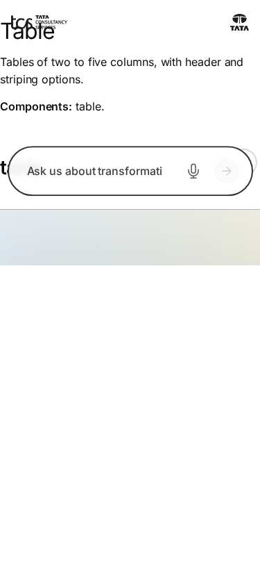
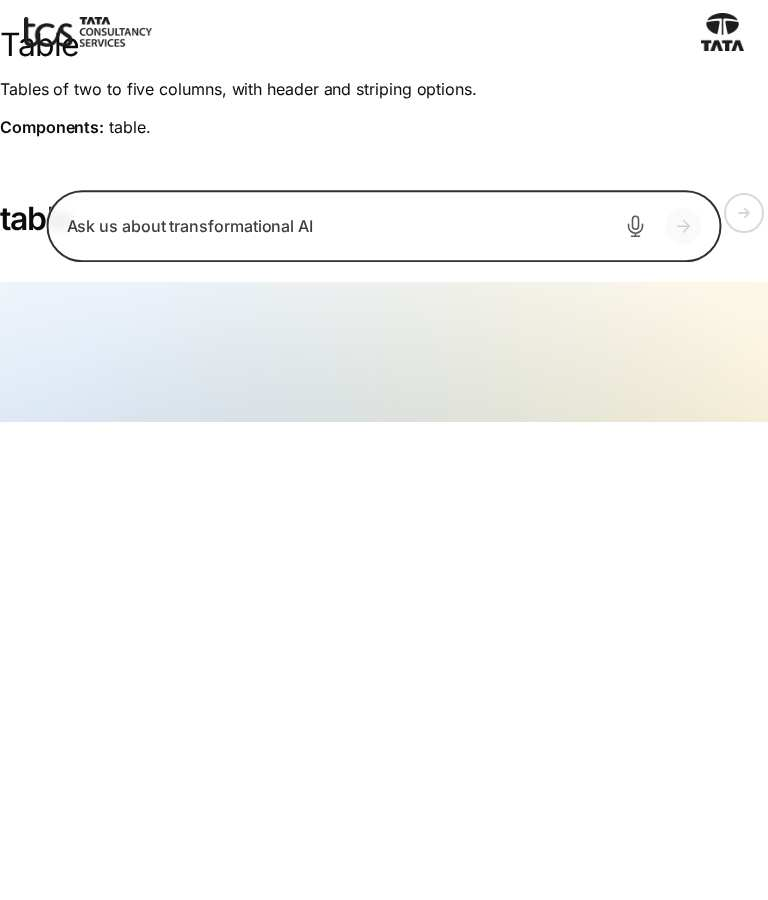
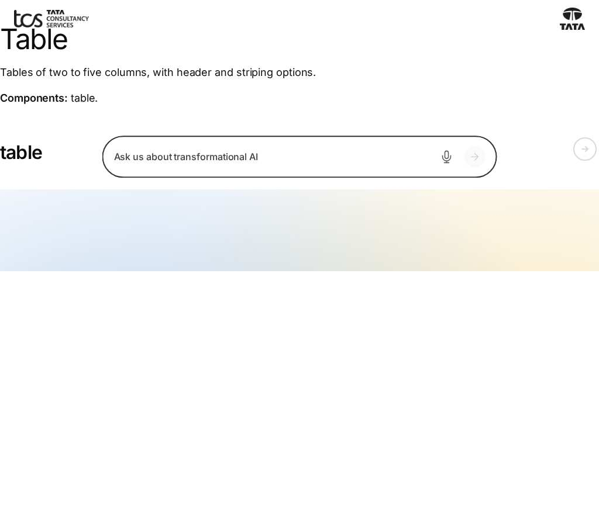
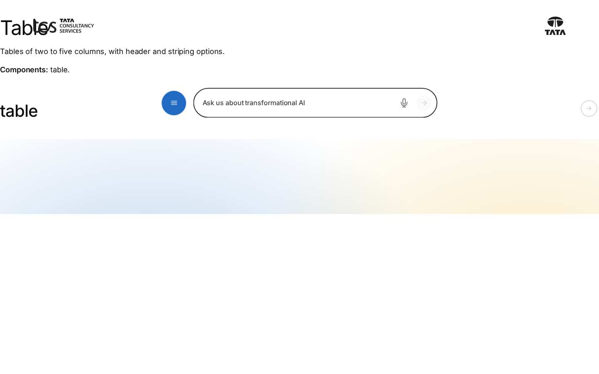
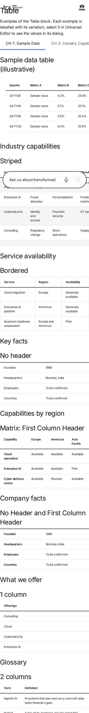
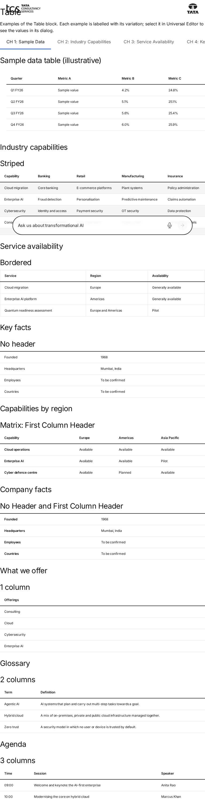
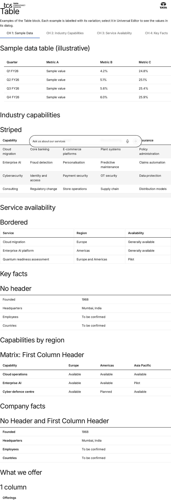
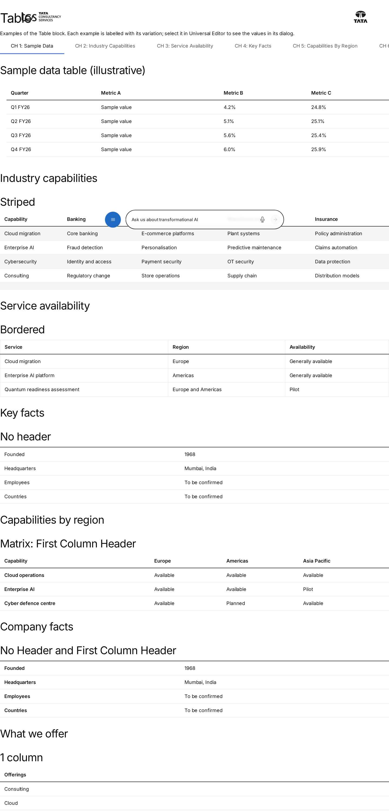

# Table Block — Test Coverage

| Attribute | Value |
| --- | --- |
| Document ID | DEV-T-table |
| Audience | Developers, technical leads, block owners, AI coding agents |
| Purpose | Unit tests, automated reference-page checks and manual test guidance for the block |
| Scope | — |
| Prerequisites | — |
| Owner | Technical Lead / Block Owner (proposed) |
| Approver | Product Owner (to be confirmed) |
| Version | 1.0 |
| Status | Draft for review |
| Last updated | 8 November 2026 |
| Last validated | 8 November 2026 |
| Source files | — |
| Related documents | — |
| Related AEM paths | — |

## Contents

- [Unit tests](#unit-tests)
- [Automated checks of the block library pages (executed 8 November 2026)](#automated-checks-of-the-block-library-pages-executed-8-november-2026)
- [Manual test guidance (block README)](#manual-test-guidance-block-readme)
- [Screenshots](#screenshots)
- [Known limitations](#known-limitations)
- [Open items](#open-items)
- [Change history](#change-history)

## Unit tests

No unit test is specific to this block (shared tests: test/models, test/items, test/docs, test/motion).

## Automated checks of the block library pages (executed 8 November 2026)

Per page: HTTP status and horizontal overflow at 375 / 768 / 1024 / 1440 px, console errors, failed requests and DOM accessibility checks at 1440 px (evidence: [screenshot register](../../../SCREENSHOT-REGISTER.md)).

| Page | 375 / 768 / 1024 / 1440 | Console errors | Failed requests | Accessibility (DOM) |
| --- | --- | --- | --- | --- |
| /design-block-master/en/block-library/table | ok / ok / ok / ok | 8 | 8 | 0 img no alt, 0 unnamed buttons, 1 heading skips |
| /design-block-master/en/block-library/table/table | overflow / overflow / overflow / overflow | 4 | 4 | 0 img no alt, 0 unnamed buttons, 0 heading skips |

## Manual test guidance (block README)

| Test ID | Scenario | Configuration | Expected result |
| ------- | -------- | ------------- | --------------- |
| TABLE-QA-01 | Standard | 4 Columns, header Row + 4 Rows | `thead` with `th scope="col"`; 4 body rows |
| TABLE-QA-02 | No Header | No Header | No `thead`; 2px rule above row 1 |
| TABLE-QA-03 | First Column Header | First Column Header | First body cells `th scope="row"` |
| TABLE-QA-04 | Row headers only | No Header + First Column Header | Label / value table |
| TABLE-QA-05 | Striped / Bordered | Each and both | Odd body rows grey / cell borders |
| TABLE-QA-06 | Column counts | 1 to 9 Columns | Add offers the matching Row |
| TABLE-QA-07 | Mixed Rows | Columns changed after Rows | Shorter rows padded with empty cells |
| TABLE-QA-08 | Tab rows | Table authored in AEM | No empty first row; header is the first Row |
| TABLE-QA-09 | Name | Heading right before / not before | `aria-labelledby` present / absent; region "Table" |
| TABLE-QA-10 | Scroll region | 5 Columns at 390 px | Block focusable, named, scrolls; page doesn't |
| TABLE-QA-11 | Resize | Widen the window to 1440 px | Region attributes removed when it fits |
| TABLE-QA-12 | Empty | No Rows | Nothing visible |
| TABLE-QA-13 | Links in cells | Link alone / in a sentence | Link button / inline link; `cmp:click` |
| TABLE-QA-14 | Multiple instances | Two tables | `table-1`, `table-2`; distinct `table-title-N` ids |
| TABLE-QA-15 | Editor | Edit a cell in Universal Editor | Edits in place; the block re-renders |

Test cases: [05-quality-assurance/test-cases/blocks/table](../../../05-quality-assurance/test-cases/blocks/table/TABLE-TEST-CASES.md).

## Screenshots

*Figure: Table: table — mobile 375 × 812 (/design-block-master/en/block-library/table, captured 2026-11-08).*

*Figure: Table: table — tablet 768 × 900 (/design-block-master/en/block-library/table, captured 2026-11-08).*

*Figure: Table: table — small desktop 1024 × 900 (/design-block-master/en/block-library/table, captured 2026-11-08).*

*Figure: Table: table — desktop 1440 × 900 (/design-block-master/en/block-library/table, captured 2026-11-08).*

*Figure: Table: table/table — mobile 375 × 812 (/design-block-master/en/block-library/table/table, captured 2026-11-08).*

*Figure: Table: table/table — tablet 768 × 900 (/design-block-master/en/block-library/table/table, captured 2026-11-08).*

*Figure: Table: table/table — small desktop 1024 × 900 (/design-block-master/en/block-library/table/table, captured 2026-11-08).*

*Figure: Table: table/table — desktop 1440 × 900 (/design-block-master/en/block-library/table/table, captured 2026-11-08).*

## Known limitations

- None recorded for this document.

## Open items

- None.

## Change history

| Version | Date | Author | Change |
| --- | --- | --- | --- |
| 1.0 | 8 November 2026 | Delivery team (documentation program) | First version of the role-specific documentation (master documentation prompt), generated from the repository and the published reference pages |
