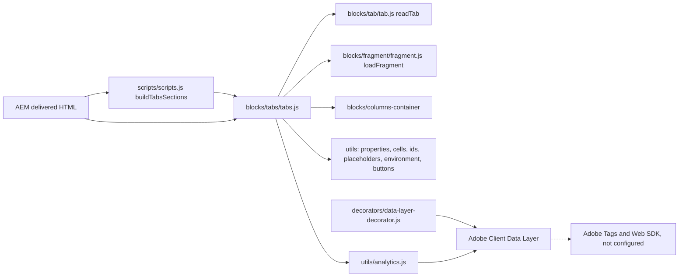
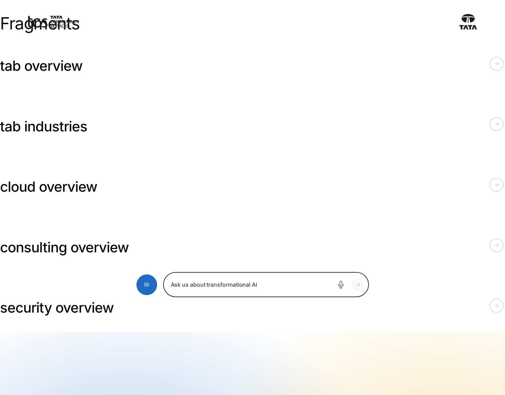
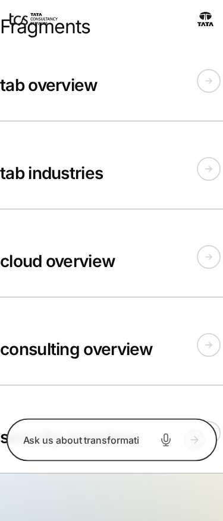

# Tabs Block — Developer Guide

| Attribute | Value |
| --- | --- |
| Document ID | DEV-B-tabs |
| Audience | Developers, technical leads, block owners, AI coding agents |
| Purpose | How the Tabs block is built: files, model, structure, behaviour, variations, tests and limitations |
| Scope | blocks/tabs/ and its components tabs, tabs-block, tabs-item |
| Prerequisites | — |
| Owner | Technical Lead / Block Owner (proposed) |
| Approver | Product Owner (to be confirmed) |
| Version | 1.0 |
| Status | Draft for review |
| Last updated | 8 November 2026 |
| Last validated | 2026-11-08 (model, files, imports from the code; reference pages from the live site) |
| Source files | blocks/tabs/README.md, blocks/tabs/_tabs.json, blocks/tabs/tabs.css, blocks/tabs/tabs.js |
| Related documents | [Variations](./TABS-VARIATIONS.md), [Test coverage](./TABS-TEST-COVERAGE.md), [Authoring guide](../../../03-authoring/components/tabs/TABS-AUTHORING-GUIDE.md) |
| Related AEM paths | /content/tcs-corp/design-block-master/en/block-library/tabs, /content/tcs-corp/design-block-master/en/block-library/tabs/fragments, /content/tcs-corp/design-block-master/en/block-library/tabs/fragments/cloud-overview |

## Contents

- [Summary](#summary)
- [Overview](#overview)
- [Source files](#source-files)
- [Components, models and filters](#components-models-and-filters)
- [Fields](#fields)
- [Dependencies](#dependencies)
- [For Developers](#for-developers)
- [Extending the Block](#extending-the-block)
- [Responsive Behavior](#responsive-behavior)
- [Accessibility](#accessibility)
- [Data Layer and Analytics](#data-layer-and-analytics)
- [Performance Considerations](#performance-considerations)
- [Security and Privacy](#security-and-privacy)
- [For Architects](#for-architects)
- [Troubleshooting](#troubleshooting)
- [Known limitations of the block](#known-limitations-of-the-block)
- [Change history of the block](#change-history-of-the-block)
- [Reference pages](#reference-pages)
- [Coverage of the required topics](#coverage-of-the-required-topics)
- [Screenshots](#screenshots)
- [Known limitations](#known-limitations)
- [Open items](#open-items)
- [Change history](#change-history)

## Summary

| Attribute | Value |
| --- | --- |
| Block | Tabs |
| Folder | `blocks/tabs` |
| Type | Container (section) and block |
| Category | container |
| Status | Active |
| Purpose | Tabs Container section (Tab items and content) and the Tabs block (tabs of fragments) |
| Variations (summary) | Styles, alignment, orientation |
| Children | tab (Tab), column-break (Column Break), tabs-item (Tab, Tabs block) |
| Code size | 586 lines of JS and CSS |

## Overview

**Business purpose.** Related views of one topic (service lines, industries, regions, reporting periods) share one area of the page: visitors switch between them without scrolling past the others, and every view stays one selection or one `#id` link away.

**User experience.** A row of tab buttons (or, from 900px, a column on the left with Orientation Vertical) above the panel of the selected tab. Clicking a tab or using the arrow keys shows its panel; links to a tab's ID (or to anything inside a tab) open that tab and scroll to it.

**The two forms.**

| Form | Component | Where the content comes from | Use it when |
|---|---|---|---|
| Tabs Container | `tabs` (a section) | The components after each [Tab](https://github.com/sradha-tcs/tcs-corp/blob/main/blocks/tab/README.md) item, up to the next Tab, authored on the page | Each tab has its own content on this page (text, images, buttons, blocks, columns) |
| Tabs block | `tabs-block` (a block) | The Fragment page chosen on each Tab item (`tabs-item`) | The same tab content is reused on several pages and maintained once |

**Templates / page types.** Any page; no template adds Tabs. **Data source:** authored content only (Tabs Container) or fragment pages (Tabs block); placeholders for UI text. No query index, sheet or taxonomy.

**Related blocks.** [Tab](https://github.com/sradha-tcs/tcs-corp/blob/main/blocks/tab/README.md) (the tab marker of a Tabs Container), [Column Break](https://github.com/sradha-tcs/tcs-corp/blob/main/blocks/column-break/README.md) (columns inside a tab), [Columns Container](https://github.com/sradha-tcs/tcs-corp/blob/main/blocks/columns-container/README.md) (the layout built in a tab with Column Breaks), the Fragment block (`blocks/fragment/fragment.js`, which loads the Tabs block's fragment pages), Accordion (collapsible alternative), Anchor List (its links open tabs through the `tabs:reveal` event).

**When to use.** Two or more parallel, mutually exclusive views with short labels, where visitors usually need one view at a time.

**When not to use.** Content that must be compared side by side or read in sequence (use default content or a [Columns Container](https://github.com/sradha-tcs/tcs-corp/blob/main/blocks/columns-container/README.md)); many short question / answer items (use the Accordion); a single tab (use a normal section); navigation between pages (use the header or an Anchor List); content that must be visible without interaction (legal notices, the page's main call to action).

**Realistic use cases.** A services overview with the tabs Consulting, Cloud and Cybersecurity, each a heading, a text and a two-column image and text layout (Tabs Container); an industries panel reused on several landing pages (Tabs block with fragment pages under the locale's `references/` or a fragments folder); investor information by period.

## Source files

| File | Link |
| --- | --- |
| `README.md` | [GitHub](https://github.com/sradha-tcs/tcs-corp/blob/main/blocks/tabs/README.md) |
| `_tabs.json` | [GitHub](https://github.com/sradha-tcs/tcs-corp/blob/main/blocks/tabs/_tabs.json) |
| `tabs.css` | [GitHub](https://github.com/sradha-tcs/tcs-corp/blob/main/blocks/tabs/tabs.css) |
| `tabs.js` | [GitHub](https://github.com/sradha-tcs/tcs-corp/blob/main/blocks/tabs/tabs.js) |

## Components, models and filters

| Component | Title | Resource type | Template name | Model | Children allowed |
| --- | --- | --- | --- | --- | --- |
| `tabs` | Tabs Container | `core/franklin/components/section/v1/section` | Tabs | `tabs` | tab, column-break, text, image, button-block, title, hero, teaser, image-collage, quote, media-contacts, testimonial, anchor-list, accordion, table, table-list, list, separator, embed, video, modal, form-variations, filter-list, cards, fragment, tabs-block |
| `tabs-block` | Tabs | `core/franklin/components/block/v1/block` | Tabs | `tabs-block` | tabs-item |
| `tabs-item` | Tab | `core/franklin/components/block/v1/block/item` | Tab | `tabs-item` | — |

## Fields

The Additional tab fields (anchor, hide, padding, margin, animation) are common to the blocks and described in the [content modeling guide](../../markdown/CONTENT-MODELING-GUIDE.md).

### Tabs Container (`tabs`)

| Tab | Label | Property | Type | Required in model | Default | Options | Visibility |
| --- | --- | --- | --- | --- | --- | --- | --- |
| Content | Component | `style` | select | No | `tabs-section` | 1 options | — |
| Content | Anchor name | `anchorName` | text | No | — | — | — |
| Content | Width Type | `sectionWidth` | select | No | `full-width` | 2 options | — |
| Content | Label | `tabsAriaLabel` | text | No | — | — | — |
| Styles | Style | `tabsStyle` | select | No | `underline` | 3 options | — |
| Styles | Alignment | `tabsAlignment` | select | No | `left` | 3 options | — |
| Styles | Orientation | `tabsOrientation` | select | No | `horizontal` | 2 options | — |
| Additional | Anchor ID | `containerAnchor` | text | No | — | — | — |
| Additional | Hide block | `containerHide` | boolean | No | `false` | — | — |
| Additional | Animation Type | `containerAnimation` | select | No | `""` | 11 options | — |
| Additional | Motion Speed | `containerAnimationSpeed` | select | No | `""` | 3 options | Conditional |
| Additional | Animation Trigger | `containerAnimationTrigger` | select | No | `""` | 2 options | Conditional |
| Additional | Padding left | `containerPaddingLeft` | select | No | `""` | 15 options | — |
| Additional | Padding right | `containerPaddingRight` | select | No | `""` | 15 options | — |
| Additional | Padding top | `containerPaddingTop` | select | No | `""` | 15 options | — |
| Additional | Padding bottom | `containerPaddingBottom` | select | No | `""` | 15 options | — |
| Additional | Margin left | `containerMarginLeft` | select | No | `""` | 15 options | — |
| Additional | Margin right | `containerMarginRight` | select | No | `""` | 15 options | — |
| Additional | Margin top | `containerMarginTop` | select | No | `""` | 15 options | — |
| Additional | Margin bottom | `containerMarginBottom` | select | No | `""` | 15 options | — |

### Tabs (`tabs-block`)

| Tab | Label | Property | Type | Required in model | Default | Options | Visibility |
| --- | --- | --- | --- | --- | --- | --- | --- |
| Content | Tab ID prefix | `tabsId` | text | No | — | — | — |
| Content | Label | `tabsAriaLabel` | text | No | — | — | — |
| Styles | Style | `tabsStyle` | select | No | `underline` | 3 options | — |
| Styles | Alignment | `tabsAlignment` | select | No | `left` | 3 options | — |
| Styles | Orientation | `tabsOrientation` | select | No | `horizontal` | 2 options | — |

### Tab (`tabs-item`)

| Tab | Label | Property | Type | Required in model | Default | Options | Visibility |
| --- | --- | --- | --- | --- | --- | --- | --- |
| Tab | Title | `title` | text | Yes | — | — | — |
| Tab | ID | `tabId` | text | No | — | — | — |
| Tab | Active tab | `activeTab` | boolean | No | — | — | — |
| Fragment | Fragment | `fragment` | aem-content | No | — | — | — |

"Required in model" is the model's `required` flag; whether a field is required in practice is stated in the authoring guide where it is known.

## Dependencies

| Import |
| --- |
| `../../decorators/data-layer-decorator.js` |
| `../../utils/analytics.js` |
| `../../scripts/aem.js` |
| `../../scripts/scripts.js` |
| `../../utils/buttons.js` |
| `../../utils/cells.js` |
| `../../utils/environment.js` |
| `../../utils/ids.js` |
| `../../utils/placeholders.js` |
| `../../utils/properties.js` |
| `../fragment/fragment.js` |
| `../tab/tab.js` |

## For Developers

<!-- BEGIN GENERATED: files (npm run build:docs) -->

```text
blocks/tabs/
├── README.md
├── _tabs.json
├── tabs.css
└── tabs.js
```

| Decorator/Utility | Purpose | Execution or dependency point |
| ----------------- | ------- | ----------------------------- |
| [`decorators/data-layer-decorator.js`](https://github.com/sradha-tcs/tcs-corp/blob/main/decorators/data-layer-decorator.js) | `trackPage`, `trackBlocks`, `trackInteractions`, `componentIdOf` (Adobe Client Data Layer for every block, Core Components schema, read by Adobe Tags / Web SDK; see "Data layer" below) | `tabs.js`: { componentIdOf } |
| [`utils/analytics.js`](https://github.com/sradha-tcs/tcs-corp/blob/main/utils/analytics.js) | `pushToDataLayer`, `pushComponents`, `pushComponentEvent` (Adobe Client Data Layer, Core Components schema; never throws) | `tabs.js`: { pushComponentEvent, pushComponents } |
| [`scripts/aem.js`](https://github.com/sradha-tcs/tcs-corp/blob/main/scripts/aem.js) | Edge Delivery core library (block loading, CSS, metadata, optimized pictures) | `tabs.js`: { decorateBlock, loadBlock, toClassName } |
| [`scripts/scripts.js`](https://github.com/sradha-tcs/tcs-corp/blob/main/scripts/scripts.js) | Page decoration (moveInstrumentation and shared page helpers) | `tabs.js`: { moveInstrumentation } |
| [`utils/buttons.js`](https://github.com/sradha-tcs/tcs-corp/blob/main/utils/buttons.js) | `BUTTON_VIEWS`, `BUTTON_TYPES`, `BUTTON_ALIGNMENTS`, `pick`, `readButtonOptions` | `tabs.js`: { pick } |
| [`utils/cells.js`](https://github.com/sradha-tcs/tcs-corp/blob/main/utils/cells.js) | `itemRows`, `KEY_VALUE_ITEM`, `FIELD_ROW_ITEM` (the item rows of a block: by model in the editor, by their cells on the page), `withoutTabCells` (drops the empty cell AEM renders for each dialog tab of an item model), `m | `tabs.js`: { withoutTabCells } |
| [`utils/environment.js`](https://github.com/sradha-tcs/tcs-corp/blob/main/utils/environment.js) | `prefersReducedMotion`, `scrollBehavior`, `isEditing`, `isInEditor`, `isAuthor` (the page is rendered by AEM author, which has no query index) | `tabs.js`: { isEditing } |
| [`utils/ids.js`](https://github.com/sradha-tcs/tcs-corp/blob/main/utils/ids.js) | `nextInstance`, `uniqueId`, `createIdFactory` (unique ids per block instance), `availableId` (an authored id kept, suffixed -2, -3, ... only when taken) | `tabs.js`: { availableId, uniqueId } |
| [`utils/placeholders.js`](https://github.com/sradha-tcs/tcs-corp/blob/main/utils/placeholders.js) | `getPlaceholders`, `loadPlaceholders`, `fillPlaceholder` (UI text from the locale's placeholders, with English fallbacks) | `tabs.js`: { getPlaceholders } |
| [`utils/properties.js`](https://github.com/sradha-tcs/tcs-corp/blob/main/utils/properties.js) | `readProperties`, `textOf`, `isOn`, `isOnByDefault` (a toggle that defaults to on), `optionOf`, `normalizeKey`, `textSource` (key-value block properties) | `tabs.js`: { isOn, normalizeKey, textOf } |
| [`blocks/fragment/fragment.js`](https://github.com/sradha-tcs/tcs-corp/blob/main/blocks/fragment/fragment.js) | — | `tabs.js`: { loadFragment } |
| [`blocks/tab/tab.js`](https://github.com/sradha-tcs/tcs-corp/blob/main/blocks/tab/tab.js) | — | `tabs.js`: { readTab } |

<!-- END GENERATED: files -->

**Responsibilities.** `tabs.js` builds the tab list and panels for both forms, the keyboard, deep links, editor integration and data layer; `tabs.css` styles the list, the three styles, alignment, vertical orientation and panels (child selectors only, so nested Tabs keep their own style), hides the Tab wrappers outside edit mode and styles the empty hint. `scripts/scripts.js` `buildTabsSections` creates the synthetic block of a Tabs Container.

**Input DOM.**

- Tabs Container: a section with the class `tabs-section` and the data attributes `data-tabsstyle`, `data-tabsalignment`, `data-tabsorientation`, `data-tabsarialabel` and `data-container*`. `buildTabsSections` creates `div.tabs[data-source="section"]`, adds the style values as classes and the Label as `data-label`, applies `applySectionBlockOptions` (container fields to classes) and `wrapSectionContent` (the section's wrappers move into the block; blocks among them are decorated).
- Tabs block: a key-value block: two-cell rows whose normalized key is `tabsid`, `tabsarialabel`, `tabsstyle`, `tabsalignment` or `tabsorientation` are properties; every other row is a Tab item, `ITEM_LAYOUT = [null, 'title', 'tabId', 'activeTab', null, 'fragment']` (an empty cell per dialog tab, dropped by `withoutTabCells`); the Fragment is a link or text in the last cell.

**Rendered DOM.**

```html
<div class="tabs block underline left horizontal" data-source="section" data-cmp-id="…">
  <div class="tabs-list" role="tablist" aria-label="Our services">
    <button type="button" class="tabs-tab" id="consulting-tab" role="tab" aria-controls="consulting" aria-selected="true" tabindex="0">Consulting</button>
  </div>
  <div class="tabs-panel" id="consulting" data-tab-id="consulting" data-cmp-id="consulting" role="tabpanel" tabindex="0" aria-labelledby="consulting-tab">
    <!-- Tabs Container: the authored wrappers (the Tab wrapper first); Tabs block: div.tabs-fragment -->
  </div>
</div>
```

**Decoration flow.**

1. Load placeholders. Container: `groupContainerTabs` (a wrapper with `:scope > .tab` starts a group; `readTab` reads Title, ID, Active tab; a Tab with `hideblock` drops its group outside edit mode; its `per-row-N` class is kept), then `columnsOf` per group. Block: `readBlockProperties` (classes, `data-label`), then `readItem` per item (fragments loaded in parallel with `loadFragment(path, row)`).
2. No group: the block is emptied; in edit mode a `p.tabs-empty` hint.
3. Panel ids are reserved first (`availableId`, plus a local set) as the Tab's ID or `{base}-item-{n}` (base: section id / Tab ID prefix, else `uniqueId('tabs')`); button ids `{panel}-tab`.
4. Panels pushed to the data layer; `select()` shows the first tab without notifying: the tab shown before an editor re-render (`shownTabs`, keyed by the `data-aue-resource`), else the tab holding the `#hash` target, else the first Active tab, else the first.
5. One `hashchange` listener per page (`listenToHash`); a page opened with a hash in a tab scrolls to it after `load`.

**Events.** Listened on the block: `click` (tab buttons), `keydown` (tab list), `aue:ui-select` (editor selection inside a panel selects it), `tabs:reveal` (bubbling, dispatched by deep links and the Anchor List: the panel containing the target opens), `tabs:tab-update` (dispatched by a re-rendered [Tab](https://github.com/sradha-tcs/tcs-corp/blob/main/blocks/tab/README.md): updates the button label). Dispatched: `tabs:change` and `tabs:reveal`.

**Error handling.** A fragment that isn't a site path, fails to load, is the page itself or is already in the chain of including fragments gives an empty panel. Unknown Style / Alignment / Orientation values are ignored (Tabs block).

**Exports.** `default decorate(block)` only. It imports `readTab` from `blocks/tab/tab.js` and `loadFragment` from `blocks/fragment/fragment.js`.

**Parent / child contracts.** The Tab marker caches its fields on `data-tab-title`, `data-tab-id`, `data-tab-active` so `readTab` can be called before and after its own decoration. The columns built in a panel are a `columns-container` block (see [Columns Container](https://github.com/sradha-tcs/tcs-corp/blob/main/blocks/columns-container/README.md)); Column Breaks keep their own decoration.

**Data-layer hooks.** `pushComponents`, `pushComponentEvent('cmp:show', …)`, `componentIdOf(block)`, `data-cmp-id` on panels and columns.

## Extending the Block

1. **A new Style, Alignment or Orientation value:** add the option in `_tabs.json` (models `tabs` and `tabs-block`), add it to `STYLES` / `ALIGNMENTS` / `ORIENTATIONS` in `tabs.js` (the Tabs block only accepts listed values), add the CSS with child selectors (`.tabs.newstyle > .tabs-list > .tabs-tab`), check focus and selected states and contrast.
2. **A new dialog field:** add it to the model in `_tabs.json`, run `npm run build:json` and `npm run lint`. For the Tabs block, add its normalized key to `BLOCK_FIELDS`; for the Tabs Container, read it from `section.dataset` in `buildTabsSections`. For a Tab item field, update `ITEM_LAYOUT` (an empty cell per dialog tab) and keep the Fragment last.
3. **Delivery rules:** don't end field names in Text, Title, Type, Alt or MimeType (they collapse); remember that the Tabs Container is a section (its `classes_*` fields aren't delivered: use `container*` names); no sample values in definition templates.
4. **Data layer:** keep `pushComponents` for panels and `cmp:show` on change; describe clicks with `data-cmp-*` attributes rather than pushing them.
5. **Tests:** no unit test covers the Tabs decoration; the model rules are checked by `test/motion/motion.test.mjs` (container fields) and `test/models/block-names.test.mjs` (template names). Check the block library pages listed below and nested Tabs, deep links and the editor.
6. **Backward compatibility:** keep reading Tab items with more cells (Fragment last) and Tabs Containers with built-in Columns.
7. Update this README and run `npm run build:docs`; run `npm run build:modules` after changing imports.

## Responsive Behavior

| Viewport | Layout | Image behavior | Interaction behavior |
|---|---|---|---|
| Below 900px | Tab list above the panels (also with Orientation Vertical); horizontal scrolling (scrollbar hidden) when the tabs don't fit; tab padding `--space-300` / `--space-600` | Images limited to the panel width | Tap or keys; scroll the tab list sideways |
| 900px and wider | Larger tab padding (`--space-1000`, pills `--space-800`); Orientation Vertical: grid with the tab list on the left (`minmax(12.5rem, 1fr)`) and the panel on the right (`3fr`), labels wrap | As above | Click or keys |

Columns built from Column Breaks in a tab stack below 900px and sit side by side from 900px (the Columns Container default).

## Accessibility

- **Semantics:** WAI-ARIA tabs pattern: `role="tablist"` (named by the Label or "Tabs"), `role="tab"` `<button>`s with `aria-selected` and `aria-controls`, `role="tabpanel"` panels with `aria-labelledby` and `hidden` when not shown.
- **Keyboard:** roving tabindex (only the selected tab is in the tab order); automatic activation (moving with the keys selects the tab); the panel is focusable (`tabIndex = 0`) so keyboard users reach its start.
- **Focus:** a visible brand outline on tab buttons (`:focus-visible`, inset) and on panels (0.25rem offset).
- **Headings:** the tab list adds no heading; authors start each panel with one.
- **Moving content:** when a panel is hidden its videos are paused and YouTube / Vimeo iframes get a pause command (WCAG 1.4.2).
- **Reduced motion:** the colour and border transitions of the tabs are switched off.
- **Deep links:** a link to a tab's ID or to anything inside a tab opens the tab(s), nested ones too, and scrolls below the fixed header (`scroll-margin-top: var(--nav-height)`).
- **Contrast:** text colours are design tokens (`--color-text-secondary`, `--color-text-default`, `--color-text-brand`, `--color-text-on-brand`).
- **Empty state:** nothing is rendered on the page; in edit mode a hint (placeholder text).
- **Reflow:** horizontal lists scroll inside their own box instead of widening the page.

**Author responsibilities:** fill the Label; use unique, descriptive Titles; start each panel with a heading; give images alt text; don't hide essential content in a non-default tab.

**Developer responsibilities:** keep the ARIA roles and the keyboard handler; keep UI text in placeholders (`tabs`, `tabNumber`, `tabsEmpty`, `tabsBlockEmpty`); keep media paused in hidden panels; keep the child selectors so nested Tabs keep their own style.

| Key | Expected behavior |
|---|---|
| Tab | Moves focus to the selected tab, then into the panel |
| Arrow Right / Arrow Down | Selects and focuses the next tab (wraps to the first) |
| Arrow Left / Arrow Up | Selects and focuses the previous tab (wraps to the last) |
| Home | Selects and focuses the first tab |
| End | Selects and focuses the last tab |
| Enter / Space | Activates the focused tab button (native button) |

## Data Layer and Analytics

- **Components:** the Tabs block is added by `decorators/data-layer-decorator.js` as `tcs-corp/components/tabs` (both forms; id: the block's id, else `tabs-{n}`). `tabs.js` adds each panel with `pushComponents` as `tcs-corp/components/tabs/item` (id: the panel id, `parentId`: the Tabs id, `dc:title`: the tab label). Columns built in a panel get `data-cmp-id="{panel id}-columns"`. Tab markers and Column Breaks are `data-analytics="off"` (not components).
- **Item positions:** not set (no `data-cmp-position`).
- **Events:** a tab change by click, keyboard, deep link, Anchor List link or editor selection pushes `cmp:show` for the new panel with its `dc:title` and dispatches the bubbling DOM event `tabs:change` (`detail`: `index`, `id`, `title`); the tab shown on load doesn't. Clicks on tab buttons are captured centrally as `cmp:click` (interaction `button`, `dc:title` the label, component the Tabs). Clicks on links in a panel's default content are attributed to the panel; links inside a block in the panel to that block.
- **Path:** Adobe Client Data Layer → Adobe Data Collection (Tags) → AEP Web SDK → Edge Network → Analytics / CJA is the intended path, but Tags and the Web SDK aren't configured yet (blocked: measurement plan). No consent mechanism is implemented.

| Trigger | Data-layer event | Required properties | Analytics behavior |
|---|---|---|---|
| Page load | component state | `tcs-corp/components/tabs`, `tcs-corp/components/tabs/item` per panel (`parentId`, `dc:title`) | Inventory of the tabs and panels |
| Another tab shown | `cmp:show` | panel id, `dc:title` | Tab views (not for the tab shown on load) |
| Click on a tab button | `cmp:click` | component (the Tabs), `interaction: button`, `dc:title`, `breakpoint` | Tab clicks |
| Click on a link in a panel | `cmp:click` | component (the panel or the block in it), `xdm:linkURL`, `xdm:linkType` | Link clicks |

## Performance Considerations

- **Loading phase:** decorated with its section (eager for the first section, lazy otherwise); `loadSection` loads the synthetic `tabs` block before the blocks inside it.
- **Network:** placeholders (cached per locale); the Tabs block fetches one `.plain.html` per Tab item, in parallel, and waits for all before rendering; each fragment is decorated and its sections loaded.
- **Dynamic imports:** a tab with Column Breaks loads the `columns-container` block (CSS and JS) with `loadBlock`.
- **DOM:** every panel is in the DOM, hidden panels included, and the blocks in them are loaded; images follow their components' loading.
- **Listeners:** per block click / keydown / editor and reveal listeners; one `hashchange` listener per page.
- **Layout shift:** the tabs are built while the section is hidden until loaded; panels of different heights move the content below when switching (keep panels of similar length).
- **High-cost configurations:** many Tab items with large fragment pages; deeply nested Tabs.

## Security and Privacy

- Fragment paths are accepted only as same-origin site paths (start with `/`, not `//`); a fragment can't include the page itself or a fragment already in its chain.
- Labels are set with `textContent`; the hash is normalized with `toClassName` and escaped with `CSS.escape` before it is used in a selector.
- The pause command to embedded YouTube / Vimeo iframes is sent with `postMessage` to any origin; it carries only the pause command.
- No personal data is read or stored; the data layer receives tab labels and panel ids only.

## For Architects

- **Role:** a container component in two forms. The Tabs Container is a section container (like the Columns Container and Gen Carousel) because Edge Delivery allows one level of nesting: a section holds blocks and default content, so tab content made of blocks is a section whose content `scripts.js` wraps in a synthetic block. The Tabs block reuses fragment pages.
- **Content model:** section model `tabs` (data attributes), key-value block `tabs-block` with item `tabs-item`, marker block `tab` (key-value).
- **Rendering and data source:** client-side decoration of delivered HTML; fragment pages fetched as `{path}.plain.html` from the same origin.
- **Dependencies:** `utils/properties.js`, `utils/cells.js`, `utils/ids.js`, `utils/placeholders.js`, `utils/environment.js`, `utils/buttons.js` (`pick`), `utils/analytics.js`, `decorators/data-layer-decorator.js`, `scripts/aem.js`, `scripts/scripts.js`.
- **Data layer / Web SDK / Target:** ACDL only; Tags / Web SDK not configured; no Target.
- **Consent and identity:** none.
- **Caching:** fragment pages are cached like any page by the CDN; a session-level cache isn't implemented in `tabs.js`.
- **Performance / scalability:** all panels are in the DOM (hidden ones too); see [Performance Considerations](https://github.com/sradha-tcs/tcs-corp/blob/main/blocks/tabs/README.md#performance-considerations).



## Troubleshooting

| Symptom | Likely cause | Diagnostic steps | Resolution | Verification |
|---|---|---|---|---|
| Content shown without tabs | A Section instead of a Tabs Container, or Component not `tabs-section` | Inspect the section for the class `tabs-section` and `div.tabs-wrapper` | Use a Tabs Container; keep Component Tabs | Tab list appears |
| An extra "Tab 1" first | A component before the first Tab | Check the content tree order | Move it after a Tab | Only titled tabs |
| Tabs block panel empty | No Fragment, fragment not published, not a site path | Open `{fragment}.plain.html` on the same host; check the network panel | Choose and publish the fragment | Panel shows the fragment |
| Deep link opens the first tab | ID differs (normalized), de-duplicated (`-2`), or the link targets the button or section id | Inspect the panel `id` / `data-tab-id` | Use the exact Tab ID after `#` | The tab opens |
| Wrong tab on load | Several Active tabs, a `#hash`, or the editor keeps the tab shown before a re-render | Check Active tab on every Tab; load without hash | One Active tab | Correct tab on a fresh load |
| Vertical tabs horizontal | Below 900px (by design) or value not delivered | Check width; inspect for the `vertical` class | Test at 900px or wider; re-save | Left column from 900px |
| Tab option change without effect in the editor | Tab ID, Active tab, Columns per row, Hide block apply after a re-render of the container (R-C-7) | Reload the editor | Reload | Option applied |
| Tab chip visible on the page | A Tab outside a Tabs Container | Check the section class | Move or delete the Tab | No chip |

Evidence to collect (no secrets): page URL, viewport width, the section's classes and data attributes, the panel ids, console errors, the `adobeDataLayer` entries for the Tabs.

## Known limitations of the block

| Limitation | Impact | Workaround | Planned correction |
|---|---|---|---|
| Changing a Tab's ID, Active tab, Columns per row or Hide block in Universal Editor applies only after the container is rendered again (re-audit R-C-7, deferred) | Authors don't see the change at once | Reload the editor | Not recorded |
| Gap, Vertical alignment and Side by side from aren't offered for columns in a tab | Columns in tabs always use the medium gap, top alignment and 900px breakpoint | Use a Columns Container section outside the tabs | Not planned |
| A Conversation Canvas isn't offered inside a Tabs Container | No Canvas in a tab | Place the Canvas outside the Tabs | Not planned |
| The tab shown on load pushes no `cmp:show` | The first view isn't counted as a tab view | Use the component state | Not recorded |
| `decodeURIComponent` of the address hash has no error handling | A malformed percent-encoded hash may stop the Tabs from being built | Avoid malformed links | Not recorded |
| A Tabs block panel whose fragment fails shows no message | An empty panel on the page | Publish the fragment | Not recorded |

## Change history of the block

| Version | Change | Source | Date |
|---|---|---|---|
| Not recorded | README generated from verified implementation and approved handover documentation | Repository review | Not recorded |
| Handover 2.8 | Tabs dialog tabs Content / Styles / Additional (at most three tabs) | docs/handover revision history | 17 October 2026 |
| Handover 2.28 | Column Breaks in a tab lay out columns (Tab field Columns per row); the Tabs Container takes the components of a Columns Container column; built-in Columns no longer offered | docs/handover revision history | 20 October 2026 |
| Handover 2.29 | Re-audit: nested Tabs styling, Canvas in tabs, deep links into hidden tabs, media paused in hidden tabs, panels in the data layer | docs/handover revision history | 20 October 2026 |
| Handover 2.30 | The Tabs Container's Additional tab uses `container*` fields (AEM doesn't deliver a section's `classes_*`) | docs/handover revision history | 20 October 2026 |

## Reference pages

| Kind | Page | Live URL |
| --- | --- | --- |
| Block library | /design-block-master/en/block-library/tabs | https://main--tcs-corp--sradha-tcs.aem.live/design-block-master/en/block-library/tabs |
| Block library | /design-block-master/en/block-library/tabs/fragments | https://main--tcs-corp--sradha-tcs.aem.live/design-block-master/en/block-library/tabs/fragments |
| Block library | /design-block-master/en/block-library/tabs/fragments/cloud-overview | https://main--tcs-corp--sradha-tcs.aem.live/design-block-master/en/block-library/tabs/fragments/cloud-overview |
| Block library | /design-block-master/en/block-library/tabs/fragments/consulting-overview | https://main--tcs-corp--sradha-tcs.aem.live/design-block-master/en/block-library/tabs/fragments/consulting-overview |
| Block library | /design-block-master/en/block-library/tabs/fragments/security-overview | https://main--tcs-corp--sradha-tcs.aem.live/design-block-master/en/block-library/tabs/fragments/security-overview |
| Block library | /design-block-master/en/block-library/tabs/fragments/tab-industries | https://main--tcs-corp--sradha-tcs.aem.live/design-block-master/en/block-library/tabs/fragments/tab-industries |
| Block library | /design-block-master/en/block-library/tabs/fragments/tab-overview | https://main--tcs-corp--sradha-tcs.aem.live/design-block-master/en/block-library/tabs/fragments/tab-overview |
| Block library | /design-block-master/en/block-library/tabs/tab | https://main--tcs-corp--sradha-tcs.aem.live/design-block-master/en/block-library/tabs/tab |
| Block library | /design-block-master/en/block-library/tabs/tab-deep-link | https://main--tcs-corp--sradha-tcs.aem.live/design-block-master/en/block-library/tabs/tab-deep-link |
| Block library | /design-block-master/en/block-library/tabs/tabs-block | https://main--tcs-corp--sradha-tcs.aem.live/design-block-master/en/block-library/tabs/tabs-block |
| Block library | /design-block-master/en/block-library/tabs/tabs-block-styles | https://main--tcs-corp--sradha-tcs.aem.live/design-block-master/en/block-library/tabs/tabs-block-styles |
| Block library | /design-block-master/en/block-library/tabs/tabs-block-with-fragments | https://main--tcs-corp--sradha-tcs.aem.live/design-block-master/en/block-library/tabs/tabs-block-with-fragments |
| Block library | /design-block-master/en/block-library/tabs/tabs-fixed-width | https://main--tcs-corp--sradha-tcs.aem.live/design-block-master/en/block-library/tabs/tabs-fixed-width |
| Block library | /design-block-master/en/block-library/tabs/tabs-section | https://main--tcs-corp--sradha-tcs.aem.live/design-block-master/en/block-library/tabs/tabs-section |
| Curated design page | /design-block-master/en/curated-design-pages/story | https://main--tcs-corp--sradha-tcs.aem.live/design-block-master/en/curated-design-pages/story |

## Coverage of the required topics

| Topic | Where |
| --- | --- |
| Purpose | Overview |
| Source files | generated: Files |
| Model, definition, filters, children | generated: Components |
| Dependencies | generated: Dependencies |
| Authored input / rendered output / DOM transformation | For Developers |
| Configuration fields, defaults, required fields | generated: Fields |
| Variations | TABS-VARIATIONS.md |
| Responsive behaviour | Responsive Behavior |
| Accessibility and keyboard | Accessibility |
| Analytics / data layer | Data Layer and Analytics |
| Performance | Performance Considerations |
| Security | Security and Privacy |
| Extending | Extending the Block |
| Known limitations | Known Limitations |
| Troubleshooting | Troubleshooting |
| Tests | TABS-TEST-COVERAGE.md |
| SEO behaviour | Not recorded |
| Caching considerations | Not recorded (Edge Delivery default caching; no block-specific rule) |
| Ownership | Technical Lead / Block Owner (proposed) |

## Screenshots



*Figure: Tabs block library page — desktop 1440 × 900 (/design-block-master/en/block-library/tabs/fragments, captured 2026-11-08).*



*Figure: Tabs block library page — mobile 375 × 812 (/design-block-master/en/block-library/tabs/fragments, captured 2026-11-08).*


*Figure: Desktop rendering — The Tabs Container at 1440 px: an Underline tab list Consulting, Cloud, Cybersecurity, Data and AI with Cloud selected (semibold, brand underline) above a grey divider; below it the Cloud panel, a Columns with photo-2.svg on the left and the H3 Cloud migration and operations with its text on the right. (Sample content on the preview; callout letters as in the Field Entry Table; file screenshots/tabs-desktop-view.jpg) (handover screenshot; rendering at the time it was taken).*


*Figure: Tablet rendering — The same Tabs at 768 px: the four labels Consulting, Cloud, Cybersecurity, Data and AI fit in one row with Cloud underlined, so the list does not scroll here; the Cloud Columns is stacked, photo-2.svg above the H3 Cloud migration and operations and its text. (Sample content on the preview; callout letters as in the Field Entry Table; file screenshots/tabs-tablet-view.jpg) (handover screenshot; rendering at the time it was taken).*


*Figure: Mobile rendering — The Tabs at 375 px: the tab list shows Consulting, Cloud (selected, underlined) and a cut-off Cybersecu..., with Data and AI off-screen to the right; below it the Cloud panel stacked: photo-2.svg, the H3 Cloud migration and operations on two lines and its text. (Sample content on the preview; callout letters as in the Field Entry Table; file screenshots/tabs-mobile-view.jpg) (handover screenshot; rendering at the time it was taken).*


*Figure: Tabs Container variation — A Tabs Container at 1440 px with the tabs Consulting (selected), Cloud and Cybersecurity; the Consulting panel shows the H3 Business and technology consulting, a Columns with photo-1.svg on the left and its text on the right, and the black primary button Explore consulting with an arrow below. (Sample content on the preview; callout letters as in the Field Entry Table; file screenshots/tabs-container-mode.jpg) (handover screenshot; rendering at the time it was taken).*


*Figure: Tabs block variation — A Tabs block at 1440 px with the tabs Consulting (selected), Cloud and Cybersecurity; the panel shows the fragment page consulting-overview: the H2 Consulting that delivers outcomes and its text, then the Cards heading Consulting capabilities and three cards Strategy, Operations and Change with images, titles and descriptions. (Sample content on the preview; callout letters as in the Field Entry Table; file screenshots/tabs-block-fragments.jpg) (handover screenshot; rendering at the time it was taken).*


*Figure: Underline style — Underline tabs at 1440 px: the plain labels Banking (selected, semibold, 3px brand underline), Retail and Manufacturing on a thin grey divider, and below it the Banking text Modern core banking, payments and risk platforms that help banks serve customers in real time. (Sample content on the preview; callout letters as in the Field Entry Table; file screenshots/tabs-style-underline.jpg) (handover screenshot; rendering at the time it was taken).*


*Figure: Boxed style — Boxed tabs at 1440 px: Banking (selected) is a white box with a thin border and brand-coloured text, open towards the panel; Retail and Manufacturing are light grey boxes with rounded top corners, 0.25rem apart; below, the Banking text. (Sample content on the preview; callout letters as in the Field Entry Table; file screenshots/tabs-style-boxed.jpg) (handover screenshot; rendering at the time it was taken).*


*Figure: Pills style — Pill tabs at 1440 px: Banking (selected) is a pill filled with the brand blue and white text; Retail and Manufacturing are outlined pills 0.5rem apart, with no divider under the list; below, the Banking text. (Sample content on the preview; callout letters as in the Field Entry Table; file screenshots/tabs-style-pills.jpg) (handover screenshot; rendering at the time it was taken).*


*Figure: Left alignment — Left-aligned Underline tabs at 1440 px: Consulting (selected), Cloud and Cybersecurity start at the left edge of the content area with free space on the right of the divider; below, the Consulting text Strategy, operating model design and change management that turn transformation goals into measurable results. (Sample content on the preview; callout letters as in the Field Entry Table; file screenshots/tabs-alignment-left.jpg) (handover screenshot; rendering at the time it was taken).*


*Figure: Center alignment — Centre-aligned Underline tabs at 1440 px: Consulting (selected), Cloud and Cybersecurity centred above the full-width grey divider; below, the left-aligned Consulting text. There is no centred Title above the tabs in this example (the chapter caption mentions one). (Sample content on the preview; callout letters as in the Field Entry Table; file screenshots/tabs-alignment-center.jpg) (handover screenshot; rendering at the time it was taken).*


*Figure: Full width alignment — Full width (stretch) Underline tabs at 1440 px: Consulting (selected, its underline a third of the width), Cloud and Cybersecurity share the full width of the content area with their labels centred in each third; below, the Consulting text. (Sample content on the preview; callout letters as in the Field Entry Table; file screenshots/tabs-alignment-stretch.jpg) (handover screenshot; rendering at the time it was taken).*


*Figure: Horizontal orientation — Horizontal Underline tabs at 1440 px: Consulting (selected), Cloud, Cybersecurity and Data and AI in one row above the panel; the Consulting panel shows a Columns with photo-1.svg on the left and the H3 Business and technology consulting with its text on the right. (Sample content on the preview; callout letters as in the Field Entry Table; file screenshots/tabs-orientation-horizontal.jpg) (handover screenshot; rendering at the time it was taken).*


*Figure: Vertical orientation — Vertical Underline tabs at 1200 px: a left column with a thin left border listing Banking, Financial Services and Insurance (selected, semibold, 3px brand left border, wrapped on three lines), Retail and Consumer Goods, Manufacturing and Energy and Utilities; on the right the panel with the H3 Banking, Financial Services and Insurance and its text. (Sample content on the preview; callout letters as in the Field Entry Table; file screenshots/tabs-orientation-vertical.jpg) (handover screenshot; rendering at the time it was taken).*


*Figure: Full Width section — A Full Width Tabs Container on a 1920 px screen: the tabs Consulting (selected), Cloud and Cybersecurity and the divider span the page width inside the 5rem section padding; the Consulting Columns stretches across, a large photo-1.svg on the left and the H3 Business and technology consulting with its text on the right. (Sample content on the preview; callout letters as in the Field Entry Table; file screenshots/tabs-width-full.jpg) (handover screenshot; rendering at the time it was taken).*


*Figure: Fixed Width section — A Fixed Width Tabs Container on a 1920 px screen: the tabs Consulting (selected), Cloud and Cybersecurity and the Consulting Columns are centred at the 90rem content width, with empty space on both sides; photo-1.svg on the left, the H3 Business and technology consulting with its text on the right. (Sample content on the preview; callout letters as in the Field Entry Table; file screenshots/tabs-width-fixed.jpg) (handover screenshot; rendering at the time it was taken).*

![Universal Editor canvas — Edit mode preview at 1440 px with letters: D on the selected tab Consulting (A on the Tabs and B on the tab list sit under D at the same corner), C on the dashed Tab chip Consulting, E on the Columns with photo-1.svg and the H3, and G on a second, empty Tabs Container showing Add a Tab, then the components of the tab after it. No content tree is shown and F is not marked. (Annotated preview in editor mode with sample content; letters as in the annotations list, not a Universal Editor screenshot; file screenshots/tabs-authoring-view.jpg)](./screenshots/handover/tabs-authoring-view.jpg)

*Figure: Universal Editor canvas — Edit mode preview at 1440 px with letters: D on the selected tab Consulting (A on the Tabs and B on the tab list sit under D at the same corner), C on the dashed Tab chip Consulting, E on the Columns with photo-1.svg and the H3, and G on a second, empty Tabs Container showing Add a Tab, then the components of the tab after it. No content tree is shown and F is not marked. (Annotated preview in editor mode with sample content; letters as in the annotations list, not a Universal Editor screenshot; file screenshots/tabs-authoring-view.jpg) (handover screenshot; rendering at the time it was taken).*


*Figure: Properties panel — The properties panel of a Tabs Container with its four tabs (Properties, Accessibility, Styles, Additional), next to the properties of a Tabs block Tab item with its Tab and Fragment tabs. (Dialog reference generated from the component model, not a Universal Editor screenshot; file screenshots/tabs-properties-panel.jpg) (handover screenshot; rendering at the time it was taken).*

## Known limitations

- Universal Editor dialogs were not captured: no author access in this program (see the access blockers).

## Open items

- None.

## Change history

| Version | Date | Author | Change |
| --- | --- | --- | --- |
| 1.0 | 8 November 2026 | Delivery team (documentation program) | First version of the role-specific documentation (master documentation prompt), generated from the repository and the published reference pages |
