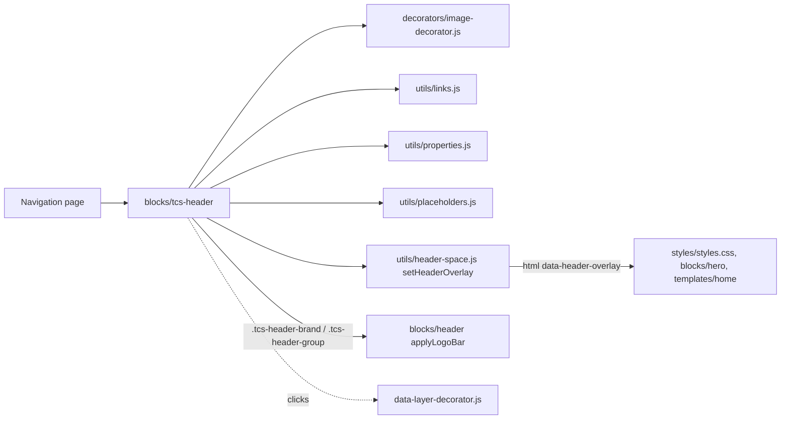

# TCS Header Block — Developer Guide

| Attribute | Value |
| --- | --- |
| Document ID | DEV-B-tcs-header |
| Audience | Developers, technical leads, block owners, AI coding agents |
| Purpose | How the TCS Header block is built: files, model, structure, behaviour, variations, tests and limitations |
| Scope | blocks/tcs-header/ and its components tcs-header |
| Prerequisites | — |
| Owner | Technical Lead / Block Owner (proposed) |
| Approver | Product Owner (to be confirmed) |
| Version | 1.0 |
| Status | Draft for review |
| Last updated | 8 November 2026 |
| Last validated | 2026-11-08 (model, files, imports from the code; reference pages from the live site) |
| Source files | blocks/tcs-header/README.md, blocks/tcs-header/_tcs-header.json, blocks/tcs-header/tcs-header.css, blocks/tcs-header/tcs-header.js |
| Related documents | [Variations](./TCS-HEADER-VARIATIONS.md), [Test coverage](./TCS-HEADER-TEST-COVERAGE.md), [Authoring guide](../../../03-authoring/components/tcs-header/TCS-HEADER-AUTHORING-GUIDE.md) |
| Related AEM paths | — |

## Contents

- [Summary](#summary)
- [Overview](#overview)
- [Source files](#source-files)
- [Components, models and filters](#components-models-and-filters)
- [Fields](#fields)
- [Dependencies](#dependencies)
- [For Developers](#for-developers)
- [Extending the Block](#extending-the-block)
- [Responsive Behavior](#responsive-behavior)
- [Accessibility](#accessibility)
- [Data Layer and Analytics](#data-layer-and-analytics)
- [Performance Considerations](#performance-considerations)
- [Security and Privacy](#security-and-privacy)
- [For Architects](#for-architects)
- [Troubleshooting](#troubleshooting)
- [Known limitations of the block](#known-limitations-of-the-block)
- [Change history of the block](#change-history-of-the-block)
- [Reference pages](#reference-pages)
- [Coverage of the required topics](#coverage-of-the-required-topics)
- [Screenshots](#screenshots)
- [Known limitations](#known-limitations)
- [Open items](#open-items)
- [Change history](#change-history)

## Summary

| Attribute | Value |
| --- | --- |
| Block | TCS Header |
| Folder | `blocks/tcs-header` |
| Type | Independent |
| Category | navigation |
| Status | Active |
| Purpose | The TCS and TATA logos of the header, on the nav page |
| Variations (summary) | — |
| Children | — |
| Code size | 152 lines of JS and CSS |

## Overview

**Business purpose.** Lets authors maintain the corporate logos of the header (image, alt text, link) on the Navigation page, so every page inherits them and an area can override them with its own Navigation page.

**User experience.** In the site header: the TCS logo at the left and the TATA logo (desktop: at the right; tablet / mobile: next to it) of the logo bar. Standalone: the same logos together on mobile and tablet, TCS left and TATA right from 1200px.

**Templates / page types.** Navigation pages in the locale's `references/` (block library: `block-library/header/nav-default`, `block-library/header/nav-careers`); technically any page section.

**Data source.** Its own fields; UI text (fallback names) from the locale's placeholders.

**Related blocks.** [Header](https://github.com/sradha-tcs/tcs-corp/blob/main/blocks/header/README.md) (consumes it), [Conversation Canvas](https://github.com/sradha-tcs/tcs-corp/blob/main/blocks/conversation-canvas/README.md) (a header Canvas may share its section).

**When to use.** In the first section of every Navigation page.

**When not to use.** As a content element on ordinary pages (the header already shows the logos); inside a Columns Container (not offered there).

**Realistic use cases.** The default nav page of a locale; an area nav page (`references/nav-careers`) with the same logos and its own menu; a landing page that shows the logo bar in a section (rare).

## Source files

| File | Link |
| --- | --- |
| `README.md` | [GitHub](https://github.com/sradha-tcs/tcs-corp/blob/main/blocks/tcs-header/README.md) |
| `_tcs-header.json` | [GitHub](https://github.com/sradha-tcs/tcs-corp/blob/main/blocks/tcs-header/_tcs-header.json) |
| `tcs-header.css` | [GitHub](https://github.com/sradha-tcs/tcs-corp/blob/main/blocks/tcs-header/tcs-header.css) |
| `tcs-header.js` | [GitHub](https://github.com/sradha-tcs/tcs-corp/blob/main/blocks/tcs-header/tcs-header.js) |

## Components, models and filters

| Component | Title | Resource type | Template name | Model | Children allowed |
| --- | --- | --- | --- | --- | --- |
| `tcs-header` | TCS Header | `core/franklin/components/block/v1/block` | TCS Header | `tcs-header` | — |

## Fields

The Additional tab fields (anchor, hide, padding, margin, animation) are common to the blocks and described in the [content modeling guide](../../markdown/CONTENT-MODELING-GUIDE.md).

### TCS Header (`tcs-header`)

| Tab | Label | Property | Type | Required in model | Default | Options | Visibility |
| --- | --- | --- | --- | --- | --- | --- | --- |
| Content | TCS Logo | `tcsLogo` | reference | No | — | — | — |
| Content | TCS Logo Alt Text | `tcsLogoAlt` | text | No | `Tata Consultancy Services` | — | — |
| Content | TCS Logo Link | `tcsLogoLink` | aem-content | No | — | — | — |
| Content | TATA Logo | `tataLogo` | reference | No | — | — | — |
| Content | TATA Logo Alt Text | `tataLogoAlt` | text | No | `TATA Group` | — | — |
| Content | TATA Logo Link | `tataLogoLink` | aem-content | No | — | — | — |
| Content | Header over the first block | `headerOverlay` | select | No | `""` | 3 options | — |

"Required in model" is the model's `required` flag; whether a field is required in practice is stated in the authoring guide where it is known.

## Dependencies

| Import |
| --- |
| `../../decorators/image-decorator.js` |
| `../../utils/header-space.js` |
| `../../utils/links.js` |
| `../../utils/properties.js` |
| `../../utils/placeholders.js` |

## For Developers

<!-- BEGIN GENERATED: files (npm run build:docs) -->

```text
blocks/tcs-header/
├── README.md
├── _tcs-header.json
├── tcs-header.css
└── tcs-header.js
```

| Decorator/Utility | Purpose | Execution or dependency point |
| ----------------- | ------- | ----------------------------- |
| [`decorators/image-decorator.js`](https://github.com/sradha-tcs/tcs-corp/blob/main/decorators/image-decorator.js) | `pictureOf` (image with its alt text field) | `tcs-header.js`: { pictureOf } |
| [`utils/header-space.js`](https://github.com/sradha-tcs/tcs-corp/blob/main/utils/header-space.js) | `reserveHeaderSpace`, `rememberHeaderSpace` (the loaded header's height, the logo bar, remembered per breakpoint (`header-height-v2-*`) and reserved on the next pages before the header loads: no layout shift); `setHeader | `tcs-header.js`: { setHeaderOverlay } |
| [`utils/links.js`](https://github.com/sradha-tcs/tcs-corp/blob/main/utils/links.js) | `NEW_WINDOW`, `linkOf`, `linkPathsOf` (the paths of a page property, one or many), `readLinkItems` (CTA lists with Link Type and the items' other select values), `readLinkRows` (the same from link item rows, e.g. Hero CT | `tcs-header.js`: { linkOf } |
| [`utils/properties.js`](https://github.com/sradha-tcs/tcs-corp/blob/main/utils/properties.js) | `readProperties`, `textOf`, `isOn`, `isOnByDefault` (a toggle that defaults to on), `optionOf`, `normalizeKey`, `textSource` (key-value block properties) | `tcs-header.js`: { readProperties, textOf } |
| [`utils/placeholders.js`](https://github.com/sradha-tcs/tcs-corp/blob/main/utils/placeholders.js) | `getPlaceholders`, `loadPlaceholders`, `fillPlaceholder` (UI text from the locale's placeholders, with English fallbacks) | `tcs-header.js`: { getPlaceholders } |

<!-- END GENERATED: files -->

**Input DOM.** A key-value block: one row per delivered property (`readProperties`: `tcslogo`, `tcslogolink`, `tatalogo`, `tatalogolink`, `menurootpath`, `menudepth`, `headeroverlay` (`always`, `never` or empty), plus the Additional tab classes). The alt fields aren't rows: they collapse into the images' `alt`.

**Decoration flow.** `readProperties(block)`; in the nav fragment (`!block.isConnected`, not on the nav page itself) `setHeaderOverlay(headeroverlay)` (`utils/header-space.js`: `<html data-header-overlay>`, remembered as `localStorage` `header-overlay-v1` and applied by `reserveHeaderSpace` in the eager phase of the next pages) and, without an authored menu, the menu section from `getPageTree`; `getPlaceholders()`, then `buildLogo` per logo: `pictureOf(imageCell)` (moves the editor instrumentation to the picture), the alt fallback, the href (link `href` or cell text, `https://` added to a bare domain), an `a` or `span`; `block.replaceChildren(bar)`.

**Rendered DOM contract.**

```html
<div class="tcs-header block">
  <div class="tcs-header-bar">
    <a class="tcs-header-brand" href="/en/"><picture>…</picture></a>
    <a class="tcs-header-group" href="https://www.tata.com"><picture>…</picture></a>
  </div>
</div>
```

`blocks/header` relies on `.tcs-header`, `.tcs-header-brand` and `.tcs-header-group`.

**Header over the first block: CSS contract.** `<html data-header-overlay>` is `always`, `never` or absent (Auto). `styles/styles.css` (loaded before the header) takes `<header>` out of the flow at every width for Auto over an opening light Hero and for Always, and sets `--header-overlay-space` on `body` (the header's height while it lies over the first block; unset otherwise, use `var(--header-overlay-space, 0rem)`); `blocks/hero` and `templates/home` keep a Hero's content below the logos; `tcs-header.css` makes `header .nav-wrapper` transparent (Always) or keeps its background over a light Hero (Never).

**Events / async.** Awaits the placeholders; no listeners.

**Error handling.** Missing fields degrade (no image: text; nothing: logo left out).

**Exported functions.** Only the default `decorate(block)`.

## Extending the Block

- **A field or value.** Add it to `_tcs-header.json` (keep the Additional tab last), run `npm run build:json` and `npm run lint`. Key-value rules: no grouped fields (`prefix_name`); a name ending in Alt, Text, Title, Type or MimeType collapses into its base field.
- **Rendering.** Read it with `readProperties`; keep the two output classes for the header.
- **Responsive / accessibility.** Logo sizes are in `tcs-header.css` and, for the site header, `blocks/header/header.css`: change both. Every link needs a name.
- **Data layer.** Captured centrally.
- **Tests.** No unit test exists for the block; add one for new pure logic.
- **Backward compatibility.** Existing nav pages keep their values; keep `tcs-header-brand` / `tcs-header-group`.
- **Docs.** Update this README (`npm run build:docs`) and the block library nav pages; `npm run build:modules` after changing imports (the block is in `CHROME_BLOCKS`, preloaded on every page).

## Responsive Behavior

| Viewport | Layout | Image behavior | Interaction behavior |
| -------- | ------ | -------------- | -------------------- |
| Mobile (< 600px) | Logos side by side at the left; 1rem gutter in a Full Width section | TCS 1.2104rem, TATA 1.5rem high | Links |
| Tablet (600–1199px) | As mobile; 1.5rem gutter | TCS 1.9165rem, TATA 2.375rem | Links |
| Desktop (>= 1200px) | TCS left, TATA right; 5rem gutter | TCS 2.175rem, TATA 2.75rem | Links |

In the site header the header's CSS applies (same heights). At every width, **Header over the first block** decides whether the bar lies transparent over the page's first block (Auto: an opening light Hero; Always: any first block, which starts at the top of the page; Never: the page starts below the bar).

## Accessibility

- **Semantics.** Two links (or `span`s without a link) with the logo images; no heading.
- **Accessible names.** The image alt text; an empty alt on a linked logo is replaced by the placeholder name, so no link is unnamed.
- **Keyboard.** Standard link focus; nothing else to operate.
- **Contrast.** Text fallback in `--color-text-default`, bold.
- **Reflow.** The bar is a flex row; logos keep their aspect ratio.

Author responsibilities: alt texts naming the organisations, translated per locale; transparent logo assets.

Developer responsibilities: keep the alt-text fallback and the scheme completion; keep the classes `tcs-header-brand` / `tcs-header-group` (read by `blocks/header`).

| Key | Expected behavior |
| --- | ----------------- |
| Tab / Shift+Tab | Moves to each logo link |
| Enter | Follows the focused logo link |

## Data Layer and Analytics

- **Standalone:** the block is a component (`tcs-header-{n}`, `@type` `tcs-corp/components/tcs-header`) added by `trackBlocks`; logo clicks push `cmp:click` (`interaction` "link", `xdm:linkURL`, `xdm:linkType` `other` or `exit`). `dc:title` is the link's `aria-label` or text content, so an image-only logo link has an empty `dc:title` (the image's alt isn't read); identify the logo by `xdm:linkURL`.
- **On the Navigation page:** the block's section is replaced by the header's sections, so logo clicks report the header component.
- No `data-cmp-*` attributes and no own pushes.

| Trigger | Data-layer event | Required properties | Analytics behavior |
| ------- | ---------------- | ------------------- | ------------------ |
| Block tracked (standalone) | `component` entry | `@type`, `parentId` | Component inventory |
| Click on a logo | `cmp:click` | `eventInfo.path`, `interaction` "link", `xdm:linkURL`, `xdm:linkType`, `breakpoint` | Brand / group link click |

The intended flow is Adobe Client Data Layer → Adobe Data Collection (Tags) → AEP Web SDK → Edge Network → Analytics / CJA; Tags and the Web SDK aren't configured yet (blocked: measurement plan). No consent mechanism is implemented.

## Performance Considerations

- Decorated with the nav page fragment in the lazy phase (or with its section on a page); module and stylesheet preloaded on every page (`CHROME_BLOCKS`).
- Images as delivered; no extra requests, observers or listeners. Small DOM (two links).
- Header over the first block: the layout applies in the eager phase from the remembered mode (no shift); a visitor's first page with Always or Never can shift once when the header loads (measured locally: CLS 0.086 for Never over a light Hero, 0 on the next page; KB-D-052).

## Security and Privacy

- Links are as authored; a bare domain is completed with `https://`; no other URL validation or query strings; no personal data.
- `localStorage` key `header-overlay-v1` (`always` / `never`, removed for Auto): the nav page's layout mode, no personal data.

## For Architects

- **Role.** The authoring model of the header's logos (not a duplicate of the header, audit decision "Retain").
- **Content model.** Key-value block, two image + link pairs.
- **Rendering.** Client-side decoration; consumed by `blocks/header` after the nav fragment is decorated.
- **Dependencies.** `decorators/image-decorator.js` (`pictureOf`), `utils/links.js` (`linkOf`), `utils/properties.js`, `utils/placeholders.js`, `utils/query-index.js` (`getPageTree`), `utils/urls.js`, `utils/header-space.js` (`setHeaderOverlay`).
- **Header over the first block.** A site-wide (per nav page) desktop layout mode set by the block in the lazy phase; the layout must apply before the header loads (KB-D-039), so the mode is remembered per browser and applied in the eager phase of the next pages; a visitor's first page with Always or Never can shift once when the header arrives (decision log KB-D-052, Proposed).
- **Data layer / Web SDK / Target.** Central click capture; no Target.
- **Consent, identity, caching.** None in the block; the nav page is CDN cached.
- **Performance.** No network request of its own beyond the placeholders (cached once per page).
- **Security.** Links as authored; only the scheme completion.



## Troubleshooting

| Symptom | Likely cause | Diagnostic steps | Resolution | Verification |
| ------- | ------------ | ---------------- | ---------- | ------------ |
| No logos in the header | Assets not uploaded / published (F-77), or block not on the nav page in use | Check the page's Navigation; image requests | Upload / publish the SVGs; edit the right nav page | Logos visible |
| Logo with a white box | JPG / PNG with background (F-81) | Inspect the asset | Use the transparent SVG | Clean logo |
| TATA link leads to a 404 on the site | Old content with a relative link | Inspect `href` | Enter `https://www.tata.com` | Correct target |
| Logo name shown as text | No image selected | Properties panel | Select the asset | Image shown |
| Spacing options have no effect in the header | Additional tab styles apply only inside `main` | — | Expected | — |
| No menu button on tablet / mobile | No Menu root path with pages in the site: e.g. a language master path on an `/en` nav page and no Conversation Canvas Menu root path | The nav page's TCS Header and Canvas Menu root paths; `/{locale}/query-index.json` | Set the TCS Header's Menu root path to a page of the site (`/en/...`) or clear it | Menu button shown |
| Header over the first block has no effect | Nav page not published, or the page uses another nav page | `<html data-header-overlay>` on the page; the page's Navigation | Publish the nav page | Attribute set, layout as chosen |
| The page moves once when the header loads (Always / Never) | The visitor's first page: the mode isn't known before the header loads | Second page view: no shift | Expected (KB-D-052, Proposed) | CLS 0 on the next page |
| Text of the first block under the logos (Always) | The block has no space for the header | Inspect the block's top padding | Padding top (Additional tab) or `--header-overlay-space` in the block's CSS | Text below the logos |

Evidence to collect: the nav page path, the rendered `a.tcs-header-*` markup, the asset paths, a screenshot per breakpoint.

## Known limitations of the block

| Limitation | Impact | Workaround | Planned correction |
| ---------- | ------ | ---------- | ------------------ |
| The alt fields collapse into their images: without an image, the authored alt text isn't available | A linked logo without image shows the placeholder name, not the authored alt | Always select the image | Not planned (AEM delivery rule) |
| Offered in every section (`section` filter) | Authors may add it to content pages | Add it only to nav pages | Not recorded (audit suggestion: nav-page-only filter) |
| Logo assets not yet in DAM (F-77) | No logos until authored | Block library sample PNGs | Not recorded (content task) |
| Additional tab has no effect in the site header | Spacing / hide only on the nav page itself | — | Not planned |
| Header over the first block: first page shift | A visitor's first page with Always or Never moves once when the header loads | Keep Auto where the first block is a light Hero | To be discussed (KB-D-052, Proposed) |
| Header over the first block: one mode per browser | A nav page without a TCS Header keeps the mode remembered from another nav page | Add the TCS Header to every nav page | Not recorded |
| Header over the first block: dark first blocks | Dark logos aren't visible over a dark first block (Always) | Keep Auto / Never for dark first blocks | Not recorded (a light-logo option) |

## Change history of the block

| Version | Change | Source | Date |
| ------- | ------ | ------ | ---- |
| Not recorded | README generated from verified implementation and approved handover documentation | Repository review | Not recorded |
| Handover 2.2 | TCS Header (Figma *New Screens from New DS*) and the logo bar | docs/handover revision history | 16 October 2026 |
| Handover 2.4 | Logo sizes per breakpoint, one DAM asset per logo, authored in the TCS Header block (F-77) | docs/handover revision history | 16 October 2026 |
| Handover 2.27 | Block ecosystem audit: no-image fallback and unnamed TATA logo link corrected with placeholder names (D-D-25) | docs/handover revision history; docs/audit/BLOCK-ECOSYSTEM-AUDIT.md | 19 October 2026 |
| Handover 2.29 | Re-audit: logo links typed without `https://` completed (R-D-15) | docs/handover revision history; docs/audit/REAUDIT-2026-10-20.md | 20 October 2026 |
| Handover 2.31 | TATA logo link checked on the live pages (`https://www.tata.com`, "TATA Group") | docs/handover revision history | 20 October 2026 |
| PR #141 | Header over the first block (Auto / Always / Never; every width from the sticky bar fix) | KB-D-052 (Proposed) | 22 October 2026 |

## Reference pages

| Kind | Page | Live URL |
| --- | --- | --- |

## Coverage of the required topics

| Topic | Where |
| --- | --- |
| Purpose | Overview |
| Source files | generated: Files |
| Model, definition, filters, children | generated: Components |
| Dependencies | generated: Dependencies |
| Authored input / rendered output / DOM transformation | For Developers |
| Configuration fields, defaults, required fields | generated: Fields |
| Variations | TCS-HEADER-VARIATIONS.md |
| Responsive behaviour | Responsive Behavior |
| Accessibility and keyboard | Accessibility |
| Analytics / data layer | Data Layer and Analytics |
| Performance | Performance Considerations |
| Security | Security and Privacy |
| Extending | Extending the Block |
| Known limitations | Known Limitations |
| Troubleshooting | Troubleshooting |
| Tests | TCS-HEADER-TEST-COVERAGE.md |
| SEO behaviour | Not recorded |
| Caching considerations | Not recorded (Edge Delivery default caching; no block-specific rule) |
| Ownership | Technical Lead / Block Owner (proposed) |

## Screenshots

> **Screenshot required**
>
> - Required screen: TCS Header on its block library page
> - Required role/access: none (published page)
> - Required navigation steps: Open https://main--tcs-corp--sradha-tcs.aem.live/design-block-master/en/block-library/tcs-header
> - Reason unavailable: No block library page of this block was found under /design-block-master/en/block-library
> - Owner: Content Lead / AEM Authoring Lead (proposed)
> - Target completion date: To be confirmed


*Figure: Desktop rendering — The header at 1440 px in one 4rem row: TCS at the left, Services, Industries, Insights and About us, then Investors and the Contact us primary button at the right. Services is open: its chevron points up and a light grey 12.5rem panel with a pointer triangle lists Consulting, Cloud, Cybersecurity and AI and data. (Sample content on the preview; callout letters as in the Field Entry Table; file screenshots/header-desktop-view.jpg) (handover screenshot; rendering at the time it was taken).*


*Figure: Tablet rendering — The header at 768 px with the menu closed, in one 4rem row: the three-bar menu button at the left, TCS next to it and Investors with the Contact us button at the right; the four sections are hidden. (Sample content on the preview; callout letters as in the Field Entry Table; file screenshots/header-tablet-view.jpg) (handover screenshot; rendering at the time it was taken).*


*Figure: Mobile rendering — Two 390 px frames side by side. Menu closed: the menu button, TCS and the tools in one 4rem row. Menu open: the X icon and TCS, then Services with Consulting, Cloud, Cybersecurity and AI and data, Industries with Banking, Retail and Manufacturing, Insights and About us stacked, and Investors and Contact us at the bottom. (Sample content on the preview; callout letters as in the Field Entry Table; file screenshots/header-mobile-view.jpg) (handover screenshot; rendering at the time it was taken).*


*Figure: Default navigation of the /en locale — An /en content page at 1440 px with the header from /en/references/nav, all dropdowns closed: TCS, Services and Industries with chevrons, Insights, About us, Investors and the Contact us primary button, above the start of the page content. (Sample content on the preview; callout letters as in the Field Entry Table; file screenshots/header-default-locale-navigation.jpg) (handover screenshot; rendering at the time it was taken).*


*Figure: Area-specific navigation — Two 1440 px headers one above the other (not side by side). Top, a page of /en: TCS, Services, Industries, Insights, About us, Investors, Contact us. Bottom, /en/careers/jobs inheriting nav-careers: TCS Careers, Find jobs with a chevron, Life at TCS, Locations, tcs.com and the Apply now primary button. (Sample content on the preview; callout letters as in the Field Entry Table; file screenshots/header-alternate-navigation.jpg) (handover screenshot; rendering at the time it was taken).*


*Figure: An open dropdown — The header at 1440 px with Services open: its chevron points up, and the light grey 12.5rem panel with the pointer triangle lists Consulting, Cloud, Cybersecurity and AI and data in regular weight, with Cloud underlined under the mouse pointer. (Sample content on the preview; callout letters as in the Field Entry Table; file screenshots/header-desktop-dropdown.jpg) (handover screenshot; rendering at the time it was taken).*


*Figure: Open mobile menu — The header at 390 px with the menu open over the full height: the X icon and TCS on top, then Services with Consulting, Cloud, Cybersecurity and AI and data, Industries with Banking, Retail and Manufacturing, Insights and About us stacked, and Investors and Contact us at the bottom. (Sample content on the preview; callout letters as in the Field Entry Table; file screenshots/header-mobile-menu.jpg) (handover screenshot; rendering at the time it was taken).*


*Figure: Section label rendered as a button — The header at 1440 px after Tab to Services and Enter: the Services button shows the keyboard focus ring and its chevron points up, and its dropdown lists Consulting, Cloud, Cybersecurity and AI and data. (Sample content on the preview; callout letters as in the Field Entry Table; file screenshots/header-unlinked-section-label.jpg) (handover screenshot; rendering at the time it was taken).*


*Figure: Linked label with dropdown toggle — The header at 1440 px after Tab from the bold Industries link to its toggle and Enter: Industries stays a link with its chevron pointing up and the dropdown lists Banking, Retail and Manufacturing; no focus ring is visible because the toggle button is 0 × 0 (F-13). (Sample content on the preview; callout letters as in the Field Entry Table; file screenshots/header-linked-section-label.jpg) (handover screenshot; rendering at the time it was taken).*


*Figure: Plain first-level link — The header at 1440 px with the pointer on Insights: Insights is underlined and has no chevron, like About us, while Services and Industries carry closed chevrons; no dropdown is open. (Sample content on the preview; callout letters as in the Field Entry Table; file screenshots/header-simple-section-link.jpg) (handover screenshot; rendering at the time it was taken).*


*Figure: Tools on the right of the header — Two frames one above the other. Top, 1440 px: the full row with Investors as a link and the Contact us primary button at the right end. Bottom, 390 px with the menu closed: the menu button, TCS and the same two tools at the right of the 4rem row. (Sample content on the preview; callout letters as in the Field Entry Table; file screenshots/header-tools-area.jpg) (handover screenshot; rendering at the time it was taken).*


*Figure: Universal Editor canvas of the nav page — references/nav opened directly in editor mode at 1440 px, rendered as an ordinary page under its own header: A the section with the TCS link, B the bulleted list, C Services with its four indented links, D one second-level link, E the section with Investors and the Contact us button. (Annotated preview in editor mode with sample content; letters as in the annotations list, not a Universal Editor screenshot; file screenshots/header-authoring-view.jpg) (handover screenshot; rendering at the time it was taken).*


*Figure: Properties used to choose the nav page — Page Properties of a content page with the Navigation field (and Footer, 404 Page) highlighted; plus the properties panel of the Text component holding the list on the nav page. (Dialog reference generated from the component model, not a Universal Editor screenshot; file screenshots/header-properties-panel.jpg) (handover screenshot; rendering at the time it was taken).*

## Known limitations

- Universal Editor dialogs were not captured: no author access in this program (see the access blockers).

## Open items

- None.

## Change history

| Version | Date | Author | Change |
| --- | --- | --- | --- |
| 1.0 | 8 November 2026 | Delivery team (documentation program) | First version of the role-specific documentation (master documentation prompt), generated from the repository and the published reference pages |
