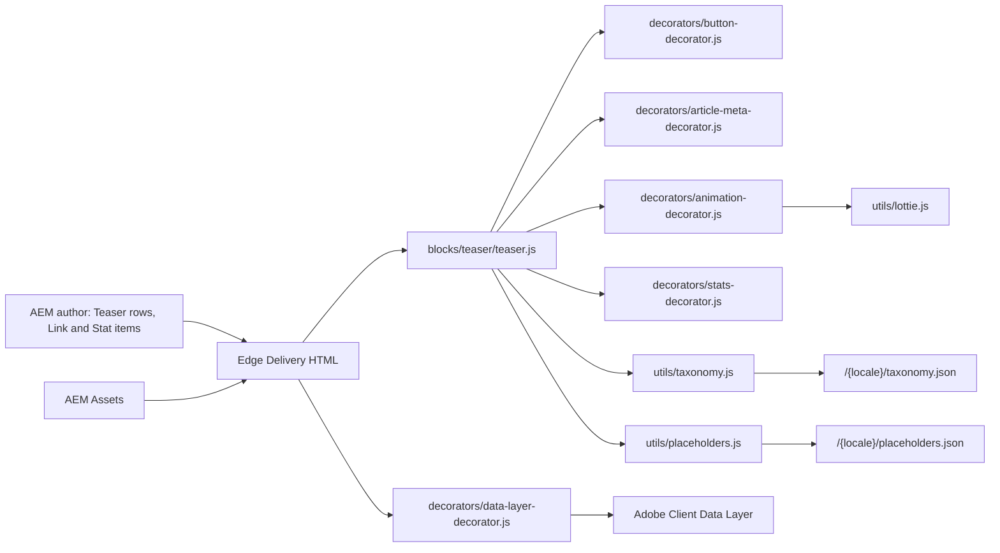
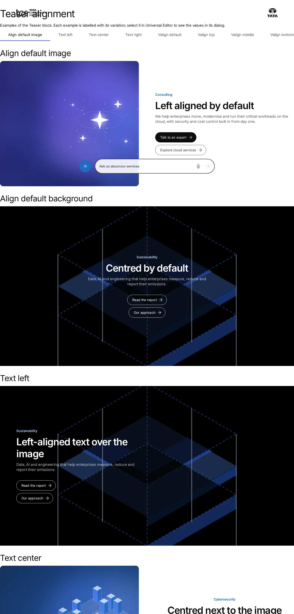
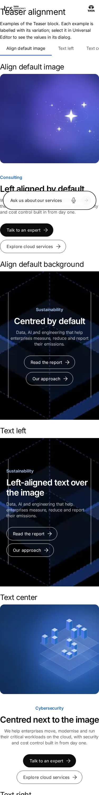

# Teaser Block — Developer Guide

| Attribute | Value |
| --- | --- |
| Document ID | DEV-B-teaser |
| Audience | Developers, technical leads, block owners, AI coding agents |
| Purpose | How the Teaser block is built: files, model, structure, behaviour, variations, tests and limitations |
| Scope | blocks/teaser/ and its components teaser, teaser-link, teaser-stat, teaser-collage-image |
| Prerequisites | — |
| Owner | Technical Lead / Block Owner (proposed) |
| Approver | Product Owner (to be confirmed) |
| Version | 1.0 |
| Status | Draft for review |
| Last updated | 8 November 2026 |
| Last validated | 2026-11-08 (model, files, imports from the code; reference pages from the live site) |
| Source files | blocks/teaser/README.md, blocks/teaser/_teaser.json, blocks/teaser/teaser.css, blocks/teaser/teaser.js |
| Related documents | [Variations](./TEASER-VARIATIONS.md), [Test coverage](./TEASER-TEST-COVERAGE.md), [Authoring guide](../../../03-authoring/components/teaser/TEASER-AUTHORING-GUIDE.md) |
| Related AEM paths | /content/tcs-corp/design-block-master/en/block-library/teaser, /content/tcs-corp/design-block-master/en/block-library/teaser/alignment, /content/tcs-corp/design-block-master/en/block-library/teaser/article-meta |

## Contents

- [Summary](#summary)
- [Overview](#overview)
- [Source files](#source-files)
- [Components, models and filters](#components-models-and-filters)
- [Fields](#fields)
- [Dependencies](#dependencies)
- [For Developers](#for-developers)
- [Extending the Block](#extending-the-block)
- [Responsive Behavior](#responsive-behavior)
- [Accessibility](#accessibility)
- [Data Layer and Analytics](#data-layer-and-analytics)
- [Performance Considerations](#performance-considerations)
- [Security and Privacy](#security-and-privacy)
- [For Architects](#for-architects)
- [Troubleshooting](#troubleshooting)
- [Known limitations of the block](#known-limitations-of-the-block)
- [Change history of the block](#change-history-of-the-block)
- [Reference pages](#reference-pages)
- [Coverage of the required topics](#coverage-of-the-required-topics)
- [Screenshots](#screenshots)
- [Known limitations](#known-limitations)
- [Open items](#open-items)
- [Change history](#change-history)

## Summary

| Attribute | Value |
| --- | --- |
| Block | Teaser |
| Folder | `blocks/teaser` |
| Type | Container |
| Category | content |
| Status | Active |
| Purpose | Title, text, image and links in one of four layouts |
| Variations (summary) | Layouts (Image & Text, Text split, Background image, Card), image positions, BG Color, styles |
| Children | teaser-link (Link), teaser-stat (Stat) |
| Code size | 2062 lines of JS and CSS |

## Overview

- **Business purpose:** presents one focused message (a service, an insight, a statistic-led story, a career call, a media resource) in an approved design-system layout, and leads the visitor on through clear links. One block covers many Figma frames.
- **User experience:**
  - **Image & Text:** the image beside the text (left or right from 600px) or above / below it. Without an image, the text is centred.
  - **Text split:** the eyebrow, tags and article meta across the top; the title and author on the left; the description, an optional image (for example a chart), stats, links and short description on the right (from 900px).
  - **Background image:** centred text over the image under a dark overlay.
  - **Card:** a rounded card with the image behind its text and the links at the bottom.
  - **Image collage:** centred text on a dark background, surrounded by up to nine floating Collage image items (black and white by default).
- **Templates / page types:** any page. Teasers are also the slides of a Gen Carousel section (block library `block-library/gen-carousel/teaser-slides`).
- **Data source:** authored fields and items. Tag labels come from the locale's taxonomy (`/{locale}/taxonomy.json`) and UI labels from its placeholders. The block reads no page metadata or query index.
- **Related blocks:** Hero (`blocks/hero`, the full-height opening banner, which shares the Lotto image type); Page Header (`blocks/page-header`, metadata-driven article header, which shares `decorators/article-meta-decorator.js`); Testimonial (shares `decorators/stats-decorator.js`); [Cards](https://github.com/sradha-tcs/tcs-corp/blob/main/blocks/cards/README.md) and [List](https://github.com/sradha-tcs/tcs-corp/blob/main/blocks/list/README.md) for collections (their "Display as teaser" is a card presentation, class `display-teaser`, not this block); [Columns Container](https://github.com/sradha-tcs/tcs-corp/blob/main/blocks/columns-container/README.md).
- **When to use:** a single message that combines a heading with text, media, stats or links in the page flow, matching one of the Teaser's layouts.
- **When not to use:** for the first full-height banner (use the Hero); for article / blog / press-release headers built from page metadata (use the Page Header); for lists of several items (Cards, List, Filter List); for quotes (Quote, Testimonial); for video (the Teaser has no video media type).
- **Realistic use cases:** an Image & Text service promotion; a two-column "Text split" section with stats; a secondary page header (Top spacing "Page header"); an article-style header with date, reading time, actions and author; a careers call to action without an image; a sustainability banner (Background image); a media kit card (Card); a list of related resources (List link style); an animated Lottie illustration beside the text.

## Source files

| File | Link |
| --- | --- |
| `README.md` | [GitHub](https://github.com/sradha-tcs/tcs-corp/blob/main/blocks/teaser/README.md) |
| `_teaser.json` | [GitHub](https://github.com/sradha-tcs/tcs-corp/blob/main/blocks/teaser/_teaser.json) |
| `teaser.css` | [GitHub](https://github.com/sradha-tcs/tcs-corp/blob/main/blocks/teaser/teaser.css) |
| `teaser.js` | [GitHub](https://github.com/sradha-tcs/tcs-corp/blob/main/blocks/teaser/teaser.js) |

## Components, models and filters

| Component | Title | Resource type | Template name | Model | Children allowed |
| --- | --- | --- | --- | --- | --- |
| `teaser` | Teaser | `core/franklin/components/block/v1/block` | Teaser | `teaser` | teaser-link, teaser-stat, teaser-collage-image |
| `teaser-link` | Link | `core/franklin/components/block/v1/block/item` | Link | `teaser-link` | — |
| `teaser-stat` | Stat | `core/franklin/components/block/v1/block/item` | Stat | `teaser-stat` | — |
| `teaser-collage-image` | Collage image | `core/franklin/components/block/v1/block/item` | Collage image | `teaser-collage-image` | — |

## Fields

The Additional tab fields (anchor, hide, padding, margin, animation) are common to the blocks and described in the [content modeling guide](../../markdown/CONTENT-MODELING-GUIDE.md).

### Teaser (`teaser`)

| Tab | Label | Property | Type | Required in model | Default | Options | Visibility |
| --- | --- | --- | --- | --- | --- | --- | --- |
| Content | Eyebrow | `eyebrow` | text | No | — | — | — |
| Content | Show Eyebrow | `showEyebrow` | boolean | No | `true` | — | — |
| Content | Title | `title` | text | No | — | — | — |
| Content | Title Type | `titleType` | select | No | `h2` | 6 options | — |
| Content | Hide Title | `titleHidden` | boolean | No | `false` | — | — |
| Content | Description | `description` | richtext | No | `""` | — | — |
| Content | Show Description | `showDescription` | boolean | No | `true` | — | — |
| Content | Short Description | `shortDescription` | richtext | No | `""` | — | — |
| Content | View All Text | `viewAllText` | text | No | — | — | — |
| Content | View All Link | `viewAll` | aem-content | No | — | — | — |
| Content | Show Date | `showDate` | boolean | No | `false` | — | — |
| Content | Date | `date` | date-time | No | — | — | Conditional |
| Content | Date Format | `dateFormat` | select | No | `dd-mm-yyyy` | 4 options | Conditional |
| Content | Date label | `dateLabel` | text | No | — | — | Conditional |
| Content | Reading time | `readingTime` | text | No | — | — | — |
| Content | Display Tags | `displayTags` | boolean | No | `false` | — | — |
| Content | Tags | `tags` | aem-tag | No | — | — | — |
| Content | Listen link | `listenLink` | aem-content | No | — | — | — |
| Content | Download | `download` | boolean | No | `false` | — | — |
| Content | Share | `socialShare` | boolean | No | `false` | — | — |
| Content | Author name | `authorName` | text | No | — | — | — |
| Content | Author designation | `authorDesignation` | text | No | — | — | — |
| Content | Author image | `authorImage` | reference | No | — | — | — |
| Content | Author image alt text | `authorImageAlt` | text | No | — | — | — |
| Content | Image type | `imageFormat` | select | No | `""` | 2 options | — |
| Content | Image | `image` | reference | No | — | — | — |
| Content | Image alt text | `imageAlt` | text | No | — | — | — |
| Content | Hide Image | `hideImage` | boolean | No | `false` | — | — |
| Content | Image position | `imagePosition` | select | No | `left` | 4 options | Conditional |
| Content | Image position (mobile) | `imagePositionMobile` | select | No | `""` | 3 options | Conditional |
| Content | Image ratio | `imageRatio` | select | No | `""` | 4 options | Conditional |
| Content | Image corners | `imageCorners` | select | No | `""` | 2 options | Conditional |
| Content | Multiple links | `multiLinks` | boolean | No | `false` | — | — |
| Content | Links (authored before Link items) | `links` | container | No | — | — | Conditional |
| Content | Links (authored before Link items) › CTA Title | `ctaText` | text | No | — | — | — |
| Content | Links (authored before Link items) › CTA Link | `cta` | aem-content | No | — | — | — |
| Content | Links (authored before Link items) › CTA Link Type | `ctaTarget` | select | No | `""` | 2 options | — |
| Content | Links (authored before Link items) › CTA Link Style | `ctaStyle` | select | No | `""` | 6 options | — |
| Content | Links (authored before Link items) › CTA Background | `ctaBackground` | select | No | `""` | 4 options | — |
| Content | Links (authored before Link items) › CTA Shape | `ctaShape` | select | No | `""` | 2 options | — |
| Content | List arrow | `linkArrow` | select | No | `""` | 3 options | — |
| Content | Primary CTA Title | `primaryCtaText` | text | No | — | — | Conditional |
| Content | Primary CTA Link | `primaryCta` | aem-content | No | — | — | Conditional |
| Content | Primary CTA Link Type | `primaryCtaTarget` | select | No | `""` | 2 options | Conditional |
| Content | Primary CTA Link Style | `primaryCtaStyle` | select | No | `primary` | 6 options | Conditional |
| Content | Primary CTA Background | `primaryCtaBackground` | select | No | `""` | 4 options | Conditional |
| Content | Primary CTA Shape | `primaryCtaShape` | select | No | `""` | 2 options | Conditional |
| Content | Secondary CTA Title | `secondaryCtaText` | text | No | — | — | Conditional |
| Content | Secondary CTA Link | `secondaryCta` | aem-content | No | — | — | Conditional |
| Content | Secondary CTA Link Type | `secondaryCtaTarget` | select | No | `""` | 2 options | Conditional |
| Content | Secondary CTA Link Style | `secondaryCtaStyle` | select | No | `secondary` | 6 options | Conditional |
| Content | Secondary CTA Background | `secondaryCtaBackground` | select | No | `""` | 4 options | Conditional |
| Content | Secondary CTA Shape | `secondaryCtaShape` | select | No | `""` | 2 options | Conditional |
| Content | Buttons side by side | `buttonsSideBySide` | boolean | No | `false` | — | — |
| Content | Stats (authored before Stat items) | `stats` | container | No | — | — | — |
| Content | Stats (authored before Stat items) › Stats Title | `statLabel` | richtext | No | `""` | — | — |
| Content | Stats (authored before Stat items) › Stats Value | `statValue` | richtext | No | `""` | — | — |
| Style | Layout | `classes` | select | No | `""` | 5 options | — |
| Style | BG Color | `bgColor` | select | No | `""` | 5 options | — |
| Style | Text alignment | `textAlignment` | select | No | `""` | 5 options | — |
| Style | Vertical alignment | `verticalAlignment` | select | No | `""` | 4 options | — |
| Style | Title weight | `titleWeight` | select | No | `""` | 3 options | — |
| Style | Title color | `titleColor` | select | No | `""` | 4 options | — |
| Style | Description size | `descriptionSize` | select | No | `""` | 3 options | — |
| Style | Eyebrow Style | `eyebrowStyle` | select | No | `""` | 4 options | — |
| Style | Top spacing | `topSpacing` | select | No | `""` | 2 options | — |

### Link (`teaser-link`)

| Tab | Label | Property | Type | Required in model | Default | Options | Visibility |
| --- | --- | --- | --- | --- | --- | --- | --- |
| — | CTA Link | `link` | aem-content | Yes | — | — | — |
| — | CTA Title | `linkText` | text | No | — | — | — |
| — | CTA Link Type | `linkTarget` | select | No | `""` | 2 options | — |
| — | CTA Link Style | `linkStyle` | select | No | `""` | 6 options | — |
| — | Button background | `buttonBackground` | select | No | `""` | 4 options | — |
| — | Button shape | `buttonShape` | select | No | `""` | 2 options | — |

### Stat (`teaser-stat`)

| Tab | Label | Property | Type | Required in model | Default | Options | Visibility |
| --- | --- | --- | --- | --- | --- | --- | --- |
| Stat | Stats Title | `statLabel` | richtext | No | `""` | — | — |
| Stat | Stats Value | `statValue` | richtext | No | `""` | — | — |

### Collage image (`teaser-collage-image`)

| Tab | Label | Property | Type | Required in model | Default | Options | Visibility |
| --- | --- | --- | --- | --- | --- | --- | --- |
| Collage image | Image | `image` | reference | Yes | — | — | — |
| Collage image | Image alt text | `imageAlt` | text | No | — | — | — |
| Collage image | Image treatment | `imageTreatment` | select | No | `black-white` | 2 options | — |

"Required in model" is the model's `required` flag; whether a field is required in practice is stated in the authoring guide where it is known.

## Dependencies

| Import |
| --- |
| `../../scripts/aem.js` |
| `../../scripts/scripts.js` |
| `../../decorators/a11y-decorator.js` |
| `../../decorators/animation-decorator.js` |
| `../../decorators/article-meta-decorator.js` |
| `../../decorators/button-decorator.js` |
| `../../decorators/content-decorator.js` |
| `../../decorators/editor-item-decorator.js` |
| `../../decorators/heading-decorator.js` |
| `../../decorators/image-decorator.js` |
| `../../decorators/link-decorator.js` |
| `../../decorators/stats-decorator.js` |
| `../../decorators/tag-decorator.js` |
| `../../utils/cells.js` |
| `../../utils/links.js` |
| `../../utils/media.js` |
| `../../utils/placeholders.js` |
| `../../utils/properties.js` |
| `../../utils/tags.js` |
| `../../utils/taxonomy.js` |

## For Developers

<!-- BEGIN GENERATED: files (npm run build:docs) -->

```text
blocks/teaser/
├── README.md
├── _teaser.json
├── teaser.css
└── teaser.js
```

| Decorator/Utility | Purpose | Execution or dependency point |
| ----------------- | ------- | ----------------------------- |
| [`scripts/aem.js`](https://github.com/sradha-tcs/tcs-corp/blob/main/scripts/aem.js) | Edge Delivery core library (block loading, CSS, metadata, optimized pictures) | `teaser.js`: { toClassName } |
| [`scripts/scripts.js`](https://github.com/sradha-tcs/tcs-corp/blob/main/scripts/scripts.js) | Page decoration (moveInstrumentation and shared page helpers) | `teaser.js`: { moveInstrumentation } |
| [`decorators/a11y-decorator.js`](https://github.com/sradha-tcs/tcs-corp/blob/main/decorators/a11y-decorator.js) | `hideVisually`, `createHiddenText` (with `.visually-hidden` in `styles/styles.css`) | `teaser.js`: { hideVisually } |
| [`decorators/animation-decorator.js`](https://github.com/sradha-tcs/tcs-corp/blob/main/decorators/animation-decorator.js) | `createAnimation`, `playAnimation` (Lottie animations of the Lotto image type, loaded when near the viewport; a pause / play button as `element.animationToggle`, WCAG 2.2.2; paused for reduced motion) | `teaser.js`: { createAnimation } |
| [`decorators/article-meta-decorator.js`](https://github.com/sradha-tcs/tcs-corp/blob/main/decorators/article-meta-decorator.js) | `buildPublished`, `buildReadingTime`, `buildPageActions` (listen / download / share), `buildAuthorLockup` | `teaser.js`: { buildAuthorLockup, buildPageActions, buildPublished, buildReadingTime, } |
| [`decorators/button-decorator.js`](https://github.com/sradha-tcs/tcs-corp/blob/main/decorators/button-decorator.js) | `decorateButton` (option `newTabHint`: a link opening a new tab says so), `createButton`, `setButtonDisabled`, `setButtonAlignment`, `removeButtonDecoration` | `teaser.js`: { decorateButton } |
| [`decorators/content-decorator.js`](https://github.com/sradha-tcs/tcs-corp/blob/main/decorators/content-decorator.js) | `fromCell` (property content into an element, keeping editor instrumentation) | `teaser.js`: { fromCell } |
| [`decorators/editor-item-decorator.js`](https://github.com/sradha-tcs/tcs-corp/blob/main/decorators/editor-item-decorator.js) | `buildEditorItems`, `editorItemHint` (in Universal Editor, an item the block doesn't render yet, e.g. a CTA just added, as a dashed placeholder the author can select; styles in `styles/lazy-styles.css`; the hint loaded o | `teaser.js`: { buildEditorItems, editorItemHint } |
| [`decorators/heading-decorator.js`](https://github.com/sradha-tcs/tcs-corp/blob/main/decorators/heading-decorator.js) | `buildHeading` (Title + Title Type), `HEADINGS` | `teaser.js`: { buildHeading } |
| [`decorators/image-decorator.js`](https://github.com/sradha-tcs/tcs-corp/blob/main/decorators/image-decorator.js) | `pictureOf` (image with its alt text field) | `teaser.js`: { pictureOf } |
| [`decorators/link-decorator.js`](https://github.com/sradha-tcs/tcs-corp/blob/main/decorators/link-decorator.js) | `setLinkTarget` (open in a new window), `announceNewTab` (tells screen reader users a link opens in a new tab: hidden text, or added to its aria-label) | `teaser.js`: { announceNewTab, setLinkTarget } |
| [`decorators/stats-decorator.js`](https://github.com/sradha-tcs/tcs-corp/blob/main/decorators/stats-decorator.js) | `buildStats` (Stat items, and the Stats composite multifield authored before them, as a description list) | `teaser.js`: { buildStats } |
| [`decorators/tag-decorator.js`](https://github.com/sradha-tcs/tcs-corp/blob/main/decorators/tag-decorator.js) | `buildTagList` | `teaser.js`: { buildTagList } |
| [`utils/cells.js`](https://github.com/sradha-tcs/tcs-corp/blob/main/utils/cells.js) | `itemRows`, `KEY_VALUE_ITEM`, `FIELD_ROW_ITEM` (the item rows of a block: by model in the editor, by their cells on the page), `withoutTabCells` (drops the empty cell AEM renders for each dialog tab of an item model), `m | `teaser.js`: { KEY_VALUE_ITEM, itemRows, withoutTabCells } |
| [`utils/links.js`](https://github.com/sradha-tcs/tcs-corp/blob/main/utils/links.js) | `NEW_WINDOW`, `linkOf`, `linkPathsOf` (the paths of a page property, one or many), `readLinkItems` (CTA lists with Link Type and the items' other select values), `readLinkRows` (the same from link item rows, e.g. Hero CT | `teaser.js`: { NEW_WINDOW, linkOf, readLinkItems, readLinkRows, } |
| [`utils/media.js`](https://github.com/sradha-tcs/tcs-corp/blob/main/utils/media.js) | `isYoutube`, `isVimeo`, `isAnimation`, `youtubeEmbedUrl`, `vimeoEmbedUrl`, `videoType`, `deliveryAsset` (reads a Dynamic Media with OpenAPI delivery URL of a separate AEM Assets environment), `deliveryImageUrl` (its URL  | `teaser.js`: { animationLabel, isAnimation } |
| [`utils/placeholders.js`](https://github.com/sradha-tcs/tcs-corp/blob/main/utils/placeholders.js) | `getPlaceholders`, `loadPlaceholders`, `fillPlaceholder` (UI text from the locale's placeholders, with English fallbacks) | `teaser.js`: { getPlaceholders } |
| [`utils/properties.js`](https://github.com/sradha-tcs/tcs-corp/blob/main/utils/properties.js) | `readProperties`, `textOf`, `isOn`, `isOnByDefault` (a toggle that defaults to on), `optionOf`, `normalizeKey`, `textSource` (key-value block properties) | `teaser.js`: { isOn, isOnByDefault, optionOf as option, readProperties, textOf, } |
| [`utils/tags.js`](https://github.com/sradha-tcs/tcs-corp/blob/main/utils/tags.js) | `readTagValues`, `parseTag`, `readTags` (tag IDs; ID-derived labels as the taxonomy fallback) | `teaser.js`: { readTagValues } |
| [`utils/taxonomy.js`](https://github.com/sradha-tcs/tcs-corp/blob/main/utils/taxonomy.js) | `loadTaxonomy`, `resolveTags` (tag labels from the locale's taxonomy) | `teaser.js`: { resolveTags } |

<!-- END GENERATED: files -->

- **JavaScript (`teaser.js`):** an async `decorate(block)`.
  1. Read the properties (`readProperties`) and the item rows. Link rows are `teaser-link`, or rows with other than two cells and a link in the first cell; Stat rows are `teaser-stat`, or such rows without a link there (`itemRows`, `KEY_VALUE_ITEM`).
  2. Await the placeholders and the editor item hint.
  3. Resolve the layout, BG Color, image position and style options (`optionOf`: row value, else a block class).
  4. Build the header, intro, body and media.
  5. Set the classes, then `replaceChildren`.
- **CSS (`teaser.css`):** custom properties per block (`--teaser-*` colours, gaps, overlay), the layouts, the options as classes, the dark themes, and the 600px / 900px media queries.
- **Input DOM:** key-value rows (`name | value`) for the block fields. Link item rows have three cells (CTA Link with its title collapsed, CTA Link Type, CTA Link Style). Stat item rows have three cells (empty tab cell, Stats Title, Stats Value), as `test/items/item-rows.test.mjs` asserts. Legacy multifield cells (`links`, `stats`) hold items separated by `<hr>` or list items.
- **Rendered DOM:**

```html
<div class="teaser block no-image bg-grey text-left buttons-inline">
  <div class="teaser-media">…</div> <!-- first child for Image & Text, Background image, Card -->
  <div class="teaser-content">
    <div class="teaser-header">
      <div class="teaser-kicker">
        <p class="teaser-eyebrow">…</p>
        <div class="teaser-meta"><ul class="teaser-tags"><li data-tag="…">…</li></ul></div>
        <div class="teaser-info">
          <p class="teaser-date">… <time datetime="…">…</time></p>
          <p class="teaser-reading-time">…</p>
          <div class="teaser-actions">… <p class="teaser-status" role="status"></p></div>
        </div>
      </div>
      <div class="teaser-intro">
        <div class="teaser-heading-row"><h2 class="teaser-title">…</h2><a class="button primary teaser-view-all">…</a></div>
        <div class="teaser-author"><div class="teaser-author-image">…</div><div class="teaser-author-details">…</div></div>
      </div>
    </div>
    <div class="teaser-body">
      <div class="teaser-description">…</div>
      <div class="teaser-media">…</div> <!-- Text split only -->
      <dl class="teaser-stats"><div class="teaser-stat"><dt class="teaser-stat-label">…</dt><dd class="teaser-stat-value">…</dd></div></dl>
      <div class="teaser-links"><a class="button primary">…</a><ul class="teaser-link-list"><li><a class="teaser-link-list-item">…</a></li></ul></div>
      <div class="teaser-short-description">…</div>
    </div>
  </div>
</div>
```

- **Block classes:** the layout (`no-image`, `background`, `card`; removed first), `bg-{grey|dark|dark-green}` (removed first), the option classes (`text-*`, `valign-*`, `mobile-image-*`, `title-*`, `text-regular` / `text-large`, `eyebrow-label`, `spacing-header`, `ratio-*`, `square`, `arrow-down-right` / `arrow-none`), `buttons-inline`, `image-right` / `image-top` / `image-bottom` and `teaser-has-media` (Image & Text with media only).
- **Links (`buildLinks`):** CTAs (Multiple links off) or the Links multifield (`readLinkItems`), then Link items (`readLinkRows`), then editor placeholders for Link items without a link (`buildEditorItems`). `renderLinks` groups consecutive List links in one `ul.teaser-link-list`; the others go through `decorateButton` (type = style or `tertiary`, `newWindow`, `newTabHint`).
- **Events and async behavior:** `getPlaceholders()` is awaited on every page (one cached request per locale). `resolveTags` loads the taxonomy only when Display Tags is on and tags are set. `editorItemHint` loads placeholders only in the editor. Share uses `navigator.share`, else `navigator.clipboard.writeText`; errors are ignored. The Lottie player loads on visibility; a load failure dispatches `animation:failed`, which hides the animation and its toggle.
- **Error handling:** no try / catch in the block; the placeholders and taxonomy helpers fall back to English labels and ID-derived tag labels.
- **Exports:** the default `decorate` only. The module keeps the new-tab hint in a module variable set on each decoration.
- **Parent / child contract:** the `teaser` filter allows `teaser-link` and `teaser-stat`. The models must keep three cells each so they are told apart from the two-cell property rows (a Link item has its link in the first cell).
- **Editor:** `moveInstrumentation` moves the Universal Editor attributes to the rendered title, texts, pictures, CTAs, Link items, stats and the multifield containers.
- **Data-layer hooks:** `data-cmp-interaction` on the listen / download / share buttons and the animation toggle (set by the decorators).
- **Motion:** content targets `:scope > *`. Background layers are `.teaser-media` for `.background, .card`, with the overlay (`BACKGROUNDS.teaser`).

## Extending the Block

1. **Add a field or option value** in `blocks/teaser/_teaser.json` (Content, Style or Additional tab; no new tabs). Run `npm run build:json`, then `npm run lint`.
2. **Delivery rules:** names ending in Text, Title, Type, Alt or MimeType collapse into their base field (that is why the CTA style is `primaryCtaStyle` and the CTA text collapses into the link); no grouped fields in this key-value block; no sample content or default text in templates; an empty select value isn't delivered, so give a style that must differ from the missing-row fallback a real value (Text link is stored as `tertiary`).
3. **A new style option:** add its normalized property name and class values to `OPTIONS` in `teaser.js` (the value becomes a block class), then style the class in `teaser.css`, scoped to `.teaser`, mobile first, at the 600px / 900px breakpoints, in rem.
4. **A new layout:** add it to `LAYOUTS`, add its CSS, and review the dialog conditions in `_teaser.json` (`classes`), the motion `BACKGROUNDS.teaser.when`, and the dark theme selectors.
5. **Accessibility:** buttons through `decorateButton` (with `newTabHint`); UI text through `getPlaceholders` with an English fallback.
6. **Data layer:** `data-cmp-interaction` / `data-cmp-value` for new interactive elements; push state only when the central decorator can't see it (`pushComponentEvent`).
7. **Tests:** `test/items/item-rows.test.mjs` (item cells), `test/motion/motion.test.mjs` (Additional tab), `test/modules/module-graph.test.mjs` (the Teaser's preloaded modules). Run `npm test`.
8. **Backward compatibility:** keep reading the Links / Stats multifields, `multiLinkStyle`, the class fallbacks and the existing property names.
9. **Library and docs:** update the `block-library/teaser/*` pages, then run `npm run build:docs`. Run `npm run build:modules` after changing imports.

## Responsive Behavior

| Viewport | Layout | Image behavior | Interaction behavior |
| -------- | ------ | -------------- | -------------------- |
| Below 600px | Image & Text in one column (image first; last with Image position Bottom or Image position (mobile) Bottom); Text split, Background image and Card stacked; gap 2.5rem; Background image min 35rem, Card min 25rem | 10:9 (16:9 for Top / Bottom); covers the block for Background image / Card | Buttons stacked unless Buttons side by side |
| 600px to 899px | Image & Text Left / Right in two equal columns (Right: image second); Top / Bottom stay one column; Text split still one column | As above; Image position (mobile) no longer applies to Image & Text | As above |
| 900px and wider | Gap 5rem; Text split grid (kicker across, heading left, body right); Top spacing Page header 12.5rem; Background image min 48.75rem, padding 7.5rem / 5rem; Card min 35.625rem, padding 2.5rem; title sizes 64–20px; stat values 6rem | Image position (mobile) no longer applies to Text split | As above |

## Accessibility

- **Semantic HTML:** a real heading (Title Type); `<time datetime>`; tags in a `<ul>`; stats in a `<dl>`; List links in a `<ul>`; buttons are `<a>` or `<button>` elements.
- **Headings:** Hide Title keeps the heading visually hidden, not removed.
- **Keyboard and focus:** all links and buttons are native and reachable with Tab; List links and icon buttons change colour on `:focus-visible`.
- **Accessible names:** icon buttons from placeholders; the Lottie animation from Image alt text or the delivered link text.
- **Link purpose:** new-window links announce "(opens in a new tab)" (placeholder `opensInNewTab`, `announceNewTab`).
- **Announcements:** "Link copied to clipboard" in a `role="status"` element.
- **Reduced motion:** Lottie stays on its first frame (pause / play available); the Additional tab's animations don't run.
- **Contrast:** dark panels and overlays switch text to light tokens, with the eyebrow and stat values in brand 300. Primary buttons aren't adapted on the Teaser's own dark colours.
- **Empty states:** empty parts aren't rendered; unrendered items are editor placeholders only.
- **Reflow:** the layouts stack below 600px (Image & Text) or 900px (Text split); kicker, tags, heading row and buttons wrap.

Author responsibilities: one H1 per page; alt texts; descriptive link text; Image alt text for informative animations; check dark colours with primary buttons.

Developer responsibilities: keep buttons through `decorateButton` with `newTabHint`; keep the animation toggle reachable; UI text from placeholders with English fallbacks.

| Key | Expected behavior |
| --- | ----------------- |
| Tab / Shift+Tab | Moves through View All, the CTAs, the List links, the icon buttons and the animation toggle in DOM order |
| Enter | Follows a link; activates a button (download, share, pause / play) |
| Space | Activates a `<button>` (download, share, pause / play) |

## Data Layer and Analytics

- **Component:** `trackBlocks` adds `component.{id}` once the sections have loaded: `@type` `tcs-corp/components/teaser`, id = Anchor ID else `teaser-{n}`, `parentId` (the page, or the enclosing block such as a Columns Container), `dc:title` = the first heading (also when hidden).
- **Variation:** not recorded (the layout and options aren't in the data layer).
- **Item positions:** the Teaser sets no `data-cmp-position`, so clicks carry no position.
- **Interactions:** captured centrally from `data-cmp-interaction`: `listen`, `download`, `share` (`decorators/article-meta-decorator.js`) and `animation` (`decorators/animation-decorator.js`); other links and buttons are `link`. The block calls no `pushComponentEvent` itself. The share outcome (shared, copied, cancelled) isn't tracked.

| Trigger | Data-layer event | Required properties | Analytics behavior |
| ------- | ---------------- | ------------------- | ------------------ |
| Block decorated and sections loaded | component state (`component.{id}`) | `@type`, `parentId`, `dc:title` | Component inventory |
| Click on a CTA, Link item, List row or View All | `cmp:click` | `interaction` `link`, `dc:title`, `xdm:linkURL`, `xdm:linkType` (`other`, `exit`, `download`), `breakpoint` | Link click attributed to the Teaser |
| Click on Listen | `cmp:click` | `interaction` `listen`, `xdm:linkURL` | Audio link click |
| Click on Download / Share | `cmp:click` | `interaction` `download` / `share`, `dc:title` | Button click |
| Click on the Lottie pause / play | `cmp:click` | `interaction` `animation`, `dc:title` (Pause / Play animation) | Toggle click |

The intended path is Adobe Client Data Layer, then Adobe Data Collection (Tags), the AEP Web SDK, the Edge Network, and finally Analytics / CJA. Tags and the Web SDK aren't configured yet (blocked: measurement plan). No consent mechanism is implemented.

## Performance Considerations

- **Initialization:** eager when the block is in the first section, else lazy with its section. The decoration waits for the placeholders (one cached JSON per locale) and, with tags, the taxonomy.
- **Images:** the delivered pictures, lazy except the first image of the first section (`waitForFirstImage`); fixed aspect ratios reserve their space, except Original.
- **Dynamic imports:** the Lottie player loads only when an animation nears the viewport (200px margin), in idle time.
- **Listeners and observers:** Share and Download click handlers; the Lottie visibility watchers; the motion decorator's shared observer for animated blocks.
- **Layout shift:** Background image and Card have minimum heights; the Original ratio and Text split images take their own height once loaded.
- **High-cost configurations:** Background animation on a teaser above the fold delays the paint of its image (handover F-94); several Lottie teasers on one page each run a player.

## Security and Privacy

- **Links:** authored links are used as delivered. New-window links get `rel="noopener noreferrer"` (`setLinkTarget`).
- **Sanitization:** the block moves delivered nodes and sets text with `textContent`; it doesn't parse HTML strings.
- **External content:** Lottie JSON from AEM Assets; the listen link as authored.
- **Query strings:** not read. Share uses `window.location.href` as is.
- **Data minimization:** the data layer records titles, link text and URLs, and the breakpoint; no form or personal data.

## For Architects

- **Role:** the generic single-message block of the design system, covering several Figma frames with options rather than separate blocks.
- **Content model:** key-value properties plus `teaser-link` and `teaser-stat` items; the legacy composite multifields are still read.
- **Rendering and data source:** client-side decoration of the delivered rows; the locale's placeholders and taxonomy sheets; no query index.
- **Dependencies:** the decorators and utils listed in the files table above (button, link, heading, image, content, stats, tag, article meta, animation, a11y, editor item; properties, cells, links, media, tags, taxonomy, placeholders).
- **Data layer / Web SDK / Target:** a component entry and central click capture; Tags, the Web SDK and Target aren't integrated. **Consent and identity:** none.
- **Caching:** the page HTML and the sheets are cached by the CDN; placeholders and taxonomy load once per page.
- **Performance:** the placeholders are awaited before rendering, and the taxonomy too when tags are shown; Lottie loads lazily.
- **Security:** delivered nodes are moved; no HTML parsing from strings; external links get `rel="noopener noreferrer"` when opening a new window.
- **Scalability:** instances are independent; shared requests are cached.



## Troubleshooting

| Symptom | Likely cause | Diagnostic steps | Resolution | Verification |
| ------- | ------------ | ---------------- | ---------- | ------------ |
| A field is missing from the dialog | Its visibility condition (Layout, Show Date, Display Tags, Multiple links) | Check the controlling field | Set the Layout or toggle first | The field appears |
| Links don't appear | Multiple links on (the CTA fields are hidden and ignored), or the CTA has no link | Inspect the rows; check Multiple links | Turn Multiple links off, or add Link items with a CTA Link | The links render |
| Tags show raw or English labels | No taxonomy entry for the locale | Open `/{locale}/taxonomy.json` | Add the tag and publish the taxonomy | Localized labels |
| Text unreadable on Background image / Card | No image (only the overlay colour shows) or a light image | Check `.teaser-media` | Select a darker image; publish it | Readable white text |
| Image cropped or chart cut off | Image ratio crop (`object-fit: cover`) | Check the ratio class | Use Original, or Text split's default (whole image) | The whole image shows |
| Wrong date format or no date | Show Date off, no Date, or Date Format | Inspect `.teaser-date` | Set Show Date and the format | The date shows as chosen |
| Share does nothing visible on desktop | No Web Share API: the link is copied and "Link copied to clipboard" shows for 3 seconds | Paste the clipboard | None needed | The URL is in the clipboard |
| Lottie box empty | The `.json` isn't published, or Image type isn't Lotto | Network tab: the JSON request | Publish the JSON; set Image type Lotto | The animation plays |
| Image position Right has no effect | Narrower than 600px, Layout isn't Image & Text, or no image | Check `image-right` and `teaser-has-media` | Widen the viewport; set an image | The image on the right |

Evidence to collect: the page URL, viewport width, browser, a screenshot, the block's outer HTML and the console messages (for Lottie, "failed to play the Lottie animation"). No credentials or session data.

## Known limitations of the block

| Limitation | Impact | Workaround | Planned correction |
| ---------- | ------ | ---------- | ------------------ |
| Some options have no effect in some layouts: Text alignment Center in Text split, Top spacing in Background image and Card, Image ratio Original on animations (handover F-18) | Author confusion | Choose options that apply to the layout | Not recorded |
| A Primary Button keeps its dark fill on the Teaser's own BG Color Dark / Dark green; `teaser.css` adapts only secondary buttons and text links (handover F-49) | The main call to action is hard to see | Use a Secondary Button or a Text link on dark teasers | Not recorded |
| The "Link copied to clipboard" status is anchored to the right edge of the actions (`.teaser-status`, `right: 0`) (handover F-50) | With the actions on the left, the message can run off the left edge | None | Not recorded |
| Background animation clips or fades the image while it runs (handover F-94) | Delays the image paint above the fold | Use Background animation below the fold | Not planned |
| No video media type | Video can't be the teaser's media | Use the Video or Embed block | Not planned |
| View All has no Link Type | It always opens in the same window | Use a CTA or Link item for a new-window link | Not recorded |

## Change history of the block

| Version | Change | Source | Date |
| ------- | ------ | ------ | ---- |
| Not recorded | README generated from verified implementation and approved handover documentation | Repository review | Not recorded |
| Handover 2.7 | List and Cards "Display as teaser" class renamed `display-teaser`, so the Teaser styles no longer apply to them (F-83) | docs/handover revision history | 17 October 2026 |
| Handover 2.8 | Dialog reduced to Content / Style / Additional tabs (F-84) | docs/handover revision history | 17 October 2026 |
| Handover 2.10 | Links and Stats authored as Link and Stat items; the multifields are still read (F-87) | docs/handover revision history | 17 October 2026 |
| Handover 2.18 | Content and Background animation on the Additional tab | docs/handover revision history | 18 October 2026 |
| Handover 2.27 | Block ecosystem audit: Teaser Personalization field removed | docs/handover revision history | 19 October 2026 |
| Handover 2.32 | Title Type sets level and size (Title size removed); Image position Top / Bottom, Left / Right from 600px; BG Color only the colour; Buttons side by side; List arrow Down right on every link (F-103) | docs/handover revision history | 20 October 2026 |
| Handover 2.34 | List arrow None; a Grey Teaser inside dark Sections and Columns Containers resets the text tokens (F-105) | docs/handover revision history | 20 October 2026 |
| Handover 2.35 | Packages 1.0.12 and 1.0.13 with the Teaser options verified on aem.live | docs/handover revision history | 20 October 2026 |
| Handover 2.41 | Primary Button (no arrow) CTA style with navy fill and shared alignment content width | Repository change | 22 October 2026 |

## Reference pages

| Kind | Page | Live URL |
| --- | --- | --- |
| Block library | /design-block-master/en/block-library/teaser | https://main--tcs-corp--sradha-tcs.aem.live/design-block-master/en/block-library/teaser |
| Block library | /design-block-master/en/block-library/teaser/alignment | https://main--tcs-corp--sradha-tcs.aem.live/design-block-master/en/block-library/teaser/alignment |
| Block library | /design-block-master/en/block-library/teaser/article-meta | https://main--tcs-corp--sradha-tcs.aem.live/design-block-master/en/block-library/teaser/article-meta |
| Block library | /design-block-master/en/block-library/teaser/cta-styles | https://main--tcs-corp--sradha-tcs.aem.live/design-block-master/en/block-library/teaser/cta-styles |
| Block library | /design-block-master/en/block-library/teaser/description-eyebrow-spacing | https://main--tcs-corp--sradha-tcs.aem.live/design-block-master/en/block-library/teaser/description-eyebrow-spacing |
| Block library | /design-block-master/en/block-library/teaser/image-options-and-colours | https://main--tcs-corp--sradha-tcs.aem.live/design-block-master/en/block-library/teaser/image-options-and-colours |
| Block library | /design-block-master/en/block-library/teaser/image-positions | https://main--tcs-corp--sradha-tcs.aem.live/design-block-master/en/block-library/teaser/image-positions |
| Block library | /design-block-master/en/block-library/teaser/layouts | https://main--tcs-corp--sradha-tcs.aem.live/design-block-master/en/block-library/teaser/layouts |
| Block library | /design-block-master/en/block-library/teaser/links-and-stats | https://main--tcs-corp--sradha-tcs.aem.live/design-block-master/en/block-library/teaser/links-and-stats |
| Block library | /design-block-master/en/block-library/teaser/mobile-image-position | https://main--tcs-corp--sradha-tcs.aem.live/design-block-master/en/block-library/teaser/mobile-image-position |
| Block library | /design-block-master/en/block-library/teaser/title-sizes-and-weights | https://main--tcs-corp--sradha-tcs.aem.live/design-block-master/en/block-library/teaser/title-sizes-and-weights |
| Curated design page | /design-block-master/en/curated-design-pages/case-study | https://main--tcs-corp--sradha-tcs.aem.live/design-block-master/en/curated-design-pages/case-study |
| Curated design page | /design-block-master/en/curated-design-pages/collection | https://main--tcs-corp--sradha-tcs.aem.live/design-block-master/en/curated-design-pages/collection |
| Curated design page | /design-block-master/en/curated-design-pages/home | https://main--tcs-corp--sradha-tcs.aem.live/design-block-master/en/curated-design-pages/home |
| Curated design page | /design-block-master/en/curated-design-pages/industry-landing-page | https://main--tcs-corp--sradha-tcs.aem.live/design-block-master/en/curated-design-pages/industry-landing-page |
| Curated design page | /design-block-master/en/curated-design-pages/insights | https://main--tcs-corp--sradha-tcs.aem.live/design-block-master/en/curated-design-pages/insights |
| Curated design page | /design-block-master/en/curated-design-pages/media-and-investor | https://main--tcs-corp--sradha-tcs.aem.live/design-block-master/en/curated-design-pages/media-and-investor |
| Curated design page | /design-block-master/en/curated-design-pages/news-and-events | https://main--tcs-corp--sradha-tcs.aem.live/design-block-master/en/curated-design-pages/news-and-events |
| Curated design page | /design-block-master/en/curated-design-pages/product | https://main--tcs-corp--sradha-tcs.aem.live/design-block-master/en/curated-design-pages/product |
| Curated design page | /design-block-master/en/curated-design-pages/services | https://main--tcs-corp--sradha-tcs.aem.live/design-block-master/en/curated-design-pages/services |
| Curated design page | /design-block-master/en/curated-design-pages/story | https://main--tcs-corp--sradha-tcs.aem.live/design-block-master/en/curated-design-pages/story |
| Curated design page | /design-block-master/en/curated-design-pages/what-we-do | https://main--tcs-corp--sradha-tcs.aem.live/design-block-master/en/curated-design-pages/what-we-do |
| Curated design page | /design-block-master/en/curated-design-pages/who-we-are | https://main--tcs-corp--sradha-tcs.aem.live/design-block-master/en/curated-design-pages/who-we-are |

## Coverage of the required topics

| Topic | Where |
| --- | --- |
| Purpose | Overview |
| Source files | generated: Files |
| Model, definition, filters, children | generated: Components |
| Dependencies | generated: Dependencies |
| Authored input / rendered output / DOM transformation | For Developers |
| Configuration fields, defaults, required fields | generated: Fields |
| Variations | TEASER-VARIATIONS.md |
| Responsive behaviour | Responsive Behavior |
| Accessibility and keyboard | Accessibility |
| Analytics / data layer | Data Layer and Analytics |
| Performance | Performance Considerations |
| Security | Security and Privacy |
| Extending | Extending the Block |
| Known limitations | Known Limitations |
| Troubleshooting | Troubleshooting |
| Tests | TEASER-TEST-COVERAGE.md |
| SEO behaviour | Not recorded |
| Caching considerations | Not recorded (Edge Delivery default caching; no block-specific rule) |
| Ownership | Technical Lead / Block Owner (proposed) |

## Screenshots



*Figure: Teaser block library page — desktop 1440 × 900 (/design-block-master/en/block-library/teaser/alignment, captured 2026-11-08).*



*Figure: Teaser block library page — mobile 375 × 812 (/design-block-master/en/block-library/teaser/alignment, captured 2026-11-08).*


*Figure: Desktop rendering — An Image & Text teaser at 1440 px: the rounded 10:9 image photo-1 on the left; the brand-blue eyebrow Cloud services, the semibold title Modernise your core on any cloud, the grey description and the buttons Talk to an expert (primary) above Explore cloud services (secondary) on the right, vertically centred against the image. (Sample content on the preview; callout letters as in the Field Entry Table; file screenshots/teaser-desktop-view.jpg) (handover screenshot; rendering at the time it was taken).*


*Figure: Tablet rendering — The same cloud services teaser at 768 px in one column: the rounded 10:9 image photo-1 full width on top, then the eyebrow Cloud services, the title Modernise your core on any cloud, the description and the stacked buttons Talk to an expert and Explore cloud services. (Sample content on the preview; callout letters as in the Field Entry Table; file screenshots/teaser-tablet-view.jpg) (handover screenshot; rendering at the time it was taken).*


*Figure: Mobile rendering — The cloud services teaser at 375 px: the rounded 10:9 image photo-1 on top, then the eyebrow Cloud services, the title Modernise your core on any cloud over two lines, the description and the stacked buttons Talk to an expert and Explore cloud services. (Sample content on the preview; callout letters as in the Field Entry Table; file screenshots/teaser-mobile-view.jpg) (handover screenshot; rendering at the time it was taken).*


*Figure: Image & Text, image left — An Image & Text teaser at 1440 px: the rounded 10:9 image photo-2 (consultants in a workshop) on the left; the brand-blue eyebrow Consulting, the semibold title Strategy that turns into results, the description and the buttons Talk to an expert and Explore cloud services on the right. (Sample content on the preview; callout letters as in the Field Entry Table; file screenshots/teaser-image-text-left.jpg) (handover screenshot; rendering at the time it was taken).*


*Figure: Image & Text, image right — An Image & Text teaser at 1440 px with Image position Right: on the left the eyebrow Cybersecurity, the title Resilience by design, the description and the buttons Talk to an expert and Explore cloud services; on the right the rounded 10:9 image photo-3. (Sample content on the preview; callout letters as in the Field Entry Table; file screenshots/teaser-image-text-right.jpg) (handover screenshot; rendering at the time it was taken).*


*Figure: Centred text teaser — An Image & Text teaser without an image at 1440 px, centred in a 37.5rem column: the eyebrow Careers, the title Build the future with us at 3rem, the description and the buttons Search jobs (primary) above Life at TCS (secondary). (Sample content on the preview; callout letters as in the Field Entry Table; file screenshots/teaser-image-text-no-image.jpg) (handover screenshot; rendering at the time it was taken).*


*Figure: Text split — A Text split teaser at 1440 px: across the top the eyebrow Insights and the grey uppercase tags ARTIFICIAL INTELLIGENCE, BANKING and REPORT; the regular-weight title Turning enterprise data into decisions on the left; the description and the text links Read the report and Explore data and analytics on the right. (Sample content on the preview; callout letters as in the Field Entry Table; file screenshots/teaser-text-split.jpg) (handover screenshot; rendering at the time it was taken).*


*Figure: Text split with a chart — A Text split teaser at 1440 px: the eyebrow Insights and the regular-weight title Growth follows data maturity on the left; on the right the description and below it the bar chart chart.svg (Revenue growth index, 2020–2026) shown whole with square corners. (Sample content on the preview; callout letters as in the Field Entry Table; file screenshots/teaser-text-split-image.jpg) (handover screenshot; rendering at the time it was taken).*


*Figure: Background image teaser — A Background image teaser at 1440 px: wide.svg under a dark 60 % overlay with the centred brand-blue eyebrow Sustainability, the white title Technology for a net-zero future, the description and the white outline buttons Read the report and Our approach, stacked. (Sample content on the preview; callout letters as in the Field Entry Table; file screenshots/teaser-background-image.jpg) (handover screenshot; rendering at the time it was taken).*


*Figure: Card teaser — A Card teaser at 1440 px: a rounded card with photo-4 under a 70 % black overlay; the eyebrow Media kit and the white title Brand assets and company facts top left; at the bottom the description and the List rows Download the media kit and Contact the press office with a divider and right arrows. (Sample content on the preview; callout letters as in the Field Entry Table; file screenshots/teaser-card.jpg) (handover screenshot; rendering at the time it was taken).*


*Figure: Lottie teaser — An Image & Text teaser at 1440 px with Image type Lotto: the Lottie animation.json (a blue shape) contained in the left media box with a round pause button at its bottom right; on the right the eyebrow Innovation, the title AI that learns with your business, the description and the buttons Talk to an expert and Explore cloud services. (Sample content on the preview; callout letters as in the Field Entry Table; file screenshots/teaser-lotto-animation.jpg) (handover screenshot; rendering at the time it was taken).*


*Figure: Default mobile image position — An Image & Text teaser at 375 px with Image position (mobile) Default: the rounded 10:9 image photo-5 on top, then the eyebrow Retail, the title Personalised experiences at scale, the description and the stacked buttons Talk to an expert and Explore cloud services. (Sample content on the preview; callout letters as in the Field Entry Table; file screenshots/teaser-mobile-image-default.jpg) (handover screenshot; rendering at the time it was taken).*


*Figure: Mobile image on top — A Text split teaser at 375 px with Image position (mobile) Top: the eyebrow Insights, the title Growth follows data maturity, then the bar chart chart.svg, then the description Organisations that connect their data across functions… (Sample content on the preview; callout letters as in the Field Entry Table; file screenshots/teaser-mobile-image-top.jpg) (handover screenshot; rendering at the time it was taken).*


*Figure: Mobile image at the bottom — An Image & Text teaser at 375 px with Image position (mobile) Bottom: the eyebrow Manufacturing, the title Smart factories, connected supply chains, the description and the stacked buttons Talk to an expert and Explore cloud services, then the rounded image photo-6 below the buttons. (Sample content on the preview; callout letters as in the Field Entry Table; file screenshots/teaser-mobile-image-bottom.jpg) (handover screenshot; rendering at the time it was taken).*


*Figure: 10:9 image — An Image & Text teaser at 1440 px: the image photo-2 cropped to 10:9 with rounded corners on the left; the brand-blue eyebrow Cloud services, the semibold title A default 10:9 image, the description and the button Talk to an expert on the right. (Sample content on the preview; callout letters as in the Field Entry Table; file screenshots/teaser-ratio-10-9.jpg) (handover screenshot; rendering at the time it was taken).*


*Figure: 8:9 image — An Image & Text teaser at 1440 px: the image photo-3 cropped to a taller 8:9 portrait on the left; the brand-blue eyebrow Cloud services, the semibold title A portrait 8:9 image, the description and the button Talk to an expert on the right. (Sample content on the preview; callout letters as in the Field Entry Table; file screenshots/teaser-ratio-8-9.jpg) (handover screenshot; rendering at the time it was taken).*


*Figure: Square image — An Image & Text teaser at 1440 px: the image photo-5 as a rounded square (1:1) on the left; the brand-blue eyebrow Cloud services, the semibold title A square 1:1 image, the description and the button Talk to an expert on the right. (Sample content on the preview; callout letters as in the Field Entry Table; file screenshots/teaser-ratio-1-1.jpg) (handover screenshot; rendering at the time it was taken).*


*Figure: Original ratio — An Image & Text teaser at 1440 px: the wide image photo-6 uncropped at its own 16:9 proportion on the left; the brand-blue eyebrow Cloud services, the semibold title The image in its original ratio, the description and the button Talk to an expert vertically centred on the right. (Sample content on the preview; callout letters as in the Field Entry Table; file screenshots/teaser-ratio-original.jpg) (handover screenshot; rendering at the time it was taken).*


*Figure: Rounded corners — An Image & Text teaser at 1440 px: the image photo-7 at 10:9 with 1rem rounded corners on the left; the brand-blue eyebrow Cloud services, the semibold title Rounded image corners, the description and the button Talk to an expert on the right. (Sample content on the preview; callout letters as in the Field Entry Table; file screenshots/teaser-corners-rounded.jpg) (handover screenshot; rendering at the time it was taken).*


*Figure: Square corners — An Image & Text teaser at 1440 px: the image photo-8 at 10:9 with sharp square corners on the left; the brand-blue eyebrow Cloud services, the semibold title Square image corners, the description and the button Talk to an expert on the right. (Sample content on the preview; callout letters as in the Field Entry Table; file screenshots/teaser-corners-square.jpg) (handover screenshot; rendering at the time it was taken).*


*Figure: No background colour — An Image & Text teaser at 1440 px: on the white page without a panel, the rounded 10:9 image photo-2 on the left; the brand-blue eyebrow Cloud services, the semibold title Modernise your core on any cloud, the description and the buttons Talk to an expert and Explore cloud services on the right. (Sample content on the preview; callout letters as in the Field Entry Table; file screenshots/teaser-bg-default.jpg) (handover screenshot; rendering at the time it was taken).*


*Figure: Grey panel — A Text split teaser at 1440 px on a padded light grey panel: the eyebrow Insights above, the regular-weight title Turning enterprise data into decisions on the left, the description and the text link Read the report on the right. (Sample content on the preview; callout letters as in the Field Entry Table; file screenshots/teaser-bg-grey.jpg) (handover screenshot; rendering at the time it was taken).*

![Dark panel — A Text split teaser at 1440 px on a near-black panel: the eyebrow Results and the white title Cloud modernisation in numbers on the left; on the right the description, the stats Lower operating cost 40%, Faster releases 3x and Applications migrated 1,200 in light blue, then Talk to an expert as a black button barely visible on the panel and the white outline Read the case studies. (Sample content on the preview; callout letters as in the Field Entry Table; file screenshots/teaser-bg-dark.jpg)](./screenshots/handover/teaser-bg-dark.jpg)

*Figure: Dark panel — A Text split teaser at 1440 px on a near-black panel: the eyebrow Results and the white title Cloud modernisation in numbers on the left; on the right the description, the stats Lower operating cost 40%, Faster releases 3x and Applications migrated 1,200 in light blue, then Talk to an expert as a black button barely visible on the panel and the white outline Read the case studies. (Sample content on the preview; callout letters as in the Field Entry Table; file screenshots/teaser-bg-dark.jpg) (handover screenshot; rendering at the time it was taken).*


*Figure: Dark green panel — A teaser without an image at 1440 px on a dark green panel, centred: the brand-blue eyebrow Sustainability, the white title Engineering a net-zero future, the description and the buttons Our commitments (black) above Read the report (white outline). (Sample content on the preview; callout letters as in the Field Entry Table; file screenshots/teaser-bg-dark-green.jpg) (handover screenshot; rendering at the time it was taken).*

![Layout default alignment — Two teasers at 1440 px stacked one above the other: first an Image & Text teaser with photo-2 on the left and the left-aligned title Left aligned by default with two buttons; below it a Background image teaser with wide.svg and the centred eyebrow Sustainability, title Centred by default and the white outline buttons Read the report and Our approach. (Sample content on the preview; callout letters as in the Field Entry Table; file screenshots/teaser-text-layout-default.jpg)](./screenshots/handover/teaser-text-layout-default.jpg)

*Figure: Layout default alignment — Two teasers at 1440 px stacked one above the other: first an Image & Text teaser with photo-2 on the left and the left-aligned title Left aligned by default with two buttons; below it a Background image teaser with wide.svg and the centred eyebrow Sustainability, title Centred by default and the white outline buttons Read the report and Our approach. (Sample content on the preview; callout letters as in the Field Entry Table; file screenshots/teaser-text-layout-default.jpg) (handover screenshot; rendering at the time it was taken).*


*Figure: Left-aligned text — A Background image teaser at 1440 px with Text alignment Left: wide.svg under the dark overlay; the eyebrow Sustainability, the white title Left-aligned text over the image, the description and the white outline buttons Read the report and Our approach are left aligned within a text block that stays centred in the banner. (Sample content on the preview; callout letters as in the Field Entry Table; file screenshots/teaser-text-left.jpg) (handover screenshot; rendering at the time it was taken).*


*Figure: Centred text — An Image & Text teaser at 1440 px with Text alignment Center: the rounded image photo-3 on the left; in the right column the eyebrow Cybersecurity, the title Centred next to the image, the description and the buttons Talk to an expert and Explore cloud services, all centred. (Sample content on the preview; callout letters as in the Field Entry Table; file screenshots/teaser-text-center.jpg) (handover screenshot; rendering at the time it was taken).*


*Figure: Right-aligned text — A Card teaser at 1440 px with Text alignment Right: photo-4 under a dark overlay; the eyebrow Media kit, the title Brand assets and company facts and the description aligned right; the List rows Download the media kit and Contact the press office stay full width with their labels on the left and arrows on the right. (Sample content on the preview; callout letters as in the Field Entry Table; file screenshots/teaser-text-right.jpg) (handover screenshot; rendering at the time it was taken).*


*Figure: Layout default vertical alignment — An Image & Text teaser at 1440 px: the tall image tall.svg at 8:9 on the left; the brand-blue eyebrow Cloud services, the semibold title Modernise your core on any cloud, the description and the two buttons vertically centred against the image on the right. (Sample content on the preview; callout letters as in the Field Entry Table; file screenshots/teaser-valign-default.jpg) (handover screenshot; rendering at the time it was taken).*


*Figure: Top alignment — An Image & Text teaser at 1440 px: the tall image tall.svg at 8:9 on the left; the brand-blue eyebrow Cloud services, the semibold title Text aligned to the top of the image, the description and the two buttons on the right, with the eyebrow level with the top edge of the image. (Sample content on the preview; callout letters as in the Field Entry Table; file screenshots/teaser-valign-top.jpg) (handover screenshot; rendering at the time it was taken).*


*Figure: Centre alignment — A Text split teaser at 1440 px with Vertical alignment Center: the eyebrow Insights above; the short title AI at scale on the left, vertically centred against the right column with the long description and the List rows Cloud migration, Business and technology consulting and Industries we serve. (Sample content on the preview; callout letters as in the Field Entry Table; file screenshots/teaser-valign-middle.jpg) (handover screenshot; rendering at the time it was taken).*


*Figure: Bottom alignment — A Background image teaser at 1440 px with Vertical alignment Bottom: wide.svg under the dark overlay, with the centred eyebrow Sustainability, the white title Text resting at the bottom, the description and the white outline buttons Read the report and Our approach in the lower part of the banner. (Sample content on the preview; callout letters as in the Field Entry Table; file screenshots/teaser-valign-bottom.jpg) (handover screenshot; rendering at the time it was taken).*


*Figure: Default title size — Two teasers at 1440 px stacked one above the other: an Image & Text teaser with photo-2 and the semibold 2.5rem title Image & Text title with the button Talk to an expert; below it a Text split teaser with the regular-weight 3rem title Text split title on the left and the description on the right. (Sample content on the preview; callout letters as in the Field Entry Table; file screenshots/teaser-title-default.jpg) (handover screenshot; rendering at the time it was taken).*


*Figure: Medium title — A Background image teaser at 1440 px with Title size Medium: wide.svg under the dark overlay with the centred eyebrow Sustainability, the 2.5rem white title Technology for a net-zero future, the description and the white outline buttons Read the report and Our approach. (Sample content on the preview; callout letters as in the Field Entry Table; file screenshots/teaser-title-m.jpg) (handover screenshot; rendering at the time it was taken).*


*Figure: Large title — An Image & Text teaser at 1440 px: the rounded image photo-2 on the left; the brand-blue eyebrow Cloud services, the semibold title A large title beside the image at 3rem (Title size Large) over two lines, the description and the button Talk to an expert on the right. (Sample content on the preview; callout letters as in the Field Entry Table; file screenshots/teaser-title-l.jpg) (handover screenshot; rendering at the time it was taken).*


*Figure: Extra large title — A Text split teaser at 1440 px with Title Type H1 and Title size Extra large: the eyebrow Services above, the 4rem regular-weight title Cloud on the left and the description Move, modernise and run workloads on any cloud… on the right. (Sample content on the preview; callout letters as in the Field Entry Table; file screenshots/teaser-title-xl.jpg) (handover screenshot; rendering at the time it was taken).*


*Figure: Display title — A teaser at 1440 px with only a title and Title size Display: the semibold 6rem title Built on belief centred on the white page over two lines, without eyebrow, description or links. (Sample content on the preview; callout letters as in the Field Entry Table; file screenshots/teaser-title-display.jpg) (handover screenshot; rendering at the time it was taken).*


*Figure: Default title weight — Two teasers at 1440 px stacked one above the other: an Image & Text teaser with photo-2 and the semibold title A semibold Image & Text title with the button Talk to an expert; below it a Text split teaser with the regular-weight title A regular Text split title on the left and the description on the right. (Sample content on the preview; callout letters as in the Field Entry Table; file screenshots/teaser-title-weight-default.jpg) (handover screenshot; rendering at the time it was taken).*


*Figure: Regular title — An Image & Text teaser at 1440 px: the rounded image photo-2 on the left; the brand-blue eyebrow Cloud services, the title A regular-weight title in regular weight (Title weight Regular), the description and the button Talk to an expert on the right. (Sample content on the preview; callout letters as in the Field Entry Table; file screenshots/teaser-title-regular.jpg) (handover screenshot; rendering at the time it was taken).*


*Figure: Semibold title — A Text split teaser at 1440 px with Title weight Semibold: the eyebrow Insights above, the 3rem semibold title A semibold Text split title on the left and the description on the right. (Sample content on the preview; callout letters as in the Field Entry Table; file screenshots/teaser-title-semibold.jpg) (handover screenshot; rendering at the time it was taken).*


*Figure: Default description size — Two teasers at 1440 px stacked one above the other: an Image & Text teaser with photo-2, the title Description at 1.125rem, grey 1.125rem body text and a button; below it a Text split teaser with the title Description at 1.5rem on the left and the larger black description on the right. (Sample content on the preview; callout letters as in the Field Entry Table; file screenshots/teaser-description-default.jpg) (handover screenshot; rendering at the time it was taken).*


*Figure: Regular description — A Text split teaser at 1440 px with Description size Regular: the eyebrow Insights above, the regular-weight title Regular body text on the left and on the right the description at 1.125rem, smaller than the Text split default. (Sample content on the preview; callout letters as in the Field Entry Table; file screenshots/teaser-description-regular.jpg) (handover screenshot; rendering at the time it was taken).*


*Figure: Large description — An Image & Text teaser at 1440 px: the rounded image photo-2 on the left; the brand-blue eyebrow Cloud services, the semibold title A large description, the description at 1.5rem (Description size Large) over four lines and the button Talk to an expert on the right. (Sample content on the preview; callout letters as in the Field Entry Table; file screenshots/teaser-description-large.jpg) (handover screenshot; rendering at the time it was taken).*


*Figure: Brand eyebrow — An Image & Text teaser at 1440 px: the rounded image photo-2 on the left; the brand-blue eyebrow Artificial intelligence, the semibold title The brand eyebrow, the description and the button Talk to an expert on the right. (Sample content on the preview; callout letters as in the Field Entry Table; file screenshots/teaser-eyebrow-brand.jpg) (handover screenshot; rendering at the time it was taken).*


*Figure: Label eyebrow — A Text split teaser at 1440 px with Eyebrow style Label: the small grey uppercase label PRESS RELEASE above, the regular-weight title TCS opens a new AI innovation centre in Europe on the left and the description on the right. (Sample content on the preview; callout letters as in the Field Entry Table; file screenshots/teaser-eyebrow-label.jpg) (handover screenshot; rendering at the time it was taken).*


*Figure: Default top spacing — A section at 1440 px: the H2 How we work and the intro text, then an Image & Text teaser with photo-2, the eyebrow Cloud services, the title A teaser between other content and the button Talk to an expert, then the text Explore our services, industries and latest research below, with normal spacing. (Sample content on the preview; callout letters as in the Field Entry Table; file screenshots/teaser-top-spacing-default.jpg) (handover screenshot; rendering at the time it was taken).*


*Figure: Page header spacing — A Text split teaser at 1440 px with Top spacing Page header: a large empty space above, then the eyebrow Industries, the regular-weight title Banking and financial services on the left and the description on the right. (Sample content on the preview; callout letters as in the Field Entry Table; file screenshots/teaser-spacing-header.jpg) (handover screenshot; rendering at the time it was taken).*


*Figure: Two CTAs — A Text split teaser at 1440 px: the eyebrow Insights above, the title Two calls to action on the left; on the right the description, the black button Talk to an expert and below it the outline button Explore our services. (Sample content on the preview; callout letters as in the Field Entry Table; file screenshots/teaser-links-primary-secondary.jpg) (handover screenshot; rendering at the time it was taken).*


*Figure: Multiple links — A Text split teaser at 1440 px: the eyebrow Insights above, the title Related services on the left; on the right the description and four List rows Cloud migration, Business and technology consulting, Industries we serve and About us with grey dividers and right arrows. (Sample content on the preview; callout letters as in the Field Entry Table; file screenshots/teaser-links-multiple.jpg) (handover screenshot; rendering at the time it was taken).*


*Figure: Text link — An Image & Text teaser at 1440 px: the rounded image photo-2 on the left; the brand-blue eyebrow Cloud services, the semibold title A text link, the description and the text link Learn more with a right arrow on the right. (Sample content on the preview; callout letters as in the Field Entry Table; file screenshots/teaser-link-text.jpg) (handover screenshot; rendering at the time it was taken).*


*Figure: List links — A Text split teaser at 1440 px: the eyebrow Insights above, the title Explore more on the left; on the right the description and three List rows Cloud migration, Business and technology consulting and Industries we serve with grey dividers and right arrows. (Sample content on the preview; callout letters as in the Field Entry Table; file screenshots/teaser-link-list.jpg) (handover screenshot; rendering at the time it was taken).*


*Figure: Primary button — An Image & Text teaser at 1440 px: the rounded image photo-2 on the left; the brand-blue eyebrow Cloud services, the semibold title One primary button, the description and the black pill button Talk to an expert on the right. (Sample content on the preview; callout letters as in the Field Entry Table; file screenshots/teaser-link-primary.jpg) (handover screenshot; rendering at the time it was taken).*


*Figure: Secondary button — Two centred teasers at 1440 px stacked one above the other: on white, the eyebrow Careers, the title A secondary button, the description and the outline button Life at TCS; below it on a near-black panel, the title On a dark panel with the same button as a white outline. (Sample content on the preview; callout letters as in the Field Entry Table; file screenshots/teaser-link-secondary.jpg) (handover screenshot; rendering at the time it was taken).*


*Figure: Mixed links — A Text split teaser at 1440 px: the eyebrow Insights above, the title Mixed link styles on the left; on the right the description, the List rows Cloud migration and Business and technology consulting with a divider and arrows, then the black button Talk to an expert. (Sample content on the preview; callout letters as in the Field Entry Table; file screenshots/teaser-links-mixed.jpg) (handover screenshot; rendering at the time it was taken).*


*Figure: Right arrow — A Text split teaser at 1440 px: the title List rows with right arrows on the left; on the right the description and three divided List rows Cloud migration, Business and technology consulting and Industries we serve, each ending in a grey right arrow. (Sample content on the preview; callout letters as in the Field Entry Table; file screenshots/teaser-list-arrow-right.jpg) (handover screenshot; rendering at the time it was taken).*


*Figure: Down-right arrow — A Text split teaser at 1440 px with List arrow Down right: the title List rows with down-right arrows on the left; on the right the description and three divided List rows, each ending in a grey diagonal arrow pointing down and right. (Sample content on the preview; callout letters as in the Field Entry Table; file screenshots/teaser-list-arrow-down-right.jpg) (handover screenshot; rendering at the time it was taken).*


*Figure: Stats — A Text split teaser at 1440 px: the eyebrow Results above, the title Cloud modernisation in numbers on the left; on the right the description and the stats Lower operating cost 40%, Faster releases 3x and Applications migrated 1,200, each label above a large brand-blue value. (Sample content on the preview; callout letters as in the Field Entry Table; file screenshots/teaser-stats.jpg) (handover screenshot; rendering at the time it was taken).*


*Figure: Date — A Text split teaser at 1440 px: the eyebrow Report, and below it on the left (not at the right of the kicker, as there are no tags) the small text Published 13-10-2026; then the regular-weight title The state of AI in banking 2026 on the left and the description How 300 banks are moving AI from pilots into everyday operations… on the right. (Sample content on the preview; callout letters as in the Field Entry Table; file screenshots/teaser-date.jpg) (handover screenshot; rendering at the time it was taken).*


*Figure: Reading time — A Text split teaser at 1440 px: the eyebrow Report, and below it on the left the small text Published 13-10-2026 followed by 14 min read; then the regular-weight title The state of AI in banking 2026 on the left and the description How 300 banks are moving AI from pilots into everyday operations… on the right. (Sample content on the preview; callout letters as in the Field Entry Table; file screenshots/teaser-reading-time.jpg) (handover screenshot; rendering at the time it was taken).*

![Page actions — A Text split teaser at 1440 px after selecting Share: under the eyebrow Report, on the left, the headphones, download and share icon buttons with Link copied to clipboard below them, its first letter cut off at the left edge; then the regular-weight title The state of AI in banking 2026 on the left and the description How 300 banks are moving AI from pilots into everyday operations… on the right. (Sample content on the preview; callout letters as in the Field Entry Table; file screenshots/teaser-page-actions.jpg)](./screenshots/handover/teaser-page-actions.jpg)

*Figure: Page actions — A Text split teaser at 1440 px after selecting Share: under the eyebrow Report, on the left, the headphones, download and share icon buttons with Link copied to clipboard below them, its first letter cut off at the left edge; then the regular-weight title The state of AI in banking 2026 on the left and the description How 300 banks are moving AI from pilots into everyday operations… on the right. (Sample content on the preview; callout letters as in the Field Entry Table; file screenshots/teaser-page-actions.jpg) (handover screenshot; rendering at the time it was taken).*


*Figure: Author — A Text split teaser at 1440 px: the eyebrow Report above; on the left the title The state of AI in banking 2026 and below it a round portrait with Anita Rao and Head of AI Research; on the right the description. (Sample content on the preview; callout letters as in the Field Entry Table; file screenshots/teaser-author.jpg) (handover screenshot; rendering at the time it was taken).*


*Figure: Tags — A Text split teaser at 1440 px: the eyebrow Report, below it the grey uppercase tags ARTIFICIAL INTELLIGENCE, BANKING and REPORT separated by bars; then the regular-weight title The state of AI in banking 2026 on the left and the description How 300 banks are moving AI from pilots into everyday operations… on the right. (Sample content on the preview; callout letters as in the Field Entry Table; file screenshots/teaser-tags.jpg) (handover screenshot; rendering at the time it was taken).*


*Figure: View All — A teaser without an image at 1440 px with Text alignment Left: the eyebrow Insights, the title Latest research on the left with the black View all button at the right of the same row, and the description Reports, articles and case studies from our experts below. (Sample content on the preview; callout letters as in the Field Entry Table; file screenshots/teaser-view-all.jpg) (handover screenshot; rendering at the time it was taken).*


*Figure: Hidden title — A centred teaser without an image at 1440 px with Hide Title on: no visible title; the description Join a global team of technologists… and the buttons Search jobs and Life at TCS, centred. (Sample content on the preview; callout letters as in the Field Entry Table; file screenshots/teaser-hide-title.jpg) (handover screenshot; rendering at the time it was taken).*


*Figure: Short description — A centred teaser without an image at 1440 px: the eyebrow Careers, the title Build the future with us, the description, the buttons Search jobs and Life at TCS and below them the short note Applications are reviewed on a rolling basis. Equal opportunity employer. (Sample content on the preview; callout letters as in the Field Entry Table; file screenshots/teaser-short-description.jpg) (handover screenshot; rendering at the time it was taken).*


*Figure: Hidden eyebrow — A centred teaser without an image at 1440 px with Show Eyebrow off: no eyebrow; the title Build the future with us, the description and the buttons Search jobs and Life at TCS. (Sample content on the preview; callout letters as in the Field Entry Table; file screenshots/teaser-eyebrow-hidden.jpg) (handover screenshot; rendering at the time it was taken).*


*Figure: Hidden description — A centred teaser without an image at 1440 px with Show Description off: the eyebrow Careers, the title Build the future with us and the buttons Search jobs and Life at TCS, without a description. (Sample content on the preview; callout letters as in the Field Entry Table; file screenshots/teaser-description-hidden.jpg) (handover screenshot; rendering at the time it was taken).*


*Figure: Heading level — Two identical-looking centred teasers at 1440 px stacked one above the other, each with the eyebrow Careers, the title Build the future with us, the description and the buttons Search jobs and Life at TCS; the first title is an H2, the second an H3. (Sample content on the preview; callout letters as in the Field Entry Table; file screenshots/teaser-title-type.jpg) (handover screenshot; rendering at the time it was taken).*

![Universal Editor canvas — The fully populated Text split teaser at 1440 px in editor mode with markers A to N (A shares the top-left corner with C): eyebrow Report, tags, Published 13-10-2026, 14 min read and action icons above; title, View all and Anita Rao on the left; description, chart, stats 40%, 3x, 1,200, two buttons and the short description on the right. (Annotated preview in editor mode with sample content; letters as in the annotations list, not a Universal Editor screenshot; file screenshots/teaser-authoring-view.jpg)](./screenshots/handover/teaser-authoring-view.jpg)

*Figure: Universal Editor canvas — The fully populated Text split teaser at 1440 px in editor mode with markers A to N (A shares the top-left corner with C): eyebrow Report, tags, Published 13-10-2026, 14 min read and action icons above; title, View all and Anita Rao on the left; description, chart, stats 40%, 3x, 1,200, two buttons and the short description on the right. (Annotated preview in editor mode with sample content; letters as in the annotations list, not a Universal Editor screenshot; file screenshots/teaser-authoring-view.jpg) (handover screenshot; rendering at the time it was taken).*


*Figure: Properties panel — The Teaser properties panel with its six tabs (Content, Image, Style, Links, Stats, Additional), the Content tab open with Show Date on so that Date, Date Format and Date label are visible. (Dialog reference generated from the component model, not a Universal Editor screenshot; file screenshots/teaser-properties-panel.jpg) (handover screenshot; rendering at the time it was taken).*

## Known limitations

- Universal Editor dialogs were not captured: no author access in this program (see the access blockers).

## Open items

- None.

## Change history

| Version | Date | Author | Change |
| --- | --- | --- | --- |
| 1.0 | 8 November 2026 | Delivery team (documentation program) | First version of the role-specific documentation (master documentation prompt), generated from the repository and the published reference pages |
