# Teaser Block — Test Coverage

| Attribute | Value |
| --- | --- |
| Document ID | DEV-T-teaser |
| Audience | Developers, technical leads, block owners, AI coding agents |
| Purpose | Unit tests, automated reference-page checks and manual test guidance for the block |
| Scope | — |
| Prerequisites | — |
| Owner | Technical Lead / Block Owner (proposed) |
| Approver | Product Owner (to be confirmed) |
| Version | 1.0 |
| Status | Draft for review |
| Last updated | 8 November 2026 |
| Last validated | 8 November 2026 |
| Source files | — |
| Related documents | — |
| Related AEM paths | — |

## Contents

- [Unit tests](#unit-tests)
- [Automated checks of the block library pages (executed 8 November 2026)](#automated-checks-of-the-block-library-pages-executed-8-november-2026)
- [Manual test guidance (block README)](#manual-test-guidance-block-readme)
- [Screenshots](#screenshots)
- [Known limitations](#known-limitations)
- [Open items](#open-items)
- [Change history](#change-history)

## Unit tests

No unit test is specific to this block (shared tests: test/models, test/items, test/docs, test/motion).

## Automated checks of the block library pages (executed 8 November 2026)

Per page: HTTP status and horizontal overflow at 375 / 768 / 1024 / 1440 px, console errors, failed requests and DOM accessibility checks at 1440 px (evidence: [screenshot register](../../../SCREENSHOT-REGISTER.md)).

| Page | 375 / 768 / 1024 / 1440 | Console errors | Failed requests | Accessibility (DOM) |
| --- | --- | --- | --- | --- |
| /design-block-master/en/block-library/teaser | ok / ok / ok / ok | 20 | 20 | 0 img no alt, 0 unnamed buttons, 1 heading skips |
| /design-block-master/en/block-library/teaser/alignment | ok / ok / ok / ok | 4 | 4 | 0 img no alt, 0 unnamed buttons, 0 heading skips |
| /design-block-master/en/block-library/teaser/article-meta | ok / ok / ok / ok | 4 | 4 | 0 img no alt, 0 unnamed buttons, 0 heading skips |
| /design-block-master/en/block-library/teaser/cta-styles | ok / ok / ok / ok | 4 | 4 | 0 img no alt, 0 unnamed buttons, 0 heading skips |
| /design-block-master/en/block-library/teaser/description-eyebrow-spacing | ok / ok / ok / ok | 4 | 4 | 0 img no alt, 0 unnamed buttons, 0 heading skips |
| /design-block-master/en/block-library/teaser/image-options-and-colours | ok / ok / ok / ok | 4 | 4 | 0 img no alt, 0 unnamed buttons, 0 heading skips |
| /design-block-master/en/block-library/teaser/image-positions | ok / ok / ok / ok | 4 | 4 | 0 img no alt, 0 unnamed buttons, 0 heading skips |
| /design-block-master/en/block-library/teaser/layouts | ok / ok / ok / ok | 8 | 8 | 0 img no alt, 0 unnamed buttons, 0 heading skips |
| /design-block-master/en/block-library/teaser/links-and-stats | ok / ok / ok / ok | 4 | 4 | 0 img no alt, 0 unnamed buttons, 0 heading skips |
| /design-block-master/en/block-library/teaser/mobile-image-position | ok / ok / ok / ok | 4 | 4 | 0 img no alt, 0 unnamed buttons, 0 heading skips |
| /design-block-master/en/block-library/teaser/title-sizes-and-weights | ok / ok / ok / ok | 4 | 4 | 0 img no alt, 0 unnamed buttons, 3 heading skips |

## Manual test guidance (block README)

| Test ID | Scenario | Configuration | Expected result |
| ------- | -------- | ------------- | --------------- |
| TEASER-QA-01 | Image & Text default | Title, Description, Image, two CTAs | Image left from 600px; above below 600px; primary then secondary button |
| TEASER-QA-02 | Image position | Right / Top / Bottom | `image-right` (second column from 600px) / `image-top` / `image-bottom` (16:9, one column) |
| TEASER-QA-03 | Image position (mobile) | Bottom on Image & Text | Image below the text below 600px only |
| TEASER-QA-04 | No image | Image & Text, no Image | Centred text up to 37.5rem |
| TEASER-QA-05 | Text split | Layout Text split, image | One column below 900px; grid from 900px; image whole in the body |
| TEASER-QA-06 | Background image | Layout Background image | Image under the overlay, centred light text, min height 35rem / 48.75rem |
| TEASER-QA-07 | Card | Layout Card | Rounded card, 70% overlay, links at the bottom |
| TEASER-QA-08 | Lotto | Image type Lotto with a published `.json` | Animation with a pause / play button; first frame only for reduced motion |
| TEASER-QA-09 | Lotto failure | Unpublished or missing `.json` | Animation and toggle hidden; no broken box |
| TEASER-QA-10 | BG Colors | Grey / Dark / Dark green | Colour only, no padding; light text on Dark / Dark green |
| TEASER-QA-11 | Title Type | H1–H6 | Heading level and size change together (64–20px desktop) |
| TEASER-QA-12 | Hide Title | On | Heading visually hidden, in the HTML and `dc:title` |
| TEASER-QA-13 | Link styles | Text link, List, Primary, Secondary items | Tertiary button, list rows, buttons; consecutive List links share one list |
| TEASER-QA-14 | New window | CTA Link Type Open in New Window | `target="_blank"`, `rel="noopener noreferrer"`, hidden "(opens in a new tab)" |
| TEASER-QA-15 | List arrow | Down right / None | Arrows rotated on all links / removed on List links |
| TEASER-QA-16 | Buttons side by side | On | Buttons in a wrapping row following the text alignment |
| TEASER-QA-17 | Article meta | Date, Reading time 14, Listen, Download, Share | "14 min read"; icon buttons with names; Share copies the link and announces it |
| TEASER-QA-18 | Tags | Display Tags on, tags set | Localized labels from the taxonomy; ID-derived without an entry |
| TEASER-QA-19 | Stats | Stat items; a Stat without a value | Rendered in a `<dl>`; the empty one hidden (placeholder in the editor) |
| TEASER-QA-20 | Legacy links | Multiple links on with the Links multifield | Links in their CTA Link Style; Link items after them |
| TEASER-QA-21 | Empty items in the editor | A Link item just added | Dashed placeholder with `itemEditorHint` |
| TEASER-QA-22 | Multiple instances | Several Teasers, one in a Gen Carousel | Independent; ids `teaser-{n}` or Anchor IDs; `parentId` the enclosing block |
| TEASER-QA-23 | Keyboard | Tab through a fully populated teaser | Every link and button reachable with visible focus; Enter / Space activate |
| TEASER-QA-24 | Data layer | Click CTA, Download, Share, animation toggle | `cmp:click` with `link`, `download`, `share`, `animation` |
| TEASER-QA-25 | Dark Section | Grey Teaser inside a Section with Style Dark | Dark text on grey (theme contract reset) |
| TEASER-QA-26 | Existing content | Teasers authored before 2.32 (Title size, `image-right` class) | Title follows its Title Type; the image on the right |
| TEASER-QA-27 | CTA without arrow | Primary Button (no arrow), Left / Center / Right alignment | Navy primary button, no visible arrow, unchanged button dimensions and shared content width |

Test cases: [05-quality-assurance/test-cases/blocks/teaser](../../../05-quality-assurance/test-cases/blocks/teaser/TEASER-TEST-CASES.md).

## Screenshots

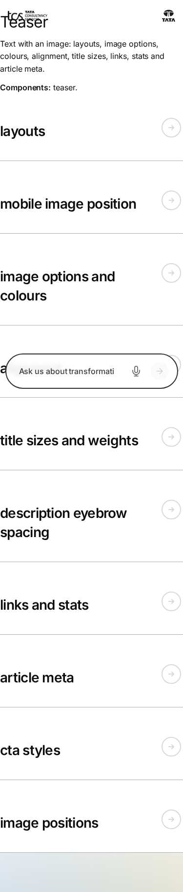

*Figure: Teaser: teaser — mobile 375 × 812 (/design-block-master/en/block-library/teaser, captured 2026-11-08).*

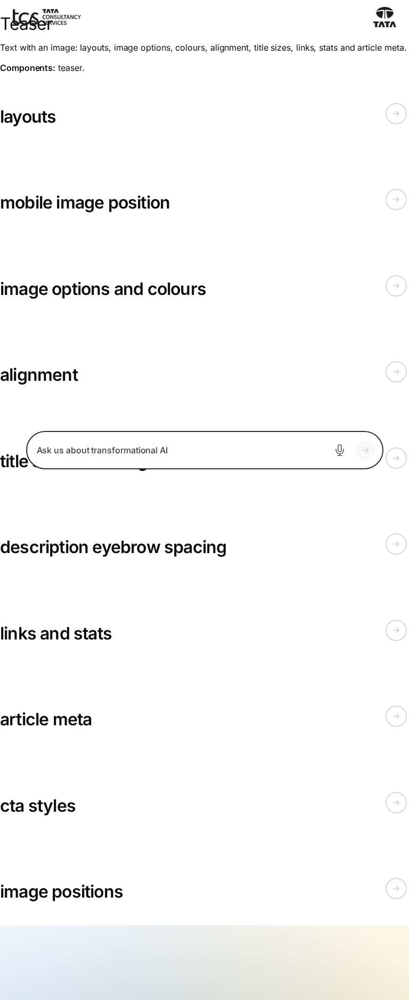

*Figure: Teaser: teaser — tablet 768 × 900 (/design-block-master/en/block-library/teaser, captured 2026-11-08).*

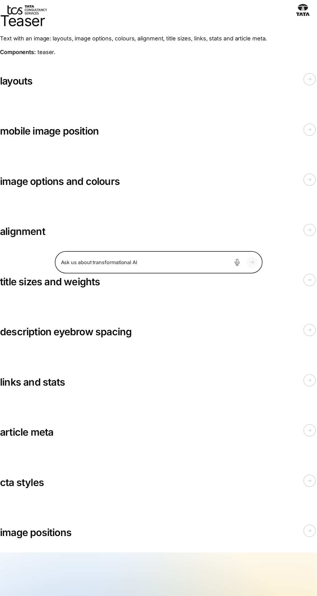

*Figure: Teaser: teaser — small desktop 1024 × 900 (/design-block-master/en/block-library/teaser, captured 2026-11-08).*

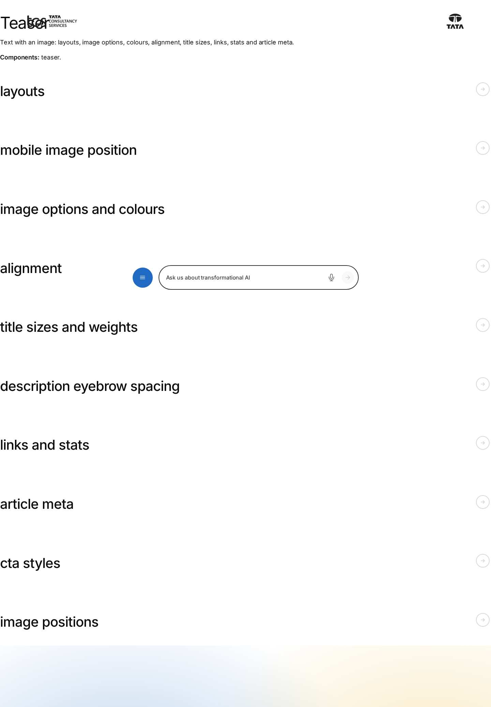

*Figure: Teaser: teaser — desktop 1440 × 900 (/design-block-master/en/block-library/teaser, captured 2026-11-08).*

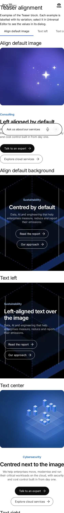

*Figure: Teaser: teaser/alignment — mobile 375 × 812 (/design-block-master/en/block-library/teaser/alignment, captured 2026-11-08).*

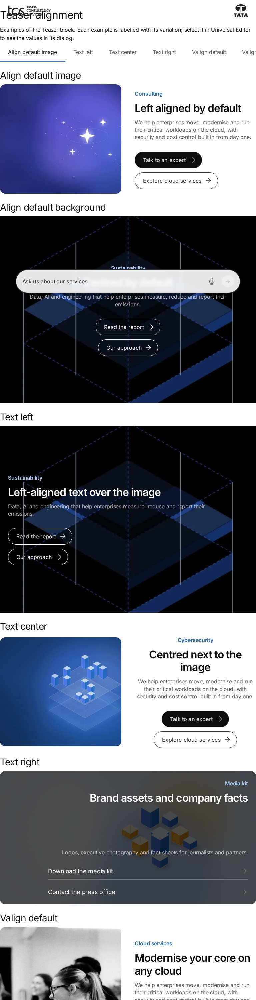

*Figure: Teaser: teaser/alignment — tablet 768 × 900 (/design-block-master/en/block-library/teaser/alignment, captured 2026-11-08).*

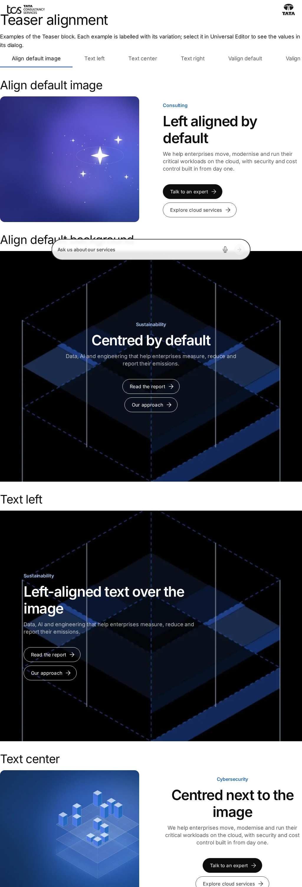

*Figure: Teaser: teaser/alignment — small desktop 1024 × 900 (/design-block-master/en/block-library/teaser/alignment, captured 2026-11-08).*

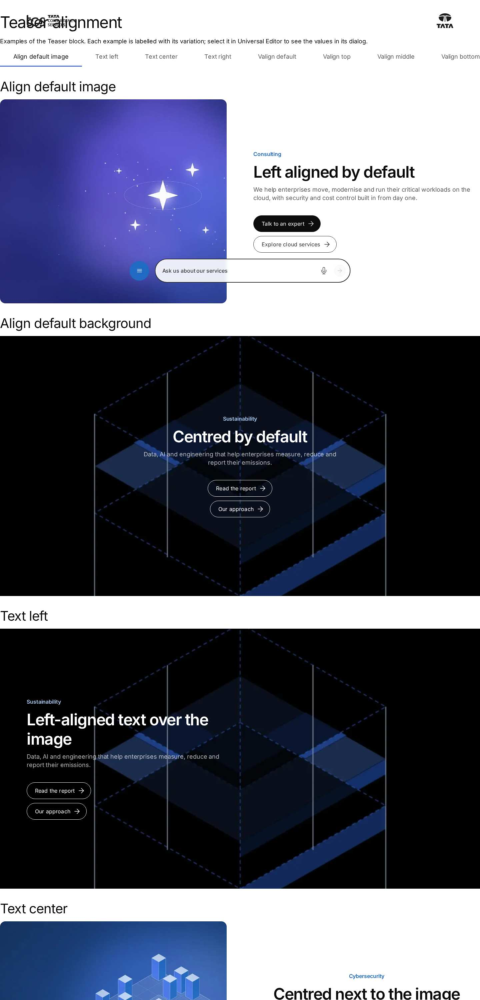

*Figure: Teaser: teaser/alignment — desktop 1440 × 900 (/design-block-master/en/block-library/teaser/alignment, captured 2026-11-08).*

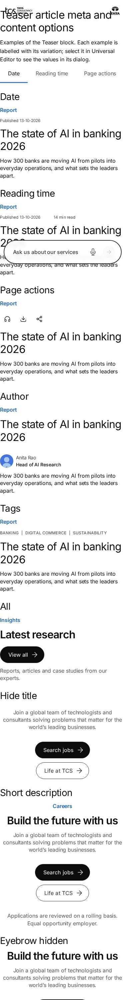

*Figure: Teaser: teaser/article-meta — mobile 375 × 812 (/design-block-master/en/block-library/teaser/article-meta, captured 2026-11-08).*

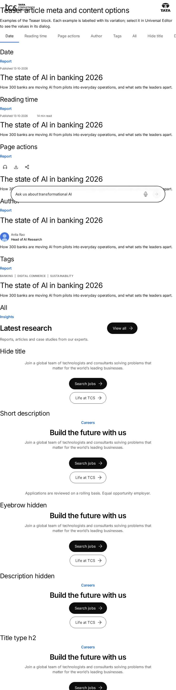

*Figure: Teaser: teaser/article-meta — tablet 768 × 900 (/design-block-master/en/block-library/teaser/article-meta, captured 2026-11-08).*

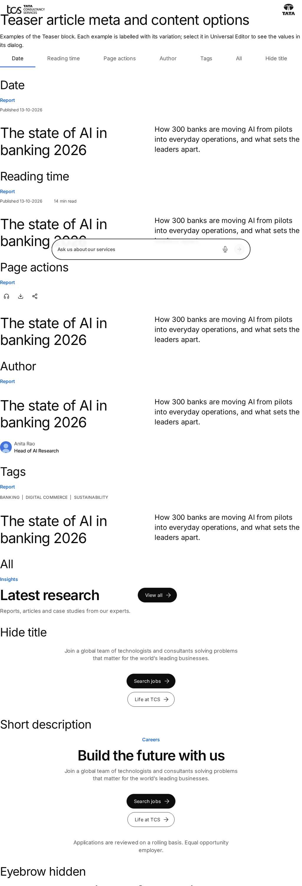

*Figure: Teaser: teaser/article-meta — small desktop 1024 × 900 (/design-block-master/en/block-library/teaser/article-meta, captured 2026-11-08).*

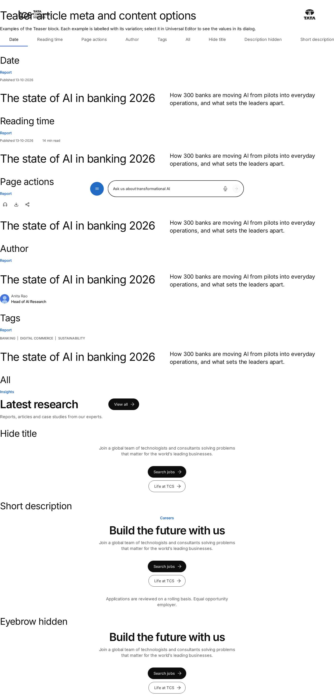

*Figure: Teaser: teaser/article-meta — desktop 1440 × 900 (/design-block-master/en/block-library/teaser/article-meta, captured 2026-11-08).*

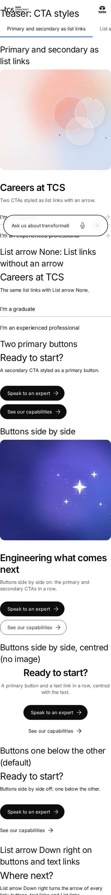

*Figure: Teaser: teaser/cta-styles — mobile 375 × 812 (/design-block-master/en/block-library/teaser/cta-styles, captured 2026-11-08).*

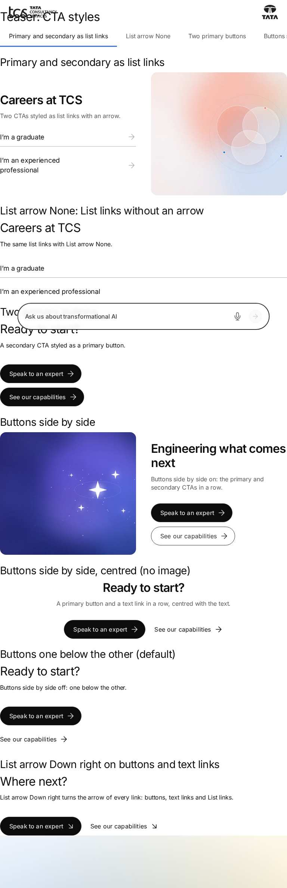

*Figure: Teaser: teaser/cta-styles — tablet 768 × 900 (/design-block-master/en/block-library/teaser/cta-styles, captured 2026-11-08).*

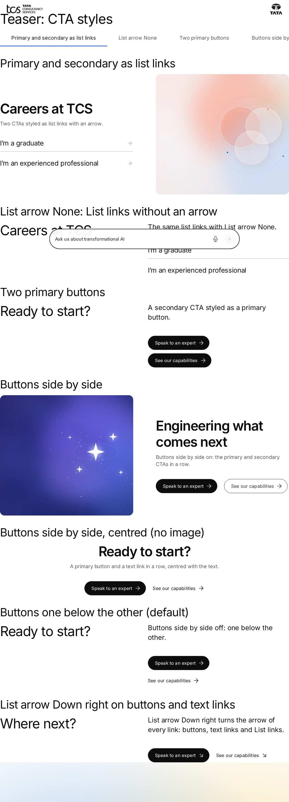

*Figure: Teaser: teaser/cta-styles — small desktop 1024 × 900 (/design-block-master/en/block-library/teaser/cta-styles, captured 2026-11-08).*

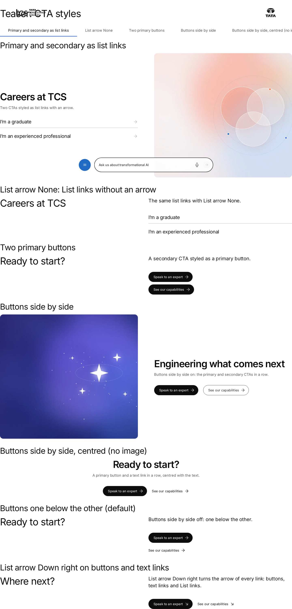

*Figure: Teaser: teaser/cta-styles — desktop 1440 × 900 (/design-block-master/en/block-library/teaser/cta-styles, captured 2026-11-08).*

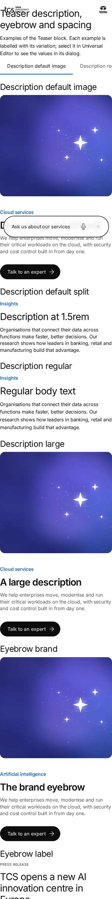

*Figure: Teaser: teaser/description-eyebrow-spacing — mobile 375 × 812 (/design-block-master/en/block-library/teaser/description-eyebrow-spacing, captured 2026-11-08).*

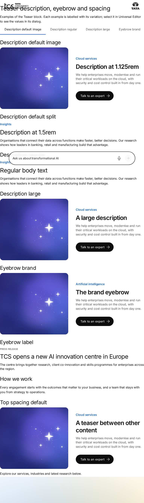

*Figure: Teaser: teaser/description-eyebrow-spacing — tablet 768 × 900 (/design-block-master/en/block-library/teaser/description-eyebrow-spacing, captured 2026-11-08).*

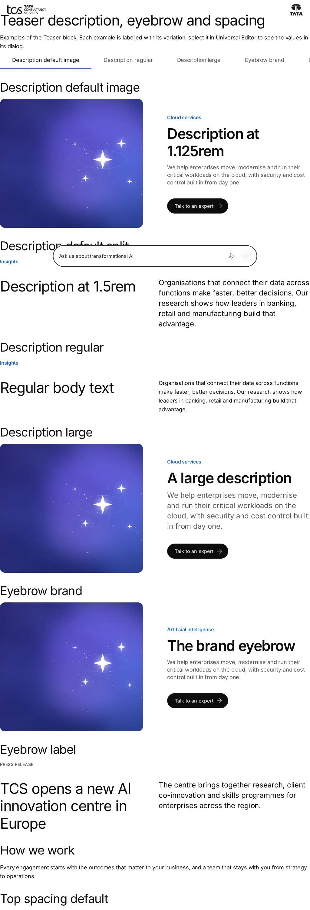

*Figure: Teaser: teaser/description-eyebrow-spacing — small desktop 1024 × 900 (/design-block-master/en/block-library/teaser/description-eyebrow-spacing, captured 2026-11-08).*

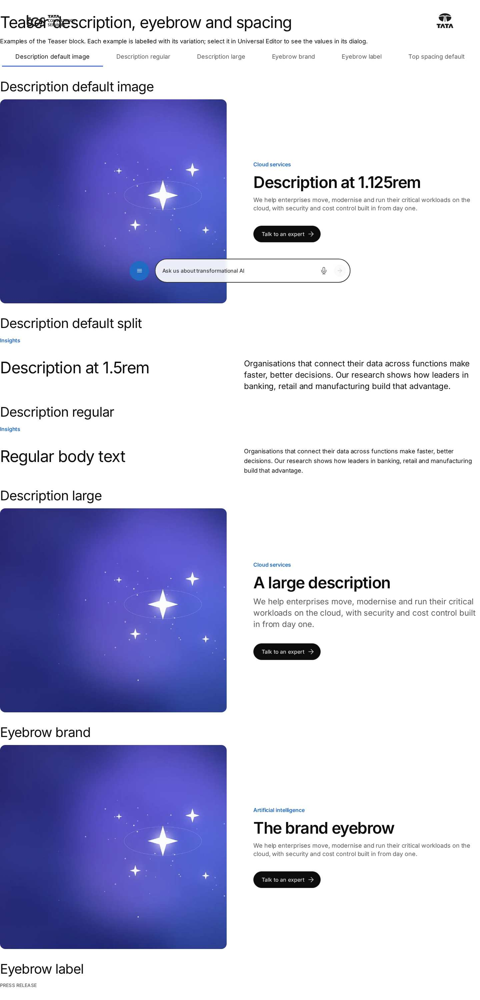

*Figure: Teaser: teaser/description-eyebrow-spacing — desktop 1440 × 900 (/design-block-master/en/block-library/teaser/description-eyebrow-spacing, captured 2026-11-08).*

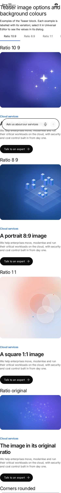

*Figure: Teaser: teaser/image-options-and-colours — mobile 375 × 812 (/design-block-master/en/block-library/teaser/image-options-and-colours, captured 2026-11-08).*

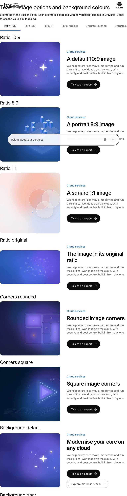

*Figure: Teaser: teaser/image-options-and-colours — tablet 768 × 900 (/design-block-master/en/block-library/teaser/image-options-and-colours, captured 2026-11-08).*

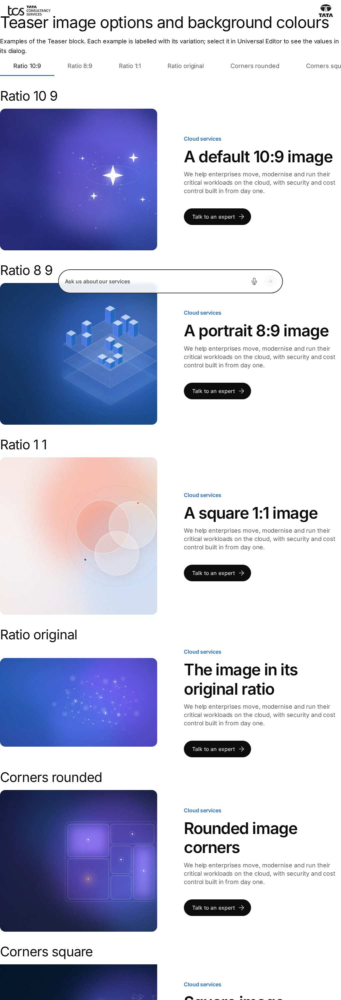

*Figure: Teaser: teaser/image-options-and-colours — small desktop 1024 × 900 (/design-block-master/en/block-library/teaser/image-options-and-colours, captured 2026-11-08).*

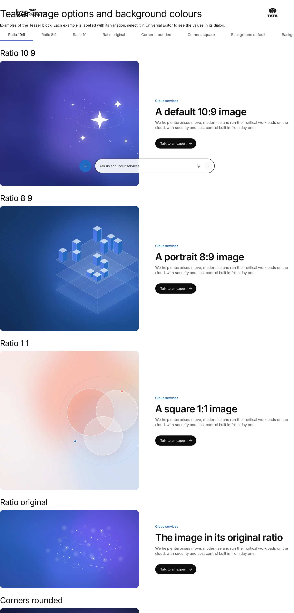

*Figure: Teaser: teaser/image-options-and-colours — desktop 1440 × 900 (/design-block-master/en/block-library/teaser/image-options-and-colours, captured 2026-11-08).*

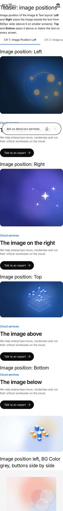

*Figure: Teaser: teaser/image-positions — mobile 375 × 812 (/design-block-master/en/block-library/teaser/image-positions, captured 2026-11-08).*

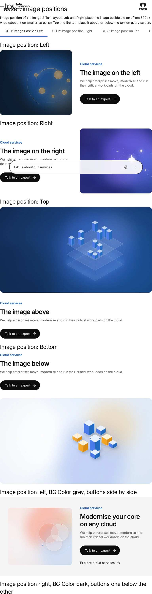

*Figure: Teaser: teaser/image-positions — tablet 768 × 900 (/design-block-master/en/block-library/teaser/image-positions, captured 2026-11-08).*

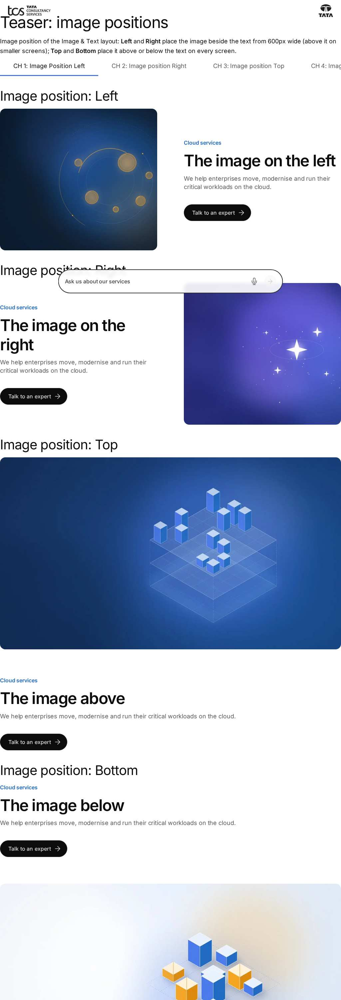

*Figure: Teaser: teaser/image-positions — small desktop 1024 × 900 (/design-block-master/en/block-library/teaser/image-positions, captured 2026-11-08).*

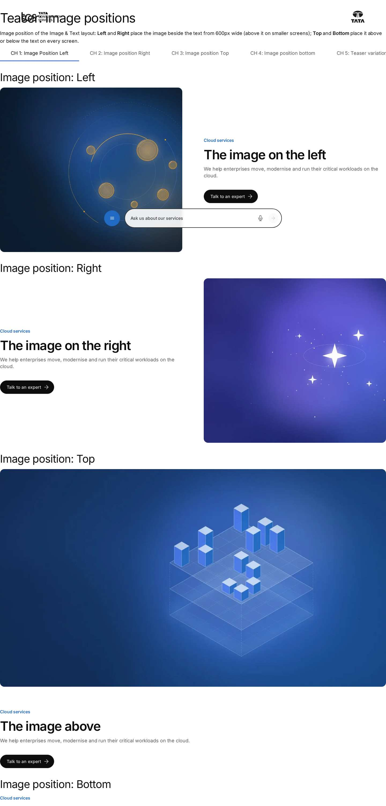

*Figure: Teaser: teaser/image-positions — desktop 1440 × 900 (/design-block-master/en/block-library/teaser/image-positions, captured 2026-11-08).*

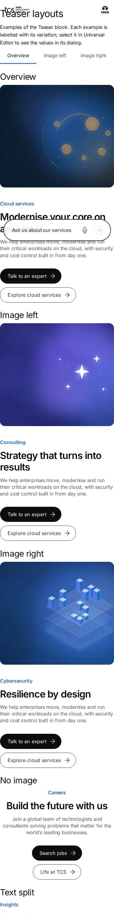

*Figure: Teaser: teaser/layouts — mobile 375 × 812 (/design-block-master/en/block-library/teaser/layouts, captured 2026-11-08).*

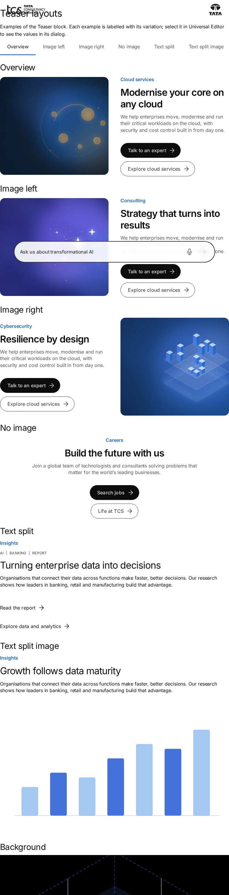

*Figure: Teaser: teaser/layouts — tablet 768 × 900 (/design-block-master/en/block-library/teaser/layouts, captured 2026-11-08).*

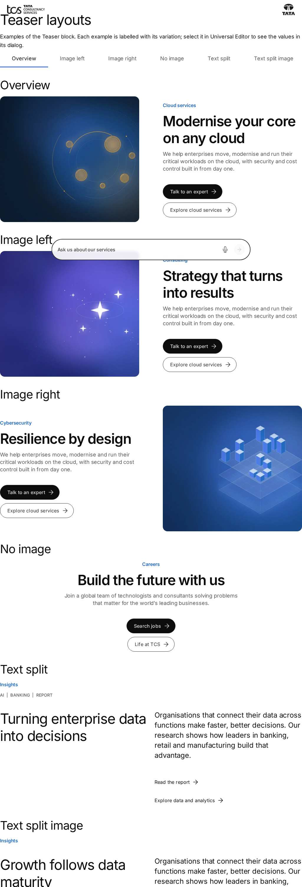

*Figure: Teaser: teaser/layouts — small desktop 1024 × 900 (/design-block-master/en/block-library/teaser/layouts, captured 2026-11-08).*

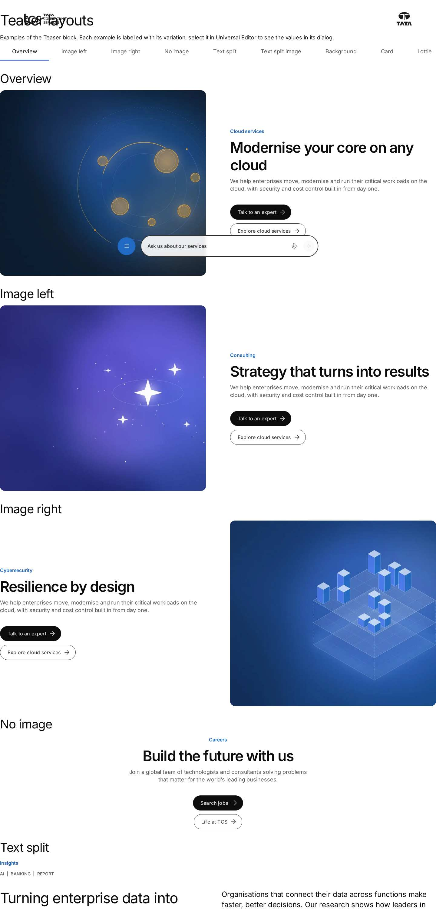

*Figure: Teaser: teaser/layouts — desktop 1440 × 900 (/design-block-master/en/block-library/teaser/layouts, captured 2026-11-08).*

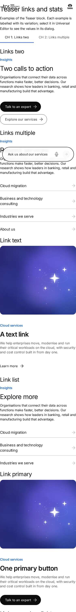

*Figure: Teaser: teaser/links-and-stats — mobile 375 × 812 (/design-block-master/en/block-library/teaser/links-and-stats, captured 2026-11-08).*

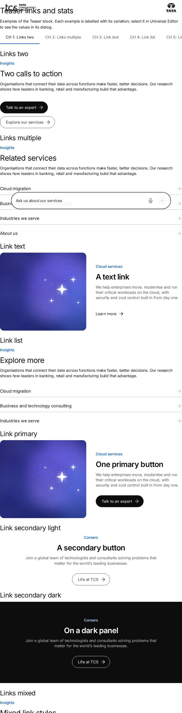

*Figure: Teaser: teaser/links-and-stats — tablet 768 × 900 (/design-block-master/en/block-library/teaser/links-and-stats, captured 2026-11-08).*

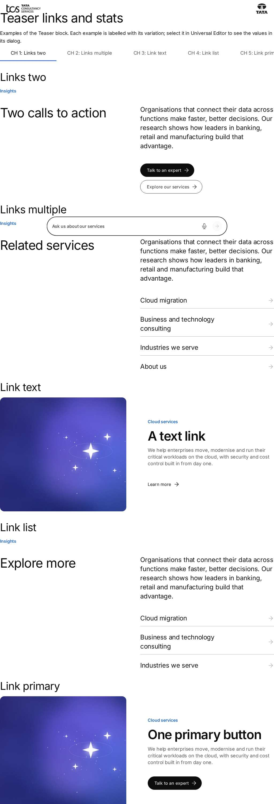

*Figure: Teaser: teaser/links-and-stats — small desktop 1024 × 900 (/design-block-master/en/block-library/teaser/links-and-stats, captured 2026-11-08).*

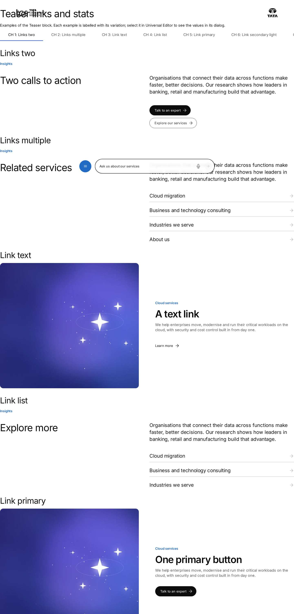

*Figure: Teaser: teaser/links-and-stats — desktop 1440 × 900 (/design-block-master/en/block-library/teaser/links-and-stats, captured 2026-11-08).*

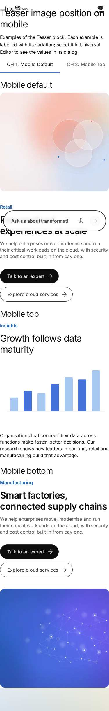

*Figure: Teaser: teaser/mobile-image-position — mobile 375 × 812 (/design-block-master/en/block-library/teaser/mobile-image-position, captured 2026-11-08).*

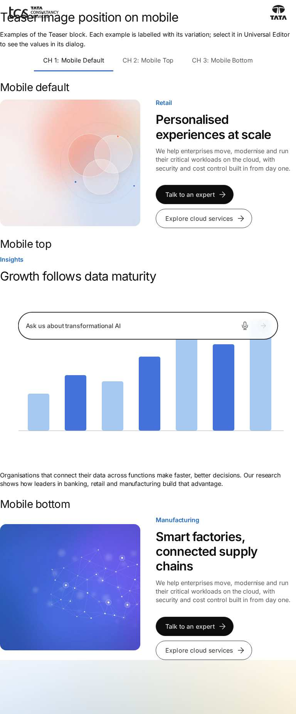

*Figure: Teaser: teaser/mobile-image-position — tablet 768 × 900 (/design-block-master/en/block-library/teaser/mobile-image-position, captured 2026-11-08).*

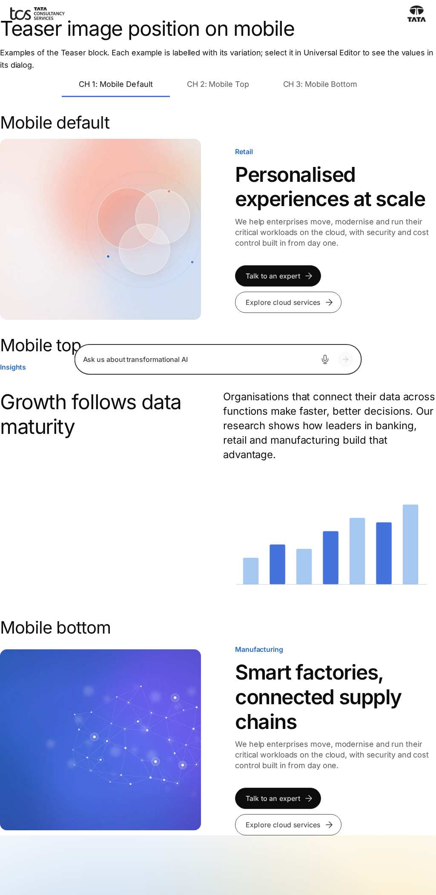

*Figure: Teaser: teaser/mobile-image-position — small desktop 1024 × 900 (/design-block-master/en/block-library/teaser/mobile-image-position, captured 2026-11-08).*

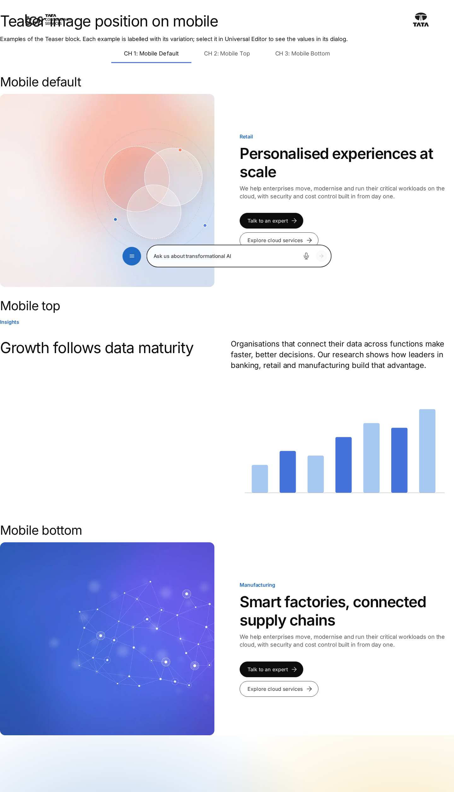

*Figure: Teaser: teaser/mobile-image-position — desktop 1440 × 900 (/design-block-master/en/block-library/teaser/mobile-image-position, captured 2026-11-08).*

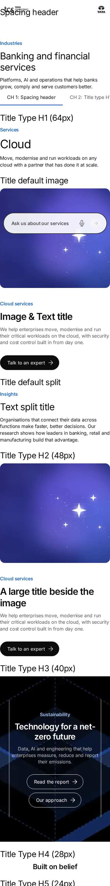

*Figure: Teaser: teaser/title-sizes-and-weights — mobile 375 × 812 (/design-block-master/en/block-library/teaser/title-sizes-and-weights, captured 2026-11-08).*

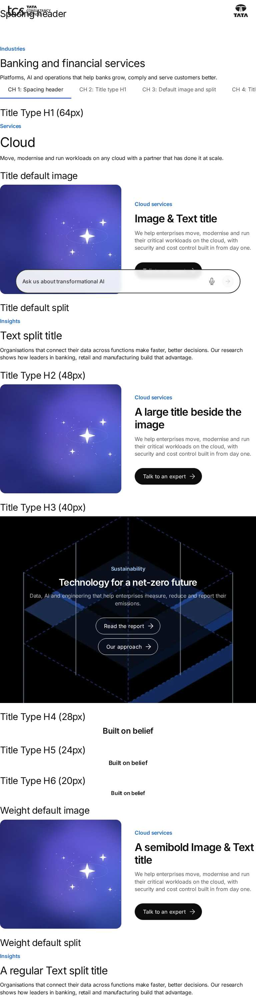

*Figure: Teaser: teaser/title-sizes-and-weights — tablet 768 × 900 (/design-block-master/en/block-library/teaser/title-sizes-and-weights, captured 2026-11-08).*

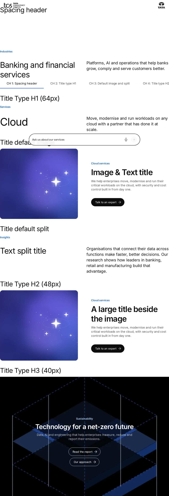

*Figure: Teaser: teaser/title-sizes-and-weights — small desktop 1024 × 900 (/design-block-master/en/block-library/teaser/title-sizes-and-weights, captured 2026-11-08).*

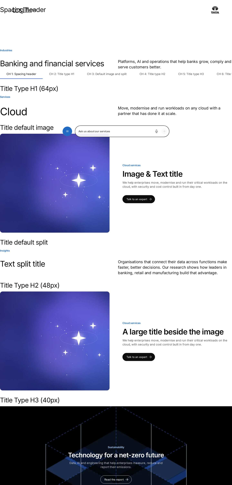

*Figure: Teaser: teaser/title-sizes-and-weights — desktop 1440 × 900 (/design-block-master/en/block-library/teaser/title-sizes-and-weights, captured 2026-11-08).*

## Known limitations

- None recorded for this document.

## Open items

- None.

## Change history

| Version | Date | Author | Change |
| --- | --- | --- | --- |
| 1.0 | 8 November 2026 | Delivery team (documentation program) | First version of the role-specific documentation (master documentation prompt), generated from the repository and the published reference pages |
