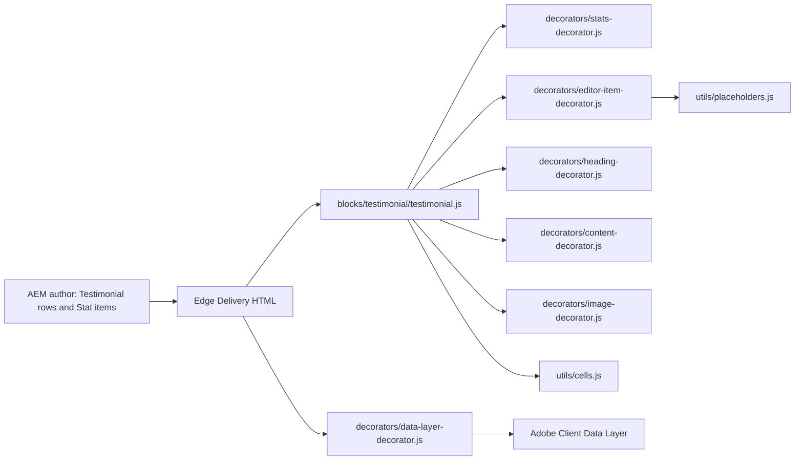
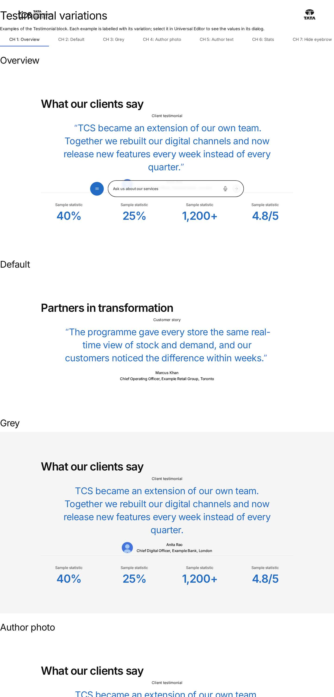
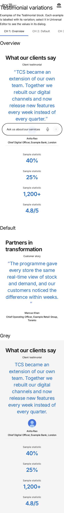

# Testimonial Block — Developer Guide

| Attribute | Value |
| --- | --- |
| Document ID | DEV-B-testimonial |
| Audience | Developers, technical leads, block owners, AI coding agents |
| Purpose | How the Testimonial block is built: files, model, structure, behaviour, variations, tests and limitations |
| Scope | blocks/testimonial/ and its components testimonial, testimonial-stat |
| Prerequisites | — |
| Owner | Technical Lead / Block Owner (proposed) |
| Approver | Product Owner (to be confirmed) |
| Version | 1.0 |
| Status | Draft for review |
| Last updated | 8 November 2026 |
| Last validated | 2026-11-08 (model, files, imports from the code; reference pages from the live site) |
| Source files | blocks/testimonial/README.md, blocks/testimonial/_testimonial.json, blocks/testimonial/testimonial.css, blocks/testimonial/testimonial.js |
| Related documents | [Variations](./TESTIMONIAL-VARIATIONS.md), [Test coverage](./TESTIMONIAL-TEST-COVERAGE.md), [Authoring guide](../../../03-authoring/components/testimonial/TESTIMONIAL-AUTHORING-GUIDE.md) |
| Related AEM paths | /content/tcs-corp/design-block-master/en/block-library/testimonial, /content/tcs-corp/design-block-master/en/block-library/testimonial/testimonial-variations |

## Contents

- [Summary](#summary)
- [Overview](#overview)
- [Source files](#source-files)
- [Components, models and filters](#components-models-and-filters)
- [Fields](#fields)
- [Dependencies](#dependencies)
- [For Developers](#for-developers)
- [Extending the Block](#extending-the-block)
- [Responsive Behavior](#responsive-behavior)
- [Accessibility](#accessibility)
- [Data Layer and Analytics](#data-layer-and-analytics)
- [Performance Considerations](#performance-considerations)
- [Security and Privacy](#security-and-privacy)
- [For Architects](#for-architects)
- [Troubleshooting](#troubleshooting)
- [Known limitations of the block](#known-limitations-of-the-block)
- [Change history of the block](#change-history-of-the-block)
- [Reference pages](#reference-pages)
- [Coverage of the required topics](#coverage-of-the-required-topics)
- [Screenshots](#screenshots)
- [Known limitations](#known-limitations)
- [Open items](#open-items)
- [Change history](#change-history)

## Summary

| Attribute | Value |
| --- | --- |
| Block | Testimonial |
| Folder | `blocks/testimonial` |
| Type | Container |
| Category | content |
| Status | Active |
| Purpose | A client testimonial with author, image and stats |
| Variations (summary) | BG Color, show / hide options |
| Children | testimonial-stat (Stat) |
| Code size | 357 lines of JS and CSS |

## Overview

- **Business purpose:** builds trust by showing a client's own words together with measurable results.
- **User experience:** a left-aligned section title, then the eyebrow, quote and author centred in up to 59.375rem, then the stats in columns under a divider.
- **Templates / page types:** any page. No template adds the block.
- **Data source:** authored fields and Stat items only. The block reads no sheet, metadata, Authors sheet, taxonomy or query index.
- **Related blocks:** Quote (`blocks/quote`) for a large portrait overlapped by the quote. Teaser (`blocks/teaser`), which builds its stats with the same stats decorator. Cards / List for stat grids with links.
- **When to use:** one testimonial is the focus of a section, ideally with quantified results.
- **When not to use:** for a large portrait (use a Quote). For several testimonials side by side (use one Testimonial per Gen Carousel slide, or cards). For a call to action (the block has no CTA field).
- **Realistic use cases:** a client testimonial with the outcomes of an engagement on a case study page; a results band with the description and author hidden; a short endorsement with name and role only.

## Source files

| File | Link |
| --- | --- |
| `README.md` | [GitHub](https://github.com/sradha-tcs/tcs-corp/blob/main/blocks/testimonial/README.md) |
| `_testimonial.json` | [GitHub](https://github.com/sradha-tcs/tcs-corp/blob/main/blocks/testimonial/_testimonial.json) |
| `testimonial.css` | [GitHub](https://github.com/sradha-tcs/tcs-corp/blob/main/blocks/testimonial/testimonial.css) |
| `testimonial.js` | [GitHub](https://github.com/sradha-tcs/tcs-corp/blob/main/blocks/testimonial/testimonial.js) |

## Components, models and filters

| Component | Title | Resource type | Template name | Model | Children allowed |
| --- | --- | --- | --- | --- | --- |
| `testimonial` | Testimonial | `core/franklin/components/block/v1/block` | Testimonial | `testimonial` | testimonial-stat |
| `testimonial-stat` | Stat | `core/franklin/components/block/v1/block/item` | Stat | `testimonial-stat` | — |

## Fields

The Additional tab fields (anchor, hide, padding, margin, animation) are common to the blocks and described in the [content modeling guide](../../markdown/CONTENT-MODELING-GUIDE.md).

### Testimonial (`testimonial`)

| Tab | Label | Property | Type | Required in model | Default | Options | Visibility |
| --- | --- | --- | --- | --- | --- | --- | --- |
| Content | Eyebrow | `eyebrow` | text | No | — | — | — |
| Content | Title | `title` | text | No | — | — | — |
| Content | Title Type | `titleType` | select | No | `h2` | 6 options | — |
| Content | Description | `description` | richtext | No | `""` | — | — |
| Content | Author | `authorName` | text | No | — | — | — |
| Content | Author Image | `authorImage` | reference | No | — | — | — |
| Content | Author Image Alt Text | `authorImageAlt` | text | No | — | — | — |
| Content | Designation & Location | `designationLocation` | richtext | No | `""` | — | — |
| Content | Stats | `stats` | container | No | — | — | — |
| Content | Stats › Stats Title | `statLabel` | richtext | No | `""` | — | — |
| Content | Stats › Stats Value | `statValue` | richtext | No | `""` | — | — |
| Style | BG Color | `bgColor` | select | No | `""` | 3 options | — |
| Style | Hide Eyebrow | `hideEyebrow` | boolean | No | `false` | — | — |
| Style | Hide Title | `titleHidden` | boolean | No | `false` | — | — |
| Style | Show Description | `showDescription` | boolean | No | `true` | — | — |
| Style | Hide Author Details | `hideAuthor` | boolean | No | `false` | — | — |

### Stat (`testimonial-stat`)

| Tab | Label | Property | Type | Required in model | Default | Options | Visibility |
| --- | --- | --- | --- | --- | --- | --- | --- |
| Stat | Stats Title | `statLabel` | richtext | No | `""` | — | — |
| Stat | Stats Value | `statValue` | richtext | No | `""` | — | — |

"Required in model" is the model's `required` flag; whether a field is required in practice is stated in the authoring guide where it is known.

## Dependencies

| Import |
| --- |
| `../../decorators/a11y-decorator.js` |
| `../../decorators/content-decorator.js` |
| `../../decorators/editor-item-decorator.js` |
| `../../decorators/heading-decorator.js` |
| `../../decorators/image-decorator.js` |
| `../../decorators/stats-decorator.js` |
| `../../utils/cells.js` |
| `../../utils/properties.js` |

## For Developers

<!-- BEGIN GENERATED: files (npm run build:docs) -->

```text
blocks/testimonial/
├── README.md
├── _testimonial.json
├── testimonial.css
└── testimonial.js
```

| Decorator/Utility | Purpose | Execution or dependency point |
| ----------------- | ------- | ----------------------------- |
| [`decorators/a11y-decorator.js`](https://github.com/sradha-tcs/tcs-corp/blob/main/decorators/a11y-decorator.js) | `hideVisually`, `createHiddenText` (with `.visually-hidden` in `styles/styles.css`) | `testimonial.js`: { hideVisually } |
| [`decorators/content-decorator.js`](https://github.com/sradha-tcs/tcs-corp/blob/main/decorators/content-decorator.js) | `fromCell` (property content into an element, keeping editor instrumentation) | `testimonial.js`: { fromCell } |
| [`decorators/editor-item-decorator.js`](https://github.com/sradha-tcs/tcs-corp/blob/main/decorators/editor-item-decorator.js) | `buildEditorItems`, `editorItemHint` (in Universal Editor, an item the block doesn't render yet, e.g. a CTA just added, as a dashed placeholder the author can select; styles in `styles/lazy-styles.css`; the hint loaded o | `testimonial.js`: { editorItemHint } |
| [`decorators/heading-decorator.js`](https://github.com/sradha-tcs/tcs-corp/blob/main/decorators/heading-decorator.js) | `buildHeading` (Title + Title Type), `HEADINGS` | `testimonial.js`: { buildHeading } |
| [`decorators/image-decorator.js`](https://github.com/sradha-tcs/tcs-corp/blob/main/decorators/image-decorator.js) | `pictureOf` (image with its alt text field) | `testimonial.js`: { pictureOf } |
| [`decorators/stats-decorator.js`](https://github.com/sradha-tcs/tcs-corp/blob/main/decorators/stats-decorator.js) | `buildStats` (Stat items, and the Stats composite multifield authored before them, as a description list) | `testimonial.js`: { buildStats } |
| [`utils/cells.js`](https://github.com/sradha-tcs/tcs-corp/blob/main/utils/cells.js) | `itemRows`, `KEY_VALUE_ITEM`, `FIELD_ROW_ITEM` (the item rows of a block: by model in the editor, by their cells on the page), `withoutTabCells` (drops the empty cell AEM renders for each dialog tab of an item model), `m | `testimonial.js`: { KEY_VALUE_ITEM, itemRows } |
| [`utils/properties.js`](https://github.com/sradha-tcs/tcs-corp/blob/main/utils/properties.js) | `readProperties`, `textOf`, `isOn`, `isOnByDefault` (a toggle that defaults to on), `optionOf`, `normalizeKey`, `textSource` (key-value block properties) | `testimonial.js`: { isOn, isOnByDefault, optionOf, readProperties, textOf, } |

<!-- END GENERATED: files -->

- **JavaScript (`testimonial.js`):** an async `decorate(block)`. It reads the properties (`readProperties`) and the Stat item rows (`itemRows(block, ['testimonial-stat'], KEY_VALUE_ITEM)`: by `data-aue-model` in the editor, else rows with other than two cells). It builds the title, the figure and the stats, then replaces the children.
- **CSS (`testimonial.css`):** the column layout, the centred figure, the author row, the stats grid with its divider, the Grey panel, and the 900px changes.
- **Input DOM:** key-value rows (`eyebrow`, `title`, `titleType`, `description`, `authorName`, `authorImage`, `authorImageAlt`, `designationLocation`, `stats`, `bgColor`, `hideEyebrow`, `titleHidden`, `showDescription`, `hideAuthor`), then Stat item rows of three cells: an empty cell for the item's Stat tab, Stats Title, Stats Value (`test/items/item-rows.test.mjs`).
- **Rendered DOM:**

```html
<div class="testimonial block bg-grey">
  <h2 class="testimonial-title">…</h2>
  <figure class="testimonial-quote">
    <p class="testimonial-eyebrow">…</p>
    <blockquote class="testimonial-description">…</blockquote>
    <figcaption>
      <div class="testimonial-author">
        <div class="testimonial-author-image"><picture>…</picture></div>
        <div class="testimonial-author-text">
          <p class="testimonial-author-name">…</p>
          <div class="testimonial-author-details">…</div>
        </div>
      </div>
    </figcaption>
  </figure>
  <dl class="testimonial-stats">
    <div class="testimonial-stat">
      <dt class="testimonial-stat-label">…</dt>
      <dd class="testimonial-stat-value">…</dd>
    </div>
  </dl>
</div>
```

- **Decoration flow:** properties and item rows; `buildHeading` (+ `hideVisually`); `fromCell` for the eyebrow, description, name and details; `pictureOf` for the photo; `buildStats(props.stats, 'testimonial', statRows, hint)` from `decorators/stats-decorator.js` (multifield stats, then Stat items, then editor placeholders); `bg-grey` reset and set; `replaceChildren`.
- **Async behavior:** `editorItemHint` loads the placeholders (key `itemEditorHint`) only in Universal Editor (rows with `data-aue-resource`). On the page it resolves at once without a request.
- **Error handling:** no try / catch. Missing parts are left out.
- **Exports:** the default `decorate` only.
- **Parent / child contract:** the `testimonial` filter allows only `testimonial-stat`. Its model must render three cells (tab, label, value) so `KEY_VALUE_ITEM` tells it from the two-cell property rows.
- **Editor:** instrumentation moves to the rendered elements and Stat items (`moveInstrumentation`); unrendered Stat items become `.editor-item` placeholders.
- **Motion:** content targets `:scope > *`; the background colour is animated (`BACKGROUNDS.testimonial`).

## Extending the Block

1. **Add a field** in `blocks/testimonial/_testimonial.json` (at most three short tabs, Additional last). Then run `npm run build:json` and `npm run lint`.
2. **Delivery rules:** avoid names ending in Text, Title, Type, Alt or MimeType for values that must be read; no grouped fields; options that should become classes go in `classes_*`; no sample content in templates. Changing the Stat model changes its cells: update `test/items/item-rows.test.mjs` and `decorators/stats-decorator.js` (`readStatRows`) together.
3. **Rendering:** read the field in `testimonial.js` and style it in `testimonial.css`, scoped to `.testimonial`, mobile first, in rem.
4. **Accessibility:** keep the semantic structure; new UI text comes from placeholders with an English fallback.
5. **Data layer:** describe interactive elements with `data-cmp-*` attributes.
6. **Tests:** `npm test` (`test/items/item-rows.test.mjs`, `test/motion/motion.test.mjs`).
7. **Backward compatibility:** keep reading the Stats multifield and the `grey` class fallback.
8. **Library and docs:** update `block-library/testimonial/testimonial-variations`, then `npm run build:docs`. Run `npm run build:modules` after changing imports.

## Responsive Behavior

| Viewport | Layout | Image behavior | Interaction behavior |
| -------- | ------ | -------------- | -------------------- |
| Below 900px | Column with 2.5rem gaps; Grey padding 2.5rem / 1.5rem; smaller type tokens (title 2rem, quote 1.75rem); stats in as many 10rem columns as fit | 3rem round author photo | None |
| 900px and wider | 5rem gaps; Grey padding 7.5rem / 5rem; title 3rem, quote 2.5rem; stats up to 70rem wide | 3rem round author photo | None |

The type sizes come from the global tokens in `styles/styles.css`, which change at 900px.

## Accessibility

- **Semantic HTML:** the title heading, then a `<figure>` with the eyebrow `<p>`, the `<blockquote>` and a `<figcaption>`; the stats are a `<dl>`.
- **Headings:** Title Type sets the level. Hide Title uses the visually hidden pattern, so the heading stays in the outline.
- **Keyboard and focus:** no interactive elements of its own; links in rich text keep the site's focus styles.
- **Alt text:** Author Image Alt Text, else `alt=""`.
- **Reduced motion:** the Additional tab's animations don't run for reduced motion or in the editor.
- **Contrast:** text uses the default, secondary and brand text tokens.
- **Empty states:** parts without content are left out. Stat items without a value are left out on the page and shown as placeholders in the editor.
- **Reflow:** the stats grid wraps; the author row wraps.

Author responsibilities: a fitting heading level, a name that isn't duplicated, alt text when the photo adds information, and stats with values.

Developer responsibilities: keep the figure / blockquote / figcaption and `<dl>` structure, and keep Hide Title visually hidden rather than removed.

The block handles no keys itself.

## Data Layer and Analytics

- **Component:** `trackBlocks` (`decorators/data-layer-decorator.js`) adds `component.{id}` once the sections have loaded: `@type` `tcs-corp/components/testimonial`, id = Anchor ID else `testimonial-{n}`, `parentId`, and `dc:title` = the first heading (also when visually hidden).
- **Variation and item positions:** not recorded; Stat items carry no `data-cmp-*` attributes.
- **Interactions:** the block pushes no events itself. Clicks on links in the rich text are captured centrally.

| Trigger | Data-layer event | Required properties | Analytics behavior |
| ------- | ---------------- | ------------------- | ------------------ |
| Block decorated and sections loaded | component state (`component.{id}`) | `@type`, `parentId`, `dc:title` | Component inventory |
| Click on a link in the Description or Designation & Location | `cmp:click` | `interaction` (`link`), `dc:title`, `xdm:linkURL`, `xdm:linkType`, `breakpoint` | Link click attributed to the Testimonial |

The intended path is Adobe Client Data Layer, then Adobe Data Collection (Tags), the AEP Web SDK, the Edge Network, and finally Analytics / CJA. Tags and the Web SDK aren't configured yet (blocked: measurement plan). No consent mechanism is implemented.

## Performance Considerations

- **Initialization:** decorated when its section loads (eager in the first section). On the page there is no network request; in the editor, the placeholders are loaded once for the item hint.
- **Images:** one small author photo (3rem), lazy unless it is the first image of the first section.
- **DOM:** small; no listeners or observers in the block. **Layout shift:** the photo has a fixed 3rem box.
- **Dynamic imports:** none. Modules are preloaded from `scripts/module-graph.js`.

## Security and Privacy

- **Links:** authored links in the rich text, used as delivered.
- **Sanitization:** delivered nodes are moved, and no HTML is parsed from strings.
- **External content and query strings:** none.
- **Data minimization:** the block collects nothing; the names and photos it shows are authored content. The data layer records the title and clicked link text and URL only.

## For Architects

- **Role:** a presentational block with authored content and item children.
- **Content model:** key-value properties plus `testimonial-stat` items; a legacy composite multifield is still read.
- **Rendering:** client-side decoration of the delivered rows; the text is in the HTML.
- **Dependencies:** `decorators/a11y-decorator.js`, `content-decorator.js`, `editor-item-decorator.js`, `heading-decorator.js`, `image-decorator.js`, `stats-decorator.js`; `utils/cells.js`, `utils/properties.js`.
- **Data layer / Web SDK / Target:** a component entry and central click capture; Tags, the Web SDK and Target aren't integrated. **Consent and identity:** none.
- **Caching:** the page HTML on the CDN. **Performance:** no page requests. **Security:** moves delivered nodes only. **Scalability:** instances are independent.



## Troubleshooting

| Symptom | Likely cause | Diagnostic steps | Resolution | Verification |
| ------- | ------------ | ---------------- | ---------- | ------------ |
| The quote doesn't appear | Show Description off, or the Description is empty | Check the Style tab and the Description | Turn Show Description on; fill in the Description | The `<blockquote>` renders |
| A stat is missing | Its Stats Value is empty | Look for the placeholder in the editor | Fill in Stats Value | The stat renders |
| Value and title swapped (legacy stats) | In the multifield, the last element of an item is always the value | Read the item's paragraphs | Re-enter the stat as a Stat item | Title above value |
| The author row is missing | Hide Author Details on, or no author fields | Check the Style tab | Turn it off; fill in the fields | The figcaption renders |
| The title isn't visible | Hide Title on | Inspect: `visually-hidden` on the heading | Turn Hide Title off | The heading shows |
| The name appears twice | The name was typed in Designation & Location too | Read both fields | Keep the name in Author only | One name |

Evidence to collect: the page URL, viewport, browser, a screenshot, and the block's outer HTML. No credentials or session data.

## Known limitations of the block

| Limitation | Impact | Workaround | Planned correction |
| ---------- | ------ | ---------- | ------------------ |
| In legacy Stats multifield items, the last element is always the value (handover F-25) | A one-element or multi-paragraph item renders unexpectedly | Use Stat items | Not recorded |
| No CTA field | No styled call to action in the block | Add a Teaser or Button below, or a standalone link in the rich text | Not planned |
| Background animation needs BG Color Grey | No background animation on the default white block | Use Animation Type for the content | Not planned |

## Change history of the block

| Version | Change | Source | Date |
| ------- | ------ | ------ | ---- |
| Not recorded | README generated from verified implementation and approved handover documentation | Repository review | Not recorded |
| Handover 2.8 | Dialog reduced to Content / Style / Additional tabs (F-84) | docs/handover revision history | 17 October 2026 |
| Handover 2.10 | Stats authored as Stat items (`testimonial-stat`); the multifield is still read (F-87) | docs/handover revision history | 17 October 2026 |
| Handover 2.18 | Content and Background animation on the Additional tab | docs/handover revision history | 18 October 2026 |
| Handover 2.27 | Block ecosystem audit: the Quote / Testimonial Style field removed | docs/handover revision history | 19 October 2026 |

## Reference pages

| Kind | Page | Live URL |
| --- | --- | --- |
| Block library | /design-block-master/en/block-library/testimonial | https://main--tcs-corp--sradha-tcs.aem.live/design-block-master/en/block-library/testimonial |
| Block library | /design-block-master/en/block-library/testimonial/testimonial-variations | https://main--tcs-corp--sradha-tcs.aem.live/design-block-master/en/block-library/testimonial/testimonial-variations |
| Curated design page | /design-block-master/en/curated-design-pages/case-study | https://main--tcs-corp--sradha-tcs.aem.live/design-block-master/en/curated-design-pages/case-study |
| Curated design page | /design-block-master/en/curated-design-pages/industry-landing-page | https://main--tcs-corp--sradha-tcs.aem.live/design-block-master/en/curated-design-pages/industry-landing-page |
| Curated design page | /design-block-master/en/curated-design-pages/insights | https://main--tcs-corp--sradha-tcs.aem.live/design-block-master/en/curated-design-pages/insights |
| Curated design page | /design-block-master/en/curated-design-pages/product | https://main--tcs-corp--sradha-tcs.aem.live/design-block-master/en/curated-design-pages/product |
| Curated design page | /design-block-master/en/curated-design-pages/services | https://main--tcs-corp--sradha-tcs.aem.live/design-block-master/en/curated-design-pages/services |
| Curated design page | /design-block-master/en/curated-design-pages/story | https://main--tcs-corp--sradha-tcs.aem.live/design-block-master/en/curated-design-pages/story |
| Curated design page | /design-block-master/en/curated-design-pages/who-we-are | https://main--tcs-corp--sradha-tcs.aem.live/design-block-master/en/curated-design-pages/who-we-are |

## Coverage of the required topics

| Topic | Where |
| --- | --- |
| Purpose | Overview |
| Source files | generated: Files |
| Model, definition, filters, children | generated: Components |
| Dependencies | generated: Dependencies |
| Authored input / rendered output / DOM transformation | For Developers |
| Configuration fields, defaults, required fields | generated: Fields |
| Variations | TESTIMONIAL-VARIATIONS.md |
| Responsive behaviour | Responsive Behavior |
| Accessibility and keyboard | Accessibility |
| Analytics / data layer | Data Layer and Analytics |
| Performance | Performance Considerations |
| Security | Security and Privacy |
| Extending | Extending the Block |
| Known limitations | Known Limitations |
| Troubleshooting | Troubleshooting |
| Tests | TESTIMONIAL-TEST-COVERAGE.md |
| SEO behaviour | Not recorded |
| Caching considerations | Not recorded (Edge Delivery default caching; no block-specific rule) |
| Ownership | Technical Lead / Block Owner (proposed) |

## Screenshots



*Figure: Testimonial block library page — desktop 1440 × 900 (/design-block-master/en/block-library/testimonial/testimonial-variations, captured 2026-11-08).*



*Figure: Testimonial block library page — mobile 375 × 812 (/design-block-master/en/block-library/testimonial/testimonial-variations, captured 2026-11-08).*

![Desktop rendering — The Testimonial at 1440 px: the H2 What our clients say left aligned in the default text colour; centred below, the eyebrow Client testimonial, the 2.5rem brand-blue quote TCS became an extension of our own team… and the 3rem round photo person-1.svg beside Anita Rao / Chief Digital Officer, Example Bank, London; under a divider four stats in one row: 40%, 25%, 1,200+ and 4.8/5. (Sample content on the preview; callout letters as in the Field Entry Table; file screenshots/testimonial-desktop-view.jpg)](./screenshots/handover/testimonial-desktop-view.jpg)

*Figure: Desktop rendering — The Testimonial at 1440 px: the H2 What our clients say left aligned in the default text colour; centred below, the eyebrow Client testimonial, the 2.5rem brand-blue quote TCS became an extension of our own team… and the 3rem round photo person-1.svg beside Anita Rao / Chief Digital Officer, Example Bank, London; under a divider four stats in one row: 40%, 25%, 1,200+ and 4.8/5. (Sample content on the preview; callout letters as in the Field Entry Table; file screenshots/testimonial-desktop-view.jpg) (handover screenshot; rendering at the time it was taken).*


*Figure: Tablet rendering — The Testimonial at 768 px with the smaller base sizes: the 2rem title What our clients say, the centred eyebrow, the 1.75rem blue quote and the author row with person-1.svg; under the divider three stats (40%, 25%, 1,200+) in the first row and 4.8/5 Customer satisfaction alone in the second. (Sample content on the preview; callout letters as in the Field Entry Table; file screenshots/testimonial-tablet-view.jpg) (handover screenshot; rendering at the time it was taken).*


*Figure: Mobile rendering — The Testimonial at 375 px: the title What our clients say, the centred eyebrow and blue quote, the round photo with Anita Rao / Chief Digital Officer, Example Bank, London centred, then the four stats stacked one per row under the divider. (Sample content on the preview; callout letters as in the Field Entry Table; file screenshots/testimonial-mobile-view.jpg) (handover screenshot; rendering at the time it was taken).*


*Figure: Default variation — The Testimonial at 1440 px on white: the H2 Partners in transformation left aligned; centred below, Customer story, the large blue quote about the real-time view of stock and demand, and Marcus Khan / Chief Operating Officer, Example Retail Group, Toronto; no photo, no stats. (Sample content on the preview; callout letters as in the Field Entry Table; file screenshots/testimonial-default.jpg) (handover screenshot; rendering at the time it was taken).*


*Figure: Grey background variation — The Testimonial at 1440 px with BG Color Grey: the title What our clients say, the centred eyebrow, the blue quote, the author row with person-1.svg and the four stats under the divider, all on a light grey panel with 7.5rem / 5rem padding. (Sample content on the preview; callout letters as in the Field Entry Table; file screenshots/testimonial-grey-background.jpg) (handover screenshot; rendering at the time it was taken).*


*Figure: Author with photo — A detail of the Testimonial at 1440 px showing the author row below the quote: the centred author row with the 3rem round photo person-1.svg on the left of Anita Rao and Chief Digital Officer, Example Bank, London. (Sample content on the preview; callout letters as in the Field Entry Table; file screenshots/testimonial-author-photo.jpg) (handover screenshot; rendering at the time it was taken).*


*Figure: Author text only — A detail of the Testimonial at 1440 px showing the author row below the quote: Sara Lee and VP Operations, Example Manufacturing, Munich centred on two lines, without a photo. (Sample content on the preview; callout letters as in the Field Entry Table; file screenshots/testimonial-author-text-only.jpg) (handover screenshot; rendering at the time it was taken).*

![Stats variation — The Testimonial at 1440 px: the H2 Measurable outcomes left aligned, the centred Case study results, the cloud-native quote and Sara Lee / Chief Information Officer, Example Insurance, Amsterdam; under a 1px divider four stats in one row, grey titles above 3rem blue values: Faster time to market 40%, Lower operating cost 25%, Applications migrated 1,200+, Customer satisfaction 4.8/5. (Sample content on the preview; callout letters as in the Field Entry Table; file screenshots/testimonial-with-stats.jpg)](./screenshots/handover/testimonial-with-stats.jpg)

*Figure: Stats variation — The Testimonial at 1440 px: the H2 Measurable outcomes left aligned, the centred Case study results, the cloud-native quote and Sara Lee / Chief Information Officer, Example Insurance, Amsterdam; under a 1px divider four stats in one row, grey titles above 3rem blue values: Faster time to market 40%, Lower operating cost 25%, Applications migrated 1,200+, Customer satisfaction 4.8/5. (Sample content on the preview; callout letters as in the Field Entry Table; file screenshots/testimonial-with-stats.jpg) (handover screenshot; rendering at the time it was taken).*


*Figure: Hide Eyebrow variation — The Testimonial at 1440 px with Hide Eyebrow on: the H2 What our clients say, then directly the centred blue quote and the author row with person-1.svg and Anita Rao / Chief Digital Officer, Example Bank, London; no Client testimonial label and no stats. (Sample content on the preview; callout letters as in the Field Entry Table; file screenshots/testimonial-hide-eyebrow.jpg) (handover screenshot; rendering at the time it was taken).*


*Figure: Hide Title variation — The Testimonial at 1440 px with Hide Title on: no visible title; the block starts with the centred eyebrow Client testimonial, then the blue quote and the author row with person-1.svg and Anita Rao. The H2 stays in the HTML for screen readers. (Sample content on the preview; callout letters as in the Field Entry Table; file screenshots/testimonial-hide-title.jpg) (handover screenshot; rendering at the time it was taken).*


*Figure: Show Description off — The Testimonial at 1440 px with Show Description off: the H2 What our clients say, the centred eyebrow Client testimonial and directly the author row with person-1.svg and Anita Rao; under the divider the four stats 40%, 25%, 1,200+ and 4.8/5; no quote. (Sample content on the preview; callout letters as in the Field Entry Table; file screenshots/testimonial-description-hidden.jpg) (handover screenshot; rendering at the time it was taken).*


*Figure: Hide Author Details variation — The Testimonial at 1440 px with Hide Author Details on: the H2 What our clients say, the centred eyebrow and the blue quote, then directly the divider and the four stats 40%, 25%, 1,200+ and 4.8/5; no photo, name or designation. (Sample content on the preview; callout letters as in the Field Entry Table; file screenshots/testimonial-hide-author.jpg) (handover screenshot; rendering at the time it was taken).*


*Figure: Universal Editor canvas — The Testimonial in Universal Editor edit mode at 1440 px, selected, with letters A on the title, B on the eyebrow, C on the quote, D on person-1.svg, E on Anita Rao, F on the designation, G on the stat titles and H on the stat values. An annotated preview, not a Universal Editor screenshot. (Annotated preview in editor mode with sample content; letters as in the annotations list, not a Universal Editor screenshot; file screenshots/testimonial-authoring-view.jpg) (handover screenshot; rendering at the time it was taken).*


*Figure: Properties panel — The Testimonial properties panel showing the six tabs (Content, Author, Style, Show / Hide, Stats, Additional) with the Stats tab open and two items. (Dialog reference generated from the component model, not a Universal Editor screenshot; file screenshots/testimonial-properties-panel.jpg) (handover screenshot; rendering at the time it was taken).*

## Known limitations

- Universal Editor dialogs were not captured: no author access in this program (see the access blockers).

## Open items

- None.

## Change history

| Version | Date | Author | Change |
| --- | --- | --- | --- |
| 1.0 | 8 November 2026 | Delivery team (documentation program) | First version of the role-specific documentation (master documentation prompt), generated from the repository and the published reference pages |
