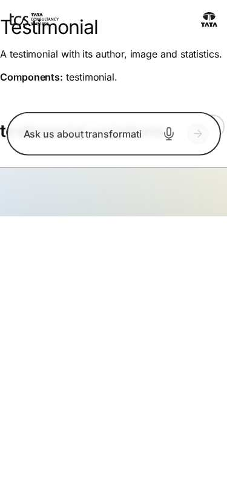
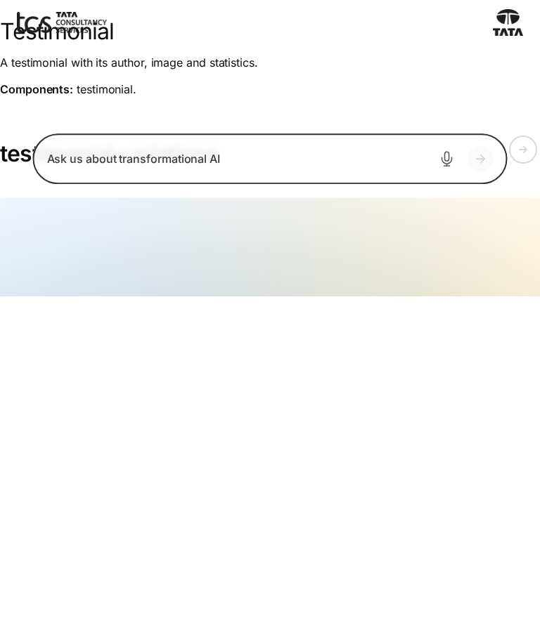
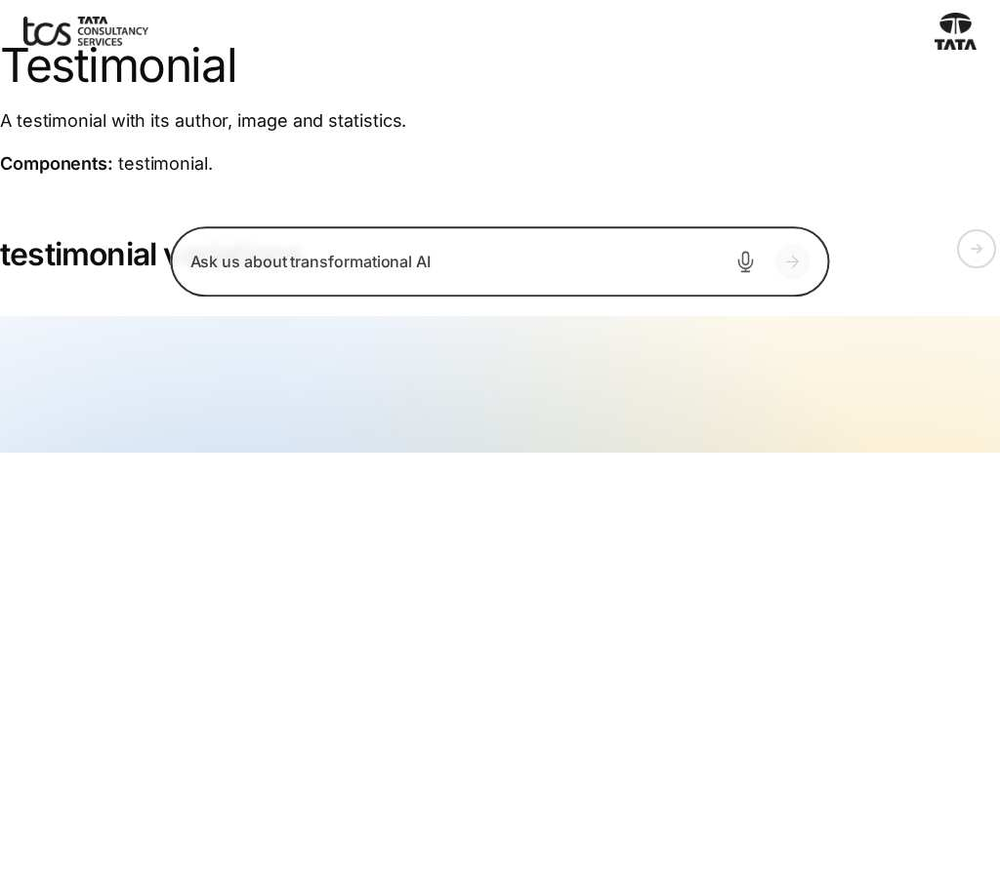
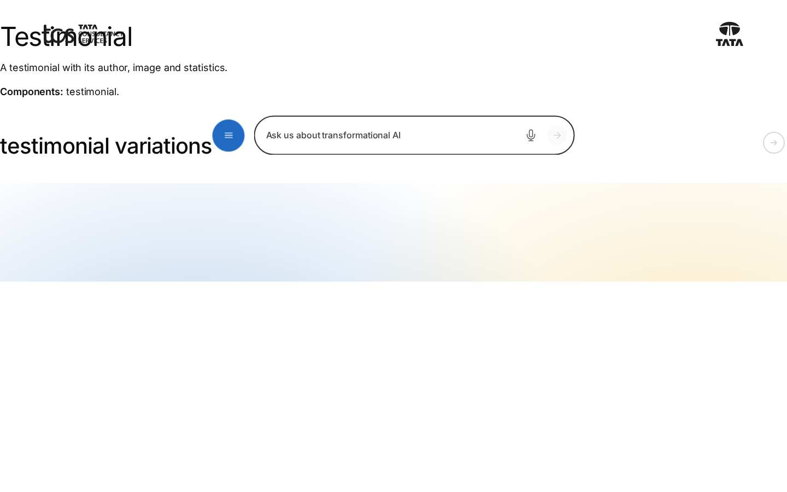
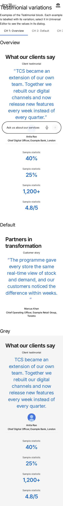
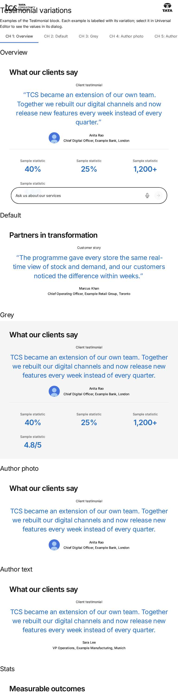
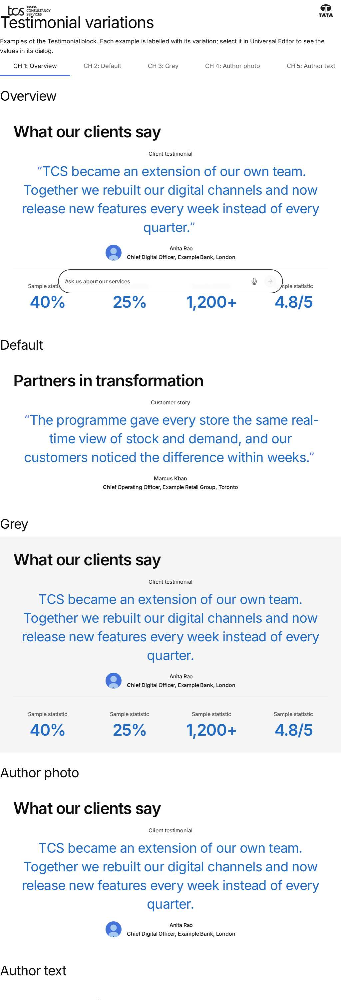
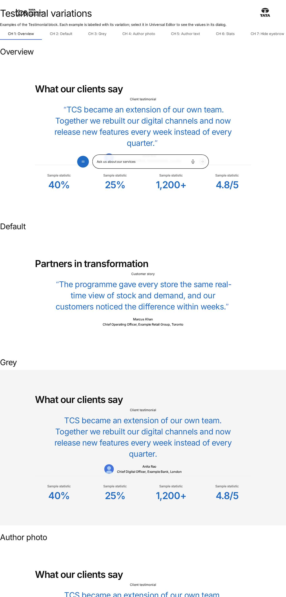

# Testimonial Block — Test Coverage

| Attribute | Value |
| --- | --- |
| Document ID | DEV-T-testimonial |
| Audience | Developers, technical leads, block owners, AI coding agents |
| Purpose | Unit tests, automated reference-page checks and manual test guidance for the block |
| Scope | — |
| Prerequisites | — |
| Owner | Technical Lead / Block Owner (proposed) |
| Approver | Product Owner (to be confirmed) |
| Version | 1.0 |
| Status | Draft for review |
| Last updated | 8 November 2026 |
| Last validated | 8 November 2026 |
| Source files | — |
| Related documents | — |
| Related AEM paths | — |

## Contents

- [Unit tests](#unit-tests)
- [Automated checks of the block library pages (executed 8 November 2026)](#automated-checks-of-the-block-library-pages-executed-8-november-2026)
- [Manual test guidance (block README)](#manual-test-guidance-block-readme)
- [Screenshots](#screenshots)
- [Known limitations](#known-limitations)
- [Open items](#open-items)
- [Change history](#change-history)

## Unit tests

No unit test is specific to this block (shared tests: test/models, test/items, test/docs, test/motion).

## Automated checks of the block library pages (executed 8 November 2026)

Per page: HTTP status and horizontal overflow at 375 / 768 / 1024 / 1440 px, console errors, failed requests and DOM accessibility checks at 1440 px (evidence: [screenshot register](../../../SCREENSHOT-REGISTER.md)).

| Page | 375 / 768 / 1024 / 1440 | Console errors | Failed requests | Accessibility (DOM) |
| --- | --- | --- | --- | --- |
| /design-block-master/en/block-library/testimonial | ok / ok / ok / ok | 8 | 8 | 0 img no alt, 0 unnamed buttons, 1 heading skips |
| /design-block-master/en/block-library/testimonial/testimonial-variations | overflow / overflow / overflow / ok | 4 | 4 | 0 img no alt, 0 unnamed buttons, 0 heading skips |

## Manual test guidance (block README)

| Test ID | Scenario | Configuration | Expected result |
| ------- | -------- | ------------- | --------------- |
| TESTIMONIAL-QA-01 | Default | Title, Eyebrow, Description, Author, Designation & Location | Title, then the centred figure; no stats |
| TESTIMONIAL-QA-02 | Grey | BG Color Grey | Grey panel with 2.5rem / 1.5rem padding, 7.5rem / 5rem from 900px; Background animation offered |
| TESTIMONIAL-QA-03 | Author photo | Author Image, no alt | 3rem round photo with `alt=""` |
| TESTIMONIAL-QA-04 | Stat items | Three Stat items | `dl.testimonial-stats` with three stats in order |
| TESTIMONIAL-QA-05 | Stat without value | A Stat with only Stats Title | Not shown on the page; placeholder in the editor |
| TESTIMONIAL-QA-06 | Legacy stats | Stats multifield authored before | Rendered before the Stat items |
| TESTIMONIAL-QA-07 | Hide Eyebrow | On | No eyebrow |
| TESTIMONIAL-QA-08 | Hide Title | On | Heading visually hidden, present in the HTML and in `dc:title` |
| TESTIMONIAL-QA-09 | Show Description | Off; and a block without the row | Off: no quote; missing row: quote shown |
| TESTIMONIAL-QA-10 | Hide Author Details | On | No figcaption |
| TESTIMONIAL-QA-11 | Empty figure | No eyebrow, description or author | No figure; title and stats only |
| TESTIMONIAL-QA-12 | Viewports | 375 / 768 / 1440px | Stats wrap; gaps and type larger from 900px |
| TESTIMONIAL-QA-13 | Data layer | Load the page | `component.{id}` with `@type` `tcs-corp/components/testimonial` |
| TESTIMONIAL-QA-14 | Multiple instances | Two Testimonials | Independent; ids `testimonial-1`, `testimonial-2` or Anchor IDs |
| TESTIMONIAL-QA-15 | Dark Section | Testimonial with BG Color Grey in a Section with Style Dark | Check the text contrast on the grey panel |

Test cases: [05-quality-assurance/test-cases/blocks/testimonial](../../../05-quality-assurance/test-cases/blocks/testimonial/TESTIMONIAL-TEST-CASES.md).

## Screenshots

*Figure: Testimonial: testimonial — mobile 375 × 812 (/design-block-master/en/block-library/testimonial, captured 2026-11-08).*

*Figure: Testimonial: testimonial — tablet 768 × 900 (/design-block-master/en/block-library/testimonial, captured 2026-11-08).*

*Figure: Testimonial: testimonial — small desktop 1024 × 900 (/design-block-master/en/block-library/testimonial, captured 2026-11-08).*

*Figure: Testimonial: testimonial — desktop 1440 × 900 (/design-block-master/en/block-library/testimonial, captured 2026-11-08).*

*Figure: Testimonial: testimonial/testimonial-variations — mobile 375 × 812 (/design-block-master/en/block-library/testimonial/testimonial-variations, captured 2026-11-08).*

*Figure: Testimonial: testimonial/testimonial-variations — tablet 768 × 900 (/design-block-master/en/block-library/testimonial/testimonial-variations, captured 2026-11-08).*

*Figure: Testimonial: testimonial/testimonial-variations — small desktop 1024 × 900 (/design-block-master/en/block-library/testimonial/testimonial-variations, captured 2026-11-08).*

*Figure: Testimonial: testimonial/testimonial-variations — desktop 1440 × 900 (/design-block-master/en/block-library/testimonial/testimonial-variations, captured 2026-11-08).*

## Known limitations

- None recorded for this document.

## Open items

- None.

## Change history

| Version | Date | Author | Change |
| --- | --- | --- | --- |
| 1.0 | 8 November 2026 | Delivery team (documentation program) | First version of the role-specific documentation (master documentation prompt), generated from the repository and the published reference pages |
