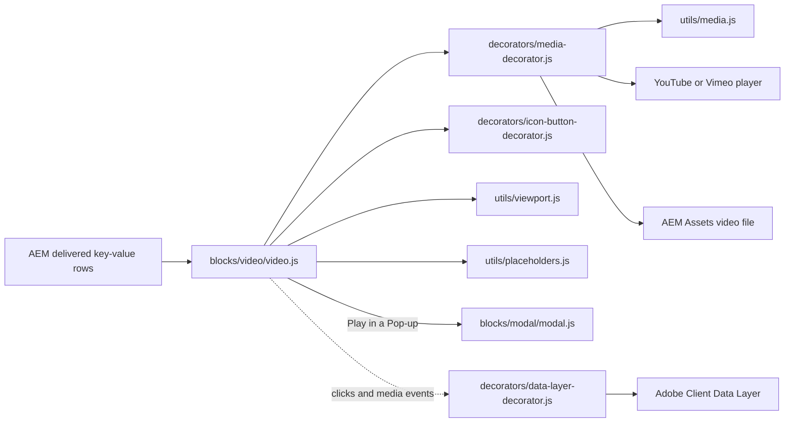
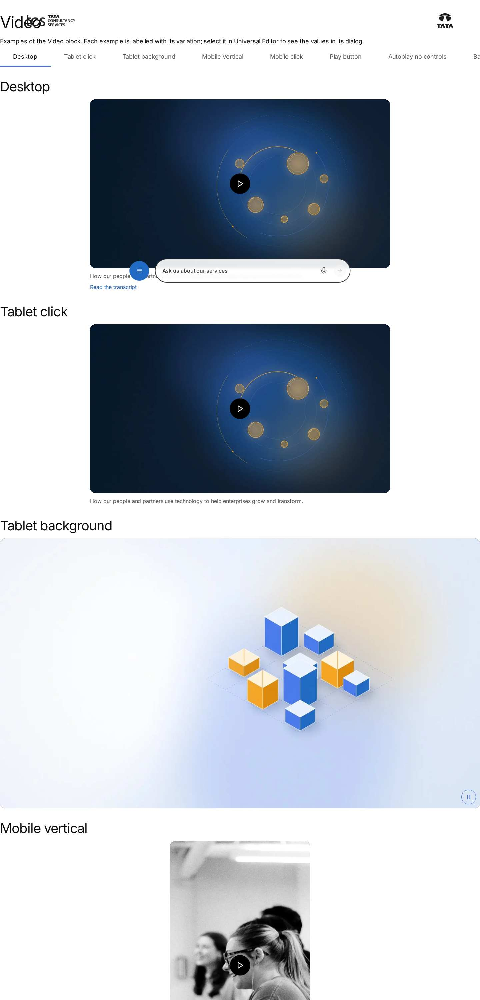
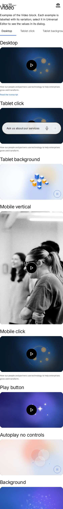
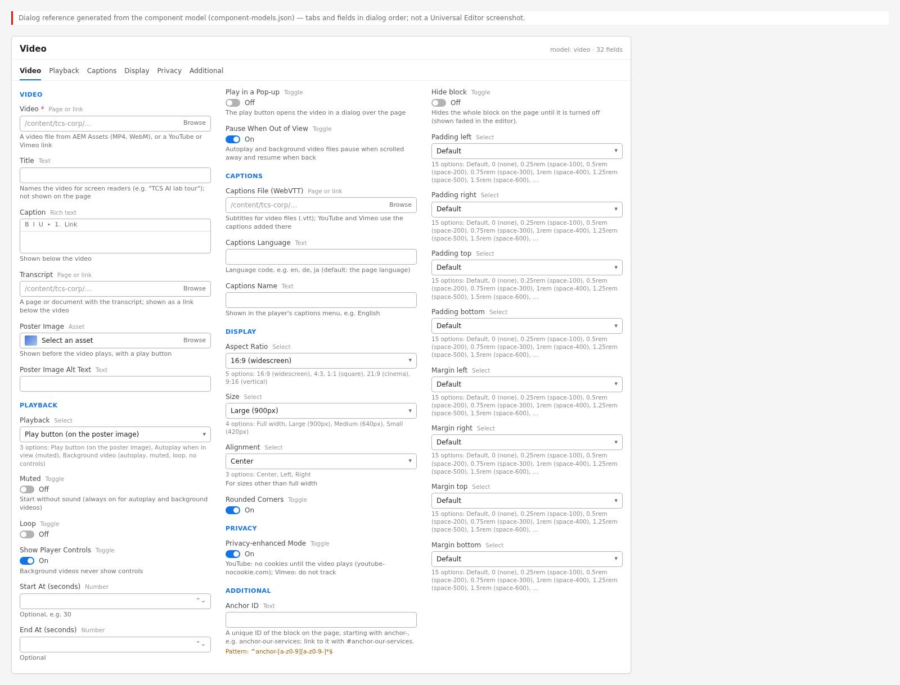

# Video Block — Developer Guide

| Attribute | Value |
| --- | --- |
| Document ID | DEV-B-video |
| Audience | Developers, technical leads, block owners, AI coding agents |
| Purpose | How the Video block is built: files, model, structure, behaviour, variations, tests and limitations |
| Scope | blocks/video/ and its components video |
| Prerequisites | — |
| Owner | Technical Lead / Block Owner (proposed) |
| Approver | Product Owner (to be confirmed) |
| Version | 1.0 |
| Status | Draft for review |
| Last updated | 8 November 2026 |
| Last validated | 2026-11-08 (model, files, imports from the code; reference pages from the live site) |
| Source files | blocks/video/README.md, blocks/video/_video.json, blocks/video/video.css, blocks/video/video.js |
| Related documents | [Variations](./VIDEO-VARIATIONS.md), [Test coverage](./VIDEO-TEST-COVERAGE.md), [Authoring guide](../../../03-authoring/components/video/VIDEO-AUTHORING-GUIDE.md) |
| Related AEM paths | /content/tcs-corp/design-block-master/en/block-library/video, /content/tcs-corp/design-block-master/en/block-library/video/video, /content/tcs-corp/design-block-master/en/block-library/video/video-pop-up |

## Contents

- [Summary](#summary)
- [Overview](#overview)
- [Source files](#source-files)
- [Components, models and filters](#components-models-and-filters)
- [Fields](#fields)
- [Dependencies](#dependencies)
- [For Developers](#for-developers)
- [Extending the Block](#extending-the-block)
- [Responsive Behavior](#responsive-behavior)
- [Accessibility](#accessibility)
- [Data Layer and Analytics](#data-layer-and-analytics)
- [Performance Considerations](#performance-considerations)
- [Security and Privacy](#security-and-privacy)
- [For Architects](#for-architects)
- [Troubleshooting](#troubleshooting)
- [Known limitations of the block](#known-limitations-of-the-block)
- [Change history of the block](#change-history-of-the-block)
- [Reference pages](#reference-pages)
- [Coverage of the required topics](#coverage-of-the-required-topics)
- [Screenshots](#screenshots)
- [Known limitations](#known-limitations)
- [Open items](#open-items)
- [Change history](#change-history)

## Summary

| Attribute | Value |
| --- | --- |
| Block | Video |
| Folder | `blocks/video` |
| Type | Independent |
| Category | media |
| Status | Active |
| Purpose | A DAM, YouTube or Vimeo video inline or in a pop-up, with poster and captions |
| Variations (summary) | Inline or pop-up, autoplay / loop options |
| Children | — |
| Code size | 537 lines of JS and CSS |

## Overview

**Business purpose.** Present brand, product and thought-leadership videos with control over
playback, accessibility (captions, transcript, accessible names, a pause control), privacy and
performance (poster first, the player loads on demand).

**User experience.** By default visitors see a poster image with a round Play button; the player
loads only when they press Play (in place, or in a dialog over the page with Play in a Pop-up).
Autoplay and background videos start muted when they come into view; when they play without
controls a pause / stop button sits in the bottom-right corner. Visitors who prefer reduced motion
always get the Play button instead of autoplay. A caption and a transcript link can follow the
video.

**Templates / page types.** Any page type; the block has no template-specific behaviour.

**Data source.** Only the block's own properties; video, poster and captions files come from AEM
Assets, YouTube or Vimeo. UI labels come from the locale's placeholders sheet.

**Related blocks.** [Embed](https://github.com/sradha-tcs/tcs-corp/blob/main/blocks/embed/embed.js) (simple third-party embeds and X posts),
[Modal](https://github.com/sradha-tcs/tcs-corp/blob/main/blocks/modal/modal.js) (the pop-up player), Hero and Teaser (media inside larger
compositions).

**When to use.** Any video that needs a poster, captions, a transcript, a pop-up, autoplay or a
background mode, start / end times, a privacy-enhanced player or a fixed size and aspect ratio.

**When not to use.** For X (Twitter) posts or arbitrary iframes (use the Embed block); for Lottie
animations (the Lotto image type of Hero / Teaser); for essential information that only autoplay
conveys (autoplay is switched off for reduced motion).

**Realistic use cases.**

- A brand film from AEM Assets with a poster, caption, captions file and transcript link.
- A keynote on YouTube that opens in a pop-up from a poster.
- A silent, looping background clip (for example an office ambience) at full width.
- A vertical 9:16 client story at Size Small.

## Source files

| File | Link |
| --- | --- |
| `README.md` | [GitHub](https://github.com/sradha-tcs/tcs-corp/blob/main/blocks/video/README.md) |
| `_video.json` | [GitHub](https://github.com/sradha-tcs/tcs-corp/blob/main/blocks/video/_video.json) |
| `video.css` | [GitHub](https://github.com/sradha-tcs/tcs-corp/blob/main/blocks/video/video.css) |
| `video.js` | [GitHub](https://github.com/sradha-tcs/tcs-corp/blob/main/blocks/video/video.js) |

## Components, models and filters

| Component | Title | Resource type | Template name | Model | Children allowed |
| --- | --- | --- | --- | --- | --- |
| `video` | Video | `core/franklin/components/block/v1/block` | Video | `video` | — |

## Fields

The Additional tab fields (anchor, hide, padding, margin, animation) are common to the blocks and described in the [content modeling guide](../../markdown/CONTENT-MODELING-GUIDE.md).

### Video (`video`)

| Tab | Label | Property | Type | Required in model | Default | Options | Visibility |
| --- | --- | --- | --- | --- | --- | --- | --- |
| Video | Video | `uri` | aem-content | Yes | — | — | — |
| Video | Title | `label` | text | No | — | — | — |
| Video | Caption | `caption` | richtext | No | — | — | — |
| Video | Transcript | `transcript` | aem-content | No | — | — | — |
| Video | Poster Image | `poster` | reference | No | — | — | — |
| Video | Poster Image Alt Text | `posterAlt` | text | No | `""` | — | — |
| Video | Captions File (WebVTT) | `captions` | aem-content | No | — | — | — |
| Video | Captions Language | `captionsLanguage` | text | No | — | — | — |
| Video | Captions Name | `captionsLabel` | text | No | — | — | — |
| Video | Privacy-enhanced Mode | `privacyMode` | boolean | No | `true` | — | — |
| Playback | Playback | `playback` | select | No | `click` | 3 options | — |
| Playback | Muted | `muted` | boolean | No | `false` | — | — |
| Playback | Loop | `loop` | boolean | No | `false` | — | — |
| Playback | Show Player Controls | `controls` | boolean | No | `true` | — | — |
| Playback | Start At (seconds) | `startTime` | number | No | — | — | — |
| Playback | End At (seconds) | `endTime` | number | No | — | — | — |
| Playback | Play in a Pop-up | `openInModal` | boolean | No | `false` | — | Conditional |
| Playback | Pause When Out of View | `pauseOffscreen` | boolean | No | `true` | — | — |
| Playback | Aspect Ratio | `aspectRatio` | select | No | `16-9` | 5 options | — |
| Playback | Size | `size` | select | No | `large` | 4 options | — |
| Playback | Alignment | `alignment` | select | No | `center` | 3 options | — |
| Playback | Rounded Corners | `rounded` | boolean | No | `true` | — | — |

"Required in model" is the model's `required` flag; whether a field is required in practice is stated in the authoring guide where it is known.

## Dependencies

| Import |
| --- |
| `../../scripts/aem.js` |
| `../../decorators/button-decorator.js` |
| `../../decorators/icon-button-decorator.js` |
| `../../decorators/content-decorator.js` |
| `../../decorators/image-decorator.js` |
| `../../decorators/media-decorator.js` |
| `../../utils/environment.js` |
| `../../utils/links.js` |
| `../../utils/media.js` |
| `../../utils/placeholders.js` |
| `../../utils/properties.js` |
| `../../utils/site.js` |
| `../../utils/viewport.js` |

## For Developers

<!-- BEGIN GENERATED: files (npm run build:docs) -->

```text
blocks/video/
├── README.md
├── _video.json
├── video.css
└── video.js
```

| Decorator/Utility | Purpose | Execution or dependency point |
| ----------------- | ------- | ----------------------------- |
| [`scripts/aem.js`](https://github.com/sradha-tcs/tcs-corp/blob/main/scripts/aem.js) | Edge Delivery core library (block loading, CSS, metadata, optimized pictures) | `video.js`: { toClassName } |
| [`decorators/button-decorator.js`](https://github.com/sradha-tcs/tcs-corp/blob/main/decorators/button-decorator.js) | `decorateButton` (option `newTabHint`: a link opening a new tab says so), `createButton`, `setButtonDisabled`, `setButtonAlignment`, `removeButtonDecoration` | `video.js`: { decorateButton } |
| [`decorators/icon-button-decorator.js`](https://github.com/sradha-tcs/tcs-corp/blob/main/decorators/icon-button-decorator.js) | `createIconButton` | `video.js`: { createIconButton } |
| [`decorators/content-decorator.js`](https://github.com/sradha-tcs/tcs-corp/blob/main/decorators/content-decorator.js) | `fromCell` (property content into an element, keeping editor instrumentation) | `video.js`: { fromCell } |
| [`decorators/image-decorator.js`](https://github.com/sradha-tcs/tcs-corp/blob/main/decorators/image-decorator.js) | `pictureOf` (image with its alt text field) | `video.js`: { pictureOf } |
| [`decorators/media-decorator.js`](https://github.com/sradha-tcs/tcs-corp/blob/main/decorators/media-decorator.js) | `createFrame`, `createYoutubeFrame`, `createVimeoFrame`, `createVideoElement` | `video.js`: { createVideoElement, createVimeoFrame, createYoutubeFrame, } |
| [`utils/environment.js`](https://github.com/sradha-tcs/tcs-corp/blob/main/utils/environment.js) | `prefersReducedMotion`, `scrollBehavior`, `isEditing`, `isInEditor`, `isAuthor` (the page is rendered by AEM author, which has no query index) | `video.js`: { prefersReducedMotion } |
| [`utils/links.js`](https://github.com/sradha-tcs/tcs-corp/blob/main/utils/links.js) | `NEW_WINDOW`, `linkOf`, `linkPathsOf` (the paths of a page property, one or many), `readLinkItems` (CTA lists with Link Type and the items' other select values), `readLinkRows` (the same from link item rows, e.g. Hero CT | `video.js`: { linkOf } |
| [`utils/media.js`](https://github.com/sradha-tcs/tcs-corp/blob/main/utils/media.js) | `isYoutube`, `isVimeo`, `isAnimation`, `youtubeEmbedUrl`, `vimeoEmbedUrl`, `videoType`, `deliveryAsset` (reads a Dynamic Media with OpenAPI delivery URL of a separate AEM Assets environment), `deliveryImageUrl` (its URL  | `video.js`: { isVimeo, isYoutube, youtubeId } |
| [`utils/placeholders.js`](https://github.com/sradha-tcs/tcs-corp/blob/main/utils/placeholders.js) | `getPlaceholders`, `loadPlaceholders`, `fillPlaceholder` (UI text from the locale's placeholders, with English fallbacks) | `video.js`: { getPlaceholders } |
| [`utils/properties.js`](https://github.com/sradha-tcs/tcs-corp/blob/main/utils/properties.js) | `readProperties`, `textOf`, `isOn`, `isOnByDefault` (a toggle that defaults to on), `optionOf`, `normalizeKey`, `textSource` (key-value block properties) | `video.js`: { isOn, normalizeKey, optionOf, readProperties, textOf, } |
| [`utils/site.js`](https://github.com/sradha-tcs/tcs-corp/blob/main/utils/site.js) | `LOCALES`, `DEFAULT_LOCALE`, `getLocale`, `indexRoot`, `REVIEW_ROOTS` and `REVIEW_SHEETS` (the three review roots, KB-D-068: /language-master/en for testing, /language-masters/en the language master, /design-block-master | `video.js`: { getLocale } |
| [`utils/viewport.js`](https://github.com/sradha-tcs/tcs-corp/blob/main/utils/viewport.js) | `onVisible` (once), `watchVisibility` (on / off screen), `currentBreakpoint` (mobile / tablet / desktop) | `video.js`: { onVisible, watchVisibility } |
| [`blocks/modal/modal.js`](https://github.com/sradha-tcs/tcs-corp/blob/main/blocks/modal/modal.js) | — | `video.js`: (dynamic import) |

<!-- END GENERATED: files -->

**JavaScript (`video.js`).** `readFields` reads the key-value rows (`readProperties`), else the
one-row-per-field layout (`FIELDS` in dialog order, recognised by a valid Playback row), else
nothing (first model). `readConfig` normalises them with the defaults (playback `click`, controls
on, pause off screen on, 16:9, large, center, rounded, privacy on) and the legacy fallbacks.
`decorate` empties the block, sets `data-embed-loaded="false"`, the classes `video-size-{size}`,
`video-align-{alignment}`, `video-rounded` and `--video-aspect-ratio`, appends `div.video-media`,
the caption and the transcript paragraph, then wires the playback:

- `click`: with a poster or the pop-up, `buildPoster` with the Play button (`playInModal` or an
  inline `buildPlayer` + `focusWhenLoaded`); else `onVisible` builds a player with controls.
- `autoplay` / `background`: the poster (no button) until `onVisible` builds the autoplaying player;
  background players get `aria-hidden` (iframe `tabindex="-1"`); `pauseOffscreen` (files) uses
  `watchVisibility`; `addPlaybackToggle` when background or controls off.

`buildPlayer` maps the configuration to `createYoutubeFrame`, `createVimeoFrame` or
`createVideoElement` (`decorators/media-decorator.js`, URLs from `utils/media.js`). `whenLoaded`
sets `data-embed-loaded="true"` on `canplay` / iframe `load`. The module exports only `decorate`.

**CSS (`video.css`).** Sizes and radius through `--video-max-width`, `--video-radius`,
`--video-aspect-ratio`; the poster stays until `data-embed-loaded="true"`, the player is hidden
until then; the modal player styles (`.modal .video-modal-player`) live here too.

**Input DOM.** Key-value rows `name | value` (names normalised: `uri`, `label`, `caption`,
`transcript`, `poster`, `playback`, `muted`, `loop`, `controls`, `starttime`, `endtime`,
`openinmodal`, `pauseoffscreen`, `captions`, `captionslanguage`, `captionslabel`, `aspectratio`,
`size`, `alignment`, `rounded`, `privacymode`); `posterAlt` arrives collapsed into the poster image;
the Additional tab arrives as block classes.

**Rendered DOM contract.** `.video.video-size-*.video-align-*[.video-rounded][.placeholder]`
`[data-embed-loaded]` > `.video-media` (> `.video-placeholder` (picture, `.video-placeholder-play`),
`video` or `.video-frame` > `iframe`, `.video-toggle`), `.video-caption`, `p > a.video-transcript`.

**Events and async behavior.** `getPlaceholders` is awaited before rendering; IntersectionObserver
via `onVisible` / `watchVisibility`; `import('../modal/modal.js')` on Play in a Pop-up;
`data-opening` on the Play button prevents double dialogs. Autoplay `play()` rejections are
swallowed.

**Error handling.** No Video: empty block. Unknown select values fall back to the defaults. The
block logs nothing.

**Parent / child contracts.** Tabs (`blocks/tabs/tabs.js`) pauses `video` elements and sends
YouTube / Vimeo pause commands when a tab is hidden (relies on `enablejsapi=1`).

## Extending the Block

1. **Add a dialog field or value** in `_video.json` (a field name not ending in Text, Title, Type,
   Alt or MimeType unless it should collapse; no grouped `prefix_name` fields in this key-value
   block), add its normalised name to `FIELDS` in dialog order (one-row-per-field blocks depend on
   it), then `npm run build:json` and `npm run lint`.
2. **Map it to rendering** in `readConfig` / `buildPlayer` with a default for blocks that don't
   have it; select values come through `optionOf`.
3. **Responsive and accessibility:** keep the aspect-ratio reservation, the toggle for
   self-playing media, the reduced-motion rule and placeholder-based labels (add keys with English
   fallbacks).
4. **Data layer:** mark new controls with `data-cmp-interaction`; flag programmatic media calls with
   `data-cmp-auto`.
5. **Tests:** provider URL parsing belongs in `test/media/` (pure functions in `utils/media.js`).
6. **Backward compatibility:** keep the legacy readers (one-row-per-field, first model, the former
   poster rows) until the content is migrated.
7. **Library and docs:** add a block library example, update this README and run
   `npm run build:docs`; run `npm run build:modules` after changing imports.

## Responsive Behavior

`video.css` has no media queries: the block is fluid at every viewport, capped by its Size.

| Viewport | Layout | Image behavior | Interaction behavior |
| -------- | ------ | -------------- | -------------------- |
| All viewports | Width up to the Size's `max-width` (Full width: none), aligned by Alignment; the media area keeps the Aspect Ratio | Poster and file cover the area (`object-fit: cover`) | Same controls everywhere; the pop-up is `min(90vw, 75rem, 80vh × ratio)` wide |
| Below 900px | As above | As above | Caption and transcript text use `--body-font-size-s` (0.75rem below 900px, 1rem from 900px, `styles/styles.css`) |

## Accessibility

- **Semantics:** a native `video` (named by `aria-label`) or an iframe named by its `title`; the
  Play and pause / stop controls are `button`s from the icon button decorator with accessible
  names and tooltips; the caption is text; the transcript is a link.
- **Headings:** the block adds none on the page; the pop-up has a visually hidden `h2` that names
  the dialog.
- **Keyboard and focus:** Play, the toggle and the player controls are reachable with Tab; after
  Play focus moves into the player (on `canplay` for files, on the iframe's `load`); the pop-up
  returns focus to the Play button on close.
- **Moving content:** autoplay and background videos without controls always get a pause / stop
  button (WCAG 2.2.2); background players are `aria-hidden` and their iframe has `tabindex="-1"`.
- **Reduced motion:** no autoplay at all (`prefersReducedMotion`); the Additional tab animation
  doesn't play either.
- **Captions and transcript:** one WebVTT track for files; platform captions for YouTube / Vimeo.
- **Contrast:** the caption uses `--color-text-secondary` (slate-700, 6.9:1 on white per
  `styles/styles.css`).
- **Reflow:** the media area scales with the content width; no horizontal scrolling.
- **Empty / loading / error states:** no Video: nothing rendered; loading: the poster or the dark
  media area; errors are the provider's or browser's own messages.

**Author responsibilities:** a Title, poster alt text, captions for speech, a transcript for
informative videos, no essential information in background videos.

**Developer responsibilities:** keep the accessible names from placeholders, the toggle for
self-playing media, the focus moves and the reduced-motion rule.

| Key | Expected behavior |
| --- | ----------------- |
| Tab | Moves to the Play button, the pause / stop button, the transcript link and the player controls |
| Enter / Space | Activates Play or the pause / stop button |
| Escape | Closes the pop-up dialog; focus returns to the Play button |

## Data Layer and Analytics

The block is added to the Adobe Client Data Layer by `decorators/data-layer-decorator.js` as
`tcs-corp/components/video`, id = the block's id (Anchor ID) else `video-{n}` in page order,
`parentId` the page (or a containing block). The block adds `data-cmp-interaction="playback"` to
the pause / stop button and `data-cmp-auto` to the pauses and resumes of Pause When Out of View
(so they aren't measured as the visitor's).

| Trigger | Data-layer event | Required properties | Analytics behavior |
| ------- | ---------------- | ------------------- | ------------------ |
| Block decorated | component state | `@type`, `parentId` | One entry per block |
| Play button click | `cmp:click` | `interaction` `button`, `dc:title` (the button's name), `breakpoint` | A play request |
| Pause / stop button click | `cmp:click` | `interaction` `playback`, `dc:title` (Pause / Stop / Play video) | Visitor stopped or restarted the video |
| Transcript link click | `cmp:click` | `interaction` `link`, `xdm:linkURL`, `xdm:linkType` | Link tracking |
| File play / pause / ended | `cmp:media` | `interaction` (event type), `xdm:mediaURL`, `position` (seconds) | Media engagement; not for background files or Pause When Out of View |
| Pop-up opened / closed | `cmp:show` / `cmp:hide` | `interaction` `dialog` (on the `modal-{n}` component) | Dialog views |

Interactions inside YouTube and Vimeo players aren't visible to the page and aren't tracked. The
automatic start of an autoplay file is pushed as a `cmp:media` play unless it plays like a
background video (muted, looping, no controls); programmatic play / pause in the data layer is a
deferred audit item (D-D-13). The intended path is Adobe
Client Data Layer, then Adobe Data Collection (Tags), the AEP Web SDK, the Edge Network and
Analytics / CJA, but Tags and the Web SDK aren't configured yet (blocked: measurement plan); no
consent mechanism is implemented.

## Performance Considerations

- Decorated when its section loads (eager in the first section, else lazy); only placeholders are
  fetched (cached per page).
- No player, file or provider request until Play or until the block is in view (`onVisible`); iframes
  are `loading="lazy"`; files use `preload="metadata"` unless autoplaying (`auto`).
- `blocks/modal/modal.js` is imported only for Play in a Pop-up.
- The media area's `aspect-ratio` reserves the space: no layout shift when the player arrives.
- A poster in the first section may be the LCP image (loaded eagerly by `waitForFirstImage`).
- One IntersectionObserver per block (disconnected after first sight), plus one per autoplay file for
  Pause When Out of View.
- High-cost configurations: several autoplay or background files on one page, large unoptimised
  files, 21:9 / Full width posters at large sizes.

## Security and Privacy

- Players are built with DOM APIs and `URL` objects (`decorators/media-decorator.js`); the YouTube id
  and Vimeo id are URL-encoded; no authored value is written as HTML.
- Any file URL is accepted as a `video` source; there is no host allow-list.
- Privacy-enhanced Mode (default on) uses `www.youtube-nocookie.com` and Vimeo `dnt=1`; no consent
  mechanism is implemented.
- The data layer gets the media URL and playback position only; no personal data.
- `controlslist="nodownload"` and the suppressed context menu discourage casual downloads; they don't
  protect the file.

## For Architects

- **Role:** a self-contained media block; no data fetching beyond placeholders.
- **Content model:** key-value block with three dialog tabs (Video, Playback, Additional).
- **Rendering and data source:** client-side decoration of the delivered properties; players built
  with DOM APIs (no authored URL in HTML strings).
- **Dependencies:** media decorator and utils, button / icon button decorators, content and image
  decorators, properties, links, placeholders, site, viewport and environment utils, Modal block.
- **Data layer / Web SDK / Target:** generic component state and events; no Web SDK or Target code.
- **Consent and identity:** none implemented; Privacy-enhanced Mode reduces provider cookies /
  tracking but isn't consent.
- **Caching:** page HTML and images through the Edge Delivery CDN; video files from the published
  DAM; provider players from the providers.
- **Performance:** load on visibility or Play; reserved aspect ratio (no layout shift).
- **Security:** see [Security and Privacy](https://github.com/sradha-tcs/tcs-corp/blob/main/blocks/video/README.md#security-and-privacy).
- **Scalability:** each block observes itself; many autoplay videos on a page multiply downloads.



## Troubleshooting

| Symptom | Likely cause | Diagnostic steps | Resolution | Verification |
| ------- | ------------ | ---------------- | ---------- | ------------ |
| Nothing renders | Video empty or not delivered | Open `{page}.plain.html`, look for the `uri` row | Select the asset or URL; republish | Poster or player renders |
| Dark area on the live site, 404 for the MP4 | Asset not published (non-image DAM files) | Network panel; asset publication status | Publish with references | File returns 200 |
| Autoplay doesn't start | Reduced motion, not in view yet, or browser policy | OS setting; scroll into view; console | Expected for reduced motion; set a poster | Plays with reduced motion off |
| Picture cropped | Aspect Ratio doesn't match the file | Compare file dimensions | Set the matching ratio | Full frame visible |
| No captions | YouTube / Vimeo source, VTT unpublished or invalid | Source type; open the `.vtt` URL | Platform captions, publish / fix the VTT | Captions in the player menu |
| Vimeo plays past End At | End At isn't applied to Vimeo | Check the source | Edit on Vimeo or host the excerpt as a file | Stops as intended |
| Pop-up doesn't open | Playback isn't Play button, or the Modal code failed | Playback value; console / Network for `blocks/modal/modal.js` | Set Play button; escalate load errors | Dialog opens |
| Poster missing on an older block | Former Placeholder Image group never delivered | `.plain.html` has no poster | Re-select the poster in Poster Image | Poster shows |

Evidence to collect (no secrets): the page URL, `.plain.html` of the block, browser and OS
(including the reduced-motion setting), console errors, the Network entries of the video, VTT and
player requests, and the block's `window.adobeDataLayer` entries.

## Known limitations of the block

| Limitation | Impact | Workaround | Planned correction |
| ---------- | ------ | ---------- | ------------------ |
| One captions track; no audio description track | Single captions language per block | One block per locale | Not recorded |
| Captions file ignored for YouTube / Vimeo | No CC from the VTT | Add captions on the platform | Not planned |
| End At not applied to Vimeo | Video plays on | Edit on Vimeo or use a file | Not recorded |
| Stop / play restarts YouTube and Vimeo | Visitors lose their position | Keep controls on | Not recorded |
| Files cropped to the Aspect Ratio | Edges cut off | Match the ratio | Not planned |
| Interactions inside YouTube / Vimeo not tracked | No provider play data | None | Not recorded |
| Autoplay start of a file (not muted + looping + without controls) pushed as `cmp:media` | Inflated play counts | Filter in reporting | Deferred (D-D-13, needs the measurement plan) |
| Posters of the former Placeholder Image group not delivered | Older blocks show no poster | Re-select in Poster Image | Content migration (R-D-7) |
| Non-image DAM files served only once published | 404 on preview / live | Publish with references | Operations (R-D-6) |
| No consent management for provider players | Provider cookies once loaded | Privacy-enhanced Mode | Not recorded (owner: privacy / legal) |
| No VideoObject structured data, chapters or playlists | No rich results | Describe the video in page text | Not recorded |

## Change history of the block

| Version | Change | Source | Date |
| ------- | ------ | ------ | ---- |
| Not recorded | README generated from verified implementation and approved handover documentation | Repository review | Not recorded |
| Handover 1.4 | The Video poster read from its grouped cell (findings F-43 to F-48) | docs/handover revision history | 14 October 2026 |
| Handover 2.8 | Dialog reduced to three tabs: Video / Playback / Additional (fields and stored values unchanged) | docs/handover revision history | 17 October 2026 |
| Handover 2.18 | Additional tab content animation (Animation Type, Motion Speed, Animation Trigger) | docs/handover revision history | 18 October 2026 |
| Handover 2.27 | Block audit: the poster field renamed `poster` (the grouped field wasn't delivered in a key-value block) | docs/handover revision history | 19 October 2026 |
| Handover 2.29 | Re-audit: Vimeo URLs, the Video pop-up (name, focus, double click), sample content removed from templates; non-image DAM assets to be published | docs/handover revision history | 20 October 2026 |

## Reference pages

| Kind | Page | Live URL |
| --- | --- | --- |
| Block library | /design-block-master/en/block-library/video | https://main--tcs-corp--sradha-tcs.aem.live/design-block-master/en/block-library/video |
| Block library | /design-block-master/en/block-library/video/video | https://main--tcs-corp--sradha-tcs.aem.live/design-block-master/en/block-library/video/video |
| Block library | /design-block-master/en/block-library/video/video-pop-up | https://main--tcs-corp--sradha-tcs.aem.live/design-block-master/en/block-library/video/video-pop-up |
| Curated design page | /design-block-master/en/curated-design-pages/case-study | https://main--tcs-corp--sradha-tcs.aem.live/design-block-master/en/curated-design-pages/case-study |
| Curated design page | /design-block-master/en/curated-design-pages/industry-landing-page | https://main--tcs-corp--sradha-tcs.aem.live/design-block-master/en/curated-design-pages/industry-landing-page |
| Curated design page | /design-block-master/en/curated-design-pages/story | https://main--tcs-corp--sradha-tcs.aem.live/design-block-master/en/curated-design-pages/story |

## Coverage of the required topics

| Topic | Where |
| --- | --- |
| Purpose | Overview |
| Source files | generated: Files |
| Model, definition, filters, children | generated: Components |
| Dependencies | generated: Dependencies |
| Authored input / rendered output / DOM transformation | For Developers |
| Configuration fields, defaults, required fields | generated: Fields |
| Variations | VIDEO-VARIATIONS.md |
| Responsive behaviour | Responsive Behavior |
| Accessibility and keyboard | Accessibility |
| Analytics / data layer | Data Layer and Analytics |
| Performance | Performance Considerations |
| Security | Security and Privacy |
| Extending | Extending the Block |
| Known limitations | Known Limitations |
| Troubleshooting | Troubleshooting |
| Tests | VIDEO-TEST-COVERAGE.md |
| SEO behaviour | For Developers |
| Caching considerations | Not recorded (Edge Delivery default caching; no block-specific rule) |
| Ownership | Technical Lead / Block Owner (proposed) |

## Screenshots



*Figure: Video block library page — desktop 1440 × 900 (/design-block-master/en/block-library/video/video, captured 2026-11-08).*



*Figure: Video block library page — mobile 375 × 812 (/design-block-master/en/block-library/video/video, captured 2026-11-08).*


*Figure: Desktop rendering — The Video block at 1440 px: a Large (900 px) 16:9 media area, centred, with 1rem rounded corners, showing the poster photo-1.svg and the round brand-blue Play button in the centre; below it the grey caption How our people and partners use technology to help enterprises grow and transform. and the link Read the transcript. (Sample content on the preview; callout letters as in the Field Entry Table; file screenshots/video-desktop-view.jpg) (handover screenshot; rendering at the time it was taken).*


*Figure: Tablet rendering — Two Video blocks at 768 px: the brand film poster photo-1.svg with the Play button filling the content width, its caption below; then the full-width background video Innovation hub ambience showing its poster photo-4.svg with the round pause button in the bottom-right corner. (Sample content on the preview; callout letters as in the Field Entry Table; file screenshots/video-tablet-view.jpg) (handover screenshot; rendering at the time it was taken).*


*Figure: Mobile rendering — Two Video blocks at 390 px: a 9:16 vertical video Client story in 60 seconds (poster tall.svg, Size Small) filling the content width with the Play button, partly under the sticky header; below it the 16:9 brand film poster with the Play button and the grey caption. (Sample content on the preview; callout letters as in the Field Entry Table; file screenshots/video-mobile-view.jpg) (handover screenshot; rendering at the time it was taken).*


*Figure: Variation example — The Video block at 1440 px: a Large 16:9 rounded media area with the poster photo-2.svg (data centre corridor) and the round brand-blue Play button in the centre; no caption or transcript. The second state, the film playing in place after Play, is not captured. (Sample content on the preview; callout letters as in the Field Entry Table; file screenshots/video-play-button-poster.jpg) (handover screenshot; rendering at the time it was taken).*


*Figure: Variation example — The page at 1440 px after pressing Play on a Video with Play in a Pop-up on: the page dimmed behind a white dialog with the Close (x) button at the top right and the native player showing the poster photo-3.svg and its controls; the player is clipped at the dialog's right edge. (Sample content on the preview; callout letters as in the Field Entry Table; file screenshots/video-popup.jpg) (handover screenshot; rendering at the time it was taken).*


*Figure: Variation example — The Video block at 1440 px: a Large 16:9 rounded media area showing the poster photo-5.svg (wind turbines) without a Play button, and the round pause button in the bottom-right corner; in the capture the poster is still shown, not the playing video. (Sample content on the preview; callout letters as in the Field Entry Table; file screenshots/video-autoplay-no-controls.jpg) (handover screenshot; rendering at the time it was taken).*


*Figure: Variation example — The Video block at 1440 px in Size Full width: a rounded 16:9 area across the section's full content width (1280 px) showing the poster photo-6.svg (Sample image 6) with only the round pause button in the bottom-right corner. (Sample content on the preview; callout letters as in the Field Entry Table; file screenshots/video-background.jpg) (handover screenshot; rendering at the time it was taken).*


*Figure: Variation example — The Video block at 1440 px in Size Medium (640 px): the rounded 16:9 poster photo-3.svg with the Play button, then the grey caption How our people and partners use technology to help enterprises grow and transform. and the blue link Read the transcript. (Sample content on the preview; callout letters as in the Field Entry Table; file screenshots/video-caption-transcript.jpg) (handover screenshot; rendering at the time it was taken).*


*Figure: Variation example — The Video block at 1440 px: the default 16:9 widescreen media area, 900 px wide (Size Large), rounded, with the poster photo-1.svg and the centred Play button. (Sample content on the preview; callout letters as in the Field Entry Table; file screenshots/video-ratio-16-9.jpg) (handover screenshot; rendering at the time it was taken).*


*Figure: Variation example — The Video block at 1440 px: a 4:3 media area, 900 px wide (Size Large), rounded, with the poster photo-2.svg cropped to fill it and the centred Play button. (Sample content on the preview; callout letters as in the Field Entry Table; file screenshots/video-ratio-4-3.jpg) (handover screenshot; rendering at the time it was taken).*


*Figure: Variation example — The Video block at 1440 px: a square 1:1 media area, Size Medium (640 px), centred in the section, rounded, with the poster square-1.svg and the centred Play button. (Sample content on the preview; callout letters as in the Field Entry Table; file screenshots/video-ratio-1-1.jpg) (handover screenshot; rendering at the time it was taken).*


*Figure: Variation example — The Video block at 1440 px: a shallow 21:9 cinema-format background video at Full width across the section's content width, rounded, showing the poster wide.svg with only the pause button in the bottom-right corner. (Sample content on the preview; callout letters as in the Field Entry Table; file screenshots/video-ratio-21-9.jpg) (handover screenshot; rendering at the time it was taken).*


*Figure: Variation example — The Video block at 1440 px: a vertical 9:16 media area, Size Small (420 px), centred in the section, rounded, with the poster tall.svg and the centred Play button. (Sample content on the preview; callout letters as in the Field Entry Table; file screenshots/video-ratio-9-16.jpg) (handover screenshot; rendering at the time it was taken).*


*Figure: Variation example — The Video block at 1440 px in Size Full width: a rounded 16:9 media area across the section's full content width (1280 px), showing the poster wide.svg with the centred Play button. (Sample content on the preview; callout letters as in the Field Entry Table; file screenshots/video-size-full.jpg) (handover screenshot; rendering at the time it was taken).*


*Figure: Variation example — The Video block at 1440 px with the default Size Large (900 px): a rounded 16:9 poster photo-7.svg with the centred Play button, centred in the section with white space on both sides. (Sample content on the preview; callout letters as in the Field Entry Table; file screenshots/video-size-large.jpg) (handover screenshot; rendering at the time it was taken).*


*Figure: Variation example — The Video block at 1440 px in Size Medium (640 px): a rounded 16:9 poster photo-8.svg (red tones) with the centred Play button, centred in the section. (Sample content on the preview; callout letters as in the Field Entry Table; file screenshots/video-size-medium.jpg) (handover screenshot; rendering at the time it was taken).*


*Figure: Variation example — The Video block at 1440 px in Size Small (420 px), Aspect Ratio 9:16 and Alignment Left: a tall rounded vertical poster tall.svg with the Play button at the left edge of the section's content. (Sample content on the preview; callout letters as in the Field Entry Table; file screenshots/video-size-small.jpg) (handover screenshot; rendering at the time it was taken).*


*Figure: Variation example — A section at 1440 px: the H2 Inside our innovation labs and a line of body text, left-aligned, and below them a Size Medium (640 px) 16:9 Video with the poster photo-2.svg and Play button, centred in the section. (Sample content on the preview; callout letters as in the Field Entry Table; file screenshots/video-align-center.jpg) (handover screenshot; rendering at the time it was taken).*


*Figure: Variation example — A section at 1440 px: the H2 Inside our innovation labs and body text, then a Size Small (420 px) 16:9 Video with the poster photo-3.svg and Play button aligned with the left edge of the text. (Sample content on the preview; callout letters as in the Field Entry Table; file screenshots/video-align-left.jpg) (handover screenshot; rendering at the time it was taken).*


*Figure: Variation example — A section at 1440 px: the H2 Inside our innovation labs and body text, then a Size Small (420 px) 16:9 Video with the poster photo-5.svg (green) and Play button aligned to the right edge of the section's content. (Sample content on the preview; callout letters as in the Field Entry Table; file screenshots/video-align-right.jpg) (handover screenshot; rendering at the time it was taken).*


*Figure: Variation example — The Video block at 1440 px: a Large 16:9 poster photo-4.svg (purple) with the centred Play button and the default 1rem rounded corners. (Sample content on the preview; callout letters as in the Field Entry Table; file screenshots/video-rounded.jpg) (handover screenshot; rendering at the time it was taken).*


*Figure: Variation example — The Video block at 1440 px: a full-width 16:9 background video with square corners across the section's content width, showing the poster photo-6.svg and the pause button in the bottom-right corner. (Sample content on the preview; callout letters as in the Field Entry Table; file screenshots/video-square-corners.jpg) (handover screenshot; rendering at the time it was taken).*


*Figure: Variation example — The Video block at 1440 px, set to Background video, as seen with the operating system's Reduce motion on: a Large 16:9 rounded poster photo-7.svg with the centred Play button instead of a playing video. (Sample content on the preview; callout letters as in the Field Entry Table; file screenshots/video-reduced-motion.jpg) (handover screenshot; rendering at the time it was taken).*


*Figure: Variation example — A Video block authored with the earlier model at 1440 px: a Large 16:9 rounded poster photo-8.svg (red tones) with the centred Play button, rendered like the current Play button playback. (Sample content on the preview; callout letters as in the Field Entry Table; file screenshots/video-legacy.jpg) (handover screenshot; rendering at the time it was taken).*


*Figure: Universal Editor canvas — The Video block in Universal Editor edit mode at 1440 px with sample content: the poster photo-1.svg, the Play button (C), the media area (D), the caption (E) and the Read the transcript link (F), outlined with red dashed boxes; markers A, B and G are not drawn. (Annotated preview in editor mode with sample content; letters as in the annotations list, not a Universal Editor screenshot; file screenshots/video-authoring-view.jpg) (handover screenshot; rendering at the time it was taken).*



*Figure: Properties panel — The Video properties panel with its tabs Video, Playback, Captions, Display, Privacy and Additional. (Dialog reference generated from the component model, not a Universal Editor screenshot; file screenshots/video-properties-panel.jpg) (handover screenshot; rendering at the time it was taken).*

## Known limitations

- Universal Editor dialogs were not captured: no author access in this program (see the access blockers).

## Open items

- None.

## Change history

| Version | Date | Author | Change |
| --- | --- | --- | --- |
| 1.0 | 8 November 2026 | Delivery team (documentation program) | First version of the role-specific documentation (master documentation prompt), generated from the repository and the published reference pages |
