# Video Block — Test Coverage

| Attribute | Value |
| --- | --- |
| Document ID | DEV-T-video |
| Audience | Developers, technical leads, block owners, AI coding agents |
| Purpose | Unit tests, automated reference-page checks and manual test guidance for the block |
| Scope | — |
| Prerequisites | — |
| Owner | Technical Lead / Block Owner (proposed) |
| Approver | Product Owner (to be confirmed) |
| Version | 1.0 |
| Status | Draft for review |
| Last updated | 13 November 2026 |
| Last validated | 13 November 2026 |
| Source files | — |
| Related documents | — |
| Related AEM paths | — |

## Contents

- [Unit tests](#unit-tests)
- [Automated checks of the block library pages (executed 13 November 2026)](#automated-checks-of-the-block-library-pages-executed-13-november-2026)
- [Manual test guidance (block README)](#manual-test-guidance-block-readme)
- [Screenshots](#screenshots)
- [Known limitations](#known-limitations)
- [Open items](#open-items)
- [Change history](#change-history)

## Unit tests

No unit test is specific to this block (shared tests: test/models, test/items, test/docs, test/motion).

## Automated checks of the block library pages (executed 13 November 2026)

Per page: HTTP status and horizontal overflow at 375 / 768 / 1024 / 1440 px, console errors, failed requests and DOM accessibility checks at 1440 px (evidence: [screenshot register](../../../SCREENSHOT-REGISTER.md)).

| Page | 375 / 768 / 1024 / 1440 | Console errors | Failed requests | Accessibility (DOM) |
| --- | --- | --- | --- | --- |
| /design-block-master/en/block-library/video | ok / ok / ok / ok | 12 | 12 | 0 img no alt, 0 unnamed buttons, 1 heading skips |
| /design-block-master/en/block-library/video/video | ok / ok / ok / ok | 20 | 20 | 0 img no alt, 0 unnamed buttons, 0 heading skips |
| /design-block-master/en/block-library/video/video-pop-up | ok / ok / ok / ok | 4 | 4 | 0 img no alt, 0 unnamed buttons, 0 heading skips |

## Manual test guidance (block README)

| Test ID | Scenario | Configuration | Expected result |
| ------- | -------- | ------------- | --------------- |
| VIDEO-QA-01 | Default | MP4, Title, poster, defaults | Poster with Play; Play plays in place with sound; focus in the player |
| VIDEO-QA-02 | No poster | MP4, Play button, no poster | Player with controls loads when in view, not autoplaying (controls even with Show Player Controls off) |
| VIDEO-QA-03 | Pop-up | Play in a Pop-up on | Dialog opens and plays; Escape closes; focus returns to Play; double click opens one dialog |
| VIDEO-QA-04 | Autoplay | Autoplay, controls off, poster | Muted autoplay when in view; pause button pauses / plays |
| VIDEO-QA-05 | Background | Background video | Muted loop, no controls, `aria-hidden`; pause button present |
| VIDEO-QA-06 | Pause off screen | Autoplay file, Pause When Out of View on | Pauses when scrolled away, resumes when back; no `cmp:media` for these |
| VIDEO-QA-07 | YouTube privacy | YouTube URL, privacy on / off | `www.youtube-nocookie.com` / `www.youtube.com` iframe |
| VIDEO-QA-08 | Vimeo URL forms | `vimeo.com/{id}`, channel, unlisted hash | Valid `player.vimeo.com/video/{id}` (with `h`) |
| VIDEO-QA-09 | Start / End | 10 / 20 seconds on file, YouTube, Vimeo | File and YouTube excerpt; Vimeo starts at 10 s, plays on |
| VIDEO-QA-10 | Captions | MP4 with VTT, language and name | One default captions track; YouTube / Vimeo ignore it |
| VIDEO-QA-11 | Display | Each Aspect Ratio, Size, Alignment, corners | Matches the Display table; Margin left / right override Alignment |
| VIDEO-QA-12 | Reduced motion | OS reduce motion on, Autoplay / Background | Play button instead of autoplay |
| VIDEO-QA-13 | Missing Video | Video empty | Nothing rendered |
| VIDEO-QA-14 | Multiple instances | Two Videos on a page | Ids `video-1`, `video-2`; each plays independently |
| VIDEO-QA-15 | Viewports | 1440 / 768 / 390 px | Fluid, capped by Size; no horizontal scrolling |
| VIDEO-QA-16 | Keyboard | Tab / Enter / Escape | As in the key table |
| VIDEO-QA-17 | Data layer | Click Play, pause, open pop-up | `cmp:click`, `cmp:media`, `cmp:show` / `cmp:hide` as documented |
| VIDEO-QA-18 | Existing content | One-row-per-field and first-model blocks | Render; first-model `autoplay` plays as background |
| VIDEO-QA-19 | Hidden tab | Video in a Tabs Container tab, switch tab | The video pauses |

Test cases: [05-quality-assurance/test-cases/blocks/video](../../../05-quality-assurance/test-cases/blocks/video/VIDEO-TEST-CASES.md).

## Screenshots

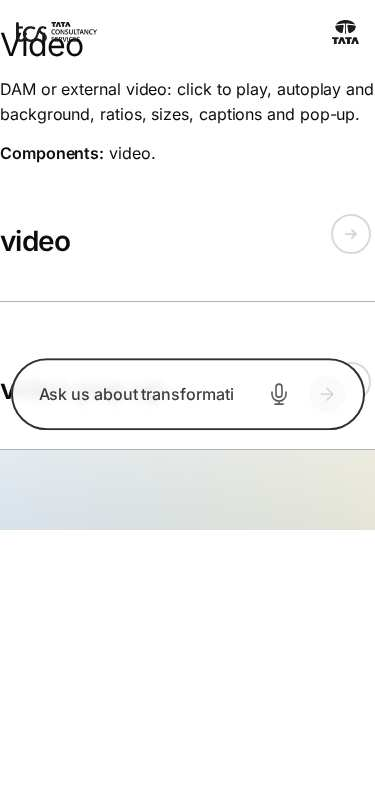

*Figure: Video: video — mobile 375 × 812 (/design-block-master/en/block-library/video, captured 2026-11-08).*

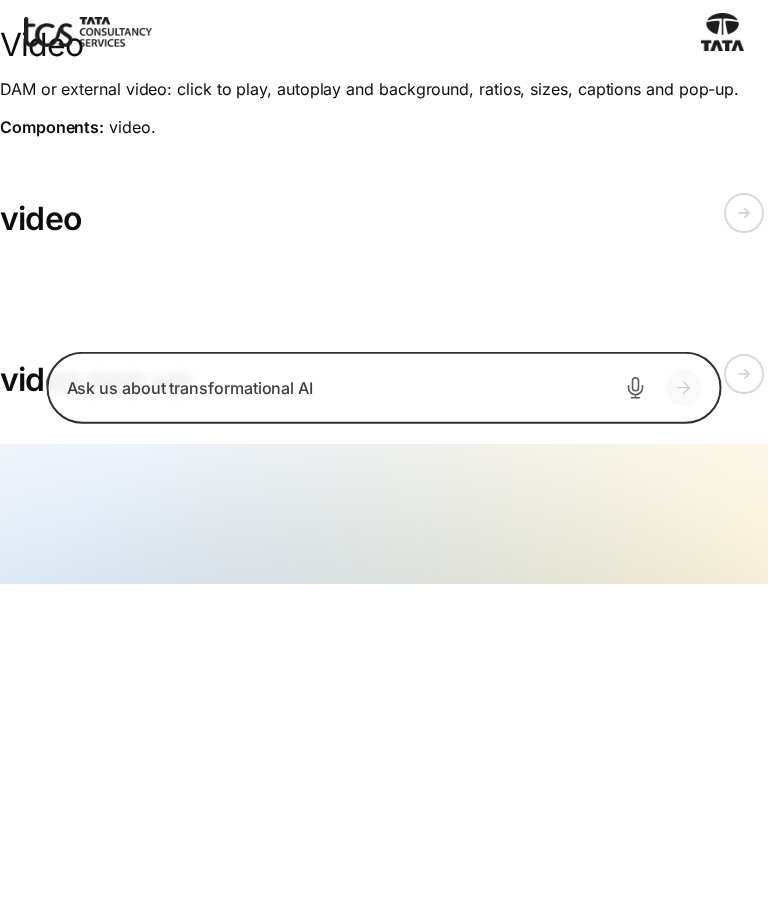

*Figure: Video: video — tablet 768 × 900 (/design-block-master/en/block-library/video, captured 2026-11-08).*

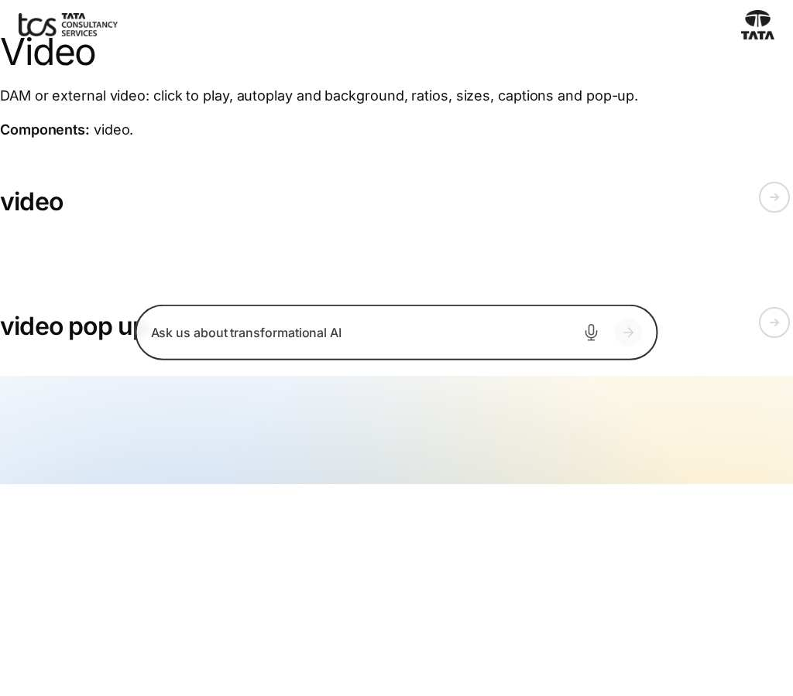

*Figure: Video: video — small desktop 1024 × 900 (/design-block-master/en/block-library/video, captured 2026-11-08).*

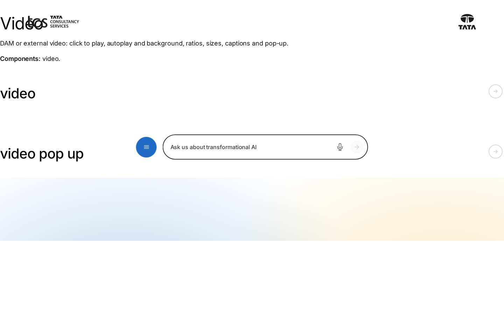

*Figure: Video: video — desktop 1440 × 900 (/design-block-master/en/block-library/video, captured 2026-11-08).*

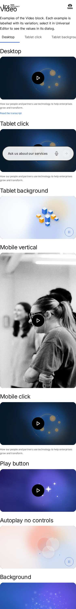

*Figure: Video: video/video — mobile 375 × 812 (/design-block-master/en/block-library/video/video, captured 2026-11-08).*

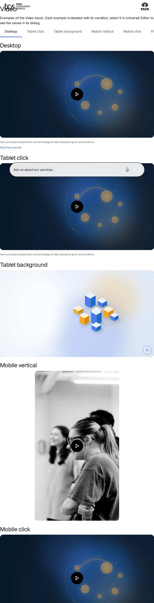

*Figure: Video: video/video — tablet 768 × 900 (/design-block-master/en/block-library/video/video, captured 2026-11-08).*

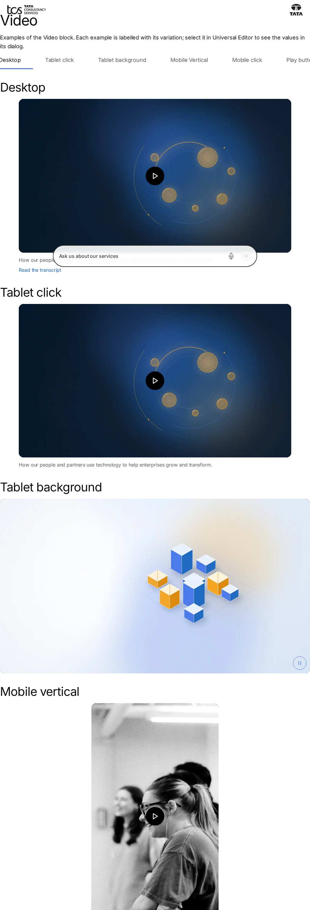

*Figure: Video: video/video — small desktop 1024 × 900 (/design-block-master/en/block-library/video/video, captured 2026-11-08).*

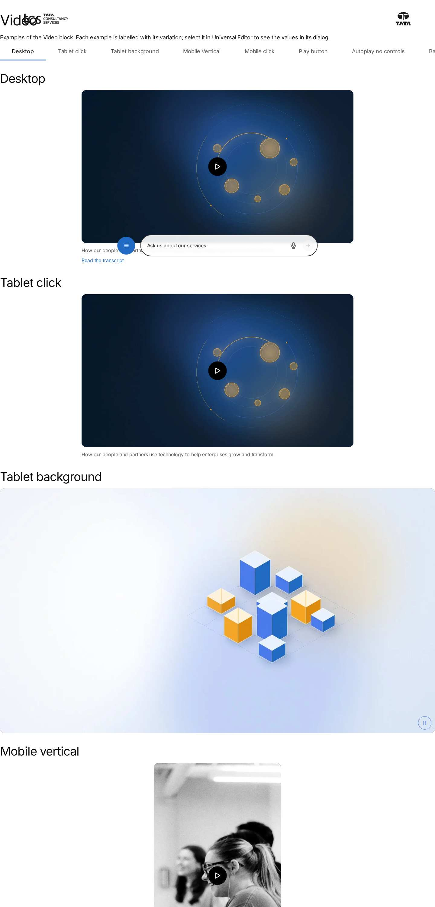

*Figure: Video: video/video — desktop 1440 × 900 (/design-block-master/en/block-library/video/video, captured 2026-11-08).*

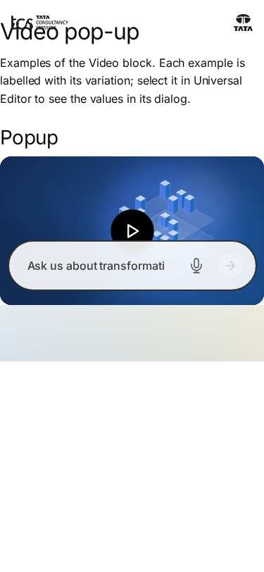

*Figure: Video: video/video-pop-up — mobile 375 × 812 (/design-block-master/en/block-library/video/video-pop-up, captured 2026-11-08).*

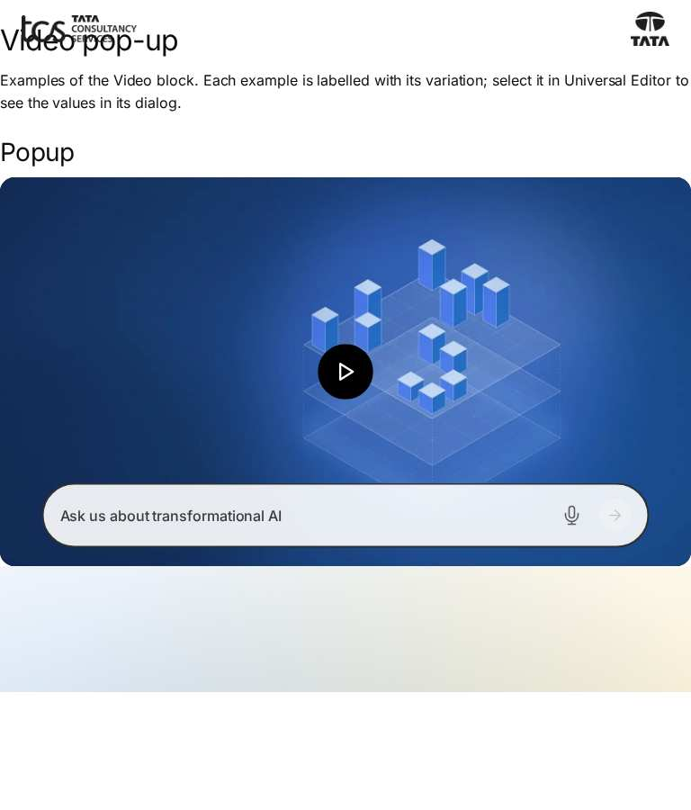

*Figure: Video: video/video-pop-up — tablet 768 × 900 (/design-block-master/en/block-library/video/video-pop-up, captured 2026-11-08).*

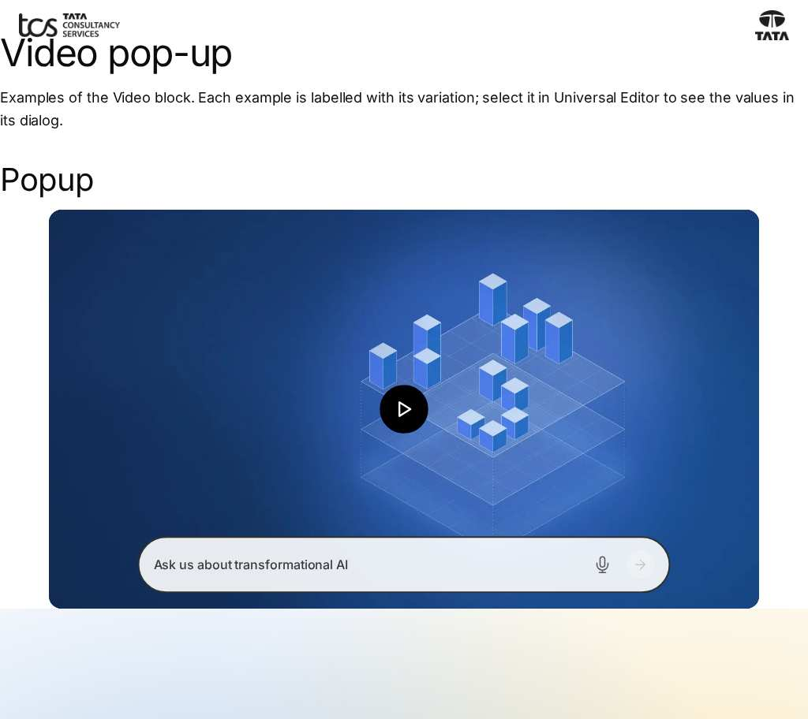

*Figure: Video: video/video-pop-up — small desktop 1024 × 900 (/design-block-master/en/block-library/video/video-pop-up, captured 2026-11-08).*

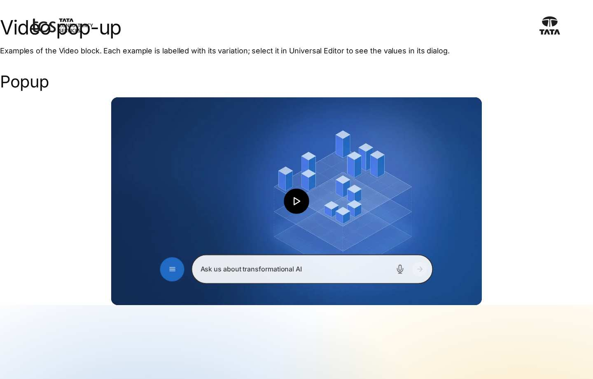

*Figure: Video: video/video-pop-up — desktop 1440 × 900 (/design-block-master/en/block-library/video/video-pop-up, captured 2026-11-08).*

## Known limitations

- None recorded for this document.

## Open items

- None.

## Change history

| Version | Date | Author | Change |
| --- | --- | --- | --- |
| 1.0 | 13 November 2026 | Delivery team (documentation program) | First version of the role-specific documentation (master documentation prompt), generated from the repository and the published reference pages |
