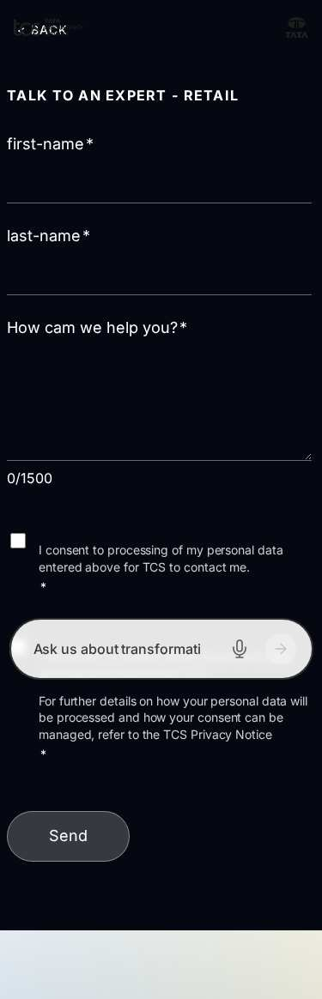
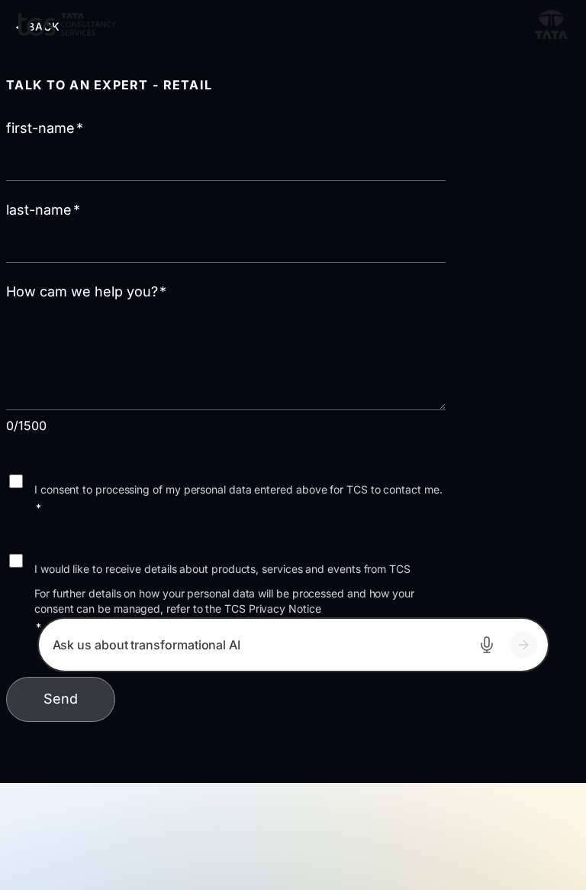
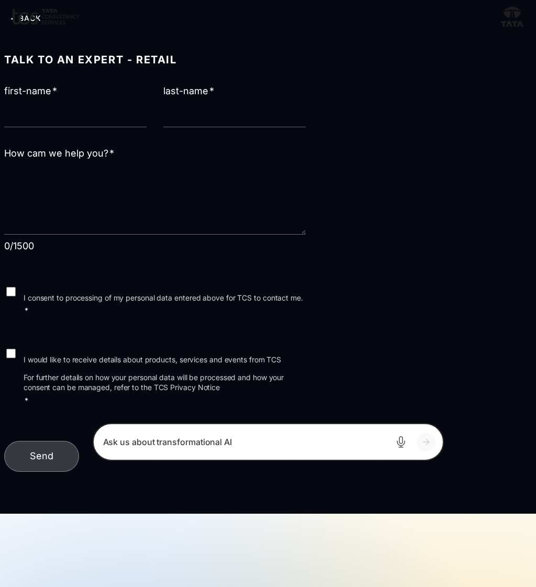
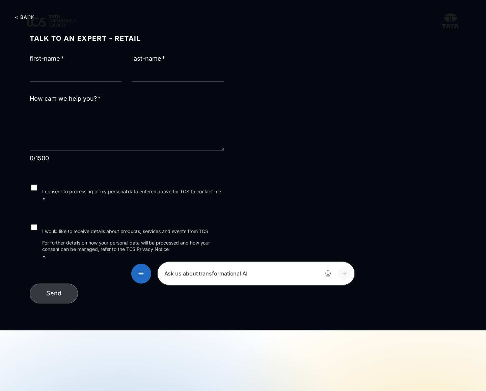

# Curated Design Page "forms/talk-to-an-expert-retail" — Developer Guide

| Attribute | Value |
| --- | --- |
| Document ID | DEV-C-forms-talk-to-an-expert-retail |
| Audience | Developers, technical leads, block owners, AI coding agents |
| Purpose | The composition, behaviour and checks of the curated design page forms/talk-to-an-expert-retail |
| Scope | — |
| Prerequisites | — |
| Owner | Technical Lead / Block Owner (proposed) |
| Approver | Product Owner (to be confirmed) |
| Version | 1.0 |
| Status | Draft for review |
| Last updated | 8 November 2026 |
| Last validated | 8 November 2026 |
| Source files | published page |
| Related documents | — |
| Related AEM paths | /content/tcs-corp/design-block-master/en/curated-design-pages/forms/talk-to-an-expert-retail |

## Contents

- [Page](#page)
- [Blocks in order](#blocks-in-order)
- [Automated checks (executed 2026-11-08)](#automated-checks-executed-2026-11-08)
- [Authoring and development](#authoring-and-development)
- [Screenshots](#screenshots)
- [Known limitations](#known-limitations)
- [Open items](#open-items)
- [Change history](#change-history)

## Page

| Attribute | Value |
| --- | --- |
| Author path | /content/tcs-corp/design-block-master/en/curated-design-pages/forms/talk-to-an-expert-retail |
| Preview | https://main--tcs-corp--sradha-tcs.aem.page/design-block-master/en/curated-design-pages/forms/talk-to-an-expert-retail |
| Live | https://main--tcs-corp--sradha-tcs.aem.live/design-block-master/en/curated-design-pages/forms/talk-to-an-expert-retail |
| Title | talk-to-an-expert-retail |
| Business purpose | Design reference of the Figma page of the same name (INFERRED, REQUIRES BUSINESS VALIDATION) |
| Unique or reusable | Same composition as /design-block-master/en/curated-design-pages/forms/ar-landing, /design-block-master/en/curated-design-pages/forms/csr, /design-block-master/en/curated-design-pages/forms/csr-form, /design-block-master/en/curated-design-pages/forms/global-contact-us, /design-block-master/en/curated-design-pages/forms/inquizitive, /design-block-master/en/curated-design-pages/forms/website-feedback-form: reusable pattern |

## Blocks in order

| # | Block | Classes (variations) | Developer guide |
| --- | --- | --- | --- |
| 1 | form-variations | `form-variations dark pl-100 ml-100` | [guide](../../blocks/form-variations/FORM-VARIATIONS-DEVELOPER-GUIDE.md) |

## Automated checks (executed 2026-11-08)

| Check | Result |
| --- | --- |
| HTTP status 375 / 768 / 1024 / 1440 | 200 / 200 / 200 / 200 |
| Horizontal overflow 375 / 768 / 1024 / 1440 | yes / yes / yes / yes |
| Console errors | 375: Failed to load resource: the server responded with a status of 404 (); 375: Failed to load resource: the server responded with a status of 404 (); 768: Failed to load resource: the server responded with a status of 404 (); 768: Failed to load resource: the server responded with a status of 404 (); 1024: Failed to load resource: the server responded with a status of 404 (); 1024: Failed to load resource: the server responded with a status of 404 (); 1440: Failed to load resource: the server responded with a status of 404 (); 1440: Failed to load resource: the server responded with a status of 404 () |
| Failed requests | 375: 404 https://main--tcs-corp--sradha-tcs.aem.live/design-block-master/en/curated-design-pages/forms; 375: 404 https://main--tcs-corp--sradha-tcs.aem.live/design-block-master/english/references/footer-conversation-canvas.plain.html; 768: 404 https://main--tcs-corp--sradha-tcs.aem.live/design-block-master/en/curated-design-pages/forms; 768: 404 https://main--tcs-corp--sradha-tcs.aem.live/design-block-master/english/references/footer-conversation-canvas.plain.html; 1024: 404 https://main--tcs-corp--sradha-tcs.aem.live/design-block-master/en/curated-design-pages/forms; 1024: 404 https://main--tcs-corp--sradha-tcs.aem.live/design-block-master/english/references/footer-conversation-canvas.plain.html; 1440: 404 https://main--tcs-corp--sradha-tcs.aem.live/design-block-master/en/curated-design-pages/forms; 1440: 404 https://main--tcs-corp--sradha-tcs.aem.live/design-block-master/english/references/footer-conversation-canvas.plain.html |
| H1 count | 0 |
| Heading level skips | 0 |
| Images without alt | 0 |
| Unnamed buttons | 0 |
| Links without a name | 0 |
| Data layer entries / events | 2 / — |
| Empty lists ("There are no items to show") | 0 |
| html lang | en-US |

## Authoring and development

Build the page from the blocks above in this order; each block's developer and authoring guides describe its fields and options. Metadata, taxonomy and assets of the page were not inspected on the author (no author access).

## Screenshots

*Figure: Curated design page forms/talk-to-an-expert-retail — mobile 375 × 812 (/design-block-master/en/curated-design-pages/forms/talk-to-an-expert-retail, captured 2026-11-08).*

*Figure: Curated design page forms/talk-to-an-expert-retail — tablet 768 × 900 (/design-block-master/en/curated-design-pages/forms/talk-to-an-expert-retail, captured 2026-11-08).*

*Figure: Curated design page forms/talk-to-an-expert-retail — small desktop 1024 × 900 (/design-block-master/en/curated-design-pages/forms/talk-to-an-expert-retail, captured 2026-11-08).*

*Figure: Curated design page forms/talk-to-an-expert-retail — desktop 1440 × 900 (/design-block-master/en/curated-design-pages/forms/talk-to-an-expert-retail, captured 2026-11-08).*

## Known limitations

- Universal Editor and AEM author views were not captured (no author access).

## Open items

- The curated pages link to /language-master/en and to /content/tcs-corp/design-block-master/english/... (see the curated design page audit).

## Change history

| Version | Date | Author | Change |
| --- | --- | --- | --- |
| 1.0 | 8 November 2026 | Delivery team (documentation program) | First version of the role-specific documentation (master documentation prompt), generated from the repository and the published reference pages |
