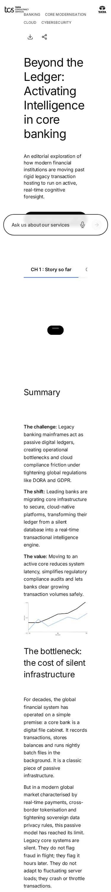
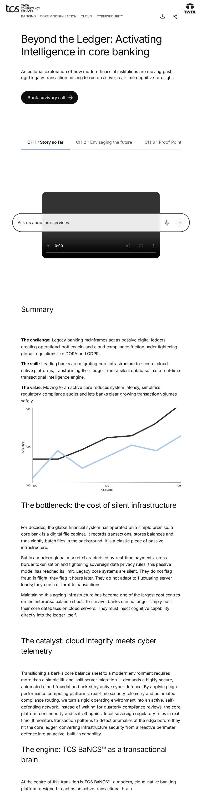
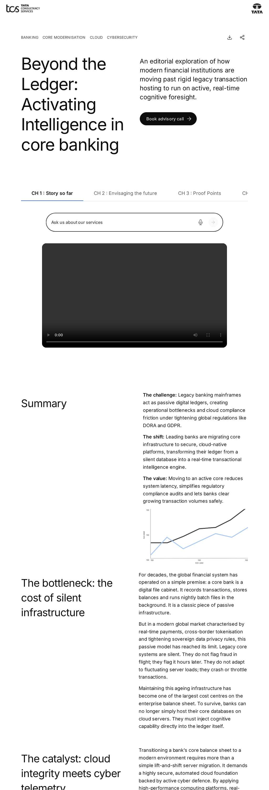
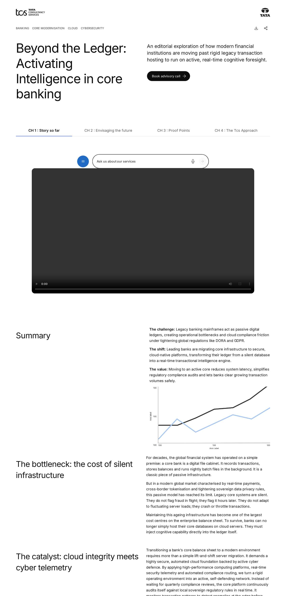

# Curated Design Page "story" — Developer Guide

| Attribute | Value |
| --- | --- |
| Document ID | DEV-C-story |
| Audience | Developers, technical leads, block owners, AI coding agents |
| Purpose | The composition, behaviour and checks of the curated design page story |
| Scope | — |
| Prerequisites | — |
| Owner | Technical Lead / Block Owner (proposed) |
| Approver | Product Owner (to be confirmed) |
| Version | 1.0 |
| Status | Draft for review |
| Last updated | 8 November 2026 |
| Last validated | 8 November 2026 |
| Source files | published page |
| Related documents | — |
| Related AEM paths | /content/tcs-corp/design-block-master/en/curated-design-pages/story |

## Contents

- [Page](#page)
- [Blocks in order](#blocks-in-order)
- [Automated checks (executed 2026-11-08)](#automated-checks-executed-2026-11-08)
- [Authoring and development](#authoring-and-development)
- [Screenshots](#screenshots)
- [Known limitations](#known-limitations)
- [Open items](#open-items)
- [Change history](#change-history)

## Page

| Attribute | Value |
| --- | --- |
| Author path | /content/tcs-corp/design-block-master/en/curated-design-pages/story |
| Preview | https://main--tcs-corp--sradha-tcs.aem.page/design-block-master/en/curated-design-pages/story |
| Live | https://main--tcs-corp--sradha-tcs.aem.live/design-block-master/en/curated-design-pages/story |
| Title | Beyond the Ledger: Activating Intelligence in core banking |
| Business purpose | Design reference of the Figma page of the same name (INFERRED, REQUIRES BUSINESS VALIDATION) |
| Unique or reusable | Unique composition |

## Blocks in order

| # | Block | Classes (variations) | Developer guide |
| --- | --- | --- | --- |
| 1 | page-header | `page-header pl-2000 pr-2000 mb-3000 article` | [guide](../../blocks/page-header/PAGE-HEADER-DEVELOPER-GUIDE.md) |
| 2 | anchor-list | `anchor-list hideblock mt-1000` | [guide](../../blocks/anchor-list/ANCHOR-LIST-DEVELOPER-GUIDE.md) |
| 3 | tabs | `tabs underline stretch horizontal pl-2000 pr-2000 mb-800` | [guide](../../blocks/tabs/TABS-DEVELOPER-GUIDE.md) |
| 4 | tab | `tab` | [guide](../../blocks/tab/TAB-DEVELOPER-GUIDE.md) |
| 5 | video | `video pl-2000 pr-2000 pt-3000 pb-3000 video-size-full video-align-center video-rounded` | [guide](../../blocks/video/VIDEO-DEVELOPER-GUIDE.md) |
| 6 | tab | `tab` | [guide](../../blocks/tab/TAB-DEVELOPER-GUIDE.md) |
| 7 | video | `video pl-2000 pr-2000 pt-3000 pb-3000 video-size-full video-align-center video-rounded` | [guide](../../blocks/video/VIDEO-DEVELOPER-GUIDE.md) |
| 8 | tab | `tab` | [guide](../../blocks/tab/TAB-DEVELOPER-GUIDE.md) |
| 9 | video | `video pl-2000 pr-2000 pt-3000 pb-3000 video-size-full video-align-center video-rounded` | [guide](../../blocks/video/VIDEO-DEVELOPER-GUIDE.md) |
| 10 | tab | `tab` | [guide](../../blocks/tab/TAB-DEVELOPER-GUIDE.md) |
| 11 | video | `video pl-2000 pr-2000 pt-3000 pb-3000 mb-800 video-size-full video-align-center video-rounded` | [guide](../../blocks/video/VIDEO-DEVELOPER-GUIDE.md) |
| 12 | columns-container | `columns-container per-row-auto gap-large align-top from-desktop pl-2000 pr-2000 columns-container-2` | [guide](../../blocks/columns-container/COLUMNS-CONTAINER-DEVELOPER-GUIDE.md) |
| 13 | column-break | `column-break` | [guide](../../blocks/column-break/COLUMN-BREAK-DEVELOPER-GUIDE.md) |
| 14 | column-break | `column-break` | [guide](../../blocks/column-break/COLUMN-BREAK-DEVELOPER-GUIDE.md) |
| 15 | teaser | `teaser hideblock mb-1000 no-image text-left valign-top title-semibold` | [guide](../../blocks/teaser/TEASER-DEVELOPER-GUIDE.md) |
| 16 | teaser | `teaser hideblock mt-1000 no-image text-left valign-top title-semibold` | [guide](../../blocks/teaser/TEASER-DEVELOPER-GUIDE.md) |
| 17 | columns-container | `columns-container per-row-auto gap-medium align-top from-desktop pl-2000 pr-2000 columns-container-2` | [guide](../../blocks/columns-container/COLUMNS-CONTAINER-DEVELOPER-GUIDE.md) |
| 18 | column-break | `column-break` | [guide](../../blocks/column-break/COLUMN-BREAK-DEVELOPER-GUIDE.md) |
| 19 | column-break | `column-break` | [guide](../../blocks/column-break/COLUMN-BREAK-DEVELOPER-GUIDE.md) |
| 20 | columns-container | `columns-container per-row-auto gap-medium align-top from-desktop pl-2000 pr-2000 columns-container-2` | [guide](../../blocks/columns-container/COLUMNS-CONTAINER-DEVELOPER-GUIDE.md) |
| 21 | column-break | `column-break` | [guide](../../blocks/column-break/COLUMN-BREAK-DEVELOPER-GUIDE.md) |
| 22 | column-break | `column-break` | [guide](../../blocks/column-break/COLUMN-BREAK-DEVELOPER-GUIDE.md) |
| 23 | columns-container | `columns-container per-row-auto gap-medium align-top from-desktop pl-2000 pr-2000 columns-container-2` | [guide](../../blocks/columns-container/COLUMNS-CONTAINER-DEVELOPER-GUIDE.md) |
| 24 | column-break | `column-break` | [guide](../../blocks/column-break/COLUMN-BREAK-DEVELOPER-GUIDE.md) |
| 25 | column-break | `column-break` | [guide](../../blocks/column-break/COLUMN-BREAK-DEVELOPER-GUIDE.md) |
| 26 | teaser | `teaser hideblock mt-1000 no-image text-left valign-top title-semibold` | [guide](../../blocks/teaser/TEASER-DEVELOPER-GUIDE.md) |
| 27 | teaser | `teaser hideblock mt-1000 no-image text-left valign-top title-semibold` | [guide](../../blocks/teaser/TEASER-DEVELOPER-GUIDE.md) |
| 28 | columns-container | `columns-container per-row-auto gap-medium align-top from-desktop pl-2000 pr-2000 columns-container-2` | [guide](../../blocks/columns-container/COLUMNS-CONTAINER-DEVELOPER-GUIDE.md) |
| 29 | column-break | `column-break` | [guide](../../blocks/column-break/COLUMN-BREAK-DEVELOPER-GUIDE.md) |
| 30 | column-break | `column-break` | [guide](../../blocks/column-break/COLUMN-BREAK-DEVELOPER-GUIDE.md) |
| 31 | teaser | `teaser hideblock pl-600 pr-600 pb-1000 mt-300 mb-400 no-image text-left valign-top title-semibold` | [guide](../../blocks/teaser/TEASER-DEVELOPER-GUIDE.md) |
| 32 | testimonial | `testimonial` | [guide](../../blocks/testimonial/TESTIMONIAL-DEVELOPER-GUIDE.md) |
| 33 | list | `list hideblock card-list desktop-scroll tablet-scroll mobile-scroll mobile-indicator snap hide-scrollbar edge-bleed stretch snap-start display-teaser style-image ratio-16-9 panel-portrait source-fixed` | [guide](../../blocks/list/LIST-DEVELOPER-GUIDE.md) |
| 34 | teaser | `teaser hideblock pl-1000 pr-1000 pt-1600 pb-1600 bg-dark text-left valign-top mobile-image-bottom title-semibold ratio-8-9 image-right teaser-has-media` | [guide](../../blocks/teaser/TEASER-DEVELOPER-GUIDE.md) |
| 35 | teaser | `teaser hideblock pl-1000 pr-1000 pt-1600 pb-1600 bg-dark text-center valign-middle title-regular buttons-inline` | [guide](../../blocks/teaser/TEASER-DEVELOPER-GUIDE.md) |

## Automated checks (executed 2026-11-08)

| Check | Result |
| --- | --- |
| HTTP status 375 / 768 / 1024 / 1440 | 200 / 200 / 200 / 200 |
| Horizontal overflow 375 / 768 / 1024 / 1440 | no / no / no / no |
| Console errors | 375: Failed to load resource: net::ERR_UNKNOWN_URL_SCHEME; 375: Failed to load resource: the server responded with a status of 404 (); 768: Failed to load resource: the server responded with a status of 404 (); 768: Failed to load resource: net::ERR_UNKNOWN_URL_SCHEME; 1024: Failed to load resource: net::ERR_UNKNOWN_URL_SCHEME; 1024: Failed to load resource: the server responded with a status of 404 (); 1440: Failed to load resource: net::ERR_UNKNOWN_URL_SCHEME; 1440: Failed to load resource: the server responded with a status of 404 () |
| Failed requests | 375: failed about:error; 375: 404 https://main--tcs-corp--sradha-tcs.aem.live/content/dam/tcs-corp/open-video-2025-025-002.mp4; 768: 404 https://main--tcs-corp--sradha-tcs.aem.live/content/dam/tcs-corp/open-video-2025-025-002.mp4; 768: failed about:error; 1024: failed about:error; 1024: 404 https://main--tcs-corp--sradha-tcs.aem.live/content/dam/tcs-corp/open-video-2025-025-002.mp4; 1440: failed about:error; 1440: 404 https://main--tcs-corp--sradha-tcs.aem.live/content/dam/tcs-corp/open-video-2025-025-002.mp4 |
| H1 count | 1 |
| Heading level skips | 0 |
| Images without alt | 0 |
| Unnamed buttons | 0 |
| Links without a name | 0 |
| Data layer entries / events | 5 / — |
| Empty lists ("There are no items to show") | 0 |
| html lang | en-US |

## Authoring and development

Build the page from the blocks above in this order; each block's developer and authoring guides describe its fields and options. Metadata, taxonomy and assets of the page were not inspected on the author (no author access).

## Screenshots

*Figure: Curated design page story — mobile 375 × 812 (/design-block-master/en/curated-design-pages/story, captured 2026-11-08).*

*Figure: Curated design page story — tablet 768 × 900 (/design-block-master/en/curated-design-pages/story, captured 2026-11-08).*

*Figure: Curated design page story — small desktop 1024 × 900 (/design-block-master/en/curated-design-pages/story, captured 2026-11-08).*

*Figure: Curated design page story — desktop 1440 × 900 (/design-block-master/en/curated-design-pages/story, captured 2026-11-08).*

## Known limitations

- Universal Editor and AEM author views were not captured (no author access).

## Open items

- The curated pages link to /language-master/en and to /content/tcs-corp/design-block-master/english/... (see the curated design page audit).

## Change history

| Version | Date | Author | Change |
| --- | --- | --- | --- |
| 1.0 | 8 November 2026 | Delivery team (documentation program) | First version of the role-specific documentation (master documentation prompt), generated from the repository and the published reference pages |
