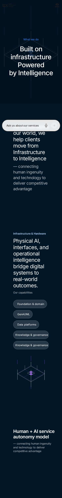
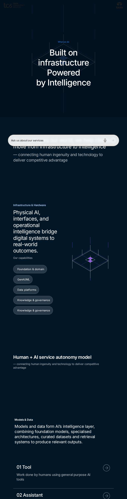
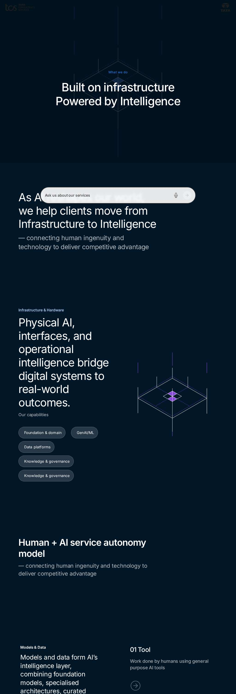
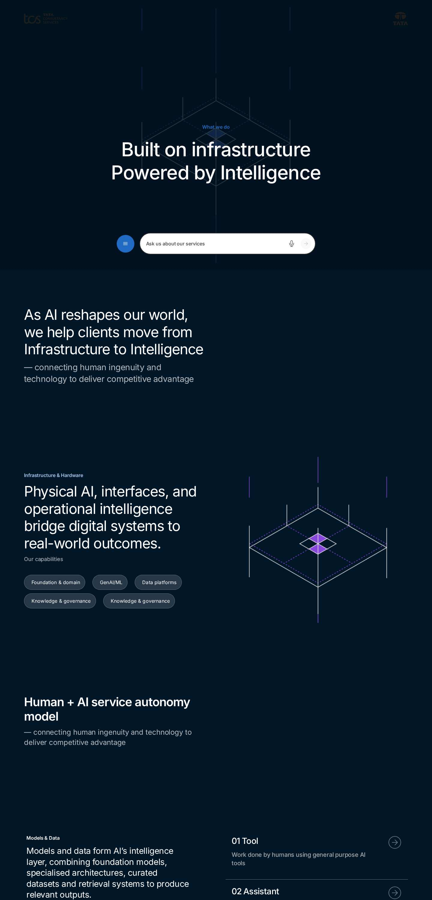

# Curated Design Page "what-we-do" — Developer Guide

| Attribute | Value |
| --- | --- |
| Document ID | DEV-C-what-we-do |
| Audience | Developers, technical leads, block owners, AI coding agents |
| Purpose | The composition, behaviour and checks of the curated design page what-we-do |
| Scope | — |
| Prerequisites | — |
| Owner | Technical Lead / Block Owner (proposed) |
| Approver | Product Owner (to be confirmed) |
| Version | 1.0 |
| Status | Draft for review |
| Last updated | 8 November 2026 |
| Last validated | 8 November 2026 |
| Source files | published page |
| Related documents | — |
| Related AEM paths | /content/tcs-corp/design-block-master/en/curated-design-pages/what-we-do |

## Contents

- [Page](#page)
- [Blocks in order](#blocks-in-order)
- [Automated checks (executed 2026-11-08)](#automated-checks-executed-2026-11-08)
- [Authoring and development](#authoring-and-development)
- [Screenshots](#screenshots)
- [Known limitations](#known-limitations)
- [Open items](#open-items)
- [Change history](#change-history)

## Page

| Attribute | Value |
| --- | --- |
| Author path | /content/tcs-corp/design-block-master/en/curated-design-pages/what-we-do |
| Preview | https://main--tcs-corp--sradha-tcs.aem.page/design-block-master/en/curated-design-pages/what-we-do |
| Live | https://main--tcs-corp--sradha-tcs.aem.live/design-block-master/en/curated-design-pages/what-we-do |
| Title | What We Do |
| Business purpose | Design reference of the Figma page of the same name (INFERRED, REQUIRES BUSINESS VALIDATION) |
| Unique or reusable | Unique composition |

## Blocks in order

| # | Block | Classes (variations) | Developer guide |
| --- | --- | --- | --- |
| 1 | hero | `hero media-contained align-middle align-center text-center bg-dark hero-has-media` | [guide](../../blocks/hero/HERO-DEVELOPER-GUIDE.md) |
| 2 | teaser | `teaser hideblock pl-1600 pr-1600 pt-2000 pb-2000 bg-navy text-left valign-middle` | [guide](../../blocks/teaser/TEASER-DEVELOPER-GUIDE.md) |
| 3 | columns-container | `columns-container per-row-auto gap-medium align-top from-desktop pt-0 pb-0 mt-0 mb-0 columns-container-1` | [guide](../../blocks/columns-container/COLUMNS-CONTAINER-DEVELOPER-GUIDE.md) |
| 4 | teaser | `teaser pl-2000 pr-2000 pt-3000 pb-3000 bg-navy text-left valign-middle title-regular` | [guide](../../blocks/teaser/TEASER-DEVELOPER-GUIDE.md) |
| 5 | teaser | `teaser pl-2000 pr-2000 pt-3000 pb-3000 bg-navy text-left valign-middle mobile-image-bottom title-regular ratio-original arrow-none buttons-inline image-right teaser-has-media` | [guide](../../blocks/teaser/TEASER-DEVELOPER-GUIDE.md) |
| 6 | teaser | `teaser hideblock pl-1000 pr-1000 pt-1600 pb-1600 bg-navy text-left valign-middle mobile-image-bottom title-regular ratio-original buttons-inline teaser-has-media` | [guide](../../blocks/teaser/TEASER-DEVELOPER-GUIDE.md) |
| 7 | teaser | `teaser hideblock pl-1000 pr-1000 pt-1600 pb-1600 bg-navy text-left valign-middle mobile-image-bottom title-regular ratio-original buttons-inline image-right teaser-has-media` | [guide](../../blocks/teaser/TEASER-DEVELOPER-GUIDE.md) |
| 8 | teaser | `teaser pl-2000 pr-1000 pt-3000 pb-3000 mt-0 bg-navy text-left title-semibold text-large` | [guide](../../blocks/teaser/TEASER-DEVELOPER-GUIDE.md) |
| 9 | columns-container | `columns-container per-row-2 gap-large align-top from-desktop bg-navy pl-2000 pr-2000 pt-3000 pb-2000 columns-container-2` | [guide](../../blocks/columns-container/COLUMNS-CONTAINER-DEVELOPER-GUIDE.md) |
| 10 | column-break | `column-break pl-0` | [guide](../../blocks/column-break/COLUMN-BREAK-DEVELOPER-GUIDE.md) |
| 11 | teaser | `teaser pl-200 pr-1200 pt-1200 bg-navy text-left valign-middle mobile-image-top title-regular text-regular eyebrow-white ratio-original` | [guide](../../blocks/teaser/TEASER-DEVELOPER-GUIDE.md) |
| 12 | column-break | `column-break` | [guide](../../blocks/column-break/COLUMN-BREAK-DEVELOPER-GUIDE.md) |
| 13 | table-list | `table-list pl-0 pr-0 pt-800 pb-600 ml-0 mr-0 mt-0 segments numbers-show background-navy` | [guide](../../blocks/table-list/TABLE-LIST-DEVELOPER-GUIDE.md) |
| 14 | conversation-canvas | `conversation-canvas hideblock conversation-canvas-bg-default conversation-canvas-title-bigger` | [guide](../../blocks/conversation-canvas/CONVERSATION-CANVAS-DEVELOPER-GUIDE.md) |
| 15 | columns-container | `columns-container per-row-2 gap-small align-top from-desktop pl-2000 pr-2000 pt-3000 pb-1000 columns-container-2` | [guide](../../blocks/columns-container/COLUMNS-CONTAINER-DEVELOPER-GUIDE.md) |
| 16 | column-break | `column-break pl-0` | [guide](../../blocks/column-break/COLUMN-BREAK-DEVELOPER-GUIDE.md) |
| 17 | column-break | `column-break` | [guide](../../blocks/column-break/COLUMN-BREAK-DEVELOPER-GUIDE.md) |
| 18 | button-block | `button-block pt-1200` | [guide](../../blocks/button-block/BUTTON-BLOCK-DEVELOPER-GUIDE.md) |
| 19 | teaser | `teaser pl-2000 pr-2000 mb-600 card text-left valign-top title-semibold eyebrow-label` | [guide](../../blocks/teaser/TEASER-DEVELOPER-GUIDE.md) |
| 20 | teaser | `teaser mb-600 card bg-dark text-left valign-top title-semibold eyebrow-label` | [guide](../../blocks/teaser/TEASER-DEVELOPER-GUIDE.md) |
| 21 | teaser | `teaser card text-left valign-top title-semibold eyebrow-label` | [guide](../../blocks/teaser/TEASER-DEVELOPER-GUIDE.md) |
| 22 | table-list | `table-list hideblock segments numbers-hide background-white` | [guide](../../blocks/table-list/TABLE-LIST-DEVELOPER-GUIDE.md) |

## Automated checks (executed 2026-11-08)

| Check | Result |
| --- | --- |
| HTTP status 375 / 768 / 1024 / 1440 | 200 / 200 / 200 / 200 |
| Horizontal overflow 375 / 768 / 1024 / 1440 | no / no / no / no |
| Console errors | 375: Failed to load resource: the server responded with a status of 404 (); 768: Failed to load resource: the server responded with a status of 404 (); 1024: Failed to load resource: the server responded with a status of 404 (); 1440: Failed to load resource: the server responded with a status of 404 () |
| Failed requests | 375: 404 https://main--tcs-corp--sradha-tcs.aem.live/design-block-master/english/references/footer-conversation-canvas.plain.html; 768: 404 https://main--tcs-corp--sradha-tcs.aem.live/design-block-master/english/references/footer-conversation-canvas.plain.html; 1024: 404 https://main--tcs-corp--sradha-tcs.aem.live/design-block-master/english/references/footer-conversation-canvas.plain.html; 1440: 404 https://main--tcs-corp--sradha-tcs.aem.live/design-block-master/english/references/footer-conversation-canvas.plain.html |
| H1 count | 1 |
| Heading level skips | 0 |
| Images without alt | 0 |
| Unnamed buttons | 0 |
| Links without a name | 0 |
| Data layer entries / events | 3 / — |
| Empty lists ("There are no items to show") | 0 |
| html lang | en-US |

## Authoring and development

Build the page from the blocks above in this order; each block's developer and authoring guides describe its fields and options. Metadata, taxonomy and assets of the page were not inspected on the author (no author access).

## Screenshots

*Figure: Curated design page what-we-do — mobile 375 × 812 (/design-block-master/en/curated-design-pages/what-we-do, captured 2026-11-08).*

*Figure: Curated design page what-we-do — tablet 768 × 900 (/design-block-master/en/curated-design-pages/what-we-do, captured 2026-11-08).*

*Figure: Curated design page what-we-do — small desktop 1024 × 900 (/design-block-master/en/curated-design-pages/what-we-do, captured 2026-11-08).*

*Figure: Curated design page what-we-do — desktop 1440 × 900 (/design-block-master/en/curated-design-pages/what-we-do, captured 2026-11-08).*

## Known limitations

- Universal Editor and AEM author views were not captured (no author access).

## Open items

- The curated pages link to /language-master/en and to /content/tcs-corp/design-block-master/english/... (see the curated design page audit).

## Change history

| Version | Date | Author | Change |
| --- | --- | --- | --- |
| 1.0 | 8 November 2026 | Delivery team (documentation program) | First version of the role-specific documentation (master documentation prompt), generated from the repository and the published reference pages |
