# Performance Development Guide

| Attribute | Value |
| --- | --- |
| Document ID | DEV-011 |
| Audience | Developers, technical leads, block owners, AI coding agents |
| Purpose | Performance rules for code changes |
| Scope | — |
| Prerequisites | — |
| Owner | Technical Lead / Block Owner (proposed) |
| Approver | Product Owner (to be confirmed) |
| Version | 1.0 |
| Status | Draft for review |
| Last updated | 8 November 2026 |
| Last validated | 8 November 2026 |
| Source files | docs/handover/knowledge-base/performance.md |
| Related documents | — |
| Related AEM paths | — |

## Contents

- [JavaScript loading](#javascript-loading)
- [CSS loading](#css-loading)
- [Images](#images)
- [Fonts](#fonts)
- [Layout shift prevention](#layout-shift-prevention)
- [DOM size, listeners and observers](#dom-size-listeners-and-observers)
- [Query and data requests](#query-and-data-requests)
- [Budgets](#budgets)
- [Required performance validation](#required-performance-validation)
- [Screenshots](#screenshots)
- [Known limitations](#known-limitations)
- [Open items](#open-items)
- [Change history](#change-history)

## JavaScript loading

```mermaid
flowchart LR
  A[head.html: aem.js, scripts.js, styles.css, 20 modulepreload links] --> B[loadEager]
  B --> C[decorateMain, reserveHeaderSpace, body.appear]
  C --> D[preloadBlockModules first section]
  D --> E[loadSection first: prepareMotion, waitForFirstImage]
  E --> F[loadLazy]
  F --> G[preloadBlockModules rest and chrome, prefetchData]
  G --> H[loadHeader, loadFooter hidden]
  H --> I[loadMainSections in order]
  I --> J[footer shown, trackBlocks, lazy-styles.css, fonts.css]
  J --> K[loadDelayed after 3 s: trackBlocks, delayed.js]
```

| Phase | What runs (`scripts/scripts.js`) |
| --- | --- |
| Eager (`loadEager`) | `decorateHead` (SEO tags, `<html lang>`), `trackInteractions` (data-layer listeners and page entry), template / theme / page-type classes, the 404 content or the Page Type template (`templates/{name}`), `decorateMain`, `reserveHeaderSpace`, `body.appear`, `preloadBlockModules(first section)`, then the first section with `prepareMotion` and `waitForFirstImage` (sets the first image `loading="eager"` and waits for it); `fonts.css` only on wide viewports or when cached |
| Lazy (`loadLazy`) | Modal auto-links, `preloadBlockModules` for the rest of `main` and the chrome blocks (`header`, `footer`, `fragment`, `tcs-header`, `conversation-canvas`), `prefetchData`, `loadHeader`, `loadFooter` (hidden), `loadMainSections` (each section in order, animations prepared before it shows), then footer shown, `trackBlocks(main)`, Go back on 404 pages, hash scroll, `lazy-styles.css`, `loadFonts` |
| Delayed (`loadDelayed`) | After 3 s: `trackBlocks(document)` (blocks added later, such as header, footer, modals) and `import('./delayed.js')`, which is empty ("add delayed functionality here") |

- **Per-block code splitting**: `loadBlock` (`scripts/aem.js`) loads a block's CSS and JS in parallel only when the block is on the page; blocks of a section load one after another, and sections load in order.
- **Module preloading**: there is no build step, so each import level is a network round trip. `head.html` has 20 `modulepreload` links (the modules `scripts.js` imports); `preloadBlockModules` adds `modulepreload` for each block's modules and a `preload as="style"` for its stylesheet from the generated `scripts/module-graph.js`. Stylesheet preloads go in the **body**, because `loadCSS` skips any stylesheet whose href is already linked in the head. Run `npm run build:modules` after any import change; `npm test` (`test/modules/module-graph.test.mjs`) fails when the graph or the head links are stale (AGENTS.md "Setup Commands").
- **Dynamic imports**: on-demand modules are imported only when needed: `utils/inherited-metadata.js` (404 pages), `utils/placeholders.js` (Go back), `utils/query-index.js`, `utils/taxonomy.js`, `utils/redirects.js` (`prefetchData`), `blocks/modal/modal.js` (modal links and the video pop-up), template modules; the Lottie player (`scripts/lib/lottie`, vendored) loads when an animation is near the viewport.

## CSS loading

| Stylesheet | When it loads |
| --- | --- |
| `styles/styles.css` | Render-blocking `<link>` in `head.html` (tokens, global styles, sections, buttons, theme contract, fallback font faces, skeletons, Additional tab classes) |
| `blocks/<name>/<name>.css` | With the block (`loadBlock`), preloaded by `preloadBlockModules` (`blockStylesheet`) |
| `styles/card-list.css` | `@import` from `blocks/list/list.css` and `blocks/cards/cards.css` (a chained request after the block stylesheet; not in the preload list) |
| `templates/<name>/<name>.css` | With the Page Type template in the eager phase (`templates/blog/blog.css` imports `article.css`) |
| `styles/motion.css` | Only on pages with an animated block (`prepareMotion`) |
| `styles/fonts.css` | Eager on viewports ≥ 900px or when the session flag is set, else end of the lazy phase |
| `styles/lazy-styles.css` | End of the lazy phase (currently only the Universal Editor item placeholder styles) |

## Images

- Authored images are optimised `/media_…` renditions served as `<picture>` with WebP and fallback sources (`createOptimizedPicture`: 2000px from 600px, 750px below; `format=webply&optimize=medium`).
- The first image of the first section is the LCP candidate: `waitForFirstImage` sets `loading="eager"` on it and waits for it before the lazy phase. The Hero sets `loading="eager"` and `fetchPriority="high"` on its image when it opens the page; the Page Header does the same for its featured image; List / Cards "Image loading" Eager gives only the first image a high fetch priority (`decorators/card-list-decorator.js`).
- `buildImage` (`decorators/responsive-image-decorator.js`) optimises same-origin media URLs and lazy-loads other URLs; section backgrounds use 2000px / 750px. Open: a featured image that isn't site media stays lazy (handover F-14).
- Icons are lazy `` (16 × 16 attributes). Images committed to git must be optimised (AGENTS.md "Performance"); the only font file is 48,256 bytes.

## Fonts

- One self-hosted variable font (`fonts/inter-variable.woff2`, `font-display: swap`, Latin `unicode-range`); no external font service.
- Eager only when `window.innerWidth >= 900` or `sessionStorage` `fonts-loaded` is set (set after the first load, except on localhost); otherwise loaded at the end of the lazy phase, so the font doesn't compete with the LCP image on small screens.
- Text first renders in a fallback face scaled to Inter: `inter-fallback` (Arial, Liberation Sans), `inter-fallback-roboto` (Android), `inter-fallback-dejavu` (Linux), in `styles/styles.css` (values in [design-system.md](./DESIGN-STYLE-GUIDE.md#fonts)). Keep the faces when the font changes, or text reflows when Inter arrives (2.36: CLS 0.33 → 0.003).

## Layout shift prevention

| Source of shift | Prevention |
| --- | --- |
| Header (lazy phase) | `header:not(:has(.nav-wrapper))` keeps `--header-reserved` (the logo bar `--nav-height`: 4rem, 7.75rem from 1200px) or the height remembered for the breakpoint (`utils/header-space.js`, `localStorage` key `header-height-v2-<breakpoint>`); from 1200px the header lies over a light first hero out of the flow; the header Canvas lies on the hero and takes no header space |
| Header / footer content | `header .header` and `footer .footer` stay `visibility: hidden` until `data-block-status="loaded"` |
| Footer | `display: none` until all main sections have loaded |
| Fonts | Metric-matched fallback faces |
| Data blocks (List, Filter List) | Skeletons shaped like the block (`renderWhenLoaded`) when data takes longer than 150 ms; shown at least 250 ms so they don't flash |
| Sticky Anchor List | Doesn't pin while its section is hidden (F-90) |
| Animations | Only `opacity`, `transform`, `clip-path`; first frames applied only on screen; Background animation on the first hero delays the LCP image paint (F-94: use it below the fold) |

## DOM size, listeners and observers

- DOM size: no measurement or limit is recorded. Skeletons add about 20–40 small spans per block, removed with the skeleton; animations add no wrapper elements ([animation report](https://github.com/sradha-tcs/tcs-corp/blob/archive/docs-before-role-docs-2026-11-08/docs/animation/README.md), section I).
- Data-layer listeners are delegated: one capturing listener per event type on `document` (`click`, `toggle`, `close`, `play` / `pause` / `ended`, `submit`, `change`), registered once (`trackInteractions`).
- Observers: one IntersectionObserver for all animations (`decorators/motion-decorator.js`); `utils/viewport.js` `onVisible` / `watchVisibility` for deferred work (Embed, Video, Gen Carousel, Lottie in `decorators/animation-decorator.js`); own IntersectionObservers in the Separator (motion) and the Modal (inside the editor); ResizeObserver in scrollers, masonry, Table, Anchor List, Header and the Canvas controller (resizes measured once they settle).
- Scroll listeners are passive and scheduled (Anchor List, Canvas controller); the Canvas never measures while scrolling.
- Layout reads are batched: scrollers measure in one shared animation frame, reads before writes; the Canvas controller writes `<html>` custom properties only when they change (AGENTS.md module preloading paragraph).

## Query and data requests

| Data | Loading |
| --- | --- |
| Query index (`/query-index.json`) | `utils/query-index.js` `getPages()`: fetched once per page view in pages of 500 rows (`offset` / `limit`), kept as an in-memory promise, filtered to the locale (or the review root) |
| Taxonomy, redirects, placeholders, data sheets | Fetched once per page view, cached in memory |
| Inherited metadata (Navigation, Footer, 404 Page) | Parent pages' heads loaded in parallel, cached per browser session (`sessionStorage`) |
| Prefetch | `prefetchData` starts the query index and taxonomy (and, with a List, the redirects) when the lazy phase begins on pages with a List, Filter List or Conversation Canvas; not in the eager phase, so it doesn't compete with the LCP image |
| Late data | `renderWhenLoaded`: data within 150 ms renders directly; else a skeleton, so the section is shown and the sections below aren't held back (a 1.5 s index showed the sections below a List at 0.5 s instead of after the index) |

## Budgets

**No verified performance budget** (bytes, requests, long tasks) is defined in the repository, CI or handover. The working targets are the NFRs above (PSI 100, LCP < 2.5 s, CLS ≤ 0.1, INP ≤ 200 ms at p75). Proposed budgets are a recommendation, not a decision.

## Required performance validation

Validate before merging (AGENTS.md "Publishing Process"; handover 12.4 release checklist and 13.16):

| Change | Validate |
| --- | --- |
| A block's JS or CSS | PageSpeed Insights 100 on the feature preview of a page using the block (mobile and desktop); `npm run build:modules` if imports changed, then `npm test`; no forced layout while decorating (reads before writes in one frame); no new eager work in the first section; the block README's "Performance Considerations" updated |
| A dialog option or combination | The block library page of the option, first section and below the fold; options that load media or data (Image loading Eager / Lazy, Background animation, Lotto, autoplay video, List sources) checked for LCP and CLS; the [dialog options report](https://github.com/sradha-tcs/tcs-corp/blob/archive/docs-before-role-docs-2026-11-08/docs/audit/DIALOG-OPTIONS-2026-10-20.md) "Responsive and performance" section is the model (CSS-only options: no new requests, listeners or blocking resources) |
| Block library pages | The harness run (0 errors, 0 failed requests, 0 overflow) and Lighthouse on a representative library page |
| Curated design pages and key templates (Home, Insights, What we do, article) | Lighthouse mobile / desktop and a throttled run against main on aem.live; CLS from the font swap on Android-like metrics (long intro paragraphs) |
| A new third-party script | Loaded from `scripts/delayed.js` or on interaction / visibility, never in `head.html`; CSP compatible |
| Fonts | Keep the fallback faces; measure CLS on mobile |

Author guidance that affects performance: keep the LCP image in the first block (Hero or Page Header); set List / Cards "Image loading" to Eager only for lists in the first section; avoid page lists from the query index and Background animation as the first block (handover 13.16, F-94).

## Screenshots

No screenshot belongs to this document (it describes code, configuration or process). Evidence screenshots are listed in the [screenshot register](../../SCREENSHOT-REGISTER.md).

## Known limitations

- None recorded for this document.

## Open items

- None.

## Change history

| Version | Date | Author | Change |
| --- | --- | --- | --- |
| 1.0 | 8 November 2026 | Delivery team (documentation program) | First version of the role-specific documentation (master documentation prompt), generated from the repository and the published reference pages |
