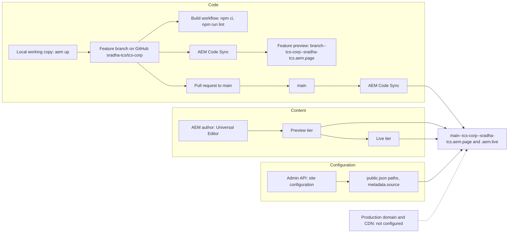

# Release and Deployment Guide (developers)

| Attribute | Value |
| --- | --- |
| Document ID | DEV-016 |
| Audience | Developers, technical leads, block owners, AI coding agents |
| Purpose | How code reaches preview and live, and how it is rolled back |
| Scope | — |
| Prerequisites | — |
| Owner | Technical Lead / Block Owner (proposed) |
| Approver | Product Owner (to be confirmed) |
| Version | 1.0 |
| Status | Draft for review |
| Last updated | 8 November 2026 |
| Last validated | 8 November 2026 |
| Source files | docs/handover/knowledge-base/deployment-and-release.md, .github/workflows/main.yaml |
| Related documents | — |
| Related AEM paths | — |

## Contents

- [Delivery streams](#delivery-streams)
- [Branches and feature previews](#branches-and-feature-previews)
- [Pull requests](#pull-requests)
- [Automated checks](#automated-checks)
- [Environment promotion](#environment-promotion)
- [Rollback](#rollback)
- [Screenshots](#screenshots)
- [Known limitations](#known-limitations)
- [Open items](#open-items)
- [Change history](#change-history)

## Delivery streams

Content, code and configuration are released independently: a code merge doesn't publish content and publishing content doesn't deploy code. A release that needs both goes **code first, then content** (handover Part 12, introduction).

## Branches and feature previews

- `main` is production. Changes go through short-lived branches merged with pull requests (130 merge commits on `main` at 2d06316, latest #129).
- Branch prefixes in use: `feature/`, `feat/`, `fix/`, `perf/`, `docs/` (for example `fix/block-reaudit`, `perf/module-preload`, `docs/block-readmes`). The handover's `feature/tcs-<topic>` convention (12.2.2) is not what recent history uses; no naming rule is enforced.
- AEM Code Sync serves every pushed branch at `https://{branch}--tcs-corp--sradha-tcs.aem.page/` (slashes become hyphens; keep names short and lower case: branch, repository and owner form the host name).

## Pull requests

The publishing process of [AGENTS.md](https://github.com/sradha-tcs/tcs-corp/blob/main/AGENTS.md#publishing-process):

1. Push the feature branch; Code Sync makes it available on the feature preview.
2. Run PageSpeed Insights on the feature preview URL and fix issues; target a score of 100.
3. Open a pull request to `main`. The description **must** link `https://{branch}--tcs-corp--sradha-tcs.aem.page/{path}` showing the change, or the PR is rejected. Without a page, create test content in `drafts/` and ask an author to create a CMS page to link.
4. Check the status of code sync, linting and performance tests (`gh pr checks`).
5. A human reviewer reviews the code, opens the URL and merges; Code Sync updates `main`.

[.github/pull_request_template.md](https://github.com/sradha-tcs/tcs-corp/blob/main/.github/pull_request_template.md) asks for the GitHub issue (`Fix #<gh-issue-id>`) and Before / After test URLs. It still contains the boilerplate placeholders `{repo}` and `{owner}`: replace them with `tcs-corp` and `sradha-tcs` (the `cleanup-on-create` workflow that would replace them only runs on repository creation or manual dispatch).

Approval rules: the number of required reviews, required checks and branch protection on `main` are not recorded (handover 12.3; open item O-05).

## Automated checks

| Check | Defined in | When | What it does | Status at 2d06316 |
| --- | --- | --- | --- | --- |
| Husky pre-commit | [.husky/pre-commit](https://github.com/sradha-tcs/tcs-corp/blob/main/.husky/pre-commit) → [.husky/pre-commit.mjs](https://github.com/sradha-tcs/tcs-corp/blob/main/.husky/pre-commit.mjs) | Every local commit | If staged files include a model partial (`_*.json`), runs `npm run build:json` and stages the three aggregated files | Aggregated files match the partials: Passed |
| Build | [.github/workflows/main.yaml](https://github.com/sradha-tcs/tcs-corp/blob/main/.github/workflows/main.yaml) | Every push, every branch (`on: [push]`) | `npm ci`, then `npm run lint` (ESLint with `airbnb-base`, `plugin:json`, `plugin:xwalk/recommended`; Stylelint `stylelint-config-standard`) | `npm run lint` locally: Passed |
| Unit tests | [package.json](https://github.com/sradha-tcs/tcs-corp/blob/main/package.json) `test` | Manual only: not in any workflow | 311 tests in 53 suites (`test/`) | `npm test` locally: Passed (311 / 311) |
| cleanup-on-create | [.github/workflows/cleanup-on-create.yaml](https://github.com/sradha-tcs/tcs-corp/blob/main/.github/workflows/cleanup-on-create.yaml) | Repository creation or manual dispatch | Boilerplate clean-up; no role in releases | Not applicable |
| Renovate | [.renovaterc.json](https://github.com/sradha-tcs/tcs-corp/blob/main/.renovaterc.json) | Renovate schedule | Dependency PRs; devDependency PRs labelled `ignore-psi-check` and auto-merged when tests pass; ESLint pinned to `^8.0.0` | Not applicable |
| AEM Code Sync | GitHub app (not a repository file) | Every push | Syncs the branch to the code bus and reports a check | Not verified here (no GitHub access) |
| PageSpeed (`aem-psi-check`) | AEM GitHub app (not a repository file) | Pull requests | PageSpeed Insights on the URLs in the PR description | Not verified here |

The CI gate is lint only. Run `npm test` before every PR; adding it to `main.yaml` is a recommendation of the handover (14.9 #19, F-37), not a decision.

## Environment promotion

| Step | From → to | How | Owner |
| --- | --- | --- | --- |
| 1 | Local → feature preview | Push the branch; Code Sync | Developer |
| 2 | Feature preview → `main` (preview and live code) | Reviewed PR merged; Code Sync updates `main--tcs-corp--sradha-tcs.aem.page` and `.aem.live` | Reviewer |
| 3 | Universal Editor | Authors reload the editor to get new definitions, models and filters | Content team |
| 4 | Configuration | Apply `public.json` paths, `metadata.source`, sitemap or CDN settings through the configuration Admin API, saving the current JSON first | Site Administrator |
| 5 | Content: author → preview → live | Publish sheets, then fragments, then pages | Content team |

There is no separate staging environment in the repository: feature previews and the `main` preview tier play that role. The author environment reads the code of `main` ([fstab.yaml](https://github.com/sradha-tcs/tcs-corp/blob/main/fstab.yaml) mount point). The production domain and CDN are not configured (open item O-03).

## Rollback

No rollback has been recorded; the procedures below are the handover's (Part 12, 12.6) and Require validation.

| Stream | Procedure |
| --- | --- |
| Code | Revert the merged PR in GitHub (a revert PR, checks, merge) or `git revert -m 1 <merge-commit>` on a branch, newest first; Code Sync deploys the previous code. Never force-push or rewrite `main` |
| Models | The revert restores partials and aggregated files; authors reload the editor; values saved with removed fields stay stored but aren't shown |
| Content | Sites console **Timeline > Revert to this Version** (or Restore Version), check, publish again; sheets the same way; unpublish when no good version exists |
| Configuration | Re-apply the saved JSON (`public.json` paths from a previous `paths.json`: `git show <commit>:paths.json`; the previous `metadata.source` list); repository configuration files by reverting the PR, then re-index or regenerate the sitemap |
| Content package | Reinstall the previous package version from the `home-content-package` branch (installing replaces the package's pages) |

Emergency change approval and the hotfix path are not recorded (handover 12.6.1, Part 17 R-15).

## Screenshots

No screenshot belongs to this document (it describes code, configuration or process). Evidence screenshots are listed in the [screenshot register](../../SCREENSHOT-REGISTER.md).

## Known limitations

- None recorded for this document.

## Open items

- None.

## Change history

| Version | Date | Author | Change |
| --- | --- | --- | --- |
| 1.0 | 8 November 2026 | Delivery team (documentation program) | First version of the role-specific documentation (master documentation prompt), generated from the repository and the published reference pages |
