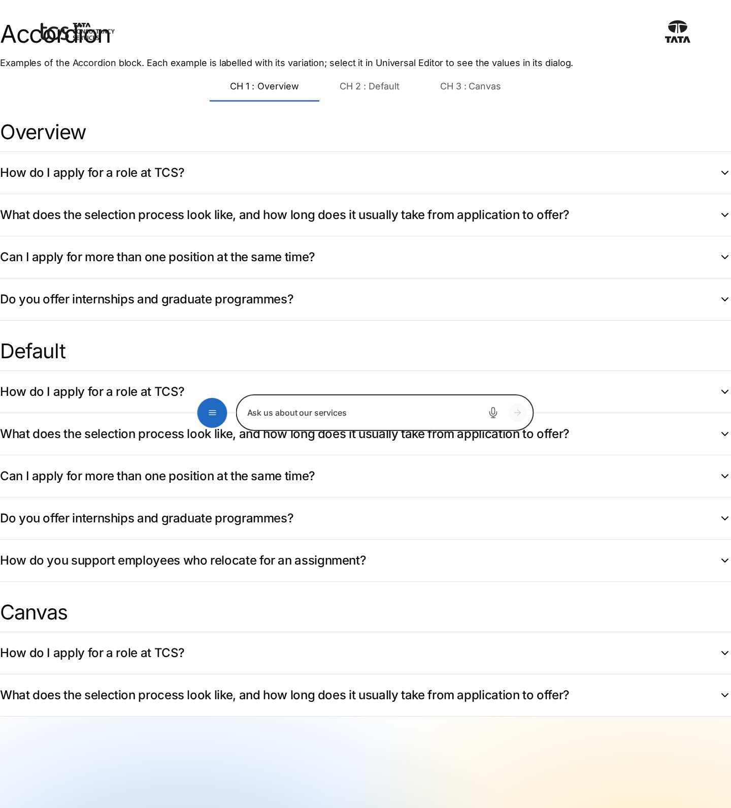
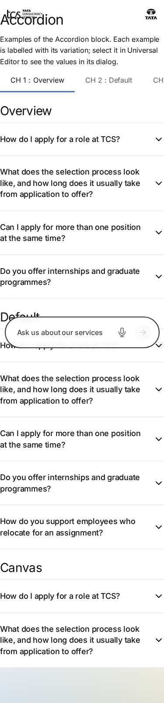

# Accordion — Authoring Guide

| Attribute | Value |
| --- | --- |
| Document ID | AUT-C-accordion |
| Audience | Content authors, content managers, AEM authoring leads |
| Purpose | How to add, fill in and check the Accordion component |
| Scope | — |
| Prerequisites | — |
| Owner | Content Lead / AEM Authoring Lead (proposed) |
| Approver | Product Owner (to be confirmed) |
| Version | 1.0 |
| Status | Draft for review |
| Last updated | 8 November 2026 |
| Last validated | 8 November 2026 |
| Source files | blocks/accordion/README.md, blocks/accordion/_accordion.json |
| Related documents | — |
| Related AEM paths | — |

## Contents

- [Where to see it](#where-to-see-it)
- [For Content Authors](#for-content-authors)
- [Authorable Fields](#authorable-fields)
- [Screenshot-Based Authoring Steps](#screenshot-based-authoring-steps)
- [Variations](#variations)
- [Complete Authoring Example](#complete-authoring-example)
- [Content and Asset Guidelines](#content-and-asset-guidelines)
- [Troubleshooting](#troubleshooting)
- [Screenshots](#screenshots)
- [Known limitations](#known-limitations)
- [Open items](#open-items)
- [Change history](#change-history)

## Where to see it

- https://main--tcs-corp--sradha-tcs.aem.live/design-block-master/en/block-library/accordion
- https://main--tcs-corp--sradha-tcs.aem.live/design-block-master/en/block-library/accordion/accordion

## For Content Authors

1. **Add the block.** In the content tree select a Section, a Columns Container column or a Tabs Container tab, choose Add (+) and pick **Accordion**.
2. **Open its properties.** Select the Accordion in the content tree; its properties panel has only the **Additional** tab (Anchor ID, Hide block, animation and spacing).
3. **Add the items.** With the Accordion selected, choose Add (+) and pick **Accordion Item**, once per question or entry. A new item has no content and shows as a dashed placeholder until it has a Summary.
4. **Enter content.** Select each Accordion Item and fill **Summary** (the always-visible label, e.g. "How do I apply for a role at TCS?") and **Text** (the answer: paragraphs, lists, links).
5. **Reorder items.** Drag the Accordion Items in the content tree; they render in that order.
6. **Options.** In the Accordion's Additional tab set an Anchor ID (e.g. `anchor-careers-faq`) to link to the FAQ, an Animation Type if the items should appear one after another, or spacing.
7. **Preview.** Switch Universal Editor to Preview, open and close every item, and check the page at mobile, tablet and desktop widths.
8. **Publish** the page (and the fragment page, if the Accordion is on a fragment).
9. **Validate the published output:** on the live page every item is closed on load, opens and closes with mouse and keyboard, and every link in the answers works.

- **Minimum required:** one Accordion Item with a Summary. An item without a Summary is not shown on the page.
- **Recommended:** a Text for every item; a Title (default content) above the Accordion to introduce the topic, because summaries are not headings.
- **Optional:** Anchor ID, Hide block, Animation Type / Motion Speed / Animation Trigger, padding and margin.

## Authorable Fields

<!-- BEGIN GENERATED: fields (npm run build:docs) -->

#### Accordion (`accordion`)

Model `accordion`; template name "Accordion" (the block class AEM renders); children: `accordion-item`.

##### Additional tab — Accordion

| Field label | Property | Type | Required | Default | Allowed values | Author guidance | Example |
| ----------- | -------- | ---- | -------- | ------- | -------------- | --------------- | ------- |
| Anchor ID | `classes_anchor` | text | No | — | regExp: ^anchor-[a-z0-9][a-z0-9-]*$; customErrorMsg: Start with anchor-, then lower-case letters, digits and hyphens. | A unique ID of the block on the page, starting with anchor-, e.g. anchor-our-services; link to it with #anchor-our-services. Delivered as a block class. | — |
| Hide block | `classes_hideblock` | boolean | No | `false` | on / off | Hides the whole block on the page until it is turned off (shown faded in the editor). Delivered as a block class. | — |
| Animation Type | `classes_animation` | select | No | "" | None (""), Fade in (`motion-fade-in`), Fade up (`motion-fade-up`), Fade down (`motion-fade-down`), Fade left (`motion-fade-left`), Fade right (`motion-fade-right`), Slide up (`motion-slide-up`), Slide down (`motion-slide-down`), Slide left (`motion-slide-left`), Slide right (`motion-slide-right`), Scale in (`motion-scale-in`) | How the block's content appears; repeated items (cards, list items, accordion items, columns) appear one after another. None: shown as is. Not played in the editor or when the visitor prefers reduced motion. Delivered as a block class. | motion-fade-left |
| Motion Speed | `classes_animationspeed` | select | No | "" | Medium (""), Fast (`motion-fast`), Slow (`motion-slow`) | How fast the animation runs: 0.3, 0.6 or 0.9 seconds. Shown when `classes_animation` is set and `classes_animation` is not empty. Delivered as a block class. | — |
| Animation Trigger | `classes_animationtrigger` | select | No | "" | On Scroll / Viewport Entry (""), On Page Load (`motion-on-load`) | When the block's animations run. On Scroll: when the block comes into view (at once if it is in view when the page opens). On Page Load: as soon as the block is ready, wherever it is on the page. Shown when `classes_animation` is set and `classes_animation` is not empty. Delivered as a block class. | — |
| Padding left | `classes_paddingleft` | select | No | "" | Default (""), 0 (none) (`pl-0`), 0.25rem (space-100) (`pl-100`), 0.5rem (space-200) (`pl-200`), 0.75rem (space-300) (`pl-300`), 1rem (space-400) (`pl-400`), 1.25rem (space-500) (`pl-500`), 1.5rem (space-600) (`pl-600`), 2rem (space-800) (`pl-800`), 2.5rem (space-1000) (`pl-1000`), 3rem (space-1200) (`pl-1200`), 4rem (space-1600) (`pl-1600`), 5rem (space-2000) (`pl-2000`), 6rem (space-2400) (`pl-2400`), 7.5rem (space-3000) (`pl-3000`) | Delivered as a block class. | — |
| Padding right | `classes_paddingright` | select | No | "" | Default (""), 0 (none) (`pr-0`), 0.25rem (space-100) (`pr-100`), 0.5rem (space-200) (`pr-200`), 0.75rem (space-300) (`pr-300`), 1rem (space-400) (`pr-400`), 1.25rem (space-500) (`pr-500`), 1.5rem (space-600) (`pr-600`), 2rem (space-800) (`pr-800`), 2.5rem (space-1000) (`pr-1000`), 3rem (space-1200) (`pr-1200`), 4rem (space-1600) (`pr-1600`), 5rem (space-2000) (`pr-2000`), 6rem (space-2400) (`pr-2400`), 7.5rem (space-3000) (`pr-3000`) | Delivered as a block class. | — |
| Padding top | `classes_paddingtop` | select | No | "" | Default (""), 0 (none) (`pt-0`), 0.25rem (space-100) (`pt-100`), 0.5rem (space-200) (`pt-200`), 0.75rem (space-300) (`pt-300`), 1rem (space-400) (`pt-400`), 1.25rem (space-500) (`pt-500`), 1.5rem (space-600) (`pt-600`), 2rem (space-800) (`pt-800`), 2.5rem (space-1000) (`pt-1000`), 3rem (space-1200) (`pt-1200`), 4rem (space-1600) (`pt-1600`), 5rem (space-2000) (`pt-2000`), 6rem (space-2400) (`pt-2400`), 7.5rem (space-3000) (`pt-3000`) | Delivered as a block class. | — |
| Padding bottom | `classes_paddingbottom` | select | No | "" | Default (""), 0 (none) (`pb-0`), 0.25rem (space-100) (`pb-100`), 0.5rem (space-200) (`pb-200`), 0.75rem (space-300) (`pb-300`), 1rem (space-400) (`pb-400`), 1.25rem (space-500) (`pb-500`), 1.5rem (space-600) (`pb-600`), 2rem (space-800) (`pb-800`), 2.5rem (space-1000) (`pb-1000`), 3rem (space-1200) (`pb-1200`), 4rem (space-1600) (`pb-1600`), 5rem (space-2000) (`pb-2000`), 6rem (space-2400) (`pb-2400`), 7.5rem (space-3000) (`pb-3000`) | Delivered as a block class. | — |
| Margin left | `classes_marginleft` | select | No | "" | Default (""), 0 (none) (`ml-0`), 0.25rem (space-100) (`ml-100`), 0.5rem (space-200) (`ml-200`), 0.75rem (space-300) (`ml-300`), 1rem (space-400) (`ml-400`), 1.25rem (space-500) (`ml-500`), 1.5rem (space-600) (`ml-600`), 2rem (space-800) (`ml-800`), 2.5rem (space-1000) (`ml-1000`), 3rem (space-1200) (`ml-1200`), 4rem (space-1600) (`ml-1600`), 5rem (space-2000) (`ml-2000`), 6rem (space-2400) (`ml-2400`), 7.5rem (space-3000) (`ml-3000`) | Delivered as a block class. | — |
| Margin right | `classes_marginright` | select | No | "" | Default (""), 0 (none) (`mr-0`), 0.25rem (space-100) (`mr-100`), 0.5rem (space-200) (`mr-200`), 0.75rem (space-300) (`mr-300`), 1rem (space-400) (`mr-400`), 1.25rem (space-500) (`mr-500`), 1.5rem (space-600) (`mr-600`), 2rem (space-800) (`mr-800`), 2.5rem (space-1000) (`mr-1000`), 3rem (space-1200) (`mr-1200`), 4rem (space-1600) (`mr-1600`), 5rem (space-2000) (`mr-2000`), 6rem (space-2400) (`mr-2400`), 7.5rem (space-3000) (`mr-3000`) | Delivered as a block class. | — |
| Margin top | `classes_margintop` | select | No | "" | Default (""), 0 (none) (`mt-0`), 0.25rem (space-100) (`mt-100`), 0.5rem (space-200) (`mt-200`), 0.75rem (space-300) (`mt-300`), 1rem (space-400) (`mt-400`), 1.25rem (space-500) (`mt-500`), 1.5rem (space-600) (`mt-600`), 2rem (space-800) (`mt-800`), 2.5rem (space-1000) (`mt-1000`), 3rem (space-1200) (`mt-1200`), 4rem (space-1600) (`mt-1600`), 5rem (space-2000) (`mt-2000`), 6rem (space-2400) (`mt-2400`), 7.5rem (space-3000) (`mt-3000`) | Delivered as a block class. | — |
| Margin bottom | `classes_marginbottom` | select | No | "" | Default (""), 0 (none) (`mb-0`), 0.25rem (space-100) (`mb-100`), 0.5rem (space-200) (`mb-200`), 0.75rem (space-300) (`mb-300`), 1rem (space-400) (`mb-400`), 1.25rem (space-500) (`mb-500`), 1.5rem (space-600) (`mb-600`), 2rem (space-800) (`mb-800`), 2.5rem (space-1000) (`mb-1000`), 3rem (space-1200) (`mb-1200`), 4rem (space-1600) (`mb-1600`), 5rem (space-2000) (`mb-2000`), 6rem (space-2400) (`mb-2400`), 7.5rem (space-3000) (`mb-3000`) | Delivered as a block class. | — |

#### Accordion Item (`accordion-item`)

Model `accordion-item`; template name "Accordion Item" (the block class AEM renders).

##### Fields — Accordion Item

| Field label | Property | Type | Required | Default | Allowed values | Author guidance | Example |
| ----------- | -------- | ---- | -------- | ------- | -------------- | --------------- | ------- |
| Summary | `summary` | text | No | "" | — | — | How do I apply for a role at TCS? |
| Text | `text` | richtext | No | "" | — | — | — |

<!-- END GENERATED: fields -->

Notes on the fields (see the tables above for labels, properties and values):

- **Summary:** moved into the item's `summary` element (`summary.accordion-item-label`). It is the accessible name of the disclosure control and the `dc:title` of the item's `cmp:show` / `cmp:hide` data-layer events. An item whose Summary cell has no text (and no image or link) is removed on the page and shown as an editor placeholder in Universal Editor.
- **Text:** becomes `div.accordion-item-body`; an item without Text opens to an empty body. The first and last elements of the body lose their outer margins.
- **No content template values:** new Accordion Items are created empty (the former "Lorem Ipsum" template values were removed, re-audit finding R-C-11).
- **Additional tab:** Anchor ID, Hide block, spacing and the content animation fields behave as described in AGENTS.md "Additional tab" and "Animation and skeletons". For the Accordion the animation targets are the items (`:scope > .accordion-item`), which appear one after another (staggered), from `decorators/motion-decorator.js` `CONTENT_TARGETS`.
- **Legacy mapping:** none; the block reads only the two item cells.

## Screenshot-Based Authoring Steps

#### Authoring Step 1: Add the Accordion

```text
[Screenshot Placeholder]

File name:
accordion-authoring-step-1.png

Purpose:
A Section selected in the content tree, the Add (+) menu open with Accordion highlighted.

Annotations:
A = Section in the content tree
B = Add (+) button
C = Accordion in the component list
```

#### Values to Enter

| Callout | Field | Value | Reason | Expected result |
| ------- | ----- | ----- | ------ | --------------- |
| A | Section (content tree) | The FAQ section of the careers page | The Accordion is offered in Sections, Columns Container columns and Tabs Container tabs | The section is selected |
| C | Component | Accordion | Adds the block | An empty Accordion appears in the section |

- **Author action:** select the section, choose Add (+), pick Accordion.
- **Expected preview:** an empty block area (no items yet).
- **Expected published result:** nothing visible until items are added.
- **Business rules:** only Accordion Items can be added inside the Accordion.
- **Validation:** the Accordion appears in the content tree under the section.
- **Common mistake:** the Accordion is not in the Add list. Resolution: select a Section, a Columns Container column or a Tabs Container tab, not another block.

#### Authoring Step 2: Add Accordion Items

```text
[Screenshot Placeholder]

File name:
accordion-authoring-step-2.png

Purpose:
The Accordion selected, Add (+) open with Accordion Item, and two new items shown as dashed placeholders on the canvas.

Annotations:
A = Accordion in the content tree
B = Accordion Item in the Add list
C = Placeholder of an item without a Summary
```

#### Values to Enter

| Callout | Field | Value | Reason | Expected result |
| ------- | ----- | ----- | ------ | --------------- |
| A | Accordion (content tree) | Selected | Items are added to the selected block | The Add list offers Accordion Item |
| B | Component | Accordion Item (four times) | One item per question | Four placeholders appear in the block |

- **Author action:** select the Accordion, choose Add (+) and pick Accordion Item for each question.
- **Expected preview:** each new item is a dashed placeholder with the hint text from placeholder `itemEditorHint`.
- **Expected published result:** items without a Summary are left out of the page.
- **Validation:** the content tree lists the items under the Accordion.
- **Common mistake:** the Summary and Text fields cannot be found. Resolution: select the Accordion Item, not the Accordion.

#### Authoring Step 3: Enter Summary and Text

```text
[Screenshot Placeholder]

File name:
accordion-authoring-step-3.png

Purpose:
An Accordion Item selected with its properties panel: Summary and Text filled in; the canvas shows the item as a closed row.

Annotations:
A = Summary field
B = Text field (rich text)
C = The rendered summary row
```

#### Values to Enter

| Callout | Field | Value | Reason | Expected result |
| ------- | ----- | ----- | ------ | --------------- |
| A | Summary | How do I apply for a role at TCS? | The visible question | The row shows the question and a chevron |
| B | Text | Search the open roles on our careers pages, choose a role and select Apply. You can save your application and complete it later. Then a bulleted list: Create a candidate profile; Upload your CV; Track the status of your application | The answer shown when the item opens | The body opens below the summary |

- **Author action:** select the item and type both fields; use the rich text toolbar for the list.
- **Expected preview:** a closed row; opening it shows the paragraph and the bullets.
- **Expected published result:** the same row, closed on page load.
- **Business rules:** keep each Summary short and unique; put essential messages outside the Accordion.
- **Validation:** open and close the item in Preview mode.
- **Common mistake:** an item opens to nothing. Resolution: fill its Text.

#### Authoring Step 4: Reorder, set options and preview

```text
[Screenshot Placeholder]

File name:
accordion-authoring-step-4.png

Purpose:
An Accordion Item dragged to a new position in the content tree, and the Accordion's Additional tab with Anchor ID anchor-careers-faq and Margin bottom set.

Annotations:
A = Item being dragged in the content tree
B = Anchor ID field
C = Margin bottom select
```

#### Values to Enter

| Callout | Field | Value | Reason | Expected result |
| ------- | ----- | ----- | ------ | --------------- |
| A | Item order | Drag "Do you offer internships and graduate programmes?" to the end | Items render in content tree order | The canvas shows the new order |
| B | Anchor ID | anchor-careers-faq | `#anchor-careers-faq` links reach the FAQ | The block gets the id `anchor-careers-faq` |
| C | Margin bottom | 2.5rem (space-1000) | Space below the FAQ | Class `mb-1000` on the block |

- **Author action:** drag items in the content tree; set the Additional tab fields on the Accordion.
- **Expected preview:** items in the new order; the spacing below the block.
- **Expected published result:** the same order and spacing; `#anchor-careers-faq` scrolls to the block.
- **Business rules:** the Anchor ID must start with `anchor-` (validated); a duplicate on the page is suffixed `-2`, `-3`.
- **Validation:** open the preview URL with `#anchor-careers-faq`.
- **Common mistake:** the anchor link does not scroll. Resolution: check the block's id in the browser developer tools and make the Anchor ID unique.

## Variations

#### Default Accordion

The Accordion has no style, layout or variant field (its model has only the Additional tab), so there is one presentation. Additional tab options (Anchor ID, Hide block, animation, spacing) are block options, not variations.

| Aspect | Detail |
| ------ | ------ |
| Purpose | Question / answer or label / detail pairs, compact, all closed on load |
| When to use | Several independent items of which visitors read one or a few |
| When not to use | Content every visitor must see; alternative views to compare (Tabs Container) |
| Required fields | One Accordion Item with a Summary |
| Optional fields | Text (recommended), Additional tab |
| Dialog configuration | None besides the Additional tab |
| Rendering | `details.accordion-item` per item with `summary.accordion-item-label` and `div.accordion-item-body`; native marker hidden, chevron drawn by `summary::after` and rotated 180 degrees when open |
| Desktop / tablet / mobile | Same layout at every width; summary and body sizes come from the typography tokens, which switch at 900px |
| Accessibility | Native disclosure semantics and keyboard support; visible focus outline; decorative chevron |
| Data layer | `cmp:show` / `cmp:hide` per toggle, `dc:title` = summary |
| Personalization and fallback | None; the authored items render |

```text
[Screenshot Placeholder]

File name:
accordion-default-tablet.png

Purpose:
The Default Accordion at 768px with one item open, the summary at 1.125rem and the body at 1rem.

Annotations:
A = Closed item with downward chevron
B = Open item with rotated chevron
C = Body text
```

## Complete Authoring Example

Scenario: a careers FAQ on a careers page, below a Title "Frequently asked questions".

| Field | Example value | Guidance |
| ----- | ------------- | -------- |
| Accordion › Anchor ID | anchor-careers-faq | Lets other blocks link to the FAQ |
| Accordion › Margin bottom | 2.5rem (space-1000) | Optional spacing |
| Item 1 › Summary | How do I apply for a role at TCS? | Short, specific question |
| Item 1 › Text | Search the open roles on our careers pages, choose a role and select Apply. … plus three bullets | Paragraph and list |
| Item 2 › Summary | What does the selection process look like, and how long does it usually take from application to offer? | Long summaries wrap; keep them readable on mobile |
| Item 2 › Text | Most roles have an online assessment, a technical interview and a final interview with the hiring team. … | Plain answer |
| Item 3 › Summary | Can I apply for more than one position at the same time? | |
| Item 3 › Text | Yes. You can apply for up to three roles at once; each application is reviewed by the team that is hiring for it. | |
| Item 4 › Summary | Do you offer internships and graduate programmes? | |
| Item 4 › Text | We run paid internships and a two-year graduate programme in most of our regions. … see Graduate careers for the dates. | "Graduate careers" links to the graduates page; descriptive link text |

Steps: add a Title above the block, add the Accordion, add four Accordion Items, fill Summary and Text of each, set the Anchor ID, preview, publish.

- **Expected output:** four closed rows between 1px dividers with chevrons; each opens to its answer; several can be open at once.
- **Responsive:** the same stack at every width; summaries at 1.125rem below 900px and 1.5rem from 900px, bodies at 1rem / 1.125rem.
- **Accessibility:** each summary is a keyboard-operable disclosure named by its text; the Title gives the FAQ a heading.
- **Analytics / data layer:** the block is `component.anchor-careers-faq` (`@type` `tcs-corp/components/accordion`); opening item 1 pushes `cmp:show` with `dc:title` "How do I apply for a role at TCS?"; the "Graduate careers" link pushes `cmp:click`.
- **Personalization fallback:** none; the authored items render for every visitor.
- **Pre-publish checklist:** every item has a Summary and a Text; items in the intended order; Hide block off; Anchor ID unique and starting with `anchor-`; every link in the answers works; keyboard check (Tab, Enter, Space); layout checked at 375px, 768px and 1440px.

## Content and Asset Guidelines

- **Summaries:** short, specific and unique; a question for FAQs; don't start every summary with the same words. Long summaries wrap (the handover recommends up to about 100 characters; not enforced).
- **Body text:** short paragraphs, lists and descriptive links ("Graduate careers", not "click here"). Headings inside a body should follow the page's heading hierarchy.
- **Titles / eyebrows / labels / CTAs:** the block has none of its own; put calls to action outside the Accordion so they are always visible.
- **Images and icons:** the block CSS has no image rules; avoid images in items. The chevron is `icons/chevron-down.svg`, drawn by CSS.
- **Tags and metadata:** none read.
- **Min / max items:** No verified technical limit was identified (the handover recommends 3 to 10 items).
- **Lazy / eager loading and missing assets:** not applicable (no assets).

## Troubleshooting

| Symptom | Likely cause | Diagnostic steps | Resolution | Verification |
| ------- | ------------ | ---------------- | ---------- | ------------ |
| Items show as plain text, no chevrons | Block script failed or wrong block | Developer tools: items should be `details.accordion-item`; console for `failed to load` messages; Network for `accordion.js` | Reload; escalate to development if the files fail | Items open and close |
| An item is missing on the page | Its Summary is empty | Check the item in the content tree; in the editor it is a dashed placeholder | Fill the Summary | The item renders |
| An item opens to nothing | Text empty | Select the item, check Text | Enter the answer or delete the item | The body shows |
| Block missing on the live page | Hide block on, or page / fragment not published | Additional tab; publication status | Turn Hide block off; publish page and fragment | Block visible on aem.live |
| `#anchor-…` link does not reach the block | Anchor ID differs or was suffixed `-2` | Inspect the block's `id` | Correct or de-duplicate the Anchor ID | The link scrolls to the block |
| No `cmp:show` events | Inside `data-analytics="off"`, or Tags not reading them | Open an item, run `window.adobeDataLayer.slice(-3)` in the console | If present, configure Tags (not yet set up); else escalate | `cmp:show` appears |

Evidence to collect (no secrets): page URL, browser and viewport, a screenshot, the block's rendered HTML from the developer tools, console errors, and the last data-layer entries.

## Screenshots



*Figure: Accordion as published (block library) — desktop 1440 × 900 (/design-block-master/en/block-library/accordion/accordion, captured 2026-11-08).*



*Figure: Accordion as published (block library) — mobile 375 × 812 (/design-block-master/en/block-library/accordion/accordion, captured 2026-11-08).*

> **Screenshot required**
>
> - Required screen: Accordion dialog in Universal Editor (every tab, including Additional)
> - Required role/access: AEM Sites author with Universal Editor (content author)
> - Required navigation steps: AEM Sites console > /content/tcs-corp/language-masters/en > open a page in Universal Editor
> - Reason unavailable: No AEM author access in the documentation program (access blocker AB-01)
> - Owner: Content Lead / AEM Authoring Lead (proposed)
> - Target completion date: To be confirmed

## Known limitations

- Universal Editor screenshots are placeholders: no author access in this program.

## Open items

- None.

## Change history

| Version | Date | Author | Change |
| --- | --- | --- | --- |
| 1.0 | 8 November 2026 | Delivery team (documentation program) | First version of the role-specific documentation (master documentation prompt), generated from the repository and the published reference pages |
