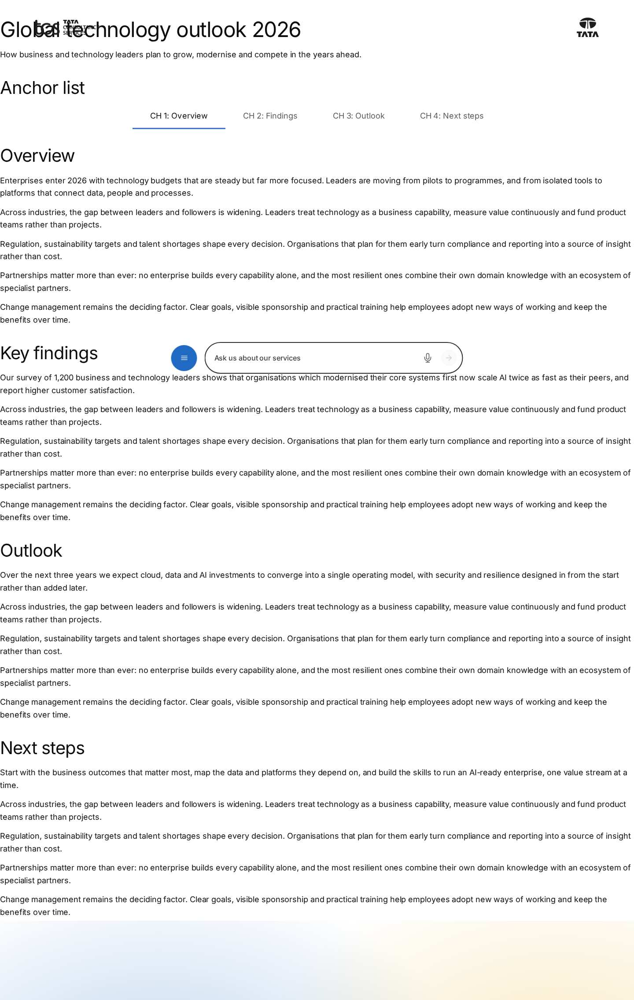

# Anchor List — Authoring Guide

| Attribute | Value |
| --- | --- |
| Document ID | AUT-C-anchor-list |
| Audience | Content authors, content managers, AEM authoring leads |
| Purpose | How to add, fill in and check the Anchor List component |
| Scope | — |
| Prerequisites | — |
| Owner | Content Lead / AEM Authoring Lead (proposed) |
| Approver | Product Owner (to be confirmed) |
| Version | 1.0 |
| Status | Draft for review |
| Last updated | 8 November 2026 |
| Last validated | 8 November 2026 |
| Source files | blocks/anchor-list/README.md, blocks/anchor-list/_anchor-list.json |
| Related documents | — |
| Related AEM paths | — |

## Contents

- [Where to see it](#where-to-see-it)
- [For Content Authors](#for-content-authors)
- [Authorable Fields](#authorable-fields)
- [Screenshot-Based Authoring Steps](#screenshot-based-authoring-steps)
- [Variations](#variations)
- [Complete Authoring Example](#complete-authoring-example)
- [Content and Asset Guidelines](#content-and-asset-guidelines)
- [Troubleshooting](#troubleshooting)
- [Screenshots](#screenshots)
- [Known limitations](#known-limitations)
- [Open items](#open-items)
- [Change history](#change-history)

## Where to see it

- https://main--tcs-corp--sradha-tcs.aem.live/design-block-master/en/block-library/anchor-list
- https://main--tcs-corp--sradha-tcs.aem.live/design-block-master/en/block-library/anchor-list/anchor-list
- https://main--tcs-corp--sradha-tcs.aem.live/design-block-master/en/block-library/anchor-list/anchor-list-sticky

## For Content Authors

1. **Prepare the targets.** For each chapter section, open its Section properties and enter an **Anchor name** (e.g. `overview`, `findings`, `outlook`, `next-steps`: lower case, no spaces). A block's Anchor ID (`anchor-…`) or a heading id also works as a target.
2. **Add the block.** Select the section above the first chapter (a Section, a Columns Container column or a Tabs Container tab), choose Add (+) and pick **Anchor List**.
3. **Open its properties.** The Content tab has **Sticky**, and the **Links** multifield kept for lists authored before; the Additional tab has Anchor ID, Hide block and spacing.
4. **Add the links.** With the Anchor List selected, choose Add (+) and pick **Anchor Link** once per chapter. In each, enter **Link Title** (required, e.g. "CH 1: Overview") and **Anchor Name** (the section's Anchor name, e.g. `overview`).
5. **Reorder links** by dragging the Anchor Links in the content tree; keep them in page order so the highlight follows the reading position.
6. **Choose the variation:** turn **Sticky** on to pin the row while scrolling (long pages); leave it off for an in-place index.
7. **Preview.** Switch to Preview mode (Sticky doesn't pin in edit mode), click every link, scroll the page and check the current-link highlight.
8. **Publish** the page; the links and the section Anchor names are part of the same page.
9. **Validate the published output:** open the live URL with a hash (e.g. `#outlook`): its link is current; each link scrolls to its chapter with the heading visible below the header (and the pinned list).

- **Minimum required:** one Anchor Link with a Link Title, and a matching id on the page (else the link only marks itself current).
- **Recommended:** an Anchor Name for every link; 3 to 7 short links (handover guidance); Sticky on for long pages.
- **Optional:** Anchor ID, Hide block, padding and margin (keep the margins at Default on a sticky list).

## Authorable Fields

<!-- BEGIN GENERATED: fields (npm run build:docs) -->

#### Anchor List (`anchor-list`)

Model `anchor-list`; template name "Anchor List" (the block class AEM renders); key-value block (one row per property); children: `anchor-list-item`.

##### Content tab — Anchor List

| Field label | Property | Type | Required | Default | Allowed values | Author guidance | Example |
| ----------- | -------- | ---- | -------- | ------- | -------------- | --------------- | ------- |
| Links | `anchors` | container (multiple) | No | — | — | Links authored before Anchor Link items. Add links to the list with Add (Anchor Link) instead. | — |
| Links › Link Title | `label` | text | No | — | — | e.g. CH 1: Overview | — |
| Links › Anchor Name | `anchorName` | text | No | — | — | The Anchor name of the target section (Section properties), e.g. overview. Heading ids work too. | — |
| Sticky | `sticky` | boolean | No | `false` | on / off | Keep the links at the top of the screen while scrolling. | true |

##### Additional tab — Anchor List

| Field label | Property | Type | Required | Default | Allowed values | Author guidance | Example |
| ----------- | -------- | ---- | -------- | ------- | -------------- | --------------- | ------- |
| Anchor ID | `classes_anchor` | text | No | — | regExp: ^anchor-[a-z0-9][a-z0-9-]*$; customErrorMsg: Start with anchor-, then lower-case letters, digits and hyphens. | A unique ID of the block on the page, starting with anchor-, e.g. anchor-our-services; link to it with #anchor-our-services. Delivered as a block class. | — |
| Hide block | `classes_hideblock` | boolean | No | `false` | on / off | Hides the whole block on the page until it is turned off (shown faded in the editor). Delivered as a block class. | — |
| Padding left | `classes_paddingleft` | select | No | "" | Default (""), 0 (none) (`pl-0`), 0.25rem (space-100) (`pl-100`), 0.5rem (space-200) (`pl-200`), 0.75rem (space-300) (`pl-300`), 1rem (space-400) (`pl-400`), 1.25rem (space-500) (`pl-500`), 1.5rem (space-600) (`pl-600`), 2rem (space-800) (`pl-800`), 2.5rem (space-1000) (`pl-1000`), 3rem (space-1200) (`pl-1200`), 4rem (space-1600) (`pl-1600`), 5rem (space-2000) (`pl-2000`), 6rem (space-2400) (`pl-2400`), 7.5rem (space-3000) (`pl-3000`) | Delivered as a block class. | — |
| Padding right | `classes_paddingright` | select | No | "" | Default (""), 0 (none) (`pr-0`), 0.25rem (space-100) (`pr-100`), 0.5rem (space-200) (`pr-200`), 0.75rem (space-300) (`pr-300`), 1rem (space-400) (`pr-400`), 1.25rem (space-500) (`pr-500`), 1.5rem (space-600) (`pr-600`), 2rem (space-800) (`pr-800`), 2.5rem (space-1000) (`pr-1000`), 3rem (space-1200) (`pr-1200`), 4rem (space-1600) (`pr-1600`), 5rem (space-2000) (`pr-2000`), 6rem (space-2400) (`pr-2400`), 7.5rem (space-3000) (`pr-3000`) | Delivered as a block class. | — |
| Padding top | `classes_paddingtop` | select | No | "" | Default (""), 0 (none) (`pt-0`), 0.25rem (space-100) (`pt-100`), 0.5rem (space-200) (`pt-200`), 0.75rem (space-300) (`pt-300`), 1rem (space-400) (`pt-400`), 1.25rem (space-500) (`pt-500`), 1.5rem (space-600) (`pt-600`), 2rem (space-800) (`pt-800`), 2.5rem (space-1000) (`pt-1000`), 3rem (space-1200) (`pt-1200`), 4rem (space-1600) (`pt-1600`), 5rem (space-2000) (`pt-2000`), 6rem (space-2400) (`pt-2400`), 7.5rem (space-3000) (`pt-3000`) | Delivered as a block class. | — |
| Padding bottom | `classes_paddingbottom` | select | No | "" | Default (""), 0 (none) (`pb-0`), 0.25rem (space-100) (`pb-100`), 0.5rem (space-200) (`pb-200`), 0.75rem (space-300) (`pb-300`), 1rem (space-400) (`pb-400`), 1.25rem (space-500) (`pb-500`), 1.5rem (space-600) (`pb-600`), 2rem (space-800) (`pb-800`), 2.5rem (space-1000) (`pb-1000`), 3rem (space-1200) (`pb-1200`), 4rem (space-1600) (`pb-1600`), 5rem (space-2000) (`pb-2000`), 6rem (space-2400) (`pb-2400`), 7.5rem (space-3000) (`pb-3000`) | Delivered as a block class. | — |
| Margin left | `classes_marginleft` | select | No | "" | Default (""), 0 (none) (`ml-0`), 0.25rem (space-100) (`ml-100`), 0.5rem (space-200) (`ml-200`), 0.75rem (space-300) (`ml-300`), 1rem (space-400) (`ml-400`), 1.25rem (space-500) (`ml-500`), 1.5rem (space-600) (`ml-600`), 2rem (space-800) (`ml-800`), 2.5rem (space-1000) (`ml-1000`), 3rem (space-1200) (`ml-1200`), 4rem (space-1600) (`ml-1600`), 5rem (space-2000) (`ml-2000`), 6rem (space-2400) (`ml-2400`), 7.5rem (space-3000) (`ml-3000`) | Delivered as a block class. | — |
| Margin right | `classes_marginright` | select | No | "" | Default (""), 0 (none) (`mr-0`), 0.25rem (space-100) (`mr-100`), 0.5rem (space-200) (`mr-200`), 0.75rem (space-300) (`mr-300`), 1rem (space-400) (`mr-400`), 1.25rem (space-500) (`mr-500`), 1.5rem (space-600) (`mr-600`), 2rem (space-800) (`mr-800`), 2.5rem (space-1000) (`mr-1000`), 3rem (space-1200) (`mr-1200`), 4rem (space-1600) (`mr-1600`), 5rem (space-2000) (`mr-2000`), 6rem (space-2400) (`mr-2400`), 7.5rem (space-3000) (`mr-3000`) | Delivered as a block class. | — |
| Margin top | `classes_margintop` | select | No | "" | Default (""), 0 (none) (`mt-0`), 0.25rem (space-100) (`mt-100`), 0.5rem (space-200) (`mt-200`), 0.75rem (space-300) (`mt-300`), 1rem (space-400) (`mt-400`), 1.25rem (space-500) (`mt-500`), 1.5rem (space-600) (`mt-600`), 2rem (space-800) (`mt-800`), 2.5rem (space-1000) (`mt-1000`), 3rem (space-1200) (`mt-1200`), 4rem (space-1600) (`mt-1600`), 5rem (space-2000) (`mt-2000`), 6rem (space-2400) (`mt-2400`), 7.5rem (space-3000) (`mt-3000`) | Delivered as a block class. | — |
| Margin bottom | `classes_marginbottom` | select | No | "" | Default (""), 0 (none) (`mb-0`), 0.25rem (space-100) (`mb-100`), 0.5rem (space-200) (`mb-200`), 0.75rem (space-300) (`mb-300`), 1rem (space-400) (`mb-400`), 1.25rem (space-500) (`mb-500`), 1.5rem (space-600) (`mb-600`), 2rem (space-800) (`mb-800`), 2.5rem (space-1000) (`mb-1000`), 3rem (space-1200) (`mb-1200`), 4rem (space-1600) (`mb-1600`), 5rem (space-2000) (`mb-2000`), 6rem (space-2400) (`mb-2400`), 7.5rem (space-3000) (`mb-3000`) | Delivered as a block class. | — |

#### Anchor Link (`anchor-list-item`)

Model `anchor-list-item`; template name "Anchor Link" (the block class AEM renders).

##### Link tab — Anchor Link

| Field label | Property | Type | Required | Default | Allowed values | Author guidance | Example |
| ----------- | -------- | ---- | -------- | ------- | -------------- | --------------- | ------- |
| Link Title | `label` | text | Yes | — | — | e.g. CH 1: Overview | — |
| Anchor Name | `anchorName` | text | No | — | — | The Anchor name of the target section (Section properties), e.g. overview. Heading ids work too. | — |

<!-- END GENERATED: fields -->

Notes on the fields (see the tables above):

- **Link Title** becomes the link text. In an Anchor Link it is required: an Anchor Link without a title is not rendered on the page (in Universal Editor it shows as a dashed placeholder with the `itemEditorHint` text).
- **Anchor Name** becomes the link's `href="#…"`, normalized with `toClassName` after removing a leading `#` (e.g. "Our Findings" becomes `our-findings`), the same way `scripts/scripts.js` turns a section's Anchor name into its id. When it is empty, the normalized Link Title is used (e.g. "CH 1: Overview" becomes `ch-1-overview`).
- **Sticky** adds the `sticky` class and enables pinning (see Variations). It is on only for the value `true`.
- **Legacy mapping:** the **Links** multifield (`anchors`: Link Title, Anchor Name) is still read and its links render first, before the Anchor Links. In a multifield item the non-empty values are read in order, so an item with only one value uses it as both the text and (normalized) the anchor. New content should use Anchor Link items (composite multifields don't render from content packages, AGENTS.md "Item children").
- **Additional tab:** Anchor ID, Hide block and spacing as in AGENTS.md "Additional tab". The Anchor List has no animation fields (`test/motion/motion.test.mjs` lists it among the blocks without Content animation).
- **Accessibility / data layer impact:** the Link Title is the link's accessible name and the `dc:title` of its `cmp:click`.

## Screenshot-Based Authoring Steps

#### Authoring Step 1: Set the section Anchor names

```text
[Screenshot Placeholder]

File name:
anchor-list-authoring-step-1.png

Purpose:
The Overview section selected, its Section properties open with Anchor name overview.

Annotations:
A = Section in the content tree
B = Anchor name field
```

#### Values to Enter

| Callout | Field | Value | Reason | Expected result |
| ------- | ----- | ----- | ------ | --------------- |
| B | Anchor name (Section properties, chapter 1) | overview | The id the first link jumps to | The section gets `id="overview"` |
| B | Anchor name (chapters 2 to 4) | findings, outlook, next-steps | One id per chapter | Each section gets its id |

- **Author action:** select each chapter section and enter its Anchor name.
- **Expected preview / published result:** no visible change; the sections carry the ids.
- **Business rules:** lower case, digits and hyphens (validated); a name already used on the page gets a suffix (`-2`, `-3`), so keep names unique.
- **Validation:** in the browser console, `document.getElementById('findings')` returns the section.
- **Common mistake:** two sections use the same name. Resolution: rename one; the second one would get `findings-2`.

#### Authoring Step 2: Add the Anchor List

```text
[Screenshot Placeholder]

File name:
anchor-list-authoring-step-2.png

Purpose:
The first section selected, Add (+) open with Anchor List; the new block below the page title and intro.

Annotations:
A = Section in the content tree
B = Anchor List in the Add list
C = The new Anchor List on the canvas
```

#### Values to Enter

| Callout | Field | Value | Reason | Expected result |
| ------- | ----- | ----- | ------ | --------------- |
| B | Component | Anchor List | Adds the chapter navigation | An empty labelled navigation appears |

- **Author action:** select the section above the first chapter, Add (+), pick Anchor List.
- **Expected preview:** an empty row until links are added.
- **Business rules:** place it above the first chapter, below the page title.
- **Validation:** the block appears in the content tree.
- **Common mistake:** the block is placed inside a chapter. Resolution: move it above the first chapter section.

#### Authoring Step 3: Add the Anchor Links

```text
[Screenshot Placeholder]

File name:
anchor-list-authoring-step-3.png

Purpose:
An Anchor Link selected with its Link tab: Link Title CH 2: Findings and Anchor Name findings; four links on the canvas.

Annotations:
A = Anchor Link in the content tree
B = Link Title
C = Anchor Name
D = The rendered link
```

#### Values to Enter

| Callout | Field | Value | Reason | Expected result |
| ------- | ----- | ----- | ------ | --------------- |
| B | Link Title (link 1) | CH 1: Overview | Visible link text | Link "CH 1: Overview" |
| C | Anchor Name (link 1) | overview | Target section | `href="#overview"` |
| B / C | Links 2 to 4 | CH 2: Findings / findings; CH 3: Outlook / outlook; CH 4: Next steps / next-steps | One link per chapter, in page order | Four links in a row |

- **Author action:** select the Anchor List, Add (+) Anchor Link four times, fill both fields of each.
- **Expected preview:** four links; the first is current at the top of the page.
- **Expected published result:** the same row; a click scrolls to the chapter.
- **Business rules:** keep the links in page order; keep titles short (links never wrap).
- **Validation:** click each link in Preview mode.
- **Common mistake:** a link only underlines itself. Resolution: make its Anchor Name match the section's Anchor name.

#### Authoring Step 4: Turn on Sticky and preview

```text
[Screenshot Placeholder]

File name:
anchor-list-authoring-step-4.png

Purpose:
The Anchor List Content tab with Sticky on, and the page in Preview mode scrolled into chapter 3 with the row pinned at the top.

Annotations:
A = Sticky toggle
B = Pinned Anchor List
C = Current link CH 3: Outlook
```

#### Values to Enter

| Callout | Field | Value | Reason | Expected result |
| ------- | ----- | ----- | ------ | --------------- |
| A | Sticky | On | Keep the chapters in view on a long page | The row pins once scrolled to the top |
| — | Mode | Preview | Pinning is off in edit mode | The row pins while scrolling |

- **Author action:** turn Sticky on, switch to Preview, scroll through the chapters.
- **Expected preview / published result:** the row pins at the top of the screen (below the fixed header on smaller screens) and the highlight follows the chapter in view.
- **Business rules:** keep the Additional tab margins at Default on a sticky list (margins are outside the height kept while pinned).
- **Validation:** no jump when the row pins; the clicked chapter's heading is visible below the row.
- **Common mistake:** the row doesn't pin in the editor. Resolution: expected; check in Preview mode or on the preview URL.

## Variations

#### Default (in place)

| Aspect | Detail |
| ------ | ------ |
| Purpose | A chapter index at its place in the page, typically below the page header |
| When to use | Medium-length pages; a table of contents at the top |
| When not to use | When readers need the chapters while deep in the page (use Sticky) |
| Required fields | Anchor Links with Link Titles; matching ids on the page |
| Optional fields | Anchor Names (else the normalized title), Additional tab |
| Dialog configuration | Sticky off (the default) |
| Rendering | `nav.anchor-list-nav` > `ul.anchor-list-items` > `li` > `a.anchor-list-link`; scrolls away with the page |
| Desktop / tablet / mobile | Centred row; 2.5rem link padding from 900px, 1.5rem below; sideways scrolling when the links don't fit |
| Accessibility | Labelled `nav` landmark, `aria-current="location"`, focus moved to the target after a click |
| Data layer | `cmp:click` per link |
| Personalization and fallback | None; links to missing targets only mark themselves current |

```text
[Screenshot Placeholder]

File name:
anchor-list-default-tablet.png

Purpose:
The in-place Anchor List at 768px below the page title, CH 1: Overview current.

Annotations:
A = Anchor List row
B = Current link
```

#### Sticky

| Aspect | Detail |
| ------ | ------ |
| Purpose | Keeps the chapters and the reading position visible throughout a long page |
| When to use | Reports, long solution pages, case studies |
| When not to use | Pages with other fixed elements at the top (they aren't part of the scroll offset) |
| Required fields | As Default, plus Sticky on |
| Dialog configuration | Content tab › Sticky = on |
| Rendering | Class `sticky` (background `--color-bg-default`); once its place scrolls up to the top (or to the bottom of a fixed header), the block gets `anchor-list-pinned` (`position: fixed`, full width, `z-index: 10`, the section's inline padding) and an inline `top`; the wrapper keeps the block's height (`min-height`) so the page doesn't jump. Released when scrolling back above its place. Not pinned in Universal Editor edit mode or while its section is still hidden |
| Desktop / tablet / mobile | From 1200px the site header scrolls away, so the row pins at the very top; below 1200px the header is fixed (`blocks/header/header.css`) and the row pins directly below it |
| Accessibility | As Default; clicked targets get a scroll margin so they aren't hidden under the row |
| Data layer | As Default |
| Personalization and fallback | None |

```text
[Screenshot Placeholder]

File name:
anchor-list-sticky-desktop.png

Purpose:
The pinned Anchor List at 1440px while scrolled into chapter 3, without a jump in the content below.

Annotations:
A = Pinned row at the top of the screen
B = Current link CH 3: Outlook
C = Chapter content below
```

## Complete Authoring Example

Scenario: chapter navigation of the "Global technology outlook 2026" report.

| Field | Example value | Guidance |
| ----- | ------------- | -------- |
| Section 1 | Title "Global technology outlook 2026" (h1), Text intro, Anchor List | The Anchor List sits above the first chapter |
| Anchor Link 1 | CH 1: Overview / overview | Link Title / Anchor Name |
| Anchor Link 2 | CH 2: Findings / findings | |
| Anchor Link 3 | CH 3: Outlook / outlook | |
| Anchor Link 4 | CH 4: Next steps / next-steps | |
| Sticky | On | Long report |
| Chapter sections › Anchor name | overview, findings, outlook, next-steps | One per section, in this order |

Steps: set the four section Anchor names, add the Anchor List to the first section, add four Anchor Links, turn Sticky on, preview, publish.

- **Expected output:** a centred row of four links; "CH 1: Overview" current at the top; scrolling into chapter 2 makes "CH 2: Findings" current; at the end of the page the last link is current.
- **Responsive:** at 375px the links overflow and the row scrolls sideways to the current link; pinned below the fixed header up to 1199px, at the top from 1200px.
- **Accessibility:** a `nav` named "On this page"; Enter on a link moves focus to its chapter.
- **Analytics / data layer:** the block is `anchor-list-1` (no Anchor ID); a click on "CH 2: Findings" pushes `cmp:click` with `dc:title` "CH 2: Findings" and `xdm:linkURL` ending in `#findings`.
- **Personalization fallback:** none.
- **Pre-publish checklist:** every link scrolls to its chapter with the heading visible; the highlight follows the scroll; the preview URL with `#findings` marks CH 2 current; pinning without a jump at 375px and 1440px; Tab and Enter move focus to each chapter; the locale placeholders sheet has `onThisPage`.

## Content and Asset Guidelines

- **Link Titles:** short chapter names, as the section headings read (or a consistent "CH n: Name" pattern); about 25 characters (handover guidance); links never wrap.
- **Anchor Names:** stable, meaningful words (`findings`, not `section-2`); don't rename anchors other pages link to.
- **Titles, descriptions, eyebrows, CTAs, images, icons:** none in this block.
- **Tags and metadata:** none read.
- **Min / max items:** No verified technical limit was identified (the handover recommends 3 to 7 links).
- **Asset loading / fallback:** not applicable (no assets).

## Troubleshooting

| Symptom | Likely cause | Diagnostic steps | Resolution | Verification |
| ------- | ------------ | ---------------- | ---------- | ------------ |
| A link only underlines itself | No element with the link's anchor (Anchor name missing, different or suffixed `-2`) | `document.getElementById('<anchor>')` in the console; compare the section's id | Match the names; keep them unique | The link scrolls |
| Heading hidden after a click | Another fixed element besides the header and the list | Look for fixed banners; compare 375px and 1440px | Remove it or escalate to development | Heading visible below the row |
| Sticky doesn't pin in the editor | Pinning is off in edit mode by design | Switch to Preview | Test in Preview or on the preview URL | Row pins |
| Wrong link highlighted | Links not in page order; a short last chapter; click lock until the scroll ends | Compare link and section order | Reorder the links | Highlight follows the scroll |
| Links off screen on mobile | Too many or long titles; hidden scrollbar | Check at 375px | Shorten titles or reduce links | All links reachable, current one in view |
| A link is missing | Anchor Link without Link Title | Content tree; editor placeholder | Fill the Link Title | The link renders |
| Page jumps when the row pins | Margins set in the Additional tab | Check the block's classes | Use padding or Default spacing | No visible jump |
| English "On this page" on a localized page | `onThisPage` missing in the locale sheet | `/{locale}/placeholders.json` | Add and publish the key | Localized label in the `nav` |

Evidence to collect (no secrets): page URL with the hash, viewport, a screenshot, the block's rendered HTML, the target element's id, console errors.

## Screenshots



*Figure: Anchor List as published (block library) — desktop 1440 × 900 (/design-block-master/en/block-library/anchor-list/anchor-list, captured 2026-11-08).*


*Figure: Anchor List as published (block library) — mobile 375 × 812 (/design-block-master/en/block-library/anchor-list/anchor-list, captured 2026-11-08).*

> **Screenshot required**
>
> - Required screen: Anchor List dialog in Universal Editor (every tab, including Additional)
> - Required role/access: AEM Sites author with Universal Editor (content author)
> - Required navigation steps: AEM Sites console > /content/tcs-corp/language-masters/en > open a page in Universal Editor
> - Reason unavailable: No AEM author access in the documentation program (access blocker AB-01)
> - Owner: Content Lead / AEM Authoring Lead (proposed)
> - Target completion date: To be confirmed

## Known limitations

- Universal Editor screenshots are placeholders: no author access in this program.

## Open items

- None.

## Change history

| Version | Date | Author | Change |
| --- | --- | --- | --- |
| 1.0 | 8 November 2026 | Delivery team (documentation program) | First version of the role-specific documentation (master documentation prompt), generated from the repository and the published reference pages |
