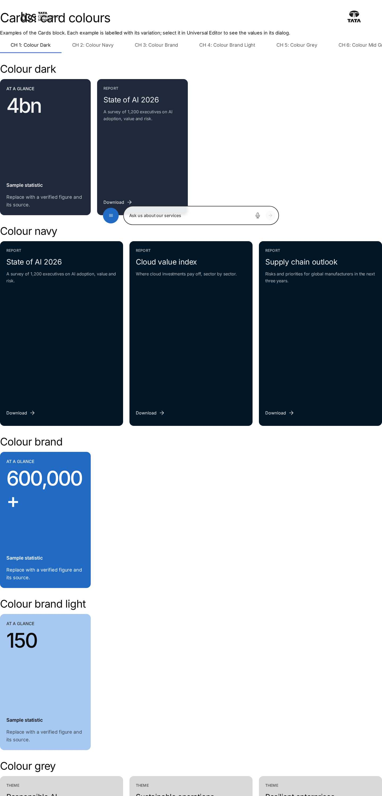
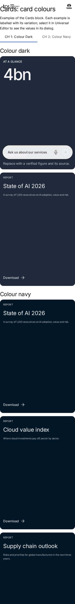

# Cards — Authoring Guide

| Attribute | Value |
| --- | --- |
| Document ID | AUT-C-cards |
| Audience | Content authors, content managers, AEM authoring leads |
| Purpose | How to add, fill in and check the Cards component |
| Scope | — |
| Prerequisites | — |
| Owner | Content Lead / AEM Authoring Lead (proposed) |
| Approver | Product Owner (to be confirmed) |
| Version | 1.0 |
| Status | Draft for review |
| Last updated | 8 November 2026 |
| Last validated | 8 November 2026 |
| Source files | blocks/cards/README.md, blocks/cards/_cards.json |
| Related documents | — |
| Related AEM paths | — |

## Contents

- [Where to see it](#where-to-see-it)
- [For Content Authors](#for-content-authors)
- [Authorable Fields](#authorable-fields)
- [Screenshot-Based Authoring Steps](#screenshot-based-authoring-steps)
- [Variations](#variations)
- [Complete Authoring Example](#complete-authoring-example)
- [Content and Asset Guidelines](#content-and-asset-guidelines)
- [Troubleshooting](#troubleshooting)
- [Screenshots](#screenshots)
- [Known limitations](#known-limitations)
- [Open items](#open-items)
- [Change history](#change-history)

## Where to see it

- https://main--tcs-corp--sradha-tcs.aem.live/design-block-master/en/block-library/cards
- https://main--tcs-corp--sradha-tcs.aem.live/design-block-master/en/block-library/cards/card-colours
- https://main--tcs-corp--sradha-tcs.aem.live/design-block-master/en/block-library/cards/card-styles
- https://main--tcs-corp--sradha-tcs.aem.live/design-block-master/en/block-library/cards/grid-and-horizontal-scroll
- https://main--tcs-corp--sradha-tcs.aem.live/design-block-master/en/block-library/cards/heights-links-legacy
- https://main--tcs-corp--sradha-tcs.aem.live/design-block-master/en/block-library/cards/images-panels-style-options
- https://main--tcs-corp--sradha-tcs.aem.live/design-block-master/en/block-library/cards/per-card-styles-and-colours

## For Content Authors

1. **Add the block.** In Universal Editor select a Section, a Columns Container column or a Tabs Container, use **Add (+)** and choose **Cards**.
2. **Open its properties.** Select the Cards block (not a Card) in the content tree; the properties panel has the tabs **Content**, **Display** and **Additional**. Universal Editor collapses tabs that don't fit on one line into a dropdown.
3. **Enter the header (Content tab).** Title and Heading type (H2 under the page H1), an optional Description, and a CTA link with CTA text and CTA style for a "View all" link. Without a Title, fill **Accessible list label** so screen readers can name the cards.
4. **Choose the presentation (Display tab).** Display as teaser (cards; off: rows of links), Card style, Card colour, Image ratio, Panel height, First card as feature, the Show switches, Date format and Image loading.
5. **Choose the layout per breakpoint (Display tab).** For Desktop, Tablet and Mobile choose Grid (columns) or Horizontal scroll (items visible or a card width, previous / next buttons, scroll indicator), and the gap. The scroll options (snap, step, loop, initial item, edge) appear once a breakpoint scrolls.
6. **Add the cards.** Select the Cards block and use **Add (+)** → **Card**. In each Card fill at least a Title, a Description or an Image (otherwise the card isn't shown). Add a Link (a page from the picker, or `https://…`) and, for a button, a Call to action label. Duplicate, delete and drag Cards in the content tree to reorder them; cards render in the content tree order.
7. **Exceptions per card (Card › Display tab).** Card style and Card colour override the block's for one card; Analytics label and Accessibility label are optional.
8. **Preview.** Switch Universal Editor to Preview, or open the page on aem.page; check every breakpoint (desktop from 1200px, tablet 600–1199px, mobile below 600px).
9. **Publish** the page, and the images it uses, from AEM.
10. **Validate the published output** on aem.live: every card is shown, links and calls to action open the right page, tag labels are taxonomy labels, panel texts aren't clipped.

- **Minimum required:** one Card with a Title, a Description or an Image. No field is required in the model.
- **Recommended:** a block Title (or Accessible list label); a Title, Image alt text (for informative images) and Link on every Card; one Card style for the whole block; each breakpoint set explicitly.
- **Optional:** header Description and CTA; Eyebrow, Label, Tags, Date, Content type, Reading time; per-card style and colour; Style options; the scroll options; the Additional tab.

## Authorable Fields

<!-- BEGIN GENERATED: fields (npm run build:docs) -->

#### Cards (`cards`)

Model `cards`; template name "Cards" (the block class AEM renders); key-value block (one row per property); children: `card`.

Stored on a new component (definition template): `titleType` = `"h2"`, `displayAsTeaser` = `true`, `cardStyle` = `"image"`, `imageRatio` = `"16-9"`, `panelHeight` = `"portrait"`, `linkItems` = `true`, `showImage` = `true`, `showEyebrow` = `true`, `showTags` = `true`, `showDescription` = `true`, `showDate` = `true`, `dateFormat` = `"dd-mmm-yy"`, `showCta` = `true`, `imageLoading` = `"lazy"`, `desktopMode` = `"grid"`, `desktopColumns` = `4`, `tabletMode` = `"grid"`, `tabletColumns` = `4`, `mobileMode` = `"grid"`, `mobileColumns` = `1`, `scrollSnap` = `true`, `emptyBehavior` = `"hide"`, `analyticsEnabled` = `true`.

##### Content tab — Cards

| Field label | Property | Type | Required | Default | Allowed values | Author guidance | Example |
| ----------- | -------- | ---- | -------- | ------- | -------------- | --------------- | ------- |
| Title | `title` | text | No | — | — | The heading of the cards, e.g. Related to Agentic AI. | Our services |
| Heading type | `titleType` | select | No | `h2` | H2 (`h2`), H3 (`h3`), H4 (`h4`), H5 (`h5`), H6 (`h6`) | Delivered with `title` (field collapse). | h2 |
| Description | `description` | richtext | No | — | — | — | — |
| CTA link | `link` | aem-content | No | — | — | — | /design-block-master/en/curated-design-pages/insights |
| CTA text | `linkText` | text | No | — | — | Delivered with `link` (field collapse). | View all insights |
| CTA style | `linkType` | select | No | "" | Text link (""), Primary button (`primary`), Secondary button (`secondary`) | Delivered with `link` (field collapse). | primary |
| Accessible list label | `listLabel` | text | No | — | — | Names the cards for screen readers when there is no title. | — |

##### Display tab — Cards

| Field label | Property | Type | Required | Default | Allowed values | Author guidance | Example |
| ----------- | -------- | ---- | -------- | ------- | -------------- | --------------- | ------- |
| Display as teaser | `displayAsTeaser` | boolean | No | `true` | on / off | Cards; off: a list of links (title rows). | false |
| Card style | `cardStyle` | select | No | `image` | Image card (`image`), Panel (`panel`), Report (`report`), Statistic (`stat`), Mixed (`mixed`) | A style here applies to every card (an item's own Card style still wins). Mixed: each card's own style, else (List) the page's card-style metadata, else Report content as report cards, cards without an image as panels, the others as image cards. Shown when `displayAsTeaser` is `true`. | image |
| Card colour | `cardTheme` | select | No | "" | Default for the style (""), Dark (`dark`), Navy (`navy`), Brand blue (`brand`), Light blue (`brand-light`), Light grey (`grey`), Mid grey (`mid-grey`), Grey gradient (`gradient`), Image background (`image`) | Panel, report and statistic cards (image cards keep their image). A colour here applies to every card (an item's own Card colour still wins). Default for the style: the card's own colour, else (List) the page's card-theme metadata, else the style's colour. Shown when `displayAsTeaser` is `true`. | dark |
| Image ratio | `imageRatio` | select | No | `16-9` | 16:9 (`16-9`), 1:1 (`1-1`), 4:3 (`4-3`), 3:2 (`3-2`) | Shown when `displayAsTeaser` is `true`. | 1-1 |
| Panel height | `panelHeight` | select | No | `portrait` | Portrait (2:3) (`portrait`), Compact (`compact`), Content (`auto`) | Panel, report and statistic cards. Shown when `displayAsTeaser` is `true`. | compact |
| First card as feature | `featureFirst` | boolean | No | `false` | on / off | The first card as a large spotlight above the others. Shown when `displayAsTeaser` is `true`. | true |
| Link items | `linkItems` | boolean | No | `true` | on / off | — | — |
| Open links in a new tab | `openInNewTab` | boolean | No | `false` | on / off | The default for the items. | — |
| Show image | `showImage` | boolean | No | `true` | on / off | — | — |
| Show eyebrow | `showEyebrow` | boolean | No | `true` | on / off | — | — |
| Show tags | `showTags` | boolean | No | `true` | on / off | — | false |
| Show description | `showDescription` | boolean | No | `true` | on / off | On image cards and link rows; panel, report and statistic cards always show theirs. | — |
| Show date | `showDate` | boolean | No | `true` | on / off | — | false |
| Date format | `dateFormat` | select | No | `dd-mmm-yy` | 04 Sep 26 (`dd-mmm-yy`), 04-09-2026 (`dd-mm-yyyy`), 09-04-2026 (`mm-dd-yyyy`), Sep 4, 2026 (`mmm-d-yyyy`), 04/09/26 (`dd/mm/yy`), 4th September 2026 (`do-mmmm-yyyy`) | Shown when `showDate` is `true`. | — |
| Show call to action | `showCta` | boolean | No | `true` | on / off | — | false |
| Image loading | `imageLoading` | select | No | `lazy` | Lazy (`lazy`), Eager (first screen) (`eager`) | — | — |
| Desktop display | `desktopMode` | select | No | `grid` | Grid (`grid`), Horizontal scroll (`horizontal-scroll`) | Grid or horizontal scroll on desktop (1200px and wider), independently of the other breakpoints. | horizontal-scroll |
| Desktop columns | `desktopColumns` | number | No | `4` | — | Shown when `desktopMode` is `grid`. | 3 |
| Desktop gap (px) | `desktopGap` | number | No | `24` | — | Space between the cards. | — |
| Desktop items visible | `desktopVisible` | number | No | `4.2` | — | Cards in view, e.g. 4.2 shows 4 and a part of the next one. Shown when `desktopMode` is `horizontal-scroll`. | — |
| Desktop card width (px) | `desktopCardWidth` | number | No | `0` | — | A fixed card width (120 or more); 0 uses Items visible. Shown when `desktopMode` is `horizontal-scroll`. | 320 |
| Previous / next buttons on desktop | `desktopControls` | boolean | No | `false` | on / off | Shown when `desktopMode` is `horizontal-scroll`. | true |
| Scroll indicator on desktop | `desktopIndicator` | boolean | No | `false` | on / off | Shown when `desktopMode` is `horizontal-scroll`. | true |
| Tablet display | `tabletMode` | select | No | `grid` | Grid (`grid`), Horizontal scroll (`horizontal-scroll`) | Grid or horizontal scroll on tablet (600 to 1199px), independently of the other breakpoints. | horizontal-scroll |
| Tablet columns | `tabletColumns` | number | No | `4` | — | Shown when `tabletMode` is `grid`. | 2 |
| Tablet gap (px) | `tabletGap` | number | No | `24` | — | Space between the cards. | — |
| Tablet items visible | `tabletVisible` | number | No | `3.3` | — | Cards in view, e.g. 4.2 shows 4 and a part of the next one. Shown when `tabletMode` is `horizontal-scroll`. | 2.5 |
| Tablet card width (px) | `tabletCardWidth` | number | No | `0` | — | A fixed card width (120 or more); 0 uses Items visible. Shown when `tabletMode` is `horizontal-scroll`. | — |
| Previous / next buttons on tablet | `tabletControls` | boolean | No | `false` | on / off | Shown when `tabletMode` is `horizontal-scroll`. | true |
| Scroll indicator on tablet | `tabletIndicator` | boolean | No | `false` | on / off | Shown when `tabletMode` is `horizontal-scroll`. | true |
| Mobile display | `mobileMode` | select | No | `grid` | Grid (`grid`), Horizontal scroll (`horizontal-scroll`) | Grid or horizontal scroll on mobile (up to 599px), independently of the other breakpoints. | horizontal-scroll |
| Mobile columns | `mobileColumns` | number | No | `1` | — | Shown when `mobileMode` is `grid`. | 1 |
| Mobile gap (px) | `mobileGap` | number | No | `16` | — | Space between the cards. | — |
| Mobile items visible | `mobileVisible` | number | No | `1.2` | — | Cards in view, e.g. 4.2 shows 4 and a part of the next one. Shown when `mobileMode` is `horizontal-scroll`. | 1.2 |
| Mobile card width (px) | `mobileCardWidth` | number | No | `0` | — | A fixed card width (120 or more); 0 uses Items visible. Shown when `mobileMode` is `horizontal-scroll`. | — |
| Previous / next buttons on mobile | `mobileControls` | boolean | No | `false` | on / off | Shown when `mobileMode` is `horizontal-scroll`. | — |
| Scroll indicator on mobile | `mobileIndicator` | boolean | No | `true` | on / off | Shown when `mobileMode` is `horizontal-scroll`. | — |
| Equal card height | `equalHeight` | boolean | No | `false` | on / off | All rows as tall as the tallest card. | true |
| Stretch cards to row height | `stretchCards` | boolean | No | `true` | on / off | — | false |
| Scroll snap | `scrollSnap` | boolean | No | `true` | on / off | Shown when `desktopMode` is `horizontal-scroll` or `tabletMode` is `horizontal-scroll` or `mobileMode` is `horizontal-scroll`. | — |
| Snap alignment | `snapAlign` | select | No | `start` | Start (`start`), Center (`center`) | Shown when `scrollSnap` is `true` and `desktopMode` is `horizontal-scroll` or `tabletMode` is `horizontal-scroll` or `mobileMode` is `horizontal-scroll`. | center |
| Hide native scrollbar | `hideScrollbar` | boolean | No | `true` | on / off | Shown when `desktopMode` is `horizontal-scroll` or `tabletMode` is `horizontal-scroll` or `mobileMode` is `horizontal-scroll`. | — |
| Allow mouse drag | `mouseDrag` | boolean | No | `true` | on / off | Shown when `desktopMode` is `horizontal-scroll` or `tabletMode` is `horizontal-scroll` or `mobileMode` is `horizontal-scroll`. | — |
| Keyboard scrolling | `keyboardScrolling` | boolean | No | `true` | on / off | Arrow keys, Home and End when the list has focus. Shown when `desktopMode` is `horizontal-scroll` or `tabletMode` is `horizontal-scroll` or `mobileMode` is `horizontal-scroll`. | — |
| Scroll step | `scrollStep` | select | No | `one-card` | One card (`one-card`), Viewport (`viewport`) | Shown when `desktopMode` is `horizontal-scroll` or `tabletMode` is `horizontal-scroll` or `mobileMode` is `horizontal-scroll`. | viewport |
| Loop | `loop` | boolean | No | `false` | on / off | Next at the end goes back to the start. Shown when `desktopMode` is `horizontal-scroll` or `tabletMode` is `horizontal-scroll` or `mobileMode` is `horizontal-scroll`. | true |
| Initial item index | `initialIndex` | number | No | `0` | — | The card shown first (0: the first). Shown when `desktopMode` is `horizontal-scroll` or `tabletMode` is `horizontal-scroll` or `mobileMode` is `horizontal-scroll`. | 1 |
| Edge | `edgePadding` | select | No | `bleed` | Cards run to the edge (`bleed`), Inside the content width (`none`) | Fixed-width sections only: the cards run into the section gutter. In full-width sections both look the same. Shown when `desktopMode` is `horizontal-scroll` or `tabletMode` is `horizontal-scroll` or `mobileMode` is `horizontal-scroll`. | none |
| When there are no cards | `emptyBehavior` | select | No | `hide` | Hide the block (`hide`), Show a message (`message`) | In the editor a hint is always shown. | message |
| Empty message | `emptyMessage` | text | No | — | — | Shown when `emptyBehavior` is `message`. | There are no cards to show yet. |
| Analytics | `analyticsEnabled` | boolean | No | `true` | on / off | Card clicks and scrolling in the Adobe Data Layer. | — |
| Style options | `classes` | multiselect | No | — | Compact statistic title (`stat-compact`), Dividers between rows (`dividers`), Header centred (`header-center`) | — | — |

##### Additional tab — Cards

| Field label | Property | Type | Required | Default | Allowed values | Author guidance | Example |
| ----------- | -------- | ---- | -------- | ------- | -------------- | --------------- | ------- |
| Anchor ID | `classes_anchor` | text | No | — | regExp: ^anchor-[a-z0-9][a-z0-9-]*$; customErrorMsg: Start with anchor-, then lower-case letters, digits and hyphens. | A unique ID of the block on the page, starting with anchor-, e.g. anchor-our-services; link to it with #anchor-our-services. Delivered as a block class. | — |
| Hide block | `classes_hideblock` | boolean | No | `false` | on / off | Hides the whole block on the page until it is turned off (shown faded in the editor). Delivered as a block class. | — |
| Animation Type | `classes_animation` | select | No | "" | None (""), Fade in (`motion-fade-in`), Fade up (`motion-fade-up`), Fade down (`motion-fade-down`), Fade left (`motion-fade-left`), Fade right (`motion-fade-right`), Slide up (`motion-slide-up`), Slide down (`motion-slide-down`), Slide left (`motion-slide-left`), Slide right (`motion-slide-right`), Scale in (`motion-scale-in`) | How the block's content appears; repeated items (cards, list items, accordion items, columns) appear one after another. None: shown as is. Not played in the editor or when the visitor prefers reduced motion. Delivered as a block class. | motion-fade-up |
| Motion Speed | `classes_animationspeed` | select | No | "" | Medium (""), Fast (`motion-fast`), Slow (`motion-slow`) | How fast the animation runs: 0.3, 0.6 or 0.9 seconds. Shown when `classes_animation` is set and `classes_animation` is not empty. Delivered as a block class. | motion-fast |
| Animation Trigger | `classes_animationtrigger` | select | No | "" | On Scroll / Viewport Entry (""), On Page Load (`motion-on-load`) | When the block's animations run. On Scroll: when the block comes into view (at once if it is in view when the page opens). On Page Load: as soon as the block is ready, wherever it is on the page. Shown when `classes_animation` is set and `classes_animation` is not empty. Delivered as a block class. | — |
| Padding left | `classes_paddingleft` | select | No | "" | Default (""), 0 (none) (`pl-0`), 0.25rem (space-100) (`pl-100`), 0.5rem (space-200) (`pl-200`), 0.75rem (space-300) (`pl-300`), 1rem (space-400) (`pl-400`), 1.25rem (space-500) (`pl-500`), 1.5rem (space-600) (`pl-600`), 2rem (space-800) (`pl-800`), 2.5rem (space-1000) (`pl-1000`), 3rem (space-1200) (`pl-1200`), 4rem (space-1600) (`pl-1600`), 5rem (space-2000) (`pl-2000`), 6rem (space-2400) (`pl-2400`), 7.5rem (space-3000) (`pl-3000`) | Delivered as a block class. | — |
| Padding right | `classes_paddingright` | select | No | "" | Default (""), 0 (none) (`pr-0`), 0.25rem (space-100) (`pr-100`), 0.5rem (space-200) (`pr-200`), 0.75rem (space-300) (`pr-300`), 1rem (space-400) (`pr-400`), 1.25rem (space-500) (`pr-500`), 1.5rem (space-600) (`pr-600`), 2rem (space-800) (`pr-800`), 2.5rem (space-1000) (`pr-1000`), 3rem (space-1200) (`pr-1200`), 4rem (space-1600) (`pr-1600`), 5rem (space-2000) (`pr-2000`), 6rem (space-2400) (`pr-2400`), 7.5rem (space-3000) (`pr-3000`) | Delivered as a block class. | — |
| Padding top | `classes_paddingtop` | select | No | "" | Default (""), 0 (none) (`pt-0`), 0.25rem (space-100) (`pt-100`), 0.5rem (space-200) (`pt-200`), 0.75rem (space-300) (`pt-300`), 1rem (space-400) (`pt-400`), 1.25rem (space-500) (`pt-500`), 1.5rem (space-600) (`pt-600`), 2rem (space-800) (`pt-800`), 2.5rem (space-1000) (`pt-1000`), 3rem (space-1200) (`pt-1200`), 4rem (space-1600) (`pt-1600`), 5rem (space-2000) (`pt-2000`), 6rem (space-2400) (`pt-2400`), 7.5rem (space-3000) (`pt-3000`) | Delivered as a block class. | — |
| Padding bottom | `classes_paddingbottom` | select | No | "" | Default (""), 0 (none) (`pb-0`), 0.25rem (space-100) (`pb-100`), 0.5rem (space-200) (`pb-200`), 0.75rem (space-300) (`pb-300`), 1rem (space-400) (`pb-400`), 1.25rem (space-500) (`pb-500`), 1.5rem (space-600) (`pb-600`), 2rem (space-800) (`pb-800`), 2.5rem (space-1000) (`pb-1000`), 3rem (space-1200) (`pb-1200`), 4rem (space-1600) (`pb-1600`), 5rem (space-2000) (`pb-2000`), 6rem (space-2400) (`pb-2400`), 7.5rem (space-3000) (`pb-3000`) | Delivered as a block class. | — |
| Margin left | `classes_marginleft` | select | No | "" | Default (""), 0 (none) (`ml-0`), 0.25rem (space-100) (`ml-100`), 0.5rem (space-200) (`ml-200`), 0.75rem (space-300) (`ml-300`), 1rem (space-400) (`ml-400`), 1.25rem (space-500) (`ml-500`), 1.5rem (space-600) (`ml-600`), 2rem (space-800) (`ml-800`), 2.5rem (space-1000) (`ml-1000`), 3rem (space-1200) (`ml-1200`), 4rem (space-1600) (`ml-1600`), 5rem (space-2000) (`ml-2000`), 6rem (space-2400) (`ml-2400`), 7.5rem (space-3000) (`ml-3000`) | Delivered as a block class. | — |
| Margin right | `classes_marginright` | select | No | "" | Default (""), 0 (none) (`mr-0`), 0.25rem (space-100) (`mr-100`), 0.5rem (space-200) (`mr-200`), 0.75rem (space-300) (`mr-300`), 1rem (space-400) (`mr-400`), 1.25rem (space-500) (`mr-500`), 1.5rem (space-600) (`mr-600`), 2rem (space-800) (`mr-800`), 2.5rem (space-1000) (`mr-1000`), 3rem (space-1200) (`mr-1200`), 4rem (space-1600) (`mr-1600`), 5rem (space-2000) (`mr-2000`), 6rem (space-2400) (`mr-2400`), 7.5rem (space-3000) (`mr-3000`) | Delivered as a block class. | — |
| Margin top | `classes_margintop` | select | No | "" | Default (""), 0 (none) (`mt-0`), 0.25rem (space-100) (`mt-100`), 0.5rem (space-200) (`mt-200`), 0.75rem (space-300) (`mt-300`), 1rem (space-400) (`mt-400`), 1.25rem (space-500) (`mt-500`), 1.5rem (space-600) (`mt-600`), 2rem (space-800) (`mt-800`), 2.5rem (space-1000) (`mt-1000`), 3rem (space-1200) (`mt-1200`), 4rem (space-1600) (`mt-1600`), 5rem (space-2000) (`mt-2000`), 6rem (space-2400) (`mt-2400`), 7.5rem (space-3000) (`mt-3000`) | Delivered as a block class. | — |
| Margin bottom | `classes_marginbottom` | select | No | "" | Default (""), 0 (none) (`mb-0`), 0.25rem (space-100) (`mb-100`), 0.5rem (space-200) (`mb-200`), 0.75rem (space-300) (`mb-300`), 1rem (space-400) (`mb-400`), 1.25rem (space-500) (`mb-500`), 1.5rem (space-600) (`mb-600`), 2rem (space-800) (`mb-800`), 2.5rem (space-1000) (`mb-1000`), 3rem (space-1200) (`mb-1200`), 4rem (space-1600) (`mb-1600`), 5rem (space-2000) (`mb-2000`), 6rem (space-2400) (`mb-2400`), 7.5rem (space-3000) (`mb-3000`) | Delivered as a block class. | — |

#### Card (`card`)

Model `card`; template name "Card" (the block class AEM renders).

##### Content tab — Card

| Field label | Property | Type | Required | Default | Allowed values | Author guidance | Example |
| ----------- | -------- | ---- | -------- | ------- | -------------- | --------------- | ------- |
| Image | `image` | reference | No | — | — | — | — |
| Image alt text | `imageAlt` | text | No | — | — | Describes the image for screen readers; empty: decorative. Delivered with `image` (field collapse). | — |
| Eyebrow | `eyebrow` | text | No | — | — | A short label above the title, e.g. Perspective. | — |
| Title | `title` | text | No | — | — | Statistic cards: the number, e.g. 4bn. | — |
| Description | `text` | richtext | No | "" | — | — | — |
| Label | `subtitle` | text | No | — | — | Statistic cards: the label above the description, e.g. Revenue. | — |
| Tags | `tags` | aem-tag (multiple) | No | — | — | — | — |
| Date | `date` | date-time | No | — | — | Shown in the Date format of the block. | — |
| Content type | `contentLabel` | text | No | — | — | e.g. Article or Report (report cards in the Mixed style). | — |
| Reading time | `readingTime` | text | No | — | — | Minutes, e.g. 6 (shown as 6m). | — |

##### Link tab — Card

| Field label | Property | Type | Required | Default | Allowed values | Author guidance | Example |
| ----------- | -------- | ---- | -------- | ------- | -------------- | --------------- | ------- |
| Link | `link` | aem-content | No | — | — | A page of the site or https://…; empty: the card isn't linked. | — |
| Link text | `linkText` | text | No | — | — | The title when the card has none. Delivered with `link` (field collapse). | — |
| Call to action label | `ctaLabel` | text | No | — | — | Shows a call to action (the card's one link); empty: the title is the link. | — |
| Open in a new tab | `newTab` | select | No | "" | As the block (""), Yes (`true`), No (`false`) | — | — |

##### Display tab — Card

| Field label | Property | Type | Required | Default | Allowed values | Author guidance | Example |
| ----------- | -------- | ---- | -------- | ------- | -------------- | --------------- | ------- |
| Card style | `kind` | select | No | "" | As the block (""), Image card (`image`), Panel (`panel`), Report (`report`), Statistic (`stat`) | — | — |
| Card colour | `theme` | select | No | "" | As the block (""), Dark (`dark`), Navy (`navy`), Brand blue (`brand`), Light blue (`brand-light`), Light grey (`grey`), Mid grey (`mid-grey`), Grey gradient (`gradient`), Image background (`image`) | Panel, report and statistic cards (image cards keep their image); overrides the block's Card colour. | — |
| Analytics label | `analyticsLabel` | text | No | — | maxLength: 120 | — | — |
| Accessibility label | `ariaLabel` | text | No | — | — | The link's accessible name, when the title or call to action isn't enough. | — |

<!-- END GENERATED: fields -->

The block fields are the shared groups of `models/_card-list.json` (the List's), without the List's source, order and maximum items: cards show in the authored order, with no maximum. Notes the tables can't show:

- **Title / Heading type:** the header heading (`h2` by default); the card titles are one level below it (`h3` under an `h2`, `h3` without a block title, at most `h6`). The heading also names the cards region.
- **CTA style:** collapses into the CTA link as bold / italic (field collapse); Primary and Secondary render buttons, empty renders a text link (`tertiary`). The header CTA reports `interaction: cta` in the data layer.
- **Accessible list label:** when set, it is always the region's `aria-label` (even with a title).
- **Card style:** the card kind is the Card's own Card style, else the block's (unless Mixed), else automatic: a Content type containing "report" gives a report card, a card with an image an image card, otherwise a panel (`kindOf`). The block's style is `xdm:variant` in the data layer (`links` with Display as teaser off).
- **Card colour:** the Card's own colour, else the block's, else the style's default (panel dark, report gradient, statistic grey) (`themeOf`). Image cards keep their image and ignore the colour.
- **Link items:** off, no card is linked.
- **Show call to action:** with a label (the Card's, else "Explore" on panels and "Download" on reports) the call to action is the card's one link; off, the title is the link.
- **Show description:** applies to image cards and rows; panel, report and statistic cards always show their description.
- **Show tags:** also hides the reading time (it is part of the kicker).
- **Image loading:** Eager sets `loading="eager"` and gives only the first image `fetchpriority="high"`; use it only for a block on the first screen.
- **Card Title:** the heading of the card; on statistic cards the number. Without a Title, the Link text becomes the title (unless it equals the URL); a card without a title has no heading and is linked only through a call to action.
- **Card Description:** rich text; it stays editable in place in Universal Editor and its inline links stay clickable above the card link.
- **Card Tags:** up to 3 labels on image cards and the feature card, the first one on panels (without an eyebrow) and rows.
- **Card Date:** shown in the block's Date format inside `<time datetime>`, on image cards (meta row) and rows.
- **Card Reading time:** digits show as `{n}m` (placeholder `minutesShort`).
- **Card Open in a new tab:** As the block, Yes or No; new-tab links get `target="_blank"`, `rel="noopener noreferrer"` and the hidden text "(opens in a new tab)".
- **Card Analytics label:** the card's `dc:title` in the data layer (else the title, else the first 100 characters of the description).
- **Card Accessibility label:** the `aria-label` of the card link; without it a call to action is named "{label}: {title}".
- **Legacy values still read:** Component ID (`componentId`), Allow touch swipe (`touchSwipe`) and Reduced motion support (`reducedMotion`) were removed from the dialog in the block audit (0 uses); stored Component ID and Touch swipe values are still read (Component ID becomes the component id; Touch swipe off adds `no-swipe`), Reduced motion is ignored (reduced motion is always honoured). Cards made before the redesign (an image and a rich text cell) are read as described under [Legacy cards](https://github.com/sradha-tcs/tcs-corp/blob/main/blocks/cards/README.md#legacy-cards-compatibility).
- **Additional tab:** Anchor ID, Hide block, Animation Type / Motion Speed / Animation Trigger, padding and margin, as described in AGENTS.md "Additional tab" and "Animation and skeletons". The Anchor ID becomes the block id and the component id (unless a stored Component ID exists). The animation moves the header, the feature card, the empty message and each card in, one after another (at most 5 steps).

## Screenshot-Based Authoring Steps

#### Authoring Step 1: Add Cards and write the header

```text
[Screenshot Placeholder]

File name:
cards-authoring-step-1.png

Purpose:
The Cards block added to a section, with the Content tab of its properties filled in.

Annotations:
A = Title
B = Heading type
C = Description
D = CTA link
E = CTA text
F = CTA style
```

#### Values to Enter

| Callout | Field | Value | Reason | Expected result |
| ------- | ----- | ----- | ------ | --------------- |
| A | Title | Our services | Names the block and the cards region | H2 "Our services" on the left of the header |
| B | Heading type | H2 | Fits under the page H1 | Card titles become H3 |
| C | Description | Capabilities that help enterprises grow, transform and compete. | Short introduction | Text below the title |
| D | CTA link | /en/services (page picker) | Overview page | Link on the right of the header |
| E | CTA text | View all services | Specific label | The link text |
| F | CTA style | Text link | Default header link | A text link (`tertiary`) |

- **Author action:** select the section, Add (+) → Cards; select the block and fill the Content tab.
- **Expected preview:** the header with the title, description and the link; an empty block shows "Add a Card to the block and give it a title, a description or an image." in edit mode.
- **Expected published result:** without cards the block is hidden (default When there are no cards = Hide the block).
- **Business rules:** the header link is rendered only when a CTA link is set.
- **Validation:** the heading level in the page outline has no skipped level.
- **Common mistakes:** adding Cards inside another block instead of a section (only Section, Columns Container and Tabs Container offer it).

#### Authoring Step 2: Choose the card presentation

```text
[Screenshot Placeholder]

File name:
cards-authoring-step-2.png

Purpose:
The Display tab with the card presentation fields.

Annotations:
A = Display as teaser
B = Card style
C = Card colour
D = Image ratio
E = First card as feature
```

#### Values to Enter

| Callout | Field | Value | Reason | Expected result |
| ------- | ----- | ----- | ------ | --------------- |
| A | Display as teaser | On | Cards, not rows of links | Card layout |
| B | Card style | Image card | Service cards with photos | Every card is an image card |
| C | Card colour | Default for the style | Image cards ignore the colour | No colour class |
| D | Image ratio | 16:9 | Default Figma ratio | Images cropped to 16:9 |
| E | First card as feature | Off | Equal cards | No feature card |

- **Author action:** open the Display tab and set the fields; leave the Show switches on.
- **Expected preview:** cards with image, kicker, title, description and meta row.
- **Business rules:** Card style other than Mixed forces every card's style unless a Card sets its own.
- **Validation:** the cards look like the block library page `block-library/cards/card-styles`.
- **Common mistakes:** expecting Card colour on image cards (it applies to panel, report and statistic cards only).

#### Authoring Step 3: Set the layout per breakpoint

```text
[Screenshot Placeholder]

File name:
cards-authoring-step-3.png

Purpose:
The Display tab layout fields for desktop, tablet and mobile.

Annotations:
A = Desktop display
B = Desktop items visible
C = Previous / next buttons on desktop
D = Scroll indicator on desktop
E = Tablet display / Tablet columns
F = Mobile display / Mobile columns
```

#### Values to Enter

| Callout | Field | Value | Reason | Expected result |
| ------- | ----- | ----- | ------ | --------------- |
| A | Desktop display | Horizontal scroll | A rail on wide screens | Cards in one scrolling row from 1200px |
| B | Desktop items visible | 3.2 | Shows that more cards follow | 3 cards and part of the fourth |
| C | Previous / next buttons on desktop | On | Mouse and keyboard users | Round buttons below the row |
| D | Scroll indicator on desktop | On | Shows the position | Track and thumb below the row |
| E | Tablet display / Tablet columns | Grid / 2 | Two per row at 600–1199px | 2-column grid |
| F | Mobile display / Mobile columns | Grid / 1 | One per row below 600px | Single column |

- **Author action:** set each breakpoint explicitly; the scroll options appear when a breakpoint scrolls.
- **Expected preview:** at 1440px a rail with buttons and indicator; at 1024px a 2-column grid; at 402px one column.
- **Business rules:** buttons and indicator only show on a breakpoint that scrolls and only while the cards overflow; columns are clamped to 1–6, items visible to 1–8, a card width below 120 is ignored.
- **Validation:** resize the preview through 600px and 1200px.
- **Common mistakes:** turning buttons on for another breakpoint than the scrolling one; a rail whose cards all fit (no buttons, no indicator).

#### Authoring Step 4: Add and fill the Card items

```text
[Screenshot Placeholder]

File name:
cards-authoring-step-4.png

Purpose:
A Card selected in the content tree with its Content and Link tabs.

Annotations:
A = Image / Image alt text
B = Eyebrow
C = Title
D = Description
E = Link
F = Call to action label
```

#### Values to Enter

| Callout | Field | Value | Reason | Expected result |
| ------- | ----- | ----- | ------ | --------------- |
| A | Image / Image alt text | photo-1.svg / Consultants in a client workshop | Informative image | Image in 16:9 with alt text |
| B | Eyebrow | Consulting | Fixed label | Upper case kicker (replaces the tags) |
| C | Title | Business and technology consulting | Card heading | H3 title |
| D | Description | Strategy, design and change management for transformation. | One sentence | Description text |
| E | Link | /en/services/consulting | Destination | The card is linked |
| F | Call to action label | Learn more | A visible action | "Learn more" text link named "Learn more: Business and technology consulting" |

- **Author action:** select the Cards block, Add (+) → Card; fill the Content and Link tabs; repeat for each card and drag to reorder.
- **Expected preview:** the cards in the content tree order; a Card without a title, description or image is a dashed placeholder in edit mode only.
- **Business rules:** a card with an unsafe link (`javascript:`, `data:` or another non-web scheme) isn't shown; a card without a link is shown, not linked.
- **Validation:** count the cards on the page against the Cards in the content tree.
- **Common mistakes:** selecting a Card before Add (+) (items can't hold items); typing a date as text instead of using the date picker.

#### Authoring Step 5: Preview, publish and validate

```text
[Screenshot Placeholder]

File name:
cards-authoring-step-5.png

Purpose:
The published page on aem.live with the Cards block at desktop width.

Annotations:
A = Header
B = Cards
C = Previous / next and indicator
```

#### Values to Enter

| Callout | Field | Value | Reason | Expected result |
| ------- | ----- | ----- | ------ | --------------- |
| A | Hide block (Additional) | Off | Show the block | Block visible |
| B | Animation Type (Additional) | None | Optional | Cards shown as is |
| C | Analytics (Display) | On | Measurement | Block and cards in `window.adobeDataLayer` |

- **Author action:** Preview in Universal Editor, then publish the page and its images.
- **Expected published result:** the same rendering as the preview; tags show taxonomy labels.
- **Validation:** click every card and call to action (no 404 or redirect); check new-tab cards; on non-English locales check the translated UI texts (Explore, Download, Previous items, Next items).
- **Common mistakes:** unpublished images; links to moved pages (Cards doesn't resolve the redirects sheet).

## Variations

All variations are configurations of the same block (block classes set by `applyCardListLayout`); the List shares them (see the [List README](https://github.com/sradha-tcs/tcs-corp/blob/main/blocks/list/README.md)). Personalization and fallback are the same for all: no personalization; the authored configuration renders.

#### Image cards (Card style Image card, default)

- **Purpose / when to use:** cards with a photo: services, insights, case studies. Not for statistics or text-only cards.
- **Fields:** Image (with alt text) and Title recommended; Eyebrow or Tags, Description, Content type, Date, Reading time, Link and Call to action label optional.
- **Dialog:** Display as teaser on, Card style Image card; Image ratio 16:9, 1:1, 4:3 or 3:2.
- **Rendering:** `article.list-card.list-card-image`: image, kicker (eyebrow, else up to 3 tags, then the reading time), title, description, meta row (content type and date), optional call to action (text link). **Hover (Figma):** hovering or focusing anywhere on a linked image card fades its title from `--color-text-neutral` (#303030) to `--color-text-brand` (#216AC3) with an underline, 300ms ease-out (`--list-hover-duration`, `--list-hover-easing`), and back on leave; the underline is always drawn transparent and only changes colour, so the card, its padding and image don't move or resize. On dark backgrounds the theme contract's light brand colour is used. Cards without a link have no hover; panel, report and statistic cards keep their own hover (`styles/card-list.css`).
- **Responsive:** the grid columns or scroller per breakpoint; the image keeps its ratio (`aspect-ratio`).
- **Accessibility:** decorative image with an empty alt text; the title link or call to action is the only link; inside dark Sections / Columns Containers the text turns light.
- **Data layer:** `xdm:variant: image`; card clicks `interaction: card`.

```text
[Screenshot Placeholder]

File name:
cards-image-tablet.png

Purpose:
Image cards at 1024px (Tablet columns 4 by default) with kicker, title, description and meta row.

Annotations:
A = Image
B = Kicker
C = Title
D = Meta row
```

#### Panel cards (Card style Panel)

- **Purpose / when to use:** themed panels linking to topic hubs; no image needed.
- **Fields:** Title, Description; Eyebrow (or the first tag); Link. Image only with Card colour Image background (the image covers the card).
- **Dialog:** Card style Panel; Card colour (default dark `#20293c`); Panel height Portrait (2:3), Compact (9:10) or Content.
- **Rendering:** `list-card-panel` with kicker, title, description and the call to action "Explore" (placeholder `explore`) unless a label is set or Show call to action is off.
- **Responsive:** fixed shapes with `overflow: hidden` clip long texts; Panel height Content fits the text.
- **Accessibility:** the focus ring is drawn inside the card edge; check contrast on Brand blue and Image background.
- **Data layer:** `xdm:variant: panel`.

```text
[Screenshot Placeholder]

File name:
cards-panel-mobile.png

Purpose:
A panel card at 402px with the Explore action at the bottom.

Annotations:
A = Kicker
B = Title
C = Explore
```

#### Report cards (Card style Report)

- **Purpose / when to use:** report or download teasers.
- **Fields:** Title, Description, Content type (the kicker, e.g. Report), Link.
- **Dialog:** Card style Report (or Mixed with Content type "Report"); default colour the grey gradient.
- **Rendering:** `list-card-report`: kicker (content type, else eyebrow), title, description and the call to action "Download" (placeholder `download`) unless a label is set or Show call to action is off; it is a text link (`tertiary`), only statistic cards get a secondary button.
- **Responsive / accessibility / data layer:** as panels; `xdm:variant: report`.

```text
[Screenshot Placeholder]

File name:
cards-report-mobile.png

Purpose:
A report card at 402px with the Download call to action.

Annotations:
A = Report kicker
B = Title
C = Download call to action
```

#### Statistic cards (Card style Statistic)

- **Purpose / when to use:** "At a glance" figures; the Title holds the number.
- **Fields:** Title (the number, up to about 8 characters), Label, Description; Eyebrow optional.
- **Dialog:** Card style Statistic; default colour light grey; Style option **Compact statistic title** (`stat-compact`) for phrases instead of numbers.
- **Rendering:** `list-card-stat`: top (kicker, number), bottom (label, description); a call to action only with a label (secondary button).
- **Responsive:** the number is 5rem below 600px, 4rem from 600px and 6rem from 1200px; it scales down to fit narrow cards.
- **Accessibility:** the number is the card heading; add a Label and Description so it makes sense.
- **Data layer:** `xdm:variant: stat`.

```text
[Screenshot Placeholder]

File name:
cards-statistic-tablet.png

Purpose:
Statistic cards at 1024px with number, label and description.

Annotations:
A = Number (title)
B = Label
C = Description
```

#### Mixed (Card style Mixed)

- **Purpose / when to use:** a row combining image, panel and report cards.
- **Dialog:** Card style Mixed; each card takes its own Card style, else report for a Content type containing "report", image when it has an image, otherwise panel.
- **Data layer:** `xdm:variant: mixed`.

```text
[Screenshot Placeholder]

File name:
cards-mixed-mobile.png

Purpose:
Mixed cards at 402px: an image card, a panel and a report card stacked.

Annotations:
A = Image card
B = Panel
C = Report card
```

#### First card as feature

- **Purpose / when to use:** one spotlight card followed by smaller cards (Figma variation 2).
- **Fields:** the first Card's Image, Tags, Reading time and Title (the feature shows no description).
- **Dialog:** Display as teaser on, First card as feature on.
- **Rendering:** `article.list-feature` above the list, with the image behind the tags, reading time and title; the image is shown even with Show image off (unless that card hides it); no author lockup (Cards has no Author field).
- **Responsive:** minimum height 32.5rem below 600px, 27.1875rem from 600px, 35.625rem from 1200px.
- **Data layer:** the feature carries `data-cmp-id` of the first card and position 1.

```text
[Screenshot Placeholder]

File name:
cards-feature-mobile.png

Purpose:
The feature card at 402px above the remaining cards.

Annotations:
A = Feature image
B = Tags and reading time
C = Feature title
```

#### Rows of links (Display as teaser off)

- **Purpose / when to use:** news-style link lists (Figma variation 5) not driven by the query index.
- **Dialog:** Display as teaser off; Style option **Dividers between rows** (`dividers`) for lines between rows from 600px.
- **Rendering:** `article.list-row`: kicker (eyebrow, else content type, and the first tag), title link, description, date, a decorative circle arrow (`icons/circle-arrow.svg`, 48px box, #D9D9D9; hover or focus on the row turns it #1E1E1E over 300ms ease-out without movement, the title isn't underlined); no images, calls to action, styles, colours or feature.
- **Data layer:** `xdm:variant: links`.

```text
[Screenshot Placeholder]

File name:
cards-rows-of-links-tablet.png

Purpose:
Rows of links at 1024px with dividers.

Annotations:
A = Kicker
B = Title link
C = Arrow
D = Divider
```

#### Card colours

Dark, Navy, Brand blue, Light blue, Light grey, Mid grey, Grey gradient and Image background (`theme-{value}` on the card), for panel, report and statistic cards, set on the block or per Card. Buttons on Dark, Navy and Brand blue cards are inverted on hover and focus.

```text
[Screenshot Placeholder]

File name:
cards-colours-tablet.png

Purpose:
Panel cards in several Card colours at 1024px, one with the focus on its Explore link.

Annotations:
A = Dark
B = Brand blue
C = Image background
D = Focus ring
```

#### Grid and horizontal scroll per breakpoint

- **Purpose:** a grid (columns) or a rail (items visible or a fixed card width) on each of desktop (from 1200px), tablet (600–1199px) and mobile (below 600px); 8 combinations.
- **Options:** previous / next buttons and scroll indicator per breakpoint; scroll snap (start / center), hide scrollbar, mouse drag, keyboard scrolling, scroll step (one card / viewport), loop, initial item index, edge (bleed / inside the content width).
- **Rendering:** classes `{desktop,tablet,mobile}-{grid,scroll}`, `-controls`, `-indicator`, `snap`, `snap-{start,center}`, `hide-scrollbar`, `edge-bleed`, `equal-height`, `stretch`; custom properties `--list-{columns,gap,visible,card-width}-{bp}`.
- **Accessibility:** the scroller is a named region, focusable only while it overflows; Arrow Left / Right, Home, End scroll it; buttons are `aria-disabled` at the ends (Loop off) and keep the focus.
- **Data layer:** previous / next clicks `interaction: previous` / `next`.

```text
[Screenshot Placeholder]

File name:
cards-scroll-mobile-buttons-mobile.png

Purpose:
A mobile rail with previous / next buttons turned on (off by default on mobile) and the indicator.

Annotations:
A = Peeking next card
B = Indicator
C = Previous / Next
```

#### Style options

Compact statistic title (`stat-compact`), Dividers between rows (`dividers`) and Header centred (`header-center`), added as block classes.

#### Legacy cards (compatibility)

Cards authored before the redesign (Block Collection: an image and a rich text cell per card, or the rich text only) still render in the new design: the text's first heading (or a bold-only first paragraph) is the title, a link alone in the last paragraph is the call to action and the link, the rest is the description. Cards blocks created before the redesign have no block model and aren't key-value: Universal Editor shows no usable settings, so they use the defaults (image cards, 4 / 4 / 1 columns). Replace such a block with a new Cards block (planned migration: `docs/proposals/cards-card-refactoring.md`). Not for new authoring.

## Complete Authoring Example

Scenario: a services rail on a corporate landing page (handover 6.15.17).

| Field | Example value | Guidance |
| ----- | ------------- | -------- |
| Title (Content) | Our services | The region name and H2 |
| Description (Content) | Capabilities that help enterprises grow, transform and compete. | Up to about 200 characters |
| CTA link / CTA text (Content) | /en/services / View all services | Overview page, specific label |
| Desktop display (Display) | Horizontal scroll | Rail from 1200px |
| Desktop items visible (Display) | 3.2 | A part of the next card shows |
| Previous / next buttons on desktop, Scroll indicator on desktop (Display) | On, On | Controls for the desktop rail |
| Card 1: Image, Image alt text | photo-1.svg, Consultants in a client workshop | Informative image |
| Card 1: Eyebrow, Title | Consulting, Business and technology consulting | Title up to about 60 characters |
| Card 1: Description | Strategy, design and change management for transformation. | One sentence |
| Card 1: Tags, Date, Content type, Reading time | tcs-corp:service/consulting, 2026-09-04, Service, 6 | Kicker and meta row |
| Card 1: Link, Call to action label | /en/services/consulting, Learn more | Verb, 1–3 words |
| Cards 2–4 | Cloud migration and operations, Cyber defence and resilience, AI and data platforms, each with image, eyebrow, description, date, content type Service and a link | Same structure |

Steps: add Cards to the section; fill the Content tab; set the desktop layout on the Display tab; add four Cards and fill them; preview at 1440, 1024 and 402px; publish the page and the images.

- **Expected output:** header with H2 and a text link; a desktop rail of four image cards with 3.2 visible, buttons and indicator; card titles H3; Card 1's call to action "Learn more" (named "Learn more: Business and technology consulting"); the other cards linked through their titles.
- **Responsive:** tablet and mobile keep the default grids (4 columns from 600px, 1 column below).
- **Accessibility:** region named by "Our services"; one link per card; decorative images only where the alt text is empty.
- **Analytics / data layer:** with Analytics on, `cards-1` and `cards-1-item-1` to `-4` are pushed; clicks are `cmp:click` with `interaction` `card`, `cta`, `previous` or `next`.
- **Personalization fallback:** none; the authored cards render for every visitor.
- **Pre-publish checklist:** every Card shown; texts not clipped; tags show taxonomy labels; buttons and indicator appear on the scrolling breakpoint; Hide block off; Anchor ID unique; images published.

## Content and Asset Guidelines

- **Titles:** block title up to about 60 characters; card titles up to about 60 characters (2 lines on a 4-column desktop grid); statistic numbers up to about 8 characters (use Compact statistic title for phrases). Recommended lengths come from the handover; they aren't enforced.
- **Descriptions:** up to about 160 characters; on Portrait / Compact panels up to about 120, or use Panel height Content.
- **Eyebrows and labels:** 1–3 words. The eyebrow replaces the tags on image cards.
- **CTAs and links:** start with a verb ("Explore services", "Download the report"); link to canonical published pages (Cards uses the link as authored and doesn't resolve redirects); don't put the same destination in the card link and in a description link.
- **Images and alt text:** images from AEM Assets; write alt text for informative images, leave it empty for decorative images next to a title. Images are cropped with `object-fit: cover` to the Image ratio (16:9, 1:1, 4:3, 3:2), panels with Image background to 2:3, 9:10 or the content height; keep the subject in the centre (feature card: on the right, the text sits on a gradient on the left).
- **Icons:** previous / next chevrons and the row arrow come from code; no authored icons.
- **Tags and metadata:** tags from the locale taxonomy (only 3 shown, 1 on panels and rows); Cards reads no page metadata.
- **Min / max items:** no verified technical limit was identified (no maximum; cards without content are dropped). Handover recommendation: a multiple of the columns in a grid, 5–12 in a scroller.
- **Asset source:** AEM Assets; images travel with the page when it is published.
- **Lazy / eager loading:** lazy by default; Eager (first screen) only for a block in the first viewport (the first eager image gets `fetchpriority="high"`).
- **Missing assets:** a card without an image renders without one (an image card without image keeps its text); with Card style Mixed it becomes a panel.

## Troubleshooting

| Symptom | Likely cause | Diagnostic steps | Resolution | Verification |
| ------- | ------------ | ---------------- | ---------- | ------------ |
| A Card is missing | No title, description or image, or an unsafe link | Check the Card's fields and Link scheme | Add content; use the page picker or an `https://` URL | The card shows after reload |
| The whole block is missing | No card content with Hide the block; Hide block on; script load error | Edit mode hint; Additional tab; console `failed to load block cards` | Add content or Show a message; turn Hide block off; escalate load errors | Block visible on preview and live |
| Tags show ID-like labels | Tag missing in the locale taxonomy or taxonomy not published | Search the tag ID in `/{locale}/taxonomy.json` | Add / translate the tag, publish the taxonomy | Correct label in a new session |
| Text clipped in coloured cards | Portrait / Compact panel height | Check Panel height and text length at narrow widths | Shorter text or Panel height Content | All text visible at all widths |
| No previous / next or indicator | Breakpoint in grid mode, setting off, or no overflow | Check the breakpoint's fields; inspect `.list-scroller[data-overflow]` | Turn the controls on for the scrolling breakpoint; fewer items visible | Controls show and work |
| Settings have no effect | Block authored before the redesign (no block model) | Check `.plain.html` for key-value rows | Replace with a new Cards block | Block follows the settings |
| Date or reading time missing | Show date / Show tags off; card kind without date (panel, statistic) | Check the switches and card kind | Turn on; use image cards for dates | Date shows in the Date format |
| Call to action missing | No Link, Link items off or Show call to action off | Check the Card Link and switches | Add the Link; turn the switches on | Button shows |
| No clicks in the data layer | Analytics off; the click ended a drag | Check `data-analytics`; inspect `window.adobeDataLayer` | Turn Analytics on | `cmp:click` entries appear |
| Card goes through a redirect | Authored link not updated after a page move | Check `/{locale}/redirects.json` | Update the Link and republish | Card opens the target directly |

Evidence to collect: page URL (preview / live), viewport width, the block's `.plain.html` rows, the block's classes and `data-analytics`, console messages, the relevant `window.adobeDataLayer` entries. No credentials or tokens.

## Screenshots



*Figure: Cards as published (block library) — desktop 1440 × 900 (/design-block-master/en/block-library/cards/card-colours, captured 2026-11-08).*



*Figure: Cards as published (block library) — mobile 375 × 812 (/design-block-master/en/block-library/cards/card-colours, captured 2026-11-08).*

> **Screenshot required**
>
> - Required screen: Cards dialog in Universal Editor (every tab, including Additional)
> - Required role/access: AEM Sites author with Universal Editor (content author)
> - Required navigation steps: AEM Sites console > /content/tcs-corp/language-masters/en > open a page in Universal Editor
> - Reason unavailable: No AEM author access in the documentation program (access blocker AB-01)
> - Owner: Content Lead / AEM Authoring Lead (proposed)
> - Target completion date: To be confirmed

## Known limitations

- Universal Editor screenshots are placeholders: no author access in this program.

## Open items

- None.

## Change history

| Version | Date | Author | Change |
| --- | --- | --- | --- |
| 1.0 | 8 November 2026 | Delivery team (documentation program) | First version of the role-specific documentation (master documentation prompt), generated from the repository and the published reference pages |
