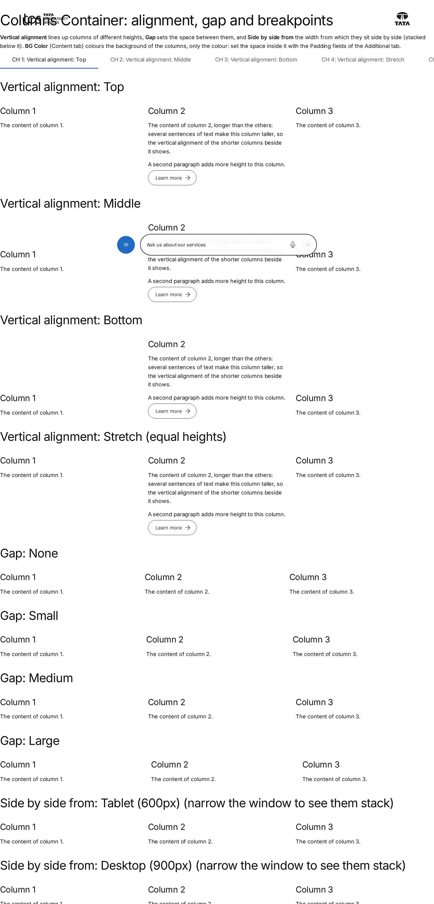
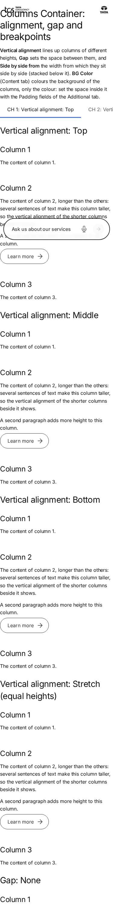

# Columns Container — Authoring Guide

| Attribute | Value |
| --- | --- |
| Document ID | AUT-C-columns-container |
| Audience | Content authors, content managers, AEM authoring leads |
| Purpose | How to add, fill in and check the Columns Container component |
| Scope | — |
| Prerequisites | — |
| Owner | Content Lead / AEM Authoring Lead (proposed) |
| Approver | Product Owner (to be confirmed) |
| Version | 1.0 |
| Status | Draft for review |
| Last updated | 8 November 2026 |
| Last validated | 8 November 2026 |
| Source files | blocks/columns-container/README.md, blocks/columns-container/_columns-container.json |
| Related documents | — |
| Related AEM paths | — |

## Contents

- [Where to see it](#where-to-see-it)
- [For Content Authors](#for-content-authors)
- [Authorable Fields](#authorable-fields)
- [Screenshot-Based Authoring Steps](#screenshot-based-authoring-steps)
- [Variations](#variations)
- [Complete Authoring Example](#complete-authoring-example)
- [Content and Asset Guidelines](#content-and-asset-guidelines)
- [Troubleshooting](#troubleshooting)
- [Screenshots](#screenshots)
- [Known limitations](#known-limitations)
- [Open items](#open-items)
- [Change history](#change-history)

## Where to see it

- https://main--tcs-corp--sradha-tcs.aem.live/design-block-master/en/block-library/columns-container
- https://main--tcs-corp--sradha-tcs.aem.live/design-block-master/en/block-library/columns-container/alignment-gap-and-breakpoints
- https://main--tcs-corp--sradha-tcs.aem.live/design-block-master/en/block-library/columns-container/columns-of-blocks
- https://main--tcs-corp--sradha-tcs.aem.live/design-block-master/en/block-library/columns-container/columns-per-row

## For Content Authors

1. On the page, choose Add (+) where sections are added and pick **Columns Container**.
2. Inside it, add a **Column Break**, then the components of that column after it; add the next **Column Break**, then its components, and so on. Columns sit side by side in rows of Columns per row (Automatic: up to 4); more Column Breaks start a new row.
3. Select the Columns Container to set its properties: in **Content** the Style, BG Color, Width Type, Background Image and Anchor name; in **Layout** the Columns per row, Gap, Vertical alignment and Side by side from; in **Additional** the block options.
4. Optionally name each Column Break (**Column name**, shown in the editor only) and use its Additional tab for the column's Anchor ID, Hide block and spacing.
5. To reorder columns, move a Column Break together with its components in the content tree.
6. Preview at desktop and mobile widths, publish, and check the published page at the breakpoint you chose.

Allowed in a column: Column Break, Text, Image, Button, Title, Hero, Teaser, Quote, Testimonial, Anchor List, Accordion, Tabs (block), Table, Table List, List, Separator, Embed, Video, Modal, Form Variations, Filter List, Conversation Canvas, Cards and Fragment; not Page Header, Footer and TCS Header.

**Minimum required:** a Column Break and a component after it (content before the first Column Break is a column of its own). **Recommended:** keep Style Columns Container selected; one Column Break per column; Padding when using a BG Color. **Optional:** everything else.

| Tab | Field | Values | Default |
|---|---|---|---|
| Content | Style | Columns Container (keep it selected: it makes the section a Columns Container), Highlight (multiselect) | Columns Container |
| Content | BG Color | Default, Grey, Dark, Dark green (as the Teaser's): only the background colour of the columns (`bg-grey`, `bg-dark`, `bg-dark-green` on the block); text, links and buttons turn light on Dark and Dark green. Space around the columns: Padding in the Additional tab | Default |
| Content | Width Type | Full Width, Fixed Width | Full Width |
| Content | Background Image | An image behind the whole container (as on sections) | — |
| Content | Image alt text | The background image's alternative text; empty: decorative | — |
| Content | Anchor name | Section id, e.g. `our-offices` (link with `#our-offices`, Anchor List) | — |
| Layout | Columns per row | Automatic (as many as there are Column Breaks, at most 4), 1, 2, 3, 4; more Column Breaks start a new row (6 at 3 per row: 2 rows of 3); the columns are of equal width | Automatic |
| Layout | Gap | None, Small, Medium, Large | Medium |
| Layout | Vertical alignment | Top, Middle, Bottom, Stretch (equal heights) | Top |
| Layout | Side by side from | Tablet (600px), Desktop (900px), Large desktop (1200px); stacked below | Desktop |
| Additional | Anchor ID, Hide block, Animation Type, Motion Speed, Animation Trigger, Padding / Margin | As on blocks; Animation Type moves the columns in one after another | — |

In Universal Editor edit mode each column is outlined and labelled with its name, so it can be selected; an empty column says what to add.

## Authorable Fields

<!-- BEGIN GENERATED: fields (npm run build:docs) -->

#### Columns Container (`columns-container`)

Model `columns-container`; template name "Columns Container" (the block class AEM renders); children: `column-break`, `text`, `image`, `button-block`, `title`, `hero`, `teaser`, `image-collage`, `quote`, `media-contacts`, `testimonial`, `anchor-list`, `accordion`, `tabs-block`, `table`, `table-list`, `list`, `separator`, `embed`, `video`, `modal`, `form-variations`, `filter-list`, `conversation-canvas`, `cards`, `fragment`.

Stored on a new component (definition template): `style` = `"columns-container-section"`, `columnsGap` = `"medium"`, `columnsAlign` = `"top"`, `columnsFrom` = `"desktop"`, `columnsPerRow` = `"auto"`.

##### Content tab — Columns Container

| Field label | Property | Type | Required | Default | Allowed values | Author guidance | Example |
| ----------- | -------- | ---- | -------- | ------- | -------------- | --------------- | ------- |
| Style | `style` | multiselect | No | `columns-container-section` | Columns Container (`columns-container-section`), Highlight (`highlight`) | Keep Columns Container selected: it makes the section a Columns Container. Add Highlight for the highlight background, as on sections. | columns-container-section |
| BG Color | `containerBgColor` | select | No | "" | Default (""), Grey (`bg-grey`), Dark (`bg-dark`), Dark green (`bg-dark-green`), Navy (`bg-navy`) | The background colour of the columns, only the colour (text and buttons turn light on Dark and Dark green); set the space around them with the Padding fields of the Additional tab. | bg-dark-green |
| Width Type | `sectionWidth` | select | No | `full-width` | Full Width (`full-width`), Fixed Width (`fixed-width`) | — | — |
| Background Image | `backgroundImage` | reference | No | — | — | — | /content/dam/tcs-corp/dummy-pages/images/smart-home.jpg |
| Image alt text | `backgroundImageAlt` | text | No | — | — | Describe the image for screen readers. Leave empty if the image is decorative. Delivered with `backgroundImage` (field collapse). | — |
| Anchor name | `anchorName` | text | No | — | regExp: ^#?[a-z0-9][a-z0-9-]*$; customErrorMsg: Lower-case letters, digits and hyphens, e.g. our-offices. | Lets Anchor List links and #links jump to this section, e.g. our-offices (lowercase, no spaces). | our-offices |

##### Layout tab — Columns Container

| Field label | Property | Type | Required | Default | Allowed values | Author guidance | Example |
| ----------- | -------- | ---- | -------- | ------- | -------------- | --------------- | ------- |
| Columns per row | `columnsPerRow` | select | No | `auto` | Automatic (`auto`), 1 (`1`), 2 (`2`), 3 (`3`), 4 (`4`) | How many columns sit side by side in a row, all of equal width; more Column Breaks start a new row (e.g. 6 Column Breaks at 3 per row: 2 rows of 3). Automatic: as many as there are Column Breaks, at most 4. Add a Column Break, then the components of the column after it. | 2 |
| Gap | `columnsGap` | select | No | `medium` | None (`none`), Small (`small`), Medium (`medium`), Large (`large`) | The space between the columns (and between them when stacked). | large |
| Vertical alignment | `columnsAlign` | select | No | `top` | Top (`top`), Middle (`middle`), Bottom (`bottom`), Stretch (equal heights) (`stretch`) | How columns of different heights line up side by side. | middle |
| Side by side from | `columnsFrom` | select | No | `desktop` | Tablet (600px) (`tablet`), Desktop (900px) (`desktop`), Large desktop (1200px) (`large`) | Below this width the columns are stacked, one under the other. | tablet |

##### Additional tab — Columns Container

| Field label | Property | Type | Required | Default | Allowed values | Author guidance | Example |
| ----------- | -------- | ---- | -------- | ------- | -------------- | --------------- | ------- |
| Anchor ID | `containerAnchor` | text | No | — | regExp: ^anchor-[a-z0-9][a-z0-9-]*$; customErrorMsg: Start with anchor-, then lower-case letters, digits and hyphens. | A unique ID of the block on the page, starting with anchor-, e.g. anchor-our-services; link to it with #anchor-our-services. | — |
| Hide block | `containerHide` | boolean | No | `false` | on / off | Hides the whole block on the page until it is turned off (shown faded in the editor). | — |
| Animation Type | `containerAnimation` | select | No | "" | None (""), Fade in (`motion-fade-in`), Fade up (`motion-fade-up`), Fade down (`motion-fade-down`), Fade left (`motion-fade-left`), Fade right (`motion-fade-right`), Slide up (`motion-slide-up`), Slide down (`motion-slide-down`), Slide left (`motion-slide-left`), Slide right (`motion-slide-right`), Scale in (`motion-scale-in`) | How the block's content appears; repeated items (cards, list items, accordion items, columns) appear one after another. None: shown as is. Not played in the editor or when the visitor prefers reduced motion. | motion-fade-up |
| Motion Speed | `containerAnimationSpeed` | select | No | "" | Medium (""), Fast (`motion-fast`), Slow (`motion-slow`) | How fast the animation runs: 0.3, 0.6 or 0.9 seconds. Shown when `containerAnimation` is set and `containerAnimation` is not empty. | motion-slow |
| Animation Trigger | `containerAnimationTrigger` | select | No | "" | On Scroll / Viewport Entry (""), On Page Load (`motion-on-load`) | When the block's animations run. On Scroll: when the block comes into view (at once if it is in view when the page opens). On Page Load: as soon as the block is ready, wherever it is on the page. Shown when `containerAnimation` is set and `containerAnimation` is not empty. | — |
| Padding left | `containerPaddingLeft` | select | No | "" | Default (""), 0 (none) (`pl-0`), 0.25rem (space-100) (`pl-100`), 0.5rem (space-200) (`pl-200`), 0.75rem (space-300) (`pl-300`), 1rem (space-400) (`pl-400`), 1.25rem (space-500) (`pl-500`), 1.5rem (space-600) (`pl-600`), 2rem (space-800) (`pl-800`), 2.5rem (space-1000) (`pl-1000`), 3rem (space-1200) (`pl-1200`), 4rem (space-1600) (`pl-1600`), 5rem (space-2000) (`pl-2000`), 6rem (space-2400) (`pl-2400`), 7.5rem (space-3000) (`pl-3000`) | — | pl-1000 |
| Padding right | `containerPaddingRight` | select | No | "" | Default (""), 0 (none) (`pr-0`), 0.25rem (space-100) (`pr-100`), 0.5rem (space-200) (`pr-200`), 0.75rem (space-300) (`pr-300`), 1rem (space-400) (`pr-400`), 1.25rem (space-500) (`pr-500`), 1.5rem (space-600) (`pr-600`), 2rem (space-800) (`pr-800`), 2.5rem (space-1000) (`pr-1000`), 3rem (space-1200) (`pr-1200`), 4rem (space-1600) (`pr-1600`), 5rem (space-2000) (`pr-2000`), 6rem (space-2400) (`pr-2400`), 7.5rem (space-3000) (`pr-3000`) | — | pr-1000 |
| Padding top | `containerPaddingTop` | select | No | "" | Default (""), 0 (none) (`pt-0`), 0.25rem (space-100) (`pt-100`), 0.5rem (space-200) (`pt-200`), 0.75rem (space-300) (`pt-300`), 1rem (space-400) (`pt-400`), 1.25rem (space-500) (`pt-500`), 1.5rem (space-600) (`pt-600`), 2rem (space-800) (`pt-800`), 2.5rem (space-1000) (`pt-1000`), 3rem (space-1200) (`pt-1200`), 4rem (space-1600) (`pt-1600`), 5rem (space-2000) (`pt-2000`), 6rem (space-2400) (`pt-2400`), 7.5rem (space-3000) (`pt-3000`) | — | pt-1000 |
| Padding bottom | `containerPaddingBottom` | select | No | "" | Default (""), 0 (none) (`pb-0`), 0.25rem (space-100) (`pb-100`), 0.5rem (space-200) (`pb-200`), 0.75rem (space-300) (`pb-300`), 1rem (space-400) (`pb-400`), 1.25rem (space-500) (`pb-500`), 1.5rem (space-600) (`pb-600`), 2rem (space-800) (`pb-800`), 2.5rem (space-1000) (`pb-1000`), 3rem (space-1200) (`pb-1200`), 4rem (space-1600) (`pb-1600`), 5rem (space-2000) (`pb-2000`), 6rem (space-2400) (`pb-2400`), 7.5rem (space-3000) (`pb-3000`) | — | pb-1000 |
| Margin left | `containerMarginLeft` | select | No | "" | Default (""), 0 (none) (`ml-0`), 0.25rem (space-100) (`ml-100`), 0.5rem (space-200) (`ml-200`), 0.75rem (space-300) (`ml-300`), 1rem (space-400) (`ml-400`), 1.25rem (space-500) (`ml-500`), 1.5rem (space-600) (`ml-600`), 2rem (space-800) (`ml-800`), 2.5rem (space-1000) (`ml-1000`), 3rem (space-1200) (`ml-1200`), 4rem (space-1600) (`ml-1600`), 5rem (space-2000) (`ml-2000`), 6rem (space-2400) (`ml-2400`), 7.5rem (space-3000) (`ml-3000`) | — | — |
| Margin right | `containerMarginRight` | select | No | "" | Default (""), 0 (none) (`mr-0`), 0.25rem (space-100) (`mr-100`), 0.5rem (space-200) (`mr-200`), 0.75rem (space-300) (`mr-300`), 1rem (space-400) (`mr-400`), 1.25rem (space-500) (`mr-500`), 1.5rem (space-600) (`mr-600`), 2rem (space-800) (`mr-800`), 2.5rem (space-1000) (`mr-1000`), 3rem (space-1200) (`mr-1200`), 4rem (space-1600) (`mr-1600`), 5rem (space-2000) (`mr-2000`), 6rem (space-2400) (`mr-2400`), 7.5rem (space-3000) (`mr-3000`) | — | — |
| Margin top | `containerMarginTop` | select | No | "" | Default (""), 0 (none) (`mt-0`), 0.25rem (space-100) (`mt-100`), 0.5rem (space-200) (`mt-200`), 0.75rem (space-300) (`mt-300`), 1rem (space-400) (`mt-400`), 1.25rem (space-500) (`mt-500`), 1.5rem (space-600) (`mt-600`), 2rem (space-800) (`mt-800`), 2.5rem (space-1000) (`mt-1000`), 3rem (space-1200) (`mt-1200`), 4rem (space-1600) (`mt-1600`), 5rem (space-2000) (`mt-2000`), 6rem (space-2400) (`mt-2400`), 7.5rem (space-3000) (`mt-3000`) | — | — |
| Margin bottom | `containerMarginBottom` | select | No | "" | Default (""), 0 (none) (`mb-0`), 0.25rem (space-100) (`mb-100`), 0.5rem (space-200) (`mb-200`), 0.75rem (space-300) (`mb-300`), 1rem (space-400) (`mb-400`), 1.25rem (space-500) (`mb-500`), 1.5rem (space-600) (`mb-600`), 2rem (space-800) (`mb-800`), 2.5rem (space-1000) (`mb-1000`), 3rem (space-1200) (`mb-1200`), 4rem (space-1600) (`mb-1600`), 5rem (space-2000) (`mb-2000`), 6rem (space-2400) (`mb-2400`), 7.5rem (space-3000) (`mb-3000`) | — | — |

<!-- END GENERATED: fields -->

Notes on the fields:

- **Style** (`style`, multiselect): `columns-container-section` makes the section a Columns Container. A section that has the container's Layout values (`data-columnsperrow`, `data-columnsgap`, `data-columnsalign`, `data-columnsfrom`) stays one even if an author removes that Style. Highlight adds the section's grey highlight band (`main .section.highlight` in `styles/styles.css`); Sections no longer offer Highlight (handover 2.33), the Columns Container still does.
- **BG Color** (`containerBgColor`): a class on the block, only the background colour (no padding). On Dark and Dark green the theme contract of `styles/styles.css` turns text, links (underlined in running text), focus and buttons light (Primary white); a Teaser or Columns Container with BG Color Grey inside sets them back. Contrast is the tokens'.
- **Width Type, Background Image, Image alt text, Anchor name**: the Section's fields with the same names, applied by `decorateSectionsWithOptions` as on any section (the Image alt text is delivered with the image, field collapse). A Background Image is behind the whole section; its alt text is read by screen readers unless empty (decorative).
- **Columns per row** (`columnsPerRow`): class `per-row-1` to `per-row-4`; Automatic (`per-row-auto`) means as many columns as Column Breaks, at most 4. The block gets `columns-container-{1-4}`.
- **Gap** (`columnsGap`): `gap-none` (0), `gap-small` (`--space-400`), Medium (the default, `--space-800`), `gap-large` (`--space-1600`); the same gap separates stacked columns.
- **Vertical alignment** (`columnsAlign`): `align-middle`, `align-bottom`, `align-stretch`; Top is the default.
- **Side by side from** (`columnsFrom`): `from-tablet` (600px), Desktop (900px, the default), `from-large` (1200px).
- **Legacy mapping:** the former **Column widths** option (`columnsLayout`) was removed; values authored before are ignored and the columns are of equal width. Column Breaks authored when the item was named "Column" (rendered as class `column`) are read as Column Breaks.
- **Additional tab:** see AGENTS.md "Additional tab". The container is a section, whose `classes_*` fields AEM doesn't deliver, so its fields are `container*` (`containerAnchor`, `containerHide`, `containerAnimation`, `containerAnimationSpeed`, `containerAnimationTrigger`, `containerPadding*`, `containerMargin*`), turned into classes of the synthetic block by `applySectionBlockOptions`. Hide block hides the whole section on the page. Animation Type animates the columns one after another (`decorators/motion-decorator.js`, target `.columns-container-column`, staggered).
- **Data layer:** the block is a component `tcs-corp/components/columns-container`; the blocks in its columns are its children (see below).

## Screenshot-Based Authoring Steps

#### Authoring Step 1: Add the Columns Container

```text
[Screenshot Placeholder]

File name:
columns-container-authoring-step-1.png

Purpose:
The page's Add (+) menu with Columns Container, and the empty container's hint in edit mode.

Annotations:
A = Add (+) on the page
B = Columns Container in the list
C = Empty hint "Add a Column Break, then the components of the column after it."
```

#### Values to Enter

| Callout | Field | Value | Reason | Expected result |
|---|---|---|---|---|
| B | Add (+) | Columns Container | Added where sections are added | An empty container with the hint |
| — | Style | Columns Container | Keep it: it makes the section a container | Section class `columns-container-section` |

Author action: add the container. Expected preview: the hint (edit mode only). Published: nothing until it has content. Business rule: it is a section; it can't be placed inside another section. Common mistake: adding a Section and expecting columns; resolution: use the Columns Container.

#### Authoring Step 2: Add the columns

```text
[Screenshot Placeholder]

File name:
columns-container-authoring-step-2.png

Purpose:
The content tree with two Column Breaks, each followed by its components, and the two outlined columns in the canvas.

Annotations:
A = First Column Break and its components
B = Second Column Break and its components
C = Column labels in the canvas
```

#### Values to Enter

| Callout | Field | Value | Reason | Expected result |
|---|---|---|---|---|
| A | Column name | Grey Teaser | Tells the columns apart in the editor | Label "Grey Teaser" (edit mode only) |
| A | Components after it | A Teaser | The first column's content | Teaser in column 1 |
| B | Column name | Contact details | — | Label "Contact details" |
| B | Components after it | Title, Text | The second column's content | Shown in column 2 |

Author action: add Column Break, its components, the next Column Break, its components. Expected preview: two outlined columns. Published: two columns from 900px. Business rule: a component belongs to the Column Break above it; content before the first Column Break forms its own first column. Common mistake: components added before the first Column Break; resolution: move them after it.

#### Authoring Step 3: Set the layout

```text
[Screenshot Placeholder]

File name:
columns-container-authoring-step-3.png

Purpose:
The Layout tab with Columns per row 2, Gap Large, Vertical alignment Middle, Side by side from Tablet (600px).

Annotations:
A = Columns per row
B = Gap
C = Vertical alignment
D = Side by side from
```

#### Values to Enter

| Callout | Field | Value | Reason | Expected result |
|---|---|---|---|---|
| A | Columns per row | 2 | Two columns per row | `per-row-2`, `columns-container-2` |
| B | Gap | Large | More space between the columns | `gap-large` (`--space-1600`) |
| C | Vertical alignment | Middle | Centre columns of different heights | `align-middle` |
| D | Side by side from | Tablet (600px) | Side by side on tablets too | `from-tablet` |

Author action: choose the layout. Expected preview: the layout at the editor's canvas width. Published: stacked below 600px, side by side from 600px. Common mistake: judging the breakpoint in a narrow editor canvas; resolution: preview at the target widths.

#### Authoring Step 4: Background colour and spacing

```text
[Screenshot Placeholder]

File name:
columns-container-authoring-step-4.png

Purpose:
BG Color Dark green in the Content tab and Padding top / bottom / left / right 2.5rem (space-1000) in the Additional tab.

Annotations:
A = BG Color
B = Padding fields
C = Result with light text
```

#### Values to Enter

| Callout | Field | Value | Reason | Expected result |
|---|---|---|---|---|
| A | BG Color | Dark green | Brand band | `bg-dark-green`; light text and buttons |
| B | Padding top / bottom / left / right | 2.5rem (space-1000) | BG Color adds no space | `pt-1000`, `pb-1000`, `pl-1000`, `pr-1000` |
| — | Animation Type / Motion Speed | Fade up / Slow | Columns appear one after another | Played on scroll on the page, not in the editor |

Author action: choose the colour, then the padding. Expected preview: coloured columns with space inside. Published: the same; the animation plays when the block comes into view (not for reduced motion). Common mistake: expecting padding from BG Color; resolution: set the Padding fields.

## Variations

#### Columns per row

Automatic (as many as Column Breaks, at most 4), or 1 to 4. More Column Breaks than per row start new rows of the same column width. **Rendering:** class `columns-container-{n}` sets `--columns-container-count`; the grid is `repeat(n, minmax(0, 1fr))` from the breakpoint. Below it, one column.

#### Gap

None, Small, Medium (default), Large: the `--columns-container-gap` variable, used between columns and between stacked columns.

#### Vertical alignment

Top (default), Middle, Bottom, Stretch (equal heights): `align-items` of the grid; visible only side by side.

#### Side by side from

Tablet (600px), Desktop (900px, default), Large desktop (1200px). Below the chosen width the columns are stacked in their order.

```text
[Screenshot Placeholder]

File name:
columns-container-from-large-desktop.png

Purpose:
Side by side from Large desktop (1200px) at 1024px: still stacked.

Annotations:
A = Stacked columns at 1024px
```

#### BG Color

Default, Grey, Dark, Dark green: only the colour; on Dark and Dark green the theme contract applies (light text, links, focus, buttons). Use the Additional tab's Padding for space inside the colour.

#### Width Type and Background Image

The Section options: Fixed Width caps the section at the content width; a Background Image sits behind the whole section.

#### Columns in a Tabs Container tab

A section can't hold a section, so inside a [Tabs Container](https://github.com/sradha-tcs/tcs-corp/blob/main/blocks/tabs/README.md) a tab's own Column Breaks make the columns: add a Column Break after the [Tab](https://github.com/sradha-tcs/tcs-corp/blob/main/blocks/tab/README.md), then that column's components, then the next Column Break. The Tab's **Columns per row** (Automatic, 1-4) sets the columns per row; content before the first Column Break (e.g. a heading) stays above the columns. `blocks/tabs/tabs.js` (`columnsOf`) builds a Columns Container block in the tab's panel, so the layout, CSS and editor labels are the same; Gap, Vertical alignment and Side by side from keep their defaults (Medium, Top, Desktop) there.

**Accessibility (all variations):** the reading order is the content order (columns are not reordered). **Data layer:** unchanged by the variation. **Personalization / fallback:** none.

## Complete Authoring Example

Scenario: an "Our offices" band on a contact page: a dark green background, a heading and address text on the left, a Teaser with a call to action on the right, side by side from tablet.

| Field | Example value | Guidance |
|---|---|---|
| Style | Columns Container | Keep selected |
| BG Color | Dark green | Use the theme's light text |
| Anchor name | our-offices | Links `#our-offices` jump to the section |
| Columns per row | 2 | Two columns |
| Gap | Large | — |
| Vertical alignment | Middle | — |
| Side by side from | Tablet (600px) | — |
| Padding (all sides) | 2.5rem (space-1000) | Space inside the colour |
| Animation Type / Motion Speed | Fade up / Slow | Optional |
| Column Break 1 / content | Contact details / Title "Our offices", Text with the address | — |
| Column Break 2 / content | Grey Teaser / a Teaser with BG Color Grey and a Button | The Grey Teaser gets dark text back |

Steps: Authoring Steps 1 to 4. Expected output: two columns on dark green, stacked below 600px. Accessibility: headings in order; buttons and links readable on the dark background. Analytics: the container is a `columns-container` component, the Teaser its child; clicks are the Teaser's. Personalization fallback: none.

Pre-publish checklist: Style Columns Container kept; every column starts with a Column Break; padding set with a BG Color; images have alt text; checked at 390px, 768px and 1440px.

## Content and Asset Guidelines

- **Columns:** up to four per row (at most 4 in Automatic; 1–4 when chosen); more Column Breaks make more rows. No verified limit on the number of rows was identified.
- **Column content:** start a column with a heading when it is a topic of its own; keep the columns' content of similar length if Vertical alignment Stretch isn't used.
- **Column names:** short editor labels (not shown on the page).
- **Background image:** an image from the DAM; alt text only if it carries meaning, else leave it empty (decorative). The section background is built as a responsive picture (2000px wide from 600px, 750px below).
- **Images in columns:** follow their component; blocks fill their column's width.
- **CTAs and links:** on Dark and Dark green, use the Button blocks; the theme inverts them.
- **Tags and metadata:** not used.
- **Missing content:** an empty column shows nothing on the page (a hint in edit mode); a container without content renders nothing.

## Troubleshooting

| Symptom | Likely cause | Diagnostic steps | Resolution | Verification |
|---|---|---|---|---|
| Content shown as a plain section | Not a Columns Container (Style removed and no Layout values) | Inspect the section for `columns-container-section` | Re-select Style Columns Container | Columns appear |
| Everything in one column | No Column Breaks | Check the content tree | Add a Column Break per column | Columns appear |
| An unexpected first column | Content before the first Column Break | Check the tree order | Move it after a Column Break | Expected columns |
| Columns stacked on tablet | Side by side from Desktop (default) | Check the Layout tab; inspect for `from-*` | Choose Tablet (600px) | Side by side at 600px |
| No space inside the colour | BG Color adds no padding | Check the Additional tab | Set Padding | Space inside |
| Padding / Hide / Animation without effect | Fields not delivered (content authored before the `container*` fields) | Inspect the section's `data-container*` attributes | Re-enter the values in the Additional tab | Classes on the block |
| Column Break option change not visible in the editor | Applied when the section is rendered again (R-C-7) | Reload | Reload | Applied |

Evidence to collect (no secrets): page URL, viewport width, the section's classes and `data-*` attributes, the block's classes, console errors.

## Screenshots



*Figure: Columns Container as published (block library) — desktop 1440 × 900 (/design-block-master/en/block-library/columns-container/alignment-gap-and-breakpoints, captured 2026-11-08).*



*Figure: Columns Container as published (block library) — mobile 375 × 812 (/design-block-master/en/block-library/columns-container/alignment-gap-and-breakpoints, captured 2026-11-08).*

> **Screenshot required**
>
> - Required screen: Columns Container dialog in Universal Editor (every tab, including Additional)
> - Required role/access: AEM Sites author with Universal Editor (content author)
> - Required navigation steps: AEM Sites console > /content/tcs-corp/language-masters/en > open a page in Universal Editor
> - Reason unavailable: No AEM author access in the documentation program (access blocker AB-01)
> - Owner: Content Lead / AEM Authoring Lead (proposed)
> - Target completion date: To be confirmed

## Known limitations

- Universal Editor screenshots are placeholders: no author access in this program.

## Open items

- None.

## Change history

| Version | Date | Author | Change |
| --- | --- | --- | --- |
| 1.0 | 8 November 2026 | Delivery team (documentation program) | First version of the role-specific documentation (master documentation prompt), generated from the repository and the published reference pages |
