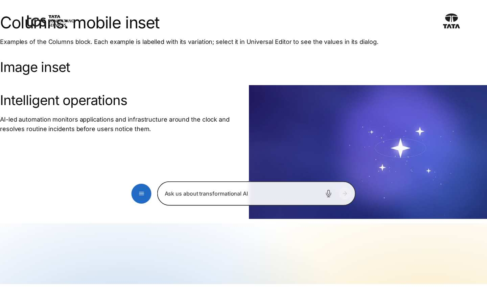
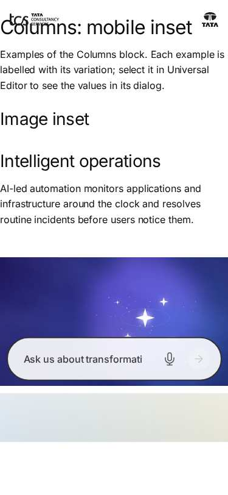

# Columns — Authoring Guide

| Attribute | Value |
| --- | --- |
| Document ID | AUT-C-columns |
| Audience | Content authors, content managers, AEM authoring leads |
| Purpose | How to add, fill in and check the Columns component |
| Scope | — |
| Prerequisites | — |
| Owner | Content Lead / AEM Authoring Lead (proposed) |
| Approver | Product Owner (to be confirmed) |
| Version | 1.0 |
| Status | Draft for review |
| Last updated | 8 November 2026 |
| Last validated | 8 November 2026 |
| Source files | blocks/columns/README.md, blocks/columns/_columns.json |
| Related documents | — |
| Related AEM paths | — |

## Contents

- [Where to see it](#where-to-see-it)
- [For Content Authors](#for-content-authors)
- [Authorable Fields](#authorable-fields)
- [Screenshot-Based Authoring Steps](#screenshot-based-authoring-steps)
- [Variations](#variations)
- [Complete Authoring Example](#complete-authoring-example)
- [Content and Asset Guidelines](#content-and-asset-guidelines)
- [Troubleshooting](#troubleshooting)
- [Screenshots](#screenshots)
- [Known limitations](#known-limitations)
- [Open items](#open-items)
- [Change history](#change-history)

## Where to see it

- https://main--tcs-corp--sradha-tcs.aem.live/design-block-master/en/block-library/columns
- https://main--tcs-corp--sradha-tcs.aem.live/design-block-master/en/block-library/columns/columns-mobile-inset
- https://main--tcs-corp--sradha-tcs.aem.live/design-block-master/en/block-library/columns/columns-variations

## For Content Authors

Columns can no longer be added. To maintain an existing one:

1. Select the Columns block on the page; its properties show **Columns** and **Rows** (the grid size set when it was created).
2. Select a column to edit its content or to add a **Text**, **Image** or **Title** to it.
3. A button in a column is a link in a Text made bold (primary) or italic (secondary).
4. Preview, publish, and check the published page at mobile and desktop widths.

To replace it (recommended):

1. Add a **Columns Container** where sections are added (or, inside a Tabs Container tab, use Column Breaks after the Tab).
2. For each column of the Columns block, add a **Column Break**, then the column's content (Text, Title, Image; Button blocks for buttons).
3. Set **Columns per row** to the number of columns per row of the old block; Gap Medium, Vertical alignment Middle and Side by side from Desktop come closest to the old layout (the old block centred columns vertically with a 1.5rem gap from 900px).
4. Delete the Columns block, preview, publish.

## Authorable Fields

<!-- BEGIN GENERATED: fields (npm run build:docs) -->

#### Columns (`columns`)

Model `columns`.

Stored on a new component (definition template): `columns` = `"2"`, `rows` = `"1"`.

##### Content tab — Columns

| Field label | Property | Type | Required | Default | Allowed values | Author guidance | Example |
| ----------- | -------- | ---- | -------- | ------- | -------------- | --------------- | ------- |
| Columns | `columns` | text | No | "" | — | — | — |
| Rows | `rows` | text | No | "" | — | — | — |

<!-- END GENERATED: fields -->

Notes on the fields:

- **Columns** and **Rows** (`columns`, `rows`): the size of the grid AEM creates for a new Columns (template values 2 and 1); the code reads the number of cells of the first row, not these values.
- **No Additional tab:** AEM delivers no `classes_*` for the built-in Columns component, so the dialog has none (removed in the block audit, handover 2.27). The motion decorator still lists `columns` (columns as staggered targets), but without delivered classes no animation can be authored.
- **Column content:** the `column` filter allows Text, Image and Title.
- **Data layer:** the block is a component `tcs-corp/components/columns`.

## Screenshot-Based Authoring Steps

#### Authoring Step 1: Find the Columns to migrate

```text
[Screenshot Placeholder]

File name:
columns-authoring-step-1.png

Purpose:
An existing Columns block selected in the content tree, with its Columns and Rows properties.

Annotations:
A = Columns block in the tree
B = Columns
C = Rows
```

#### Values to Enter

| Callout | Field | Value | Reason | Expected result |
|---|---|---|---|---|
| B | Columns | (read only) 2 | Number of columns to recreate | — |
| C | Rows | (read only) 1 | Number of rows | — |

Author action: note the columns and their content. Common mistake: looking for Columns in the Add (+) list; it is no longer offered.

#### Authoring Step 2: Add the Columns Container

```text
[Screenshot Placeholder]

File name:
columns-authoring-step-2.png

Purpose:
A Columns Container added next to the old Columns block, with Columns per row 2.

Annotations:
A = Columns Container
B = Columns per row
```

#### Values to Enter

| Callout | Field | Value | Reason | Expected result |
|---|---|---|---|---|
| A | Add (+) on the page | Columns Container | Replacement | Empty container |
| B | Columns per row | 2 | As the old block | Two columns per row |
| — | Vertical alignment | Middle | The old block centred its columns | `align-middle` |

#### Authoring Step 3: Recreate the columns

```text
[Screenshot Placeholder]

File name:
columns-authoring-step-3.png

Purpose:
Two Column Breaks with the moved content (Image, then Title and Text), and the old Columns block deleted.

Annotations:
A = Column Break 1 and the Image
B = Column Break 2 and the Title and Text
```

#### Values to Enter

| Callout | Field | Value | Reason | Expected result |
|---|---|---|---|---|
| A | Column Break 1 content | Image (with alt text) | First column | Image column |
| B | Column Break 2 content | Title, Text, Button block | Second column | Text column |

Author action: add the Column Breaks and content, delete the old block, preview at 390px and 1440px, publish. Business rule: the Columns Container stacks columns in their order (the old block moved image-only columns first on mobile): put the image column first if it should come first on mobile. Validation: the page looks as before at desktop width.

## Variations

The variations below exist only in content authored before; the code renders them as follows.

#### Two columns

Two cells per row: equal columns side by side from 900px, stacked below.

#### Three or more columns

Any number of cells per row; each takes an equal share (`flex: 1`). The class `columns-{n}-cols` is added (n = cells of the first row) but no CSS uses it.

#### Image column

A cell whose only content is a picture gets `columns-img-col`: shown first when stacked (`order: 0`), image full width.

#### Multiple rows

Each row is its own flex row; rows don't share column widths beyond their equal shares.

```text
[Screenshot Placeholder]

File name:
columns-image-column-mobile.png

Purpose:
An existing Columns block with an image-only column on the right at mobile width: the image shown above the text.

Annotations:
A = Image column moved first
B = Text column
```

## Complete Authoring Example

Scenario: migrating a two-column "Cloud transformation" Columns (image left, heading, text and a button right) to a Columns Container.

| Field | Example value | Guidance |
|---|---|---|
| Columns Container Columns per row | 2 | As the old block |
| Vertical alignment | Middle | As the old layout |
| Gap | Medium | Closest to the old 1.5rem gap |
| Column Break 1 | Image (alt text "Cloud operations dashboard") | Keep the alt text |
| Column Break 2 | Title "Cloud transformation, end to end", Text, Button block "Explore cloud services" | Button blocks replace bold links |

Expected output: the same layout from 900px; stacked below in content order. Accessibility: alt text and heading order unchanged. Analytics: the component becomes `tcs-corp/components/columns-container`, its blocks its children. Personalization fallback: none.

Pre-publish checklist: all content moved; old block deleted; checked at mobile and desktop widths.

## Content and Asset Guidelines

- Only Text, Image and Title in columns; buttons as bold (primary) or italic (secondary) links in a Text.
- Images: full column width (`width: 100%`); alt text on every meaningful image.
- Min / max: no verified technical limit was identified; many columns become narrow (equal shares, no wrapping).
- New content: use the Columns Container.

## Troubleshooting

| Symptom | Likely cause | Diagnostic steps | Resolution | Verification |
|---|---|---|---|---|
| Columns not in the Add (+) list | Deprecated, removed from the filters | — | Use a Columns Container | — |
| A block can't be added to a column | The `column` filter allows Text, Image, Title only | — | Migrate to a Columns Container | Block in a column |
| No spacing / anchor / hide options | No Additional tab for the built-in component | — | Migrate to a Columns Container | Options available |
| Image not first on mobile | The cell holds more than the picture | Inspect for `columns-img-col` | Keep the image alone in its cell, or migrate | Image first |
| Columns too narrow | Many cells per row (no wrapping) | Count the cells | Migrate with Columns per row | Columns wrap into rows |

## Screenshots



*Figure: Columns as published (block library) — desktop 1440 × 900 (/design-block-master/en/block-library/columns/columns-mobile-inset, captured 2026-11-08).*



*Figure: Columns as published (block library) — mobile 375 × 812 (/design-block-master/en/block-library/columns/columns-mobile-inset, captured 2026-11-08).*

> **Screenshot required**
>
> - Required screen: Columns dialog in Universal Editor (every tab, including Additional)
> - Required role/access: AEM Sites author with Universal Editor (content author)
> - Required navigation steps: AEM Sites console > /content/tcs-corp/language-masters/en > open a page in Universal Editor
> - Reason unavailable: No AEM author access in the documentation program (access blocker AB-01)
> - Owner: Content Lead / AEM Authoring Lead (proposed)
> - Target completion date: To be confirmed

## Known limitations

- Universal Editor screenshots are placeholders: no author access in this program.

## Open items

- None.

## Change history

| Version | Date | Author | Change |
| --- | --- | --- | --- |
| 1.0 | 8 November 2026 | Delivery team (documentation program) | First version of the role-specific documentation (master documentation prompt), generated from the repository and the published reference pages |
