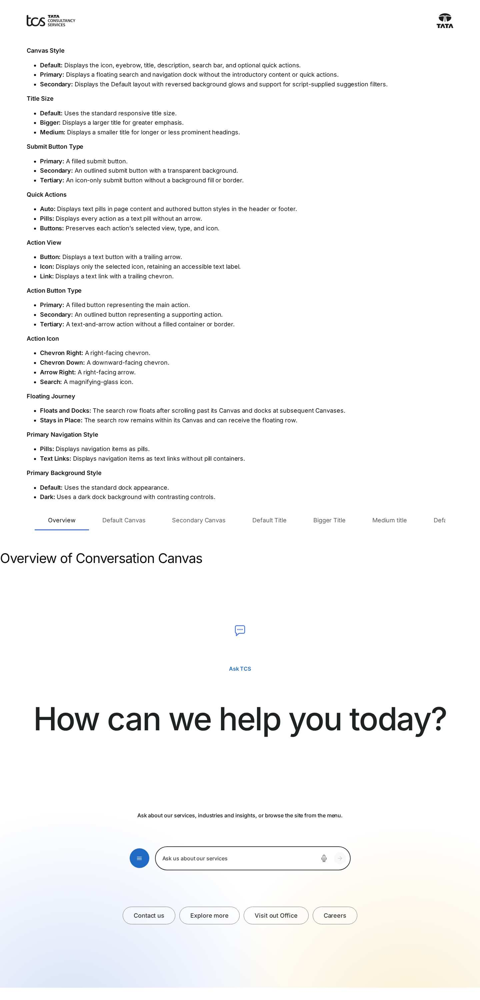
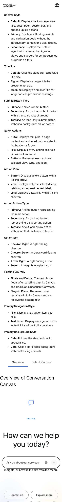

# Conversation Canvas — Authoring Guide

| Attribute | Value |
| --- | --- |
| Document ID | AUT-C-conversation-canvas |
| Audience | Content authors, content managers, AEM authoring leads |
| Purpose | How to add, fill in and check the Conversation Canvas component |
| Scope | — |
| Prerequisites | — |
| Owner | Content Lead / AEM Authoring Lead (proposed) |
| Approver | Product Owner (to be confirmed) |
| Version | 1.0 |
| Status | Draft for review |
| Last updated | 8 November 2026 |
| Last validated | 8 November 2026 |
| Source files | blocks/conversation-canvas/README.md, blocks/conversation-canvas/_conversation-canvas.json |
| Related documents | — |
| Related AEM paths | — |

## Contents

- [Where to see it](#where-to-see-it)
- [For Content Authors](#for-content-authors)
- [Authorable Fields](#authorable-fields)
- [Screenshot-Based Authoring Steps](#screenshot-based-authoring-steps)
- [Variations](#variations)
- [Complete Authoring Example](#complete-authoring-example)
- [Content and Asset Guidelines](#content-and-asset-guidelines)
- [Troubleshooting](#troubleshooting)
- [Screenshots](#screenshots)
- [Known limitations](#known-limitations)
- [Open items](#open-items)
- [Change history](#change-history)

## Where to see it

- https://main--tcs-corp--sradha-tcs.aem.live/design-block-master/en/block-library/conversation-canvas
- https://main--tcs-corp--sradha-tcs.aem.live/design-block-master/en/block-library/conversation-canvas/conversation-canvas
- https://main--tcs-corp--sradha-tcs.aem.live/design-block-master/en/block-library/conversation-canvas/docked
- https://main--tcs-corp--sradha-tcs.aem.live/design-block-master/en/block-library/conversation-canvas/floating
- https://main--tcs-corp--sradha-tcs.aem.live/design-block-master/en/block-library/conversation-canvas/footer-canvas
- https://main--tcs-corp--sradha-tcs.aem.live/design-block-master/en/block-library/conversation-canvas/journey-and-actions

## For Content Authors

1. **Add the block.** In Universal Editor select a Section (or a Columns Container column) and choose Add > Conversation Canvas. For the header Canvas add it to a section of the Navigation page; for the footer Canvas add it to the page referenced by the Footer's Conversation Canvas Page (e.g. `references/footer-conversation-canvas`).
2. **Open its properties.** Select the block; the dialog has the tabs Content and Additional.
3. **Choose the style.** Canvas Style Default, Secondary or Primary (sticky). Primary renders only the floating dock: intro, background and buttons aren't shown.
4. **Enter the content.** Icon (and Icon Alt Text only if the icon carries meaning), Eyebrow, Title, Title Type, Text, BG Background Image; Menu root path and Menu depth (1 to 3) for the site menu; the Search bar fields: water mark (the placeholder and the field's label), audio icon and its alt text, button icon type, hover text (the submit button's name) and Search page.
5. **Set the journey.** Default and Secondary: Floating journey Floats and docks (default) or Stays in place, and Quick actions Auto, Pills or Buttons; Primary (always floating) instead shows Navigation style and BG Style (the dialog shows only the fields of the chosen Canvas Style).
6. **Add quick actions.** Select the block in the content tree and Add > Conversation Canvas Button; set Link, Text, Views (Button, Icon, Link), Type and Icon. Reorder them by dragging in the content tree.
7. **Preview** on aem.page (the query index isn't available in the editor, so the menu shows "No pages found" there), scroll the page to check floating and docking.
8. **Publish** the page (and the nav or footer canvas page when you changed those), then **validate**: the menu lists the pages, a search opens the Search page with `?q=` and the row floats and docks as expected.

**Minimum required:** none technically; recommended: Title, Search bar water mark, Search bar button icon type hover text ("Submit"), Search page and a Menu root path in the same locale. **Optional:** icon, eyebrow, text, background image, quick actions, the Additional tab.

## Authorable Fields

<!-- BEGIN GENERATED: fields (npm run build:docs) -->

#### Conversation Canvas (`conversation-canvas`)

Model `conversation-canvas`; template name "Conversation Canvas" (the block class AEM renders); key-value block (one row per property); children: `conversation-canvas-button`.

##### Content tab — Conversation Canvas

| Field label | Property | Type | Required | Default | Allowed values | Author guidance | Example |
| ----------- | -------- | ---- | -------- | ------- | -------------- | --------------- | ------- |
| Canvas Style | `classes` | select | No | "" | Default (""), Primary (sticky) (`primary`), Secondary (`secondary`) | Default: the ask-us panel (title, text, search row, quick actions). Primary (sticky): only a search and site navigation dock, floating at the bottom of the window from the top of the page to the footer. Secondary: the topic exploration panel (Default with the glows reversed and suggestion filters a script can fill). | secondary |
| Floating journey | `classes_journey` | select | No | "" | Floats and docks (""), Stays in place (`nofloat`) | Default and Secondary. Floats and docks: the search row stays in place, floats once scrolled past and lands on the next Canvas, until the footer Canvas. Stays in place: the row never floats; a floating row lands on it while it is on screen. The footer Canvas never floats; Primary always floats. Shown when `classes` is not `primary`. Delivered as a block class. | nofloat |
| Quick actions | `classes_actions` | select | No | "" | Auto (""), Pills (`action-pills`), Buttons (`action-buttons`) | How the button items look. Auto: pills in page sections, buttons in the footer (Figma). Pills: filter-tag pills without arrows. Buttons: as each item is authored (view and type). Shown when `classes` is not `primary`. Delivered as a block class. | action-pills |
| BG Style | `bgStyle` | select | No | `default` | Default (`default`), Dark (Primary) (`dark`) | Shown when `classes` is `primary`. | default |
| BG Background Image | `backgroundImage` | reference | No | — | — | — | /content/dam/tcs-corp/home/home-hero-background.jpg |
| Icon | `icon` | reference | No | — | — | — | /content/dam/tcs-corp/block-library/icons/chat-icon.svg |
| Icon Alt Text | `iconAlt` | text | No | — | — | Delivered with `icon` (field collapse). | — |
| Eyebrow | `eyebrow` | text | No | — | — | — | Ask TCS |
| Title | `title` | text | No | — | — | — | Let’s shape what’s next, together |
| Title Type | `titleSize` | select | No | "" | Default (""), Bigger Title (`bigger`), Medium Title (`medium`) | — | bigger |
| Text | `text` | richtext | No | "" | — | — | — |
| Menu | `menu` | container | No | — | — | — | — |
| Menu › Menu root path | `menuRootPath` | aem-content | No | — | — | — | /design-block-master/en/dummy-pages |
| Menu › Menu depth | `menuDepth` | number | No | `1` | — | — | 2 |
| Navigation style | `classes_navstyle` | select | No | "" | Pills (""), Text links (`text-links`) | Primary (sticky): the site navigation as pills or as text links (Figma “No Pill”). Shown when `classes` is `primary`. Delivered as a block class. | text-links |
| Search bar | `searchBar` | container | No | — | — | — | — |
| Search bar › Search bar water mark | `searchPlaceholder` | text | No | — | — | — | Ask us a question |
| Search bar › Search bar audio icon | `searchAudioIcon` | reference | No | — | — | — | /content/dam/tcs-corp/block-library/icons/audio-icon.svg |
| Search bar › Search bar audio icon alt text | `searchAudioIconAlt` | text | No | — | — | — | Search by voice |
| Search bar › Search bar button icon type | `searchButtonStyle` | select | No | `primary` | Primary (`primary`), Secondary (`secondary`), Tertiary (`tertiary`) | — | primary |
| Search bar › Search bar button icon type hover text | `searchButtonLabel` | text | No | — | — | — | Search |
| Search bar › Search page | `searchPage` | aem-content | No | — | — | The page that shows search results (opened with ?q=the query). Without it, and without a search integration, visitors are told search isn’t available. | — |

##### Additional tab — Conversation Canvas

| Field label | Property | Type | Required | Default | Allowed values | Author guidance | Example |
| ----------- | -------- | ---- | -------- | ------- | -------------- | --------------- | ------- |
| Anchor ID | `classes_anchor` | text | No | — | regExp: ^anchor-[a-z0-9][a-z0-9-]*$; customErrorMsg: Start with anchor-, then lower-case letters, digits and hyphens. | A unique ID of the block on the page, starting with anchor-, e.g. anchor-our-services; link to it with #anchor-our-services. Delivered as a block class. | — |
| Hide block | `classes_hideblock` | boolean | No | `false` | on / off | Hides the whole block on the page until it is turned off (shown faded in the editor). Delivered as a block class. | — |
| Animation Type | `classes_animation` | select | No | "" | None (""), Fade in (`motion-fade-in`), Fade up (`motion-fade-up`), Fade down (`motion-fade-down`), Fade left (`motion-fade-left`), Fade right (`motion-fade-right`), Slide up (`motion-slide-up`), Slide down (`motion-slide-down`), Slide left (`motion-slide-left`), Slide right (`motion-slide-right`), Scale in (`motion-scale-in`) | How the block's content appears; repeated items (cards, list items, accordion items, columns) appear one after another. None: shown as is. Not played in the editor or when the visitor prefers reduced motion. Delivered as a block class. | motion-fade-in |
| Motion Speed | `classes_animationspeed` | select | No | "" | Medium (""), Fast (`motion-fast`), Slow (`motion-slow`) | How fast the block's animations run (Animation Type 0.3 / 0.6 / 0.9 s; the Background animation takes 1.5 times as long). Shown when (`classes_animation` is set and `classes_animation` is not empty) or (`classes_bganimation` is set and `classes_bganimation` is not empty). Delivered as a block class. | motion-slow |
| Animation Trigger | `classes_animationtrigger` | select | No | "" | On Scroll / Viewport Entry (""), On Page Load (`motion-on-load`) | When the block's animations run. On Scroll: when the block comes into view (at once if it is in view when the page opens). On Page Load: as soon as the block is ready, wherever it is on the page. Shown when (`classes_animation` is set and `classes_animation` is not empty) or (`classes_bganimation` is set and `classes_bganimation` is not empty). Delivered as a block class. | — |
| Background animation | `classes_bganimation` | select | No | "" | None (""), Fade in (`bg-motion-fade-in`), Reveal from the centre (`bg-motion-reveal`), Wipe left to right (`bg-motion-wipe-right`), Wipe right to left (`bg-motion-wipe-left`), Wipe bottom to top (`bg-motion-wipe-up`), Scale reveal (`bg-motion-scale`) | How the block's background (its colour, image or overlay as set in the block) appears. It doesn't animate the content: see Animation Type. Motion Speed and Animation Trigger apply to it too. Not played in the editor or when the visitor prefers reduced motion. Delivered as a block class. | bg-motion-reveal |
| Padding left | `classes_paddingleft` | select | No | "" | Default (""), 0 (none) (`pl-0`), 0.25rem (space-100) (`pl-100`), 0.5rem (space-200) (`pl-200`), 0.75rem (space-300) (`pl-300`), 1rem (space-400) (`pl-400`), 1.25rem (space-500) (`pl-500`), 1.5rem (space-600) (`pl-600`), 2rem (space-800) (`pl-800`), 2.5rem (space-1000) (`pl-1000`), 3rem (space-1200) (`pl-1200`), 4rem (space-1600) (`pl-1600`), 5rem (space-2000) (`pl-2000`), 6rem (space-2400) (`pl-2400`), 7.5rem (space-3000) (`pl-3000`) | Delivered as a block class. | — |
| Padding right | `classes_paddingright` | select | No | "" | Default (""), 0 (none) (`pr-0`), 0.25rem (space-100) (`pr-100`), 0.5rem (space-200) (`pr-200`), 0.75rem (space-300) (`pr-300`), 1rem (space-400) (`pr-400`), 1.25rem (space-500) (`pr-500`), 1.5rem (space-600) (`pr-600`), 2rem (space-800) (`pr-800`), 2.5rem (space-1000) (`pr-1000`), 3rem (space-1200) (`pr-1200`), 4rem (space-1600) (`pr-1600`), 5rem (space-2000) (`pr-2000`), 6rem (space-2400) (`pr-2400`), 7.5rem (space-3000) (`pr-3000`) | Delivered as a block class. | — |
| Padding top | `classes_paddingtop` | select | No | "" | Default (""), 0 (none) (`pt-0`), 0.25rem (space-100) (`pt-100`), 0.5rem (space-200) (`pt-200`), 0.75rem (space-300) (`pt-300`), 1rem (space-400) (`pt-400`), 1.25rem (space-500) (`pt-500`), 1.5rem (space-600) (`pt-600`), 2rem (space-800) (`pt-800`), 2.5rem (space-1000) (`pt-1000`), 3rem (space-1200) (`pt-1200`), 4rem (space-1600) (`pt-1600`), 5rem (space-2000) (`pt-2000`), 6rem (space-2400) (`pt-2400`), 7.5rem (space-3000) (`pt-3000`) | Delivered as a block class. | — |
| Padding bottom | `classes_paddingbottom` | select | No | "" | Default (""), 0 (none) (`pb-0`), 0.25rem (space-100) (`pb-100`), 0.5rem (space-200) (`pb-200`), 0.75rem (space-300) (`pb-300`), 1rem (space-400) (`pb-400`), 1.25rem (space-500) (`pb-500`), 1.5rem (space-600) (`pb-600`), 2rem (space-800) (`pb-800`), 2.5rem (space-1000) (`pb-1000`), 3rem (space-1200) (`pb-1200`), 4rem (space-1600) (`pb-1600`), 5rem (space-2000) (`pb-2000`), 6rem (space-2400) (`pb-2400`), 7.5rem (space-3000) (`pb-3000`) | Delivered as a block class. | — |
| Margin left | `classes_marginleft` | select | No | "" | Default (""), 0 (none) (`ml-0`), 0.25rem (space-100) (`ml-100`), 0.5rem (space-200) (`ml-200`), 0.75rem (space-300) (`ml-300`), 1rem (space-400) (`ml-400`), 1.25rem (space-500) (`ml-500`), 1.5rem (space-600) (`ml-600`), 2rem (space-800) (`ml-800`), 2.5rem (space-1000) (`ml-1000`), 3rem (space-1200) (`ml-1200`), 4rem (space-1600) (`ml-1600`), 5rem (space-2000) (`ml-2000`), 6rem (space-2400) (`ml-2400`), 7.5rem (space-3000) (`ml-3000`) | Delivered as a block class. | — |
| Margin right | `classes_marginright` | select | No | "" | Default (""), 0 (none) (`mr-0`), 0.25rem (space-100) (`mr-100`), 0.5rem (space-200) (`mr-200`), 0.75rem (space-300) (`mr-300`), 1rem (space-400) (`mr-400`), 1.25rem (space-500) (`mr-500`), 1.5rem (space-600) (`mr-600`), 2rem (space-800) (`mr-800`), 2.5rem (space-1000) (`mr-1000`), 3rem (space-1200) (`mr-1200`), 4rem (space-1600) (`mr-1600`), 5rem (space-2000) (`mr-2000`), 6rem (space-2400) (`mr-2400`), 7.5rem (space-3000) (`mr-3000`) | Delivered as a block class. | — |
| Margin top | `classes_margintop` | select | No | "" | Default (""), 0 (none) (`mt-0`), 0.25rem (space-100) (`mt-100`), 0.5rem (space-200) (`mt-200`), 0.75rem (space-300) (`mt-300`), 1rem (space-400) (`mt-400`), 1.25rem (space-500) (`mt-500`), 1.5rem (space-600) (`mt-600`), 2rem (space-800) (`mt-800`), 2.5rem (space-1000) (`mt-1000`), 3rem (space-1200) (`mt-1200`), 4rem (space-1600) (`mt-1600`), 5rem (space-2000) (`mt-2000`), 6rem (space-2400) (`mt-2400`), 7.5rem (space-3000) (`mt-3000`) | Delivered as a block class. | — |
| Margin bottom | `classes_marginbottom` | select | No | "" | Default (""), 0 (none) (`mb-0`), 0.25rem (space-100) (`mb-100`), 0.5rem (space-200) (`mb-200`), 0.75rem (space-300) (`mb-300`), 1rem (space-400) (`mb-400`), 1.25rem (space-500) (`mb-500`), 1.5rem (space-600) (`mb-600`), 2rem (space-800) (`mb-800`), 2.5rem (space-1000) (`mb-1000`), 3rem (space-1200) (`mb-1200`), 4rem (space-1600) (`mb-1600`), 5rem (space-2000) (`mb-2000`), 6rem (space-2400) (`mb-2400`), 7.5rem (space-3000) (`mb-3000`) | Delivered as a block class. | — |

#### Conversation Canvas Button (`conversation-canvas-button`)

Model `conversation-canvas-button`; template name "Conversation Canvas Button" (the block class AEM renders).

##### Fields — Conversation Canvas Button

| Field label | Property | Type | Required | Default | Allowed values | Author guidance | Example |
| ----------- | -------- | ---- | -------- | ------- | -------------- | --------------- | ------- |
| Link | `link` | aem-content | No | — | — | — | — |
| Text | `linkText` | text | No | — | — | Delivered with `link` (field collapse). | — |
| Title | `linkTitle` | text | No | — | — | Delivered with `link` (field collapse). | — |
| Views | `buttonView` | select | No | `button` | Button (`button`), Icon (`icon`), Link (`link`) | — | — |
| Type | `buttonVariant` | select | No | `primary` | Primary (`primary`), Secondary (`secondary`), Tertiary (`tertiary`) | Shown when `buttonView` is off or empty or `buttonView` is `button` or `buttonView` is `icon`. | — |
| Icon | `buttonIcon` | select | No | — | Arrow right (`arrow-right`), Chevron right (`chevron-right`), Chevron down (`chevron-down`), Search (`search`) | Shown when `buttonView` is `icon`. | — |

<!-- END GENERATED: fields -->

Notes the tables can't show:

| Field | Values | Effect |
| ----- | ------ | ------ |
| Canvas Style | Default / Primary (sticky) / Secondary | The variation (block class `primary` / `secondary`) |
| Floating journey (`classes_journey`, Default and Secondary only) | Floats and docks (default) / Stays in place (`nofloat`) | Stays in place: a stop of the journey whose own row never floats; a floating row lands on it while it's on screen (the previous row floats on after it). `decorative` (no longer offered) is read as Stays in place. Primary always floats |
| Quick actions (`classes_actions`) | Auto (default) / Pills (`action-pills`) / Buttons (`action-buttons`) | How the button items look. Auto: pills in page sections (`main`), buttons elsewhere (footer, header). Pills: filter-tag pills without arrows. Buttons: as each item is authored (view and type) |
| BG Style | Default / Dark (Primary) | Adds `conversation-canvas-bg-{value}`; only the Primary dock has Dark styles |
| Navigation style (`classes_navstyle`) | Pills / Text links | Primary dock navigation only |

- **Title** always renders as an H2 (`h2.conversation-canvas-title`); Title Type only changes its size (Bigger: 2.75rem / 4rem / 6rem below 600px / from 600px / from 1200px; Medium: 1.75rem / 2rem / 2.5rem; Default: 2.5rem / 3.125rem / 4rem).
- **Icon Alt Text** and **Search bar audio icon alt text** collapse into their images (field collapse); the block reads the image's alt (and a separate row when present). The audio alt text names the voice button (fallback placeholder `searchByVoice`); the audio icon itself is decorative.
- **Search bar water mark** is the input's placeholder and its visually hidden label (fallback `searchPlaceholder`, "Ask us a question").
- **Search bar button icon type hover text** is the submit button's accessible name and tooltip (fallback `submit`, "Submit").
- **Search page**: a search opens it with `?q=` and the query, unless a page integration handles the `conversation-canvas:search` event; without either, a status for screen readers says "Search isn’t available yet."
- **Menu root path** is converted to the published path; empty gives the locale root (e.g. `/de-de`). **Menu depth** 1 to 3 levels below the root.
- **Quick actions** (Conversation Canvas Button items): Views and Type come from the item (`buttonView`, `buttonVariant`), else from the link formatting, defaults Button / Primary; Title is dropped when equal to the text.
- **Data layer impact:** filter tags supplied by script carry `data-cmp-interaction="filter"` and `data-cmp-value`; see Data Layer and Analytics.
- **Legacy mapping:** button items authored with the former shared `button` model are read from their link and option cells (any cell value that is a known view or type; an unknown value is the icon). If no row has a known key, single-cell rows are read as properties in model order (Canvas Style and the collapsed alt texts excluded).
- **Additional tab:** Anchor ID, Hide block, the animations and spacing behave as described in AGENTS.md ("Additional tab", "Animation and skeletons"); Hide block and spacing apply only in `main`, not to header or footer Canvases. The content animation moves `.conversation-canvas-content` (intro, search row, buttons); the Background animation reveals the base colour, the brand glows (`::before`: Default blue left / yellow right, Secondary the reverse) or the BG Background Image, read from the block, never redefined (`decorators/motion-decorator.js`, `docs/animation/README.md`).

## Screenshot-Based Authoring Steps

#### Authoring Step 1: Add a Default Canvas

```text
[Screenshot Placeholder]

File name:
conversation-canvas-authoring-step-1.png

Purpose:
The Content tab with Canvas Style Default and the intro fields filled in.

Annotations:
A = Canvas Style
B = Icon
C = Eyebrow
D = Title
E = Title Type
F = Text
```

##### Values to Enter

| Callout | Field | Value | Reason | Expected result |
| ------- | ----- | ----- | ------ | --------------- |
| A | Canvas Style | Default | In-page panel | White panel with blue / yellow glows |
| B | Icon | /content/dam/tcs-corp/block-library/icons/chat-icon.svg | Visual cue | 2.5rem icon above the eyebrow |
| C | Eyebrow | Ask TCS | Context | Small brand-coloured text |
| D | Title | How can we help you today? | The question | H2 |
| E | Title Type | Default | Standard size | 4rem from 1200px |
| F | Text | Ask about our services, industries and insights, or browse the site from the menu. | Guidance | Centred text below the title |

**Author action:** Section > Add > Conversation Canvas, fill the Content tab. **Expected preview:** the centred intro and a search row. **Expected published result:** the same. **Business rule:** the page H1 stays elsewhere (Page Header). **Validation:** the heading order of the page stays logical. **Common mistake:** Canvas Style Primary when an in-page panel is wanted: Primary renders only the dock.

#### Authoring Step 2: Configure the menu and search bar

```text
[Screenshot Placeholder]

File name:
conversation-canvas-authoring-step-2.png

Purpose:
The Menu and Search bar groups of the Content tab.

Annotations:
A = Menu root path
B = Menu depth
C = Search bar water mark
D = Search bar button icon type
E = Search bar button icon type hover text
F = Search page
```

##### Values to Enter

| Callout | Field | Value | Reason | Expected result |
| ------- | ----- | ----- | ------ | --------------- |
| A | Menu root path | /language-masters/en/dummy-pages | Section of the site | Menu lists its child pages |
| B | Menu depth | 2 | Two levels | Nested list in the menu |
| C | Search bar water mark | Ask us a question | Invitation and label | Placeholder and hidden label |
| D | Search bar button icon type | Primary | Filled arrow | Brand-blue round arrow button |
| E | Search bar button icon type hover text | Submit | Accessible name | Tooltip and name "Submit" |
| F | Search page | The site's search results page | Somewhere to go | Search opens it with `?q=` |

**Author action:** fill the groups and save. **Expected preview:** on aem.page the menu button opens the list of pages; in Universal Editor it shows "No pages found". **Expected published result:** a query opens the Search page. **Business rule:** Menu root path in the same locale as the page. **Validation:** open the menu, submit a query. **Common mistake:** a test word in the hover text (it becomes the button's name): enter "Submit".

#### Authoring Step 3: Add quick actions

```text
[Screenshot Placeholder]

File name:
conversation-canvas-authoring-step-3.png

Purpose:
The content tree with two Conversation Canvas Button items and the item dialog.

Annotations:
A = Link
B = Text
C = Views
D = Type
```

##### Values to Enter

| Callout | Field | Value | Reason | Expected result |
| ------- | ----- | ----- | ------ | --------------- |
| A | Link | /content/tcs-corp/language-masters/en/dummy-pages/contact | Destination | Link to the contact page |
| B | Text | Contact us | Visible text | Button text |
| C | Views | Button | Button look | A button (pill in page sections with Quick actions Auto) |
| D | Type | Primary | Main action | Primary style when shown as a button |

**Author action:** select the block in the content tree > Add > Conversation Canvas Button (twice; the second: Explore services, Secondary). **Expected preview:** the quick actions below the search row. **Expected published result:** in a page section with Quick actions Auto they render as pills; set Quick actions to Buttons to keep the authored button styles. **Business rule:** one to three actions. **Validation:** each link opens its page. **Common mistake:** expecting button styles in a page section: Auto shows pills there.

#### Authoring Step 4: Set the floating journey

```text
[Screenshot Placeholder]

File name:
conversation-canvas-authoring-step-4.png

Purpose:
The Floating journey and Quick actions selects.

Annotations:
A = Floating journey
B = Quick actions
```

##### Values to Enter

| Callout | Field | Value | Reason | Expected result |
| ------- | ----- | ----- | ------ | --------------- |
| A | Floating journey | Floats and docks | Default journey | Row floats once passed, lands on the next Canvas |
| A | Floating journey (second Canvas of the page) | Stays in place | A stop that shouldn't float itself | The previous row floats on after it |
| B | Quick actions | Pills | Figma filter-tag look | Pills without arrows |

**Author action:** set the values on each Canvas of the page. **Expected preview:** on aem.page scroll down: one floating row, landing on each Canvas, stopping at the footer Canvas. **Business rule:** authors never set offsets, z-index or thresholds; roles come from placement. **Validation:** `document.documentElement.dataset.canvasJourneyState` shows the state. **Common mistake:** every Canvas set to Docks only: nothing floats (state `hidden`).

#### Authoring Step 5: Footer and header Canvases

```text
[Screenshot Placeholder]

File name:
conversation-canvas-authoring-step-5.png

Purpose:
The Footer block's Conversation Canvas Page field, and a Navigation page section holding a Canvas.

Annotations:
A = Conversation Canvas Page
B = Nav page section with the Canvas
```

##### Values to Enter

| Callout | Field | Value | Reason | Expected result |
| ------- | ----- | ----- | ------ | --------------- |
| A | Conversation Canvas Page (Footer) | references/footer-conversation-canvas | Final stop of the journey | The footer Canvas; nothing floats below it |
| B | A section of the Navigation page | A Conversation Canvas | Header Canvas | Row on the bottom of the first screen, fixed at the bottom of the window as soon as the page scrolls |

**Author action:** set the footer reference; add a section with a Canvas to the Navigation page (a TCS Header block in the same section stays the logo bar); publish both pages. **Expected published result:** the journey starts at the header Canvas and ends at the footer Canvas. **Validation:** scroll to the bottom: state `footer-docked`. **Common mistake:** the footer canvas page not published: the floating row stops above the footer instead.

## Variations

Verified from the repository, the published content and Figma *New Screens from New DS*. Only these are implemented.

| Variation | Figma | Context | Configuration | Floating / docked |
| --------- | ----- | ------- | ------------- | ----------------- |
| Default | Hero (4082:120388), Intelligent Personalisation Block (251:41883), Footer (2496:91965) | Page body, header, footer | Canvas Style Default | Search row docks in place, floats once passed |
| Secondary | — (repository) | Page body | Canvas Style Secondary | As Default; filter tags by script |
| Section Canvas | Intelligent Personalisation Block (251:41883), tablet 2313:52736 | Page body (Default / Secondary) | — | From 600px at least 50rem (800px) high, content centred, 1.5rem gutters; from 1200px 10rem / 5rem (160px / 80px) padding; edge to edge in a Full Width section (no rounded corners); search row 37.9375rem (607px) |
| Quick actions | Filter tag (state-5-pills, 251:41883); Footer CTA buttons (2496:91965) | Page body / footer | Quick actions (`classes_actions`) | Auto: pills in page sections (0.75rem 2rem padding, 1px `--color-border-default`, 1.125rem medium, no arrow, 0.75rem apart, at most 56.25rem wide), buttons in the footer |
| Floating search row | Floating menu (4308:42483): 59px menu button, 2px `#494c4d` outline, 60% white pill; 607×72 desktop, 463×72 tablet | Any Default / Secondary | — | The floating presentation of the owner row: 28.9375rem (463px) wide below 1200px, 37.9375rem (607px) from 1200px, never wider than the window minus 1.5rem gutters; it changes width as it floats and lands on tablet |
| Primary — Pills | Full menu (1124:26210, 1124:26244) | Page body | Canvas Style Primary (sticky), Navigation style Pills | Whole dock floats; docks give way to Canvases in place. From 900px: the 33.125rem (530px) search pill alone (40% white, light outline, light placeholder); first level as pills (0.75rem 2rem, medium), the levels below as text items with the open one filled, their row starting with the menu button (back to the first level; a back arrow deeper down) |
| Primary — Text links | Full menu – No Pill (1734:31279) | As Primary | Navigation style Text links | Text items; current / open item as filled pill |
| Primary — Dark | L1 Media & Investors (1734:38272) | As Primary | BG Style Dark (Primary) + Text links | Black fade, `--black-400` pill with `--grey-300` outline, light items |
| Title Bigger / Medium, background image, icon, eyebrow, buttons | Hero, Intelligent Personalisation Block | Default / Secondary | Title Type, BG Background Image, Icon, Eyebrow, Button items | Title Bigger 6rem (96px) from 1200px |

#### Default

Purpose: the standard ask-us panel. Use for heroes and sections; don't use for data capture. Required: nothing; recommended: Title, Search bar fields. Dialog: Canvas Style Default. Rendering: white panel (`--color-bg-default`), 1.25rem corners, blue glow left / yellow right, centred content, search row, quick actions. Site menu (Default and Secondary, desktop; Figma Full menu 1124:26210 / 1124:26244): the menu button (a blue close button while open) opens the pages below the Menu root path as a row below the search row, the page behind in a grey fade the size of the window (40% black at the top, `--color-bg-secondary` from 55% down; Figma 1124:26244); the menu button is the Figma Circle Menu (4308:42483): a 59px `--color-bg-brand` circle with a white menu icon, in place and floating. Items (Figma 1124:27046 Nav-Items): the first level as Filter tag pills (1px `--color-border-neutral-secondary` #767676, 12px 32px, medium `--color-text-neutral`), the levels below as white pills (1px `--color-border-default`, 8px 24px); in the pills only a page with child pages has an arrow (a chevron); in the panel every row has one (Figma List Container 1124:26250), on a page with child pages it is the button opening them; the open item is a filled blue pill. A page with child pages shows them, while the pointer is on it, in a panel above the row in place of the search row (Figma List Container 1124:26250: 14 / 20px rows 49px apart, an arrow at the right of every row, a Black/300 divider below every row but the last; 25.5938rem, or two columns filled top to bottom, 2.5rem apart and 51.1875rem wide, for more than six pages; 1.25rem padding); its chevron button opens it too (keyboard, touch). A link's text opens its page. In the panel, the arrow of a page with child pages opens its level: the row shows that level's pages as text items, starting with a menu button back to the first level (a back arrow below the second level), the page as a filled blue pill with a chevron and its child pages in the panel; hovering another item shows its child pages. Escape closes the panel, then the menu; a click outside (anywhere but the search row and the menu: page, header, beside the pills) or focus leaving the search row closes it; closing (any way, also scrolling) resets it to the first level with no panel open, so the search row shows again and it reopens at the first level. While open, the search row moves up when the row below wouldn't fit in the window (e.g. the header Canvas or a floating row at its bottom), placed when it opens and on resize; scrolling closes it (it doesn't follow a moving row, no flicker). The menu button and its menu show from 1200px only (on tablet and mobile the site navigation is the header's menu button, `blocks/tcs-header`). The menu's display, size, margin and padding are its own, also inside `<header>` (the header Canvas), where the header's `header nav` rules would otherwise size it. While the header's tablet / mobile menu is open, the header Canvas is hidden (the menu covers the page, whose Canvases are inert; nothing floats) and shows again in its place, with its search text, when the menu closes. Desktop / tablet / mobile: see Responsive Behavior. Accessibility: H2 title, search landmark, labelled controls. Data layer: `cmp:click`, `cmp:search`. Personalization: none; the authored panel renders.

```text
[Screenshot Placeholder]

File name:
conversation-canvas-default-mobile.png

Purpose:
The Default Canvas at 375 px: the 2.5rem title, the menu button beside a narrow search pill, buttons below.

Annotations:
A = Title
B = Search row
C = Quick actions
```

#### Secondary

Purpose: a topic exploration panel. Dialog: Canvas Style Secondary. Rendering: as Default with the glows reversed (yellow left, blue right), a 2.5rem gap in the intro, and an empty, hidden filter list (`ul.conversation-canvas-filters`, `aria-label` "Suggestions") that a script fills with `setConversationCanvasFilters(block, tags)`. Without a script no filters show. Personalization fallback: no filter tags.

```text
[Screenshot Placeholder]

File name:
conversation-canvas-secondary-tablet.png

Purpose:
The Secondary Canvas at 768 px with script-supplied filter tags (one active).

Annotations:
A = Filter tags
B = Active tag
```

#### Primary (sticky)

Purpose: a persistent search and section navigation dock. Use at most one per page, on long pages. Dialog: Canvas Style Primary (sticky); options Navigation style (Pills / Text links), BG Style (Default / Dark), Menu root path and depth. Rendering: only `.conversation-canvas-dock`, fixed at the bottom; hidden (`inert`, transparent) while another Canvas is docked or the header menu is open; below 900px only the 17.5rem search pill; from 900px the menu button, navigation and sub-page panel over a white (or black, Dark) fade. Navigation views: the root's sections on the menu root (or when the page isn't in the tree); a page's sub-pages when it has some (pills with their own sub-pages open a panel; six or more items in two balanced columns); on a page without sub-pages its suggestions (the page's tag labels, or `setConversationCanvasSuggestions(block, suggestions)`), else its parent's sub-pages. Clicking a suggestion fills the field (surrounding quotes removed) and submits. Titles drop the text after "|". Personalization fallback: tag labels or the parent's sub-pages.

```text
[Screenshot Placeholder]

File name:
conversation-canvas-primary-suggestions-desktop.png

Purpose:
The Primary dock on a page without sub-pages: the back button and suggestion pills from the page's tags.

Annotations:
A = Back / menu button
B = Suggestion pills
```

#### Floating journey: the three behaviours

The Canvas options give three behaviours, each with its own use: **Primary (sticky)** (Canvas Style): the dock floats at the bottom of the window from the top of the page to the footer (site search and navigation on long pages). **Floats and docks** (Floating journey, the default for Default and Secondary): the row stays in place, floats once scrolled past and lands on the next Canvas, until the footer Canvas. **Stays in place** (`nofloat`): the row never floats; a floating row lands on it while it's on screen, so there's never a second row over it. The former Docks only is Stays in place; the former Decorative (a Canvas outside the journey, which the floating row passed over, showing two rows) is read as Stays in place too; Floating journey isn't offered for Primary, which always floats (Docks only on a Primary used to hide the dock for good). **Hidden Canvases aren't active.** A Canvas with Hide block, or one that isn't shown (a hidden tab or section), never floats and nothing docks on it, wherever it is: in the page, in the header (nav page) or the footer (the footer's Canvas page), and a Primary dock; one that was active lets go (no floating row, `data-canvas-role` or reserved space left) and the journey runs on the active Canvases only. Hide block hides the Canvas in the header and footer too (`styles/styles.css` hides blocks in `main` only); in Universal Editor edit mode it stays visible, faded, and isn't active either. Examples: a hidden section Canvas: the header row floats on past it; a hidden header Canvas: nothing floats until the next Canvas, which floats from there; a hidden footer Canvas: the floating row floats to the end of the page, lifted above the footer.

**One row in use.** While a row floats it is the only Canvas row in use: its menu button, search field, voice and submit work, and every other Canvas row is a placeholder (`inert`: it can't be clicked, focused or read out), e.g. the next Canvas's row, hidden while the floating row comes up to it (`.conversation-canvas-approaching`), which a click used to show again next to the floating row. With no row floating (the header Canvas docked on the first screen, a section or the footer Canvas docked) every Canvas row is in use on its own. A row in use (focus in it, e.g. while typing in a docked row) stays docked while it's on screen (`focused` in `canvas-journey.js`), so it doesn't turn into a placeholder under the user's hands. An open site menu closes when its row starts or stops floating. In Universal Editor edit mode no row is made inert (authors select them). The Canvas content around a row (title, text, Quick actions) is page content and always stays in use.

#### Placement: header, section and footer Canvas

Roles come from placement (`data-canvas-role` on the block): a Canvas in `<header>` (a nav page section, hosted in `header .nav-canvas`), or the first Canvas when it is in the page's first section (the hero), is **header**; the last Canvas in `<footer>` is **footer** (the final stop; other Canvases in the footer are sections); the rest are **section**; Primary has no role (`dock`). The header Canvas sits on the bottom of the first screen and floats as soon as scrolling would carry it up; a hero shorter than the window makes it float from the start.

## Complete Authoring Example

Scenario: the Overview Canvas of the block library (`block-library/conversation-canvas/conversation-canvas`).

| Field | Example value | Guidance |
| ----- | ------------- | -------- |
| Canvas Style | Default | In-page panel |
| BG Style | Default | Glows |
| Icon | /content/dam/tcs-corp/block-library/icons/chat-icon.svg | Decorative: no alt text |
| Eyebrow | Ask TCS | Short |
| Title | How can we help you today? | One question |
| Text | Ask about our services, industries and insights, or browse the site from the menu. | One sentence |
| Menu root path | /content/tcs-corp/language-masters/en/dummy-pages | Same locale |
| Menu depth | 2 | 1 to 3 |
| Search bar water mark | Ask us a question | Also the field's label |
| Search bar button icon type | Primary | Filled arrow |
| Search bar button icon type hover text | Submit | Button name |
| Search page | The search results page | Without it search isn't available |
| Button 1 | Contact us, Button, Primary | Main action |
| Button 2 | Explore services, Button, Secondary | Second action |

Steps: add the block, fill the fields, add two Conversation Canvas Buttons, publish. Expected output: the centred panel with icon, eyebrow, H2, text, the search row and two quick actions (pills in a page section with Quick actions Auto). Responsive: the title shrinks to 3.125rem below 1200px and 2.5rem below 600px; the row floats once scrolled past. Accessibility: search landmark, labelled menu button, Escape closes the menu. Analytics: component entry, `cmp:click` on the actions and the menu, `cmp:search` with the redacted term. Personalization fallback: the authored panel. Pre-publish checklist: menu root in the same locale; hover text not a test value; Search page set; one Primary at most; the footer canvas page published; tested on aem.page by scrolling the whole page.

## Content and Asset Guidelines

- **Titles, eyebrows, text:** one question as the H2; eyebrow a short context label; one or two sentences of text.
- **Search bar texts:** an inviting water mark (it is also the label); a meaningful hover text (it is the submit button's name).
- **Quick actions:** clear verbs ("Contact us", "Explore services"); one primary action.
- **Links:** quick action links and the Search page are authored; menu and dock links come from the query index (concise page titles; text after "|" is dropped in the dock only).
- **Images and alt text:** the background image is decorative (`alt=""`, `object-fit: cover`, no fixed aspect ratio; keep the subject centred); the icon renders at 2.5rem (`--icon-size-l`), the audio icon at 1.5rem (`--icon-size-s`); SVG preferred. Leave Icon Alt Text empty for decorative icons.
- **Tags and metadata:** Primary suggestions come from the page's tags, labelled from the locale's taxonomy (labels derived from tag IDs when untranslated).
- **Min / max items:** Menu depth 1 to 3 (dialog). No other verified technical limit was identified.
- **Asset source and loading:** DAM references; a picture delivered by AEM is used as delivered, an image built from a URL is an optimized picture (site media) or a lazy ``. Missing image: the glows show instead of a background; no icon renders without an icon.

## Troubleshooting

| Symptom | Likely cause | Diagnostic steps | Resolution | Verification |
| ------- | ------------ | ---------------- | ---------- | ------------ |
| A search does nothing visible | No Search page and no integration | Check the Search page field; listen for `conversation-canvas:search` in the console | Set the Search page or connect an integration | A query opens results |
| The menu shows "No pages found" | Viewed in Universal Editor, root in another locale, pages not indexed, a parent page missing from the index | Open `/query-index.json` on aem.page and look for the root's child paths | Test on aem.page; fix the root; publish the missing pages | The menu lists the pages |
| The Primary dock never appears | Hide block on (a hidden Primary isn't active), or a Canvas in place on screen | Inspect the dock for `conversation-canvas-floating` and the journey state | Set Floats and docks; check other Canvases | The dock floats after scrolling |
| Nothing floats after the last section Canvas (state `hidden`) | That Canvas is Stays in place and no earlier Canvas may float | Check Floating journey of each Canvas | Set Floats and docks on one Canvas | State `floating-after-section` |
| The floating row stops above the footer | No footer Canvas (Conversation Canvas Page empty or unpublished) | Check the Footer block and the referenced page | Reference and publish the footer canvas page | State `footer-docked` at the bottom |
| The submit tooltip shows a test word | Hover text holds a test value | Open the Canvas (or the footer canvas page) | Enter "Submit" or clear it; publish | Tooltip and name read "Submit" |
| Dock pills on the wrong level | The page is deeper than Menu depth or outside the root | Compare the URL with root and depth | Increase the depth (max 3) or change the root | Expected view |
| No microphone button | Browser without the Web Speech API | Check `window.SpeechRecognition` and `window.webkitSpeechRecognition` in the console | None needed | Button appears in a supporting browser |

Evidence to collect (without secrets): the page URL on aem.page, `document.documentElement.dataset.canvasJourneyState` while reproducing, `data-canvas-role` of each Canvas, the Network entries for `/query-index.json` and the sheets (status only), console errors, the viewport size.

## Screenshots



*Figure: Conversation Canvas as published (block library) — desktop 1440 × 900 (/design-block-master/en/block-library/conversation-canvas/conversation-canvas, captured 2026-11-08).*



*Figure: Conversation Canvas as published (block library) — mobile 375 × 812 (/design-block-master/en/block-library/conversation-canvas/conversation-canvas, captured 2026-11-08).*

> **Screenshot required**
>
> - Required screen: Conversation Canvas dialog in Universal Editor (every tab, including Additional)
> - Required role/access: AEM Sites author with Universal Editor (content author)
> - Required navigation steps: AEM Sites console > /content/tcs-corp/language-masters/en > open a page in Universal Editor
> - Reason unavailable: No AEM author access in the documentation program (access blocker AB-01)
> - Owner: Content Lead / AEM Authoring Lead (proposed)
> - Target completion date: To be confirmed

## Known limitations

- Universal Editor screenshots are placeholders: no author access in this program.

## Open items

- None.

## Change history

| Version | Date | Author | Change |
| --- | --- | --- | --- |
| 1.0 | 8 November 2026 | Delivery team (documentation program) | First version of the role-specific documentation (master documentation prompt), generated from the repository and the published reference pages |
