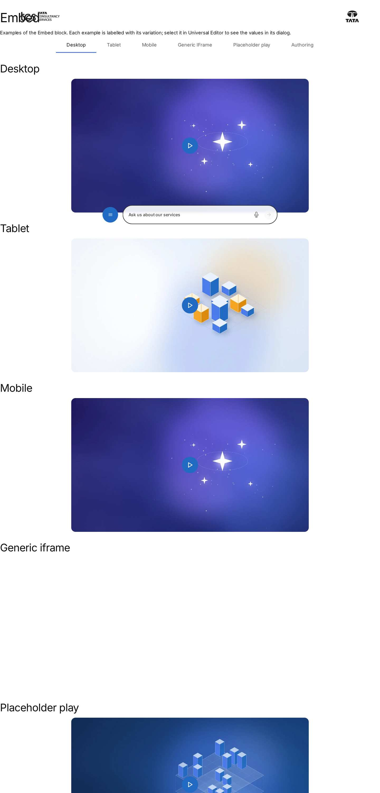
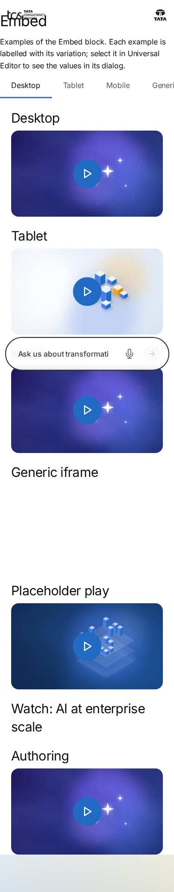

# Embed — Authoring Guide

| Attribute | Value |
| --- | --- |
| Document ID | AUT-C-embed |
| Audience | Content authors, content managers, AEM authoring leads |
| Purpose | How to add, fill in and check the Embed component |
| Scope | — |
| Prerequisites | — |
| Owner | Content Lead / AEM Authoring Lead (proposed) |
| Approver | Product Owner (to be confirmed) |
| Version | 1.0 |
| Status | Draft for review |
| Last updated | 8 November 2026 |
| Last validated | 8 November 2026 |
| Source files | blocks/embed/README.md, blocks/embed/_embed.json |
| Related documents | — |
| Related AEM paths | — |

## Contents

- [Where to see it](#where-to-see-it)
- [For Content Authors](#for-content-authors)
- [Authorable Fields](#authorable-fields)
- [Screenshot-Based Authoring Steps](#screenshot-based-authoring-steps)
- [Variations](#variations)
- [Complete Authoring Example](#complete-authoring-example)
- [Content and Asset Guidelines](#content-and-asset-guidelines)
- [Troubleshooting](#troubleshooting)
- [Screenshots](#screenshots)
- [Known limitations](#known-limitations)
- [Open items](#open-items)
- [Change history](#change-history)

## Where to see it

- https://main--tcs-corp--sradha-tcs.aem.live/design-block-master/en/block-library/embed
- https://main--tcs-corp--sradha-tcs.aem.live/design-block-master/en/block-library/embed/embed

## For Content Authors

1. **Add the block.** Select a Section, a Columns Container column or a Tabs Container tab in the
   content tree, choose Add (+) and pick **Embed**.
2. **Open its properties.** Select the block; the panel has the **Content** and **Additional**
   tabs.
3. **Enter the URI.** Paste the full https URL: a YouTube watch / `youtu.be` / `/shorts/` / `/live/`
   URL, a Vimeo URL, an X post URL, or a page that may be framed.
4. **Optional placeholder.** Select a 16:9 **Placeholder Image** and write its **Placeholder
   Image Alt Text** (it also names the Play button: "Play video: {alt text}").
5. **Put context before the block.** A Title and a short Text naming the content help every
   visitor (the iframe's own name is only "Content from {site}").
6. **Optional: Additional tab** (Anchor ID, Hide block, animation, spacing).
7. **Preview** at desktop, tablet and mobile widths; press Play with mouse and keyboard.
8. **Publish** the page (with the placeholder image).
9. **Validate the published output:** the image and Play button load; no provider request happens
   before Play (Network panel); the video plays or the post renders as a card.

**Minimum required:** URI (not required in the model, but without it nothing renders).
**Recommended:** Placeholder Image with alt text for videos; a heading and text before the block.
**Optional:** the Additional tab.

## Authorable Fields

<!-- BEGIN GENERATED: fields (npm run build:docs) -->

#### Embed (`embed`)

Model `embed`; template name "Embed" (the block class AEM renders).

##### Content tab — Embed

| Field label | Property | Type | Required | Default | Allowed values | Author guidance | Example |
| ----------- | -------- | ---- | -------- | ------- | -------------- | --------------- | ------- |
| Placeholder Image | `embed_placeholder` | reference | No | — | — | — | /content/dam/tcs-corp/dummy-pages/images/generative-ai.jpg |
| Placeholder Image Alt Text | `embed_placeholderAlt` | text | No | "" | — | Delivered with `embed_placeholder` (field collapse). | Video: how enterprises scale AI with confidence |
| URI | `embed_uri` | text | No | — | — | — | https://www.youtube.com/watch?v=Xk3pQ7vT9mA |

##### Additional tab — Embed

| Field label | Property | Type | Required | Default | Allowed values | Author guidance | Example |
| ----------- | -------- | ---- | -------- | ------- | -------------- | --------------- | ------- |
| Anchor ID | `classes_anchor` | text | No | — | regExp: ^anchor-[a-z0-9][a-z0-9-]*$; customErrorMsg: Start with anchor-, then lower-case letters, digits and hyphens. | A unique ID of the block on the page, starting with anchor-, e.g. anchor-our-services; link to it with #anchor-our-services. Delivered as a block class. | — |
| Hide block | `classes_hideblock` | boolean | No | `false` | on / off | Hides the whole block on the page until it is turned off (shown faded in the editor). Delivered as a block class. | — |
| Animation Type | `classes_animation` | select | No | "" | None (""), Fade in (`motion-fade-in`), Fade up (`motion-fade-up`), Fade down (`motion-fade-down`), Fade left (`motion-fade-left`), Fade right (`motion-fade-right`), Slide up (`motion-slide-up`), Slide down (`motion-slide-down`), Slide left (`motion-slide-left`), Slide right (`motion-slide-right`), Scale in (`motion-scale-in`) | How the block's content appears; repeated items (cards, list items, accordion items, columns) appear one after another. None: shown as is. Not played in the editor or when the visitor prefers reduced motion. Delivered as a block class. | — |
| Motion Speed | `classes_animationspeed` | select | No | "" | Medium (""), Fast (`motion-fast`), Slow (`motion-slow`) | How fast the animation runs: 0.3, 0.6 or 0.9 seconds. Shown when `classes_animation` is set and `classes_animation` is not empty. Delivered as a block class. | — |
| Animation Trigger | `classes_animationtrigger` | select | No | "" | On Scroll / Viewport Entry (""), On Page Load (`motion-on-load`) | When the block's animations run. On Scroll: when the block comes into view (at once if it is in view when the page opens). On Page Load: as soon as the block is ready, wherever it is on the page. Shown when `classes_animation` is set and `classes_animation` is not empty. Delivered as a block class. | — |
| Padding left | `classes_paddingleft` | select | No | "" | Default (""), 0 (none) (`pl-0`), 0.25rem (space-100) (`pl-100`), 0.5rem (space-200) (`pl-200`), 0.75rem (space-300) (`pl-300`), 1rem (space-400) (`pl-400`), 1.25rem (space-500) (`pl-500`), 1.5rem (space-600) (`pl-600`), 2rem (space-800) (`pl-800`), 2.5rem (space-1000) (`pl-1000`), 3rem (space-1200) (`pl-1200`), 4rem (space-1600) (`pl-1600`), 5rem (space-2000) (`pl-2000`), 6rem (space-2400) (`pl-2400`), 7.5rem (space-3000) (`pl-3000`) | Delivered as a block class. | — |
| Padding right | `classes_paddingright` | select | No | "" | Default (""), 0 (none) (`pr-0`), 0.25rem (space-100) (`pr-100`), 0.5rem (space-200) (`pr-200`), 0.75rem (space-300) (`pr-300`), 1rem (space-400) (`pr-400`), 1.25rem (space-500) (`pr-500`), 1.5rem (space-600) (`pr-600`), 2rem (space-800) (`pr-800`), 2.5rem (space-1000) (`pr-1000`), 3rem (space-1200) (`pr-1200`), 4rem (space-1600) (`pr-1600`), 5rem (space-2000) (`pr-2000`), 6rem (space-2400) (`pr-2400`), 7.5rem (space-3000) (`pr-3000`) | Delivered as a block class. | — |
| Padding top | `classes_paddingtop` | select | No | "" | Default (""), 0 (none) (`pt-0`), 0.25rem (space-100) (`pt-100`), 0.5rem (space-200) (`pt-200`), 0.75rem (space-300) (`pt-300`), 1rem (space-400) (`pt-400`), 1.25rem (space-500) (`pt-500`), 1.5rem (space-600) (`pt-600`), 2rem (space-800) (`pt-800`), 2.5rem (space-1000) (`pt-1000`), 3rem (space-1200) (`pt-1200`), 4rem (space-1600) (`pt-1600`), 5rem (space-2000) (`pt-2000`), 6rem (space-2400) (`pt-2400`), 7.5rem (space-3000) (`pt-3000`) | Delivered as a block class. | — |
| Padding bottom | `classes_paddingbottom` | select | No | "" | Default (""), 0 (none) (`pb-0`), 0.25rem (space-100) (`pb-100`), 0.5rem (space-200) (`pb-200`), 0.75rem (space-300) (`pb-300`), 1rem (space-400) (`pb-400`), 1.25rem (space-500) (`pb-500`), 1.5rem (space-600) (`pb-600`), 2rem (space-800) (`pb-800`), 2.5rem (space-1000) (`pb-1000`), 3rem (space-1200) (`pb-1200`), 4rem (space-1600) (`pb-1600`), 5rem (space-2000) (`pb-2000`), 6rem (space-2400) (`pb-2400`), 7.5rem (space-3000) (`pb-3000`) | Delivered as a block class. | — |
| Margin left | `classes_marginleft` | select | No | "" | Default (""), 0 (none) (`ml-0`), 0.25rem (space-100) (`ml-100`), 0.5rem (space-200) (`ml-200`), 0.75rem (space-300) (`ml-300`), 1rem (space-400) (`ml-400`), 1.25rem (space-500) (`ml-500`), 1.5rem (space-600) (`ml-600`), 2rem (space-800) (`ml-800`), 2.5rem (space-1000) (`ml-1000`), 3rem (space-1200) (`ml-1200`), 4rem (space-1600) (`ml-1600`), 5rem (space-2000) (`ml-2000`), 6rem (space-2400) (`ml-2400`), 7.5rem (space-3000) (`ml-3000`) | Delivered as a block class. | — |
| Margin right | `classes_marginright` | select | No | "" | Default (""), 0 (none) (`mr-0`), 0.25rem (space-100) (`mr-100`), 0.5rem (space-200) (`mr-200`), 0.75rem (space-300) (`mr-300`), 1rem (space-400) (`mr-400`), 1.25rem (space-500) (`mr-500`), 1.5rem (space-600) (`mr-600`), 2rem (space-800) (`mr-800`), 2.5rem (space-1000) (`mr-1000`), 3rem (space-1200) (`mr-1200`), 4rem (space-1600) (`mr-1600`), 5rem (space-2000) (`mr-2000`), 6rem (space-2400) (`mr-2400`), 7.5rem (space-3000) (`mr-3000`) | Delivered as a block class. | — |
| Margin top | `classes_margintop` | select | No | "" | Default (""), 0 (none) (`mt-0`), 0.25rem (space-100) (`mt-100`), 0.5rem (space-200) (`mt-200`), 0.75rem (space-300) (`mt-300`), 1rem (space-400) (`mt-400`), 1.25rem (space-500) (`mt-500`), 1.5rem (space-600) (`mt-600`), 2rem (space-800) (`mt-800`), 2.5rem (space-1000) (`mt-1000`), 3rem (space-1200) (`mt-1200`), 4rem (space-1600) (`mt-1600`), 5rem (space-2000) (`mt-2000`), 6rem (space-2400) (`mt-2400`), 7.5rem (space-3000) (`mt-3000`) | Delivered as a block class. | — |
| Margin bottom | `classes_marginbottom` | select | No | "" | Default (""), 0 (none) (`mb-0`), 0.25rem (space-100) (`mb-100`), 0.5rem (space-200) (`mb-200`), 0.75rem (space-300) (`mb-300`), 1rem (space-400) (`mb-400`), 1.25rem (space-500) (`mb-500`), 1.5rem (space-600) (`mb-600`), 2rem (space-800) (`mb-800`), 2.5rem (space-1000) (`mb-1000`), 3rem (space-1200) (`mb-1200`), 4rem (space-1600) (`mb-1600`), 5rem (space-2000) (`mb-2000`), 6rem (space-2400) (`mb-2400`), 7.5rem (space-3000) (`mb-3000`) | Delivered as a block class. | — |

<!-- END GENERATED: fields -->

What the tables don't show:

- **URI (`embed_uri`)** picks the handler: a URL containing `youtube.com` / `youtu.be` builds a
  YouTube frame, `vimeo.com` a Vimeo frame, a `twitter.com` / `x.com` host (with or without `www.`)
  an X post; anything else an iframe of the URL. The code reads the first link of the block, else
  the first `http(s)://` URL in its text.
- **Placeholder Image / Alt Text** (`embed_placeholder`, `embed_placeholderAlt`; the alt collapses
  into the image) switches the block to click-to-load: the image with a Play button; Play loads the
  embed with `autoplay=1` and `muted=1` for YouTube and Vimeo and moves focus into it. The alt text
  names the Play button ("Play video: {alt}"); without alt text the button is "Play".
- **Rendering result:** YouTube from `https://www.youtube-nocookie.com/embed/{id}` (`rel=0`,
  `enablejsapi=1`); Vimeo from `https://player.vimeo.com/video/{id}` with `dnt=1` (channel URLs and
  unlisted hashes supported); X posts as a `blockquote.twitter-tweet` with `x.com` rewritten to
  `twitter.com` and `https://platform.twitter.com/widgets.js` loaded; other URLs as an iframe with
  `allow="encrypted-media"` and fullscreen.
- **Accessibility impact:** every iframe is titled "Content from {host}" (placeholder
  `contentFrom`, host without `www.`); the placeholder alt text is the only per-item name.
- **Data-layer impact:** the Play button carries `data-cmp-interaction="play"`.
- **Legacy mapping:** none; the block reads the delivered link and picture wherever they are in
  the block, so the empty rows AEM delivers for the Content and Additional tabs don't matter.
- **Additional tab:** as on every block (AGENTS.md "Additional tab"); the block is centred with
  `margin: 0 auto`, which Margin left / right replace.

## Screenshot-Based Authoring Steps

#### Authoring Step 1: Add the Embed and paste the URI

```text
[Screenshot Placeholder]

File name:
embed-authoring-step-1.png

Purpose:
The section's Add (+) list with Embed, then the Content tab with the URI filled.

Annotations:
A = Add (+)
B = Embed in the list
C = URI
```

#### Values to Enter

| Callout | Field | Value | Reason | Expected result |
| ------- | ----- | ----- | ------ | --------------- |
| B | Component | Embed | Adds the block | An Embed in the content tree |
| C | URI | https://www.youtube.com/watch?v=Xk3pQ7vT9mA | The video to embed | The YouTube player appears when the block is in view |

**Author action:** add the Embed, open its properties and paste the URL. **Expected preview:** a
16:9 rounded YouTube player, up to 56.25rem wide, centred. **Expected published result:** the same.
**Business rules:** without a URL nothing renders. **Validation:** the player loads at 390, 768
and 1440 px. **Common mistakes:** a URL without `https://`, or a Vimeo URL without the numeric id.

#### Authoring Step 2: Add the placeholder image

```text
[Screenshot Placeholder]

File name:
embed-authoring-step-2.png

Purpose:
The Placeholder Image and its alt text filled, and the image with the Play button on the canvas.

Annotations:
A = Placeholder Image
B = Placeholder Image Alt Text
C = Play button
```

#### Values to Enter

| Callout | Field | Value | Reason | Expected result |
| ------- | ----- | ----- | ------ | --------------- |
| A | Placeholder Image | /content/dam/tcs-corp/dummy-pages/images/generative-ai.jpg | Branded first view; nothing loads from YouTube before Play | The image fills a 16:9 area |
| B | Placeholder Image Alt Text | Video: how enterprises scale AI with confidence | Describes the image and names the Play button | Play is announced "Play video: Video: how enterprises scale AI with confidence" |

**Author action:** select the image and write the alt text. **Expected preview:** the image with a
round Play button. **Expected published result:** the same; Play loads and starts the video.
**Business rules:** the image is cropped to 16:9 (`object-fit: cover`). **Validation:** Network
panel shows no YouTube request before Play. **Common mistakes:** an image that isn't 16:9 is
cropped badly; keep the subject centred. Starting the alt text with "Video:" repeats the button's
"Play video:" prefix; describe the image instead.

#### Authoring Step 3: Name the content in the page

```text
[Screenshot Placeholder]

File name:
embed-authoring-step-3.png

Purpose:
A Title and a Text directly before the Embed in the same section.

Annotations:
A = Title before the block
B = Text before the block
C = The Embed
```

#### Values to Enter

| Callout | Field | Value | Reason | Expected result |
| ------- | ----- | ----- | ------ | --------------- |
| A | Title (component) | Watch: AI at enterprise scale | The iframe is only named "Content from youtube-nocookie.com" | A heading names the video for everyone |

**Author action:** add a Title (and a Text) before the Embed. **Expected preview / published
result:** the heading above the embed. **Validation:** a screen reader reads the heading before the
frame. **Common mistakes:** relying on the frame name alone.

## Variations

#### YouTube

- **Purpose:** public, embeddable YouTube videos. **Fields:** URI; optional placeholder.
- **Rendering:** `div.embed-frame > iframe` (16:9, rounded `--radius-l`), block classes
  `embed-youtube embed-is-loaded`; privacy-enhanced host always (no option).
- **Accessibility:** iframe title "Content from youtube-nocookie.com"; captions are the video's own.
- **Data layer:** player interactions aren't tracked; Play is a `cmp:click` (`play`).

```text
[Screenshot Placeholder]

File name:
embed-youtube-mobile.png

Purpose:
A YouTube embed without placeholder at 390 px, filling the content width.

Annotations:
A = Player frame
```

#### Vimeo

- **Rendering:** `player.vimeo.com/video/{id}` with `dnt=1` (and `h` for unlisted videos);
  `embed-vimeo`. Otherwise as YouTube.

```text
[Screenshot Placeholder]

File name:
embed-vimeo-desktop.png

Purpose:
A Vimeo embed at 1440 px.

Annotations:
A = Vimeo player frame
```

#### X (Twitter) post

- **Rendering:** `blockquote.twitter-tweet` with a link to the post (its address as text) until
  the X widget script replaces it; `embed-twitter`; the rendered post is centred. The post takes the
  widget's height (no 16:9 frame).
- **Accessibility / data layer:** a click on the fallback link is a `cmp:click` (`link`, `exit`);
  clicks inside the rendered widget aren't tracked.
- **Fallback:** if the widget never loads, the link stays.

#### Generic iframe

- **Purpose:** an approved page that allows framing. **Rendering:** a 16:9 `div.embed-frame`
  iframe of the URL (`allow="encrypted-media"`, fullscreen, lazy). No height or ratio option; no
  host allow-list. A site that forbids framing shows the browser's refusal in the frame.

#### Placeholder image with Play (click-to-load)

- **Purpose:** branded first view and no provider request until Play; recommended for videos.
- **Rendering:** `div.embed-placeholder` (picture + `button.embed-placeholder-play`); Play replaces it
  with the embed (with autoplay for YouTube / Vimeo) and focuses the iframe (or the X link).
- **Accessibility:** native `button`, named from the alt text; focus moves into the player.
- **Data layer:** `cmp:click` with `interaction` `play`.

## Complete Authoring Example

Scenario: a keynote video with a branded placeholder on an insights page.

| Field | Example value | Guidance |
| ----- | ------------- | -------- |
| Title before the block | Watch: AI at enterprise scale | Names the video |
| Placeholder Image | /content/dam/tcs-corp/dummy-pages/images/generative-ai.jpg | 16:9, subject centred |
| Placeholder Image Alt Text | Keynote speaker on stage presenting enterprise AI | Describes the image |
| URI | https://www.youtube.com/watch?v=Xk3pQ7vT9mA | Full https URL |

**Steps:** add the Title, then the Embed; fill the placeholder, alt text and URI; preview; publish.

**Expected output:** the centred, rounded 16:9 image (up to 56.25rem wide) with the Play button;
Play loads the privacy-enhanced YouTube player and moves focus into it.

**Responsive:** fluid width at every viewport; the 16:9 area scales.

**Accessibility:** Play named "Play video: Keynote speaker on stage presenting enterprise AI";
the heading names the content; captions come from YouTube.

**Analytics / data layer:** `tcs-corp/components/embed` (`embed-1`); Play pushes `cmp:click` with
`interaction` `play`.

**Personalization fallback:** none.

**Pre-publish checklist:**

1. The URI is a full https URL of a public, embeddable item.
2. The placeholder image is 16:9 and published.
3. Alt text describes the image.
4. A heading before the block names the content.
5. Play works with mouse and keyboard.
6. No horizontal scrolling at 390 px.

## Content and Asset Guidelines

- **Titles and descriptions:** put them in the page (Title / Text before the block); the block has
  no text fields.
- **Labels:** "Play", "Play video: {title}" and "Content from {source}" come from placeholders
  (`play`, `playVideoTitle`, `contentFrom`); keep `{title}` / `{source}` when translating.
- **Links:** full https URLs; the canonical provider URL.
- **Images and alt text:** a 16:9 image (cropped with `object-fit: cover` to the 56.25rem maximum
  width); alt text describing it.
- **Icons:** the Play icon is generated (`icons/play.svg`).
- **Tags and metadata:** none.
- **Min / max items:** one URL per block. No verified technical limit was identified.
- **Asset source:** the placeholder from AEM Assets; content from the providers.
- **Loading:** the embed loads when in view (no placeholder) or after Play; a placeholder image in
  the first section can be the LCP image (loaded eagerly by `waitForFirstImage`).
- **Missing-asset fallback:** no URL: nothing renders (the empty block still reserves a 16:9 area,
  see Known Limitations); an X widget that doesn't load leaves the post link.

## Troubleshooting

| Symptom | Likely cause | Diagnostic steps | Resolution | Verification |
| ------- | ------------ | ---------------- | ---------- | ------------ |
| Nothing renders | No URI | `{page}.plain.html`: look for the link or URL | Paste the full https URL | Embed appears |
| YouTube "Video unavailable" | Wrong id, private video, embedding disabled | Inspect the iframe `src` | Public, embeddable video URL | Player loads |
| Vimeo "does not exist" | URL without a numeric id | Inspect the iframe `src` | Use `vimeo.com/{id}` | Player loads |
| X post shows only a link | Widget script blocked, post protected or deleted | Network: `widgets.js`; open the post | Public post; allow the script | Card renders |
| Iframe "refused to connect" | Site forbids framing, or http | Console (X-Frame-Options / CSP) | Embeddable https URL, or a link instead | Page shows |
| Video starts with sound after Play | `muted=1` is passed to YouTube as well; browsers' autoplay rules apply | Inspect the `src` parameters | Expected; use Video for playback control | — |
| Placeholder cropped badly | Image not 16:9 | Compare dimensions | 16:9 rendition, subject centred | Image framed well |

Evidence to collect (no secrets): page URL, `.plain.html` of the block, the iframe `src`, console
errors (CSP, framing), Network entries of the provider requests, the block's data-layer entries.

## Screenshots



*Figure: Embed as published (block library) — desktop 1440 × 900 (/design-block-master/en/block-library/embed/embed, captured 2026-11-08).*



*Figure: Embed as published (block library) — mobile 375 × 812 (/design-block-master/en/block-library/embed/embed, captured 2026-11-08).*

> **Screenshot required**
>
> - Required screen: Embed dialog in Universal Editor (every tab, including Additional)
> - Required role/access: AEM Sites author with Universal Editor (content author)
> - Required navigation steps: AEM Sites console > /content/tcs-corp/language-masters/en > open a page in Universal Editor
> - Reason unavailable: No AEM author access in the documentation program (access blocker AB-01)
> - Owner: Content Lead / AEM Authoring Lead (proposed)
> - Target completion date: To be confirmed

## Known limitations

- Universal Editor screenshots are placeholders: no author access in this program.

## Open items

- None.

## Change history

| Version | Date | Author | Change |
| --- | --- | --- | --- |
| 1.0 | 8 November 2026 | Delivery team (documentation program) | First version of the role-specific documentation (master documentation prompt), generated from the repository and the published reference pages |
