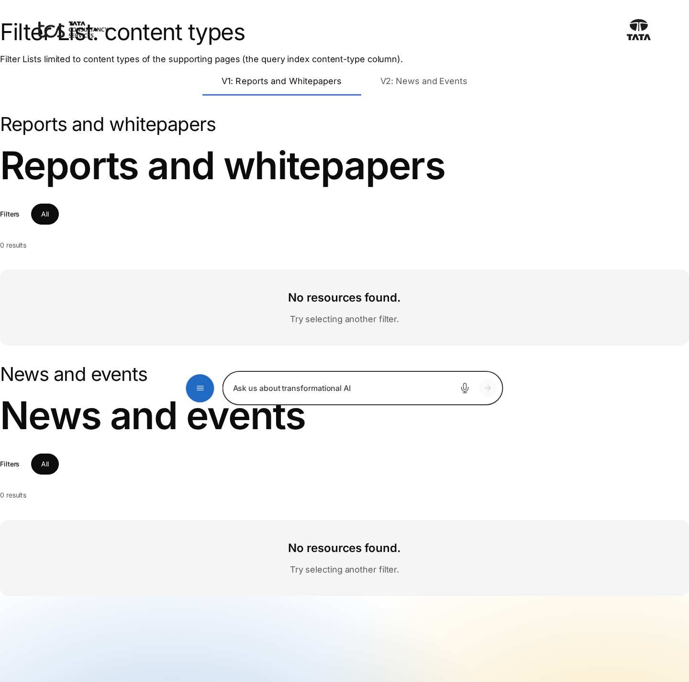
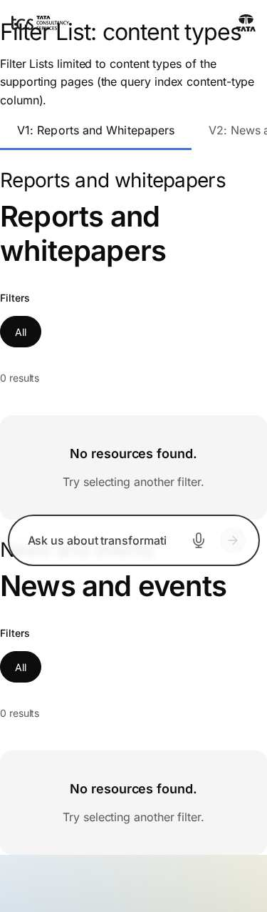

# Filter List — Authoring Guide

| Attribute | Value |
| --- | --- |
| Document ID | AUT-C-filter-list |
| Audience | Content authors, content managers, AEM authoring leads |
| Purpose | How to add, fill in and check the Filter List component |
| Scope | — |
| Prerequisites | — |
| Owner | Content Lead / AEM Authoring Lead (proposed) |
| Approver | Product Owner (to be confirmed) |
| Version | 1.0 |
| Status | Draft for review |
| Last updated | 8 November 2026 |
| Last validated | 8 November 2026 |
| Source files | blocks/filter-list/README.md, blocks/filter-list/_filter-list.json |
| Related documents | — |
| Related AEM paths | — |

## Contents

- [Where to see it](#where-to-see-it)
- [For Content Authors](#for-content-authors)
- [Authorable Fields](#authorable-fields)
- [Screenshot-Based Authoring Steps](#screenshot-based-authoring-steps)
- [Variations](#variations)
- [Complete Authoring Example](#complete-authoring-example)
- [Content and Asset Guidelines](#content-and-asset-guidelines)
- [Troubleshooting](#troubleshooting)
- [Screenshots](#screenshots)
- [Known limitations](#known-limitations)
- [Open items](#open-items)
- [Change history](#change-history)

## Where to see it

- https://main--tcs-corp--sradha-tcs.aem.live/design-block-master/en/block-library/filter-list
- https://main--tcs-corp--sradha-tcs.aem.live/design-block-master/en/block-library/filter-list/content-types
- https://main--tcs-corp--sradha-tcs.aem.live/design-block-master/en/block-library/filter-list/filter-list
- https://main--tcs-corp--sradha-tcs.aem.live/design-block-master/en/block-library/filter-list/filters
- https://main--tcs-corp--sradha-tcs.aem.live/design-block-master/en/block-library/filter-list/insights-listing
- https://main--tcs-corp--sradha-tcs.aem.live/design-block-master/en/block-library/filter-list/layouts-and-card-styles
- https://main--tcs-corp--sradha-tcs.aem.live/design-block-master/en/block-library/filter-list/rules

## For Content Authors

1. **Prepare the pages.** Each listed page needs its metadata: Title, Description, Tags, Page Type, `content-type`, `publish-date` (YYYY-MM-DD), `reading-time`, `featured-image` or `thumbnail-image`, and `author-id` (Authors sheet) or `author`; `featured` / `priority` for spotlights. Publish the pages so they are in the query index.
2. **Add the block.** Select a Section, a Columns Container column or a Tabs Container tab, choose Add (+) and pick **Filter List**.
3. **Open its properties.** Tabs: **Content** (title, description, layout, paging, source, filters), **Cards** (card style, featured cards, hero card, card mapping), **Additional**.
4. **Enter content.** Title (e.g. "Insights"), an optional Description, Default layout, Cards per page and Load more count.
5. **Choose the source.** Datasource **Query Index** (with an optional Root path, Page types, Content types and Sort by) or **Manual List** (then add Filter Page items with Use = Listed).
6. **Add filters.** Either set a **Primary filter category** (its tags used by the pages become pills) or add **Filter Tag** items (one pill per tag, in item order). For the advanced filter, keep Enable advanced filter on and add **Filter Category** items (Category label, Taxonomy root). Choose Allow multi select, Show All filter and Filter logic.
7. **Select the presentation.** In the Cards tab choose Card style, and turn on featured cards (Featured rule, count; Manual: Filter Page items with Use = Featured) or the hero card (Hero rule; Manual: Hero page).
8. **Add / reorder items** with Add (+) on the block; drag them in the content tree. Filter Tags render in item order; Filter Pages in their order for a Manual List and Manual featured rule.
9. **Preview** on the preview URL (aem.page): Universal Editor and AEM author show a hint instead of cards, because AEM author has no query index.
10. **Publish** the page (and the listed pages, the taxonomy and the Authors sheet when they changed).
11. **Validate the published output:** cards appear with images and labels; pills and the panel filter the cards; Load more adds cards; the count is right.

- **Minimum required:** none in the model; with the defaults the block lists every indexed page of the locale. A Manual List needs Filter Pages (Use = Listed); a Filter Category needs a Taxonomy root.
- **Recommended:** a Title (the block's `h2`), a Root path, filter tags or a Primary filter category, Show result count for large lists.
- **Optional:** Description, hero and featured spotlights, sorting, the card mapping fields, the Additional tab.

## Authorable Fields

<!-- BEGIN GENERATED: fields (npm run build:docs) -->

#### Filter List (`filter-list`)

Model `filter-list`; template name "Filter List" (the block class AEM renders); key-value block (one row per property); children: `filter-list-tag`, `filter-list-category`, `filter-list-page`.

Stored on a new component (definition template): `showResultCount` = `false`, `layout` = `"masonry"`, `cardsPerPage` = `9`, `loadMoreCount` = `6`, `source` = `"query-index"`, `sortBy` = `"latest"`, `showAll` = `true`, `multiSelect` = `false`, `advancedFilter` = `true`, `filterLogic` = `"and"`, `cardStyle` = `"mixed"`, `enableFeatured` = `true`, `featuredRule` = `"featured"`, `featuredCount` = `2`, `enableHero` = `false`, `heroRule` = `"featured"`, `imageSource` = `"featured-image"`, `fallbackImage` = `"thumbnail-image"`, `eyebrowSource` = `"content-type"`, `titleSource` = `"title"`, `descriptionSource` = `"description"`, `tagSource` = `"tags"`, `urlSource` = `"path"`, `authorSource` = `"author"`.

##### Content tab — Filter List

| Field label | Property | Type | Required | Default | Allowed values | Author guidance | Example |
| ----------- | -------- | ---- | -------- | ------- | -------------- | --------------- | ------- |
| Title | `title` | text | No | — | — | e.g. Explore the Agentic bank | Insights |
| Description | `description` | richtext | No | — | — | — | — |
| Show result count | `showResultCount` | boolean | No | `false` | on / off | — | true |
| Default layout | `layout` | select | No | `masonry` | Masonry (`masonry`), Grid (`grid`), List (`list`) | — | grid |
| Cards per page | `cardsPerPage` | number | No | `9` | — | Cards shown first; Load more shows the next ones. | 6 |
| Load more count | `loadMoreCount` | number | No | `6` | — | Cards added by each Load more. | 3 |
| Datasource | `source` | select | No | `query-index` | Query Index (`query-index`), Manual List (`manual`) | — | manual |
| Root path | `rootPath` | aem-content | No | — | — | Pages below this page, e.g. /en/insights. Empty: the whole site of the language. Shown when `source` is not `manual`. | /design-block-master/en/dummy-pages/insights |
| Pages (authored before Page items) | `pageItems` | container (multiple) | No | — | — | Kept for lists authored before; add items with Add instead. Shown when `source` is `manual`. | — |
| Pages (authored before Page items) › Page | `page` | aem-content | No | — | — | — | — |
| Page types | `pageTypes` | multiselect | No | — | Article (`article`), Blog (`blog`), Press release (`press-release`) | Only pages of these page types (page-type metadata). None: every page type. | — |
| Content types | `contentTypes` | multiselect | No | — | Article (`article`), Blog (`blog`), Insights (`insights`), Case study (`case-study`), Whitepaper (`whitepaper`), Report (`report`), News (`news`), Event (`event`), Press release (`press-release`) | Only pages of these content types (content-type metadata). None: every content type. | — |
| Sort by | `sortBy` | select | No | `latest` | Latest First (`latest`), Featured First (`featured`), Priority (`priority`), Alphabetical (`alphabetical`) | — | latest |
| Primary filter category | `primaryCategory` | aem-tag | No | — | — | A tag root, e.g. tcs:industry. Without Primary filter tags, its tags used by the pages are the filters. | tcs-corp:industry |
| Primary filter tags (authored before Tag items) | `primaryTags` | container (multiple) | No | — | — | Kept for lists authored before; add items with Add instead. | — |
| Primary filter tags (authored before Tag items) › Tag Id | `tagId` | aem-tag | No | — | — | — | — |
| Show All filter | `showAll` | boolean | No | `true` | on / off | — | true |
| Allow multi select | `multiSelect` | boolean | No | `false` | on / off | Several filters at once: pages with every selected tag. | true |
| Enable advanced filter | `advancedFilter` | boolean | No | `true` | on / off | The filter button opens the Advanced filter categories. | false |
| Advanced filter categories (authored before Category items) | `advancedCategories` | container (multiple) | No | — | — | Kept for lists authored before; add items with Add instead. | — |
| Advanced filter categories (authored before Category items) › Category label | `categoryLabel` | text | No | — | — | e.g. Industry | — |
| Advanced filter categories (authored before Category items) › Taxonomy root | `taxonomyRoot` | aem-tag | No | — | — | e.g. tcs:industry; its tags used by the pages are the options. | — |
| Filter logic | `filterLogic` | select | No | `and` | AND (`and`), OR (`or`) | AND: pages with every selected option. OR: pages with any of them. | or |

##### Cards tab — Filter List

| Field label | Property | Type | Required | Default | Allowed values | Author guidance | Example |
| ----------- | -------- | ---- | -------- | ------- | -------------- | --------------- | ------- |
| Card style | `cardStyle` | select | No | `mixed` | Default (`default`), Compact (`compact`), Featured (`featured`), Mixed (`mixed`) | — | default |
| Enable featured cards | `enableFeatured` | boolean | No | `true` | on / off | Large cards, one after each page of cards. | false |
| Featured rule | `featuredRule` | select | No | `featured` | Marked as featured (featured metadata) (`featured`), Priority 1 to 3 (priority metadata) (`priority`), Manual (`manual`) | Shown when `enableFeatured` is `true`. | priority |
| Featured pages (authored before Page items) | `featuredItems` | container (multiple) | No | — | — | Kept for lists authored before; add items with Add instead. Shown when `enableFeatured` is `true` and `featuredRule` is `manual`. | — |
| Featured pages (authored before Page items) › Featured page | `featuredPage` | aem-content | No | — | — | — | — |
| Featured card count | `featuredCount` | number | No | `2` | — | Shown when `enableFeatured` is `true`. | 1 |
| Enable hero card | `enableHero` | boolean | No | `false` | on / off | A large spotlight card first. | true |
| Hero rule | `heroRule` | select | No | `featured` | Latest (`latest`), Featured (`featured`), Manual (`manual`) | Shown when `enableHero` is `true`. | latest |
| Hero page | `heroPage` | aem-content | No | — | — | Shown when `enableHero` is `true` and `heroRule` is `manual`. | — |
| Image source | `imageSource` | text | No | `featured-image` | — | The metadata column of the card image. | featured-image |
| Fallback image | `fallbackImage` | text | No | `thumbnail-image` | — | The column used when the page has no image source. | thumbnail-image |
| Eyebrow source | `eyebrowSource` | text | No | `content-type` | — | The content type label, e.g. Article. | — |
| Title source | `titleSource` | text | No | `title` | — | — | — |
| Description source | `descriptionSource` | text | No | `description` | — | — | — |
| Tag source | `tagSource` | text | No | `tags` | — | — | — |
| Url source | `urlSource` | text | No | `path` | — | — | — |
| Author source | `authorSource` | text | No | `author` | — | author, or author-id (from the Authors sheet). | author |

##### Additional tab — Filter List

| Field label | Property | Type | Required | Default | Allowed values | Author guidance | Example |
| ----------- | -------- | ---- | -------- | ------- | -------------- | --------------- | ------- |
| Anchor ID | `classes_anchor` | text | No | — | regExp: ^anchor-[a-z0-9][a-z0-9-]*$; customErrorMsg: Start with anchor-, then lower-case letters, digits and hyphens. | A unique ID of the block on the page, starting with anchor-, e.g. anchor-our-services; link to it with #anchor-our-services. Delivered as a block class. | — |
| Hide block | `classes_hideblock` | boolean | No | `false` | on / off | Hides the whole block on the page until it is turned off (shown faded in the editor). Delivered as a block class. | — |
| Animation Type | `classes_animation` | select | No | "" | None (""), Fade in (`motion-fade-in`), Fade up (`motion-fade-up`), Fade down (`motion-fade-down`), Fade left (`motion-fade-left`), Fade right (`motion-fade-right`), Slide up (`motion-slide-up`), Slide down (`motion-slide-down`), Slide left (`motion-slide-left`), Slide right (`motion-slide-right`), Scale in (`motion-scale-in`) | How the block's content appears; repeated items (cards, list items, accordion items, columns) appear one after another. None: shown as is. Not played in the editor or when the visitor prefers reduced motion. Delivered as a block class. | motion-fade-in |
| Motion Speed | `classes_animationspeed` | select | No | "" | Medium (""), Fast (`motion-fast`), Slow (`motion-slow`) | How fast the animation runs: 0.3, 0.6 or 0.9 seconds. Shown when `classes_animation` is set and `classes_animation` is not empty. Delivered as a block class. | — |
| Animation Trigger | `classes_animationtrigger` | select | No | "" | On Scroll / Viewport Entry (""), On Page Load (`motion-on-load`) | When the block's animations run. On Scroll: when the block comes into view (at once if it is in view when the page opens). On Page Load: as soon as the block is ready, wherever it is on the page. Shown when `classes_animation` is set and `classes_animation` is not empty. Delivered as a block class. | — |
| Padding left | `classes_paddingleft` | select | No | "" | Default (""), 0 (none) (`pl-0`), 0.25rem (space-100) (`pl-100`), 0.5rem (space-200) (`pl-200`), 0.75rem (space-300) (`pl-300`), 1rem (space-400) (`pl-400`), 1.25rem (space-500) (`pl-500`), 1.5rem (space-600) (`pl-600`), 2rem (space-800) (`pl-800`), 2.5rem (space-1000) (`pl-1000`), 3rem (space-1200) (`pl-1200`), 4rem (space-1600) (`pl-1600`), 5rem (space-2000) (`pl-2000`), 6rem (space-2400) (`pl-2400`), 7.5rem (space-3000) (`pl-3000`) | Delivered as a block class. | — |
| Padding right | `classes_paddingright` | select | No | "" | Default (""), 0 (none) (`pr-0`), 0.25rem (space-100) (`pr-100`), 0.5rem (space-200) (`pr-200`), 0.75rem (space-300) (`pr-300`), 1rem (space-400) (`pr-400`), 1.25rem (space-500) (`pr-500`), 1.5rem (space-600) (`pr-600`), 2rem (space-800) (`pr-800`), 2.5rem (space-1000) (`pr-1000`), 3rem (space-1200) (`pr-1200`), 4rem (space-1600) (`pr-1600`), 5rem (space-2000) (`pr-2000`), 6rem (space-2400) (`pr-2400`), 7.5rem (space-3000) (`pr-3000`) | Delivered as a block class. | — |
| Padding top | `classes_paddingtop` | select | No | "" | Default (""), 0 (none) (`pt-0`), 0.25rem (space-100) (`pt-100`), 0.5rem (space-200) (`pt-200`), 0.75rem (space-300) (`pt-300`), 1rem (space-400) (`pt-400`), 1.25rem (space-500) (`pt-500`), 1.5rem (space-600) (`pt-600`), 2rem (space-800) (`pt-800`), 2.5rem (space-1000) (`pt-1000`), 3rem (space-1200) (`pt-1200`), 4rem (space-1600) (`pt-1600`), 5rem (space-2000) (`pt-2000`), 6rem (space-2400) (`pt-2400`), 7.5rem (space-3000) (`pt-3000`) | Delivered as a block class. | — |
| Padding bottom | `classes_paddingbottom` | select | No | "" | Default (""), 0 (none) (`pb-0`), 0.25rem (space-100) (`pb-100`), 0.5rem (space-200) (`pb-200`), 0.75rem (space-300) (`pb-300`), 1rem (space-400) (`pb-400`), 1.25rem (space-500) (`pb-500`), 1.5rem (space-600) (`pb-600`), 2rem (space-800) (`pb-800`), 2.5rem (space-1000) (`pb-1000`), 3rem (space-1200) (`pb-1200`), 4rem (space-1600) (`pb-1600`), 5rem (space-2000) (`pb-2000`), 6rem (space-2400) (`pb-2400`), 7.5rem (space-3000) (`pb-3000`) | Delivered as a block class. | — |
| Margin left | `classes_marginleft` | select | No | "" | Default (""), 0 (none) (`ml-0`), 0.25rem (space-100) (`ml-100`), 0.5rem (space-200) (`ml-200`), 0.75rem (space-300) (`ml-300`), 1rem (space-400) (`ml-400`), 1.25rem (space-500) (`ml-500`), 1.5rem (space-600) (`ml-600`), 2rem (space-800) (`ml-800`), 2.5rem (space-1000) (`ml-1000`), 3rem (space-1200) (`ml-1200`), 4rem (space-1600) (`ml-1600`), 5rem (space-2000) (`ml-2000`), 6rem (space-2400) (`ml-2400`), 7.5rem (space-3000) (`ml-3000`) | Delivered as a block class. | — |
| Margin right | `classes_marginright` | select | No | "" | Default (""), 0 (none) (`mr-0`), 0.25rem (space-100) (`mr-100`), 0.5rem (space-200) (`mr-200`), 0.75rem (space-300) (`mr-300`), 1rem (space-400) (`mr-400`), 1.25rem (space-500) (`mr-500`), 1.5rem (space-600) (`mr-600`), 2rem (space-800) (`mr-800`), 2.5rem (space-1000) (`mr-1000`), 3rem (space-1200) (`mr-1200`), 4rem (space-1600) (`mr-1600`), 5rem (space-2000) (`mr-2000`), 6rem (space-2400) (`mr-2400`), 7.5rem (space-3000) (`mr-3000`) | Delivered as a block class. | — |
| Margin top | `classes_margintop` | select | No | "" | Default (""), 0 (none) (`mt-0`), 0.25rem (space-100) (`mt-100`), 0.5rem (space-200) (`mt-200`), 0.75rem (space-300) (`mt-300`), 1rem (space-400) (`mt-400`), 1.25rem (space-500) (`mt-500`), 1.5rem (space-600) (`mt-600`), 2rem (space-800) (`mt-800`), 2.5rem (space-1000) (`mt-1000`), 3rem (space-1200) (`mt-1200`), 4rem (space-1600) (`mt-1600`), 5rem (space-2000) (`mt-2000`), 6rem (space-2400) (`mt-2400`), 7.5rem (space-3000) (`mt-3000`) | Delivered as a block class. | — |
| Margin bottom | `classes_marginbottom` | select | No | "" | Default (""), 0 (none) (`mb-0`), 0.25rem (space-100) (`mb-100`), 0.5rem (space-200) (`mb-200`), 0.75rem (space-300) (`mb-300`), 1rem (space-400) (`mb-400`), 1.25rem (space-500) (`mb-500`), 1.5rem (space-600) (`mb-600`), 2rem (space-800) (`mb-800`), 2.5rem (space-1000) (`mb-1000`), 3rem (space-1200) (`mb-1200`), 4rem (space-1600) (`mb-1600`), 5rem (space-2000) (`mb-2000`), 6rem (space-2400) (`mb-2400`), 7.5rem (space-3000) (`mb-3000`) | Delivered as a block class. | — |

#### Filter Tag (`filter-list-tag`)

Model `filter-list-tag`; template name "Filter Tag" (the block class AEM renders).

##### Fields — Filter Tag

| Field label | Property | Type | Required | Default | Allowed values | Author guidance | Example |
| ----------- | -------- | ---- | -------- | ------- | -------------- | --------------- | ------- |
| Tag | `tagId` | aem-tag | Yes | — | — | A primary filter, in the order of the items (label from the taxonomy). | — |

#### Filter Category (`filter-list-category`)

Model `filter-list-category`; template name "Filter Category" (the block class AEM renders).

##### Category tab — Filter Category

| Field label | Property | Type | Required | Default | Allowed values | Author guidance | Example |
| ----------- | -------- | ---- | -------- | ------- | -------------- | --------------- | ------- |
| Category label | `categoryLabel` | text | No | — | — | e.g. Industry | — |
| Taxonomy root | `taxonomyRoot` | aem-tag | Yes | — | — | e.g. tcs:industry; its tags used by the pages are the options of the advanced filter. | — |

#### Filter Page (`filter-list-page`)

Model `filter-list-page`; template name "Filter Page" (the block class AEM renders).

##### Page tab — Filter Page

| Field label | Property | Type | Required | Default | Allowed values | Author guidance | Example |
| ----------- | -------- | ---- | -------- | ------- | -------------- | --------------- | ------- |
| Page | `page` | aem-content | Yes | — | — | — | — |
| Use | `pageRole` | select | No | `listed` | Listed (Manual List) (`listed`), Featured (`featured`) | Listed: a page of the Manual List (Datasource). Featured: a featured page (Featured rule Manual). | — |

<!-- END GENERATED: fields -->

Notes on the fields (see the tables above for labels, properties, defaults and values):

- **Title** renders as `h2.filter-list-title`; it is the component's `dc:title` in the data layer (without a Title, the first card heading is).
- **Description** (rich text) is moved into `div.filter-list-description`.
- **Show result count** shows `p.filter-list-count`; when off it stays visually hidden but is still a `role="status"` live region (set after the first count, so the initial count isn't announced).
- **Cards per page / Load more count / Featured card count:** read as `Math.max(1, parseInt(value) || default)`; the model limits them (1 to 48, 1 to 48, 1 to 12), the code enforces only the minimum of 1.
- **Datasource Query Index:** pages strictly below Root path (not the root page itself), the current page excluded, filtered by Page types (`page-type`) and Content types (`content-type`) when selected, sorted by Sort by. **Manual List:** the Filter Pages (Use = Listed) in authored order, only those in the locale's index; Root path, types and Sort by are not applied; the current page is not excluded.
- **Sort by:** Latest First = `publish-date` descending, then last modified; Priority = `priority` ascending (pages without it last), then latest; Featured First = featured pages first, then priority; Alphabetical = title with the page language's collator (case and accents ignored).
- **Primary filter category / Filter Tag:** Filter Tags (and the multifield authored before) are the pills; without them, the category's tags used by the listed pages are the pills, sorted by label. Labels come from the locale's taxonomy, else from the tag ID; a pill matches a page that has the tag or a tag below it.
- **Show All filter** adds the All pill (pressed when nothing is selected). **Allow multi select:** pills toggle and a page must have every selected tag; off: one pill at a time, clicking the pressed pill clears it.
- **Enable advanced filter / Filter Category:** each category's options are the tags below its Taxonomy root used by the listed pages; categories without options are left out; with none, there is no filter button. **Filter logic** combines the checked options (AND: every option; OR: any); the result is combined with the pills by AND.
- **Card style:** see Variations. **Enable featured cards / Featured rule / Featured card count**, **Enable hero card / Hero rule / Hero page:** see Variations "Hero spotlight" and "Featured spotlights"; a page is used once (hero, then featured, then standard cards).
- **Card mapping (Image source … Author source):** metadata column names (e.g. `featured-image`, read as the index column `featuredImage`). Image: Image source, else Fallback image, else the page's own image (index `image`, og:image). Title: Title source, else the page title, else the path. Url: Url source, else the path (on AEM author, the AEM page). Eyebrow: Eyebrow source; a `content-type` value is shown with its taxonomy label (e.g. "Case study"). Tags: the first two tags of Tag source plus the reading time (a whole number becomes "{n}m", placeholder `minutesShort`). Author: the Author source value looked up as an Authors sheet id, else the page's `author-id`, else the value as a name. A misspelt column empties that part of every card.
- **Legacy mapping (still read):** the composite multifields `pageItems` (Pages), `featuredItems` (Featured pages), `primaryTags`, `advancedCategories`; the multi-value fields `pages` and `featuredPages` of lists made before them; the older `filters` multifield (tag title and tags, read when `primaryTags` is empty) and `filtersLabel` (replaces the "Filters" label). Their values come before those of the items.
- **Additional tab:** as in AGENTS.md "Additional tab"; the Filter List isn't in `CONTENT_TARGETS`, so its Animation Type animates the block as a whole, released after the skeleton.

## Screenshot-Based Authoring Steps

#### Authoring Step 1: Add the block and set the content

```text
[Screenshot Placeholder]

File name:
filter-list-authoring-step-1.png

Purpose:
The Filter List added to a section, its Content tab with Title, Description, Default layout and paging filled in.

Annotations:
A = Title
B = Description
C = Default layout
D = Cards per page
E = Load more count
```

#### Values to Enter

| Callout | Field | Value | Reason | Expected result |
| ------- | ----- | ----- | ------ | --------------- |
| A | Title | Insights | The list's heading | `h2` "Insights" |
| B | Description | Research, perspectives and case studies from across our industries and technologies. | Introduces the list | Text below the title |
| C | Default layout | Grid | Aligned rows | Class `layout-grid` |
| D | Cards per page | 6 | First page of cards | Six standard cards |
| E | Load more count | 3 | Cards per Load more | Three more per click |

- **Author action:** Add (+) › Filter List, then fill the Content tab.
- **Expected preview:** in Universal Editor the hint "The results show on the published page, from the pages' metadata."; cards on aem.page.
- **Business rules:** the numbers must be at least 1.
- **Validation:** on the preview URL the title and six cards show.
- **Common mistake:** expecting cards in the editor. Resolution: check the preview URL.

#### Authoring Step 2: Choose the source

```text
[Screenshot Placeholder]

File name:
filter-list-authoring-step-2.png

Purpose:
The Content tab with Datasource Query Index, Root path, Page types, Content types and Sort by.

Annotations:
A = Datasource
B = Root path
C = Content types
D = Sort by
```

#### Values to Enter

| Callout | Field | Value | Reason | Expected result |
| ------- | ----- | ----- | ------ | --------------- |
| A | Datasource | Query Index | Automatic list | Pages from the index |
| B | Root path | /language-masters/en/dummy-pages/insights | Only pages below it | The root page itself isn't listed |
| C | Content types | Article, Report | Narrow the list | Only pages with those `content-type` values |
| D | Sort by | Latest First | Newest first | Ordered by `publish-date` |

- **Author action:** select the source and its settings (or Manual List and Filter Page items, Use = Listed).
- **Expected published result:** the matching pages, sorted.
- **Business rules:** Root path, types and Sort by apply only to Query Index.
- **Validation:** compare with `/query-index.json` rows below the Root path.
- **Common mistake:** "No resources found." with no filter selected. Resolution: check the Root path locale and the type selections against the pages' metadata.

#### Authoring Step 3: Add the filters

```text
[Screenshot Placeholder]

File name:
filter-list-authoring-step-3.png

Purpose:
Filter Tag and Filter Category items in the content tree, a Filter Category's properties with Category label and Taxonomy root, and the rendered pills.

Annotations:
A = Filter Tag items
B = Filter Category item
C = Category label
D = Taxonomy root
E = Rendered pills and filter button
```

#### Values to Enter

| Callout | Field | Value | Reason | Expected result |
| ------- | ----- | ----- | ------ | --------------- |
| A | Filter Tag › Tag | tcs-corp:industry/banking, tcs-corp:industry/retail, tcs-corp:service/ai, tcs-corp:service/cloud | One pill each, in order | Pills with taxonomy labels after All |
| C | Filter Category › Category label | Industry | Legend of the option group | "Industry" fieldset |
| D | Filter Category › Taxonomy root | tcs-corp:industry | Options: its tags used by the pages | Checkboxes for the used industry tags |
| — | Allow multi select | On | Combine pills | A page must match every selected pill |
| — | Filter logic | OR | Any checked option | More results per added option |

- **Author action:** Add (+) › Filter Tag per pill and Filter Category per group; set the toggles in the Content tab.
- **Expected preview:** the items show as chips below the block in the editor.
- **Business rules:** tag values must be tag IDs (`namespace:path`); categories without used tags are hidden.
- **Validation:** on the preview URL, click a pill and open the panel.
- **Common mistake:** no filter button. Resolution: turn Enable advanced filter on and choose roots the pages are tagged with.

#### Authoring Step 4: Cards, spotlights and preview

```text
[Screenshot Placeholder]

File name:
filter-list-authoring-step-4.png

Purpose:
The Cards tab with Card style, Enable featured cards, Featured rule, Featured card count, Enable hero card and Hero rule; the preview with the hero and a featured spotlight.

Annotations:
A = Card style
B = Featured rule
C = Featured card count
D = Enable hero card / Hero rule
E = Hero spotlight in the preview
```

#### Values to Enter

| Callout | Field | Value | Reason | Expected result |
| ------- | ----- | ----- | ------ | --------------- |
| A | Card style | Default | Image, description and meta on every card | Class `card-default` |
| B | Featured rule | Priority 1 to 3 (priority metadata) | Pages with `priority` 1 to 3 | Spotlights by priority |
| C | Featured card count | 1 | One spotlight | One featured spotlight after the first page of cards |
| D | Enable hero card / Hero rule | On / Latest | The newest page first, large | Hero spotlight above the cards |

- **Author action:** set the Cards tab, publish, check the preview URL.
- **Expected published result:** hero first, then the cards with a spotlight after the first page, Load more.
- **Business rules:** a page appears once; Manual rules use only pages that match the source and filters.
- **Validation:** the hero is the newest matching page; the spotlight has priority 1 to 3.
- **Common mistake:** no spotlights. Resolution: check the pages' `featured` / `priority` values in the index (`featured` accepts yes, true, 1, on, y).

## Variations

#### Layout: Masonry

| Aspect | Detail |
| ------ | ------ |
| Purpose | Cards of different heights packed in columns without row gaps, in reading order |
| When to use / not | Mixed content with varying card heights; not when rows must align (Grid) |
| Fields / dialog | Default layout = Masonry (the default) |
| Rendering | `div.filter-list-grid.layout-masonry` with `masonry-native` (CSS `grid-template-rows: masonry` where supported) or `masonry-spans` (`decorators/masonry-decorator.js` sets each card's row span; spotlights start below every column) |
| Desktop / tablet / mobile | 4 columns from 1200px (3 for Featured style), 3 from 900px (2 for Featured), 2 from 600px, 1 below |
| Accessibility / data layer | DOM order is the reading order across columns; as the block |
| Personalization / fallback | None; without masonry support and `ResizeObserver` the grid stays a plain grid |

```text
[Screenshot Placeholder]

File name:
filter-list-layout-masonry-tablet.png

Purpose:
The masonry layout at 768px: two columns of cards packed by height.

Annotations:
A = Column 1
B = Column 2
```

#### Layout: Grid

| Aspect | Detail |
| ------ | ------ |
| Purpose | Aligned rows of cards |
| When to use / not | Uniform cards (Default, Compact); not for very uneven heights |
| Fields / dialog | Default layout = Grid |
| Rendering | `div.filter-list-grid.layout-grid`; block class `layout-grid` |
| Desktop / tablet / mobile | Same column counts as Masonry |
| Accessibility / data layer | As the block |
| Personalization / fallback | None |

```text
[Screenshot Placeholder]

File name:
filter-list-layout-grid-mobile.png

Purpose:
The grid layout at 375px: one column of cards.

Annotations:
A = Card
```

#### Layout: List

| Aspect | Detail |
| ------ | ------ |
| Purpose | One card per row with a divider, for scanning titles |
| When to use / not | Text-led lists; not for image-led walls |
| Fields / dialog | Default layout = List |
| Rendering | Block class `layout-list`; cards (not spotlights) get a bottom border; from 600px a card with an image shows it in the left third and the text in the right two thirds |
| Desktop / tablet / mobile | One column at every width; image beside the text from 600px, above it below |
| Accessibility / data layer | As the block |
| Personalization / fallback | Cards without an image take the full row |

```text
[Screenshot Placeholder]

File name:
filter-list-layout-list-mobile.png

Purpose:
The list layout at 375px: image above the text, divider below each card.

Annotations:
A = Card image
B = Card text
C = Divider
```

#### Card style: Default

| Aspect | Detail |
| ------ | ------ |
| Purpose | Image, tag line, title link, description (3 lines) and meta line on every card |
| Fields / dialog | Card style = Default |
| Rendering | `article.filter-list-card-standard`; 4:3 image (`object-fit: cover`); the title link covers the card |
| Desktop / tablet / mobile | 4 / 3 / 2 / 1 columns (1200 / 900 / 600 / below) |
| Accessibility | One link per card (the title); images decorative (empty alt) |
| Data layer | Card link `cmp:click` |
| Personalization / fallback | No image: no media area |

```text
[Screenshot Placeholder]

File name:
filter-list-card-default-mobile.png

Purpose:
A Default card at 375px: image, tag line, title, description and meta line.

Annotations:
A = Image
B = Tag line
C = Title link
D = Description
E = Meta line
```

#### Card style: Compact

| Aspect | Detail |
| ------ | ------ |
| Purpose | Text-only outlined cards: tag line, title link, meta line |
| Fields / dialog | Card style = Compact |
| Rendering | `article.filter-list-card-compact`; no image or description |
| Desktop / tablet / mobile | 4 / 3 / 2 / 1 columns |
| Accessibility / data layer | As Default |
| Personalization / fallback | None |

```text
[Screenshot Placeholder]

File name:
filter-list-card-compact-tablet.png

Purpose:
Compact cards at 768px in two columns.

Annotations:
A = Compact card outline
B = Title link
```

#### Card style: Featured

| Aspect | Detail |
| ------ | ------ |
| Purpose | Large cards with image, tag line, title, description, meta line and a Read more button |
| Fields / dialog | Card style = Featured |
| Rendering | `article.filter-list-card-large`; the Read more link (placeholder `readMore`, `aria-label` "Read more: {title}") covers the card |
| Desktop / tablet / mobile | 3 columns from 1200px, 2 from 900px, 2 from 600px, 1 below |
| Accessibility | The button's accessible name includes the page title |
| Data layer | `cmp:click` with `dc:title` = the `aria-label` |
| Personalization / fallback | No image: no media area |

```text
[Screenshot Placeholder]

File name:
filter-list-card-featured-mobile.png

Purpose:
A Featured style card at 375px with its Read more button.

Annotations:
A = Image
B = Read more button
```

#### Card style: Mixed

| Aspect | Detail |
| ------ | ------ |
| Purpose | A varied wall (the default style): image cards without description, report panels and dark panels |
| Fields / dialog | Card style = Mixed |
| Rendering | Report card (`filter-list-card-report`, light brand gradient, Download secondary button, placeholder `download`) when the eyebrow value contains "report"; dark card (`filter-list-card-dark`, brand dark panel, first tag only, Explore tertiary button, placeholder `explore`) when the page has no image; else a standard image card without description |
| Desktop / tablet / mobile | 4 / 3 / 2 / 1 columns |
| Accessibility | Button names "Download: {title}" / "Explore: {title}"; check contrast of the panels with real content |
| Data layer | `cmp:click` on the button |
| Personalization / fallback | Pages without images become dark cards |

```text
[Screenshot Placeholder]

File name:
filter-list-card-mixed-mobile.png

Purpose:
The Mixed style at 375px: an image card, a report panel and a dark panel in one column.

Annotations:
A = Image card
B = Report panel with Download
C = Dark panel with Explore
```

#### Hero spotlight

| Aspect | Detail |
| ------ | ------ |
| Purpose | One large spotlight card above the cards |
| Fields / dialog | Enable hero card on; Hero rule Latest / Featured / Manual (Hero page) |
| Rules | Latest: the newest matching page. Featured: the featured matching page with the lowest priority, else the newest. Manual: the Hero page if it matches the source and current filters, else no hero |
| Rendering | `article.filter-list-card-spotlight.filter-list-card-hero` before the grid: image behind (1600px from 900px, 750px below, loaded eagerly), tag line, title link, description, author lockup (Authors sheet) |
| Desktop / tablet / mobile | Full width, at least 35rem high; title 3rem and larger padding from 900px |
| Accessibility | Title link; decorative image |
| Data layer | Card link `cmp:click` |
| Personalization / fallback | The hero follows the filters (it is chosen from the matching pages) |

```text
[Screenshot Placeholder]

File name:
filter-list-hero-mobile.png

Purpose:
The hero spotlight at 375px with its tag line, title, description and author lockup.

Annotations:
A = Hero image
B = Title link
C = Author lockup
```

#### Featured spotlights

| Aspect | Detail |
| ------ | ------ |
| Purpose | Large spotlight cards placed between pages of cards |
| Fields / dialog | Enable featured cards on (default); Featured rule: Marked as featured / Priority 1 to 3 / Manual (Filter Page, Use = Featured); Featured card count (default 2) |
| Rules | Marked as featured: featured pages by priority, else (none) pages with priority 1 to 3. Priority 1 to 3: those pages by priority. Manual: the featured pages that match, in authored order. At most the count |
| Placement | One spotlight after the first page of cards and after each Load more; once every standard card is shown, the rest follow |
| Rendering | `article.filter-list-card-spotlight.filter-list-card-featured` (full width, at least 30rem); like the hero without description, image lazy |
| Accessibility / data layer | As the hero |
| Personalization / fallback | No matching page: no spotlight |

```text
[Screenshot Placeholder]

File name:
filter-list-featured-tablet.png

Purpose:
A featured spotlight at 768px after the first page of cards.

Annotations:
A = Cards of the first page
B = Featured spotlight
C = Load more
```

#### Datasource: Query Index

| Aspect | Detail |
| ------ | ------ |
| Purpose | Automatic list from published pages |
| Fields / dialog | Datasource = Query Index; Root path, Page types, Content types, Sort by |
| Rendering | Candidates below the Root path, current page excluded, filtered by type, sorted |
| Desktop / tablet / mobile | Per layout |
| Accessibility / data layer | As the block |
| Personalization / fallback | No index (AEM author, editor): the editor hint; no matching page: "No resources found." |

```text
[Screenshot Placeholder]

File name:
filter-list-source-query-index-mobile.png

Purpose:
A Query Index Filter List at 375px sorted Latest First.

Annotations:
A = Newest card
```

#### Datasource: Manual List

| Aspect | Detail |
| ------ | ------ |
| Purpose | A hand-picked, ordered list with the same cards and filters |
| Fields / dialog | Datasource = Manual List; Filter Page items with Use = Listed |
| Rendering | The pages in item order, only those in the locale's index; Sort by, Root path and types not applied |
| Desktop / tablet / mobile | Per layout |
| Accessibility / data layer | As the block |
| Personalization / fallback | A page not in the index is left out |

```text
[Screenshot Placeholder]

File name:
filter-list-source-manual-mobile.png

Purpose:
A Manual List at 375px in the authored order.

Annotations:
A = First authored page
```

#### Filter pills (single or multi select)

| Aspect | Detail |
| ------ | ------ |
| Purpose | Quick filtering by a few tags |
| Fields / dialog | Filter Tag items or Primary filter category; Show All filter; Allow multi select |
| Rendering | `div.filter-list-filters[role="group"]` (name from `filters`) with `button.filter-list-filter[aria-pressed]`, `aria-controls` on the results; a "Filters" label before them |
| Desktop / tablet / mobile | From 900px the pills sit on the toolbar row; below, on their own row below the label and the filter button |
| Accessibility | Toggle buttons with `aria-pressed`; result count in a live region |
| Data layer | `cmp:click`, `interaction` `filter`, `value` tag ID or `all` |
| Personalization / fallback | No pills when there are no tags and Show All is off |

```text
[Screenshot Placeholder]

File name:
filter-list-pills-mobile.png

Purpose:
The pills at 375px wrapping below the Filters label and the filter button, one pill pressed.

Annotations:
A = Filters label
B = Pressed pill
C = Filter button
```

#### Advanced filter (AND or OR)

| Aspect | Detail |
| ------ | ------ |
| Purpose | Filtering by several taxonomy groups |
| Fields / dialog | Enable advanced filter (default on); Filter Category items; Filter logic AND (default) / OR |
| Rendering | Round filter button (`icons/filter.svg`, name from `advancedFilters`, `aria-expanded`, `aria-controls`, a count badge) and `div.filter-list-panel[role="region"]` with a `fieldset` and `legend` per category, checkboxes and Clear all |
| Desktop / tablet / mobile | From 600px the fieldsets sit side by side (auto-fit, at least 12rem); below, stacked |
| Accessibility | Opening focuses the first checkbox; Escape closes and returns focus to the button; Clear all returns focus to the first checkbox |
| Data layer | `cmp:change`, `interaction` `filter-option`, `value` tag ID, `checked` |
| Personalization / fallback | No used tags below a root: the category is left out |

```text
[Screenshot Placeholder]

File name:
filter-list-advanced-tablet.png

Purpose:
The open panel at 768px with two categories side by side and Clear all.

Annotations:
A = Industry fieldset
B = Topic fieldset
C = Clear all
```

#### Sort order

| Aspect | Detail |
| ------ | ------ |
| Purpose | Order of the Query Index list |
| Fields / dialog | Sort by: Latest First (default), Featured First, Priority, Alphabetical |
| Rendering | See the field notes above; no effect on a Manual List |
| Desktop / tablet / mobile | Per layout (masonry keeps the order across columns) |
| Accessibility / data layer | As the block |
| Personalization / fallback | Pages without date or priority sort last within their rule |

```text
[Screenshot Placeholder]

File name:
filter-list-sort-alphabetical-mobile.png

Purpose:
The Alphabetical order at 375px.

Annotations:
A = First card A to Z
```

## Complete Authoring Example

Scenario: the "Explore insights & opinions" hub (block library `block-library/filter-list/filter-list`).

| Field | Example value | Guidance |
| ----- | ------------- | -------- |
| Title | Explore insights & opinions | The block's `h2` |
| Description | Research, perspectives and case studies from across our industries and technologies. | One sentence |
| Default layout | Masonry | Mixed heights |
| Cards per page / Load more count | 6 / 6 | |
| Datasource | Manual List | With eight Filter Pages, Use = Listed |
| Sort by | Latest First | Not applied to a Manual List |
| Filter Tag items | tcs-corp:industry/banking, tcs-corp:industry/retail, tcs-corp:service/ai, tcs-corp:service/cloud | Pills in this order |
| Filter Category items | Industry / tcs-corp:industry; Topic / tcs-corp:topic | Advanced filter groups |
| Show All filter / Allow multi select / Filter logic | On / Off / AND | Defaults |
| Card style | Mixed | Default style |
| Enable featured cards / Featured rule / count | On / Marked as featured / 2 | |
| Enable hero card / Hero rule | On / Featured | |
| Card mapping | Defaults (featured-image, thumbnail-image, content-type, title, description, tags, path, author) | Change only for other indexed columns |

Steps: add the block, fill the Content tab, add the Filter Pages, Filter Tags and Filter Categories, set the Cards tab, publish the page, check aem.page.

- **Expected output:** title and description; Filters label with All and four pills; the filter button with Industry and Topic; the hero spotlight; a masonry wall of Mixed cards with a featured spotlight after the first six; Load more.
- **Responsive:** 4 columns from 1200px, 3 from 900px, 2 from 600px, 1 below; the pills wrap on their own row below 900px.
- **Accessibility:** pills are toggle buttons; the panel is a labelled region; Escape closes it; the result count is announced on changes.
- **Analytics / data layer:** the block is `anchor-filter-list-desktop` (its Anchor ID); a Banking pill click pushes `cmp:click` with `interaction` `filter` and `value` `tcs-corp:industry/banking`; checking an option pushes `cmp:change`.
- **Personalization fallback:** none; every visitor sees the same list.
- **Pre-publish checklist:** listed pages published with images, tags, content type and dates; taxonomy published with the tags; Authors sheet published; placeholders translated; Root path in the same locale; cards checked on aem.page at 375px, 768px and 1440px; keyboard check of pills, panel and Load more.

## Content and Asset Guidelines

- **Title / description:** the handover recommends up to 60 characters for the title and 1 to 2 sentences for the description (not enforced).
- **Card titles and descriptions:** come from the pages (title / description or the mapped columns); descriptions are clamped to 3 lines by CSS; write page titles that make sense out of context (they are the link text of most cards).
- **Eyebrows and labels:** the eyebrow is the `content-type` label by default; use consistent Content type values (a value containing "report" makes a report card in the Mixed style). CTA labels (Read more, Download, Explore, Load more, Reset filters) come from placeholders, not from the block.
- **Images and alt text:** card images use the mapped image columns, else the page's own image; all card and author images are decorative (empty alt). Site media (`/media_` URLs on the same origin) are optimized responsive pictures; other URLs are plain lazy `img` elements. Card media is 4:3 (`object-fit: cover`); spotlights cover a full-width card (at least 35rem hero, 30rem featured) — keep the subject clear of the text side.
- **Icons:** `icons/filter.svg` for the filter button.
- **Tags and metadata:** tag IDs below a namespace (e.g. `tcs-corp:industry/banking`); publish the locale taxonomy with translated titles; card tags show the first two tags of each page.
- **Min / max items:** No verified technical limit was identified for pills, categories or listed pages; the numeric fields have model limits (Cards per page and Load more count 1 to 48, Featured card count 1 to 12) of which the code enforces the minimum.
- **Loading:** the hero image loads eagerly, all others lazily; a page without any image shows no media (or a dark card in Mixed).

## Troubleshooting

| Symptom | Likely cause | Diagnostic steps | Resolution | Verification |
| ------- | ------------ | ---------------- | ---------- | ------------ |
| Hint instead of cards in the editor | No query index on AEM author (expected) | Open the preview URL | Review on aem.page / aem.live | Cards on the preview |
| "No resources found." without filters | Root path in another locale, types too narrow, pages not published or excluded by `helix-query.yaml`, index request failed | `/query-index.json` rows below the Root path; their `pageType` / `contentType`; Network panel | Fix Root path or types; publish the pages | Cards and count appear |
| A new page is missing | Not yet in the live index; it is the Root path page or the current page; another locale | Its row in `/query-index.json` on aem.live | Publish again; ask an administrator to re-index | The card appears |
| Pills show derived labels or are missing | Tag missing from the locale taxonomy; value isn't a tag ID; no page uses the category's tags | `/{locale}/taxonomy.json`; the items' values | Publish the taxonomy; pick tags with the tag picker | Taxonomy titles on the pills |
| No filter button | Enable advanced filter off; no Taxonomy root; no page uses tags below the roots | Content tab; pages' tags in the index | Turn it on; choose used roots | Button and panel appear |
| Dark cards everywhere (Mixed) or no images | Image columns empty or misspelt in the card mapping | Index columns `featuredImage`, `thumbnailImage`, `image` | Fill the metadata; restore the default mapping | Image cards |
| Wrong hero or no spotlights | Rule fallbacks; Manual pages outside the source or filters; `featured` values other than yes / true / 1 / on / y | Pages' `featured` / `priority` in the index | Correct metadata or rules | Expected spotlights |
| Author lockup shows only a name | `author-id` / Author source doesn't exactly match an Authors sheet id (case-sensitive) or the sheet isn't published | Compare with `/{locale}/data/authors.json` | Correct the id; publish the sheet | Photo, name and designation |
| English labels on a localized page | Placeholder keys missing in the locale sheet | `/{locale}/placeholders.json` | Add and publish the keys | Localized labels |

Evidence to collect (no secrets): page URL, viewport, a screenshot, the block's settings, the relevant `/query-index.json` rows, the Network status of the index / taxonomy / Authors / placeholders requests, console errors.

## Screenshots



*Figure: Filter List as published (block library) — desktop 1440 × 900 (/design-block-master/en/block-library/filter-list/content-types, captured 2026-11-08).*



*Figure: Filter List as published (block library) — mobile 375 × 812 (/design-block-master/en/block-library/filter-list/content-types, captured 2026-11-08).*

> **Screenshot required**
>
> - Required screen: Filter List dialog in Universal Editor (every tab, including Additional)
> - Required role/access: AEM Sites author with Universal Editor (content author)
> - Required navigation steps: AEM Sites console > /content/tcs-corp/language-masters/en > open a page in Universal Editor
> - Reason unavailable: No AEM author access in the documentation program (access blocker AB-01)
> - Owner: Content Lead / AEM Authoring Lead (proposed)
> - Target completion date: To be confirmed

## Known limitations

- Universal Editor screenshots are placeholders: no author access in this program.

## Open items

- None.

## Change history

| Version | Date | Author | Change |
| --- | --- | --- | --- |
| 1.0 | 8 November 2026 | Delivery team (documentation program) | First version of the role-specific documentation (master documentation prompt), generated from the repository and the published reference pages |
