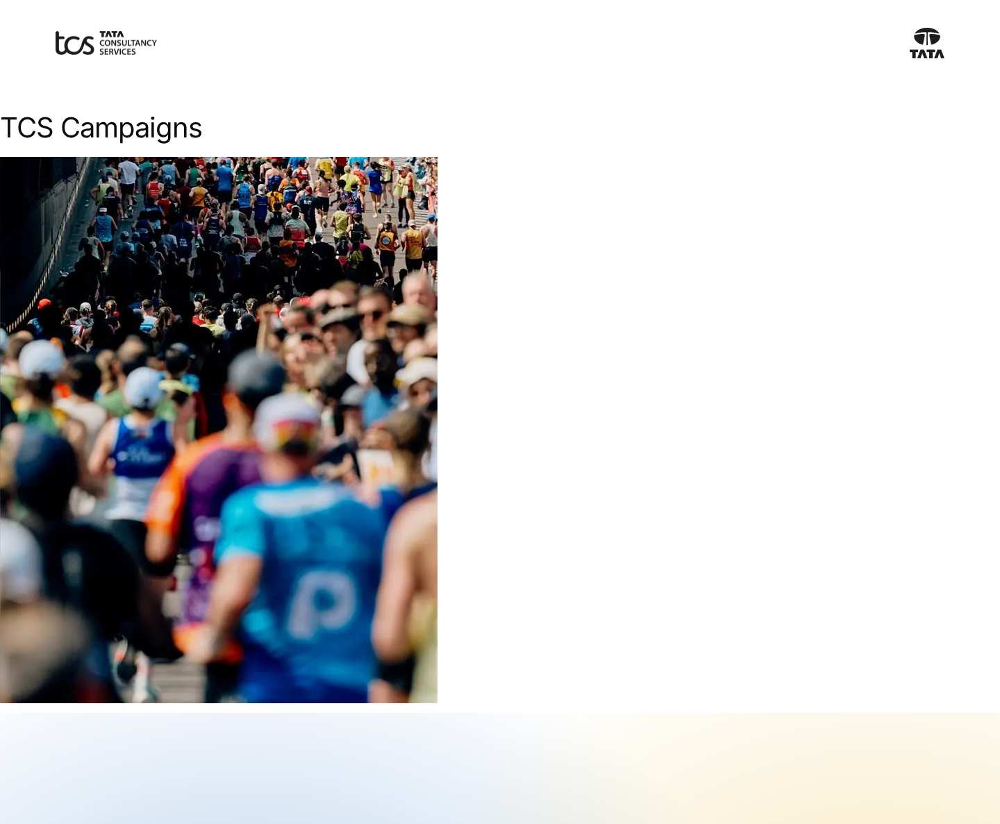
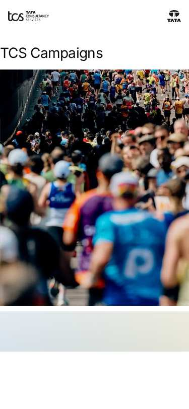

# Footer — Authoring Guide

| Attribute | Value |
| --- | --- |
| Document ID | AUT-C-footer |
| Audience | Content authors, content managers, AEM authoring leads |
| Purpose | How to add, fill in and check the Footer component |
| Scope | — |
| Prerequisites | — |
| Owner | Content Lead / AEM Authoring Lead (proposed) |
| Approver | Product Owner (to be confirmed) |
| Version | 1.0 |
| Status | Draft for review |
| Last updated | 8 November 2026 |
| Last validated | 8 November 2026 |
| Source files | blocks/footer/README.md, blocks/footer/_footer.json |
| Related documents | — |
| Related AEM paths | — |

## Contents

- [Where to see it](#where-to-see-it)
- [For Content Authors](#for-content-authors)
- [Authorable Fields](#authorable-fields)
- [Screenshot-Based Authoring Steps](#screenshot-based-authoring-steps)
- [Variations](#variations)
- [Complete Authoring Example](#complete-authoring-example)
- [Content and Asset Guidelines](#content-and-asset-guidelines)
- [Troubleshooting](#troubleshooting)
- [Screenshots](#screenshots)
- [Known limitations](#known-limitations)
- [Open items](#open-items)
- [Change history](#change-history)

## Where to see it

- https://main--tcs-corp--sradha-tcs.aem.live/design-block-master/en/block-library/footer
- https://main--tcs-corp--sradha-tcs.aem.live/design-block-master/en/block-library/footer/campaign-page
- https://main--tcs-corp--sradha-tcs.aem.live/design-block-master/en/block-library/footer/default-footer-page
- https://main--tcs-corp--sradha-tcs.aem.live/design-block-master/en/block-library/footer/footer-campaign
- https://main--tcs-corp--sradha-tcs.aem.live/design-block-master/en/block-library/footer/footer-conversation-canvas
- https://main--tcs-corp--sradha-tcs.aem.live/design-block-master/en/block-library/footer/footer-default
- https://main--tcs-corp--sradha-tcs.aem.live/design-block-master/en/block-library/footer/footer-investors
- https://main--tcs-corp--sradha-tcs.aem.live/design-block-master/en/block-library/footer/investors-page

## For Content Authors

1. **Open the footer page** of the locale (`references/footer`) or of the area (for example `references/footer-campaign`) in Universal Editor.
2. **Add the block** if the page has none: section › Add › **Footer**.
3. **Open its properties.** Fill in **Conversation Canvas Page** (optional: a page with a Conversation Canvas block, e.g. `references/footer-conversation-canvas`) and **Copyright Text** (use `{year}` for the current year).
4. **Add links** with Add › **Footer Link** inside the Footer block: Link Path (required), Link text, Open in (Same tab / New tab). Reorder them in the content tree; they render in that order.
5. **Social channels** are not in the block: maintain the locale's `data/social-links` sheet (platform, url, icon, sort-order).
6. **Preview** a content page (desktop, tablet, mobile) and check the bar, the Canvas and the social row.
7. **Publish** the footer page, the Conversation Canvas page and, after changes, the Social Links sheet.
8. **Choose the footer for an area (optional):** Page Properties › **Footer** on the area's top page (inherited by child pages; empty: the parent's, else `references/footer`), or the metadata sheet's `footer` column.
9. **Validate** on the published site: the year is current, links reach their pages, new-tab links open a new tab.

Minimum required: Copyright Text or at least one Footer Link. Recommended: 3–6 links, the Canvas page on the locale footer, a `platform` value on every social row. Optional: the Canvas, area footers.

## Authorable Fields

<!-- BEGIN GENERATED: fields (npm run build:docs) -->

#### Footer (`footer`)

Model `footer`; template name "Footer" (the block class AEM renders); children: `footer-link`.

##### Fields — Footer

| Field label | Property | Type | Required | Default | Allowed values | Author guidance | Example |
| ----------- | -------- | ---- | -------- | ------- | -------------- | --------------- | ------- |
| Conversation Canvas Page | `conversationCanvas` | aem-content | No | — | — | A page with the conversation-canvas block (e.g. references/conversation-canvas), shown above the copyright and links | — |
| Copyright Text | `copyright` | richtext | No | — | — | e.g. ©TATA Consultancy Services {year}; {year} is replaced with the current year | — |
| Link List | `links` | container (multiple) | No | — | — | Links authored before Footer Link items. Add links with Add (Footer Link) instead. | — |
| Link List › Link Title | `linkText` | text | No | — | — | — | — |
| Link List › Link Path | `link` | aem-content | No | — | — | — | — |
| Link List › Link Type | `linkTarget` | select | No | "" | Default (""), Open in new window (`new-window`) | — | — |

#### Footer Link (`footer-link`)

Model `footer-link`; template name "Footer Link" (the block class AEM renders).

##### Fields — Footer Link

| Field label | Property | Type | Required | Default | Allowed values | Author guidance | Example |
| ----------- | -------- | ---- | -------- | ------- | -------------- | --------------- | ------- |
| Link Path | `link` | aem-content | Yes | — | — | — | — |
| Link text | `linkText` | text | No | — | — | Delivered with `link` (field collapse). | — |
| Open in | `linkTarget` | select | No | "" | Same tab (""), New tab (`new-window`) | — | — |

<!-- END GENERATED: fields -->

Notes on the significant fields:

- **Conversation Canvas Page.** Loaded as a fragment (`loadFragment`) into `div.footer-canvas` above the bar; a value that can't be loaded or has no sections is skipped. Inside the footer the Canvas loses its own surface, glow and padding; its menu button shows from 600px.
- **Copyright Text.** Rich text kept with its editor instrumentation (`fromCell`); every `{year}` becomes the current four-digit year from the visitor's clock; empty text renders no copyright element.
- **Footer Link (item).** Link Path with its Link text collapsed into one link (AEM delivery rule); Open in New tab sets `target="_blank"` and `rel="noopener noreferrer"` and adds the hidden hint "(opens in a new tab)" (placeholder `opensInNewTab`). Links are plain links (button decoration removed). An item without a link isn't rendered; in Universal Editor it shows as a dashed placeholder (placeholder `itemEditorHint`).
- **Link List (legacy multifield).** Still read: its items render before the Footer Link items. Add links as Footer Link items instead (composite multifields didn't render from content packages, AGENTS.md "Item children").
- **Page property Footer** (`footer`, `models/_page.json`) and the metadata `footer` column choose the footer page (see the Header README for the same inheritance; values cached per browser session, F-35).
- **Social Links sheet.** Rows without `url` are skipped; ordered by numeric `sort-order` (rows without one last, in sheet order). `icon`: a value with `.` or `/` is an image URL; otherwise an icon name in `/icons` (`linkedin`, `x`, `facebook`, `instagram`, `youtube`; `twitter` is an alias of `x`); without an icon and an unknown platform, the label is shown as text. Links to another origin open in a new tab.
- **Accessibility impact.** `nav.footer-links` named "Footer links" (`footerLinks`); social links named "Follow us on {platform}" (`followUsOn`), the list "Follow us" (`followUs`).
- **Data layer impact.** Clicks are reported for the footer components (see [Data Layer and Analytics](https://github.com/sradha-tcs/tcs-corp/blob/main/blocks/footer/README.md#data-layer-and-analytics)).
- **Additional tab.** The Footer has none (AGENTS.md "Additional tab": all blocks except header and footer).

## Screenshot-Based Authoring Steps

#### Authoring Step 1: Open the footer page and add the Footer block

```text
[Screenshot Placeholder]

File name:
footer-authoring-step-1.png

Purpose:
The locale's references/footer page in Universal Editor with the Footer block in its section.

Annotations:
A = Section of the footer page
B = Footer block
C = Footer Link items in the content tree
```

#### Values to Enter

| Callout | Field | Value | Reason | Expected result |
| ------- | ----- | ----- | ------ | --------------- |
| A | Page | `references/footer` (sample `block-library/footer/footer-default`) | The default footer of the locale | Opens as a page |
| B | Component | Footer | Holds the bar | An empty Footer block |

Author action: section › Add › Footer. Expected preview: an empty bar. Business rule: footer pages live in `references/`. Validation: the block appears in the content tree. Common mistake: adding a Footer to a content page (unstyled); resolution: remove it there.

#### Authoring Step 2: Canvas page and copyright

```text
[Screenshot Placeholder]

File name:
footer-authoring-step-2.png

Purpose:
The Footer properties with Conversation Canvas Page and Copyright Text filled in.

Annotations:
A = Conversation Canvas Page
B = Copyright Text
```

#### Values to Enter

| Callout | Field | Value | Reason | Expected result |
| ------- | ----- | ----- | ------ | --------------- |
| A | Conversation Canvas Page | `/content/tcs-corp/language-masters/en/block-library/footer/footer-conversation-canvas` | The footer Canvas of the design | "Let's shape what's next, together" above the bar |
| B | Copyright Text | `© Tata Consultancy Services {year}` | Keeps the year current | "© Tata Consultancy Services 2026" in 2026 |

Expected published result: the Canvas and the copyright on every page using this footer. Business rule: the Canvas page must be published and contain a Conversation Canvas. Validation: the year shows as the current year. Common mistake: typing the year (it won't update); use `{year}`.

#### Authoring Step 3: Footer Links

```text
[Screenshot Placeholder]

File name:
footer-authoring-step-3.png

Purpose:
A Footer Link item's properties.

Annotations:
A = Link Path
B = Link text
C = Open in
```

#### Values to Enter

| Callout | Field | Value | Reason | Expected result |
| ------- | ----- | ----- | ------ | --------------- |
| A | Link Path | The privacy notice page | Required | Link target |
| B | Link text | `Privacy & Terms` | Visible text | "Privacy & Terms" in the bar |
| C | Open in | Same tab | Site page | Opens in the same tab |

Add `Cookie policy` and `Accessibility` the same way (sample footer-default). Author action: Footer block › Add › Footer Link. Expected preview: links at the right of the copyright (below it on mobile). Business rule: an item without a link isn't rendered on the site. Validation: each link opens its page. Common mistake: leaving Link Path empty (dashed placeholder in the editor, nothing on the site).

#### Authoring Step 4: A link opening a new tab

```text
[Screenshot Placeholder]

File name:
footer-authoring-step-4.png

Purpose:
A Footer Link with Open in = New tab (sample footer-investors).

Annotations:
A = Link Path (external)
B = Open in: New tab
```

#### Values to Enter

| Callout | Field | Value | Reason | Expected result |
| ------- | ----- | ----- | ------ | --------------- |
| A | Link Path | `https://investors.example.com/` (library sample) | External site | Link to the other site |
| B | Link text | `Investor relations` | Visible text | Link text |
| C | Open in | New tab | Leave the TCS site open | `target="_blank"`, hint "(opens in a new tab)" for screen readers |

Validation: the published link has `rel="noopener noreferrer"`. Common mistake: new tabs for site pages; keep Same tab for them.

#### Authoring Step 5: Area footer

```text
[Screenshot Placeholder]

File name:
footer-authoring-step-5.png

Purpose:
Page Properties of an area's top page with the Footer field set.

Annotations:
A = Footer
```

#### Values to Enter

| Callout | Field | Value | Reason | Expected result |
| ------- | ----- | ----- | ------ | --------------- |
| A | Footer | `references/footer-campaign` | Campaign footer | The area's pages show the campaign footer |

Validation: a child page in a new private window. Common mistake: a typo in the path: the page footer then shows only the social row (no fallback to `references/footer`).

## Variations

#### Default locale footer

- **Purpose:** the footer of every page without a Footer value: `/{locale}/references/footer`.
- **Fields / configuration:** none on the content page.
- **Rendering:** the footer page's sections in `footer > div.footer > div`, then `ul.footer-social`.
- **Desktop / tablet / mobile:** see [Responsive Behavior](https://github.com/sradha-tcs/tcs-corp/blob/main/blocks/footer/README.md#responsive-behavior).
- **Accessibility / data layer:** `<footer>` landmark; clicks on `footer-1` / `footer-2`.
- **Personalization / fallback:** none; a failing footer page leaves the social row.

```text
[Screenshot Placeholder]

File name:
footer-default-desktop.png

Purpose:
A content page ending with the default footer at 1440px.

Annotations:
A = Footer Canvas
B = Footer bar
C = Social icons
```

#### Area-specific footer

- **Purpose:** another footer page for an area or campaign (`references/footer-campaign`).
- **Configuration:** Page Properties › Footer on the area's top page, or the metadata `footer` column.
- **Rendering:** as the default; only the footer page differs; the Social Links are added to every footer page.

```text
[Screenshot Placeholder]

File name:
footer-campaign-desktop.png

Purpose:
A campaign page ending with the campaign footer (no Canvas).

Annotations:
A = Copyright
B = Campaign links
```

#### Footer bar only (no Canvas)

- **Purpose:** a compact footer.
- **Fields:** Copyright Text and Footer Links; Conversation Canvas Page empty.
- **Rendering:** `div.footer-bar` only; no minimum height.

```text
[Screenshot Placeholder]

File name:
footer-bar-only-mobile.png

Purpose:
The bar at 390px: the copyright above the links.

Annotations:
A = Copyright
B = Links
```

#### Footer with Conversation Canvas

- **Purpose:** the design's footer: the Canvas above the bar.
- **Fields:** Conversation Canvas Page.
- **Rendering:** `div.footer-canvas` with the Canvas page's sections; the footer gets a minimum height (50rem, 59.75rem from 600px, 50.125rem from 1200px) and the bar sits at its bottom; title 3.25rem (6rem from 600px), buttons stacked below 600px, the Canvas menu button from 600px.
- **Data layer:** the Canvas is its own component; it is the footer stop of the floating journey.

```text
[Screenshot Placeholder]

File name:
footer-canvas-mobile.png

Purpose:
The footer Canvas at 390px (see Visual Reference).

Annotations:
A = Title
B = Search
```

#### Social links (icons, images, text)

- **Purpose:** the locale's channels from the Social Links sheet.
- **Rendering:** `ul.footer-social[aria-label="Follow us"] > li > a` with `span.icon.icon-{name}` (1.5rem), an image for an icon URL (`alt=""`), or the visible label text; the label "Follow us on {platform}" is visually hidden behind an icon.
- **Accessibility:** external links open a new tab and say so in the label.

```text
[Screenshot Placeholder]

File name:
footer-social-fallbacks-desktop.png

Purpose:
A social row with an /icons icon, an image icon and a text label.

Annotations:
A = Icon
B = Image icon
C = Text label
```

#### Footer Link opening in a new tab

- **Purpose:** an external destination.
- **Fields:** Open in = New tab.
- **Rendering:** `target="_blank"`, `rel="noopener noreferrer"`, hidden " (opens in a new tab)".

```text
[Screenshot Placeholder]

File name:
footer-new-tab-desktop.png

Purpose:
The investors footer with "Investor relations" opening a new tab.

Annotations:
A = Investor relations link
```

## Complete Authoring Example

Scenario: the `/en` footer with the Canvas, three policy links and the social channels.

| Field | Example value | Guidance |
| ----- | ------------- | -------- |
| Page | `/content/tcs-corp/us/en/references/footer` | The locale default |
| Conversation Canvas Page | `references/footer-conversation-canvas` | A page with one Conversation Canvas |
| Copyright Text | `© Tata Consultancy Services {year}` | Keep `{year}` in translations |
| Footer Link 1 | Privacy & Terms → the privacy page, Same tab | |
| Footer Link 2 | Cookie policy → the cookie policy page, Same tab | |
| Footer Link 3 | Accessibility → the accessibility page, Same tab | |
| Social Links sheet | `LinkedIn` / profile URL / `linkedin` / `1`, … | Full https URLs |

Steps: author the block and its items, publish the footer page and the Canvas page, check the Social Links sheet is published.

Expected output: the Canvas, the bar and the icons on every `/en` page without its own Footer value. Responsive: see the table below. Accessibility: `nav` "Footer links", named social links, new-tab hints. Analytics: bar clicks on `footer-2`, social clicks on `footer-1`, Canvas clicks on its own component. Personalization fallback: none.

Pre-publish checklist:

- [ ] `{year}` in the copyright.
- [ ] Every Footer Link has a Link Path and a text.
- [ ] New tab only for external links.
- [ ] Canvas page published; Social Links rows have `url` and `platform`.
- [ ] Checked at 390px, 1024px, 1440px.

## Content and Asset Guidelines

- **Copyright.** One line; the copyright column is at least 19.375rem wide (links go below it on narrow screens).
- **Links.** Navigational nouns ("Privacy & Terms", "Cookie policy"), short and unique.
- **Canvas.** See the Conversation Canvas README; its title shows at 6rem from 600px.
- **Icons.** `/icons` names need no upload; image icons display at 1.5rem × 1.5rem (square SVG / PNG).
- **Alt text.** Social images are decorative (`alt=""`); the link name comes from the platform.
- **Tags and metadata.** No tags; the `footer` metadata chooses the footer page.
- **Min / max items.** No verified technical limit was identified.
- **Loading.** The footer page, Social Links and placeholders load in parallel in the lazy phase; the Canvas page is a further fragment request.
- **Missing assets.** An icon name without a file in `/icons` gives a broken icon (F-16).

## Troubleshooting

| Symptom | Likely cause | Diagnostic steps | Resolution | Verification |
| ------- | ------------ | ---------------- | ---------- | ------------ |
| Footer shows only social icons | Footer page not published or wrong Footer value | Network: `{footer}.plain.html` status; `<meta name="footer">` of the page and parents | Publish / correct the path | Bar visible |
| `{year}` shown or wrong year | Year typed, or `{year}` misspelled; visitor's clock | Inspect the copyright text | Use `{year}` | Current year |
| Social links missing or in the wrong order | Sheet not published, rows without `url`, `sort-order` not numeric | Open `/{locale}/data/social-links.json` | Fix and publish the sheet | Row in order |
| Broken social icon | Icon name without a file in `/icons` (F-16) | Inspect `span.icon-{name}` | Use a supported name or an image URL | Icon visible |
| Canvas missing | Canvas page unpublished or without content | Network for the Canvas page | Publish it | Canvas visible |
| Footer unstyled | Footer block placed on a content page | Inspect the block's position | Remove it from the content page | — |
| Wrong footer in an area | Parent value cached (F-35) or set on the wrong page | New private window; check the parents | Set Footer on the area top page | Area footer |

Evidence to collect: page URL, the `footer` meta values, network status of the footer, Canvas and Social Links requests, console errors, screenshots. No cookies or tokens.

## Screenshots



*Figure: Footer as published (block library) — desktop 1440 × 900 (/design-block-master/en/block-library/footer/campaign-page, captured 2026-11-08).*



*Figure: Footer as published (block library) — mobile 375 × 812 (/design-block-master/en/block-library/footer/campaign-page, captured 2026-11-08).*

> **Screenshot required**
>
> - Required screen: Footer dialog in Universal Editor (every tab, including Additional)
> - Required role/access: AEM Sites author with Universal Editor (content author)
> - Required navigation steps: AEM Sites console > /content/tcs-corp/language-masters/en > open a page in Universal Editor
> - Reason unavailable: No AEM author access in the documentation program (access blocker AB-01)
> - Owner: Content Lead / AEM Authoring Lead (proposed)
> - Target completion date: To be confirmed

## Known limitations

- Universal Editor screenshots are placeholders: no author access in this program.

## Open items

- None.

## Change history

| Version | Date | Author | Change |
| --- | --- | --- | --- |
| 1.0 | 8 November 2026 | Delivery team (documentation program) | First version of the role-specific documentation (master documentation prompt), generated from the repository and the published reference pages |
