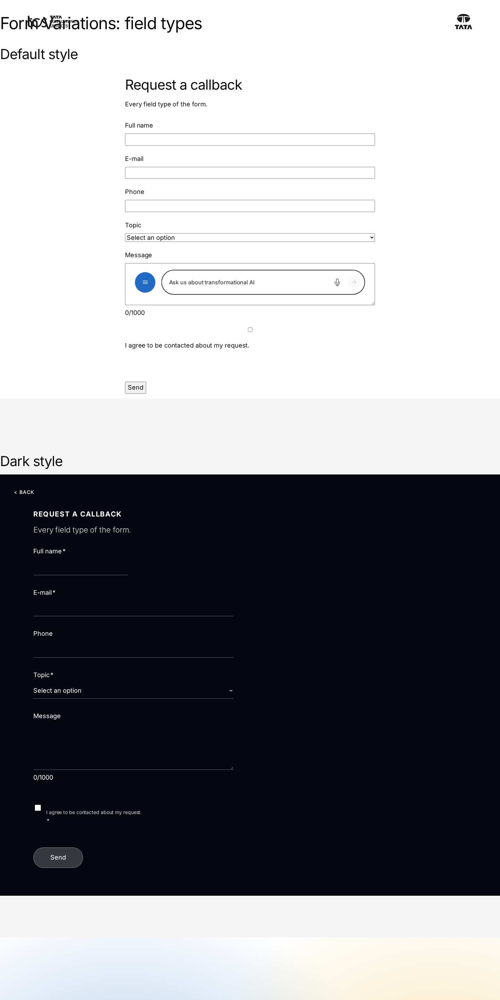
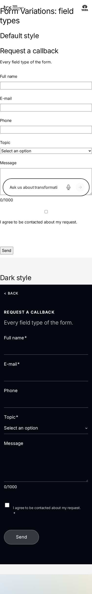

# Form Variations — Authoring Guide

| Attribute | Value |
| --- | --- |
| Document ID | AUT-C-form-variations |
| Audience | Content authors, content managers, AEM authoring leads |
| Purpose | How to add, fill in and check the Form Variations component |
| Scope | — |
| Prerequisites | — |
| Owner | Content Lead / AEM Authoring Lead (proposed) |
| Approver | Product Owner (to be confirmed) |
| Version | 1.0 |
| Status | Draft for review |
| Last updated | 8 November 2026 |
| Last validated | 8 November 2026 |
| Source files | blocks/form-variations/README.md, blocks/form-variations/_form-variations.json |
| Related documents | — |
| Related AEM paths | — |

## Contents

- [Where to see it](#where-to-see-it)
- [For Content Authors](#for-content-authors)
- [Authorable Fields](#authorable-fields)
- [Screenshot-Based Authoring Steps](#screenshot-based-authoring-steps)
- [Variations](#variations)
- [Complete Authoring Example](#complete-authoring-example)
- [Content and Asset Guidelines](#content-and-asset-guidelines)
- [Troubleshooting](#troubleshooting)
- [Screenshots](#screenshots)
- [Known limitations](#known-limitations)
- [Open items](#open-items)
- [Change history](#change-history)

## Where to see it

- https://main--tcs-corp--sradha-tcs.aem.live/design-block-master/en/block-library/form-variations
- https://main--tcs-corp--sradha-tcs.aem.live/design-block-master/en/block-library/form-variations/field-types
- https://main--tcs-corp--sradha-tcs.aem.live/design-block-master/en/block-library/form-variations/form-variations

## For Content Authors

1. **Add the block.** In Universal Editor select a Section (or a Columns Container column, or a Tabs Container) and choose Add > Form Variations.
2. **Open its properties.** Select the block; the dialog has the tabs Content and Additional.
3. **Enter the content.** Form Title / Heading (rendered as an H2), Form Description (rich text), Submit action (the endpoint the data is sent to; ask the development team for it) and Theme (Default or Dark).
4. **Add the items.** In the content tree, select the block and use Add to insert items in the order visitors should fill them: Text Input Field, Dropdown / Select Field, Textarea Field, Consent Checkbox Field, Contact Card Output, Submit Button. Reorder them by dragging in the content tree.
5. **Fill each item.** Give every field a unique Field Name / ID (the submitted key, e.g. `firstName`), a label, and set Mandatory Field (*) where needed. For a conditional item, copy the exact dropdown option text into "Show only if dropdown value equals" (or "Show when dropdown value equals" for a contact card).
6. **Preview.** In Universal Editor every conditional item stays visible with an italic condition note; switch to the preview (aem.page) to test the real behaviour.
7. **Publish** the page, then **validate** the published page: an empty Send shows the errors, a valid Send shows "Thank you, your details were sent." only when the endpoint or integration accepted the data.

**Minimum required:** at least one field item and one Submit Button. **Recommended:** Form Title / Heading, Form Description, Submit action, labels on every field, Input Type Email / Tel where relevant. **Optional:** Theme, conditions, contact cards, Max Character Limit, the Additional tab.

## Authorable Fields

<!-- BEGIN GENERATED: fields (npm run build:docs) -->

#### Form Variations (`form-variations`)

Model `form-variations`; template name "Form Variations" (the block class AEM renders); children: `field-text`, `field-select`, `field-combined`, `field-textarea`, `field-checkbox`, `contact-card`, `field-submit`.

##### Content tab — Form Variations

| Field label | Property | Type | Required | Default | Allowed values | Author guidance | Example |
| ----------- | -------- | ---- | -------- | ------- | -------------- | --------------- | ------- |
| Form Title / Heading | `formHeading` | text | No | — | — | — | Contact us |
| Form Description | `formDescription` | richtext | No | "" | — | — | — |
| Submit action | `formAction` | aem-content | No | — | — | Where the form data is sent (POST, JSON): e.g. an AEM Forms or spreadsheet submission endpoint. Without it, nothing is sent and visitors are told so. | — |
| Theme | `classes` | select | No | "" | Default (""), Dark (`dark`) | — | dark |

#### Text Input Field (`field-text`)

Model `field-text`; template name "Text Input Field" (the block class AEM renders).

Stored on a new component (definition template): `classes` = `"field-text"`, `inputKind` = `"text"`.

##### Fields — Text Input Field

| Field label | Property | Type | Required | Default | Allowed values | Author guidance | Example |
| ----------- | -------- | ---- | -------- | ------- | -------------- | --------------- | ------- |
| Field type | `classes` | text | No | `field-text` | — | Read only. | — |
| Field Name / ID | `fieldName` | text | Yes | — | — | Submitted as the field key, e.g. firstName. | firstName |
| Field Label | `label` | text | Yes | — | — | e.g. First name | First name |
| Input Type | `inputKind` | select | No | `text` | Text (`text`), Email (`email`), Tel (`tel`) | — | text |
| Mandatory Field (*) | `required` | boolean | No | `false` | on / off | — | true |
| Show only if dropdown value equals | `dependsOn` | text | No | — | — | — | Other |

#### Dropdown / Select Field (`field-select`)

Model `field-select`; template name "Dropdown / Select Field" (the block class AEM renders).

Stored on a new component (definition template): `classes` = `"field-select"`.

##### Fields — Dropdown / Select Field

| Field label | Property | Type | Required | Default | Allowed values | Author guidance | Example |
| ----------- | -------- | ---- | -------- | ------- | -------------- | --------------- | ------- |
| Field type | `classes` | text | No | `field-select` | — | Read only. | — |
| Dropdown Name / ID | `fieldName` | text | Yes | — | — | — | region |
| Dropdown Label | `label` | text | Yes | — | — | — | Region |
| Mandatory Field (*) | `required` | boolean | No | `false` | on / off | — | true |
| Options | `options` | text | No | — | — | — | Asia Pacific, Europe, India, North America |
| Show only if dropdown value equals | `dependsOn` | text | No | — | — | — | — |

#### Combined Input Field (`field-combined`)

Model `field-combined`; template name "Combined Input Field" (the block class AEM renders).

Stored on a new component (definition template): `classes` = `"field-combined"`.

##### Fields — Combined Input Field

| Field label | Property | Type | Required | Default | Allowed values | Author guidance | Example |
| ----------- | -------- | ---- | -------- | ------- | -------------- | --------------- | ------- |
| Field type | `classes` | text | No | `field-combined` | — | Read only. | — |
| Field Name / ID | `fieldName` | text | Yes | — | — | Submitted as the field key, e.g. score | — |
| Mandatory Field (*) | `required` | boolean | No | `false` | on / off | — | — |
| Show only if dropdown value equals | `dependsOn` | text | No | — | — | — | — |

#### Textarea Field (`field-textarea`)

Model `field-textarea`; template name "Textarea Field" (the block class AEM renders).

Stored on a new component (definition template): `classes` = `"field-textarea"`, `maxLength` = `1500`.

##### Fields — Textarea Field

| Field label | Property | Type | Required | Default | Allowed values | Author guidance | Example |
| ----------- | -------- | ---- | -------- | ------- | -------------- | --------------- | ------- |
| Field type | `classes` | text | No | `field-textarea` | — | Read only. | — |
| Field Name / ID | `fieldName` | text | Yes | — | — | — | message |
| Field Label | `label` | text | Yes | — | — | — | How can we help you? |
| Max Character Limit | `maxLength` | number | No | `1500` | — | — | 1500 |
| Mandatory Field (*) | `required` | boolean | No | `false` | on / off | — | false |
| Show only if dropdown value equals | `dependsOn` | text | No | — | — | — | — |

#### Consent Checkbox Field (`field-checkbox`)

Model `field-checkbox`; template name "Consent Checkbox Field" (the block class AEM renders).

Stored on a new component (definition template): `classes` = `"field-checkbox"`, `required` = `true`.

##### Fields — Consent Checkbox Field

| Field label | Property | Type | Required | Default | Allowed values | Author guidance | Example |
| ----------- | -------- | ---- | -------- | ------- | -------------- | --------------- | ------- |
| Field type | `classes` | text | No | `field-checkbox` | — | Read only. | — |
| Checkbox Name / ID | `fieldName` | text | Yes | — | — | — | consent |
| Consent Text / Disclaimer | `label` | richtext | Yes | — | — | — | — |
| Mandatory Field (*) | `required` | boolean | No | `true` | on / off | — | true |
| Show only if dropdown value equals | `dependsOn` | text | No | — | — | — | — |

#### Contact Card Output (`contact-card`)

Model `contact-card`; template name "Contact Card Output" (the block class AEM renders).

Stored on a new component (definition template): `classes` = `"contact-card"`.

##### Fields — Contact Card Output

| Field label | Property | Type | Required | Default | Allowed values | Author guidance | Example |
| ----------- | -------- | ---- | -------- | ------- | -------------- | --------------- | ------- |
| Field type | `classes` | text | No | `contact-card` | — | Read only. | — |
| Show when dropdown value equals | `region` | text | Yes | — | — | — | India |
| Contact Name | `contactName` | text | Yes | — | — | — | India media relations |
| Emails | `emails` | text | No | — | — | — | media.india@example.com, press.india@example.com |
| Phones | `phones` | text | No | — | — | — | +91 00 0000 0000 |

#### Submit Button (`field-submit`)

Model `field-submit`; template name "Submit Button" (the block class AEM renders).

Stored on a new component (definition template): `classes` = `"field-submit"`, `label` = `"Send"`.

##### Fields — Submit Button

| Field label | Property | Type | Required | Default | Allowed values | Author guidance | Example |
| ----------- | -------- | ---- | -------- | ------- | -------------- | --------------- | ------- |
| Field type | `classes` | text | No | `field-submit` | — | Read only. | — |
| Button Label | `label` | text | No | `Send` | — | — | Send |
| Show only if dropdown value equals | `dependsOn` | text | No | — | — | — | — |

<!-- END GENERATED: fields -->

Notes the tables can't show:

- **Form Title / Heading** renders as `h2.form-variations-title` and labels the form (`aria-labelledby`); it is also the `dc:title` of `cmp:submit` in the data layer. Without it the form has no accessible name and `cmp:submit` uses the block name.
- **Submit action** is read from the cell's link (`href`), else its text. It receives a `POST` with `Content-Type: application/json` and the body `{ "data": { ... } }`. Without it (and without an integration) nothing is sent; in the editor a note says so.
- **Theme** Dark adds the block class `dark`: a full-width dark panel (`--color-bg-neutral`) with rounded corners, light labels and an inverted primary button.
- **Field Name / ID** (`fieldName`) is the submitted key, sent as written. The dialog marks it required but doesn't validate its characters. A Text Input Field whose name contains "name" (any case) is half width from 900px (`half-width`); every other item is full width. The name also sets `autocomplete` (e.g. `firstName` gives `given-name`, `company` gives `organization`); Input Type Email / Tel set `email` / `tel`.
- **Mandatory Field (*)**: only the value `true` makes a field required; the asterisk is hidden from screen readers and explained once by "* Required fields".
- **Options**: comma separated; a disabled, pre-selected "Select an option" prompt comes first.
- **Max Character Limit**: a value above 0, else 1500; enforced with `maxlength`; the counter shows `count/limit` and announces "{count} of {max} characters".
- **Consent Text / Disclaimer** is rich text: its links are kept and underlined. An empty text shows the field name.
- **Show only if dropdown value equals / Show when dropdown value equals**: the item is shown when *any* enabled dropdown of the form has that value (trimmed, case-insensitive). Hidden items are `hidden`, their controls disabled (left out of validation and the data) and not required.
- **Contact Card Output** Emails become `mailto:` links, Phones `tel:` links (only digits and `+` in the link).
- **Button Label**: empty gives the placeholder `send` ("Send").
- **Legacy mapping.** Items authored before the `fieldName` field (re-audit R-D-1) have fewer cells: their key is read from the item's node name, which AEM delivers in class-name form (`firstName` arrives as `firstname`), unless the node name is only the template name (`text-input-field`, `dropdown-select-field`, `textarea-field`, `consent-checkbox-field`, `contact-card-output`, `submit-button`), in which case the name fallback applies (`text`, `select`, `message`, `consent`). Older markup with the type alone in the first cell is read too.
- **Additional tab.** Anchor ID, Hide block, Animation Type / Motion Speed / Animation Trigger, Background animation and spacing behave as described in AGENTS.md ("Additional tab", "Animation and skeletons"). The content animation moves the block's children; the Background animation reveals the block's own background (visible with Theme Dark).

## Screenshot-Based Authoring Steps

#### Authoring Step 1: Add the block and its properties

```text
[Screenshot Placeholder]

File name:
form-variations-authoring-step-1.png

Purpose:
The Form Variations dialog, Content tab, with the title, description and Submit action filled in.

Annotations:
A = Form Title / Heading
B = Form Description
C = Submit action
D = Theme
```

##### Values to Enter

| Callout | Field | Value | Reason | Expected result |
| ------- | ----- | ----- | ------ | --------------- |
| A | Form Title / Heading | Contact us | Names the form for everyone | H2 above the form; the form is labelled by it |
| B | Form Description | Tell us about your business challenge and our experts will get back to you within two business days. | Sets expectations | Grey text under the title |
| C | Submit action | The endpoint provided by the development team | Data must reach a system | Valid submissions are POSTed there |
| D | Theme | Default | Light pages | 45rem-wide form on the page background |

**Author action:** Section > Add > Form Variations; select the block; fill the Content tab. **Expected preview:** title and description render; in the editor, without Submit action, the note "No Submit action set: submissions aren’t sent anywhere." appears. **Expected published result:** the same title and description. **Business rule:** don't publish a form for live data capture without a Submit action or an agreed integration. **Validation:** check the note disappears once Submit action is set. **Common mistake:** leaving Submit action empty: visitors are told the form isn't connected; set it.

#### Authoring Step 2: Add the fields

```text
[Screenshot Placeholder]

File name:
form-variations-authoring-step-2.png

Purpose:
The content tree under the block with the items added, and the Text Input Field dialog open.

Annotations:
A = Content tree items
B = Field Name / ID
C = Field Label
D = Input Type
E = Mandatory Field (*)
```

##### Values to Enter

| Callout | Field | Value | Reason | Expected result |
| ------- | ----- | ----- | ------ | --------------- |
| B | Field Name / ID | firstName | Submitted key; contains "name" | Half width from 900px; `autocomplete="given-name"` |
| C | Field Label | First name | Visible label | Label linked to the input |
| D | Input Type | Text | Plain text | `type="text"` |
| E | Mandatory Field (*) | on | Needed by the team | Asterisk, required validation |
| B | Field Name / ID (second item) | lastName | Pairs with firstName | Sits beside First name |
| D | Input Type (third item, Field Name / ID email, Label Email) | Email | Address format | Email keyboard and format check |

**Author action:** select the block in the content tree > Add > Text Input Field (three times), fill each. **Expected preview:** First name and Last name side by side on desktop, Email full width. **Expected published result:** the same; an address without "@" shows "Enter a valid email address." on Send. **Business rule:** every Field Name / ID unique within the form. **Validation:** open the item again and check every field is set. **Common mistake:** a full-width field named `companyName` turns half width: rename it (e.g. `company`).

#### Authoring Step 3: Add a dropdown with a conditional contact card

```text
[Screenshot Placeholder]

File name:
form-variations-authoring-step-3.png

Purpose:
The Dropdown / Select Field dialog and a Contact Card Output dialog with the matching value.

Annotations:
A = Dropdown Name / ID
B = Options
C = Show when dropdown value equals
D = Contact Name
E = Emails
F = Phones
```

##### Values to Enter

| Callout | Field | Value | Reason | Expected result |
| ------- | ----- | ----- | ------ | --------------- |
| A | Dropdown Name / ID | region | Submitted key | `region` in the data |
| B | Options | Asia Pacific, Europe, India, North America | Choices | Four options after "Select an option" |
| C | Show when dropdown value equals | India | Exact option text | Card shown only for India |
| D | Contact Name | India media relations | Card heading | Brand-coloured name |
| E | Emails | media.india@example.com, press.india@example.com | Contact routes | Two `mailto:` links |
| F | Phones | +91 00 0000 0000 | Contact route | One `tel:` link |

**Author action:** Add > Dropdown / Select Field, then Add > Contact Card Output. **Expected preview:** in the editor the card stays visible with "Shown when a dropdown value is "India"". **Expected published result:** the card appears after a thin divider when India is selected, and the status announces "More fields are shown below.". **Business rule:** one value per conditional item; add another item for another value. **Validation:** select every option on aem.page. **Common mistake:** a condition spelled differently from the option: copy the option text exactly.

#### Authoring Step 4: Consent and submit

```text
[Screenshot Placeholder]

File name:
form-variations-authoring-step-4.png

Purpose:
The Consent Checkbox Field and Submit Button dialogs.

Annotations:
A = Checkbox Name / ID
B = Consent Text / Disclaimer
C = Mandatory Field (*)
D = Button Label
```

##### Values to Enter

| Callout | Field | Value | Reason | Expected result |
| ------- | ----- | ----- | ------ | --------------- |
| A | Checkbox Name / ID | consent | Submitted key | `consent: "true"` when checked |
| B | Consent Text / Disclaimer | I agree to the processing of my personal data as described in the Privacy Notice (with Privacy Notice linked) | Legal consent | Small text with an underlined link |
| C | Mandatory Field (*) | on (default) | Consent required | Send blocked until checked |
| D | Button Label | Send | Clear action | Black primary button |

**Author action:** Add > Consent Checkbox Field, Add > Submit Button. **Expected preview:** the checkbox with its text and the Send button. **Expected published result:** Send without the box checked shows "This field is required.". **Business rule:** at least one Submit Button without a condition, so visitors always have a button. **Validation:** check the button is visible before and after choosing each dropdown value. **Common mistake:** every Submit Button conditional: add an unconditional one.

#### Authoring Step 5: Preview, publish and validate

```text
[Screenshot Placeholder]

File name:
form-variations-authoring-step-5.png

Purpose:
The published form after a valid Send with the success message, the form reset.

Annotations:
A = Reset fields
B = Status "Thank you, your details were sent."
```

##### Values to Enter

| Callout | Field | Value | Reason | Expected result |
| ------- | ----- | ----- | ------ | --------------- |
| A | First name / Last name / Email | Test values agreed with the receiving team | End-to-end check | Entry arrives in the receiving system |
| B | — | — | Outcome | Success message only if the endpoint answered OK |

**Author action:** publish, open the page on aem.live, submit once. **Expected result:** the form resets and the success message receives focus. **Validation:** confirm the entry in the receiving system. **Common mistake:** testing in Universal Editor, where all conditional items are visible: test on aem.page / aem.live.

## Variations

#### Default theme

Purpose: a form on a light page. Use it by default; don't use it on a dark section background unless the theme contract of the section (styles/styles.css) gives enough contrast. Required: field items and a Submit Button; optional: title, description. Dialog: Theme = Default. Rendering: centred, at most 45rem wide; one column below 900px, two columns from 900px. Accessibility and data layer as in the sections below. Personalization: none; the authored form renders.

```text
[Screenshot Placeholder]

File name:
form-variations-default-mobile.png

Purpose:
The Default theme at 375 px: single column, full-width fields, Send button left aligned.

Annotations:
A = Title and description
B = Fields in one column
C = Send button
```

#### Dark theme

Purpose: a highlighted panel (e.g. "Talk to our experts"). Dialog: Theme = Dark (block class `dark`). Rendering: a dark (`--color-bg-neutral`) panel with `--radius-l` corners across the container, content centred at 45rem; padding grows at 600px and 900px; light labels, transparent inputs, a light-blue contact name and status, and the primary button inverted to white. Error colour `#ff6b6b` (hard-coded). Background animation, when chosen, reveals this panel.

```text
[Screenshot Placeholder]

File name:
form-variations-dark-tablet.png

Purpose:
The Dark theme at 768 px: the panel with its tablet padding and a contact card shown for a region.

Annotations:
A = Dark panel
B = Contact card
C = White Send button
```

#### Half-width name fields

Not a dialog option: a Text Input Field whose Field Name / ID contains "name" gets `half-width` and sits beside the next half-width field from 900px. Use it for First name / Last name; avoid "name" in other field names.

#### Conditional items

Not a dialog option per se: any field, contact card or Submit Button with a condition value. Rendering: `data-depends-on` on the item's group; hidden and disabled until a dropdown has the value; chains of conditions are resolved; in the editor all are shown with a note and a dashed border.

```text
[Screenshot Placeholder]

File name:
form-variations-conditional-desktop.png

Purpose:
Sector set to Other reveals the mandatory "Please specify your sector" input.

Annotations:
A = Controlling dropdown
B = Revealed conditional field
```

## Complete Authoring Example

Scenario: the "Contact us" form of the block library (`block-library/form-variations/form-variations`, section Main).

| Field | Example value | Guidance |
| ----- | ------------- | -------- |
| Form Title / Heading | Contact us | Short, specific |
| Form Description | Tell us about your business challenge and our experts will get back to you within two business days. | What happens after sending |
| Submit action | The agreed endpoint | Required for real submissions |
| Dropdown / Select Field | region, Region, mandatory, Asia Pacific, Europe, India, North America | Options as conditions will use them |
| Text Input Field | firstName, First name, Text, mandatory | Half width |
| Text Input Field | lastName, Last name, Text, mandatory | Half width |
| Text Input Field | email, Email, Email, mandatory | Format check |
| Textarea Field | message, How can we help you?, 1500 | Counter 0/1500 |
| Consent Checkbox Field | consent, consent text with Privacy Notice link, mandatory | Legal text approved per locale |
| Submit Button | Send | Unconditional |

Steps: add the block, fill the Content tab, add the seven items in that order, publish. Expected output: H2 "Contact us", "* Required fields", the Region dropdown, First name and Last name side by side (desktop), Email, the textarea with 0/1500, the consent checkbox and the Send button. Responsive: one column below 900px. Accessibility: labels, required state, errors linked to fields, focus to the first error, status focused after the outcome. Data layer: the component entry, `cmp:click` on Send, `cmp:submit` with the field names (no values) for a valid submission. Personalization fallback: the authored form. Pre-publish checklist: Submit action set; unique field names; an unconditional Send; an empty Send shows errors; each Region value tested; placeholders translated for the locale; consent text approved.

## Content and Asset Guidelines

- **Titles and descriptions:** one H2 per form; keep the page H1 elsewhere (e.g. the Page Header). The description says what happens after sending.
- **Labels:** clear, visible, without relying on the description. Don't put essential information only in conditional contact cards.
- **CTAs:** a specific verb on the Submit Button ("Send", "Subscribe"); one visible primary action, extra buttons only when conditional.
- **Links:** only in the consent text (rich text) and contact cards (generated `mailto:` / `tel:`).
- **Images, icons, tags, metadata:** not applicable; the block has no image, icon or tag field and reads no metadata.
- **Min / max items:** no verified technical limit was identified. The textarea limit defaults to 1500 characters.
- **Contact data:** only approved business contacts; sample people and numbers in the library are fictional.
- **Localization:** author labels, options, consent text and cards per locale; keep Field Name / ID identical across locales (data keys); conditions must match the locale's option text; translate the placeholder keys listed under For Site Administrators.

## Troubleshooting

| Symptom | Likely cause | Diagnostic steps | Resolution | Verification |
| ------- | ------------ | ---------------- | ---------- | ------------ |
| "This form isn’t connected yet" after Send | No Submit action and no integration | Check the Submit action field; in the console listen for `form-variations:submit` | Set the Submit action or add the integration | A valid Send shows the success message |
| "Your details couldn’t be sent" | Endpoint error, network error or rejected `respondWith` promise | Network tab: the POST status; console | Fix the endpoint / integration | 2xx response, success message |
| A conditional item never appears | Condition text differs from the option, or its dropdown is hidden | Inspect `data-depends-on` on the group | Copy the option text exactly; one value per item | Item appears for that value on aem.page |
| All conditional items visible | Viewed in Universal Editor | Look for the italic condition notes | Test on aem.page | Only unconditional items initially |
| No Send button | Every Submit Button conditional, or none added | Check the submit items | Add an unconditional Submit Button | Button visible for every choice |
| Submitted keys lower-cased | Items authored before `fieldName` | `.plain.html`: count the item's cells | Open the item, set Field Name / ID, republish | Key arrives as written |
| Values in the wrong field | A missing positional cell (O-18) | `.plain.html`: count the item's cells | Set every field of the item and save | One cell per field |
| English texts on a locale | Placeholder key missing | Open `/{locale}/placeholders.json` | Add and publish the keys | Translated texts |

Evidence to collect (without secrets): page URL on aem.page, the item rows of `{page}.plain.html`, the Network entry of the POST (status only, no personal data), console errors, `window.adobeDataLayer` entries.

## Screenshots



*Figure: Form Variations as published (block library) — desktop 1440 × 900 (/design-block-master/en/block-library/form-variations/field-types, captured 2026-11-08).*



*Figure: Form Variations as published (block library) — mobile 375 × 812 (/design-block-master/en/block-library/form-variations/field-types, captured 2026-11-08).*

> **Screenshot required**
>
> - Required screen: Form Variations dialog in Universal Editor (every tab, including Additional)
> - Required role/access: AEM Sites author with Universal Editor (content author)
> - Required navigation steps: AEM Sites console > /content/tcs-corp/language-masters/en > open a page in Universal Editor
> - Reason unavailable: No AEM author access in the documentation program (access blocker AB-01)
> - Owner: Content Lead / AEM Authoring Lead (proposed)
> - Target completion date: To be confirmed

## Known limitations

- Universal Editor screenshots are placeholders: no author access in this program.

## Open items

- None.

## Change history

| Version | Date | Author | Change |
| --- | --- | --- | --- |
| 1.0 | 8 November 2026 | Delivery team (documentation program) | First version of the role-specific documentation (master documentation prompt), generated from the repository and the published reference pages |
