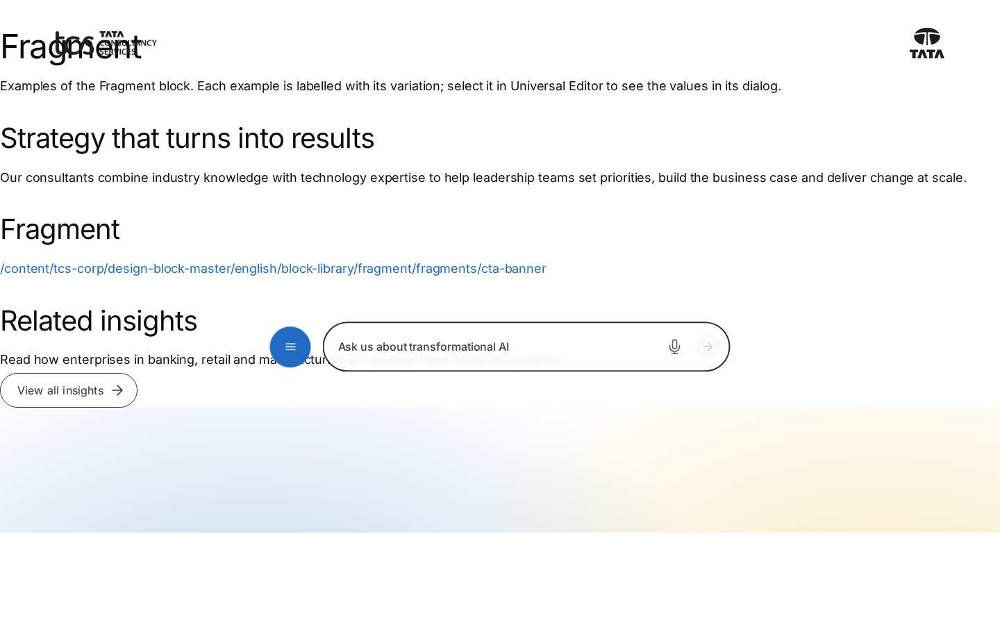
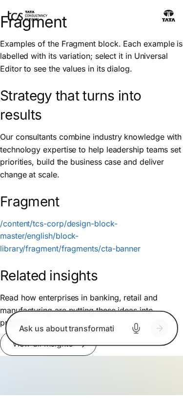

# Fragment — Authoring Guide

| Attribute | Value |
| --- | --- |
| Document ID | AUT-C-fragment |
| Audience | Content authors, content managers, AEM authoring leads |
| Purpose | How to add, fill in and check the Fragment component |
| Scope | — |
| Prerequisites | — |
| Owner | Content Lead / AEM Authoring Lead (proposed) |
| Approver | Product Owner (to be confirmed) |
| Version | 1.0 |
| Status | Draft for review |
| Last updated | 8 November 2026 |
| Last validated | 8 November 2026 |
| Source files | blocks/fragment/README.md, blocks/fragment/_fragment.json |
| Related documents | — |
| Related AEM paths | — |

## Contents

- [Where to see it](#where-to-see-it)
- [For Content Authors](#for-content-authors)
- [Authorable Fields](#authorable-fields)
- [Screenshot-Based Authoring Steps](#screenshot-based-authoring-steps)
- [Variations](#variations)
- [Complete Authoring Example](#complete-authoring-example)
- [Content and Asset Guidelines](#content-and-asset-guidelines)
- [Troubleshooting](#troubleshooting)
- [Screenshots](#screenshots)
- [Known limitations](#known-limitations)
- [Open items](#open-items)
- [Change history](#change-history)

## Where to see it

- https://main--tcs-corp--sradha-tcs.aem.live/design-block-master/en/block-library/fragment
- https://main--tcs-corp--sradha-tcs.aem.live/design-block-master/en/block-library/fragment/fragment-block
- https://main--tcs-corp--sradha-tcs.aem.live/design-block-master/en/block-library/fragment/fragments
- https://main--tcs-corp--sradha-tcs.aem.live/design-block-master/en/block-library/fragment/fragments/cta-banner

## For Content Authors

1. **Create the fragment page** in the locale's `references/` (for example `references/cta-banner`) and author its sections and blocks like any page; start its headings at H2.
2. **Publish the fragment page** (Preview for `.aem.page`, Publish for `.aem.live`).
3. **Add the block** to the host page: section (or Columns Container column, or Tab) › Add › **Fragment**.
4. **Open its properties** and pick the fragment page in **Reference** (content picker).
5. **Additional tab** (optional): Anchor ID, Hide block, padding and margin apply to the Fragment block on this page.
6. **Preview** the host page: the fragment's sections appear in the block. To change the content, edit the fragment page, not the host page.
7. **Publish** the host page.
8. **Validate** on the published site: the content shows, images load, headings fit the page's hierarchy, there is one H1.

Minimum required: Reference to a published page. Recommended: one self-contained unit per fragment (one to three sections), one fragment page per locale. Optional: the Additional tab.

## Authorable Fields

<!-- BEGIN GENERATED: fields (npm run build:docs) -->

#### Fragment (`fragment`)

Model `fragment`; template name "Fragment" (the block class AEM renders).

##### Content tab — Fragment

| Field label | Property | Type | Required | Default | Allowed values | Author guidance | Example |
| ----------- | -------- | ---- | -------- | ------- | -------------- | --------------- | ------- |
| Reference | `reference` | aem-content | No | — | — | — | /design-block-master/en/block-library/fragment/fragments/cta-banner |

##### Additional tab — Fragment

| Field label | Property | Type | Required | Default | Allowed values | Author guidance | Example |
| ----------- | -------- | ---- | -------- | ------- | -------------- | --------------- | ------- |
| Anchor ID | `classes_anchor` | text | No | — | regExp: ^anchor-[a-z0-9][a-z0-9-]*$; customErrorMsg: Start with anchor-, then lower-case letters, digits and hyphens. | A unique ID of the block on the page, starting with anchor-, e.g. anchor-our-services; link to it with #anchor-our-services. Delivered as a block class. | — |
| Hide block | `classes_hideblock` | boolean | No | `false` | on / off | Hides the whole block on the page until it is turned off (shown faded in the editor). Delivered as a block class. | — |
| Padding left | `classes_paddingleft` | select | No | "" | Default (""), 0 (none) (`pl-0`), 0.25rem (space-100) (`pl-100`), 0.5rem (space-200) (`pl-200`), 0.75rem (space-300) (`pl-300`), 1rem (space-400) (`pl-400`), 1.25rem (space-500) (`pl-500`), 1.5rem (space-600) (`pl-600`), 2rem (space-800) (`pl-800`), 2.5rem (space-1000) (`pl-1000`), 3rem (space-1200) (`pl-1200`), 4rem (space-1600) (`pl-1600`), 5rem (space-2000) (`pl-2000`), 6rem (space-2400) (`pl-2400`), 7.5rem (space-3000) (`pl-3000`) | Delivered as a block class. | — |
| Padding right | `classes_paddingright` | select | No | "" | Default (""), 0 (none) (`pr-0`), 0.25rem (space-100) (`pr-100`), 0.5rem (space-200) (`pr-200`), 0.75rem (space-300) (`pr-300`), 1rem (space-400) (`pr-400`), 1.25rem (space-500) (`pr-500`), 1.5rem (space-600) (`pr-600`), 2rem (space-800) (`pr-800`), 2.5rem (space-1000) (`pr-1000`), 3rem (space-1200) (`pr-1200`), 4rem (space-1600) (`pr-1600`), 5rem (space-2000) (`pr-2000`), 6rem (space-2400) (`pr-2400`), 7.5rem (space-3000) (`pr-3000`) | Delivered as a block class. | — |
| Padding top | `classes_paddingtop` | select | No | "" | Default (""), 0 (none) (`pt-0`), 0.25rem (space-100) (`pt-100`), 0.5rem (space-200) (`pt-200`), 0.75rem (space-300) (`pt-300`), 1rem (space-400) (`pt-400`), 1.25rem (space-500) (`pt-500`), 1.5rem (space-600) (`pt-600`), 2rem (space-800) (`pt-800`), 2.5rem (space-1000) (`pt-1000`), 3rem (space-1200) (`pt-1200`), 4rem (space-1600) (`pt-1600`), 5rem (space-2000) (`pt-2000`), 6rem (space-2400) (`pt-2400`), 7.5rem (space-3000) (`pt-3000`) | Delivered as a block class. | — |
| Padding bottom | `classes_paddingbottom` | select | No | "" | Default (""), 0 (none) (`pb-0`), 0.25rem (space-100) (`pb-100`), 0.5rem (space-200) (`pb-200`), 0.75rem (space-300) (`pb-300`), 1rem (space-400) (`pb-400`), 1.25rem (space-500) (`pb-500`), 1.5rem (space-600) (`pb-600`), 2rem (space-800) (`pb-800`), 2.5rem (space-1000) (`pb-1000`), 3rem (space-1200) (`pb-1200`), 4rem (space-1600) (`pb-1600`), 5rem (space-2000) (`pb-2000`), 6rem (space-2400) (`pb-2400`), 7.5rem (space-3000) (`pb-3000`) | Delivered as a block class. | — |
| Margin left | `classes_marginleft` | select | No | "" | Default (""), 0 (none) (`ml-0`), 0.25rem (space-100) (`ml-100`), 0.5rem (space-200) (`ml-200`), 0.75rem (space-300) (`ml-300`), 1rem (space-400) (`ml-400`), 1.25rem (space-500) (`ml-500`), 1.5rem (space-600) (`ml-600`), 2rem (space-800) (`ml-800`), 2.5rem (space-1000) (`ml-1000`), 3rem (space-1200) (`ml-1200`), 4rem (space-1600) (`ml-1600`), 5rem (space-2000) (`ml-2000`), 6rem (space-2400) (`ml-2400`), 7.5rem (space-3000) (`ml-3000`) | Delivered as a block class. | — |
| Margin right | `classes_marginright` | select | No | "" | Default (""), 0 (none) (`mr-0`), 0.25rem (space-100) (`mr-100`), 0.5rem (space-200) (`mr-200`), 0.75rem (space-300) (`mr-300`), 1rem (space-400) (`mr-400`), 1.25rem (space-500) (`mr-500`), 1.5rem (space-600) (`mr-600`), 2rem (space-800) (`mr-800`), 2.5rem (space-1000) (`mr-1000`), 3rem (space-1200) (`mr-1200`), 4rem (space-1600) (`mr-1600`), 5rem (space-2000) (`mr-2000`), 6rem (space-2400) (`mr-2400`), 7.5rem (space-3000) (`mr-3000`) | Delivered as a block class. | — |
| Margin top | `classes_margintop` | select | No | "" | Default (""), 0 (none) (`mt-0`), 0.25rem (space-100) (`mt-100`), 0.5rem (space-200) (`mt-200`), 0.75rem (space-300) (`mt-300`), 1rem (space-400) (`mt-400`), 1.25rem (space-500) (`mt-500`), 1.5rem (space-600) (`mt-600`), 2rem (space-800) (`mt-800`), 2.5rem (space-1000) (`mt-1000`), 3rem (space-1200) (`mt-1200`), 4rem (space-1600) (`mt-1600`), 5rem (space-2000) (`mt-2000`), 6rem (space-2400) (`mt-2400`), 7.5rem (space-3000) (`mt-3000`) | Delivered as a block class. | — |
| Margin bottom | `classes_marginbottom` | select | No | "" | Default (""), 0 (none) (`mb-0`), 0.25rem (space-100) (`mb-100`), 0.5rem (space-200) (`mb-200`), 0.75rem (space-300) (`mb-300`), 1rem (space-400) (`mb-400`), 1.25rem (space-500) (`mb-500`), 1.5rem (space-600) (`mb-600`), 2rem (space-800) (`mb-800`), 2.5rem (space-1000) (`mb-1000`), 3rem (space-1200) (`mb-1200`), 4rem (space-1600) (`mb-1600`), 5rem (space-2000) (`mb-2000`), 6rem (space-2400) (`mb-2400`), 7.5rem (space-3000) (`mb-3000`) | Delivered as a block class. | — |

<!-- END GENERATED: fields -->

Notes:

- **Reference.** The block reads the first link's `href`, else its text. Only paths starting with `/` (not `//`) are loaded; full URLs and relative paths are ignored. `.html` / `.plain.html` endings are removed and `{path}.plain.html` is fetched (the AEM author path when editing in Universal Editor, the published path on the site). The path isn't localized: pick the page of the same locale.
- **Rendering result.** The block's content is replaced by the fragment's sections (`div.section`), decorated like a page (`decorateMain`: sections with their options, Columns Containers, Tabs, blocks, block options, buttons) and loaded (`loadSections`); images with `./media_` paths are rebased to the fragment page; the fragment's block animations are prepared (`prepareMotion`).
- **No content.** A path that can't load (not published, 404) leaves the authored content (the reference link); in Universal Editor edit mode the block shows the hint "Fragment: choose the page whose content it shows." (placeholder `fragmentEmpty`).
- **Recursion.** A fragment that includes itself, directly or through other fragments, or the page it is on, isn't loaded again; the same fragment twice side by side is fine.
- **Accessibility impact.** The fragment's headings become part of the host page's outline.
- **Data layer impact.** The Fragment block is a component; the fragment's blocks are its children (`parentId`).
- **Legacy mapping.** None.
- **Additional tab.** As every block (AGENTS.md "Additional tab"), without animation fields (the blocks inside keep their own animations); applies to the Fragment block on the host page.

## Screenshot-Based Authoring Steps

#### Authoring Step 1: Create and publish the fragment page

```text
[Screenshot Placeholder]

File name:
fragment-authoring-step-1.png

Purpose:
The fragment page (references/cta-banner) in Universal Editor with its sections.

Annotations:
A = Default content: H2 and intro
B = Columns Container with three columns
C = Button Block "Contact us"
```

#### Values to Enter

| Callout | Field | Value | Reason | Expected result |
| ------- | ----- | ----- | ------ | --------------- |
| A | Title (H2) | `Talk to our experts` | The fragment starts at H2 | Heading in the host page outline |
| B | Columns Container | Consulting, Cloud, Cybersecurity columns | Shared content | Columns in every host page |
| C | Button Block | `Contact us` | Shared call to action | Same CTA everywhere |

Values from `block-library/fragment/fragments/cta-banner`. Author action: create the page, author, publish. Business rule: the fragment page must be published before the host page shows it. Validation: open `{path}.plain.html` on the site. Common mistake: an H1 in the fragment (two H1 on the page).

#### Authoring Step 2: Add the Fragment block

```text
[Screenshot Placeholder]

File name:
fragment-authoring-step-2.png

Purpose:
The host page with the Add menu of a section and Fragment highlighted.

Annotations:
A = Section of the host page
B = Fragment in the component list
```

#### Values to Enter

| Callout | Field | Value | Reason | Expected result |
| ------- | ----- | ----- | ------ | --------------- |
| B | Component | Fragment | Includes the shared page | Empty block with the editor hint |

Expected preview: "Fragment: choose the page whose content it shows." until a Reference is set. Common mistake: adding it in the first section of the page (slower LCP).

#### Authoring Step 3: Choose the Reference

```text
[Screenshot Placeholder]

File name:
fragment-authoring-step-3.png

Purpose:
The Fragment properties, Content tab, with Reference picked.

Annotations:
A = Reference
```

#### Values to Enter

| Callout | Field | Value | Reason | Expected result |
| ------- | ----- | ----- | ------ | --------------- |
| A | Reference | `/language-masters/en/block-library/fragment/fragments/cta-banner` | The shared page | The banner renders in the block |

Business rule: only site paths are loaded (no full URLs). Validation: the content shows in the editor preview. Common mistake: a page of another locale (wrong language).

#### Authoring Step 4: Additional tab and publish

```text
[Screenshot Placeholder]

File name:
fragment-authoring-step-4.png

Purpose:
The Additional tab of the Fragment with an Anchor ID and a margin.

Annotations:
A = Anchor ID
B = Margin top
```

#### Values to Enter

| Callout | Field | Value | Reason | Expected result |
| ------- | ----- | ----- | ------ | --------------- |
| A | Anchor ID | `anchor-g01b-fragment` (library sample) | Jump target | `id` on the block |
| B | Margin top | Default | Spacing comes from the fragment's sections | No extra space |

Expected published result: the banner on the published host page. Validation: `#anchor-g01b-fragment` jumps to it. Common mistake: publishing only the host page.

## Variations

#### Fragment block (default)

- **Purpose:** include one page's sections.
- **When to use / not:** shared content; not for page-specific or SEO-critical content.
- **Required fields:** Reference. **Optional:** Additional tab.
- **Rendering:** `div.fragment.block` containing the fragment's `div.section`s; no styles of its own (`fragment.css` is empty).
- **Desktop / tablet / mobile:** as the included sections and blocks.
- **Accessibility:** the included content's semantics.
- **Data layer:** `fragment-{n}` (or its Anchor ID) with the inner blocks as children.
- **Personalization / fallback:** none; an unpublished fragment leaves the reference link.

```text
[Screenshot Placeholder]

File name:
fragment-block-desktop.png

Purpose:
A host page with the included CTA banner at 1440px.

Annotations:
A = Fragment block boundary
B = Included Columns Container
```

#### Nested fragments

- **Purpose:** a fragment page that itself contains a Fragment (or a Tabs block with tab fragments).
- **Rendering:** the inner fragment loads while the outer one is decorated; the chain of including fragments (`main[data-fragment-chain]`) stops a fragment from including itself or the host page.
- **Performance:** each level adds a sequential request.

```text
[Screenshot Placeholder]

File name:
fragment-nested-desktop.png

Purpose:
A fragment containing another fragment, both rendered once.

Annotations:
A = Outer fragment
B = Inner fragment
```

#### Shared loader (header, footer, tabs, modal)

- **Purpose:** the same `loadFragment` loads the Navigation page (`blocks/header`), the footer page and its Canvas page (`blocks/footer`), a tab's Fragment (`blocks/tabs`, passing the tab row as `from`) and modal content (`blocks/modal`).
- **Rendering:** the caller places the decorated sections; see each block's README.

```text
[Screenshot Placeholder]

File name:
fragment-in-tab-desktop.png

Purpose:
A Tabs block panel showing a tab fragment.

Annotations:
A = Tab
B = Panel with the fragment's content
```

## Complete Authoring Example

Scenario: a "Talk to our experts" banner reused on the Consulting page.

| Field | Example value | Guidance |
| ----- | ------------- | -------- |
| Fragment page | `/content/tcs-corp/us/en/references/cta-banner` | In the locale's `references/` |
| Fragment page content | H2 `Talk to our experts`, intro, Columns Container (Consulting, Cloud, Cybersecurity, each with an "Explore …" Button Block), Button Block `Contact us` | Self-contained, starts at H2 |
| Host page › Fragment › Reference | `/content/tcs-corp/us/en/references/cta-banner` | Same locale |
| Additional › Anchor ID | `anchor-contact` | Optional |

Steps: author and publish the fragment page, add the Fragment to the host page, pick the Reference, publish the host page.

Expected output: the banner between the host page's sections. Responsive: the Columns Container's own behaviour. Accessibility: H2 / H3 inside the page's outline. Analytics: clicks on the banner's buttons report their Button Blocks (children of the fragment component); clicks on default-content links report the fragment. Personalization fallback: none.

Pre-publish checklist:

- [ ] Fragment page published and in the same locale.
- [ ] No H1 or Page Header in the fragment.
- [ ] The fragment doesn't include the host page or itself.
- [ ] Not in the page's first section.

## Content and Asset Guidelines

- **Titles.** Start at H2; keep the fragment's outline valid in every host page.
- **CTAs and links.** Generic enough for every host page.
- **Images.** Select them with the image picker on the fragment page; `./media_` paths are rebased to the fragment page.
- **Tags and metadata.** Not used from the fragment page; give it a clear title for authors.
- **Min / max items.** No verified technical limit was identified.
- **Loading.** Fetched when the block's section loads; images load as their blocks define.
- **Missing assets / page.** An unpublished fragment page leaves the reference link on the page.

## Troubleshooting

| Symptom | Likely cause | Diagnostic steps | Resolution | Verification |
| ------- | ------------ | ---------------- | ---------- | ------------ |
| The block shows a bare link | Fragment page not published (404) or a full URL | Network: `{path}.plain.html` status; the Reference value | Publish the page; pick it with the content picker | Content renders |
| Broken images in the fragment | Unpublished assets or non-`./media_` paths | Inspect `img src` | Re-select images on the fragment page and republish | Images load |
| Wrong language | Reference to another locale | Check the path's locale | Point to the locale's fragment page | Right language |
| Old content | Fragment page not republished, cache | Open its `.plain.html` | Publish the fragment page | New content |
| Two H1 | H1 or Page Header in the fragment | Heading outline | Use H2 | One H1 |
| Fragment missing on one page only | It references that page itself (guard) | Compare Reference and host path | Reference another page | Content renders |

Evidence to collect: host page URL, Reference value, network status of the `.plain.html` request, console errors, screenshot. No cookies or tokens.

## Screenshots



*Figure: Fragment as published (block library) — desktop 1440 × 900 (/design-block-master/en/block-library/fragment/fragment-block, captured 2026-11-08).*



*Figure: Fragment as published (block library) — mobile 375 × 812 (/design-block-master/en/block-library/fragment/fragment-block, captured 2026-11-08).*

> **Screenshot required**
>
> - Required screen: Fragment dialog in Universal Editor (every tab, including Additional)
> - Required role/access: AEM Sites author with Universal Editor (content author)
> - Required navigation steps: AEM Sites console > /content/tcs-corp/language-masters/en > open a page in Universal Editor
> - Reason unavailable: No AEM author access in the documentation program (access blocker AB-01)
> - Owner: Content Lead / AEM Authoring Lead (proposed)
> - Target completion date: To be confirmed

## Known limitations

- Universal Editor screenshots are placeholders: no author access in this program.

## Open items

- None.

## Change history

| Version | Date | Author | Change |
| --- | --- | --- | --- |
| 1.0 | 8 November 2026 | Delivery team (documentation program) | First version of the role-specific documentation (master documentation prompt), generated from the repository and the published reference pages |
