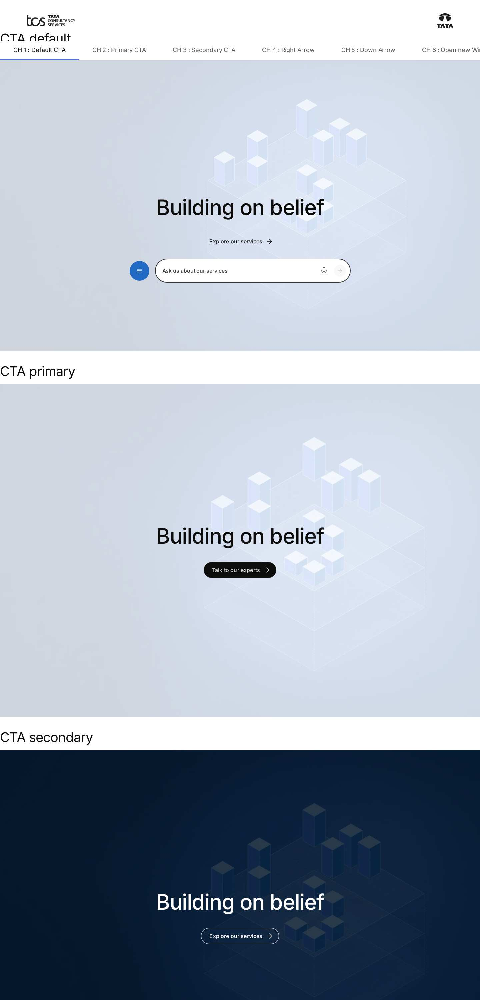
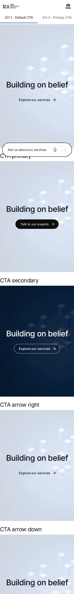

# Hero — Authoring Guide

| Attribute | Value |
| --- | --- |
| Document ID | AUT-C-hero |
| Audience | Content authors, content managers, AEM authoring leads |
| Purpose | How to add, fill in and check the Hero component |
| Scope | — |
| Prerequisites | — |
| Owner | Content Lead / AEM Authoring Lead (proposed) |
| Approver | Product Owner (to be confirmed) |
| Version | 1.0 |
| Status | Draft for review |
| Last updated | 8 November 2026 |
| Last validated | 8 November 2026 |
| Source files | blocks/hero/README.md, blocks/hero/_hero.json |
| Related documents | — |
| Related AEM paths | — |

## Contents

- [Where to see it](#where-to-see-it)
- [For Content Authors](#for-content-authors)
- [Authorable Fields](#authorable-fields)
- [Screenshot-Based Authoring Steps](#screenshot-based-authoring-steps)
- [Variations](#variations)
- [Complete Authoring Example](#complete-authoring-example)
- [Content and Asset Guidelines](#content-and-asset-guidelines)
- [Troubleshooting](#troubleshooting)
- [Screenshots](#screenshots)
- [Known limitations](#known-limitations)
- [Open items](#open-items)
- [Change history](#change-history)

## Where to see it

- https://main--tcs-corp--sradha-tcs.aem.live/design-block-master/en/block-library/hero
- https://main--tcs-corp--sradha-tcs.aem.live/design-block-master/en/block-library/hero/hero-ctas
- https://main--tcs-corp--sradha-tcs.aem.live/design-block-master/en/block-library/hero/hero-motion
- https://main--tcs-corp--sradha-tcs.aem.live/design-block-master/en/block-library/hero/hero-overview
- https://main--tcs-corp--sradha-tcs.aem.live/design-block-master/en/block-library/hero/hero-styles

## For Content Authors

1. **Add the block.** In Universal Editor select a Section, a Columns Container column, a Gen Carousel or a Tabs Container in the content tree, choose **Add (+)** and pick **Hero**. A new Hero stores Vertical Alignment Middle, Horizontal Alignment Center, Text Alignment Center align and Title heading level H1.
2. **Open its properties.** Select the Hero in the content tree; the properties panel shows the **Content**, **Style** and **Additional** tabs.
3. **Enter content (Content tab).** Choose a **Hero Image Path** and enter its **Hero Image alt text** (leave the alt empty only for a decorative image). Enter the **Eyebrow**, **Title** and **Description**; set **Title heading level** to H1 for the page's main Hero, H2 for any other. Add an **Icon** (with **Icon Image Alt Text**) only if the design needs it.
4. **Select variations.** For an animation set **Hero Image type** to Lotto and choose a Lottie `.json` file as the Hero Image Path. For an illustration that must be shown whole set **Hero View** to Contained image. On the **Style** tab choose **Vertical Alignment**, **Horizontal Alignment**, **Text Alignment** and **BG Color**.
5. **Add CTAs.** Select the Hero, choose **Add (+)** and pick **CTA**. Fill **CTA Link** (required) and **CTA Title**; choose **CTA view** (Default text link, Primary, Secondary), **CTA Arrow** (Auto, Right, Down) and **CTA Link Type** (Open in New Window only when needed). Reorder CTAs by dragging them in the content tree; the page shows them in that order.
6. **Additional tab.** Set an Anchor ID, Hide block, animations or spacing only when needed (see [Authorable Fields](https://github.com/sradha-tcs/tcs-corp/blob/main/blocks/hero/README.md#authorable-fields)).
7. **Preview.** Switch Universal Editor to Preview (animations play only there) or open the page on aem.page; check desktop, tablet and mobile widths.
8. **Publish.** Publish the page with its referenced assets. A Lottie `.json` file is served only once it is published itself (images travel with the page).
9. **Validate the published output.** On aem.live check the image loads with its alt text, exactly one H1 is on the page, every CTA goes to the right target, and a Lottie animation plays and pauses.

**Minimum required content:** a Title (a Hero without one renders, but has no heading). **Recommended:** a Hero Image with alt text, an Eyebrow, a Description and one or two CTAs. **Optional:** Icon, Lotto, Contained image, alignments, BG Color, Additional tab options.

## Authorable Fields

<!-- BEGIN GENERATED: fields (npm run build:docs) -->

#### Hero (`hero`)

Model `hero`; template name "Hero" (the block class AEM renders); children: `hero-cta`.

Stored on a new component (definition template): `classes_alignment` = `"align-middle"`, `content_titleType` = `"h1"`, `classes_horizontal` = `"align-center"`, `classes_textAlignment` = `"text-center"`.

##### Content tab — Hero

| Field label | Property | Type | Required | Default | Allowed values | Author guidance | Example |
| ----------- | -------- | ---- | -------- | ------- | -------------- | --------------- | ------- |
| Icon | `content_icon` | reference | No | — | — | — | /content/dam/tcs-corp/block-library/images/square-sample-3.jpg |
| Icon Image Alt Text | `content_iconAlt` | text | No | — | — | Leave empty if the icon is decorative. Delivered with `content_icon` (field collapse). | — |
| Hero Image type | `classes_media` | select | No | "" | Default (""), Lotto (`lottie`) | Default: the Hero Image Path is an image. Lotto: it is a Lottie animation file (.json), played as the hero background. Delivered as a block class. | lottie |
| Hero Image Path | `image` | reference | No | — | — | Default: an image. Lotto: a Lottie animation file (.json). | /content/dam/tcs-corp/block-library/images/wide-sample.jpg |
| Hero Image alt text | `imageAlt` | text | No | — | — | Leave empty if the image or animation is decorative. Delivered with `image` (field collapse). | Consultants reviewing a transformation roadmap |
| Hero View | `classes` | select | No | "" | Default (""), Contained image (`media-contained`) | Default: the image fills the hero behind the content. Contained image: the image (e.g. an illustration) is shown whole, centered behind the content. | media-contained |
| Eyebrow | `content_eyebrow` | text | No | — | — | — | Enterprise AI |
| Title | `content_title` | text | No | — | — | — | Building on belief |
| Title heading level | `content_titleType` | select | No | `h1` | H1 (`h1`), H2 (`h2`) | Use H1 for the first hero of a page, H2 for the others. Delivered with `content_title` (field collapse). | h1 |
| Description | `content_description` | richtext | No | "" | — | — | — |
| CTA List | `ctas` | container (multiple) | No | — | — | CTAs authored before CTA items. Add CTAs to the hero with Add (CTA) instead. | — |
| CTA List › CTA Title | `ctaText` | text | No | — | — | — | — |
| CTA List › CTA Text color | `ctaTextColor` | select | No | `cta-text-black` | Default (Black) (`cta-text-black`), White (`cta-text-white`) | Text Color of CTA | — |
| CTA List › CTA Link | `cta` | aem-content | No | — | — | — | — |
| CTA List › CTA Link Type | `ctaTarget` | select | No | `same-window` | Default (`same-window`), Open in New Window (`new-window`) | — | — |
| CTA List › CTA view | `ctaType` | select | No | `default` | Default (`default`), Primary (`primary`), Secondary (`secondary`) | — | — |
| CTA List › Primary CTA BG Color (Primary only) | `ctaPrimaryBackground` | select | No | `primary-bg-default` | Default (`primary-bg-default`), Blue-cyan (azure) (`primary-bg-azure`) | Background Color of Primary CTA | — |
| CTA List › Secondary CTA BG Color (Secondary only) | `ctaBackground` | select | No | `secondary-bg-default` | Default (transparent) (`secondary-bg-default`), Light grey (`secondary-bg-light-grey`), Black 40% (`secondary-bg-black-40`) | Background Color of Secondary CTA | — |
| CTA List › Secondary CTA Border color (Secondary only) | `ctaBorder` | select | No | `secondary-border-default` | Default (as the BG Color) (`secondary-border-default`), Black (`secondary-border-black`), White (`secondary-border-white`) | Border Color of Secondary CTA | — |
| CTA List › CTA Arrow | `ctaArrow` | select | No | `right` | Right (`right`), Down (`down`) | Direction of the arrow next to the CTA text. | — |

##### Style tab — Hero

| Field label | Property | Type | Required | Default | Allowed values | Author guidance | Example |
| ----------- | -------- | ---- | -------- | ------- | -------------- | --------------- | ------- |
| Vertical Alignment | `classes_alignment` | select | No | `align-middle` | Top (`align-top`), Middle (`align-middle`), Bottom (`align-bottom`) | Position of the content block: top, middle or bottom of the hero. Delivered as a block class. | align-top |
| Horizontal Alignment | `classes_horizontal` | select | No | `align-center` | Left (`align-left`), Center (`align-center`), Right (`align-right`) | Position of the content block: left, center or right of the hero (on desktop). Delivered as a block class. | align-left |
| Text Alignment | `classes_textAlignment` | select | No | `text-center` | Left align (`text-left`), Center align (`text-center`), Right align (`text-right`) | Alignment of the icon, text and CTAs inside the content block. Delivered as a block class. | text-left |
| BG Color | `classes_background` | select | No | "" | Default (""), Light, no overlay (`bg-light`), Dark blue (`bg-dark`), Dark blue (subtle) (`bg-dark-subtle`), Black (`bg-black`), Charcoal Black 80 (cool charcoal) (`bg-charcoal-80`), Midnight Navy 60 (`bg-navy-60`), Charcoal Black 40 (deep charcoal) (`bg-charcoal-40`) | Default: light, the image under a white overlay. Light, no overlay: the image as is (e.g. a light gradient) with dark text. The dark options put white text over a navy, black or charcoal overlay. Delivered as a block class. | bg-dark |
| Icon color | `classes_iconcolor` | select | No | "" | Default (as authored) (""), Black (`icon-black`), White (`icon-white`), Blue (`icon-blue`), Pale blue (`icon-pale-blue`) | Colour of the icon above the title, for a single-colour SVG icon. Default keeps the icon as authored. Delivered as a block class. | — |
| Eyebrow color | `classes_eyebrowcolor` | select | No | "" | Default (royal blue) (""), Royal blue (`eyebrow-royal-blue`), Soft sky blue (`eyebrow-sky-blue`) | Colour of the eyebrow above the title. Delivered as a block class. | — |

##### Additional tab — Hero

| Field label | Property | Type | Required | Default | Allowed values | Author guidance | Example |
| ----------- | -------- | ---- | -------- | ------- | -------------- | --------------- | ------- |
| Anchor ID | `classes_anchor` | text | No | — | regExp: ^anchor-[a-z0-9][a-z0-9-]*$; customErrorMsg: Start with anchor-, then lower-case letters, digits and hyphens. | A unique ID of the block on the page, starting with anchor-, e.g. anchor-our-services; link to it with #anchor-our-services. Delivered as a block class. | — |
| Hide block | `classes_hideblock` | boolean | No | `false` | on / off | Hides the whole block on the page until it is turned off (shown faded in the editor). Delivered as a block class. | — |
| Animation Type | `classes_animation` | select | No | "" | None (""), Fade in (`motion-fade-in`), Fade up (`motion-fade-up`), Fade down (`motion-fade-down`), Fade left (`motion-fade-left`), Fade right (`motion-fade-right`), Slide up (`motion-slide-up`), Slide down (`motion-slide-down`), Slide left (`motion-slide-left`), Slide right (`motion-slide-right`), Scale in (`motion-scale-in`) | How the block's content appears; repeated items (cards, list items, accordion items, columns) appear one after another. None: shown as is. Not played in the editor or when the visitor prefers reduced motion. Delivered as a block class. | motion-fade-in |
| Motion Speed | `classes_animationspeed` | select | No | "" | Medium (""), Fast (`motion-fast`), Slow (`motion-slow`) | How fast the block's animations run (Animation Type 0.3 / 0.6 / 0.9 s; the Background animation takes 1.5 times as long). Shown when (`classes_animation` is set and `classes_animation` is not empty) or (`classes_bganimation` is set and `classes_bganimation` is not empty). Delivered as a block class. | motion-slow |
| Animation Trigger | `classes_animationtrigger` | select | No | "" | On Scroll / Viewport Entry (""), On Page Load (`motion-on-load`) | When the block's animations run. On Scroll: when the block comes into view (at once if it is in view when the page opens). On Page Load: as soon as the block is ready, wherever it is on the page. Shown when (`classes_animation` is set and `classes_animation` is not empty) or (`classes_bganimation` is set and `classes_bganimation` is not empty). Delivered as a block class. | motion-on-load |
| Background animation | `classes_bganimation` | select | No | "" | None (""), Fade in (`bg-motion-fade-in`), Reveal from the centre (`bg-motion-reveal`), Wipe left to right (`bg-motion-wipe-right`), Wipe right to left (`bg-motion-wipe-left`), Wipe bottom to top (`bg-motion-wipe-up`), Scale reveal (`bg-motion-scale`) | How the block's background (its colour, image or overlay as set in the block) appears. It doesn't animate the content: see Animation Type. Motion Speed and Animation Trigger apply to it too. Not played in the editor or when the visitor prefers reduced motion. Delivered as a block class. | bg-motion-scale |
| Padding left | `classes_paddingleft` | select | No | "" | Default (""), 0 (none) (`pl-0`), 0.25rem (space-100) (`pl-100`), 0.5rem (space-200) (`pl-200`), 0.75rem (space-300) (`pl-300`), 1rem (space-400) (`pl-400`), 1.25rem (space-500) (`pl-500`), 1.5rem (space-600) (`pl-600`), 2rem (space-800) (`pl-800`), 2.5rem (space-1000) (`pl-1000`), 3rem (space-1200) (`pl-1200`), 4rem (space-1600) (`pl-1600`), 5rem (space-2000) (`pl-2000`), 6rem (space-2400) (`pl-2400`), 7.5rem (space-3000) (`pl-3000`) | Delivered as a block class. | — |
| Padding right | `classes_paddingright` | select | No | "" | Default (""), 0 (none) (`pr-0`), 0.25rem (space-100) (`pr-100`), 0.5rem (space-200) (`pr-200`), 0.75rem (space-300) (`pr-300`), 1rem (space-400) (`pr-400`), 1.25rem (space-500) (`pr-500`), 1.5rem (space-600) (`pr-600`), 2rem (space-800) (`pr-800`), 2.5rem (space-1000) (`pr-1000`), 3rem (space-1200) (`pr-1200`), 4rem (space-1600) (`pr-1600`), 5rem (space-2000) (`pr-2000`), 6rem (space-2400) (`pr-2400`), 7.5rem (space-3000) (`pr-3000`) | Delivered as a block class. | — |
| Padding top | `classes_paddingtop` | select | No | "" | Default (""), 0 (none) (`pt-0`), 0.25rem (space-100) (`pt-100`), 0.5rem (space-200) (`pt-200`), 0.75rem (space-300) (`pt-300`), 1rem (space-400) (`pt-400`), 1.25rem (space-500) (`pt-500`), 1.5rem (space-600) (`pt-600`), 2rem (space-800) (`pt-800`), 2.5rem (space-1000) (`pt-1000`), 3rem (space-1200) (`pt-1200`), 4rem (space-1600) (`pt-1600`), 5rem (space-2000) (`pt-2000`), 6rem (space-2400) (`pt-2400`), 7.5rem (space-3000) (`pt-3000`) | Delivered as a block class. | — |
| Padding bottom | `classes_paddingbottom` | select | No | "" | Default (""), 0 (none) (`pb-0`), 0.25rem (space-100) (`pb-100`), 0.5rem (space-200) (`pb-200`), 0.75rem (space-300) (`pb-300`), 1rem (space-400) (`pb-400`), 1.25rem (space-500) (`pb-500`), 1.5rem (space-600) (`pb-600`), 2rem (space-800) (`pb-800`), 2.5rem (space-1000) (`pb-1000`), 3rem (space-1200) (`pb-1200`), 4rem (space-1600) (`pb-1600`), 5rem (space-2000) (`pb-2000`), 6rem (space-2400) (`pb-2400`), 7.5rem (space-3000) (`pb-3000`) | Delivered as a block class. | — |
| Margin left | `classes_marginleft` | select | No | "" | Default (""), 0 (none) (`ml-0`), 0.25rem (space-100) (`ml-100`), 0.5rem (space-200) (`ml-200`), 0.75rem (space-300) (`ml-300`), 1rem (space-400) (`ml-400`), 1.25rem (space-500) (`ml-500`), 1.5rem (space-600) (`ml-600`), 2rem (space-800) (`ml-800`), 2.5rem (space-1000) (`ml-1000`), 3rem (space-1200) (`ml-1200`), 4rem (space-1600) (`ml-1600`), 5rem (space-2000) (`ml-2000`), 6rem (space-2400) (`ml-2400`), 7.5rem (space-3000) (`ml-3000`) | Delivered as a block class. | — |
| Margin right | `classes_marginright` | select | No | "" | Default (""), 0 (none) (`mr-0`), 0.25rem (space-100) (`mr-100`), 0.5rem (space-200) (`mr-200`), 0.75rem (space-300) (`mr-300`), 1rem (space-400) (`mr-400`), 1.25rem (space-500) (`mr-500`), 1.5rem (space-600) (`mr-600`), 2rem (space-800) (`mr-800`), 2.5rem (space-1000) (`mr-1000`), 3rem (space-1200) (`mr-1200`), 4rem (space-1600) (`mr-1600`), 5rem (space-2000) (`mr-2000`), 6rem (space-2400) (`mr-2400`), 7.5rem (space-3000) (`mr-3000`) | Delivered as a block class. | — |
| Margin top | `classes_margintop` | select | No | "" | Default (""), 0 (none) (`mt-0`), 0.25rem (space-100) (`mt-100`), 0.5rem (space-200) (`mt-200`), 0.75rem (space-300) (`mt-300`), 1rem (space-400) (`mt-400`), 1.25rem (space-500) (`mt-500`), 1.5rem (space-600) (`mt-600`), 2rem (space-800) (`mt-800`), 2.5rem (space-1000) (`mt-1000`), 3rem (space-1200) (`mt-1200`), 4rem (space-1600) (`mt-1600`), 5rem (space-2000) (`mt-2000`), 6rem (space-2400) (`mt-2400`), 7.5rem (space-3000) (`mt-3000`) | Delivered as a block class. | — |
| Margin bottom | `classes_marginbottom` | select | No | "" | Default (""), 0 (none) (`mb-0`), 0.25rem (space-100) (`mb-100`), 0.5rem (space-200) (`mb-200`), 0.75rem (space-300) (`mb-300`), 1rem (space-400) (`mb-400`), 1.25rem (space-500) (`mb-500`), 1.5rem (space-600) (`mb-600`), 2rem (space-800) (`mb-800`), 2.5rem (space-1000) (`mb-1000`), 3rem (space-1200) (`mb-1200`), 4rem (space-1600) (`mb-1600`), 5rem (space-2000) (`mb-2000`), 6rem (space-2400) (`mb-2400`), 7.5rem (space-3000) (`mb-3000`) | Delivered as a block class. | — |

#### CTA (`hero-cta`)

Model `hero-cta`; template name "CTA" (the block class AEM renders).

##### Fields — CTA

| Field label | Property | Type | Required | Default | Allowed values | Author guidance | Example |
| ----------- | -------- | ---- | -------- | ------- | -------------- | --------------- | ------- |
| CTA Link | `link` | aem-content | Yes | — | — | — | — |
| CTA Title | `linkText` | text | No | — | — | Delivered with `link` (field collapse). | — |
| CTA Link Type | `linkTarget` | select | No | "" | Default (""), Open in New Window (`new-window`) | — | — |
| CTA view | `linkStyle` | select | No | "" | Default (""), Primary (`primary`), Secondary (`secondary`) | — | — |
| CTA Arrow | `linkArrow` | select | No | "" | Auto (down for links to sections of this page) (""), Right (`right`), Down (`down`) | Direction of the arrow next to the CTA text. | — |

<!-- END GENERATED: fields -->

Notes on the significant fields (the tables above list every field, default and allowed value):

- **Hero Image Path / Hero Image type.** With Default the reference renders as a `<picture>` covering the banner (`object-fit: cover`). With Lotto and a `.json` link the Lottie player renders an SVG animation instead (`createAnimation`, class `hero-animation`). With Lotto and an image, the image is shown; with Default and a `.json` link, no media is rendered.
- **Hero Image alt text.** Becomes the image's `alt`. For a Lottie file AEM delivers the alt as the link text; `animationLabel` (`utils/media.js`) reads it and the animation gets `role="img"` and `aria-label`; without an alt it is `aria-hidden="true"`.
- **Icon / Icon Image Alt Text.** The first stand-alone picture before the title becomes `div.hero-icon` (`--icon-size-l`, 3rem from 900px); further pictures go to the description.
- **Eyebrow.** Rendered as `p.hero-eyebrow` only when there is a Title; without a Title every text element goes to the description.
- **Title / Title heading level.** The heading level collapses into the title (AEM delivers an `h1` or `h2`); it becomes `.hero-title`. Accessibility and SEO: one H1 per page.
- **Description.** Rich text in `div.hero-description` (omitted when empty).
- **CTA (item) fields.** CTA view Primary / Secondary render `a.button.primary` / `a.button.secondary`; Default renders `a.button.tertiary` (text with an arrow). CTA Arrow Down, or Auto with a link starting with `#`, adds `hero-cta-down` (down arrow). Open in New Window sets `target="_blank"`, `rel="noopener noreferrer"` and appends the visually hidden placeholder text `opensInNewTab` ("(opens in a new tab)"). A CTA without a link isn't rendered (in Universal Editor it is a dashed placeholder).
- **BG Color.** Default: white overlay at 80 %. Light, no overlay: the image as is. Dark blue: navy overlay at 80 %; Dark blue (subtle): 60 %; Black: black at 80 %; the dark options switch the title to white, the description to 50 % white (85 % on Dark blue (subtle)), the eyebrow to `--brand-300` (white on Dark blue (subtle)) and Secondary / Default CTAs to white. Without media no overlay is drawn.
- **Alignments.** Vertical and Horizontal Alignment position the content block (nine positions); Text Alignment aligns the icon, text and CTAs inside it. Heroes authored before Text Alignment existed follow their Horizontal Alignment.
- **Data-layer impact.** None of the fields changes the data-layer entry except the Title (its text is the component's `dc:title`) and Anchor ID (the component id).
- **Legacy mapping.** CTAs authored in the former **CTA List** composite multifield (`ctas`: CTA Title, CTA Link, CTA Link Type, CTA view as bold / italic, CTA Arrow) are still read and shown before the CTA items. A Primary one can have a **Primary CTA BG Color** (Blue-cyan (azure), `#216AC3` `--color-bg-brand` with white text, also in dark sections), a Secondary one a **Secondary CTA BG Color** (Light grey, Black 40%) and **Secondary CTA Border color** (Black, White), labelled "(Primary only)" / "(Secondary only)" and always shown in the dialog (Universal Editor doesn't support conditions inside multifields), applied only for their CTA view; any CTA can also have a **CTA Text color** (Default (Black) or White, the field's default Default (Black) for new CTAs: the chosen colour of the text and arrow whatever the CTA view and background, also on Blue-cyan (azure) and in dark sections; choose the one that reads on the background: White on a black button, Black on azure or a light background; CTAs authored before without a value keep their colour): their values (`primary-bg-azure`, `secondary-bg-*`, `secondary-border-*`, `CTA_OPTIONS`, and `cta-text-black`, `cta-text-white`, `CTA_TEXT_COLORS` in `hero.js`) become classes of that CTA's button, which `hero.css` styles (hover and focus keep the button's own style); CTA items don't have them (KB-D-062). The former **Motion Type** values (`motion-fade`, `motion-slide`, `motion-zoom`) are mapped by `mapLegacyMotion` to Fade in, Fade up and Background Scale reveal, played Slow unless a Motion Speed is set, and only when the block has no Animation Type / Background animation of its own.
- **Additional tab.** Anchor ID, Hide block, spacing, Animation Type, Motion Speed, Animation Trigger and, because the Hero has an authored background, **Background animation**: see AGENTS.md "Additional tab" and "Animation and skeletons". The content animation moves `.hero-content`; the background animation the media and the overlay.

## Screenshot-Based Authoring Steps

#### Authoring Step 1: Add the Hero

```text
[Screenshot Placeholder]

File name:
hero-authoring-step-1.png

Purpose:
The Hero added to the first Section of the page in Universal Editor.

Annotations:
A = Section selected in the content tree
B = Add (+) menu with Hero
C = New Hero with the template defaults
```

#### Values to Enter

| Callout | Field | Value | Reason | Expected result |
| ------- | ----- | ----- | ------ | --------------- |
| A | (content tree) | First Section of the page | The opening Hero is the LCP element | Section selected |
| B | Add (+) | Hero | Adds the block | An empty Hero appears |
| C | (properties) | — | Template defaults are stored | Middle, Center, Center align, H1 |

Author action: select the Section, choose Add (+), pick Hero. Expected preview: an empty banner of the minimum height. Expected published result: nothing visible until content is entered. Business rule: only containers whose filter lists `hero` offer it. Validation: the Hero appears in the content tree under the Section. Common mistake: adding the Hero inside a Tabs Container's tab when it should open the page; resolution: move it to the first Section.

#### Authoring Step 2: Image and content

```text
[Screenshot Placeholder]

File name:
hero-authoring-step-2.png

Purpose:
The Content tab with the image, alt text, eyebrow, title, heading level and description filled.

Annotations:
A = Hero Image Path
B = Hero Image alt text
C = Eyebrow
D = Title
E = Title heading level
F = Description
```

#### Values to Enter

| Callout | Field | Value | Reason | Expected result |
| ------- | ----- | ----- | ------ | --------------- |
| A | Hero Image Path | /content/dam/tcs-corp/block-library/images/wide-sample.jpg | Cover image | The image fills the banner under the white overlay |
| B | Hero Image alt text | Consultants reviewing a transformation roadmap | Text alternative (WCAG 1.1.1) | `alt` on the image |
| C | Eyebrow | Enterprise AI | Topic label above the title | Brand-coloured eyebrow |
| D | Title | Building on belief | The page's headline | Large title |
| E | Title heading level | H1 | First Hero of the page | `h1.hero-title` |
| F | Description | Our AI-led services help enterprises grow, transform and compete with confidence. | Supporting sentence | Grey description below the title |

Author action: open the Content tab and enter the values. Expected preview: centred eyebrow, title and description over the softened image. Expected published result: the same, the image loaded eagerly with high priority in the first section. Business rule: the eyebrow only shows when there is a title. Validation: one `h1` on the page. Common mistake: leaving the alt empty for an informative image; resolution: describe the image.

#### Authoring Step 3: CTAs

```text
[Screenshot Placeholder]

File name:
hero-authoring-step-3.png

Purpose:
Two CTA items added to the Hero with Add, the first one's dialog open.

Annotations:
A = CTA Link
B = CTA Title
C = CTA view
D = CTA Arrow
E = CTA Link Type
```

#### Values to Enter

| Callout | Field | Value | Reason | Expected result |
| ------- | ----- | ----- | ------ | --------------- |
| A | CTA Link | /en/contact (first CTA), /en/services (second CTA) | Destination | Links rendered |
| B | CTA Title | Talk to our experts / Explore our services | Visible label and accessible name | Button labels |
| C | CTA view | Primary / Secondary | Primary action first | Filled and outline pill buttons |
| D | CTA Arrow | Auto | Arrow right for other pages, down for `#` links | Right arrows |
| E | CTA Link Type | Default | Same tab | No `target` attribute |

Author action: select the Hero, Add (+) › CTA, fill the dialog; repeat for the second CTA. Expected preview: two CTAs side by side below the description, wrapping when they don't fit. Expected published result: the same. Business rule: CTA Link is required; a CTA without a link isn't rendered. Validation: both CTAs open their pages. Common mistake: entering a CTA Title without a CTA Link (the editor shows a dashed placeholder); resolution: fill CTA Link.

#### Authoring Step 4: Style

```text
[Screenshot Placeholder]

File name:
hero-authoring-step-4.png

Purpose:
The Style tab with the content block moved to the left and a dark overlay.

Annotations:
A = Vertical Alignment
B = Horizontal Alignment
C = Text Alignment
D = BG Color
```

#### Values to Enter

| Callout | Field | Value | Reason | Expected result |
| ------- | ----- | ----- | ------ | --------------- |
| A | Vertical Alignment | Middle | Content in the vertical centre | Centred vertically |
| B | Horizontal Alignment | Left | Keep the image subject on the right free | Content block on the left, at most 47.5rem wide from 900px |
| C | Text Alignment | Left align | Text follows the block's position | Text and CTAs start at the left |
| D | BG Color | Dark blue | Brand statement with white text | Navy overlay, white title, light eyebrow |

Author action: open the Style tab and choose the values. Expected preview: white text on the navy overlay, content on the left. Expected published result: the same. Business rule: Text Alignment is independent of Horizontal Alignment. Validation: text contrast is readable at the text position. Common mistake: Light, no overlay over a busy photograph; resolution: choose Default or a dark BG Color.

#### Authoring Step 5: Preview, publish and verify

```text
[Screenshot Placeholder]

File name:
hero-authoring-step-5.png

Purpose:
The Hero in Universal Editor Preview at desktop width, compared with the published page.

Annotations:
A = Preview toggle
B = Published Hero
```

#### Values to Enter

| Callout | Field | Value | Reason | Expected result |
| ------- | ----- | ----- | ------ | --------------- |
| A | Preview | On | Animations play only in Preview | The Hero as visitors see it |
| B | Publish | Publish with referenced assets | The image must be published | The Hero on aem.live |

Author action: switch to Preview, then publish. Expected result: the published Hero matches the preview. Validation: image request succeeds, alt text present, CTAs work. Common mistake: a Lotto Hero whose `.json` asset wasn't published (empty background on the published page); resolution: publish the asset.

## Variations

The variations are the select values of the model (`blocks/hero/_hero.json`), delivered as block classes. They combine freely.

#### Default image (Hero Image type Default, Hero View Default)

Purpose: a photograph covering the whole banner. Use for most heroes; not for illustrations that must not be cropped. Required: Hero Image Path, alt text (or decorative). Rendering: `div.hero-media > picture` absolutely positioned behind the content, `object-fit: cover`, under the BG Color overlay; the block gets `hero-has-media`. Desktop / tablet / mobile: the image is cropped around its centre into the banner's height. Accessibility: the `alt` names the image. Data layer: no change. Personalization and fallback: no personalization; without an image the hero renders without media.

```text
[Screenshot Placeholder]

File name:
hero-default-image-mobile.png

Purpose:
The Default image Hero at 375px: the image cropped to the centre of the 35rem banner.

Annotations:
A = Cropped cover image
B = Content block
```

#### Lotto (`lottie`)

Purpose: a looping Lottie animation as the background. Use for campaign pages with an approved Lottie JSON; not when the animation carries information the text doesn't. Required: Hero Image type Lotto, Hero Image Path a `.json` file; optional alt text. Rendering: `div.hero-media > div.hero-animation` (SVG renderer, `xMidYMid meet`, looping) and a pause / play `button.animation-toggle` appended to the block, 1rem (`--space-400`) from the bottom-right corner. The player loads when the hero is within 200px of the viewport, in idle time; the animation pauses off screen and starts paused on its first frame for reduced motion. If the file fails, the animation and its button are hidden. Accessibility: WCAG 2.2.2 pause control with localised labels (`pauseAnimation`, `playAnimation`). Data layer: a click on the button is a `cmp:click` with `interaction: animation`. Fallback: with Lotto and an image, the image is shown.

```text
[Screenshot Placeholder]

File name:
hero-lottie-tablet.png

Purpose:
The Lotto Hero at 768px with the pause / play button in the bottom-right corner.

Annotations:
A = Lottie animation
B = Pause / play button
```

#### Contained image (`media-contained`)

Purpose: show an illustration or chart whole, centred behind the content. Use for artwork that must not be cropped; not for photographs meant to fill the banner. Rendering: the media becomes a centred flex box with `--space-600` padding and the image `object-fit: contain`. Usually paired with BG Color Light, no overlay. Accessibility and data layer as Default.

```text
[Screenshot Placeholder]

File name:
hero-contained-image-mobile.png

Purpose:
The Contained image Hero at 375px: the whole illustration visible inside the banner.

Annotations:
A = Contained illustration
B = Content block
```

#### Text only (no media)

Purpose: a plain banner without image. Rendering: no `hero-media`, no `hero-has-media`, no overlay; the block background is `--color-bg-default` (navy or black with the dark BG Colors). Use for simple statement pages.

#### BG Color: Default, Light no overlay (`bg-light`), Dark blue (`bg-dark`), Dark blue subtle (`bg-dark-subtle`), Black (`bg-black`), Charcoal Black 80 (`bg-charcoal-80`), Midnight Navy 60 (`bg-navy-60`), Charcoal Black 40 (`bg-charcoal-40`)

Purpose: readability of the text over the media. Rendering and colours as in [Authorable Fields](https://github.com/sradha-tcs/tcs-corp/blob/main/blocks/hero/README.md#authorable-fields); Charcoal Black 80 is a `rgba(34, 35, 41, 0.8)` overlay, Midnight Navy 60 `rgba(1, 18, 31, 0.6)` (the Dark blue subtle overlay with the 50 % white description of the other dark options), Charcoal Black 40 `rgba(12, 12, 13, 0.4)`; all three are dark options (white text, the header keeps its band). Use a dark option for white text on photographs; Light, no overlay only with light, calm images. Accessibility: the dark colours were adjusted for WCAG 1.4.3 (re-audit R-B-4); the Default overlay's eyebrow contrast awaits design sign-off.

```text
[Screenshot Placeholder]

File name:
hero-bg-dark-subtle-mobile.png

Purpose:
BG Color Dark blue (subtle) at 375px: white eyebrow, white title and 85 % white description over the 60 % navy overlay.

Annotations:
A = White eyebrow
B = Description at 85 % white
C = White Secondary CTA
```

#### Vertical Alignment: Top, Middle, Bottom (`align-top`, `align-middle`, `align-bottom`)

Positions the content block in the banner's height (`justify-content`). Middle is the template default.

#### Horizontal Alignment: Left, Center, Right (`align-left`, `align-center`, `align-right`)

Positions the content block across the banner. From 900px Left and Right limit the content block to 47.5rem; below 900px it is full width.

#### Text Alignment: Left, Center, Right align (`text-left`, `text-center`, `text-right`)

Aligns the icon, text and CTAs inside the content block. Center align is the template default.

#### CTA view, CTA Arrow and CTA Link Type (item options)

Default (text with arrow, `tertiary`), Primary, Secondary; Arrow Auto / Right / Down; Link Type Default / Open in New Window. See [Authorable Fields](https://github.com/sradha-tcs/tcs-corp/blob/main/blocks/hero/README.md#authorable-fields).

#### Title heading level H2

For any Hero other than the page's main one: the title renders as `h2.hero-title` with the same styles as an H1.

## Complete Authoring Example

Scenario: the opening banner of the English Enterprise AI landing page.

| Field | Example value | Guidance |
| ----- | ------------- | -------- |
| Hero Image type | Default | A photograph |
| Hero Image Path | /content/dam/tcs-corp/block-library/images/wide-sample.jpg | A wide image with a centred subject |
| Hero Image alt text | Consultants reviewing a transformation roadmap | Describe what the image shows |
| Eyebrow | Enterprise AI | Short topic label |
| Title | Building on belief | One headline |
| Title heading level | H1 | The page's only H1 |
| Description | Our AI-led services help enterprises grow, transform and compete with confidence. | One or two sentences |
| CTA 1 | Talk to our experts, /en/contact, Primary, Auto | The main action |
| CTA 2 | Explore our services, /en/services, Secondary, Auto | The secondary action |
| Vertical / Horizontal / Text Alignment | Middle / Center / Center align | Template defaults |
| BG Color | Default | White overlay, dark text |

Steps: add the Hero to the first Section (Authoring Step 1), fill the Content tab (Step 2), add the two CTAs (Step 3), keep the Style defaults, preview and publish (Step 5).

Expected output: a centred banner with the brand-blue eyebrow, the dark H1, the grey description and a filled and an outline button side by side over the softened photograph.

Responsive: 35rem high on phones, 40rem from 600px, 53.125rem from 900px (at most the first screen below the header in the first section); CTAs wrap when they don't fit.

Accessibility: one H1, image alt text, CTAs with meaningful text, keyboard reachable.

Analytics / data layer: the Hero is `hero-1` (or its Anchor ID) with `dc:title` "Building on belief"; each CTA click is a `cmp:click`.

Personalization fallback: none; the authored content is what renders.

Pre-publish checklist:

- [ ] Exactly one H1 on the page.
- [ ] Image alt text entered (or the image is decorative).
- [ ] Every CTA has a CTA Link and a meaningful CTA Title.
- [ ] Open in New Window used only where needed.
- [ ] Text readable over the image at desktop, tablet and mobile.
- [ ] Referenced assets (and any Lottie `.json`) published.
- [ ] Hide block is off.

## Content and Asset Guidelines

- **Titles.** One message; use H1 only for the page's main Hero.
- **Descriptions.** One or two sentences; the description is limited to 53.125rem wide, the title to 72.5rem.
- **Eyebrows.** A short topic label; shown only with a title.
- **CTAs and links.** Action-oriented labels that make sense out of context; use Down arrows only for in-page anchors (`#anchor-...`). No verified technical limit on the number of CTAs was identified; the row wraps.
- **Images and alt text.** Wide images with the subject in the centre (the cover crop keeps the centre); describe informative images, leave the alt empty only for decorative ones. No verified aspect ratio or minimum size is enforced by the code.
- **Icons.** A small square image or SVG; shown at the `--icon-size-l` token size, 3rem from 900px.
- **Lottie.** A Lottie JSON for the SVG renderer from AEM Assets; it must be published separately (non-image DAM files aren't delivered with the page).
- **Tags and metadata.** None: the Hero has no tag field and reads no metadata.
- **Min / max items.** No verified technical limit was identified (CTAs, description length).
- **Asset source.** AEM Assets (DAM).
- **Loading.** In the first section of the page the hero image gets `loading="eager"` and `fetchpriority="high"`; elsewhere the delivered loading applies. The Lottie player loads lazily near the viewport.
- **Missing asset fallback.** Without media the Hero renders as a text banner without overlay; a Lottie that fails is hidden with its button.

## Troubleshooting

| Symptom | Likely cause | Diagnostic steps | Resolution | Verification |
| ------- | ------------ | ---------------- | ---------- | ------------ |
| No animation behind the content | Hero Image type Default with a `.json` file; JSON asset not published; invalid Lottie | Check the block has class `lottie`; Network: `.json` status; console `failed to play the Lottie animation` | Set Lotto; publish the asset; re-export the Lottie | Animation plays on the published page |
| Animation shows its first frame only | Visitor prefers reduced motion | Check the OS setting | Expected; Play starts it | Toggle plays it |
| Two H1s on the page | Several Heroes with H1, or a Hero on a templated page with Page Header | Search the DOM for `h1` | Set Title heading level H2 on the others; use the Page Header on templated pages | One `h1` |
| A CTA is missing | CTA item without CTA Link | Open the CTA item | Fill CTA Link | CTA renders |
| CTA arrow points down for a normal link | CTA Arrow Down, or Auto with a `#` link | Check CTA Arrow / CTA Link | Set CTA Arrow Right | Right arrow |
| Text hard to read | Light, no overlay on a busy image; Dark blue (subtle) on a bright image | Contrast checker at the text | Choose Default or a dark BG Color, or another image | Contrast at least 4.5:1 (3:1 large text) |
| Hero missing on the published page | Hide block on | Block has class `hideblock` | Turn Hide block off and publish | Hero visible |
| Old Motion Type can't be changed | Legacy `motion-*` class from content authored before | Inspect the authored classes | Migrate to Animation Type (re-audit R-B-6) | Animation as chosen |
| Slow LCP on a page opening with a Hero | Background animation on the first Hero (F-94) | Lighthouse LCP | Use Background animation below the fold | LCP improves |

Evidence to collect (no secrets): page URL, viewport, the block's classes and rendered HTML, console errors, Network status of the image / `.json`, the data-layer entries.

## Screenshots



*Figure: Hero as published (block library) — desktop 1440 × 900 (/design-block-master/en/block-library/hero/hero-ctas, captured 2026-11-08).*



*Figure: Hero as published (block library) — mobile 375 × 812 (/design-block-master/en/block-library/hero/hero-ctas, captured 2026-11-08).*

> **Screenshot required**
>
> - Required screen: Hero dialog in Universal Editor (every tab, including Additional)
> - Required role/access: AEM Sites author with Universal Editor (content author)
> - Required navigation steps: AEM Sites console > /content/tcs-corp/language-masters/en > open a page in Universal Editor
> - Reason unavailable: No AEM author access in the documentation program (access blocker AB-01)
> - Owner: Content Lead / AEM Authoring Lead (proposed)
> - Target completion date: To be confirmed

## Known limitations

- Universal Editor screenshots are placeholders: no author access in this program.

## Open items

- None.

## Change history

| Version | Date | Author | Change |
| --- | --- | --- | --- |
| 1.0 | 8 November 2026 | Delivery team (documentation program) | First version of the role-specific documentation (master documentation prompt), generated from the repository and the published reference pages |
