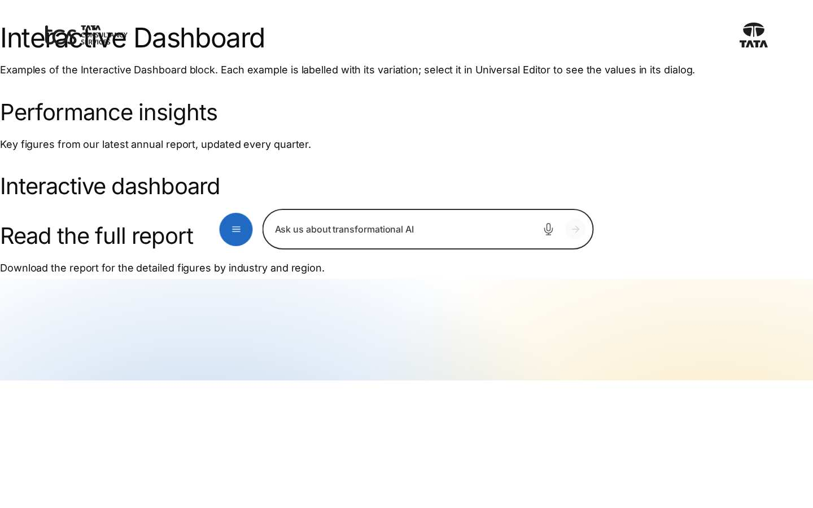
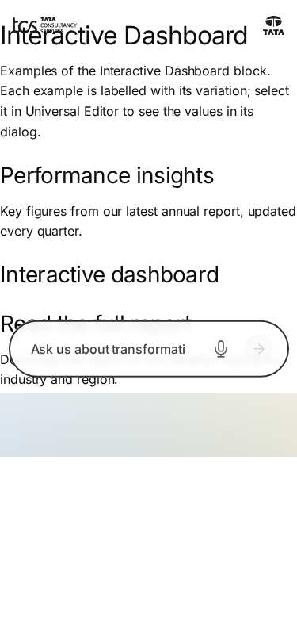

# Interactive Dashboard — Authoring Guide

| Attribute | Value |
| --- | --- |
| Document ID | AUT-C-interactive-dashboard |
| Audience | Content authors, content managers, AEM authoring leads |
| Purpose | How to add, fill in and check the Interactive Dashboard component |
| Scope | — |
| Prerequisites | — |
| Owner | Content Lead / AEM Authoring Lead (proposed) |
| Approver | Product Owner (to be confirmed) |
| Version | 1.0 |
| Status | Draft for review |
| Last updated | 8 November 2026 |
| Last validated | 8 November 2026 |
| Source files | blocks/interactive-dashboard/README.md, blocks/interactive-dashboard/_interactive-dashboard.json |
| Related documents | — |
| Related AEM paths | — |

## Contents

- [Where to see it](#where-to-see-it)
- [For Content Authors](#for-content-authors)
- [Authorable Fields](#authorable-fields)
- [Screenshot-Based Authoring Steps](#screenshot-based-authoring-steps)
- [Variations](#variations)
- [Complete Authoring Example](#complete-authoring-example)
- [Content and Asset Guidelines](#content-and-asset-guidelines)
- [Troubleshooting](#troubleshooting)
- [Screenshots](#screenshots)
- [Known limitations](#known-limitations)
- [Open items](#open-items)
- [Change history](#change-history)

## Where to see it

- https://main--tcs-corp--sradha-tcs.aem.live/design-block-master/en/block-library/interactive-dashboard
- https://main--tcs-corp--sradha-tcs.aem.live/design-block-master/en/block-library/interactive-dashboard/interactive-dashboard

## For Content Authors

1. **Adding the block:** not possible; the Interactive Dashboard is in no component filter.
2. **An existing instance:** select it in the content tree (or on the canvas in edit mode); its
   properties have only the **Additional** tab.
3. **Content:** the block has no content fields; anything placed in it is discarded.
4. **Preview:** in Preview mode and on the site the block is not shown.
5. **Publish:** don't publish pages that rely on it; delete the block (or the empty section) before
   publishing, or turn on Hide block.
6. **Validate:** on the preview host the page shows no gap where the block was.

**Minimum required / recommended / optional:** not applicable.

## Authorable Fields

<!-- BEGIN GENERATED: fields (npm run build:docs) -->

#### Interactive Dashboard (`interactive-dashboard`)

Model `interactive-dashboard`; template name "Interactive Dashboard" (the block class AEM renders).

##### Additional tab — Interactive Dashboard

| Field label | Property | Type | Required | Default | Allowed values | Author guidance | Example |
| ----------- | -------- | ---- | -------- | ------- | -------------- | --------------- | ------- |
| Anchor ID | `classes_anchor` | text | No | — | regExp: ^anchor-[a-z0-9][a-z0-9-]*$; customErrorMsg: Start with anchor-, then lower-case letters, digits and hyphens. | A unique ID of the block on the page, starting with anchor-, e.g. anchor-our-services; link to it with #anchor-our-services. Delivered as a block class. | — |
| Hide block | `classes_hideblock` | boolean | No | `false` | on / off | Hides the whole block on the page until it is turned off (shown faded in the editor). Delivered as a block class. | — |
| Animation Type | `classes_animation` | select | No | "" | None (""), Fade in (`motion-fade-in`), Fade up (`motion-fade-up`), Fade down (`motion-fade-down`), Fade left (`motion-fade-left`), Fade right (`motion-fade-right`), Slide up (`motion-slide-up`), Slide down (`motion-slide-down`), Slide left (`motion-slide-left`), Slide right (`motion-slide-right`), Scale in (`motion-scale-in`) | How the block's content appears; repeated items (cards, list items, accordion items, columns) appear one after another. None: shown as is. Not played in the editor or when the visitor prefers reduced motion. Delivered as a block class. | — |
| Motion Speed | `classes_animationspeed` | select | No | "" | Medium (""), Fast (`motion-fast`), Slow (`motion-slow`) | How fast the animation runs: 0.3, 0.6 or 0.9 seconds. Shown when `classes_animation` is set and `classes_animation` is not empty. Delivered as a block class. | — |
| Animation Trigger | `classes_animationtrigger` | select | No | "" | On Scroll / Viewport Entry (""), On Page Load (`motion-on-load`) | When the block's animations run. On Scroll: when the block comes into view (at once if it is in view when the page opens). On Page Load: as soon as the block is ready, wherever it is on the page. Shown when `classes_animation` is set and `classes_animation` is not empty. Delivered as a block class. | — |
| Padding left | `classes_paddingleft` | select | No | "" | Default (""), 0 (none) (`pl-0`), 0.25rem (space-100) (`pl-100`), 0.5rem (space-200) (`pl-200`), 0.75rem (space-300) (`pl-300`), 1rem (space-400) (`pl-400`), 1.25rem (space-500) (`pl-500`), 1.5rem (space-600) (`pl-600`), 2rem (space-800) (`pl-800`), 2.5rem (space-1000) (`pl-1000`), 3rem (space-1200) (`pl-1200`), 4rem (space-1600) (`pl-1600`), 5rem (space-2000) (`pl-2000`), 6rem (space-2400) (`pl-2400`), 7.5rem (space-3000) (`pl-3000`) | Delivered as a block class. | — |
| Padding right | `classes_paddingright` | select | No | "" | Default (""), 0 (none) (`pr-0`), 0.25rem (space-100) (`pr-100`), 0.5rem (space-200) (`pr-200`), 0.75rem (space-300) (`pr-300`), 1rem (space-400) (`pr-400`), 1.25rem (space-500) (`pr-500`), 1.5rem (space-600) (`pr-600`), 2rem (space-800) (`pr-800`), 2.5rem (space-1000) (`pr-1000`), 3rem (space-1200) (`pr-1200`), 4rem (space-1600) (`pr-1600`), 5rem (space-2000) (`pr-2000`), 6rem (space-2400) (`pr-2400`), 7.5rem (space-3000) (`pr-3000`) | Delivered as a block class. | — |
| Padding top | `classes_paddingtop` | select | No | "" | Default (""), 0 (none) (`pt-0`), 0.25rem (space-100) (`pt-100`), 0.5rem (space-200) (`pt-200`), 0.75rem (space-300) (`pt-300`), 1rem (space-400) (`pt-400`), 1.25rem (space-500) (`pt-500`), 1.5rem (space-600) (`pt-600`), 2rem (space-800) (`pt-800`), 2.5rem (space-1000) (`pt-1000`), 3rem (space-1200) (`pt-1200`), 4rem (space-1600) (`pt-1600`), 5rem (space-2000) (`pt-2000`), 6rem (space-2400) (`pt-2400`), 7.5rem (space-3000) (`pt-3000`) | Delivered as a block class. | — |
| Padding bottom | `classes_paddingbottom` | select | No | "" | Default (""), 0 (none) (`pb-0`), 0.25rem (space-100) (`pb-100`), 0.5rem (space-200) (`pb-200`), 0.75rem (space-300) (`pb-300`), 1rem (space-400) (`pb-400`), 1.25rem (space-500) (`pb-500`), 1.5rem (space-600) (`pb-600`), 2rem (space-800) (`pb-800`), 2.5rem (space-1000) (`pb-1000`), 3rem (space-1200) (`pb-1200`), 4rem (space-1600) (`pb-1600`), 5rem (space-2000) (`pb-2000`), 6rem (space-2400) (`pb-2400`), 7.5rem (space-3000) (`pb-3000`) | Delivered as a block class. | — |
| Margin left | `classes_marginleft` | select | No | "" | Default (""), 0 (none) (`ml-0`), 0.25rem (space-100) (`ml-100`), 0.5rem (space-200) (`ml-200`), 0.75rem (space-300) (`ml-300`), 1rem (space-400) (`ml-400`), 1.25rem (space-500) (`ml-500`), 1.5rem (space-600) (`ml-600`), 2rem (space-800) (`ml-800`), 2.5rem (space-1000) (`ml-1000`), 3rem (space-1200) (`ml-1200`), 4rem (space-1600) (`ml-1600`), 5rem (space-2000) (`ml-2000`), 6rem (space-2400) (`ml-2400`), 7.5rem (space-3000) (`ml-3000`) | Delivered as a block class. | — |
| Margin right | `classes_marginright` | select | No | "" | Default (""), 0 (none) (`mr-0`), 0.25rem (space-100) (`mr-100`), 0.5rem (space-200) (`mr-200`), 0.75rem (space-300) (`mr-300`), 1rem (space-400) (`mr-400`), 1.25rem (space-500) (`mr-500`), 1.5rem (space-600) (`mr-600`), 2rem (space-800) (`mr-800`), 2.5rem (space-1000) (`mr-1000`), 3rem (space-1200) (`mr-1200`), 4rem (space-1600) (`mr-1600`), 5rem (space-2000) (`mr-2000`), 6rem (space-2400) (`mr-2400`), 7.5rem (space-3000) (`mr-3000`) | Delivered as a block class. | — |
| Margin top | `classes_margintop` | select | No | "" | Default (""), 0 (none) (`mt-0`), 0.25rem (space-100) (`mt-100`), 0.5rem (space-200) (`mt-200`), 0.75rem (space-300) (`mt-300`), 1rem (space-400) (`mt-400`), 1.25rem (space-500) (`mt-500`), 1.5rem (space-600) (`mt-600`), 2rem (space-800) (`mt-800`), 2.5rem (space-1000) (`mt-1000`), 3rem (space-1200) (`mt-1200`), 4rem (space-1600) (`mt-1600`), 5rem (space-2000) (`mt-2000`), 6rem (space-2400) (`mt-2400`), 7.5rem (space-3000) (`mt-3000`) | Delivered as a block class. | — |
| Margin bottom | `classes_marginbottom` | select | No | "" | Default (""), 0 (none) (`mb-0`), 0.25rem (space-100) (`mb-100`), 0.5rem (space-200) (`mb-200`), 0.75rem (space-300) (`mb-300`), 1rem (space-400) (`mb-400`), 1.25rem (space-500) (`mb-500`), 1.5rem (space-600) (`mb-600`), 2rem (space-800) (`mb-800`), 2.5rem (space-1000) (`mb-1000`), 3rem (space-1200) (`mb-1200`), 4rem (space-1600) (`mb-1600`), 5rem (space-2000) (`mb-2000`), 6rem (space-2400) (`mb-2400`), 7.5rem (space-3000) (`mb-3000`) | Delivered as a block class. | — |

<!-- END GENERATED: fields -->

What the table doesn't show:

- The model has only the Additional tab (AGENTS.md "Additional tab"); its values arrive as block
  classes. Anchor ID becomes the block's id, but links to it don't scroll (the block isn't
  displayed). Hide block hides the block's wrapper too (outside edit mode). Animation fields have no
  visible effect (nothing is shown).
- **Rendering result:** none on the site; the editor box.
- **Accessibility / data-layer impact:** see the sections below.
- **Legacy mapping:** none.

## Screenshot-Based Authoring Steps

#### Authoring Step 1: Find an existing instance

```text
[Screenshot Placeholder]

File name:
interactive-dashboard-authoring-step-1.png

Purpose:
The content tree with the Interactive Dashboard selected and the placeholder box on the canvas.

Annotations:
A = The block in the content tree
B = The placeholder box
```

#### Values to Enter

| Callout | Field | Value | Reason | Expected result |
| ------- | ----- | ----- | ------ | --------------- |
| A | (selection) | Interactive Dashboard | Locate the placeholder | The box is highlighted |

**Author action:** select the block in the content tree. **Expected preview:** nothing.
**Expected published result:** nothing. **Business rules:** the block can't be added again once
deleted. **Validation:** switch to Preview: the box disappears. **Common mistakes:** looking for it
in Preview mode.

#### Authoring Step 2: Remove it before publishing

```text
[Screenshot Placeholder]

File name:
interactive-dashboard-authoring-step-2.png

Purpose:
The delete action on the selected block in the content tree.

Annotations:
A = Delete
```

#### Values to Enter

| Callout | Field | Value | Reason | Expected result |
| ------- | ----- | ----- | ------ | --------------- |
| A | (action) | Delete | Nothing should depend on a placeholder | The block is gone from the page |

**Author action:** delete the block (and the section if it is now empty). **Expected result:** no
gap on the preview host. **Common mistakes:** leaving an empty section with its own spacing.

#### Authoring Step 3: Hide it instead

```text
[Screenshot Placeholder]

File name:
interactive-dashboard-authoring-step-3.png

Purpose:
The Additional tab with Hide block on.

Annotations:
A = Hide block
```

#### Values to Enter

| Callout | Field | Value | Reason | Expected result |
| ------- | ----- | ----- | ------ | --------------- |
| A | Hide block | On | Keep the position in a draft without a gap | The block and its wrapper are hidden outside edit mode |

**Validation:** preview host shows no gap. **Common mistakes:** linking to its Anchor ID.

## Variations

#### Editor placeholder (Universal Editor edit mode)

- **Rendering:** the emptied block with `data-placeholder="Interactive Dashboard"`; under
  `html.adobe-ue-edit` it is a grid at least 10rem tall with a 2px dashed
  `--color-border-secondary` border, `--radius-l` corners and the centred text "Interactive
  Dashboard (placeholder)" (CSS `::before`, fixed English).
- **Accessibility / data layer / personalization:** editor only; not applicable.

#### Published and preview rendering (empty)

- **Rendering:** `.interactive-dashboard:empty { display: none }`: nothing at any viewport.

## Complete Authoring Example

Scenario: a draft annual report page holding the placeholder between two text sections, cleaned up
before publishing.

| Field | Example value | Guidance |
| ----- | ------------- | -------- |
| Anchor ID | (empty) | Don't link to the placeholder |
| Hide block | On | Or delete the block |

**Steps:** select the block, turn on Hide block (or delete it), preview, publish.

**Expected output:** the two text sections follow each other without a gap.

**Responsive / accessibility:** nothing rendered at any viewport; nothing announced.

**Analytics / data layer:** the block still has a component entry while it is on the page.

**Personalization fallback:** none.

**Pre-publish checklist:**

1. No live page relies on the dashboard.
2. No link points to its Anchor ID.
3. No empty gap on the preview host.

## Content and Asset Guidelines

Not applicable: no titles, descriptions, links, images, icons, tags or metadata. No verified
technical limit was identified. Anything authored inside the block is discarded.

## Troubleshooting

| Symptom | Likely cause | Diagnostic steps | Resolution | Verification |
| ------- | ------------ | ---------------- | ---------- | ------------ |
| Nothing on the published page | By design | Inspect: empty `div.interactive-dashboard` | Remove the block; use Table, Cards or Embed | Intended content shows |
| Not offered in Add (+) | Not in any filter (by design) | `component-filters.json` | None until it is implemented | — |
| Box not visible in the editor | Preview mode | Editor mode toggle | Switch to edit mode or use the content tree | Box appears |
| Empty gap on the page | The section keeps its spacing | Inspect the section | Delete the block / section, or Hide block | No gap |
| Anchor link doesn't scroll | Target is `display: none` | Check the id | Remove the link | — |
| Data layer lists the component | Every block is tracked | `window.adobeDataLayer` | Remove the block, or ignore the type | — |

Evidence to collect: page URL and the block's markup (no secrets involved).

## Screenshots



*Figure: Interactive Dashboard as published (block library) — desktop 1440 × 900 (/design-block-master/en/block-library/interactive-dashboard/interactive-dashboard, captured 2026-11-08).*



*Figure: Interactive Dashboard as published (block library) — mobile 375 × 812 (/design-block-master/en/block-library/interactive-dashboard/interactive-dashboard, captured 2026-11-08).*

> **Screenshot required**
>
> - Required screen: Interactive Dashboard dialog in Universal Editor (every tab, including Additional)
> - Required role/access: AEM Sites author with Universal Editor (content author)
> - Required navigation steps: AEM Sites console > /content/tcs-corp/language-masters/en > open a page in Universal Editor
> - Reason unavailable: No AEM author access in the documentation program (access blocker AB-01)
> - Owner: Content Lead / AEM Authoring Lead (proposed)
> - Target completion date: To be confirmed

## Known limitations

- Universal Editor screenshots are placeholders: no author access in this program.

## Open items

- None.

## Change history

| Version | Date | Author | Change |
| --- | --- | --- | --- |
| 1.0 | 8 November 2026 | Delivery team (documentation program) | First version of the role-specific documentation (master documentation prompt), generated from the repository and the published reference pages |
