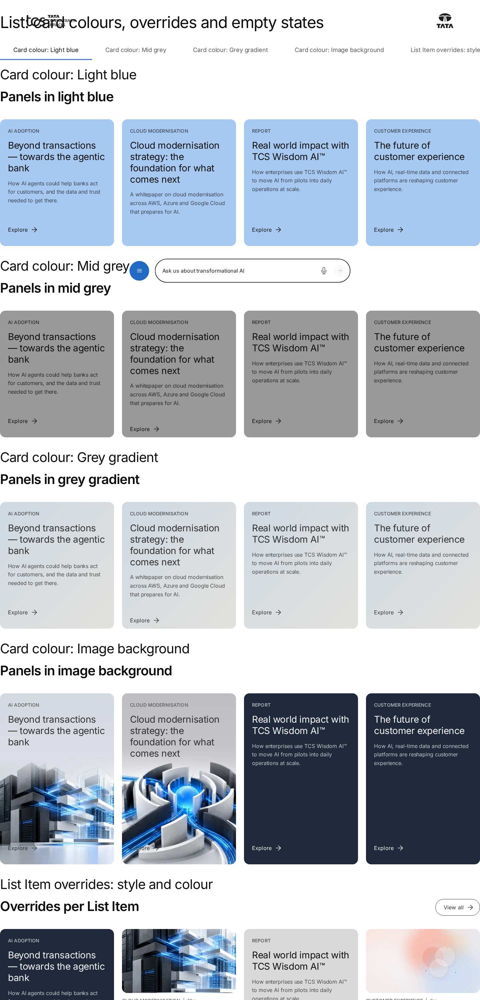
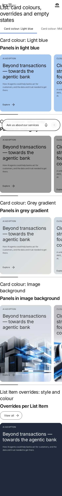

# List — Authoring Guide

| Attribute | Value |
| --- | --- |
| Document ID | AUT-C-list |
| Audience | Content authors, content managers, AEM authoring leads |
| Purpose | How to add, fill in and check the List component |
| Scope | — |
| Prerequisites | — |
| Owner | Content Lead / AEM Authoring Lead (proposed) |
| Approver | Product Owner (to be confirmed) |
| Version | 1.0 |
| Status | Draft for review |
| Last updated | 8 November 2026 |
| Last validated | 8 November 2026 |
| Source files | blocks/list/README.md, blocks/list/_list.json |
| Related documents | — |
| Related AEM paths | — |

## Contents

- [Where to see it](#where-to-see-it)
- [For Content Authors](#for-content-authors)
- [Authorable Fields](#authorable-fields)
- [Screenshot-Based Authoring Steps](#screenshot-based-authoring-steps)
- [Variations](#variations)
- [Complete Authoring Example](#complete-authoring-example)
- [Content and Asset Guidelines](#content-and-asset-guidelines)
- [Troubleshooting](#troubleshooting)
- [Screenshots](#screenshots)
- [Known limitations](#known-limitations)
- [Open items](#open-items)
- [Change history](#change-history)

## Where to see it

- https://main--tcs-corp--sradha-tcs.aem.live/design-block-master/en/block-library/list
- https://main--tcs-corp--sradha-tcs.aem.live/design-block-master/en/block-library/list/card-colours-and-overrides
- https://main--tcs-corp--sradha-tcs.aem.live/design-block-master/en/block-library/list/card-style-from-pages
- https://main--tcs-corp--sradha-tcs.aem.live/design-block-master/en/block-library/list/card-style-from-pages/automatic
- https://main--tcs-corp--sradha-tcs.aem.live/design-block-master/en/block-library/list/card-style-from-pages/image-light-blue
- https://main--tcs-corp--sradha-tcs.aem.live/design-block-master/en/block-library/list/card-style-from-pages/panel-grey
- https://main--tcs-corp--sradha-tcs.aem.live/design-block-master/en/block-library/list/card-style-from-pages/report-navy
- https://main--tcs-corp--sradha-tcs.aem.live/design-block-master/en/block-library/list/card-style-from-pages/statistic
- https://main--tcs-corp--sradha-tcs.aem.live/design-block-master/en/block-library/list/cards
- https://main--tcs-corp--sradha-tcs.aem.live/design-block-master/en/block-library/list/empty-state
- https://main--tcs-corp--sradha-tcs.aem.live/design-block-master/en/block-library/list/figma-variations
- https://main--tcs-corp--sradha-tcs.aem.live/design-block-master/en/block-library/list/layout-and-scrolling
- https://main--tcs-corp--sradha-tcs.aem.live/design-block-master/en/block-library/list/list-item-display
- https://main--tcs-corp--sradha-tcs.aem.live/design-block-master/en/block-library/list/lists-made-before
- https://main--tcs-corp--sradha-tcs.aem.live/design-block-master/en/block-library/list/sources

## For Content Authors

1. **Add the block:** in Universal Editor select a Section, a Columns Container column or a Tabs Container tab, choose **Add** and pick **List**.
2. **Open its properties:** select the List on the page or in the content tree; the properties panel shows the tabs **Content**, **Display** and **Additional**.
3. **Write the header (Content):** Title and Heading type (card titles are one level below), Description, CTA link with CTA text and CTA style. Without a Title, fill **Accessible list label** so screen readers can name the list.
4. **Choose the List source (Content):**
   - **Child pages:** pick the **Parent page** (or leave it empty with **Use the current page when empty** on); turn **Direct children only** off to set a **Child depth**.
   - **Fixed list:** add **List Items** with **Add** on the selected List (or in the content tree) and drag them to reorder. In each List Item's **Link** tab pick a page, a path or an external `https://` URL.
   - **Tagged pages:** pick the **Search root** (or use the current page), the **Tags** and **Match** (Any / All); optionally limit **Include descendant pages** and **Maximum search depth**.
   Fields that don't apply to the chosen source or option are hidden.
5. **Order and limit (Content):** **Order by** (Manual, Title, Last modified), **Sort order**, **Maximum items** (0: all).
6. **Choose the presentation (Display):** Display as teaser (cards) or rows of links, Card style, Card colour, Image ratio, Panel height, First card as feature (then Show author on feature card), the Show options, Date format, Image loading (Eager only for a list on the first screen).
7. **Set the layout per breakpoint (Display):** Desktop, Tablet and Mobile display (Grid or Horizontal scroll), columns or items visible, gap, previous / next buttons and scroll indicator; then the scroll options and **When there are no items**.
8. **Change one card (List Item):** fill only the fields to override (Title, Description, Image, Eyebrow, Tags, Label, Call to action label) and, in its Display tab, Card style, Card colour and the Display toggles.
9. **Preview:** switch Universal Editor to Preview, or open the page preview. Child pages and Tagged pages lists show their pages only on the published page (AEM author has no query index).
10. **Publish:** publish the page. Listed pages must be published (and indexed) themselves to appear.
11. **Validate:** on the published page check the cards, their order, their links (redirect targets) and each breakpoint.

- **Minimum required:** List source; for Fixed list at least one List Item with a link, for Tagged pages at least one tag.
- **Recommended:** Title (or Accessible list label), Maximum items for sources that grow, card metadata on the listed pages (`card-title`, `card-description`, `card-image`, `card-image-alt`).
- **Optional:** Description, CTA, feature card, item overrides and Display toggles, scroller options, empty behaviour, Style options, Additional tab.

## Authorable Fields

<!-- BEGIN GENERATED: fields (npm run build:docs) -->

#### List (`list`)

Model `list`; template name "List" (the block class AEM renders); key-value block (one row per property); children: `list-item`.

Stored on a new component (definition template): `titleType` = `"h2"`, `source` = `"fixed"`, `orderBy` = `"manual"`, `sortOrder` = `"ascending"`, `maxItems` = `0`, `displayAsTeaser` = `true`, `cardStyle` = `"image"`, `imageRatio` = `"16-9"`, `panelHeight` = `"portrait"`, `linkItems` = `true`, `showImage` = `true`, `showEyebrow` = `true`, `showTags` = `true`, `showDescription` = `true`, `showDate` = `true`, `dateFormat` = `"dd-mmm-yy"`, `imageLoading` = `"lazy"`, `desktopMode` = `"grid"`, `desktopColumns` = `4`, `tabletMode` = `"grid"`, `tabletColumns` = `4`, `mobileMode` = `"grid"`, `mobileColumns` = `1`, `scrollSnap` = `true`, `emptyBehavior` = `"message"`, `analyticsEnabled` = `true`.

##### Content tab — List

| Field label | Property | Type | Required | Default | Allowed values | Author guidance | Example |
| ----------- | -------- | ---- | -------- | ------- | -------------- | --------------- | ------- |
| Title | `title` | text | No | — | — | The heading of the cards, e.g. Related to Agentic AI. | Related insights |
| Heading type | `titleType` | select | No | `h2` | H2 (`h2`), H3 (`h3`), H4 (`h4`), H5 (`h5`), H6 (`h6`) | Delivered with `title` (field collapse). | h2 |
| Description | `description` | richtext | No | — | — | — | — |
| CTA link | `link` | aem-content | No | — | — | — | /design-block-master/en/curated-design-pages/insights |
| CTA text | `linkText` | text | No | — | — | Delivered with `link` (field collapse). | View all |
| CTA style | `linkType` | select | No | "" | Text link (""), Primary button (`primary`), Secondary button (`secondary`) | Delivered with `link` (field collapse). | primary |
| Accessible list label | `listLabel` | text | No | — | — | Names the cards for screen readers when there is no title. | Pages |
| List source | `source` | select | Yes | `fixed` | Child pages (`parent`), Fixed list (`fixed`), Tagged pages (`tags`) | Child pages of a page, a fixed list of pages (Pages; add List Items to change a card or to link outside the site), or pages with tags. | fixed |
| Pages (authored before List Items) | `pageItems` | container (multiple) | No | — | — | Lists made before List Items. Add List Items instead (Add on the List). Shown when `source` is `fixed`. | — |
| Pages (authored before List Items) › Page | `page` | aem-content | No | — | — | — | — |
| Parent page | `parentPath` | aem-content | No | — | — | Shown when `source` is `parent`. | /design-block-master/en/dummy-pages/insights |
| Use the current page when empty | `parentUseCurrentPage` | boolean | No | `true` | on / off | Shown when `source` is `parent`. | true |
| Direct children only | `directChildrenOnly` | boolean | No | `true` | on / off | Off: pages down to the Child depth. Shown when `source` is `parent`. | false |
| Child depth | `childDepth` | number | No | `2` | — | Levels below the parent page (1: its children). Shown when `source` is `parent` and `directChildrenOnly` is `false`. | 2 |
| Search root | `rootPath` | aem-content | No | — | — | Shown when `source` is `tags`. | /design-block-master/en/dummy-pages/insights |
| Use the current page when empty | `tagsUseCurrentPage` | boolean | No | `true` | on / off | Shown when `source` is `tags`. | false |
| Tags | `tags` | aem-tag (multiple) | No | — | — | Shown when `source` is `tags`. | — |
| Match | `tagMatch` | select | No | `any` | Any of the tags (`any`), All of the tags (`all`) | Shown when `source` is `tags`. | all |
| Include descendant pages | `includeDescendants` | boolean | No | `true` | on / off | Off: only the children of the search root. Shown when `source` is `tags`. | true |
| Maximum search depth | `maxDepth` | number | No | `0` | — | 0: no limit. Shown when `source` is `tags` and `includeDescendants` is `true`. | — |
| Order by | `orderBy` | select | No | `manual` | Manual (as authored; path order for pages) (`manual`), Title (`title`), Last modified (`lastModified`) | — | title |
| Sort order | `sortOrder` | select | No | `ascending` | Ascending (`ascending`), Descending (`descending`) | Shown when `orderBy` is not `manual`. | descending |
| Maximum items | `maxItems` | number | No | `0` | — | 0: all of them. | 3 |

##### Display tab — List

| Field label | Property | Type | Required | Default | Allowed values | Author guidance | Example |
| ----------- | -------- | ---- | -------- | ------- | -------------- | --------------- | ------- |
| Display as teaser | `displayAsTeaser` | boolean | No | `true` | on / off | Cards; off: a list of links (title rows). | false |
| Card style | `cardStyle` | select | No | `image` | Image card (`image`), Panel (`panel`), Report (`report`), Statistic (`stat`), Mixed (`mixed`) | A style here applies to every card (an item's own Card style still wins). Mixed: each card's own style, else (List) the page's card-style metadata, else Report content as report cards, cards without an image as panels, the others as image cards. Shown when `displayAsTeaser` is `true`. | mixed |
| Card colour | `cardTheme` | select | No | "" | Default for the style (""), Dark (`dark`), Navy (`navy`), Brand blue (`brand`), Light blue (`brand-light`), Light grey (`grey`), Mid grey (`mid-grey`), Grey gradient (`gradient`), Image background (`image`) | Panel, report and statistic cards (image cards keep their image). A colour here applies to every card (an item's own Card colour still wins). Default for the style: the card's own colour, else (List) the page's card-theme metadata, else the style's colour. Shown when `displayAsTeaser` is `true`. | dark |
| Image ratio | `imageRatio` | select | No | `16-9` | 16:9 (`16-9`), 1:1 (`1-1`), 4:3 (`4-3`), 3:2 (`3-2`) | Shown when `displayAsTeaser` is `true`. | 1-1 |
| Panel height | `panelHeight` | select | No | `portrait` | Portrait (2:3) (`portrait`), Compact (`compact`), Content (`auto`) | Panel, report and statistic cards. Shown when `displayAsTeaser` is `true`. | compact |
| First card as feature | `featureFirst` | boolean | No | `false` | on / off | The first card as a large spotlight above the others. Shown when `displayAsTeaser` is `true`. | true |
| Show author on feature card | `featureShowAuthor` | boolean | No | `true` | on / off | The author of the feature card's page (photo, name and designation from the Authors sheet). Off: the feature card without its author; the other cards don't change. Shown when `displayAsTeaser` is `true` and `featureFirst` is `true`. | — |
| Link items | `linkItems` | boolean | No | `true` | on / off | — | false |
| Open links in a new tab | `openInNewTab` | boolean | No | `false` | on / off | The default for the items. | — |
| Show image | `showImage` | boolean | No | `true` | on / off | — | false |
| Show eyebrow | `showEyebrow` | boolean | No | `true` | on / off | — | false |
| Show tags | `showTags` | boolean | No | `true` | on / off | — | false |
| Show description | `showDescription` | boolean | No | `true` | on / off | On image cards and link rows; panel, report and statistic cards always show theirs. | false |
| Show date | `showDate` | boolean | No | `true` | on / off | — | false |
| Date format | `dateFormat` | select | No | `dd-mmm-yy` | 04 Sep 26 (`dd-mmm-yy`), 04-09-2026 (`dd-mm-yyyy`), 09-04-2026 (`mm-dd-yyyy`), Sep 4, 2026 (`mmm-d-yyyy`), 04/09/26 (`dd/mm/yy`), 4th September 2026 (`do-mmmm-yyyy`) | Shown when `showDate` is `true`. | do-mmmm-yyyy |
| Show content type | `showContentLabel` | boolean | No | `true` | on / off | Image cards: the content type of the card's page (e.g. Case Study): its content type tag below the image and its content-type label next to the date. Off: image cards without either (the other tags and the date stay); the page metadata and the other card styles don't change. Shown when `displayAsTeaser` is `true` and `cardStyle` is `image` or `cardStyle` is `mixed`. | — |
| Show call to action | `showCta` | boolean | No | `true` | on / off | Child pages with Card style Panel: the Explore call to action on every card. Not shown for other sources or card styles (their cards keep their call to action; Fixed list: each List Item's Show Action Label). Shown when `source` is `parent` and `displayAsTeaser` is `true` and `cardStyle` is `panel`. | false |
| Image loading | `imageLoading` | select | No | `lazy` | Lazy (`lazy`), Eager (first screen) (`eager`) | — | — |
| Desktop display | `desktopMode` | select | No | `grid` | Grid (`grid`), Horizontal scroll (`horizontal-scroll`) | Grid or horizontal scroll on desktop (1200px and wider), independently of the other breakpoints. | horizontal-scroll |
| Desktop columns | `desktopColumns` | number | No | `4` | — | Shown when `desktopMode` is `grid`. | 3 |
| Desktop gap (px) | `desktopGap` | number | No | `24` | — | Space between the cards. | — |
| Desktop items visible | `desktopVisible` | number | No | `4.2` | — | Cards in view, e.g. 4.2 shows 4 and a part of the next one. Shown when `desktopMode` is `horizontal-scroll`. | 4.2 |
| Desktop card width (px) | `desktopCardWidth` | number | No | `0` | — | A fixed card width (120 or more); 0 uses Items visible. Shown when `desktopMode` is `horizontal-scroll`. | 320 |
| Previous / next buttons on desktop | `desktopControls` | boolean | No | `false` | on / off | Shown when `desktopMode` is `horizontal-scroll`. | true |
| Scroll indicator on desktop | `desktopIndicator` | boolean | No | `false` | on / off | Shown when `desktopMode` is `horizontal-scroll`. | true |
| Tablet display | `tabletMode` | select | No | `grid` | Grid (`grid`), Horizontal scroll (`horizontal-scroll`) | Grid or horizontal scroll on tablet (600 to 1199px), independently of the other breakpoints. | horizontal-scroll |
| Tablet columns | `tabletColumns` | number | No | `4` | — | Shown when `tabletMode` is `grid`. | 3 |
| Tablet gap (px) | `tabletGap` | number | No | `24` | — | Space between the cards. | — |
| Tablet items visible | `tabletVisible` | number | No | `3.3` | — | Cards in view, e.g. 4.2 shows 4 and a part of the next one. Shown when `tabletMode` is `horizontal-scroll`. | 2.3 |
| Tablet card width (px) | `tabletCardWidth` | number | No | `0` | — | A fixed card width (120 or more); 0 uses Items visible. Shown when `tabletMode` is `horizontal-scroll`. | — |
| Previous / next buttons on tablet | `tabletControls` | boolean | No | `false` | on / off | Shown when `tabletMode` is `horizontal-scroll`. | — |
| Scroll indicator on tablet | `tabletIndicator` | boolean | No | `false` | on / off | Shown when `tabletMode` is `horizontal-scroll`. | — |
| Mobile display | `mobileMode` | select | No | `grid` | Grid (`grid`), Horizontal scroll (`horizontal-scroll`) | Grid or horizontal scroll on mobile (up to 599px), independently of the other breakpoints. | horizontal-scroll |
| Mobile columns | `mobileColumns` | number | No | `1` | — | Shown when `mobileMode` is `grid`. | 1 |
| Mobile gap (px) | `mobileGap` | number | No | `16` | — | Space between the cards. | — |
| Mobile items visible | `mobileVisible` | number | No | `1.2` | — | Cards in view, e.g. 4.2 shows 4 and a part of the next one. Shown when `mobileMode` is `horizontal-scroll`. | 1.2 |
| Mobile card width (px) | `mobileCardWidth` | number | No | `0` | — | A fixed card width (120 or more); 0 uses Items visible. Shown when `mobileMode` is `horizontal-scroll`. | — |
| Previous / next buttons on mobile | `mobileControls` | boolean | No | `false` | on / off | Shown when `mobileMode` is `horizontal-scroll`. | — |
| Scroll indicator on mobile | `mobileIndicator` | boolean | No | `true` | on / off | Shown when `mobileMode` is `horizontal-scroll`. | true |
| Equal card height | `equalHeight` | boolean | No | `false` | on / off | All rows as tall as the tallest card. | true |
| Stretch cards to row height | `stretchCards` | boolean | No | `true` | on / off | — | false |
| Scroll snap | `scrollSnap` | boolean | No | `true` | on / off | Shown when `desktopMode` is `horizontal-scroll` or `tabletMode` is `horizontal-scroll` or `mobileMode` is `horizontal-scroll`. | — |
| Snap alignment | `snapAlign` | select | No | `start` | Start (`start`), Center (`center`) | Shown when `scrollSnap` is `true` and `desktopMode` is `horizontal-scroll` or `tabletMode` is `horizontal-scroll` or `mobileMode` is `horizontal-scroll`. | center |
| Hide native scrollbar | `hideScrollbar` | boolean | No | `true` | on / off | Shown when `desktopMode` is `horizontal-scroll` or `tabletMode` is `horizontal-scroll` or `mobileMode` is `horizontal-scroll`. | — |
| Allow mouse drag | `mouseDrag` | boolean | No | `true` | on / off | Shown when `desktopMode` is `horizontal-scroll` or `tabletMode` is `horizontal-scroll` or `mobileMode` is `horizontal-scroll`. | — |
| Keyboard scrolling | `keyboardScrolling` | boolean | No | `true` | on / off | Arrow keys, Home and End when the list has focus. Shown when `desktopMode` is `horizontal-scroll` or `tabletMode` is `horizontal-scroll` or `mobileMode` is `horizontal-scroll`. | — |
| Scroll step | `scrollStep` | select | No | `one-card` | One card (`one-card`), Viewport (`viewport`) | Shown when `desktopMode` is `horizontal-scroll` or `tabletMode` is `horizontal-scroll` or `mobileMode` is `horizontal-scroll`. | viewport |
| Loop | `loop` | boolean | No | `false` | on / off | Next at the end goes back to the start. Shown when `desktopMode` is `horizontal-scroll` or `tabletMode` is `horizontal-scroll` or `mobileMode` is `horizontal-scroll`. | true |
| Initial item index | `initialIndex` | number | No | `0` | — | The card shown first (0: the first). Shown when `desktopMode` is `horizontal-scroll` or `tabletMode` is `horizontal-scroll` or `mobileMode` is `horizontal-scroll`. | 2 |
| Edge | `edgePadding` | select | No | `bleed` | Cards run to the edge (`bleed`), Inside the content width (`none`) | Fixed-width sections only: the cards run into the section gutter. In full-width sections both look the same. Shown when `desktopMode` is `horizontal-scroll` or `tabletMode` is `horizontal-scroll` or `mobileMode` is `horizontal-scroll`. | none |
| When there are no items | `emptyBehavior` | select | No | `message` | Hide the list (`hide`), Show a message (`message`), Show the fallback items (`fallback`) | Fallback: the List Items of the block (for Child pages and Tagged pages). | fallback |
| Empty message | `emptyMessage` | text | No | — | — | Shown when `emptyBehavior` is `message`. | — |
| Analytics | `analyticsEnabled` | boolean | No | `true` | on / off | Card clicks and scrolling in the Adobe Data Layer. | — |
| Style options | `classes` | multiselect | No | — | Compact statistic title (`stat-compact`), Dividers between rows (`dividers`), Header centred (`header-center`) | — | — |

##### Additional tab — List

| Field label | Property | Type | Required | Default | Allowed values | Author guidance | Example |
| ----------- | -------- | ---- | -------- | ------- | -------------- | --------------- | ------- |
| Anchor ID | `classes_anchor` | text | No | — | regExp: ^anchor-[a-z0-9][a-z0-9-]*$; customErrorMsg: Start with anchor-, then lower-case letters, digits and hyphens. | A unique ID of the block on the page, starting with anchor-, e.g. anchor-our-services; link to it with #anchor-our-services. Delivered as a block class. | — |
| Hide block | `classes_hideblock` | boolean | No | `false` | on / off | Hides the whole block on the page until it is turned off (shown faded in the editor). Delivered as a block class. | — |
| Animation Type | `classes_animation` | select | No | "" | None (""), Fade in (`motion-fade-in`), Fade up (`motion-fade-up`), Fade down (`motion-fade-down`), Fade left (`motion-fade-left`), Fade right (`motion-fade-right`), Slide up (`motion-slide-up`), Slide down (`motion-slide-down`), Slide left (`motion-slide-left`), Slide right (`motion-slide-right`), Scale in (`motion-scale-in`) | How the block's content appears; repeated items (cards, list items, accordion items, columns) appear one after another. None: shown as is. Not played in the editor or when the visitor prefers reduced motion. Delivered as a block class. | motion-scale-in |
| Motion Speed | `classes_animationspeed` | select | No | "" | Medium (""), Fast (`motion-fast`), Slow (`motion-slow`) | How fast the animation runs: 0.3, 0.6 or 0.9 seconds. Shown when `classes_animation` is set and `classes_animation` is not empty. Delivered as a block class. | — |
| Animation Trigger | `classes_animationtrigger` | select | No | "" | On Scroll / Viewport Entry (""), On Page Load (`motion-on-load`) | When the block's animations run. On Scroll: when the block comes into view (at once if it is in view when the page opens). On Page Load: as soon as the block is ready, wherever it is on the page. Shown when `classes_animation` is set and `classes_animation` is not empty. Delivered as a block class. | motion-on-load |
| Padding left | `classes_paddingleft` | select | No | "" | Default (""), 0 (none) (`pl-0`), 0.25rem (space-100) (`pl-100`), 0.5rem (space-200) (`pl-200`), 0.75rem (space-300) (`pl-300`), 1rem (space-400) (`pl-400`), 1.25rem (space-500) (`pl-500`), 1.5rem (space-600) (`pl-600`), 2rem (space-800) (`pl-800`), 2.5rem (space-1000) (`pl-1000`), 3rem (space-1200) (`pl-1200`), 4rem (space-1600) (`pl-1600`), 5rem (space-2000) (`pl-2000`), 6rem (space-2400) (`pl-2400`), 7.5rem (space-3000) (`pl-3000`) | Delivered as a block class. | — |
| Padding right | `classes_paddingright` | select | No | "" | Default (""), 0 (none) (`pr-0`), 0.25rem (space-100) (`pr-100`), 0.5rem (space-200) (`pr-200`), 0.75rem (space-300) (`pr-300`), 1rem (space-400) (`pr-400`), 1.25rem (space-500) (`pr-500`), 1.5rem (space-600) (`pr-600`), 2rem (space-800) (`pr-800`), 2.5rem (space-1000) (`pr-1000`), 3rem (space-1200) (`pr-1200`), 4rem (space-1600) (`pr-1600`), 5rem (space-2000) (`pr-2000`), 6rem (space-2400) (`pr-2400`), 7.5rem (space-3000) (`pr-3000`) | Delivered as a block class. | — |
| Padding top | `classes_paddingtop` | select | No | "" | Default (""), 0 (none) (`pt-0`), 0.25rem (space-100) (`pt-100`), 0.5rem (space-200) (`pt-200`), 0.75rem (space-300) (`pt-300`), 1rem (space-400) (`pt-400`), 1.25rem (space-500) (`pt-500`), 1.5rem (space-600) (`pt-600`), 2rem (space-800) (`pt-800`), 2.5rem (space-1000) (`pt-1000`), 3rem (space-1200) (`pt-1200`), 4rem (space-1600) (`pt-1600`), 5rem (space-2000) (`pt-2000`), 6rem (space-2400) (`pt-2400`), 7.5rem (space-3000) (`pt-3000`) | Delivered as a block class. | pt-2000 |
| Padding bottom | `classes_paddingbottom` | select | No | "" | Default (""), 0 (none) (`pb-0`), 0.25rem (space-100) (`pb-100`), 0.5rem (space-200) (`pb-200`), 0.75rem (space-300) (`pb-300`), 1rem (space-400) (`pb-400`), 1.25rem (space-500) (`pb-500`), 1.5rem (space-600) (`pb-600`), 2rem (space-800) (`pb-800`), 2.5rem (space-1000) (`pb-1000`), 3rem (space-1200) (`pb-1200`), 4rem (space-1600) (`pb-1600`), 5rem (space-2000) (`pb-2000`), 6rem (space-2400) (`pb-2400`), 7.5rem (space-3000) (`pb-3000`) | Delivered as a block class. | — |
| Margin left | `classes_marginleft` | select | No | "" | Default (""), 0 (none) (`ml-0`), 0.25rem (space-100) (`ml-100`), 0.5rem (space-200) (`ml-200`), 0.75rem (space-300) (`ml-300`), 1rem (space-400) (`ml-400`), 1.25rem (space-500) (`ml-500`), 1.5rem (space-600) (`ml-600`), 2rem (space-800) (`ml-800`), 2.5rem (space-1000) (`ml-1000`), 3rem (space-1200) (`ml-1200`), 4rem (space-1600) (`ml-1600`), 5rem (space-2000) (`ml-2000`), 6rem (space-2400) (`ml-2400`), 7.5rem (space-3000) (`ml-3000`) | Delivered as a block class. | — |
| Margin right | `classes_marginright` | select | No | "" | Default (""), 0 (none) (`mr-0`), 0.25rem (space-100) (`mr-100`), 0.5rem (space-200) (`mr-200`), 0.75rem (space-300) (`mr-300`), 1rem (space-400) (`mr-400`), 1.25rem (space-500) (`mr-500`), 1.5rem (space-600) (`mr-600`), 2rem (space-800) (`mr-800`), 2.5rem (space-1000) (`mr-1000`), 3rem (space-1200) (`mr-1200`), 4rem (space-1600) (`mr-1600`), 5rem (space-2000) (`mr-2000`), 6rem (space-2400) (`mr-2400`), 7.5rem (space-3000) (`mr-3000`) | Delivered as a block class. | — |
| Margin top | `classes_margintop` | select | No | "" | Default (""), 0 (none) (`mt-0`), 0.25rem (space-100) (`mt-100`), 0.5rem (space-200) (`mt-200`), 0.75rem (space-300) (`mt-300`), 1rem (space-400) (`mt-400`), 1.25rem (space-500) (`mt-500`), 1.5rem (space-600) (`mt-600`), 2rem (space-800) (`mt-800`), 2.5rem (space-1000) (`mt-1000`), 3rem (space-1200) (`mt-1200`), 4rem (space-1600) (`mt-1600`), 5rem (space-2000) (`mt-2000`), 6rem (space-2400) (`mt-2400`), 7.5rem (space-3000) (`mt-3000`) | Delivered as a block class. | — |
| Margin bottom | `classes_marginbottom` | select | No | "" | Default (""), 0 (none) (`mb-0`), 0.25rem (space-100) (`mb-100`), 0.5rem (space-200) (`mb-200`), 0.75rem (space-300) (`mb-300`), 1rem (space-400) (`mb-400`), 1.25rem (space-500) (`mb-500`), 1.5rem (space-600) (`mb-600`), 2rem (space-800) (`mb-800`), 2.5rem (space-1000) (`mb-1000`), 3rem (space-1200) (`mb-1200`), 4rem (space-1600) (`mb-1600`), 5rem (space-2000) (`mb-2000`), 6rem (space-2400) (`mb-2400`), 7.5rem (space-3000) (`mb-3000`) | Delivered as a block class. | — |

#### List Item (`list-item`)

Model `list-item`; template name "List Item" (the block class AEM renders).

##### Link tab — List Item

| Field label | Property | Type | Required | Default | Allowed values | Author guidance | Example |
| ----------- | -------- | ---- | -------- | ------- | -------------- | --------------- | ------- |
| Page or link | `link` | aem-content | Yes | — | — | A page of the site, a path or an external URL (https://...). | /design-block-master/en/dummy-pages/services/cloud |
| Link text | `linkText` | text | No | — | — | The link text when the page has no title. Delivered with `link` (field collapse). | — |
| Open in a new tab | `newTab` | select | No | "" | As the list (""), Yes (`true`), No (`false`) | — | true |

##### Content tab — List Item

| Field label | Property | Type | Required | Default | Allowed values | Author guidance | Example |
| ----------- | -------- | ---- | -------- | ------- | -------------- | --------------- | ------- |
| Title | `headline` | text | No | — | — | Overrides the page title. | Cloud services for the enterprise |
| Description | `summary` | text | No | — | — | Overrides the page description. | Co-developed platforms from our partner ecosystem. |
| Image | `image` | reference | No | — | — | Overrides the page image. | /content/dam/tcs-corp/dummy-pages/images/ai-transformation.jpg |
| Image alt text | `imageAlt` | text | No | — | — | Empty: the image is decorative. Delivered with `image` (field collapse). | Partner team in a workshop |
| Eyebrow | `eyebrow` | text | No | — | — | — | Partner |
| Tags | `tags` | aem-tag (multiple) | No | — | — | Overrides the page tags. | — |
| Label | `subtitle` | text | No | — | — | Statistic cards: the label above the description. | Sample statistic |
| Call to action label | `ctaLabel` | text | No | — | — | — | Learn more |

##### Display tab — List Item

| Field label | Property | Type | Required | Default | Allowed values | Author guidance | Example |
| ----------- | -------- | ---- | -------- | ------- | -------------- | --------------- | ------- |
| Card style | `kind` | select | No | "" | As the list (""), Image card (`image`), Panel (`panel`), Report (`report`), Statistic (`stat`) | As the list: the list's Card style; with Mixed (by page), the linked page's card-style metadata, else automatic. A style here wins over both. | stat |
| Card colour | `theme` | select | No | "" | As the list (""), Dark (`dark`), Navy (`navy`), Brand blue (`brand`), Light blue (`brand-light`), Light grey (`grey`), Mid grey (`mid-grey`), Grey gradient (`gradient`), Image background (`image`) | Panel, report and statistic cards (image cards keep their image); overrides the List's Card colour and the page's card-theme metadata. | brand |
| Analytics label | `analyticsLabel` | text | No | — | — | — | — |
| Accessibility label | `ariaLabel` | text | No | — | — | The link name for screen readers, e.g. Read the TwinX case study. | — |
| Hide Title | `titleHidden` | boolean | No | `false` | on / off | Hides the title on the card; it stays for screen readers and in the heading outline, and names the card's link. A linked card keeps one visible link: with Show Action Label off, the title stays visible as the link. | true |
| Show Description | `showDescription` | boolean | No | `true` | on / off | Off: no description on this card (neither this item's nor its page's). | false |
| Show Image | `showImage` | boolean | No | `true` | on / off | Off: no image on this card (neither this item's nor its page's). | false |
| Show Eyebrow | `showEyebrow` | boolean | No | `true` | on / off | Off: no eyebrow on this card (the tags or content type take its place, as without an eyebrow). | false |
| Show Label | `showLabel` | boolean | No | `true` | on / off | Off: no Label on this card (statistic cards show the Label above the description). | false |
| Show Action Label | `showActionLabel` | boolean | No | `true` | on / off | On (default): the card shows its call to action (the Call to action label, else the card style's default, e.g. Explore on panels). Off: no call to action, no action element and no default label; the title is the card's link. Only this card follows it. | false |

<!-- END GENERATED: fields -->

Notes on what the tables above don't show:

- **List source and Pages.** "Pages (authored before List Items)" (`pageItems`: a composite multifield with a `page` per item, `pageItems/item0/page`, handover 2.9 / F-86) and the multi-value `pages` property of lists made before are still read, in that order, before the List Items (`mergeFixedItems`). Add List Items for new content.
- **Fixed list precedence:** List Item override, then the linked page's metadata, then defaults. Child pages and Tagged pages: the page's metadata, then defaults. Each List Item field the author filled replaces the page's value (`applyOverrides`); an empty field keeps the page's value, so an item mixes authored and page values. An authored image keeps its own alt (empty alt: decorative). A link that can't be resolved keeps the authored values, titled from its path without a Title.
- **Card style and Card colour precedence** (`kindOf`, `themeOf` in `utils/card-list-config.js`; unsupported values are skipped, so no class is made from them):

| | List Item (Fixed list) | Child pages, Tagged pages |
|---|---|---|
| 1 | the List Item's Card style / Card colour | the List's Card style (unless Mixed) / Card colour |
| 2 | the List's Card style (unless Mixed) / Card colour | the page's `card-style` / `card-theme` metadata |
| 3 | the linked page's `card-style` / `card-theme` | automatic: report for Report content, panel without an image, else image / the style's colour |
| 4 | automatic / the style's colour | |

  A Card style other than Mixed, or a Card colour, forces every card that doesn't set its own. With Mixed and Default for the style each page decides. Lists made before keep their Card style (Image card by default). Card colour paints panel, report and statistic cards; image cards keep their image.
- **List Item Display toggles** (added 20 October 2026, handover 2.34): they apply to that item's card only, on top of the List's Show options (a List with Show image off shows no images, whatever its items say). Hide Title keeps the title for screen readers and the heading outline and names the card's link; a linked card keeps one visible link (without a call to action the title stays visible). Show Description off hides the description on every card style, also panel, report and statistic cards. Show Eyebrow off: image cards show the tags in its place. Items authored before (without the toggles) show everything but the call to action. Examples: block-library/list/list-item-display.
- **Call to action** (KB-D-058, KB-D-059, KB-D-060, Proposed): each List Item's **Show Action Label** (in its Display tab, on by default since 29 October 2026, KB-D-060: an item never changed shows its call to action) decides its own card's call to action, independently of the other items. On, the card shows `p.list-card-action` with the item's Call to action label, else the card style's default (Explore on panels, Download on reports), as the card's one link; off, the action element isn't rendered and the title is the link. Cards from the query index have no List Item: the List's **Show call to action** (29 October 2026, KB-D-059) is in the dialog only while List source is Child pages, Display as teaser is on and Card style is Panel, and shows (On) or hides (Off) Explore on every fetched card (Off: the title is each card's link). For every other source and card style it isn't in the dialog, a value saved before isn't read and those cards keep their call to action (Explore on panels, Download on reports; `ctaToggleApplies`, `blocks/list/list-data.js`). The List's toggle never applies to a List Item's card. The Cards block keeps its own Show call to action (`showsCta`, `utils/card-list-config.js`). List Item rows AEM delivers without their tab cells (19 cells; 13 for rows from before the toggles) are read field by field.
- **List heading:** its size, line height and letter spacing are those of its Title Type (H1–H6, `styles/styles.css`); the List keeps only its colour and semibold weight.
- **Show options of the List:** Show description applies to image cards and link rows (panel, report and statistic cards always show theirs); Show tags also shows the reading time; on image cards an eyebrow takes the place of the tags; at most three tags are shown. Image cards show the date after the content type label (the taxonomy label of the content-type tag, e.g. Blog).
- **List Item Display toggles** (added 20 October 2026, handover 2.34): they apply to that item's card only, on top of the List's Show options (a List with Show image off shows no images, whatever its items say). Hide Title keeps the title for screen readers and the heading outline and names the card's link; a linked card keeps one visible link (with Show Action Label off too, the action label stays; without an action label the title stays visible). Show Description off hides the description on every card style, also panel, report and statistic cards. Show Eyebrow off: image cards show the tags in its place. Items authored before (without the toggles) show everything. Examples: block-library/list/list-item-display.
- **Show options of the List:** Show description applies to image cards and link rows (panel, report and statistic cards always show theirs); Show tags also shows the reading time; on image cards an eyebrow takes the place of the tags; at most three tags are shown. Image cards show the date after the content type label (the taxonomy label of the content-type tag, e.g. Blog). **Show content type** (`showContentLabel`, on by default; shown in the dialog only while Display as teaser is on and Card style is Image card or Mixed) off removes the content type from every image card of the List, also a List Item set to Image card in a List of another style: the label before the date and the content type tag in the kicker below the image (`…:content-type/…` tags; the next tags take its place, still at most three); the date and the other tags stay, and the page's `content-type` metadata, the report cards (content type over the title), the link rows (content type in place of the eyebrow) and the Cards block (its own Content label per card) don't change. No List Item toggle controls it: the List Item's Show Label is for its Label (statistic cards) only. Lists authored before have no value and show the label, as before.
- **Validation in code:** every value is validated again and invalid values fall back to the default: Child depth 1–10, Maximum search depth 0–10, Maximum items 0 or more (0, empty or invalid: all), columns 1–6, gap 0–120 (px, rendered in rem), items visible 1–8, card width 0 or 120–1200, Initial item index 0–200.
- **Display as teaser** adds the block class `display-teaser` (not `teaser`, which the Teaser styles select: F-83), off adds `links`.
- **Open in a new tab** links get `target="_blank" rel="noopener noreferrer"` and the "(opens in a new tab)" text (placeholder `opensInNewTab`). A List Item's Open in a new tab (As the list / Yes / No) overrides the List's.
- **Analytics label / Accessibility label** (List Item): `data-analytics-label` and the data layer `dc:title`; the link's `aria-label`.
- **Legacy fields still read** (no longer in the dialog): `componentId` (Component ID: block id, analytics id and card ids; a duplicate gets a suffix), `touchSwipe` (off: `no-swipe`, `touch-action: pan-y`) and `reducedMotion` (ignored: reduced motion is always honoured). Lists made before the key-value model (a title and a CTA, positional rows) render as `list-legacy`.
- **Component id:** the authored Component ID, else the block's id (its Anchor ID), else a generated `list-1`, `list-2`, ... in page order.
- **Additional tab:** Anchor ID, Hide block, Animation Type / Motion Speed / Animation Trigger, Padding and Margin, as described in AGENTS.md "Additional tab". The List has no Background animation (card colours are per card); its Content animation moves the header, the feature card and each card or row in one after another.

## Screenshot-Based Authoring Steps

#### Authoring Step 1: Add the List and write the header

```text
[Screenshot Placeholder]

File name:
list-authoring-step-1.png

Purpose:
The List Content tab with the header fields filled in.

Annotations:
A = Title
B = Heading type
C = CTA link, CTA text, CTA style
D = Accessible list label
```

#### Values to Enter

| Callout | Field | Value | Reason | Expected result |
|---|---|---|---|---|
| A | Title | Related insights | Names the list and its region | H2 heading above the cards |
| B | Heading type | h2 | Page outline; card titles become h3 | `<h2>` title |
| C | CTA link / CTA text / CTA style | /language-masters/en/curated-design-pages/insights / View all / Text link | A way to the full listing | Text link with arrow on the right of the header |

Action: select the section, **Add** > **List**, open the properties and fill the Content tab header fields. Expected preview: the header appears; the list shows the empty message or the editor hint until a source is set. Business rule: one H1 per page, so use h2–h6. Common mistake: no Title and no Accessible list label, so the region is announced as "List"; resolution: fill one of them.

#### Authoring Step 2: Choose the List source

```text
[Screenshot Placeholder]

File name:
list-authoring-step-2.png

Purpose:
The Content tab with List source Tagged pages and its fields.

Annotations:
A = List source
B = Search root
C = Tags and Match
D = Order by, Sort order, Maximum items
```

#### Values to Enter

| Callout | Field | Value | Reason | Expected result |
|---|---|---|---|---|
| A | List source | Tagged pages | The list follows the tagging | Tag fields shown |
| B | Search root | /language-masters/en/dummy-pages/insights | Limits the pages | Pages below the root only |
| C | Tags / Match | an AI topic tag / All of the tags | Related content | Pages with every tag (child tags match too) |
| D | Order by / Sort order / Maximum items | Title / Descending / 3 | Stable, short rail | At most 3 cards |

Action: set the source and its fields. Expected preview: in Universal Editor "The pages show on the published page (from the query index)."; on the published page the matching pages. Validation: publish and check the cards. Common mistake: Tagged pages without Tags shows the editor hint (tags-missing); resolution: pick at least one tag.

#### Authoring Step 3: Add and fill List Items (Fixed list)

```text
[Screenshot Placeholder]

File name:
list-authoring-step-3.png

Purpose:
A List Item's Link and Content tabs with overrides.

Annotations:
A = Page or link
B = Title override
C = Image and Image alt text
D = Eyebrow and Call to action label
```

#### Values to Enter

| Callout | Field | Value | Reason | Expected result |
|---|---|---|---|---|
| A | Page or link | /language-masters/en/dummy-pages/services/cloud | The card's page | Card from the page's metadata |
| B | Title | Cloud services for the enterprise | Placement-specific wording | Overrides the page title |
| C | Image / Image alt text | /content/dam/tcs-corp/dummy-pages/images/ai-transformation.jpg / Partner team in a workshop | A different visual | Overrides the page image |
| D | Eyebrow / Call to action label | Partner / Learn more | Kicker and explicit action | Eyebrow and a visible call to action |

Action: with List source Fixed list, **Add** a List Item on the List, pick the link, fill only the fields to override; drag items to reorder. Expected preview: the card in its place; a List Item without a link is a dashed placeholder. Common mistake: List Items on a Child pages list aren't shown (hint `listItemSourceHint`) unless the empty behaviour is fallback.

#### Authoring Step 4: Set the card display and per-item toggles

```text
[Screenshot Placeholder]

File name:
list-authoring-step-4.png

Purpose:
The List Display tab (Card style, Card colour) and a List Item Display tab with its toggles.

Annotations:
A = Card style (List)
B = Card colour (List)
C = List Item Card style
D = List Item Show Image / Hide Title
```

#### Values to Enter

| Callout | Field | Value | Reason | Expected result |
|---|---|---|---|---|
| A | Card style | Mixed | Each page or item decides | Different card styles in one list |
| B | Card colour | Default for the style | Not forced | Each card's own or the style's colour |
| C | Card style (List Item) | Statistic | A key figure | Statistic card |
| D | Show Image / Hide Title (List Item) | off / on | A text-only card with a hidden title | No image; the title is read but not shown |

Action: set the List's style, then the item's Display tab. Business rule: a linked card keeps one visible link. Common mistake: expecting an item's Show Image on to show images while the List's Show image is off; resolution: the List's options win.

#### Authoring Step 5: Layout per breakpoint, preview and publish

```text
[Screenshot Placeholder]

File name:
list-authoring-step-5.png

Purpose:
The responsive fields of the Display tab and the published result.

Annotations:
A = Desktop display and columns
B = Mobile display, items visible, indicator
C = Published list at 402px with the indicator
```

#### Values to Enter

| Callout | Field | Value | Reason | Expected result |
|---|---|---|---|---|
| A | Desktop display / Desktop columns | Grid / 3 | Three cards per row | 3-column grid at 1200px and wider |
| B | Mobile display / Mobile items visible / Scroll indicator on mobile | Horizontal scroll / 1.2 / on | Swipeable rail | One card and part of the next, progress bar below |

Action: set the layout, switch to Preview, publish the page. Validation: check 402, 1024 and 1440px widths, keyboard scrolling and the links. Common mistake: a page missing from a source list was not published or not reindexed; resolution: publish it and reindex.

## Variations

Every variation is a combination of the List's fields (no separate block class to pick); they are shared with [Cards](https://github.com/sradha-tcs/tcs-corp/blob/main/blocks/cards/README.md) (`utils/card-list-config.js`, `decorators/card-list-decorator.js`, `styles/card-list.css`). Personalization and fallback: none (see [Personalization](https://github.com/sradha-tcs/tcs-corp/blob/main/blocks/list/README.md#personalization)); the data layer state is the same for all, with `xdm:variant` = the Card style (or `links`). Handover screenshots of each are in the generated table above.

#### Image cards (Card style Image card, default)

- **Purpose / when to use:** page teasers with a picture (insights, services). Not for key figures (Statistic) or downloads (Report).
- **Fields:** Display as teaser on, Card style Image card; optional Image ratio (16:9, 1:1, 4:3, 3:2), Show options, Date format.
- **Rendering:** `article.list-card.list-card-image`: image (ratio class `ratio-*`, no layout shift), kicker (eyebrow, else up to three tags with reading time), title, description, content type label and `<time datetime>` (Show content type off: neither the label nor the content type tag in the kicker). **Hover (Figma):** hovering or focusing anywhere on a linked image card fades its title from `--color-text-neutral` (#303030) to `--color-text-brand` (#216AC3) with an underline, 300ms ease-out (`--list-hover-duration`, `--list-hover-easing`), and back on leave; the underline is always drawn transparent and only changes colour, so the card, its padding and image don't move or resize. On dark backgrounds the theme contract's light brand colour is used. Cards without a link have no hover; panel, report and statistic cards keep their own hover (`styles/card-list.css`). **Header call to action:** in an Image card List, a Secondary header CTA (e.g. View All) has no hover: under the pointer it keeps its resting colours, also on dark backgrounds; keyboard focus keeps the global focus-visible style (`blocks/list/list.css`, overriding `a.button.secondary:hover` of `styles/styles.css` for this button only).

```text
[Screenshot Placeholder]

File name:
list-image-mobile.png

Purpose:
Image cards at 402px in one column (Mobile columns 1).

Annotations:
A = Image at the chosen ratio
B = Kicker (eyebrow or tags)
C = Title, description, content type and date
```

#### Panel, Report and Statistic cards

- **Panel:** tall coloured panel (Panel height Portrait 2:3, Compact 9:10, Content) with eyebrow, title, description and the default action "Explore" (placeholder `explore`); automatic for pages without an image under Mixed.
- **Report:** content type and date, title, description and an outlined "Download" action (placeholder `download`); automatic for Report content under Mixed.
- **Statistic:** the Title as a large number, the Label (`subtitle`) above the description, a secondary-button action when a Call to action label is set; Style option `stat-compact` for statement titles (Figma variations 7 and 12).
- **Card colour** paints these three (Dark, Navy, Brand blue, Light blue, Light grey, Mid grey, Grey gradient, Image background): `theme-*` class on the card.

```text
[Screenshot Placeholder]

File name:
list-stat-tablet.png

Purpose:
Statistic cards at 1024px with item colours (brand, gradient, mid-grey, brand-light) as in Figma variation 13.

Annotations:
A = Large number (Title)
B = Label
C = Card colour per item
```

#### Mixed (Card style Mixed)

Each card's style follows the precedence in [Authorable Fields](https://github.com/sradha-tcs/tcs-corp/blob/main/blocks/list/README.md#authorable-fields): the List Item's style, else the page's `card-style`, else automatic (report, panel without image, image). Used for related-content and media rails (Figma 2, 3, 8, 9).

#### First card as feature

The first card becomes a full-width spotlight above the others (`feature-first` class) with its image, tags, reading time and, when the page has an `author-id`, the author lockup (photo, name, designation) from the Authors sheet (`getAuthors`, loaded only for this option). Use once per page, near the top.

**Show author on feature card** (`featureShowAuthor`, on by default; shown in the dialog only while Display as teaser and First card as feature are on) decides whether the feature card shows that lockup. Off: the feature card has no author (a clean hero layout) and the Authors sheet isn't loaded; the page's `author-id` and the other cards don't change (they never show an author), nor does the author elsewhere (Page Header, other Lists). Lists authored before have no value and show the author, as before. The Cards block has no authors, so it has no such option.

```text
[Screenshot Placeholder]

File name:
list-feature-mobile.png

Purpose:
The feature card at 402px stacked above the remaining cards.

Annotations:
A = Feature image
B = Author lockup
C = Remaining cards
```

#### Rows of links (Display as teaser off)

Rows with eyebrow or content type and a tag, a large title, the description, the date and a circle arrow (`aria-hidden`, `icons/circle-arrow.svg`: a 40px circle with a 2px stroke in a 48px box at the right, #D9D9D9), class `links`; hover or focus anywhere on a row only turns the circle and arrow #1E1E1E (300ms ease-out, no movement; the light text colour on Dark backgrounds), the title stays #0C0C0D without an underline; Style option `dividers` adds lines between rows (Figma 5 News). Use for news and press lists; not for visual teasers.

#### Grid and horizontal scroll per breakpoint

Each breakpoint is independently a grid (`{bp}Columns`) or a scroller (`{bp}Visible` or `{bp}CardWidth`), so all eight combinations exist (e.g. grid / grid / scroll: Figma 1, 4, 6, 10; scroll everywhere: Figma 3, 8, 9). Optional previous / next buttons and a scroll indicator per breakpoint; scroll snap (start / center), hidden scrollbar, mouse drag, keyboard scrolling, scroll step (one card / viewport), loop, initial item and edge (bleed / none) are shared.

```text
[Screenshot Placeholder]

File name:
list-scroll-tablet.png

Purpose:
A tablet rail with previous / next buttons and the indicator (tabletControls and tabletIndicator on).

Annotations:
A = Partly visible next card
B = Previous / Next buttons
C = Scroll indicator
```

#### Style options and fallback items

- **Style options** (`classes`): `stat-compact`, `dividers`, `header-center` (centred header).
- **Fallback items:** with "When there are no items" = Show the fallback items, a Child pages or Tagged pages list without matches shows its List Items instead (built as a Fixed list).

#### Figma variations

| Figma variation | Configuration |
|---|---|
| 1 Themes | Panel, item colours (dark, brand, image), grid / grid / scroll + mobile indicator |
| 2 Insight & Opinion | Mixed, First card as feature, 1:1 images, CTA text link, grid 4 / 4 / 1 |
| 3 Related | Mixed, scroll everywhere, edge bleed |
| 4 Intelligence in Action | Image 1:1, description, 3 / 3 columns, mobile scroll |
| 5 News | Display as teaser off (rows of links), primary CTA, `dividers` |
| 6 At a glance / 10 Banking today | Statistic, grey / brand, mobile scroll |
| 7, 12 Statements | Statistic + `stat-compact`, 3 columns, items' CTA |
| 8 Media coverage / 9 Investor relations | Mixed, scroll everywhere (report cards: navy colour) |
| 11 2-up | Image 1:1, 2 / 2 / 1 columns |
| 13 4-up colours | Statistic, item colours (brand, gradient, mid-grey, brand-light) |
| 14 | Statistic (the old design's edge-to-edge row isn't reproduced: content width) |

#### Legacy list (compatibility)

Lists made before the key-value model (a title and a CTA in positional rows) render as before with the class `list-legacy`: the header only, no items.

## Complete Authoring Example

Scenario: an insights hub shows its three newest AI insights as a rail on mobile and a grid on larger screens.

| Field | Example value | Guidance |
|---|---|---|
| Title / Heading type | Related insights / h2 | One heading per list |
| CTA link / CTA text / CTA style | /language-masters/en/curated-design-pages/insights / View all / Text link | Leads to the full listing |
| List source | Tagged pages | Updates itself |
| Search root | /language-masters/en/dummy-pages/insights | Keeps the list in the section |
| Tags / Match | the AI topic tag / Any of the tags | Child tags match too |
| Order by / Sort order / Maximum items | Last modified / Descending / 3 | Newest first, short |
| Card style / Image ratio | Image card / 1:1 | Figma variation 4 look |
| Desktop / Tablet / Mobile display | Grid 3 / Grid 3 / Horizontal scroll 1.2 with indicator | Rail only on phones |
| When there are no items | Show the fallback items, with two List Items | Never an empty section |

Steps: add the List to the section, fill the Content tab, set the Display tab, add two fallback List Items, publish. Expected output: three image cards newest first, linked to their redirect targets; with no match the two fallback cards. Responsive: 3 columns at 600px and wider, a rail with indicator below 600px. Accessibility: the region is labelled by the title, card titles are h3. Data layer: `list-1` (or the Anchor ID) with `xdm:listSource` `tags` and `xdm:variant` `image`, three item entries, `cmp:click` on card clicks. Personalization: none; the same list for every visitor.

Pre-publish checklist:

- The listed pages are published and indexed, with card metadata and image alt text.
- Tags exist in the locale's taxonomy (labels).
- Image loading Lazy unless the list is on the first screen.
- Checked at 402, 1024 and 1440px and with the keyboard.

## Content and Asset Guidelines

- **Titles:** the page's `card-title` (else its title) or a List Item Title; short enough for the card width. The list Title names the region.
- **Descriptions:** plain text (`card-description`, else the page description, or a List Item Description); rich text is not supported (use Cards).
- **Eyebrows and labels:** `eyebrow`, else `category`; Label only on statistic cards.
- **CTAs and links:** the header CTA, or a List Item's Call to action label (the card's one link). Links may be pages, paths or `https://` URLs; `javascript:` and `data:` links are skipped. Page links go to their redirect target.
- **Images and alt text:** `card-image`, else `og:image` (not the site default social image), `thumbnail-image`, `featured-image`; alt from `card-image-alt`, else `image-alt`, else decorative (`alt=""`, the title is next to it). List Item images come from AEM Assets with their own alt.
- **Tags and metadata:** page tags (`article:tag`, also AEM's `cq-tags`), labels from `/{locale}/taxonomy.json`; at most three tags per card. `hide-in-nav` = yes leaves a page out.
- **Min / max items:** Maximum items 0 (all) or more; no verified technical limit on the number of List Items was identified. The query index is read in pages of 500 rows.
- **Aspect ratio and cropping:** Image ratio 16:9, 1:1, 4:3 or 3:2 for image cards (the image covers the ratio box: `object-fit: cover`, so it is cropped); panels Portrait (2:3), Compact (9:10) or Content.
- **Loading:** images lazy by default; Eager for a list on the first screen (the first image gets `fetchpriority="high"`).
- **Missing assets:** a missing image, description, date or tags isn't rendered; a card without a title is skipped.

## Troubleshooting

| Symptom | Likely cause | Diagnostic steps | Resolution | Verification |
|---|---|---|---|---|
| "The pages show on the published page" | AEM author has no query index | Open the published page | None needed | Cards on aem.page / aem.live |
| A page is missing | Not published, not indexed, `hide-in-nav` = yes, outside the root or depth | Check `/query-index.json` for its path | Publish, reindex, fix metadata or settings | Page in the index and the list |
| Card overrides from metadata ignored | Live index lacks the columns (F-10) | Inspect the index row columns | Reindex after the configuration update | Columns present |
| Tags don't match | Tags not in `article:tag` / `cq-tags`, wrong tag | Check the page head metas | Fix the page Tags | Card listed |
| Wrong link target | Redirects sheet entry | Check `/{locale}/redirects.json` | Correct the sheet | Card URL |
| Editor hint "Set up the list" | Missing tags, parent, root or items | Read the hint | Fill the named field | Cards render |
| Cards not styled as expected | Precedence (item > List > page) | `?debug=list` card `kind` / `theme` | Change the right level | Classes on the card |
| An image card shows no content type | Show content type off, or the page has no `content-type` metadata / content type tag | The List's Display tab (Card style Image card or Mixed shows the option); the page's `contentType` in the index | Turn the option on, or set the page's `content-type` | Content type tag in the kicker and label before the date |
| The feature card shows no author | Show author on feature card off, the page has no `author-id`, or it isn't in the Authors sheet | The List's Display tab; the page's `author-id` in the index; `/{locale}/data/authors.json` | Turn the option on, or fix the `author-id` / the sheet | Author lockup on the feature card |

Evidence to collect: the page URL, the block's settings (screenshots of the dialog), `?debug=list` console output, the index row of a missing page. No credentials or author host names.

## Screenshots



*Figure: List as published (block library) — desktop 1440 × 900 (/design-block-master/en/block-library/list/card-colours-and-overrides, captured 2026-11-08).*



*Figure: List as published (block library) — mobile 375 × 812 (/design-block-master/en/block-library/list/card-colours-and-overrides, captured 2026-11-08).*

> **Screenshot required**
>
> - Required screen: List dialog in Universal Editor (every tab, including Additional)
> - Required role/access: AEM Sites author with Universal Editor (content author)
> - Required navigation steps: AEM Sites console > /content/tcs-corp/language-masters/en > open a page in Universal Editor
> - Reason unavailable: No AEM author access in the documentation program (access blocker AB-01)
> - Owner: Content Lead / AEM Authoring Lead (proposed)
> - Target completion date: To be confirmed

## Known limitations

- Universal Editor screenshots are placeholders: no author access in this program.

## Open items

- None.

## Change history

| Version | Date | Author | Change |
| --- | --- | --- | --- |
| 1.0 | 8 November 2026 | Delivery team (documentation program) | First version of the role-specific documentation (master documentation prompt), generated from the repository and the published reference pages |
