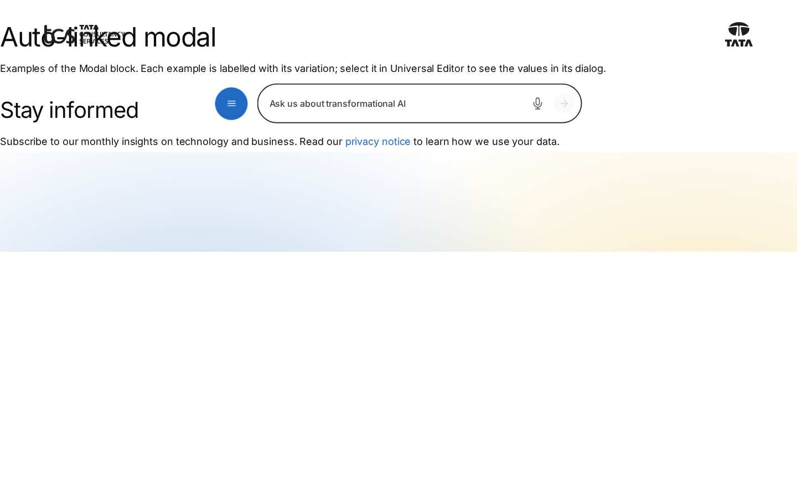
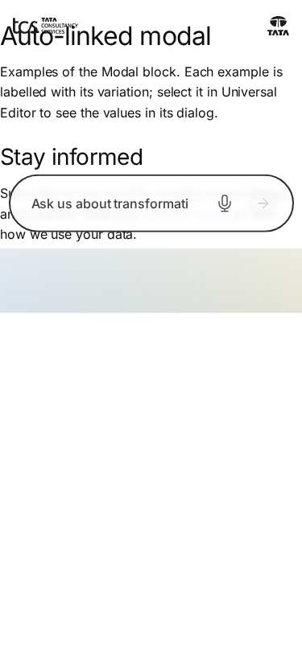

# Modal — Authoring Guide

| Attribute | Value |
| --- | --- |
| Document ID | AUT-C-modal |
| Audience | Content authors, content managers, AEM authoring leads |
| Purpose | How to add, fill in and check the Modal component |
| Scope | — |
| Prerequisites | — |
| Owner | Content Lead / AEM Authoring Lead (proposed) |
| Approver | Product Owner (to be confirmed) |
| Version | 1.0 |
| Status | Draft for review |
| Last updated | 8 November 2026 |
| Last validated | 8 November 2026 |
| Source files | blocks/modal/README.md, blocks/modal/_modal.json |
| Related documents | — |
| Related AEM paths | — |

## Contents

- [Where to see it](#where-to-see-it)
- [For Content Authors](#for-content-authors)
- [Authorable Fields](#authorable-fields)
- [Screenshot-Based Authoring Steps](#screenshot-based-authoring-steps)
- [Variations](#variations)
- [Complete Authoring Example](#complete-authoring-example)
- [Content and Asset Guidelines](#content-and-asset-guidelines)
- [Troubleshooting](#troubleshooting)
- [Screenshots](#screenshots)
- [Known limitations](#known-limitations)
- [Open items](#open-items)
- [Change history](#change-history)

## Where to see it

- https://main--tcs-corp--sradha-tcs.aem.live/design-block-master/en/block-library/modal
- https://main--tcs-corp--sradha-tcs.aem.live/design-block-master/en/block-library/modal/auto-linked-modal
- https://main--tcs-corp--sradha-tcs.aem.live/design-block-master/en/block-library/modal/fragments
- https://main--tcs-corp--sradha-tcs.aem.live/design-block-master/en/block-library/modal/fragments/contact-form
- https://main--tcs-corp--sradha-tcs.aem.live/design-block-master/en/block-library/modal/fragments/privacy-notice
- https://main--tcs-corp--sradha-tcs.aem.live/design-block-master/en/block-library/modal/fragments/recognition
- https://main--tcs-corp--sradha-tcs.aem.live/design-block-master/en/block-library/modal/fragments/terms
- https://main--tcs-corp--sradha-tcs.aem.live/design-block-master/en/block-library/modal/modal-block
- https://main--tcs-corp--sradha-tcs.aem.live/design-block-master/en/block-library/modal/modal-long-content
- https://main--tcs-corp--sradha-tcs.aem.live/design-block-master/en/block-library/modal/modal-with-a-form

## For Content Authors

1. **Create the modal page** (a fragment page, e.g. under the locale's `modal/` or `references/` folder) and start it with a heading: the heading names the dialog.
2. **Publish the modal page.**
3. **Add the block** to the host page: section (or Columns Container column, or Tab) › Add › **Modal**.
4. **Open its properties.** Pick the page in **Modal Content** and enter the **Button Text** (a verb and an object, e.g. "View our awards").
5. **Additional tab** (optional): Anchor ID, Hide block, padding and margin apply to the button's block on the page, not to the dialog.
6. **Preview:** select the button (it works in Universal Editor preview too); check the dialog's content, scrolling and closing.
7. **Publish** the host page.
8. **Auto-linked alternative:** in any text or button, link to a page whose path contains `/modal/`: on the site, the link opens that page in a dialog.
9. **Validate** on the published site: the dialog opens, is named by its heading, closes with Escape and returns focus to the button.

Minimum required: Modal Content. Recommended: Button Text; a heading at the top of the modal page. Optional: the Additional tab.

## Authorable Fields

<!-- BEGIN GENERATED: fields (npm run build:docs) -->

#### Modal (`modal`)

Model `modal`; template name "Modal" (the block class AEM renders).

##### Content tab — Modal

| Field label | Property | Type | Required | Default | Allowed values | Author guidance | Example |
| ----------- | -------- | ---- | -------- | ------- | -------------- | --------------- | ------- |
| Modal Content | `link` | aem-content | No | — | — | A fragment page, e.g. under /modal/. Opens in a dialog. | /design-block-master/en/block-library/modal/fragments/contact-form |
| Button Text | `linkText` | text | No | — | — | Delivered with `link` (field collapse). | Contact our team |

##### Additional tab — Modal

| Field label | Property | Type | Required | Default | Allowed values | Author guidance | Example |
| ----------- | -------- | ---- | -------- | ------- | -------------- | --------------- | ------- |
| Anchor ID | `classes_anchor` | text | No | — | regExp: ^anchor-[a-z0-9][a-z0-9-]*$; customErrorMsg: Start with anchor-, then lower-case letters, digits and hyphens. | A unique ID of the block on the page, starting with anchor-, e.g. anchor-our-services; link to it with #anchor-our-services. Delivered as a block class. | — |
| Hide block | `classes_hideblock` | boolean | No | `false` | on / off | Hides the whole block on the page until it is turned off (shown faded in the editor). Delivered as a block class. | — |
| Padding left | `classes_paddingleft` | select | No | "" | Default (""), 0 (none) (`pl-0`), 0.25rem (space-100) (`pl-100`), 0.5rem (space-200) (`pl-200`), 0.75rem (space-300) (`pl-300`), 1rem (space-400) (`pl-400`), 1.25rem (space-500) (`pl-500`), 1.5rem (space-600) (`pl-600`), 2rem (space-800) (`pl-800`), 2.5rem (space-1000) (`pl-1000`), 3rem (space-1200) (`pl-1200`), 4rem (space-1600) (`pl-1600`), 5rem (space-2000) (`pl-2000`), 6rem (space-2400) (`pl-2400`), 7.5rem (space-3000) (`pl-3000`) | Delivered as a block class. | — |
| Padding right | `classes_paddingright` | select | No | "" | Default (""), 0 (none) (`pr-0`), 0.25rem (space-100) (`pr-100`), 0.5rem (space-200) (`pr-200`), 0.75rem (space-300) (`pr-300`), 1rem (space-400) (`pr-400`), 1.25rem (space-500) (`pr-500`), 1.5rem (space-600) (`pr-600`), 2rem (space-800) (`pr-800`), 2.5rem (space-1000) (`pr-1000`), 3rem (space-1200) (`pr-1200`), 4rem (space-1600) (`pr-1600`), 5rem (space-2000) (`pr-2000`), 6rem (space-2400) (`pr-2400`), 7.5rem (space-3000) (`pr-3000`) | Delivered as a block class. | — |
| Padding top | `classes_paddingtop` | select | No | "" | Default (""), 0 (none) (`pt-0`), 0.25rem (space-100) (`pt-100`), 0.5rem (space-200) (`pt-200`), 0.75rem (space-300) (`pt-300`), 1rem (space-400) (`pt-400`), 1.25rem (space-500) (`pt-500`), 1.5rem (space-600) (`pt-600`), 2rem (space-800) (`pt-800`), 2.5rem (space-1000) (`pt-1000`), 3rem (space-1200) (`pt-1200`), 4rem (space-1600) (`pt-1600`), 5rem (space-2000) (`pt-2000`), 6rem (space-2400) (`pt-2400`), 7.5rem (space-3000) (`pt-3000`) | Delivered as a block class. | — |
| Padding bottom | `classes_paddingbottom` | select | No | "" | Default (""), 0 (none) (`pb-0`), 0.25rem (space-100) (`pb-100`), 0.5rem (space-200) (`pb-200`), 0.75rem (space-300) (`pb-300`), 1rem (space-400) (`pb-400`), 1.25rem (space-500) (`pb-500`), 1.5rem (space-600) (`pb-600`), 2rem (space-800) (`pb-800`), 2.5rem (space-1000) (`pb-1000`), 3rem (space-1200) (`pb-1200`), 4rem (space-1600) (`pb-1600`), 5rem (space-2000) (`pb-2000`), 6rem (space-2400) (`pb-2400`), 7.5rem (space-3000) (`pb-3000`) | Delivered as a block class. | — |
| Margin left | `classes_marginleft` | select | No | "" | Default (""), 0 (none) (`ml-0`), 0.25rem (space-100) (`ml-100`), 0.5rem (space-200) (`ml-200`), 0.75rem (space-300) (`ml-300`), 1rem (space-400) (`ml-400`), 1.25rem (space-500) (`ml-500`), 1.5rem (space-600) (`ml-600`), 2rem (space-800) (`ml-800`), 2.5rem (space-1000) (`ml-1000`), 3rem (space-1200) (`ml-1200`), 4rem (space-1600) (`ml-1600`), 5rem (space-2000) (`ml-2000`), 6rem (space-2400) (`ml-2400`), 7.5rem (space-3000) (`ml-3000`) | Delivered as a block class. | — |
| Margin right | `classes_marginright` | select | No | "" | Default (""), 0 (none) (`mr-0`), 0.25rem (space-100) (`mr-100`), 0.5rem (space-200) (`mr-200`), 0.75rem (space-300) (`mr-300`), 1rem (space-400) (`mr-400`), 1.25rem (space-500) (`mr-500`), 1.5rem (space-600) (`mr-600`), 2rem (space-800) (`mr-800`), 2.5rem (space-1000) (`mr-1000`), 3rem (space-1200) (`mr-1200`), 4rem (space-1600) (`mr-1600`), 5rem (space-2000) (`mr-2000`), 6rem (space-2400) (`mr-2400`), 7.5rem (space-3000) (`mr-3000`) | Delivered as a block class. | — |
| Margin top | `classes_margintop` | select | No | "" | Default (""), 0 (none) (`mt-0`), 0.25rem (space-100) (`mt-100`), 0.5rem (space-200) (`mt-200`), 0.75rem (space-300) (`mt-300`), 1rem (space-400) (`mt-400`), 1.25rem (space-500) (`mt-500`), 1.5rem (space-600) (`mt-600`), 2rem (space-800) (`mt-800`), 2.5rem (space-1000) (`mt-1000`), 3rem (space-1200) (`mt-1200`), 4rem (space-1600) (`mt-1600`), 5rem (space-2000) (`mt-2000`), 6rem (space-2400) (`mt-2400`), 7.5rem (space-3000) (`mt-3000`) | Delivered as a block class. | — |
| Margin bottom | `classes_marginbottom` | select | No | "" | Default (""), 0 (none) (`mb-0`), 0.25rem (space-100) (`mb-100`), 0.5rem (space-200) (`mb-200`), 0.75rem (space-300) (`mb-300`), 1rem (space-400) (`mb-400`), 1.25rem (space-500) (`mb-500`), 1.5rem (space-600) (`mb-600`), 2rem (space-800) (`mb-800`), 2.5rem (space-1000) (`mb-1000`), 3rem (space-1200) (`mb-1200`), 4rem (space-1600) (`mb-1600`), 5rem (space-2000) (`mb-2000`), 6rem (space-2400) (`mb-2400`), 7.5rem (space-3000) (`mb-3000`) | Delivered as a block class. | — |

<!-- END GENERATED: fields -->

Notes:

- **Modal Content.** Delivered as one link with its Button Text (field collapse: `linkText` into `link`). Absolute URLs are reduced to their path; the path must start with `/` (not `//`); the page is fetched each time the dialog opens; a failed request opens nothing and shows no message.
- **Button Text.** The opener's label; empty or equal to the URL → "Open" (placeholder `open`). A link title different from the text and the URL is copied to the button's `title`.
- **Rendering result.** A `<button type="button" aria-haspopup="dialog">` styled as a primary button (`decorateButton`, view button, type primary); there is no style option. The link's editor instrumentation moves to the button, so it stays selectable.
- **No Modal Content.** The block is empty on the site; in Universal Editor edit mode it shows "Modal: choose the page it opens, and its button text." (placeholder `modalEmpty`).
- **Accessibility impact.** The dialog's name is the modal page's first heading (an id `modal-title-{n}` is added if it has none), else "Dialog" (placeholder `dialog`); the close button is named "Close" (`close`).
- **Data layer impact.** `cmp:show` / `cmp:hide` with a stable dialog id (see [Data Layer and Analytics](https://github.com/sradha-tcs/tcs-corp/blob/main/blocks/modal/README.md#data-layer-and-analytics)).
- **Legacy mapping.** None.
- **Additional tab.** As every block (AGENTS.md "Additional tab"), without animation fields; the Anchor ID is also the opener's data-layer id.

## Screenshot-Based Authoring Steps

#### Authoring Step 1: Create the modal page

```text
[Screenshot Placeholder]

File name:
modal-authoring-step-1.png

Purpose:
The modal page (recognition) in Universal Editor, starting with its heading.

Annotations:
A = Title "Awards and recognition"
B = Text with the list of awards
C = Button Block "More about us"
```

#### Values to Enter

| Callout | Field | Value | Reason | Expected result |
| ------- | ----- | ----- | ------ | --------------- |
| A | Title | `Awards and recognition` | Names the dialog | `aria-labelledby` points to it |
| B | Text | Introduction and a bulleted list | Dialog content | Scrolls inside the dialog when long |
| C | Button Block | `More about us` | A next step | Link inside the dialog |

Values from `block-library/modal/fragments/recognition`. Business rule: the page must be published. Common mistake: no heading (screen readers announce "Dialog" only).

#### Authoring Step 2: Add the Modal block

```text
[Screenshot Placeholder]

File name:
modal-authoring-step-2.png

Purpose:
The host page section with the Add menu and Modal highlighted.

Annotations:
A = Section
B = Modal in the component list
```

#### Values to Enter

| Callout | Field | Value | Reason | Expected result |
| ------- | ----- | ----- | ------ | --------------- |
| B | Component | Modal | Opener button | Empty block with the editor hint |

Expected preview: the hint until Modal Content is set.

#### Authoring Step 3: Modal Content and Button Text

```text
[Screenshot Placeholder]

File name:
modal-authoring-step-3.png

Purpose:
The Modal properties, Content tab.

Annotations:
A = Modal Content
B = Button Text
```

#### Values to Enter

| Callout | Field | Value | Reason | Expected result |
| ------- | ----- | ----- | ------ | --------------- |
| A | Modal Content | `/language-masters/en/block-library/modal/fragments/recognition` | The dialog's page | The dialog shows its content |
| B | Button Text | `View our awards` | Says what opens | Primary button "View our awards" |

Business rule: an empty Button Text shows "Open". Validation: the button opens the dialog in preview. Common mistake: a Button Text that repeats the URL.

#### Authoring Step 4: Additional tab

```text
[Screenshot Placeholder]

File name:
modal-authoring-step-4.png

Purpose:
The Additional tab with the Anchor ID filled in.

Annotations:
A = Anchor ID
```

#### Values to Enter

| Callout | Field | Value | Reason | Expected result |
| ------- | ----- | ----- | ------ | --------------- |
| A | Anchor ID | `anchor-modal-awards` (library sample) | Jump target and stable analytics id | Button block `id`; dialog id `anchor-modal-awards-dialog` in the data layer |

Common mistake: expecting the spacing fields to change the dialog (they apply to the button's block).

#### Authoring Step 5: Publish and validate

```text
[Screenshot Placeholder]

File name:
modal-authoring-step-5.png

Purpose:
The published page with the dialog open over the dimmed page.

Annotations:
A = Opener button (behind the backdrop)
B = Dialog with its heading
C = Close button
```

#### Values to Enter

| Callout | Field | Value | Reason | Expected result |
| ------- | ----- | ----- | ------ | --------------- |
| A | Publish | The modal page and the host page | Both are needed | The dialog opens on the live site |

Validation: Escape closes and focus returns to the button. Common mistake: publishing only the host page (the button does nothing).

## Variations

#### Modal block (button opener)

- **Purpose:** an explicit button opening the dialog.
- **Required:** Modal Content. **Optional:** Button Text, Additional tab.
- **Rendering:** `div.modal.block > button.button.primary[aria-haspopup=dialog]`; on click a new `div.modal.block` is appended to `main` with the `dialog`. A double click opens one dialog.
- **Desktop / tablet / mobile:** see [Responsive Behavior](https://github.com/sradha-tcs/tcs-corp/blob/main/blocks/modal/README.md#responsive-behavior).
- **Accessibility:** native modal dialog; focus returns to the button.
- **Data layer:** opener click, then `cmp:show` / `cmp:hide` on `{opener id}-dialog`.
- **Personalization / fallback:** none; a modal page that can't load opens nothing.

```text
[Screenshot Placeholder]

File name:
modal-block-open-desktop.png

Purpose:
The awards dialog open from its button at 1440px.

Annotations:
A = Dialog
B = Close button
```

#### Auto-linked `/modal/` link

- **Purpose:** open a modal from any link (text, button, header or footer) without a Modal block.
- **Configuration:** a link whose URL path contains `/modal/`.
- **Rendering:** a document click listener (`autolinkModals`, started in the lazy phase) prevents the navigation and calls `openModal(href, { opener })`; links already handled (`defaultPrevented`) are skipped.
- **Data layer:** dialog id `modal-{path as class name}`.
- **Note:** in Universal Editor the editor navigates to clicked links; use a Modal block to open dialogs there.

```text
[Screenshot Placeholder]

File name:
modal-auto-link-desktop.png

Purpose:
A dialog opened by an inline link to a /modal/ page.

Annotations:
A = Inline link
B = Dialog
```

#### Component dialog (`createModal`)

- **Purpose:** the same dialog for block features: the Video block's Play in a Pop-up passes its player to `createModal([wrapper])`.
- **Rendering:** no fragment request; the content is the caller's nodes; naming, closing and data layer as above (id `modal-{n}`, no stable id passed).

```text
[Screenshot Placeholder]

File name:
modal-video-popup-desktop.png

Purpose:
A Video block playing in the dialog.

Annotations:
A = Video player in the dialog
B = Close button
```

#### Long content

- **Purpose:** terms or details longer than the screen (library `modal-long-content`).
- **Rendering:** the dialog is never taller than the visible area minus twice its gap; the content scrolls inside (`overflow-y: auto`, `overscroll-behavior: contain`); the close button stays at the top (sticky); the page is locked (`body.modal-open`).

```text
[Screenshot Placeholder]

File name:
modal-long-content-mobile.png

Purpose:
The programme terms scrolled inside the dialog at 390px.

Annotations:
A = Sticky close button
B = Scrolled content
```

## Complete Authoring Example

Scenario: a "Contact our team" dialog with a form on the Get in touch page.

| Field | Example value | Guidance |
| ----- | ------------- | -------- |
| Modal page | `/content/tcs-corp/us/en/modal/contact-form` (library `block-library/modal/fragments/contact-form`) | A heading first, then the Form Variations block |
| Modal Content | The modal page | Same locale |
| Button Text | `Contact our team` | Verb and object |
| Additional › Anchor ID | `anchor-g01b-modal` (library sample) | Stable analytics id |

Steps: author and publish the modal page, add the Modal to the host page, fill in the fields, publish.

Expected output: a primary button; the dialog with the form opens over the page. Responsive: 1.5rem from the screen edges below 900px, at most 56.25rem wide from 900px. Accessibility: named by the form page's heading, Escape closes, focus back on the button. Analytics: `cmp:click` on `anchor-g01b-modal`, `cmp:show` / `cmp:hide` on `anchor-g01b-modal-dialog`, the form's own `cmp:submit`. Personalization fallback: none.

Pre-publish checklist:

- [ ] Modal page published, starting with a heading.
- [ ] Button Text filled in.
- [ ] No modal opened from inside a modal.
- [ ] Checked at 390px and 1440px, keyboard only.

## Content and Asset Guidelines

- **Headings.** Start every modal page with a heading (it names the dialog).
- **Button Text.** A verb and an object ("View our awards", "Read the programme terms"); avoid "Open" and "Click here".
- **Content length.** Short and single-purpose; long content scrolls but belongs on a page.
- **Images.** The content area is at most 56.25rem minus its padding; images as their blocks define.
- **Tags and metadata.** Not used; give modal pages a clear title for authors.
- **Min / max items.** No verified technical limit was identified.
- **Loading.** Nothing is loaded until the dialog opens (the modal stylesheet, the fragment page); the page is fetched again at each opening.
- **Missing page.** Nothing opens.

## Troubleshooting

| Symptom | Likely cause | Diagnostic steps | Resolution | Verification |
| ------- | ------------ | ---------------- | ---------- | ------------ |
| The button does nothing | Modal page not published, wrong path, or not a site path | Network: `{path}.plain.html` status | Publish / correct Modal Content | Dialog opens |
| No button | Modal Content empty, or Hide block on | Properties panel | Choose the page; switch Hide block off | Button visible |
| Button says "Open" | Button Text empty or equal to the URL | Properties panel | Enter a descriptive text | Correct label |
| A link opens a dialog (or navigates) unexpectedly | Its path contains `/modal/` (auto-link), or clicked before the lazy phase / in the editor | Check the URL | Move pages out of `modal` folders; use a Modal block in the editor | Intended behaviour on `.aem.page` |
| Screen readers say "Dialog" only | Modal page without a heading | Inspect `aria-label` | Add a heading | `aria-labelledby` set |
| Content unstyled or blocks missing | A block of the modal page failed | Console `failed to load …` | Fix the content; escalate block errors | Renders as on its page |
| No `cmp:show` / `cmp:hide` | Dialog didn't open; Tags not configured | `adobeDataLayer.filter((e) => e.eventInfo?.interaction === 'dialog')` | Fix the opening; configure Tags later | Events present |

Evidence to collect: host page URL, Modal Content value, network status of the modal page request, console errors, the data-layer entries. No cookies or tokens.

## Screenshots



*Figure: Modal as published (block library) — desktop 1440 × 900 (/design-block-master/en/block-library/modal/auto-linked-modal, captured 2026-11-08).*



*Figure: Modal as published (block library) — mobile 375 × 812 (/design-block-master/en/block-library/modal/auto-linked-modal, captured 2026-11-08).*

> **Screenshot required**
>
> - Required screen: Modal dialog in Universal Editor (every tab, including Additional)
> - Required role/access: AEM Sites author with Universal Editor (content author)
> - Required navigation steps: AEM Sites console > /content/tcs-corp/language-masters/en > open a page in Universal Editor
> - Reason unavailable: No AEM author access in the documentation program (access blocker AB-01)
> - Owner: Content Lead / AEM Authoring Lead (proposed)
> - Target completion date: To be confirmed

## Known limitations

- Universal Editor screenshots are placeholders: no author access in this program.

## Open items

- None.

## Change history

| Version | Date | Author | Change |
| --- | --- | --- | --- |
| 1.0 | 8 November 2026 | Delivery team (documentation program) | First version of the role-specific documentation (master documentation prompt), generated from the repository and the published reference pages |
