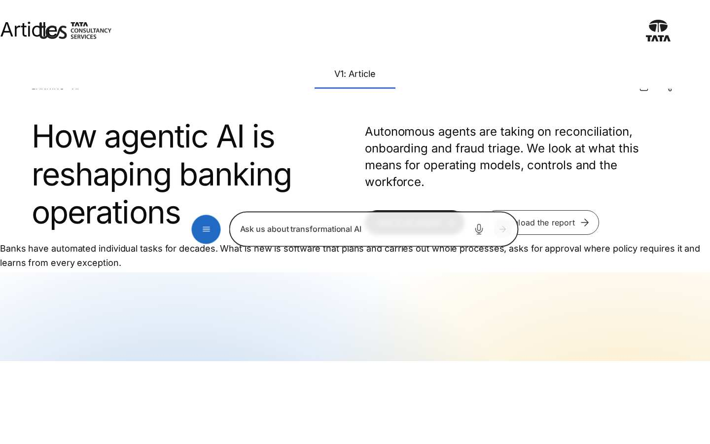

# Page Header — Authoring Guide

| Attribute | Value |
| --- | --- |
| Document ID | AUT-C-page-header |
| Audience | Content authors, content managers, AEM authoring leads |
| Purpose | How to add, fill in and check the Page Header component |
| Scope | — |
| Prerequisites | — |
| Owner | Content Lead / AEM Authoring Lead (proposed) |
| Approver | Product Owner (to be confirmed) |
| Version | 1.0 |
| Status | Draft for review |
| Last updated | 8 November 2026 |
| Last validated | 8 November 2026 |
| Source files | blocks/page-header/README.md, blocks/page-header/_page-header.json |
| Related documents | — |
| Related AEM paths | — |

## Contents

- [Where to see it](#where-to-see-it)
- [For Content Authors](#for-content-authors)
- [Authorable Fields](#authorable-fields)
- [Screenshot-Based Authoring Steps](#screenshot-based-authoring-steps)
- [Variations](#variations)
- [Complete Authoring Example](#complete-authoring-example)
- [Content and Asset Guidelines](#content-and-asset-guidelines)
- [Troubleshooting](#troubleshooting)
- [Screenshots](#screenshots)
- [Known limitations](#known-limitations)
- [Open items](#open-items)
- [Change history](#change-history)

## Where to see it

- https://main--tcs-corp--sradha-tcs.aem.live/design-block-master/en/block-library/page-header
- https://main--tcs-corp--sradha-tcs.aem.live/design-block-master/en/block-library/page-header/article
- https://main--tcs-corp--sradha-tcs.aem.live/design-block-master/en/block-library/page-header/article-default
- https://main--tcs-corp--sradha-tcs.aem.live/design-block-master/en/block-library/page-header/cta-primary
- https://main--tcs-corp--sradha-tcs.aem.live/design-block-master/en/block-library/page-header/cta-secondary
- https://main--tcs-corp--sradha-tcs.aem.live/design-block-master/en/block-library/page-header/cta-text-link
- https://main--tcs-corp--sradha-tcs.aem.live/design-block-master/en/block-library/page-header/default-by-page-type
- https://main--tcs-corp--sradha-tcs.aem.live/design-block-master/en/block-library/page-header/display
- https://main--tcs-corp--sradha-tcs.aem.live/design-block-master/en/block-library/page-header/guest-author
- https://main--tcs-corp--sradha-tcs.aem.live/design-block-master/en/block-library/page-header/landing
- https://main--tcs-corp--sradha-tcs.aem.live/design-block-master/en/block-library/page-header/landing-default
- https://main--tcs-corp--sradha-tcs.aem.live/design-block-master/en/block-library/page-header/landing-featured-image
- https://main--tcs-corp--sradha-tcs.aem.live/design-block-master/en/block-library/page-header/landing-text-only
- https://main--tcs-corp--sradha-tcs.aem.live/design-block-master/en/block-library/page-header/press-release
- https://main--tcs-corp--sradha-tcs.aem.live/design-block-master/en/block-library/page-header/secondary
- https://main--tcs-corp--sradha-tcs.aem.live/design-block-master/en/block-library/page-header/tablet-widths
- https://main--tcs-corp--sradha-tcs.aem.live/design-block-master/en/block-library/page-header/tags-and-content-type

## For Content Authors

1. **Check the page metadata first.** The header shows the page's Title (H1) and Description (page properties) and the metadata sheet's `content-type`, `publish-date` (YYYY-MM-DD), `reading-time` (a number), `author-id` (or `author`), `featured-image` (with `image-alt`) and `listen-link`, and the page tags. Article, blog and press-release pages get a Page Header automatically.
2. **Add the block (only if the page needs an authored one).** In Universal Editor select the first Section, choose **Add (+)** and pick **Page Header**. It is offered only in Sections.
3. **Open its properties.** Select the Page Header in the content tree; the panel shows **Style**, **CTAs** and **Additional**.
4. **Select the layout (Style tab).** Leave **Layout** on Default (Landing for landing / listing page types, else Article) or choose Landing, Secondary, Article or Display.
5. **Add CTAs.** Select the Page Header, choose **Add (+)** › **CTA**, fill **CTA Link** (required) and **CTA Title**, choose **CTA Link Style** (Primary Button by default, Secondary Button, Text link) and **CTA Link Type** (Open in New Window only when needed). Reorder CTAs by dragging them in the content tree.
6. **Additional tab.** Anchor ID, Hide block, Animation Type and spacing only when needed.
7. **Preview.** After changing page properties, reload the editor (metadata is read when the page loads); check desktop and mobile.
8. **Publish.** Publish the page; the Authors sheet, taxonomy and placeholders of the locale must be published too.
9. **Validate the published output.** One H1 equal to the page Title, the date as dd/mm/yy, the author lockup complete, tags with proper labels, CTAs working.

**Minimum required content:** a page Title. **Recommended:** Description, content-type, and for articles publish-date, reading-time and author-id. **Optional:** CTAs, featured-image (Landing), listen-link (Article), Layout, Additional tab options.

## Authorable Fields

<!-- BEGIN GENERATED: fields (npm run build:docs) -->

#### Page Header (`page-header`)

Model `page-header`; template name "Page Header" (the block class AEM renders); key-value block (one row per property); children: `page-header-cta`.

##### Style tab — Page Header

| Field label | Property | Type | Required | Default | Allowed values | Author guidance | Example |
| ----------- | -------- | ---- | -------- | ------- | -------------- | --------------- | ------- |
| Layout | `classes` | select | No | "" | Default (from the Page Type) (""), Landing (with the featured image) (`landing`), Secondary (title left, text right) (`secondary`), Article (meta row, author) (`article`), Display (large title) (`display`) | The content comes from the page's metadata (title, description, tags, content type, publish date, reading time, author, featured image, listen link). Default: Landing for the landing and listing page types, else Article. | article |

##### CTAs tab — Page Header

| Field label | Property | Type | Required | Default | Allowed values | Author guidance | Example |
| ----------- | -------- | ---- | -------- | ------- | -------------- | --------------- | ------- |
| CTA List | `ctas` | container (multiple) | No | — | — | CTAs authored before CTA items. Add CTAs to the page header with Add (CTA) instead. | — |
| CTA List › CTA Title | `ctaText` | text | No | — | — | — | — |
| CTA List › CTA Link | `cta` | aem-content | No | — | — | — | — |
| CTA List › CTA Link Type | `ctaTarget` | select | No | "" | Default (""), Open in New Window (`new-window`) | — | — |
| CTA List › CTA Link Style | `ctaStyle` | select | No | `primary` | Text link (""), Primary Button (`primary`), Secondary Button (`secondary`) | — | — |

##### Additional tab — Page Header

| Field label | Property | Type | Required | Default | Allowed values | Author guidance | Example |
| ----------- | -------- | ---- | -------- | ------- | -------------- | --------------- | ------- |
| Anchor ID | `classes_anchor` | text | No | — | regExp: ^anchor-[a-z0-9][a-z0-9-]*$; customErrorMsg: Start with anchor-, then lower-case letters, digits and hyphens. | A unique ID of the block on the page, starting with anchor-, e.g. anchor-our-services; link to it with #anchor-our-services. Delivered as a block class. | — |
| Hide block | `classes_hideblock` | boolean | No | `false` | on / off | Hides the whole block on the page until it is turned off (shown faded in the editor). Delivered as a block class. | — |
| Animation Type | `classes_animation` | select | No | "" | None (""), Fade in (`motion-fade-in`), Fade up (`motion-fade-up`), Fade down (`motion-fade-down`), Fade left (`motion-fade-left`), Fade right (`motion-fade-right`), Slide up (`motion-slide-up`), Slide down (`motion-slide-down`), Slide left (`motion-slide-left`), Slide right (`motion-slide-right`), Scale in (`motion-scale-in`) | How the block's content appears; repeated items (cards, list items, accordion items, columns) appear one after another. None: shown as is. Not played in the editor or when the visitor prefers reduced motion. Delivered as a block class. | — |
| Motion Speed | `classes_animationspeed` | select | No | "" | Medium (""), Fast (`motion-fast`), Slow (`motion-slow`) | How fast the animation runs: 0.3, 0.6 or 0.9 seconds. Shown when `classes_animation` is set and `classes_animation` is not empty. Delivered as a block class. | — |
| Animation Trigger | `classes_animationtrigger` | select | No | "" | On Scroll / Viewport Entry (""), On Page Load (`motion-on-load`) | When the block's animations run. On Scroll: when the block comes into view (at once if it is in view when the page opens). On Page Load: as soon as the block is ready, wherever it is on the page. Shown when `classes_animation` is set and `classes_animation` is not empty. Delivered as a block class. | — |
| Padding left | `classes_paddingleft` | select | No | "" | Default (""), 0 (none) (`pl-0`), 0.25rem (space-100) (`pl-100`), 0.5rem (space-200) (`pl-200`), 0.75rem (space-300) (`pl-300`), 1rem (space-400) (`pl-400`), 1.25rem (space-500) (`pl-500`), 1.5rem (space-600) (`pl-600`), 2rem (space-800) (`pl-800`), 2.5rem (space-1000) (`pl-1000`), 3rem (space-1200) (`pl-1200`), 4rem (space-1600) (`pl-1600`), 5rem (space-2000) (`pl-2000`), 6rem (space-2400) (`pl-2400`), 7.5rem (space-3000) (`pl-3000`) | Delivered as a block class. | — |
| Padding right | `classes_paddingright` | select | No | "" | Default (""), 0 (none) (`pr-0`), 0.25rem (space-100) (`pr-100`), 0.5rem (space-200) (`pr-200`), 0.75rem (space-300) (`pr-300`), 1rem (space-400) (`pr-400`), 1.25rem (space-500) (`pr-500`), 1.5rem (space-600) (`pr-600`), 2rem (space-800) (`pr-800`), 2.5rem (space-1000) (`pr-1000`), 3rem (space-1200) (`pr-1200`), 4rem (space-1600) (`pr-1600`), 5rem (space-2000) (`pr-2000`), 6rem (space-2400) (`pr-2400`), 7.5rem (space-3000) (`pr-3000`) | Delivered as a block class. | — |
| Padding top | `classes_paddingtop` | select | No | "" | Default (""), 0 (none) (`pt-0`), 0.25rem (space-100) (`pt-100`), 0.5rem (space-200) (`pt-200`), 0.75rem (space-300) (`pt-300`), 1rem (space-400) (`pt-400`), 1.25rem (space-500) (`pt-500`), 1.5rem (space-600) (`pt-600`), 2rem (space-800) (`pt-800`), 2.5rem (space-1000) (`pt-1000`), 3rem (space-1200) (`pt-1200`), 4rem (space-1600) (`pt-1600`), 5rem (space-2000) (`pt-2000`), 6rem (space-2400) (`pt-2400`), 7.5rem (space-3000) (`pt-3000`) | Delivered as a block class. | — |
| Padding bottom | `classes_paddingbottom` | select | No | "" | Default (""), 0 (none) (`pb-0`), 0.25rem (space-100) (`pb-100`), 0.5rem (space-200) (`pb-200`), 0.75rem (space-300) (`pb-300`), 1rem (space-400) (`pb-400`), 1.25rem (space-500) (`pb-500`), 1.5rem (space-600) (`pb-600`), 2rem (space-800) (`pb-800`), 2.5rem (space-1000) (`pb-1000`), 3rem (space-1200) (`pb-1200`), 4rem (space-1600) (`pb-1600`), 5rem (space-2000) (`pb-2000`), 6rem (space-2400) (`pb-2400`), 7.5rem (space-3000) (`pb-3000`) | Delivered as a block class. | — |
| Margin left | `classes_marginleft` | select | No | "" | Default (""), 0 (none) (`ml-0`), 0.25rem (space-100) (`ml-100`), 0.5rem (space-200) (`ml-200`), 0.75rem (space-300) (`ml-300`), 1rem (space-400) (`ml-400`), 1.25rem (space-500) (`ml-500`), 1.5rem (space-600) (`ml-600`), 2rem (space-800) (`ml-800`), 2.5rem (space-1000) (`ml-1000`), 3rem (space-1200) (`ml-1200`), 4rem (space-1600) (`ml-1600`), 5rem (space-2000) (`ml-2000`), 6rem (space-2400) (`ml-2400`), 7.5rem (space-3000) (`ml-3000`) | Delivered as a block class. | — |
| Margin right | `classes_marginright` | select | No | "" | Default (""), 0 (none) (`mr-0`), 0.25rem (space-100) (`mr-100`), 0.5rem (space-200) (`mr-200`), 0.75rem (space-300) (`mr-300`), 1rem (space-400) (`mr-400`), 1.25rem (space-500) (`mr-500`), 1.5rem (space-600) (`mr-600`), 2rem (space-800) (`mr-800`), 2.5rem (space-1000) (`mr-1000`), 3rem (space-1200) (`mr-1200`), 4rem (space-1600) (`mr-1600`), 5rem (space-2000) (`mr-2000`), 6rem (space-2400) (`mr-2400`), 7.5rem (space-3000) (`mr-3000`) | Delivered as a block class. | — |
| Margin top | `classes_margintop` | select | No | "" | Default (""), 0 (none) (`mt-0`), 0.25rem (space-100) (`mt-100`), 0.5rem (space-200) (`mt-200`), 0.75rem (space-300) (`mt-300`), 1rem (space-400) (`mt-400`), 1.25rem (space-500) (`mt-500`), 1.5rem (space-600) (`mt-600`), 2rem (space-800) (`mt-800`), 2.5rem (space-1000) (`mt-1000`), 3rem (space-1200) (`mt-1200`), 4rem (space-1600) (`mt-1600`), 5rem (space-2000) (`mt-2000`), 6rem (space-2400) (`mt-2400`), 7.5rem (space-3000) (`mt-3000`) | Delivered as a block class. | — |
| Margin bottom | `classes_marginbottom` | select | No | "" | Default (""), 0 (none) (`mb-0`), 0.25rem (space-100) (`mb-100`), 0.5rem (space-200) (`mb-200`), 0.75rem (space-300) (`mb-300`), 1rem (space-400) (`mb-400`), 1.25rem (space-500) (`mb-500`), 1.5rem (space-600) (`mb-600`), 2rem (space-800) (`mb-800`), 2.5rem (space-1000) (`mb-1000`), 3rem (space-1200) (`mb-1200`), 4rem (space-1600) (`mb-1600`), 5rem (space-2000) (`mb-2000`), 6rem (space-2400) (`mb-2400`), 7.5rem (space-3000) (`mb-3000`) | Delivered as a block class. | — |

#### CTA (`page-header-cta`)

Model `page-header-cta`; template name "CTA" (the block class AEM renders).

Stored on a new component (definition template): `linkStyle` = `"primary"`.

##### Fields — CTA

| Field label | Property | Type | Required | Default | Allowed values | Author guidance | Example |
| ----------- | -------- | ---- | -------- | ------- | -------------- | --------------- | ------- |
| CTA Link | `link` | aem-content | Yes | — | — | — | — |
| CTA Title | `linkText` | text | No | — | — | Delivered with `link` (field collapse). | — |
| CTA Link Type | `linkTarget` | select | No | "" | Default (""), Open in New Window (`new-window`) | — | — |
| CTA Link Style | `linkStyle` | select | No | `primary` | Text link (`tertiary`), Primary Button (`primary`), Secondary Button (`secondary`) | — | — |
| Button background | `buttonBackground` | select | No | "" | Style default (""), Blue (`button-bg-blue`) | For Primary and Secondary Buttons. Blue: #216AC3 with white text. | — |
| Button shape | `buttonShape` | select | No | "" | Style default (""), Round (`button-round`) | For Primary and Secondary Buttons. Round: a 6rem circle, for a short label (words of up to 12 characters, up to 24 in all); a longer label stays a pill. | — |

<!-- END GENERATED: fields -->

Notes on the significant fields:

- **Button background and Button shape** (CTA items, the Teaser link's field names and classes). For a Primary or Secondary Button: **Button background: Blue** (`button-bg-blue`) fills it with the brand blue `#216ac3` (`--color-bg-brand`, border `--color-border-brand-secondary`) and white text (5.4:1), hover and focus `#1b5ea3`; **Button shape: Round** (`button-round`) makes it a 6rem circle with the label (12px, wrapped between words) above the arrow. A label with a word over 12 characters or over 24 characters in all doesn't fit the circle and stays a pill. A Text link ignores both. **Style default** keeps the CTA Link Style. The legacy CTA List has neither (use CTA items); Blue and Round authored before as CTA Link Style `blue` / CTA Shape `round` are shown as Blue and Round.
- **Layout.** Becomes the block class (`landing`, `secondary`, `article`, `display`); any other layout class is removed and the resolved one added. Default resolves from the Page Type (`page-type`, else `template` metadata).
- **CTA (item) fields.** CTA Link Style Primary / Secondary render `a.button.primary` / `a.button.secondary`; Text link (`tertiary`, or empty in content authored before) renders `a.button.tertiary`. A new CTA stores Primary Button (definition template). Open in New Window sets `target="_blank"`, `rel="noopener noreferrer"` and appends the visually hidden placeholder `opensInNewTab`. A CTA without a link isn't rendered (in Universal Editor it is a dashed placeholder, `itemEditorHint`).
- **Metadata (not dialog fields).** Title → `h1.page-header-title`; Description → `div.page-header-description`; content-type → eyebrow (Landing, Secondary) or `p.page-header-collection` (Article); tags → `ul.page-header-tags` (Article meta row; Display eyebrow; Landing / Secondary eyebrow when there is no content-type), labels from the taxonomy, else derived from the tag ID; publish-date (`publication-date` as a fallback) → "Published" + `<time>` (dd/mm/yy); reading-time → "{n} min read" for a number; author-id → Authors sheet name, designation and region, image, LinkedIn; author → name only; featured-image and image-alt → the Landing image; listen-link → the listen action.
- **Accessibility impact.** One H1 per page; the featured image's alt comes from `image-alt` (empty: decorative); the author image is decorative (`alt=""`).
- **Data-layer impact.** The H1 text is the component's `dc:title`; CTAs and the actions are tracked as clicks.
- **Legacy mapping.** CTAs authored in the former **CTA List** composite multifield (`ctas`: CTA Title, CTA Link, CTA Link Type, CTA Link Style) are still read and shown before the CTA items; a style stored as empty renders as a Text link.
- **Additional tab.** Anchor ID, Hide block, Animation Type, Motion Speed, Animation Trigger and spacing (no Background animation): see AGENTS.md "Additional tab" and "Animation and skeletons". The content animation moves the block as a whole.

## Screenshot-Based Authoring Steps

#### Authoring Step 1: Prepare the page metadata

```text
[Screenshot Placeholder]

File name:
page-header-authoring-step-1.png

Purpose:
The page properties (Title, Description, Page Type) and the locale metadata sheet row of the page.

Annotations:
A = Title
B = Description
C = Page Type
D = Metadata sheet row (content-type, publish-date, reading-time, author-id)
```

#### Values to Enter

| Callout | Field | Value | Reason | Expected result |
| ------- | ----- | ----- | ------ | --------------- |
| A | Title (page properties) | Cloud transformation for banks | The H1 | `h1.page-header-title` |
| B | Description (page properties) | How banks modernise their core on the cloud. | Supporting text | Description beside the title |
| C | Page Type | article | Default layout | Article layout |
| D | content-type / publish-date / reading-time / author-id | Insight / 2026-03-12 / 6 / an author-id of the Authors sheet | Meta row and author | "Insight", "Published 12/03/26", "6 min read", the author lockup |

Author action: edit the page properties and the metadata sheet, publish the sheet. Expected preview: the Article header with the meta row. Business rule: the date must be ISO (YYYY-MM-DD) to be formatted. Validation: `<meta name="publish-date">` in the page source. Common mistake: typing the date as "March 12" (shown as typed); resolution: use YYYY-MM-DD.

#### Authoring Step 2: Add the Page Header and choose the layout

```text
[Screenshot Placeholder]

File name:
page-header-authoring-step-2.png

Purpose:
The Page Header added to the first Section, the Style tab with the Layout select open.

Annotations:
A = Page Header in the content tree
B = Layout
```

#### Values to Enter

| Callout | Field | Value | Reason | Expected result |
| ------- | ----- | ----- | ------ | --------------- |
| A | Add (+) | Page Header | Authored header (pages without a template header) | Header from metadata |
| B | Layout | Secondary (title left, text right) | Title and description side by side | Eyebrow above two columns from 900px |

Author action: select the first Section, Add (+) › Page Header, open Style, choose Layout. Expected preview: the chosen layout. Business rule: only one Page Header per page; the templates don't add another when one is authored. Validation: the block has the layout class. Common mistake: leaving Default on a page whose page-type is set by a sheet row to `landing`; resolution: choose the layout explicitly.

#### Authoring Step 3: Add CTAs

```text
[Screenshot Placeholder]

File name:
page-header-authoring-step-3.png

Purpose:
Two CTA items in the content tree, the first one's dialog open.

Annotations:
A = CTA Link
B = CTA Title
C = CTA Link Type
D = CTA Link Style
```

#### Values to Enter

| Callout | Field | Value | Reason | Expected result |
| ------- | ----- | ----- | ------ | --------------- |
| A | CTA Link | /en/contact (first), /en/services (second) | Destinations | Links rendered |
| B | CTA Title | Talk to an expert / Explore services | Labels | Button texts |
| C | CTA Link Type | Default | Same tab | No `target` |
| D | CTA Link Style | Primary Button / Secondary Button | One primary action | Black filled and outlined pill buttons |

Author action: Add (+) › CTA twice, fill each dialog. Expected preview: the CTAs below the description. Business rule: CTA Link is required. Validation: both CTAs open their pages. Common mistake: a CTA Title without a CTA Link (dashed placeholder in the editor, nothing on the page); resolution: fill the link.

#### Authoring Step 4: Preview, publish and verify

```text
[Screenshot Placeholder]

File name:
page-header-authoring-step-4.png

Purpose:
The published Article header compared with the Universal Editor preview.

Annotations:
A = H1 title
B = Meta row
C = Author lockup
D = CTAs
```

#### Values to Enter

| Callout | Field | Value | Reason | Expected result |
| ------- | ----- | ----- | ------ | --------------- |
| A | Preview | Reload the editor | Metadata is read on load | The header shows the new values |
| B | Publish | Page, metadata sheet, Authors sheet, taxonomy | All sources live | The header complete on aem.live |

Author action: reload, preview, publish. Validation: one H1, labels from the taxonomy, author complete. Common mistake: the Authors sheet not published (no lockup); resolution: publish `data/authors`.

## Variations

The layouts are the Layout select values in `blocks/page-header/_page-header.json`; Default resolves in `page-header.js` `layoutOf`.

#### Default (from the Page Type)

Purpose: the right layout without a choice: Landing for `landing` / `listing`, else Article. Use on template pages. Rendering: as the resolved layout. The automatic header of the templates always uses Default.

#### Landing (`landing`)

Purpose: landing and listing pages with a large title and, optionally, the featured image. Required: Title; optional Description, content-type, CTAs, featured-image (+ image-alt). Rendering: `div.page-header-intro` with eyebrow, title (`--display-font-size-1`, semibold; 6rem from 900px), description and CTAs; `div.page-header-media` with the featured image; with an image the block gets `page-header-has-image` and, from 900px, a two-column grid (`--space-2000` gap). The image is requested 1200px wide from 900px, 750px below, eager with high priority when it is same-origin site media (`/media_`). Without an image the text stacks on the left.

```text
[Screenshot Placeholder]

File name:
page-header-landing-tablet.png

Purpose:
The Landing layout with a featured image at 768px: text and CTAs stacked, the image below them (two columns only from 900px).

Annotations:
A = Intro column
B = Featured image
```

#### Secondary (`secondary`)

Purpose: title on one side, description and CTAs on the other. Rendering: the eyebrow above `div.page-header-columns` (intro: semibold title; summary: description and CTAs, `--space-300` lower from 900px); two columns from 900px.

#### Article (`article`)

Purpose: articles, blogs, insights, press releases. Rendering: `div.page-header-meta-row` (labels: tags and `p.page-header-collection`; info: date, reading time, `div.page-header-actions` with listen (only with listen-link), download (prints the page) and share (device share dialog, else copies the URL with a `role="status"` message for 3 seconds)), then the columns (intro: title at `--display-font-size-2` and the author lockup; summary: description and CTAs).

```text
[Screenshot Placeholder]

File name:
page-header-article-no-author-desktop.png

Purpose:
The Article layout on a page without author-id and author: no lockup under the title.

Annotations:
A = Title without author
B = Meta row
```

#### Display (`display`)

Purpose: a very large statement title under the tags. Rendering: the tags separated by "|" as the eyebrow, the title at `--display-font-size-1` (6rem from 900px, medium weight, `--color-text-neutral`), the summary vertically centred from 900px.

#### Automatic Page Header (templates)

The Article, Blog and Press Release templates prepend an empty `div.page-header` in its own section when the page has none; it renders with Default layout and no CTAs.

#### Author from the Authors sheet / from Author metadata

With `author-id` found in the Authors sheet: photo (2.5rem circle), name linked to LinkedIn in a new tab (with the new-tab hint) and "designation, region". With only `author`: the name alone. Without either: no lockup.

## Complete Authoring Example

Scenario: an insight article page on the English site.

| Field | Example value | Guidance |
| ----- | ------------- | -------- |
| Title (page properties) | Cloud transformation for banks | Becomes the H1 |
| Description (page properties) | How banks modernise their core on the cloud. | One or two sentences |
| Page Type | article | Default layout Article |
| content-type (metadata) | Insight | One or two words |
| Tags (page properties) | Banking, Artificial intelligence (taxonomy tags) | 1–4 tags |
| publish-date (metadata) | 2026-03-12 | ISO date |
| reading-time (metadata) | 6 | A number |
| author-id (metadata) | An id listed in `/en/data/authors.json` | Maintained in the Authors sheet |
| Layout | Default | Resolves to Article |
| CTA 1 | Talk to an expert, /en/contact, Primary Button | Main action |

Steps: set the page properties and the metadata row (Authoring Step 1); the article template adds the header (or add it, Step 2); add the CTA (Step 3); publish and verify (Step 4).

Expected output: the meta row (tags, "Insight" | "Published 12/03/26", "6 min read", download and share), the H1 with the author lockup, the description and the CTA.

Responsive: one column below 900px, two columns from 900px; the meta row wraps.

Accessibility: one H1, `<time datetime>`, named icon buttons, announced share status, LinkedIn new-tab hint.

Analytics / data layer: `page-header-1` with `dc:title` "Cloud transformation for banks"; clicks on the CTA, LinkedIn, download and share.

Personalization fallback: none; the metadata is what renders.

Pre-publish checklist:

- [ ] Page Title and Description final (they are the H1 and the description).
- [ ] publish-date in YYYY-MM-DD; reading-time a number.
- [ ] author-id present in the locale's Authors sheet (published).
- [ ] Tags present in the locale's taxonomy.
- [ ] Only one Page Header and one H1 on the page.
- [ ] Every CTA has a link.

## Content and Asset Guidelines

- **Titles and descriptions.** Edited in the page properties, not in the block; keep them consistent with `meta-title` / `meta-description` (the block reads the page Title and Description as delivered, before the SEO decorator applies those columns).
- **Eyebrows.** The content-type (one or two words), else the tags.
- **CTAs and links.** Start with a verb; one Primary Button. No verified technical limit on the number of CTAs was identified.
- **Images and alt text.** `featured-image` (Landing only) with `image-alt`; no aspect ratio is enforced (full column width, height automatic). Use DAM images delivered as site media so they load eagerly. Author photos are shown as a 2.5rem circle (`object-fit: cover`) and are decorative.
- **Icons.** `icons/headphones.svg`, `download.svg`, `share.svg` (code).
- **Tags and metadata.** Taxonomy tags with titles in each locale's taxonomy; dates as YYYY-MM-DD (shown as dd/mm/yy in every locale).
- **Min / max items.** No verified technical limit was identified.
- **Loading.** The Landing image is eager with high priority only for same-origin `/media_` URLs; other URLs are a plain lazy `` (F-14).
- **Missing-asset fallback.** Missing metadata parts are left out; a missing Authors sheet or taxonomy gives no author and ID-derived tag labels.

## Troubleshooting

| Symptom | Likely cause | Diagnostic steps | Resolution | Verification |
| ------- | ------------ | ---------------- | ---------- | ------------ |
| Title or description wrong / missing | Page properties not updated or not republished | Page source: `og:title`, `description` | Update the page properties; publish | H1 matches the Title |
| Wrong layout | Default with an unexpected page-type (e.g. a sheet row) | `<meta name="page-type">`; block classes | Choose the Layout explicitly or fix the sheet | Expected layout class |
| No author lockup | author-id missing from the Authors sheet, sheet not published, or layout not Article | `<meta name="author-id">`; open `/{locale}/data/authors.json` | Fix the author row; publish | Lockup shows |
| Tags show technical labels | Tag missing from the locale taxonomy / language sheet | Open `/{locale}/taxonomy.json` | Add / translate the tag; publish | Proper labels |
| Date not formatted | publish-date not ISO | Check the metadata value | Use YYYY-MM-DD | dd/mm/yy with `datetime` |
| Landing image loads late | featured-image not same-origin site media (F-14) | `img` with `loading="lazy"`, no `<picture>` | Use DAM / site media | Eager, high priority |
| Share does nothing | No share dialog and clipboard blocked | Test on HTTPS, check permissions | Use the HTTPS hosts | Dialog or message |
| Two H1s | Hero with H1 or a second Page Header | List headings | Change other H1s to H2; keep one Page Header | One H1 |

Evidence to collect (no secrets): URL, viewport, the page's `<meta>` tags, the rendered block HTML, Network status of the three JSON resources, console errors.

## Screenshots



*Figure: Page Header as published (block library) — desktop 1440 × 900 (/design-block-master/en/block-library/page-header/article, captured 2026-11-08).*


*Figure: Page Header as published (block library) — mobile 375 × 812 (/design-block-master/en/block-library/page-header/article, captured 2026-11-08).*

> **Screenshot required**
>
> - Required screen: Page Header dialog in Universal Editor (every tab, including Additional)
> - Required role/access: AEM Sites author with Universal Editor (content author)
> - Required navigation steps: AEM Sites console > /content/tcs-corp/language-masters/en > open a page in Universal Editor
> - Reason unavailable: No AEM author access in the documentation program (access blocker AB-01)
> - Owner: Content Lead / AEM Authoring Lead (proposed)
> - Target completion date: To be confirmed

## Known limitations

- Universal Editor screenshots are placeholders: no author access in this program.

## Open items

- None.

## Change history

| Version | Date | Author | Change |
| --- | --- | --- | --- |
| 1.0 | 8 November 2026 | Delivery team (documentation program) | First version of the role-specific documentation (master documentation prompt), generated from the repository and the published reference pages |
