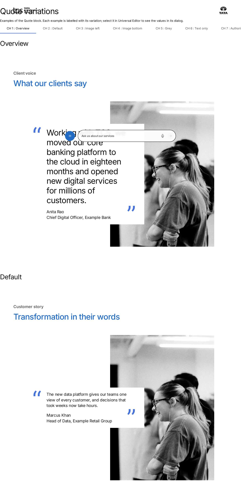
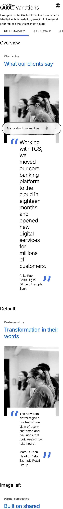

# Quote — Authoring Guide

| Attribute | Value |
| --- | --- |
| Document ID | AUT-C-quote |
| Audience | Content authors, content managers, AEM authoring leads |
| Purpose | How to add, fill in and check the Quote component |
| Scope | — |
| Prerequisites | — |
| Owner | Content Lead / AEM Authoring Lead (proposed) |
| Approver | Product Owner (to be confirmed) |
| Version | 1.0 |
| Status | Draft for review |
| Last updated | 8 November 2026 |
| Last validated | 8 November 2026 |
| Source files | blocks/quote/README.md, blocks/quote/_quote.json |
| Related documents | — |
| Related AEM paths | — |

## Contents

- [Where to see it](#where-to-see-it)
- [For Content Authors](#for-content-authors)
- [Authorable Fields](#authorable-fields)
- [Screenshot-Based Authoring Steps](#screenshot-based-authoring-steps)
- [Variations](#variations)
- [Complete Authoring Example](#complete-authoring-example)
- [Content and Asset Guidelines](#content-and-asset-guidelines)
- [Troubleshooting](#troubleshooting)
- [Screenshots](#screenshots)
- [Known limitations](#known-limitations)
- [Open items](#open-items)
- [Change history](#change-history)

## Where to see it

- https://main--tcs-corp--sradha-tcs.aem.live/design-block-master/en/block-library/quote
- https://main--tcs-corp--sradha-tcs.aem.live/design-block-master/en/block-library/quote/quote-variations

## For Content Authors

1. **Add the block.** In Universal Editor, select a Section, a Columns Container column or a Tabs Container. Choose Add (+) and pick **Quote**.
2. **Open its properties.** Select the block in the canvas or the content tree to open the properties panel. It has two tabs: Content and Additional.
3. **Enter content.** On the Content tab, fill in Eyebrow, Title, Quote and Quote Author. Put the name on the first line of Quote Author, then the designation and organisation. Don't type quotation marks: the block adds them.
4. **Add the image.** Select a portrait in Image, then write Image Alt Text, or leave it empty if the image is decorative.
5. **Choose the variation.** Set Image Position (Desktop) to Right or Left, Image Position (Mobile) to Top or Bottom, and BG Color to Default or Grey.
6. **Child items:** the Quote has none. Each Quote holds one statement.
7. **Preview.** Switch Universal Editor to Preview, then check the page at desktop width (900px and wider) and at a mobile width.
8. **Publish.** Publish the page together with the image (referenced assets in the Publish dialog).
9. **Validate.** On the published page, check the quote marks, the overlap, the alt text (browser inspector) and the heading level.

Minimum content: a Quote or a Quote Author (otherwise there is no card). Recommended: Title, Quote, Quote Author, Image and Image Alt Text. Optional: Eyebrow, BG Color, and the image positions (Right / Top by default).

## Authorable Fields

<!-- BEGIN GENERATED: fields (npm run build:docs) -->

#### Quote (`quote`)

Model `quote`; template name "Quote" (the block class AEM renders); key-value block (one row per property).

Stored on a new component (definition template): `titleType` = `"h2"`, `imagePosition` = `"right"`, `imagePositionMobile` = `"top"`.

##### Content tab — Quote

| Field label | Property | Type | Required | Default | Allowed values | Author guidance | Example |
| ----------- | -------- | ---- | -------- | ------- | -------------- | --------------- | ------- |
| Eyebrow | `eyebrow` | text | No | — | — | — | Client voice |
| Title | `title` | text | No | — | — | — | What our clients say |
| Title Type | `titleType` | select | No | `h2` | H1 (`h1`), H2 (`h2`), H3 (`h3`), H4 (`h4`), H5 (`h5`), H6 (`h6`) | Delivered with `title` (field collapse). | h2 |
| Quote | `quote` | richtext | No | "" | — | — | — |
| Quote Author | `author` | richtext | No | "" | — | Name on the first line, then designation and organisation. | — |
| Image | `image` | reference | No | — | — | — | /content/dam/tcs-corp/block-library/images/tall-sample.jpg |
| Image Alt Text | `imageAlt` | text | No | — | — | Leave empty if the image is decorative. Delivered with `image` (field collapse). | Portrait of Anita Rao |
| Image Position (Desktop) | `imagePosition` | select | No | `right` | Right (`right`), Left (`left`) | Side of the image on desktop (900px and wider); the quote overlaps it. | left |
| Image Position (Mobile) | `imagePositionMobile` | select | No | `top` | Top (`top`), Bottom (`bottom`) | Image above or below the quote on mobile and tablet (narrower than 900px). | bottom |
| BG Color | `bgColor` | select | No | "" | Default (""), Grey (`grey`) | — | grey |

##### Additional tab — Quote

| Field label | Property | Type | Required | Default | Allowed values | Author guidance | Example |
| ----------- | -------- | ---- | -------- | ------- | -------------- | --------------- | ------- |
| Anchor ID | `classes_anchor` | text | No | — | regExp: ^anchor-[a-z0-9][a-z0-9-]*$; customErrorMsg: Start with anchor-, then lower-case letters, digits and hyphens. | A unique ID of the block on the page, starting with anchor-, e.g. anchor-our-services; link to it with #anchor-our-services. Delivered as a block class. | — |
| Hide block | `classes_hideblock` | boolean | No | `false` | on / off | Hides the whole block on the page until it is turned off (shown faded in the editor). Delivered as a block class. | — |
| Animation Type | `classes_animation` | select | No | "" | None (""), Fade in (`motion-fade-in`), Fade up (`motion-fade-up`), Fade down (`motion-fade-down`), Fade left (`motion-fade-left`), Fade right (`motion-fade-right`), Slide up (`motion-slide-up`), Slide down (`motion-slide-down`), Slide left (`motion-slide-left`), Slide right (`motion-slide-right`), Scale in (`motion-scale-in`) | How the block's content appears; repeated items (cards, list items, accordion items, columns) appear one after another. None: shown as is. Not played in the editor or when the visitor prefers reduced motion. Delivered as a block class. | motion-fade-in |
| Motion Speed | `classes_animationspeed` | select | No | "" | Medium (""), Fast (`motion-fast`), Slow (`motion-slow`) | How fast the block's animations run (Animation Type 0.3 / 0.6 / 0.9 s; the Background animation takes 1.5 times as long). Shown when (`classes_animation` is set and `classes_animation` is not empty) or (`classes_bganimation` is set and `classes_bganimation` is not empty). Delivered as a block class. | — |
| Animation Trigger | `classes_animationtrigger` | select | No | "" | On Scroll / Viewport Entry (""), On Page Load (`motion-on-load`) | When the block's animations run. On Scroll: when the block comes into view (at once if it is in view when the page opens). On Page Load: as soon as the block is ready, wherever it is on the page. Shown when (`classes_animation` is set and `classes_animation` is not empty) or (`classes_bganimation` is set and `classes_bganimation` is not empty). Delivered as a block class. | — |
| Background animation | `classes_bganimation` | select | No | "" | None (""), Fade in (`bg-motion-fade-in`), Reveal from the centre (`bg-motion-reveal`), Wipe left to right (`bg-motion-wipe-right`), Wipe right to left (`bg-motion-wipe-left`), Wipe bottom to top (`bg-motion-wipe-up`), Scale reveal (`bg-motion-scale`) | How the block's background (its colour, image or overlay as set in the block) appears. It doesn't animate the content: see Animation Type. Motion Speed and Animation Trigger apply to it too. Not played in the editor or when the visitor prefers reduced motion. Delivered as a block class. | bg-motion-fade-in |
| Padding left | `classes_paddingleft` | select | No | "" | Default (""), 0 (none) (`pl-0`), 0.25rem (space-100) (`pl-100`), 0.5rem (space-200) (`pl-200`), 0.75rem (space-300) (`pl-300`), 1rem (space-400) (`pl-400`), 1.25rem (space-500) (`pl-500`), 1.5rem (space-600) (`pl-600`), 2rem (space-800) (`pl-800`), 2.5rem (space-1000) (`pl-1000`), 3rem (space-1200) (`pl-1200`), 4rem (space-1600) (`pl-1600`), 5rem (space-2000) (`pl-2000`), 6rem (space-2400) (`pl-2400`), 7.5rem (space-3000) (`pl-3000`) | Delivered as a block class. | — |
| Padding right | `classes_paddingright` | select | No | "" | Default (""), 0 (none) (`pr-0`), 0.25rem (space-100) (`pr-100`), 0.5rem (space-200) (`pr-200`), 0.75rem (space-300) (`pr-300`), 1rem (space-400) (`pr-400`), 1.25rem (space-500) (`pr-500`), 1.5rem (space-600) (`pr-600`), 2rem (space-800) (`pr-800`), 2.5rem (space-1000) (`pr-1000`), 3rem (space-1200) (`pr-1200`), 4rem (space-1600) (`pr-1600`), 5rem (space-2000) (`pr-2000`), 6rem (space-2400) (`pr-2400`), 7.5rem (space-3000) (`pr-3000`) | Delivered as a block class. | — |
| Padding top | `classes_paddingtop` | select | No | "" | Default (""), 0 (none) (`pt-0`), 0.25rem (space-100) (`pt-100`), 0.5rem (space-200) (`pt-200`), 0.75rem (space-300) (`pt-300`), 1rem (space-400) (`pt-400`), 1.25rem (space-500) (`pt-500`), 1.5rem (space-600) (`pt-600`), 2rem (space-800) (`pt-800`), 2.5rem (space-1000) (`pt-1000`), 3rem (space-1200) (`pt-1200`), 4rem (space-1600) (`pt-1600`), 5rem (space-2000) (`pt-2000`), 6rem (space-2400) (`pt-2400`), 7.5rem (space-3000) (`pt-3000`) | Delivered as a block class. | — |
| Padding bottom | `classes_paddingbottom` | select | No | "" | Default (""), 0 (none) (`pb-0`), 0.25rem (space-100) (`pb-100`), 0.5rem (space-200) (`pb-200`), 0.75rem (space-300) (`pb-300`), 1rem (space-400) (`pb-400`), 1.25rem (space-500) (`pb-500`), 1.5rem (space-600) (`pb-600`), 2rem (space-800) (`pb-800`), 2.5rem (space-1000) (`pb-1000`), 3rem (space-1200) (`pb-1200`), 4rem (space-1600) (`pb-1600`), 5rem (space-2000) (`pb-2000`), 6rem (space-2400) (`pb-2400`), 7.5rem (space-3000) (`pb-3000`) | Delivered as a block class. | — |
| Margin left | `classes_marginleft` | select | No | "" | Default (""), 0 (none) (`ml-0`), 0.25rem (space-100) (`ml-100`), 0.5rem (space-200) (`ml-200`), 0.75rem (space-300) (`ml-300`), 1rem (space-400) (`ml-400`), 1.25rem (space-500) (`ml-500`), 1.5rem (space-600) (`ml-600`), 2rem (space-800) (`ml-800`), 2.5rem (space-1000) (`ml-1000`), 3rem (space-1200) (`ml-1200`), 4rem (space-1600) (`ml-1600`), 5rem (space-2000) (`ml-2000`), 6rem (space-2400) (`ml-2400`), 7.5rem (space-3000) (`ml-3000`) | Delivered as a block class. | — |
| Margin right | `classes_marginright` | select | No | "" | Default (""), 0 (none) (`mr-0`), 0.25rem (space-100) (`mr-100`), 0.5rem (space-200) (`mr-200`), 0.75rem (space-300) (`mr-300`), 1rem (space-400) (`mr-400`), 1.25rem (space-500) (`mr-500`), 1.5rem (space-600) (`mr-600`), 2rem (space-800) (`mr-800`), 2.5rem (space-1000) (`mr-1000`), 3rem (space-1200) (`mr-1200`), 4rem (space-1600) (`mr-1600`), 5rem (space-2000) (`mr-2000`), 6rem (space-2400) (`mr-2400`), 7.5rem (space-3000) (`mr-3000`) | Delivered as a block class. | — |
| Margin top | `classes_margintop` | select | No | "" | Default (""), 0 (none) (`mt-0`), 0.25rem (space-100) (`mt-100`), 0.5rem (space-200) (`mt-200`), 0.75rem (space-300) (`mt-300`), 1rem (space-400) (`mt-400`), 1.25rem (space-500) (`mt-500`), 1.5rem (space-600) (`mt-600`), 2rem (space-800) (`mt-800`), 2.5rem (space-1000) (`mt-1000`), 3rem (space-1200) (`mt-1200`), 4rem (space-1600) (`mt-1600`), 5rem (space-2000) (`mt-2000`), 6rem (space-2400) (`mt-2400`), 7.5rem (space-3000) (`mt-3000`) | Delivered as a block class. | — |
| Margin bottom | `classes_marginbottom` | select | No | "" | Default (""), 0 (none) (`mb-0`), 0.25rem (space-100) (`mb-100`), 0.5rem (space-200) (`mb-200`), 0.75rem (space-300) (`mb-300`), 1rem (space-400) (`mb-400`), 1.25rem (space-500) (`mb-500`), 1.5rem (space-600) (`mb-600`), 2rem (space-800) (`mb-800`), 2.5rem (space-1000) (`mb-1000`), 3rem (space-1200) (`mb-1200`), 4rem (space-1600) (`mb-1600`), 5rem (space-2000) (`mb-2000`), 6rem (space-2400) (`mb-2400`), 7.5rem (space-3000) (`mb-3000`) | Delivered as a block class. | — |

<!-- END GENERATED: fields -->

Notes on the significant fields (see the tables above for labels, values and defaults):

- **Title / Title Type:** the title renders as a heading at the Title Type level. Without a Title Type, it uses a heading level found in the authored title, else H2 (`buildHeading`). The heading becomes the block's `dc:title` in the data layer.
- **Quote:** renders as a `<blockquote>`. **Quote Author** renders as the `<figcaption>`, and both sit in a `<figure>`. The quotation marks are CSS content with empty alternative text, so screen readers don't read them.
- **Image / Image Alt Text:** the picture comes from the image cell. Image Alt Text replaces its alt, and an image without alt text gets `alt=""` (decorative). Without a picture, the block doesn't get `quote-has-media`, so there is no overlap.
- **Image Position (Desktop):** Left adds `image-left` and only takes effect from 900px. **Image Position (Mobile):** Bottom adds `image-bottom` and only takes effect below 900px. A missing or unknown value means Right / Top.
- **BG Color:** Grey adds `bg-grey`: a grey block and card. The padding (2.5rem / 1.5rem, 7.5rem / 5rem from 900px; see Responsive Behavior) is the same for every background, so the eyebrow and title line up on white and grey Quotes alike; BG Color sets only the colour.
- **Legacy mapping:** the select values are also read from block classes (`optionOf`), so a `grey`, `left` or `bottom` class has the same effect as the field. The Style field was removed in handover 2.27; the block doesn't read it.
- **Additional tab:** Anchor ID, Hide block, the animations and Padding / Margin, as described in AGENTS.md "Additional tab". Background animation applies to the block's background colour (white by default, grey with BG Color Grey). The Additional tab's padding classes override the block's padding.

## Screenshot-Based Authoring Steps

#### Authoring Step 1: Add the Quote

```text
[Screenshot Placeholder]

File name:
quote-authoring-step-1.png

Purpose:
The section's Add (+) menu with Quote selected.

Annotations:
A = Section in the content tree
B = Add (+)
C = Quote
```

#### Values to Enter

| Callout | Field | Value | Reason | Expected result |
| ------- | ----- | ----- | ------ | --------------- |
| A | (content tree) | Select the section | The Quote is allowed in sections | The section is selected |
| B | Add (+) | Quote | Adds the block | An empty Quote appears; nothing renders yet |

Author action: select the section, choose Add (+) and pick Quote. Expected preview: an empty block (it renders nothing until it has content). Expected published result: nothing until content is added. Business rule: one statement per Quote. Validation: the Quote node appears in the content tree. Common mistake: looking for the block in a Teaser or a List; it is only offered in sections, Columns Container columns and Tabs Containers.

#### Authoring Step 2: Eyebrow and title

```text
[Screenshot Placeholder]

File name:
quote-authoring-step-2.png

Purpose:
The Content tab with Eyebrow, Title and Title Type filled in.

Annotations:
A = Eyebrow
B = Title
C = Title Type
```

#### Values to Enter

| Callout | Field | Value | Reason | Expected result |
| ------- | ----- | ----- | ------ | --------------- |
| A | Eyebrow | Client voice | Context above the title | Grey semibold label |
| B | Title | What our clients say | Section heading | Brand-blue heading |
| C | Title Type | H2 | Fits under the page's H1 | An `<h2>` |

Author action: type the eyebrow and title, and keep Title Type H2 unless the page outline needs another level. Expected preview: the eyebrow and title above the body. Expected published result: the same, with the title as a real heading. Business rule: use one H1 per page. Validation: inspect the heading level. Common mistake: choosing H1 for a quote in the middle of a page; change it to H2 or H3.

#### Authoring Step 3: The quote and its author

```text
[Screenshot Placeholder]

File name:
quote-authoring-step-3.png

Purpose:
The Quote and Quote Author rich text fields filled in.

Annotations:
A = Quote
B = Quote Author (two lines)
```

#### Values to Enter

| Callout | Field | Value | Reason | Expected result |
| ------- | ----- | ----- | ------ | --------------- |
| A | Quote | Working with TCS, we moved our core banking platform to the cloud in eighteen months and opened new digital services for millions of customers. | The statement | The text inside large blue quote marks |
| B | Quote Author | Anita Rao (line 1), Chief Digital Officer, Example Bank (line 2) | Attribution | Two lines below the quote |

Author action: type the quote without quotation marks, then the author on two lines (two paragraphs). Expected preview: the card with the opening and closing marks. Expected published result: a `<blockquote>` and a `<figcaption>` in a `<figure>`. Business rule: keep the wording approved by the person quoted. Validation: only the large blue marks are visible. Common mistake: typing quotation marks, which shows them twice; remove them.

#### Authoring Step 4: Image and positions

```text
[Screenshot Placeholder]

File name:
quote-authoring-step-4.png

Purpose:
Image, Image Alt Text, Image Position (Desktop) and Image Position (Mobile) set.

Annotations:
A = Image
B = Image Alt Text
C = Image Position (Desktop)
D = Image Position (Mobile)
```

#### Values to Enter

| Callout | Field | Value | Reason | Expected result |
| ------- | ----- | ----- | ------ | --------------- |
| A | Image | /content/dam/tcs-corp/block-library/images/tall-sample.jpg | The portrait the card overlaps | The block gets `quote-has-media` |
| B | Image Alt Text | Portrait of Anita Rao | Describes the image | The image's alt |
| C | Image Position (Desktop) | Left | Mirror the layout | Image on the left from 900px |
| D | Image Position (Mobile) | Bottom | Lead with the quote on small screens | Image below the card below 900px |

Author action: select the portrait, write the alt text, and choose the positions. Expected preview: at 900px and wider, the image is on the chosen side and the card overlaps it; below 900px, the image is above or below the card. Expected published result: the same; the image must be published with the page. Business rule: use a portrait image with the face in the upper-middle area (4:5 on mobile, 622:869 on desktop, cropped). Validation: check at 375px, 768px and 1440px. Common mistake: expecting Left to apply on a tablet; it only applies from 900px.

#### Authoring Step 5: BG Color and publishing

```text
[Screenshot Placeholder]

File name:
quote-authoring-step-5.png

Purpose:
BG Color Grey selected and the Publish dialog listing the page and its image.

Annotations:
A = BG Color
B = Publish dialog with the referenced image
```

#### Values to Enter

| Callout | Field | Value | Reason | Expected result |
| ------- | ----- | ----- | ------ | --------------- |
| A | BG Color | Grey | Set the quote apart from the page | Grey block and card |
| B | Publish | Page and referenced assets | The image must be live too | The published page shows the portrait |

Author action: choose Grey, preview, then publish the page with its references. Expected preview: a grey panel. Expected published result: the grey Quote with the portrait. Business rule: Default or Grey only. Validation: open the published page and check the image loads. Common mistake: publishing the page without the image, so the card renders without the portrait.

## Variations

#### Default (image right, image top on mobile)

- **Purpose:** the standard overlap layout. **When to use:** most quotes with a portrait. **When not to use:** without a portrait (see Text only).
- **Fields:** Quote or Quote Author (required for the card), Image (for the overlap); Eyebrow, Title, Image Alt Text are optional. **Dialog configuration:** none beyond the defaults (Right / Top).
- **Rendering:** desktop (900px and wider): a 498 : 204 : 418 grid, up to 70rem wide; the card spans the first two columns and the image the last two, so they overlap. Tablet and mobile: the image first, at 4:5, and the card overlapping its bottom edge by 3rem, inset 1rem.
- **Accessibility:** reading order header, card, image (the image is placed first visually below 900px by CSS order only). **Data layer:** the block entry only. **Personalization and fallback:** none; the authored content renders.

```text
[Screenshot Placeholder]

File name:
quote-default-tablet.png

Purpose:
The default Quote at 768px: image first, card overlapping its bottom edge.

Annotations:
A = Header
B = Image
C = Card
```

#### Image Left (desktop)

- **Purpose:** a mirrored layout, for example to alternate with a neighbouring block. **Configuration:** Image Position (Desktop) Left (class `image-left`).
- **Rendering:** from 900px the grid is 418 : 204 : 498, with the image on the left and the card overlapping its right edge. Below 900px it is the same as Default.
- **Accessibility, data layer, personalization:** as Default.

```text
[Screenshot Placeholder]

File name:
quote-image-left-mobile.png

Purpose:
Image Position (Desktop) Left at 375px: the same stacked layout as Default.

Annotations:
A = Image
B = Card
```

#### Image Bottom (mobile and tablet)

- **Purpose:** lead with the quote on small screens. **Configuration:** Image Position (Mobile) Bottom (class `image-bottom`).
- **Rendering:** below 900px the image moves below the card, and the card overlaps its top edge by 3rem. From 900px it has no effect.
- **Accessibility, data layer, personalization:** as Default.

```text
[Screenshot Placeholder]

File name:
quote-image-bottom-tablet.png

Purpose:
Image Position (Mobile) Bottom at 768px: the card first, the image below it.

Annotations:
A = Card
B = Image
```

#### Grey background

- **Purpose:** set the quote apart from white content. **Configuration:** BG Color Grey (class `bg-grey`).
- **Rendering:** the block and the card are grey (`--color-bg-secondary`), with the block's padding (2.5rem / 1.5rem, 7.5rem / 5rem from 900px, as on white).
- **Accessibility:** the text keeps the default text tokens. **Data layer, personalization:** as Default.

```text
[Screenshot Placeholder]

File name:
quote-grey-background-tablet.png

Purpose:
BG Color Grey at 768px.

Annotations:
A = Grey padding
B = Card
```

#### Text only (no image)

- **Purpose:** a pull quote without a portrait. **Configuration:** leave Image empty.
- **Rendering:** no `quote-has-media`; the card stands alone, centred in the 70rem body from 900px, with the same quote marks.
- **Accessibility, data layer, personalization:** as Default.

```text
[Screenshot Placeholder]

File name:
quote-text-only-tablet.png

Purpose:
A Quote without an image at 768px.

Annotations:
A = Card without overlap
```

## Complete Authoring Example

Scenario: a client quote on an English case study page.

| Field | Example value | Guidance |
| ----- | ------------- | -------- |
| Eyebrow | Client voice | A few words of context |
| Title | What our clients say | Short and descriptive |
| Title Type | H2 | Fits under the page's H1 |
| Quote | Working with TCS, we moved our core banking platform to the cloud in eighteen months and opened new digital services for millions of customers. | No typed quotation marks |
| Quote Author | Anita Rao / Chief Digital Officer, Example Bank (two lines) | Name first |
| Image | /content/dam/tcs-corp/block-library/images/tall-sample.jpg | Portrait |
| Image Alt Text | Portrait of Anita Rao | Identifies the person |
| Image Position (Desktop) | Right | Default |
| Image Position (Mobile) | Top | Default |
| BG Color | Default | White |

Steps: add the Quote to the section, fill in the Content tab as above, preview at 1440px and 375px, then publish the page with the image.

- **Expected output:** the eyebrow and H2 above a white card with blue quote marks, which overlaps the portrait on the right.
- **Responsive:** from 900px, the overlap grid; below it, the image on top and the card overlapping its bottom edge.
- **Accessibility:** an `<h2>`, then a `<figure>` with `<blockquote>` and `<figcaption>`, and an image with alt text.
- **Analytics / data layer:** a `tcs-corp/components/quote` entry with `dc:title` "What our clients say".
- **Personalization fallback:** none; this content is what every visitor sees.

Pre-publish checklist: no typed quotation marks; the author name is spelled as approved; the alt text is set (or deliberately empty); the image is published; the heading level fits the page; checked at desktop and mobile widths.

## Content and Asset Guidelines

- **Eyebrow:** a few words of context (for example "Client voice"). **Title:** a short, descriptive heading.
- **Quote:** the approved statement only, without quotation marks. **Quote Author:** the name on the first line, then the designation and organisation.
- **Links / CTAs:** the block has no CTA field. A link in the rich text is rendered by the page's content decorators: a standalone link in its own paragraph becomes a button (`decorators/content-buttons-decorator.js`).
- **Images and alt text:** use portrait images. They are cropped with `object-fit: cover` to 4:5 below 900px and to 622:869 from 900px. Alt text identifies the person; leave it empty only if the image adds nothing.
- **Icons, tags and metadata:** none.
- **Limits:** no verified technical limit was identified for text length; the block holds one quote.
- **Asset source:** AEM Assets. **Loading:** the block keeps the delivered picture (lazy by default). In the first section, the page loader makes the first image eager (`waitForFirstImage`).
- **Missing asset:** without a picture, the card renders without the image and without the overlap.

## Troubleshooting

| Symptom | Likely cause | Diagnostic steps | Resolution | Verification |
| ------- | ------------ | ---------------- | ---------- | ------------ |
| The card doesn't overlap the image | No picture in Image (empty or broken reference) | Inspect the block: no `quote-has-media`, no `.quote-media` | Select the image again and publish it with the page | The block has `quote-has-media` |
| Image Position has no effect | Checked at the wrong width (Left from 900px, Bottom below 900px), or no image | Check the classes `image-left` / `image-bottom` and the viewport width | Resize past / below 900px; set an image | The image moves at the right widths |
| Double quotation marks | Marks typed in the Quote | Read the Quote rich text | Remove the typed marks | Only the blue marks remain |
| The face is cut off | 4:5 / 622:869 cover crop | Compare the image's proportions | Use a portrait with the face in the upper-middle area | Check at 375 / 768 / 1440px |
| The block is empty | No Quote, Quote Author, Title, Eyebrow or Image | Inspect the rows in the editor | Fill in the content | The card renders |
| Wrong heading level | Title Type | Inspect the title element | Set Title Type | The expected `h1`–`h6` |

Evidence to collect: the page URL (preview or live), viewport width, browser, a screenshot, and the block's outer HTML from the inspector. Don't include credentials or author session data.

## Screenshots



*Figure: Quote as published (block library) — desktop 1440 × 900 (/design-block-master/en/block-library/quote/quote-variations, captured 2026-11-08).*



*Figure: Quote as published (block library) — mobile 375 × 812 (/design-block-master/en/block-library/quote/quote-variations, captured 2026-11-08).*

> **Screenshot required**
>
> - Required screen: Quote dialog in Universal Editor (every tab, including Additional)
> - Required role/access: AEM Sites author with Universal Editor (content author)
> - Required navigation steps: AEM Sites console > /content/tcs-corp/language-masters/en > open a page in Universal Editor
> - Reason unavailable: No AEM author access in the documentation program (access blocker AB-01)
> - Owner: Content Lead / AEM Authoring Lead (proposed)
> - Target completion date: To be confirmed

## Known limitations

- Universal Editor screenshots are placeholders: no author access in this program.

## Open items

- None.

## Change history

| Version | Date | Author | Change |
| --- | --- | --- | --- |
| 1.0 | 8 November 2026 | Delivery team (documentation program) | First version of the role-specific documentation (master documentation prompt), generated from the repository and the published reference pages |
